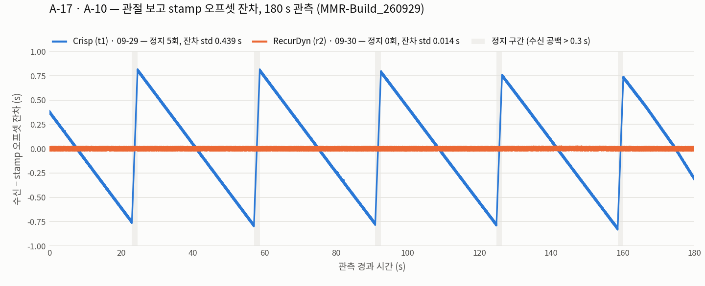

# MMR-Build_260929 인수 결과 비교 — 씬 간(Crisp 대 RecurDyn) · 빌드 간(0914 대 0929)

> **작성** 2026-10-01
>
> **근거** [인수 체크리스트 이력_20261001](../docs/archive/functionbay/펑션베이_인수_체크리스트_이력_20261001.md) — 측정값이 들어 있던 판이다(현행 체크리스트는 절차만 갖는다).
> §G.3(`Crisp-260929`, 2026-09-29 전수) · §G.4(`RecurDyn-260929`, 2026-09-30 재측정 전수),
> 원자료 `misc/fb_stamp/t1_20260929.json` · `misc/fb_stamp/r2_20260930.json`.
> 빌드 간 비교(§3)의 `build_0914` 값은 같은 이력의 기준선 열(2026-09-17 `r2` 전수) · §G.2,
> [보관 미해결_작업 §0.1](../docs/archive/functionbay/펑션베이_미해결_작업.md)(같은 날 두 솔버 비교),
> [요청 목록](../docs/backends/functionbay/펑션베이_요청_목록.md)의 `t1` 파지 시험(2026-09-17),
> 원자료 `misc/fb_stamp/r2_20260917.json` 에서 왔다.
>
> **목적** 두 축으로 나란히 놓는다 — **같은 빌드의 두 씬**(§1~§2)으로 *솔버에 따라 갈리는 것*을,
> **같은 씬의 두 빌드**(§3)로 *벤더가 이번 빌드에서 바꾼 것*을 가른다. 수집용 씬을 다시 고르는 결정
> ([남은 작업 #15](../docs/backends/functionbay/펑션베이_남은_작업.md))의 판단 재료다.

---

## 0. 결론

**씬 간 — `build_0929` 의 Crisp 대 RecurDyn**

1. **두 씬 모두 A 21 · B 18 · C 10 전 항목을 측정했고 B · C 는 전부 통과했다.** 측정이 빠진 항목은 없다.
2. **가장 큰 차이는 주기적 정지(A-17)다.** `r2` 는 180 s 동안 **0회**, `t1` 은 **5회 · 8.0 s(4.4 %)** —
   약 34 s 마다 약 1.6 s 씩 시뮬레이션이 멈춘다. stamp 잔차·진행률(A-10 · A-11)의 차이도 전부 여기서 나온다(§4).
3. **중력 보상은 `r2` 에만 벤더 것이 있다.** `r2` 는 우리 보상 없이 처짐 0.0000 이고, `t1` 은 우리 보상
   (`kp` 20000)을 계속 써야 한다.
4. **응답은 `r2` 가 약 2배 빠르다** — 팔 dead time 32 대 63 ms, τ 114 대 200 ms. 그리퍼도 같은 비율이다.
5. **`t1` 이 나은 곳은 둘이다** — 파지 유지 중 미끄러짐(30 s 에 0.01 대 −0.57 mm)과 관절 한계 강제
   (`r2` 는 joint4 를 URDF 상한 밖 +0.31 rad 까지 보낸다).
6. **나머지는 같다** — 발행 주기 · 메시지 타입 · QoS · 카메라 · 물체 TF · stamp 정렬(C-4) ·
   peg-in-hole 왕복(B-18) · 수집 계층(C-10).

수집 관점에서는 **정지가 없는 `r2` 가 유력하다**(남은 작업 #15 의 현재 판단과 같다). `r2` 를 고르면
미끄러짐과 한계 미강제를 우리 쪽에서 감당해야 한다(§6).

**빌드 간 — 같은 씬의 `build_0914` 대 `build_0929`** (§3)

7. **Crisp 은 파지가 처음 성립했다** — 0914 에서 실패하던 파지 유지(B-16)와 peg-in-hole(B-18)이 둘 다
   된다. 팔 게인이 10배가 되어 처짐도 1/10 로 줄었지만 0 은 아니어서 우리 보상은 계속 필요하다.
   **dead time · τ · 관절 한계 강제는 그대로이고, 정지는 남은 채 길어졌다**(약 1.1 → 1.6 s).
8. **RecurDyn 은 벤더 요청 둘이 반영됐다** — 정지 5회 → **0회**(A-5), 솔버 중력 보상(A-1, 우리 블록 삭제).
   그 밖의 항목은 기준선과 같은 대역이며, **파지 중 미끄러짐(−0.56 → −0.57 mm)과 관절 한계 미강제도 그대로다.**
9. **Crisp 의 0914 값은 부분 측정이다** — 그날은 두 솔버 비교와 파지 시험만 했고 C 단계는 `r2` 로만 돌렸다.
   빈 칸은 "미측정"으로 두었다.

---

## 1. 비교 조건 — 씬 간 (`build_0929`)

| | Crisp (`t1`) | RecurDyn (`r2`) |
|---|---|---|
| 측정일 | 2026-09-29 | 2026-09-30 — 09-29 저녁 회차는 **솔버 프로세스 미기동**이라 폐기했다 |
| 실행 파일 · 설정 DB | `sim/build_0929` · `MMR-Build_260929` | 같음 |
| 솔버 프로세스 | `solver/Crisp/CrispSolver.exe` | `solver/RecurDyn/SolverTCPServer.exe` |
| 솔버 선언 | `t1__SNU_1_vm.xml` (TCP 10002, 단위 m) | `r2__RecurDyn_1_vm.xml` (TCP 10001, 단위 mm) |
| 관절 보고 주기 설정 | `Hz="50"` — 빌드가 `10` 으로 와서 고쳤다. `bp.json` 은 10 그대로 | `Hz="0"` (약 50 Hz 로 나온다) |
| 팔 게인 Kp / Kd | **20000 / 2000** | 2000 / 200 |
| 그리퍼 규약 | 6축 · rad · position (`functionbay_gripper_crisp.json`) | 2축 · 도 · 관절당 p/v/f (`functionbay_gripper_recurdyn.json`) |
| 중력 보상 | **우리 것** — `motion.gravity_compensation.kp: 20000` | **벤더 것** — 우리 블록을 지웠다 |
| 이 빌드에서 바뀐 것 | 팔 게인 10배 · 접촉 강성·마찰 · SNU 솔버 스텝 0.01 → 0.005 · Crisp 솔버 실행 파일 교체 | `Gravity_Compensation` 선언 · 신호차트 관절별 상수 토크 0 (그 밖의 설정은 파일까지 동일) |
| 원자료 | `misc/fb_stamp/t1_20260929.json` | `misc/fb_stamp/r2_20260930.json` |

**대조할 때 주의할 셋.**

- **씬마다 한 회차씩이다.** A-9 · A-10 · A-11 · A-17 은 같은 빌드 · 같은 설정에서도 회차마다 바뀐다
  (체크리스트 이력_20261001 §G.1a). 특히 `r2` 의 정지 0회는 2026-09-03 에 정지를 발견한 이후 **처음 나온 값**이다.
- **중력 보상의 주체가 다르다.** B-3 · B-4 · B-8 · B-9 · B-17 · C-8 은 `t1` 이 우리 보상, `r2` 가 벤더
  보상 아래에서 잰 값이다. 둘 다 운용 조건 그대로이지만 같은 장치로 잰 것은 아니다.
- **수신 시각으로 재는 값(dead time 등)은 관절 보고 묶음(A-21)의 영향을 받는다**(체크리스트 함정 13).
  묶이는 정도가 씬마다 다르다.

---

## 2. 씬 간 비교 — `build_0929` 의 Crisp 대 RecurDyn

**한눈에 — 두 씬이 갈리는 항목.** 항목별 전체 대조는 §2.1~§2.3 에 있다.

| 항목 | Crisp (`t1`) | RecurDyn (`r2`) | 수집에 유리 |
|---|---|---|---|
| **A-17 주기적 정지** (180 s) | **5회 · 8.0 s (4.4 %)** — 약 34 s 마다 약 1.6 s | **0회** | **r2** |
| A-10 · A-11 stamp 잔차 · 진행률 | std 0.4395 s (톱니) · 0.99923 | std 0.0140 s (백색잡음) · 1.00002 | r2 (정지의 결과) |
| 중력 보상 (B-3 · B-4) | 우리 보상 필요 — 없으면 `horizontal` joint2 −0.0026 rad | 벤더 보상 — 우리 보상 없이 세 자세 0.0000 | r2 (관리할 설정이 하나 준다) |
| **팔 응답** (B-6 · B-7) | dead 62.7 ms · τ 199.6 ms | dead 32.0 ms · τ 114.1 ms | **r2** (약 2배) |
| 그리퍼 응답 (B-13) | dead 62.8 · τ 190.7 · 99 % 도달 944.6 ms | 30.8 · 111.8 · 504.0 ms | r2 |
| **관절 한계 강제** (B-10 · B-11) | 강제 — joint4 + 가 **+0.0698** 에서 선다 | **미강제** — joint4 + 가 **+0.3128** (URDF 상한 +0.0873 초과) | **t1** |
| **파지 유지 중 미끄러짐** (B-16) | **0.01 mm / 30 s** | **−0.57 mm / 30 s** | **t1** |
| 관절 보고 묶음 (A-21) | 1.75건/묶음 · 33.1 ms 마다 (실효 약 30 Hz) | 2.31건/묶음 · 47.7 ms 마다 (약 21 Hz) | t1 (실시간 소비자에게만) |
| 카메라 stamp 정합 (A-18) | 팔 대비 +9.9 ms | +19.0 ms | — (상수라 보정 가능) |
| servo 변위 (C-8, +z 0.5 × 1 s) | +51.5 mm | +68.6 mm | — (teleop 재조정 대상) |
| 그리퍼 축 수 (A-8) | 6 | 2 | — (규약 파일이 흡수한다) |
| `/output/endeffector` (A-5) | 발행 | 없음 | — (우리 스택은 안 쓴다) |

데이터셋은 stamp 로 정렬하므로 A-21 묶음과 A-18 정합은 **데이터에는 영향이 없다** — 수신 시각을 쓰는
servo 되읽기 · 정착 판정 · dead time 측정에만 걸린다.

### 2.1 A — 수동 관측 (21항목, 팔을 움직이지 않는다)

`●` 는 이 문서를 쓰면서 원자료로 다시 계산해 같은 값을 얻은 칸이다(§5).

| # | 항목 | Crisp (`t1`) 09-29 | RecurDyn (`r2`) 09-30 | 대조 |
|:-:|---|---|---|---|
| A-1 | `/input/*` 구독자 | panda 1 · gripper 1 · ee 0 | 같음 | 같음 |
| A-2 | 팔 보고 주기 | **50.17 Hz ●** · stamp 간격 20.00 ms · 정지 제외 52.48 Hz | **49.95 Hz ●** · 20.00 ms | 같은 대역. `t1` 은 정지 사이에 약 5 % 빨리 낸다 |
| A-3 | 그리퍼 보고 주기 | 팔과 같은 틱 | 49.96 Hz · 팔과 같은 틱 | 같음 |
| A-4 | 카메라 주기 | 9.63 Hz ● · 정지 제외 10.07 | **9.60 Hz ●** | 같음 |
| A-5 | `/output/endeffector` | **발행** (`PoseStamped`, 50.17 Hz) — 미사용 | 없음 | 씬 지문 |
| A-6 | 메시지 타입 | `JointState` · `JointState` · `PoseStamped` · `CompressedImage`(jpeg) · `Clock` | `PoseStamped` 만 없다 | 같음 (A-5 차이뿐) |
| A-7 | `JointState.name` | 채움 | 채움 | 같음 |
| A-8 | `position`/`velocity`/`effort` | 팔 7/7/7 · 그리퍼 **6/6/6** | 팔 7/7/7 · 그리퍼 **2/2/2** | 씬 지문 |
| A-9 | stamp 기준 | 경과시간 (전 토픽) | 경과시간 (전 토픽) | 같음 (회차 속성) |
| **A-10** | stamp 잔차 | std **0.4395 s ●** · p2p 1.65 s · R=0.066 (느린 흔들림) | std **0.0140 s ●** · p2p 0.049 s · R=1.19 (백색잡음) | **31배 차** — 정지 유무 |
| **A-11** | stamp 진행률 | **0.99923 ●** (느림) | **1.00002 ●** (실시간) | 정지 유무 |
| A-12 | 카메라 형식 | jpeg · 25.9 KB · `camera_link` | jpeg (크기는 기록하지 않았다) | 같음 |
| A-13 | `camera_info` | 없음 | 없음 | 같음 |
| A-14 | QoS | RELIABLE / VOLATILE | 같음 | 같음 |
| A-15 | `/clock` | 72.14 Hz · 경과시간 · 팔과 1.9 ms | 72.02 Hz · 경과시간 | 같음 |
| A-16 | 물체 TF | `world → peg_round_16` 28.62 Hz · 역행 0 · 로봇 링크 미발행 | 28.4 Hz · 역행 0 | 같음 |
| **A-17** | **주기적 정지** | **5회 ● · 8.00 s (4.4 %) · 주기 약 34 s** · 개별 약 1.6 s | **0회 ●** — `fb_checkup` 4토픽 · `fb_stall_when` 둘 다 | **가장 큰 차이** (§4) |
| A-18 | 토픽 간 stamp 정합 (팔 기준) | 카메라 **+9.9 ms ●** · 그리퍼 −0.3 · ee −0.6 | 카메라 **+19.0 ms ●** · 그리퍼 −0.4 | 카메라 지연이 절반 |
| **A-19** | 제어 게인 | 팔 **20000 / 2000** · 그리퍼 6축 200 / 20 | 팔 **2000 / 200** · 그리퍼 200 / 20 | **팔 10배 차** |
| **A-20** | 접촉 정의 | body 별 SDF 3건 (강성 0.7 → 1000000, 마찰 0.15 → 0.35). 손끝 선언은 없으나 **파지는 유지된다** | 쌍 4개 — peg ↔ 좌·우 손끝 · `peg_hole` · `peg_tray` | 정의 방식이 다르다. **둘 다 peg ↔ 탁자가 없다** |
| A-21 | 관절 보고 묶음 | **1.75건/묶음 ●** (1건 1310 · 2건 3860 · 3건 1) · 간격 33.1 ms · 5 ms 미만 43 % | **2.31건/묶음 ●** (1건 438 · 2건 1800 · 3건 1652) · 간격 47.7 ms · 57 % | `t1` 이 덜 묶인다 |

### 2.2 B — 능동 확인 (18항목, 팔이 움직인다)

값은 체크리스트 이력_20261001 §G.3 · §G.4 에서 옮겼다. 두 씬 모두 **18항목 전부 통과**다.

| # | 항목 | Crisp (`t1`) 09-29 | RecurDyn (`r2`) 09-30 | 대조 |
|:-:|---|---|---|---|
| B-1 · 2 | 명령 반응 · name 유무 | 7/7 반응 · 이동률 100 % · name 유무 동일 | 같음 | 같음 |
| **B-3** | 정착 · 유지 (`fb_hold`, 보상 안 얹음) | 15 s 불변 · joint4 **−0.0010** | 15 s 불변 · **전 관절 0.0000** | `t1` 은 게인 10배로 처짐이 1/10, `r2` 는 벤더 보상으로 0 |
| **B-4** | 자세별 처짐 | 우리 보상 OFF: `ready` j4 −0.0010 · `extended` j2·j4 +0.0002 · `horizontal` j2 **−0.0026** j4 +0.0010 / ON: 전 관절 0.0000 | 우리 보상 없이 세 자세 **전부 0.0000**. 얹으면 **+0.0097**(이중 보정) | `t1` 은 우리 보상이 필요하고 `r2` 는 얹으면 안 된다 |
| B-5 | 중력 중립축 (j1 · j7) | 세 자세 ±0.0000 | 같음 | 같음 |
| **B-6** | 팔 dead time | **62.7 ms** (42.0~80.1) · 11/12 유효 | **32.0 ms** (20.8~57.1) · 12/12 | `t1` 이 약 2배 |
| **B-7** | 팔 시정수 τ | **199.6 ms** (178.7~201.9) | **114.1 ms** (86.7~132.5) | `t1` 이 약 1.7배 |
| B-8 | 추종 성능 | 최적 lag 0.24 s · 평균 0.0035 · 최대 0.0402 rad · 무보정 최대 0.2317 | lag 0.155 s · 평균 0.0024 · 최대 0.0231 rad | `r2` 가 낫다. 정착 필드(0.00016 대 0.000001)는 보상 오프셋을 포함하므로 비교하지 않는다 |
| B-9 | 방향 의존 오차 (±20 mm) | +19.99 / −20.00 mm · 차 0.01 mm (우리 보상) | 100 % / 100 % · 차 0.00 mm (벤더 보상) | 같음 |
| **B-10** | 실효 가동범위 | j7+ +3.1500 (지령 +3.2171) · j4− −3.0718 (지령 −3.3916) — **축마다 다르게 선다** | j7+ +3.1931 · j4− −3.3664 — **지령 상한까지 따라온다** | 한계 처리 방식이 다르다 |
| **B-11** | 관절 한계 강제 (j4+) | **+0.0698** — URDF 상한 +0.0873 안에서 선다 | **+0.3128** — URDF 상한 초과 | **`t1` 만 강제한다** |
| B-12 | 그리퍼 개폐 | close 0.7250 (6축) · open 0.0001 · 빈손 \|eff\| 0.004~0.01 | close 0.7250 · open 0.0001 · 빈손 0.003~0.014 | 같음 |
| **B-13** | 그리퍼 계단 응답 | dead **62.8** · τ **190.7** · 99 % **944.6 ms** · 9/10 유효 | dead **30.8** · τ **111.8** · 99 % **504.0 ms** · 10/10 | 팔과 같은 약 2배 비율 |
| B-14 | 파지 판정 (effort) | 빈손 0.010 → 파지 **13.58** → 유지 끝 13.52 N·m | 0.014 → **3.296** → 2.420 | 링키지 차이다 — effort 는 `Kp × 잔차` 이지 접촉력이 아니다 |
| B-15 | 복구 경로 | `ready` 복귀 오차 0.0000 | 같음 | 같음 |
| **B-16** | 파지 유지 (+78 mm 들어 30 s) | peg +78.0 mm · **간격 변화 0.01 mm** · 되꽂기 밀림 −0.01 mm | peg +77.7 mm · **간격 변화 −0.57 mm** | **`r2` 는 약 1.1 mm/분으로 미끄러진다** |
| B-17 | 수직 이동 중 말림 (+45 mm) | 말림 0.000 mm (이동 중 최대 0.146) · 도달 0.00 mm | 말림 −0.014 mm · 도달 0.00 mm | 같음 (둘 다 보상이 살아 있다) |
| B-18 | peg-in-hole 왕복 | hole→tray (−0.08, +0.05) · tray→hole (−0.10, +0.03) mm · 하강 11.0 · 11.1 s 각 1회 | (+0.06, +0.09) · (+0.03, +0.13) mm · 하강 11.1 s 각 1회 | 둘 다 한 번에 앉는다. 오차는 반경 여유 0.5 mm 의 3분의 1 이하 |

### 2.3 C — 스택 통합 (10항목)

값은 체크리스트 이력_20261001 §G.3 · §G.4 에서 옮겼다. 두 씬 모두 **10항목 전부 통과**다.

| # | 항목 | Crisp (`t1`) 09-29 | RecurDyn (`r2`) 09-30 | 대조 |
|:-:|---|---|---|---|
| C-1 · 2 · 7 | `readiness_gate` · `joint_state_fusion` · `move_group` | clean exit · 이름 그대로 + `panda_finger_joint1=0.04` · `start planning` | 같음 | 같음 |
| C-3 | `/joint_states` (10 s) | 53.5 Hz · 8관절 | 50.1 Hz · 8관절 | `t1` 은 정지 사이 과속 구간을 쟀다 (A-2 의 정지 제외 52.48 Hz 와 같은 대역) |
| C-4 | `/joint_states` stamp | **벽시계** · 역행 0 · 간격 중앙 20.0 ms (19~21 ms 69 % · 16~19 ms 17 % · 13 ms 미만 10 %) · 수신보다 8.8 ms 앞섬 | **벽시계** · 역행 0 · 간격 중앙 20.0 ms · 수신보다 21.2 ms 앞섬 | 둘 다 수집 가능. `t1` 은 정지 뒤 따라잡기로 간격이 흩어진다 |
| C-5 | TF | `panda_link8` (+0.3070, −0.0000, +0.5903) · `grasp_center` z +0.4410 | 같음 | 같음 |
| C-6 | `/ee_pose` | 50.1 Hz · `panda_link0` | 같음 | 같음 |
| C-8 | servo 경로 | 명령 28건 · EE **+51.5 mm** (옆 +0.4) · 복귀 0.0000 | 명령 28건 · EE **+68.6 mm** (옆 +0.2) · 복귀 0.0000 | 같은 `linear_scale: 0.8` 에서 `r2` 가 1.33배 더 간다. 비례는 아직 안 쟀다 |
| C-9 | launch WARN/ERROR | ERROR 2 (octomap) · WARN 8 | ERROR 2 (octomap) · 사용 중 `Found empty JointState` 27건 · `cartesian_interpolator` WARN | 둘 다 기준 목록 밖이 없다 |
| **C-10** | 수집 계층 | `/target_joint_cmds` 1082건 / 21.5 s · 이름 7 · 벽시계 · stamp 만으로 dead **50.1 ms** · τ **187.8 ms** · 레코더 397장 / 40.9 s · 드롭 0 · 간격 중앙 98.2 ms · **0.5 s 공백 1회 (정지)** | 1082건 / 21.5 s · 이름 7 · 벽시계 · dead **52.0 ms** · τ **100.0 ms** · 레코더 313장 / 32.8 s · 드롭 0 · 간격 104.2 ms · **0.5 s 공백 0회** | 둘 다 명령 · 관측 · 영상이 한 시간축에 모인다. 영상 공백은 `t1` 에만 있다 |

---

## 3. 빌드 간 비교 — `build_0914` 대 `build_0929`

| 이름 | 실행 파일 | 설정 DB | 체크리스트의 이름 |
|---|---|---|---|
| **`build_0914`** | `D:\MMR-Build_260907\sim\build_0914` | `MMR-Build_260907` | `Crisp-260907` · `RecurDyn-260907` |
| **`build_0929`** | `D:\MMR-Build_260929\sim\build_0929` | `MMR-Build_260929` | `Crisp-260929` · `RecurDyn-260929` |

### 3.1 무엇이 바뀌었나 — 설정과 측정 조건

| 항목 | Crisp (`t1`) | RecurDyn (`r2`) |
|---|---|---|
| 팔 게인 Kp / Kd | 2000 / 200 → **20000 / 2000** | 2000 / 200 그대로 |
| 접촉 정의 | 강성 0.7 → **1000000**(`peg_hole` · `peg_tray`) · **0**(`peg`), 마찰 0.15 → **0.35**(`peg_hole` · `peg_tray`). 손끝 선언은 여전히 없다 | 4쌍 그대로 (파일까지 동일) |
| 솔버 설정 | SNU `step` 0.01 → **0.005** · `max_iter 20` · `con_margin` 신설 | **`<Gravity_Compensation Use="true" URDF="panda_urdf_tool" />` 신설** (새 URDF `ConstantModel/panda_urdf_tool.xml`) |
| 신호차트 | — | 관절별 상수 토크 → **0** (`panda_peginhole_g2.xml`) |
| 솔버 실행 파일 | **교체** — `CrispSolver.exe` 09-28 · `crisp-x86-64-v3.dll` 09-21 | 기록 없음 |
| 관절 보고 주기 설정 | `Hz="50"` → 빌드가 **`Hz="10"`** 으로 가져왔다. `vm.xml` 을 50 으로 고쳤고 `bp.json` 은 10 그대로다 | `Hz="0"` 그대로 |
| 우리 중력 보상 (측정 당시) | 켬 · `kp` 2000 → 켬 · `kp` **20000** | 켬 · `kp` 2000 → **삭제** (벤더가 보상) |
| 측정 범위 | 0914: **부분** — 두 솔버 비교(`fb_checkup 60` · 처짐 · `fb_step` · `fb_probe`) + 파지 시험 / 0929: 전수 | 0914: 전수 (2026-09-17 기준선) / 0929: 전수 (2026-09-30) |

### 3.2 Crisp (`t1`) — 0914 대 0929

**한 줄** — 파지가 처음 성립했고(B-16 · B-18) 게인 10배로 처짐이 1/10 이 됐다. 응답 속도와 관절 한계
강제는 그대로이고, 정지는 남은 채 길어졌다.

| # | 항목 | `build_0914` (2026-09-17) | `build_0929` (2026-09-29) | 변화 |
|:-:|---|---|---|---|
| A-1 | `/input/*` 구독자 | 미측정 | panda 1 · gripper 1 · ee 0 | — |
| A-2 · 3 | 팔 · 그리퍼 보고 주기 | 49.85~49.87 Hz · 같은 틱 (60 s 창) | 50.17 Hz · 같은 틱 · 정지 제외 52.48 Hz | 같은 대역 |
| A-4 | 카메라 주기 | 9.57~9.58 Hz | 9.63 Hz | 같음 |
| A-5 | `/output/endeffector` | 발행 (49.85 Hz) | 발행 (50.17 Hz) | 같음 |
| A-6 · 7 · 8 | 타입 · name · 축 수 | jpeg · 채움 · 그리퍼 6관절 | 같음 (팔 7/7/7 · 그리퍼 6/6/6) | 같음 |
| A-9 | stamp 기준 | 경과시간 | 경과시간 | 같음 |
| A-10 · 11 | stamp 잔차 · 진행률 | 미측정 (원자료 없음) | std 0.4395 s · 0.99923 | — |
| A-12 · 13 | 카메라 형식 · `camera_info` | jpeg · 없음 | jpeg 25.9 KB · 없음 | 같음 |
| A-14 · 15 · 16 | QoS · `/clock` · 물체 TF | 미측정 | RELIABLE/VOLATILE · 72.14 Hz · 28.62 Hz | — |
| **A-17** | **주기적 정지** | 60 s 창 3.8 % (2회 · 최대 1.13 s) — 주기 33.5 s · 지속 약 1.07 s | **180 s 창 5회 · 4.4 % · 각 약 1.6 s** · 주기 약 34 s | **남았고 길어졌다** (약 1.1 → 1.6 s) |
| A-18 | 토픽 간 stamp 정합 | 미측정 | 카메라 +9.9 ms · 그리퍼 −0.3 ms | — |
| **A-19** | 제어 게인 | 팔 2000 / 200 · 그리퍼 6축 200 / 20 | 팔 **20000 / 2000** · 그리퍼 같음 | **팔 10배** |
| **A-20** | 접촉 정의 | body 별 SDF 3건 · 강성 0.7 · 마찰 0.15 · 손끝 없음 | 강성·마찰 변경 (§3.1) · 손끝은 여전히 없음 | 계수 변경 — 효과는 B-16 에서 드러난다 |
| A-21 | 관절 보고 묶음 | 미측정 | 1.75건/묶음 · 33.1 ms | — |
| B-1 · 2 | 명령 반응 | 미측정 | 7/7 · 이동률 100 % | — |
| **B-3** | 정착 (`fb_hold`, 보상 안 얹음) | joint4 **−0.0097** | joint4 **−0.0010** | **1/10** (게인 10배) |
| **B-4** | 자세별 처짐 | OFF: `ready` j4 −0.0097 · `horizontal` j2 **−0.0259** j4 +0.0097 / ON: 0.0000 | OFF: `ready` j4 −0.0010 · `horizontal` j2 **−0.0026** j4 +0.0010 / ON: 0.0000 | **1/10** — 0 이 아니므로 우리 보상은 계속 필요하다 |
| B-5 | 중력 중립축 (j1 · j7) | 0.0000 | ±0.0000 | 같음 |
| B-6 | 팔 dead time | 61.1 ms (42.2~65.7) | 62.7 ms (42.0~80.1) | 같음 |
| B-7 | 팔 τ | 199.7 ms (177.4~205.1) | 199.6 ms (178.7~201.9) | **같음** — 게인이 10배가 됐는데도 바뀌지 않았다 |
| B-8 | 추종 성능 | lag 0.27 s · 평균 0.0105 · 최대 0.0451 · 무보정 최대 0.2335 rad | lag 0.24 s · 평균 **0.0035** · 최대 0.0402 · 무보정 최대 0.2317 rad | **평균 오차 3배 개선** |
| B-9 | 방향 의존 오차 | 미측정 | ±20 mm 에 차 0.01 mm | — |
| B-10 · 11 | 가동범위 · 한계 강제 | 0914 미측정. 참고 09-04(그 이전 빌드): j7+ +3.1500 · j4− −3.0718 · **j4+ +0.0698** | j7+ +3.1500 · j4− −3.0718 · **j4+ +0.0698** | 09-04 와 넷째 자리까지 같다 — 한계 강제 그대로 |
| B-12 | 그리퍼 개폐 | 미측정 | close 0.7250 · open 0.0001 | — |
| B-13 | 그리퍼 계단 응답 | 0914 미측정. 참고 09-04: 63.1 / 181.3 / 1002.1 ms (보고 30 Hz) | dead 62.8 · τ 190.7 · 99 % 944.6 ms | 09-04 와 같은 대역 |
| B-14 | 파지 판정 (effort) | 빈손 0.004 → 파지 15.05~15.47 N·m (마찰 변경 시험 중) | 빈손 0.010 → 파지 13.58 → 유지 끝 13.52 | 파지 성립은 같다 |
| B-15 | 복구 경로 | 미측정 | 0.0000 | — |
| **B-16** | **파지 유지** | **실패** — 들면 놓친다. 마찰을 1.0 · 100.0 으로 올려도 3회 모두 상실 | **+78.0 mm · 30 s 유지 · 간격 변화 0.01 mm** | **해결** (벤더 B-11) |
| B-17 | 수직 이동 중 말림 | 미측정 | 0.000 mm · 도달 0.00 mm | — |
| **B-18** | **peg-in-hole 왕복** | **실패** — `fb_move_peg` 이송 60 mm 중 40 mm 지점에서 peg 상실 (마찰 100) | 왕복 성공 · 삽입 오차 0.10 mm 이하 · 하강 각 1회 | **해결** |
| C-1~10 | 스택 통합 | 미측정 — 09-17 의 C 단계는 `r2` 로만 돌렸다 | 10항목 전부 통과 | — |

**읽을 때 주의 둘.**

- **B-8 의 정착 필드는 비교하지 않는다** — 0.0020 → 0.00016 rad 로 줄었지만 이 필드는 보상 오프셋
  (`τ_g/Kp`)의 크기를 담고 있어(체크리스트 §B-8 상세) 게인 10배가 그대로 비친 값이다.
- **B-14 의 0914 값은 마찰을 1.0 · 100.0 으로 바꾼 시험 중에 잰 것이다** — effort 는 `Kp × 잔차` 라
  마찰과 직접 관계가 없어 그대로 실었다. 시험 뒤 마찰은 0.15 로 되돌렸다.

### 3.3 RecurDyn (`r2`) — 0914 대 0929

**한 줄** — 벤더 요청 둘이 반영됐다: 주기적 정지가 사라졌고(A-17 5회 → 0회) 솔버가 중력을 보상한다
(우리 블록 삭제). 그 밖의 항목은 기준선과 같은 대역이다. 0914 쪽은 우리 보상(`kp` 2000)을 켠 채,
0929 쪽은 벤더 보상만으로 잰 값이다.

| # | 항목 | `build_0914` (2026-09-17 기준선) | `build_0929` (2026-09-30) | 변화 |
|:-:|---|---|---|---|
| A-1 | `/input/*` 구독자 | panda 1 · gripper 1 · ee 0 | 같음 | 같음 |
| A-2 · 3 | 팔 · 그리퍼 보고 주기 | 50.04 Hz (정지 제외 51.7) · 같은 틱 | 49.95 / 49.96 Hz | 같음 |
| A-4 | 카메라 주기 | 9.60 Hz (정지 제외 9.92) | 9.60 Hz | 같음 |
| A-5 | `/output/endeffector` | 없음 | 없음 | 같음 |
| A-6 · 7 · 8 | 타입 · name · 축 수 | `CompressedImage`(jpeg) · 채움 · 그리퍼 2/2/2 | 같음 | 같음 |
| A-9 | stamp 기준 | 경과시간 | 경과시간 | 같음 (회차 속성) |
| **A-10** | stamp 잔차 | std 0.367 s · p2p 1.49 s · R 0.073 | std **0.0140 s** · p2p 0.049 s · R 1.19 | **26배 감소** — 정지가 없으니 톱니도 없다 |
| **A-11** | stamp 진행률 | 1.0011~1.0015 (빠름) | **1.00002** | **실시간이 됐다** |
| A-12 · 13 · 14 | 카메라 형식 · `camera_info` · QoS | jpeg 26.3 KB · 없음 · RELIABLE/VOLATILE | jpeg · 없음 · 같음 | 같음 |
| A-15 | `/clock` | 71.96 Hz · 팔과 2.6 ms | 72.02 Hz | 같음 |
| A-16 | 물체 TF | 27.2 Hz · 역행 0 | 28.4 Hz · 역행 0 | 같음 |
| **A-17** | **주기적 정지** | 5회 · 3.3 % · 최대 1.45 s (33.5 s 마다 약 1.1 s) | **0회** | **해결** (벤더 A-5) |
| A-18 | 토픽 간 stamp 정합 | 카메라 +19.9 · 그리퍼 −0.3 ms | +19.0 · −0.4 ms | 같음 |
| A-19 | 제어 게인 | 팔 2000 / 200 · 그리퍼 200 / 20 | 같음 | 같음 |
| A-20 | 접촉 정의 | 4쌍 · peg ↔ 탁자 없음 | 파일까지 동일 | 같음 |
| A-21 | 관절 보고 묶음 | 2.41건/묶음 · 47.6 ms · 5 ms 미만 59 % | 2.31건 · 47.7 ms · 57 % | 같음 |
| B-1 · 2 | 명령 반응 | 7/7 · 이동률 95~102 % | 7/7 · 100 % | 같음 |
| **B-3** | 정착 (`fb_hold`, 우리 보상 안 얹음) | joint4 **−0.0097** | **전 관절 0.0000** | **처짐이 사라졌다** (벤더 보상) |
| **B-4** | 자세별 처짐 | 우리 보상 OFF: `ready` j4 −0.0097 · `extended` j4 +0.0021 · `horizontal` j2 −0.0259 / ON: 0.0000 | 우리 보상 없이 세 자세 **0.0000** · 얹으면 **+0.0097** (이중 보정) | **벤더 보상 작동 — 우리 블록 삭제** |
| B-5 | 중력 중립축 (j1 · j7) | ±0.0000 | ±0.0000 | 같음 |
| B-6 | 팔 dead time | 35.0 ms (31.0~52.7) | 32.0 ms (20.8~57.1) | 같음 |
| B-7 | 팔 τ | 90.5 ms (79.0~112.6) | 114.1 ms (86.7~132.5) | 같은 대역 (약간 느림) |
| B-8 | 추종 성능 | lag 0.135 s · 평균 0.0090 · 최대 0.0162 rad | lag 0.155 s · 평균 **0.0024** · 최대 0.0231 rad | 평균 3.8배 개선 · 최대는 커졌다 |
| B-9 | 방향 의존 오차 | ±20 mm 에 차 0.00 mm (우리 보상) | 차 0.00 mm (벤더 보상) | 같음 — 보상 주체만 바뀌었다 |
| B-10 | 실효 가동범위 | j7+ +3.2168 · j4− −3.3758 (지령 상한까지) | j7+ +3.1931 · j4− −3.3664 (지령 상한까지) | 같음 |
| B-11 | 관절 한계 강제 (j4+) | +0.3256 (URDF +0.0873 초과) | +0.3128 (초과) | 같음 — 여전히 미강제 |
| B-12 | 그리퍼 개폐 | close 0.7250 · open 0.0001 · 빈손 \|eff\| 0.003~0.014 | 같음 | 같음 |
| B-13 | 그리퍼 계단 응답 | 33.3 / 108.9 / 482.4 ms | 30.8 / 111.8 / 504.0 ms | 같음 |
| B-14 | 파지 판정 (effort) | 0.014 → 3.29 → 2.41 N·m | 0.014 → 3.296 → 2.420 | 같음 |
| B-15 | 복구 경로 | 0.0000 | 0.0000 | 같음 |
| B-16 | 파지 유지 | +77.7 mm · 30 s · 간격 변화 −0.56 mm | +77.7 mm · 30 s · −0.57 mm | 같음 — **미끄러짐 그대로** |
| B-17 | 수직 이동 중 말림 | −0.01 mm · 도달 0.00 mm | −0.014 mm · 0.00 mm | 같음 |
| B-18 | peg-in-hole 왕복 | (+0.01, +0.14) · (+0.06, −0.15) mm · 하강 11.1 s 각 1회 | (+0.06, +0.09) · (+0.03, +0.13) mm · 11.1 s 각 1회 | 같음 |
| C-1 · 2 · 7 | gate · fusion · `move_group` | clean exit · 이름 그대로 · `start planning` | 같음 | 같음 |
| C-3 | `/joint_states` | 47.1 Hz · 8관절 | 50.1 Hz · 8관절 | 올랐다 — 정지가 없다 |
| C-4 | `/joint_states` stamp | 벽시계 · 역행 0 · 간격 19~20 ms 대부분 (13~15 ms 약 10 %) · 수신보다 14 ms 앞섬 | 벽시계 · 역행 0 · 간격 중앙 20.0 ms · 21.2 ms 앞섬 | 같음 (수집 가능) |
| C-5 · 6 | TF · `/ee_pose` | 성립 · 50.1 Hz | 같음 | 같음 |
| **C-8** | servo 경로 | 명령 28건 · EE **+44.2 mm** (옆 1.3) | 명령 28건 · EE **+68.6 mm** (옆 0.2) | **1.55배** — 처짐 되읽기가 먹던 이동량이 돌아왔다 |
| C-9 | launch WARN/ERROR | ERROR 2 (octomap) | ERROR 2 · 사용 중 `Found empty JointState` 27건 · `cartesian_interpolator` WARN | 둘 다 기준 목록 밖이 없다 |
| C-10 | 수집 계층 | `/target_joint_cmds` 433건 / 16 s · dead 33.6 · τ 94.5 ms · 레코더 946장 / 98.7 s | 1082건 / 21.5 s · dead 52.0 · τ 100.0 ms · 313장 / 32.8 s · 0.5 s 공백 0회 | 둘 다 통과 — 명령·관측·영상이 한 축에 모인다 |

**읽을 때 주의 하나** — B-3 · B-4 · B-9 · B-17 · C-8 은 0914 가 **우리 보상**, 0929 가 **벤더 보상** 아래의
값이다. 결과가 같아 보이는 항목(B-9 · B-17)도 같은 장치로 잰 것은 아니다. C-8 이 1.55배가 된 것은 그
차이가 겉으로 드러난 경우로 보인다 — 우리 보상은 JGPC 스트리밍 경로에만 얹히고 servo 경로에는 안 얹히는데,
벤더 보상은 경로와 무관하게 걸린다.

---

## 4. 그림 — 정지(A-17)가 stamp 에 남기는 흔적

관절 보고마다 `수신 시각 − header.stamp` 를 구하고 1차 추세를 뺀 잔차다. 회색 띠는 수신이 0.3 s 넘게
끊긴 구간(정지)이다.

- **Crisp** — 정지 동안 수신은 약 1.6 s 비는데 stamp 는 **0.02 s(한 틱)** 밖에 안 나간다. 시계까지
  멈추는 것이고 전송 지연이 아니다. 그만큼 오프셋이 한 번에 뛰고, 다음 정지까지 약 34 s 동안 시뮬레이터가
  실시간보다 약 5 % 빨리 진행하며(A-2 의 정지 제외 52.48 Hz) 되갚아 톱니가 된다.
- **RecurDyn** — 180 s 내내 ±0.026 s 안에 있다. 정지가 없어지면서 진행률(A-11)과 잔차(A-10)도 함께 정상이
  됐다 — 세 값은 같은 현상의 세 측면이다.

**데이터 결손은 어느 쪽에도 없다** — sim stamp 는 연속이고 우리 스택이 경계에서 벽시계로 정렬한다(C-4).
`t1` 에서 깨지는 것은 **실시간성**이다: 원격 조작 중 약 1.6 s 무반응, 접촉 동역학의 속도 불균일, 벽시계 기준
타임아웃 오발동.

다시 그리기: 워크스페이스 루트에서 `python3 checklist_results/plot_a17_stamp_residual.py`.

---

## 5. 원자료로 다시 확인한 것 (2026-10-01)

A 단계 값 중 `fb_stamp` 원자료에서 계산할 수 있는 것은 이 문서를 쓰면서 다시 계산했다. **모두
체크리스트(이력_20261001) 기재값과 일치했다.**

| 항목 | 체크리스트 | 재계산 |
|---|---|---|
| A-2 팔 주기 | t1 50.17 · r2 49.95 Hz | 50.168 · 49.953 Hz |
| A-10 잔차 std / p2p / R | t1 0.4395 / 1.65 / 0.066 · r2 0.0140 / 0.049 / 1.19 | 0.4395 / 1.652 / 0.0655 · 0.0140 / 0.049 / 1.189 |
| A-11 진행률 | t1 0.99923 · r2 1.00002 | 0.999232 · 1.000015 |
| A-17 정지 (수신 공백 > 0.3 s) | t1 5회 · 8.00 s · 4.4 % · r2 0회 | t1 5회 · 8.00 s · 4.4 % · r2 0회 |
| A-17 주기 | t1 34.1 s | 33.8~34.1 s (정지 시작 간격 4개) |
| A-18 카메라 (팔 기준) | t1 +9.9 · r2 +19.0 ms | +9.8 · +19.0 ms |
| A-21 묶음 | t1 1.75 · 33.1 ms · 43 % · r2 2.31 · 47.7 ms · 57 % | 같음 (분포 · p90 포함) |

- **정지 하나하나의 길이는 무엇으로 재느냐에 따라 다르다** — 관절 수신 공백으로 1.56~1.64 s, 카메라
  수신 공백으로 1.64~1.70 s 이고 체크리스트에 적힌 개별값은 1.567~1.766 s 다. 어느 쪽이든 2026-09-17
  기준선(약 1.1 s, 최대 1.45 s)보다 길다.
- **정지 중 stamp 는 0.02 s 만 나간다** — 다섯 번 모두 같았다. "정지 중 시뮬레이션이 멈춘다"(체크리스트
  §A-17 상세 "정지인지 전송 지연인지 가르는 법" 1)를 원자료로 다시 확인한 것이다.
- **B · C 는 원자료 파일이 없어 다시 계산하지 않았다** — 체크리스트(이력_20261001) 기재값을 옮겼다.
- ⚠️ 체크리스트 이력_20261001 §A-21 상세의 3열 표에 있는 **"r2 09-29" 열은 폐기된 회차(솔버 미기동)** 의 값이다.
  이 문서는 09-30 재측정값(2.31건/묶음)을 썼다. 결론("묶음의 정도는 씬을 따라간다")은 바뀌지 않는다.

**빌드 간 비교(§3)의 `build_0914` 쪽** — `r2` 기준선은 원자료 `misc/fb_stamp/r2_20260917.json` 으로 다시
계산했다. `t1` 의 0914 는 `fb_stamp` 원자료가 없어 다시 계산하지 못했다.

| 항목 | 체크리스트 (r2 09-17) | 재계산 | |
|---|---|---|---|
| A-10 잔차 std / p2p / R | 0.367 s / 1.49 s / 0.073 | 0.3696 / 1.487 / 0.0729 | std 만 셋째 자리에서 다르다 |
| A-11 진행률 | 1.0011~1.0015 | 1.0015 | 범위 안 |
| A-17 정지 | 5회 · 3.3 % · 최대 1.45 s | **6회 · 7.06 s · 3.9 %** · 최대 1.447 s · 주기 33.3~33.7 s | 체크리스트는 `fb_checkup` 창, 재계산은 `fb_stamp` 창이다 — 33.5 s 주기라 180 s 창이 5회를 담느냐 6회를 담느냐는 창 위치가 정한다(체크리스트 §A-17 상세) |
| A-18 카메라 · 그리퍼 | +19.9 · −0.3 ms | +19.9 · −0.3 ms | 일치 |
| A-21 묶음 | 2.41건 · 47.6 ms · p90 54.6 · 59 % | 2.41건 · 47.6 ms · p90 54.6 · 59 % | 일치 (정지 해제 직후 10건짜리 묶음 1개가 더 있다) |

---

## 6. 수집용 씬 선택에 주는 함의

**두 씬에 공통인 제약** — peg ↔ 탁자 접촉이 없고(A-20) `/scene/reset` 이 없다. 고정물 밖에서 놓으면 물체가
탁자를 통과해 떨어지고 복구는 시뮬레이터 재시작뿐이다. 그래서 어느 씬이든 **두 고정물 사이 이송**만 된다.

**`r2` 를 고를 때 감당할 것**

| 부담 | 근거 | 대응 |
|---|---|---|
| 관절 한계를 강제하지 않는다 | B-11 joint4 +0.3128 (URDF +0.0873) | MoveIt 계획이 유일한 방어다. 직접 발행하는 스크립트·servo 가 한계 밖을 지령하면 그대로 간다 |
| 파지 중 미끄러짐 약 1.1 mm/분 | B-16 −0.57 mm / 30 s (기준선 −0.56 과 같다) | 긴 이송 에피소드에서 B-18 기하 여유(기준선 +9.9 mm)를 잠식한다. 이송 시간을 짧게 잡는다 |
| servo 변위가 커졌다 | C-8 +68.6 mm (09-17 은 +44.2) | `teleop_keyboard` 의 `linear_step` 재조정 (남은 작업 #17) |

**`t1` 을 고를 때 감당할 것**

| 부담 | 근거 | 대응 |
|---|---|---|
| 34 s 마다 약 1.6 s 정지 | A-17 · C-10 영상 공백 | 원격 조작 무반응. `teleop_retarget` 의 `pedal_timeout` 은 2.5 s 이상 (체크리스트 §A-17 상세) |
| 중력 보상이 우리 몫 | B-3 · B-4 | 프로파일에 `gravity_compensation` 블록을 되살리고 `kp` 20000. 게인이 다시 바뀌면 보상이 그 배수로 틀어지고 에러는 안 난다 |
| 응답이 약 2배 느리다 | B-6 · B-7 · B-13 | 카메라 주기를 고른 근거(B-7 τ)를 그 값으로 다시 본다 |
| 주기 설정이 두 파일에서 갈려 있다 | `vm.xml` 50 · `bp.json` 10 | 모델러로 씬을 저장하면 10 으로 되돌아갈 수 있다. 회차마다 A-2 로 확인한다 |

**결정 전에 더 보면 좋은 것**

- `r2` 의 **정지 0회가 다음 회차에서도 나오는지** — 지금까지 정지 길이·비율은 회차마다 흔들렸다(§G.1a).
- `r2` 미끄러짐이 **실제 에피소드 길이**에서 얼마나 쌓이는지.
- C-8 servo 변위가 **입력에 비례하는지**(0.25 / 0.5 / 1.0) — 두 씬 모두 아직 안 쟀다.

---

## 7. 씬을 바꿀 때

2026-10-01 현재 프로파일(`src/robot_control/config/backends/functionbay.yaml`)은 **`r2`** 다 —
`solver: RecurDyn` · `functionbay_gripper_recurdyn.json` · `gravity_compensation` 블록 없음.
`t1` 으로 바꿀 때는 체크리스트 함정 15 의 순서를 따르고 다음 셋을 함께 바꾼다.

1. `solver: Crisp` · `gripper.profile_file: config/functionbay_gripper_crisp.json`
2. `motion.gravity_compensation` 블록 복원 — 내용은 프로파일 주석에 남아 있다. `kp` 는 **20000**.
3. `robot_control` 재빌드 → 시뮬레이터 기동 후 `./scripts/functionbay/fb_gains.py` 로 게인 대조 →
   ROS 스택 재기동. 기동 로그의 `convention: solver=Crisp scene=t1` 한 줄로 확인한다.

---

## 참고

- [펑션베이 인수 체크리스트](../docs/backends/functionbay/펑션베이_인수_체크리스트.md) — 절차 · 판정 기준 (§0 · §A-17 · §A-19 · §A-20 · §B-4 · §B-8 상세)
- [인수 체크리스트 이력_20261001](../docs/archive/functionbay/펑션베이_인수_체크리스트_이력_20261001.md) — 측정값 원 기록: §G.3 · §G.4, §A · §B · §C 표의 기준선 열 (`r2` 0914),
  §G.2 (`t1` 0914 참고값), §G.1a (회차별 stamp 변동), §A-19 · §A-21 · §B-10·B-11 · §B-16 상세의 값
- [보관 미해결_작업](../docs/archive/functionbay/펑션베이_미해결_작업.md) §0.1 — `build_0914` 두 솔버 비교 (2026-09-17)
- [펑션베이 요청 목록](../docs/backends/functionbay/펑션베이_요청_목록.md) §0.4 — 이 빌드로 달라진 벤더 요청 상태,
  B-11 절 — `t1` 0914 파지 시험(마찰 1.0 · 100.0, 2026-09-17)
- [인수 체크리스트 이력](../docs/archive/functionbay/펑션베이_인수_체크리스트_이력_20260917.md) — `t1` 09-04 값 (B-10 · B-11 · B-13 참고)
- [펑션베이 남은 작업](../docs/backends/functionbay/펑션베이_남은_작업.md) #15 (씬 선택) · #16 (레코더 경로) · #17 (teleop)
- [펑션베이 중력 보상](../docs/backends/functionbay/펑션베이_중력_보상.md) — 우리 보상을 켜고 끄는 절차
