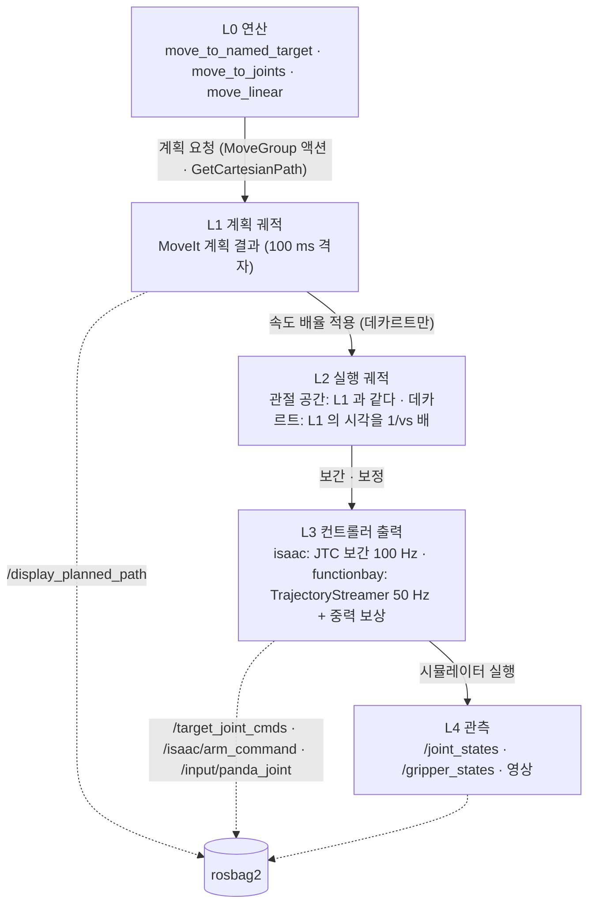

# MoveIt 명령 체인과 트윈 데이터 생성

> **보관본 (2026-09-21).** 이 문서는 갱신하지 않는다 — 본문의 상태 서술은 작성 시점 기준이다.
> 현행 정본: [learning/학습_샘플_사양.md](../../learning/학습_샘플_사양.md)


> **상태: 근거 문서 (2026-09-13 설계안으로 작성, 2026-09-17 역할 변경).** 결정은 이 문서에 두지 않는다 — [학습_데이터_수집_설계.md](학습_데이터_수집_설계.md)(이하 "수집 설계") §0 에 있다.
> 트윈(MoveIt 계획 · 실행)으로 학습 데이터를 만들 때 필요한 **사실과 실측**을 정리한다 — MoveIt 명령 체인(L0~L4)과 녹화할 수 있는 채널, 계획 궤적의 성질(밀도 · 지연 · 재현성), 시간 기준과 t₀ 후보, 트윈 생성 루프, MoveIt 생성 데이터의 한계.
> **대상 백엔드는 Isaac Sim(`isaac`)과 펑션베이(`functionbay`) 둘이다.** mock 계열(`mock`·`mock_jgpc`)은 물체를 파지할 수 없어 학습 데이터를 만들 수 없으므로 다루지 않는다(§1.1).
> **역할 분담:** 결정은 수집 설계 §0, 샘플 구조 · 레이블 규칙 · 배치는 [ACT 문서](ACT_학습_샘플_구성.md), 구현 현황은 [미구현 목록](../../learning/미구현_목록.md) 이 정본이다. §6 ~ §8 · §10.3 · §11 · §12 는 이 문서가 설계안이던 때의 대안 비교와 권고라, 지금은 요약과 정본 링크만 남겼다. **절 번호는 다른 문서의 참조를 위해 그대로 둔다.**
> 다른 문서에서는 이 문서를 **"생성 설계"** 로 부른다. 파일 이름을 바꾸기 전의 이름은 `moveit_training_data_generation_design.md` 다.
> 실측값은 부록 A 에 있다. 두 시뮬레이터를 쓸 수 없는 상태에서 측정했으므로, MoveIt·클라이언트의 성질은 `panda_mock_jgpc` 를 **대리 환경**으로 삼아 쟀다. 각 결과가 두 백엔드에 옮겨지는지는 §5.1 에 정리한다.

## 목차

1. [범위와 전제](#1-범위와-전제)
2. [용어](#2-용어)
3. [MoveIt 명령 체인](#3-moveit-명령-체인)
4. [녹화 가능한 채널](#4-녹화-가능한-채널)
5. [계획 궤적의 성질](#5-계획-궤적의-성질)
6. [action 정의 대안](#6-action-정의-대안)
7. [평가](#7-평가)
8. [권고](#8-권고)
9. [MoveIt 생성 데이터의 한계](#9-moveit-생성-데이터의-한계)
10. [시간과 정렬](#10-시간과-정렬)
11. [추론 시 배치 규약](#11-추론-시-배치-규약)
12. [저장·스키마·export 에 미치는 영향](#12-저장스키마export-에-미치는-영향)
13. [열린 질문과 검증 계획](#13-열린-질문과-검증-계획)
- [부록 A. 실측 기록](#부록-a-실측-기록)
- [부록 B. 관련 문서](#부록-b-관련-문서)

---

## 1. 범위와 전제

### 1.1 범위

| 구분 | 포함 | 제외 |
|---|---|---|
| 데이터 출처 | 트윈 연산(`move_to_named_target` · `move_to_joints` · `move_linear` · `move_gripper_to_target`). `MoveGroupClient` 를 직접 쓰는 스크립트는 측정 · 검증에만 쓴다(수집 설계 D1) | teleop (`teleop_keyboard`, `teleop_mirror`) |
| 백엔드 | `isaac` (JTC), `functionbay` (JGPC) | `mock`·`mock_jgpc` (물체 파지 불가), Gazebo (백엔드 프로파일 없음) |
| action 공간 | 팔 관절 목표, 그리퍼 심볼 | EE 공간 action — 데카르트 표현은 [좌표 공간 문서](학습_데이터의_좌표_공간_비교.md) §5 가 다룬다 |
| 배치 | 규약 | 배치 노드 구현 |

mock 계열을 제외하는 근거는 다음과 같다.

- planning scene 의 물체는 스스로 움직이지 않는다. 파지에 실패해도 물체 위치가 그대로여서 작업 결과를 관측할 수 없다. 물체를 그리퍼에 따라오게 하려면 클라이언트가 `AttachedCollisionObject` 를 선언해야 하는데, 그러면 "성공했다고 선언했으니 성공"인 **자기충족 라벨**이 된다([scene_objects_guide.md](../../control/scene_objects_guide.md) §6.2.5).
- mock 의 손가락에는 effort state interface 가 없어 `grasp` 의 `at_goal` 이 성립하지 않는다. 트윈의 `move_gripper_to_target grasp` 는 mock 에서 타임아웃된다.

mock 은 변수·연산·기록 경로가 도는지 확인하는 **배관 검증**에만 쓴다. 메시지에 `simulated` 같은 출처 플래그는 두지 않는다(결정, 2026-08-17). mock 데이터가 학습셋에 섞이는 운용이 없고, 필드를 더하면 모든 백엔드가 그 값을 채울 책임만 지기 때문이다. 출처가 필요해지면 에피소드 `metadata` 에 `backend` 를 넣는다.

### 1.2 두 백엔드의 차이

| 항목 | isaac | functionbay |
|---|---|---|
| 팔 제어 | ros2_control + JTC (`TopicBasedSystem`, `open_loop_control: true`) | ros2_control 없음. 클라이언트가 명령을 직접 스트리밍한다 |
| 클라이언트 | `MoveGroupJtcClient` | `MoveGroupJgpcClient` |
| L3 채널 · 주기 | `/isaac/arm_command` · 100 Hz (JTC update 주기) | `/input/panda_joint` · 50 Hz (`arm_command.publish_rate`) |
| 중력 처짐 | 컨트롤러 쪽에서 처리한다 (보상 오프셋 없음) | 클라이언트가 명령점마다 보상 오프셋을 더한다 (`motion.gravity_compensation`) |
| 기본 속도 배율 (vs) | 1.0 (코드 기본값) | 0.4 (프로파일 `motion.velocity_scaling`) |
| 관절 한계 파일 | `panda_real_joint_limits.yaml`. 팔 관절의 속도·가속도 한계는 moveit_resources 와 같다 | moveit_resources `joint_limits.yaml` |
| 시각 | `use_sim_time: true` (Isaac 의 `/clock`) | `use_sim_time: false`. `/output/*` 의 stamp 기준은 회차마다 벽시계 또는 경과시간이다 |
| 장면 재배치 | `/scene/reset` 제공 | 미제공 (`reset_scene` 실패) |
| 카메라 | `/isaac/camera/image_raw` (`sensor_msgs/Image`) · 10 fps | `/camera_image/compressed` (`sensor_msgs/CompressedImage`, jpeg) · 10 fps (실측 약 9.6 Hz) |
| 녹화 토픽 목록 | `config/recording_topics_isaac.list` | 전용 목록 없음 (§4.1) |
| 영상 녹화 | `rdfp_image_recorder` 의 mp4 (rosbag 에 담지 않는다, §4.2 의 3) | `rdfp_image_recorder` 의 mp4, `input_format: mjpeg` (§4.2 의 3) |
| 알려진 제약 | ros2_control 스택의 `/clock` 배속 0.937, 명령 계단 응답 dead time 131 ms | 수 mm 크기 명령의 비선형 반영, `r2` 씬의 peg–탁자 접촉 부재, 회차별 stamp 기준 변동 |

### 1.3 생성 루프

사람이 티칭하지 않고, 물체 배치를 바꿔 가며 스크립트 작업을 반복해 에피소드를 자동으로 만든다. 클라이언트는 **트윈 REST 만으로** 루프를 돈다. 중간에 ROS 서비스를 직접 불러야 한다면 트윈을 쓰는 의미가 사라진다. 구현 예제는 [robot_twin_user_guide.md](../../twin/robot_twin_user_guide.md) §5.10 에 있다.

```
start_session(task_label)
  └─ 반복: reset_scene(scene, seed) → move_to_named_target(ready)
            → start_episode → 작업 연산 → stop_episode(outcome, metadata)
stop_session
```

#### 1.3.1 에피소드 경계

| 규칙 | 근거 |
|---|---|
| 장면 재배치와 홈 복귀는 **에피소드 밖**에 둔다 | 안에 두면 물체가 순간이동하는 장면이 학습 데이터에 섞인다. 그 결과 에피소드 안의 팔 동작은 모두 `ready` 에서 시작하는 MoveIt 연산의 연속이 된다 |
| `task_label` 은 `start_session` 의 입력으로 준다 | 빈 라벨로 시작한 세션은 모든 에피소드에 빈 라벨이 기록되고, 기록 뒤에는 재적재로도 고칠 수 없다 |
| **에피소드를 닫는 것은 클라이언트의 책임이다** | 자동 수집에서 실패는 정상 경로이며 실패 에피소드도 유효한 데이터다. 트윈이 연산 실패를 보고 에피소드를 닫으면 유효한 실패 에피소드를 잘라낸다. 연산 하나의 실패가 에피소드의 끝이라는 보장도 없다(클라이언트가 재시도할 수 있다) |
| `stop_episode` 는 `try/finally` 로 반드시 부른다 | 열린 채 남으면 다음 `start_episode` 가 거부되고, 그 구간의 데이터가 경계를 잃는다 |
| 시작은 멱등하게 한다 | 이전 실행이 남긴 열린 세션은, `session_state` 가 `IDLE` 이 아닐 때 `stop_session` 으로 정리한다(`IDLE` 에서 부르면 거부된다) |
| `outcome` 은 판정했을 때만 준다 | 생략은 '판정 없음'(DB `success = NULL`)이며 실패가 아니다. 파지 실패는 `failure` 로 닫는다 |

에피소드 경계의 상태 기계는 `session_control_node` 하나가 갖고, 트윈은 그 서비스에 중계만 한다([session_control_guide.md](../../collect/session_control_guide.md)).

> **알려진 틈.** `reset_scene` 은 `[scene, arm]` 자원을 점유하지만 `start_episode` 는 자원을 점유하지 않는다. 따라서 이론상 scene 리셋 도중에 에피소드가 시작될 수 있다. 막는다면 자원이 아니라 사전조건(scene 점유 중이면 `start_episode` 거부)이 맞다. 수집 루프는 한 클라이언트가 순차로 돌므로 실제로는 발생하지 않아 넣지 않았다.

#### 1.3.2 초기 배치의 기록

| 백엔드 | 배치 수단 | 에피소드 `metadata` 에 남길 값 |
|---|---|---|
| isaac | `reset_scene(scene, seed)`. 레시피 범위에서 트윈이 추출하고 `isaac_scene_state_node` 가 다시 놓는다 | `reset_scene` 의 `outputs.objects` |
| functionbay | 없음. 배치는 씬 XML(`<씬>__floating_*_vm.xml`)이 정한다 | 에피소드 시작 시점의 `/scene/objects` |

- **seed 만으로는 재현되지 않는다.** 추출 방식이 바뀌면 같은 seed 가 다른 배치를 만든다. 또 물리 시뮬레이터에서는 명령한 배치와 실제 안착 위치가 다르므로, 학습 데이터의 근거는 `/scene/objects` 다([scene_objects_guide.md](../../control/scene_objects_guide.md) §5).
- Isaac 은 물체를 만들거나 지우지 않고 **다시 놓기만** 한다. 레시피의 이름은 `isaac_scene.json` 의 dynamic 물체뿐이고, 레시피에서 빠뜨린 물체는 이전 에피소드의 자리에 남는다([isaac_scene_reset.md](../../backends/isaac/isaac_scene_reset.md)).

#### 1.3.3 펑션베이에서의 제약

| 제약 | 루프에 미치는 영향 |
|---|---|
| `/scene/reset` 이 없다 | 배치 무작위화 없이 생성한다. 이전 에피소드가 끝난 배치가 다음 에피소드의 초기 배치가 된다 |
| 물체를 잃으면 사람이 시뮬레이터를 재시작해야 한다 | 안 앉은 채 그리퍼를 열면 물체가 튕겨 나간다(재현 4/4). 놓기 전 앉음 확인이 필수다 |
| `r2` 씬에는 peg–탁자 접촉 정의가 없다 | 고정물(구멍·트레이) 밖에서 놓으면 물체가 떨어진다. 작업은 두 고정물 사이의 이동으로 한정하며, 고정물 밖에 물체를 놓는 연산은 생성 스크립트에 넣지 않는다 |
| 고정물은 `/scene/objects` 에도 TF 에도 없다 | 목적지는 트윈의 `fixtures` 변수(`config/functionbay_fixtures.json`)에서 읽는다 |

#### 1.3.4 자동 라벨링

`stop_episode` 의 `outcome` 은 클라이언트가 관측으로 판정한다.

| 판정 | 재료 |
|---|---|
| 파지 성공 | 두 백엔드 모두 `/gripper_states` 의 `at_goal` |
| 놓기 성공 (isaac) | 놓은 뒤 `scene_objects` 의 물체 위치가 목표 지점 근처인가 |
| 삽입·놓기 성공 (functionbay) | `scene_objects` 의 peg 위치와 `fixtures` 의 입구·바닥 좌표 |

`/scene/objects` 는 이처럼 **라벨링 재료로 먼저 쓴다.** 시뮬레이터의 ground-truth 물체 pose 는 실기에 없으므로, 학습 입력(관측)으로 넣을지는 별도의 결정이다. 적재는 이미 되고 있으며 관측 포함 여부만 export 에서 정한다([scene_objects_observation_decision.md](../../learning/scene_objects_observation_decision.md)).

#### 1.3.5 구현 현황

| 항목 | 상태 |
|---|---|
| 트윈 변수 `scene_objects` · `session_state`, 연산 `start_session` · `stop_session` · `start_episode` · `stop_episode` | 완료 |
| `reset_scene` (isaac 은 `simulation_interfaces` 경유) | 완료 |
| `sessions.success` · `sessions.metadata` 적재 | 완료 |
| 수집 전 과정 (세션 → 리셋 → 에피소드 → rosbag → MP4 → DB) | isaac 에서 통과 |
| functionbay `/scene/reset` | 미제공. 시뮬레이터에 런타임 배치 수단이 없어 벤더에 의존한다 |
| Gazebo 연동 | 범위 밖 (§1.1) |
| 권고 2 의 **실행 궤적 채널(R1)** | **완료 (2026-09-18)** — `rdfp_msgs/MotionTrajectory` · 발행 지점 셋 · 단위 시험 14건. 검증 일부 남음 |
| 그 밖의 권고 (녹화 목록, 연산 이벤트 채널 등) | 미착수 (§8). 항목별 현황은 [학습_데이터_미구현_목록.md](../../learning/미구현_목록.md) |

이 루프의 설계 경위(2026-08-17~09-13 작업 기록)는 해당 정식 문서로 옮겼다. `/scene/objects` 계약과 `reset_scene` 은 [scene_objects_guide.md](../../control/scene_objects_guide.md) §3·§5·§8, 자원 락과 projection 어휘는 [robot_twin_design.md](../../twin/robot_twin_design.md) §5.5·§6.3, 세션 연산은 [robot_twin_user_guide.md](../../twin/robot_twin_user_guide.md) §4.2 와 [session_control_guide.md](../../collect/session_control_guide.md) 에 있다.

### 1.4 teleop 과 mock 을 제외하면 달라지는 전제

1. **출처 간 일관성 기준이 사라진다.** 수집 설계에서 대안 B 의 약점이던 "teleop 에는 계획이 없다"와, 대안 A 의 약점이던 "펑션베이에서 teleop 명령(중력 보상 없음)과 트윈 명령(보상 포함)이 다르다"가 해당하지 않는다.
2. **mock 보완(수집 설계의 대안 A′)이 필요 없다.** 두 백엔드 모두 현행 `/target_joint_cmds` 가 MoveIt 구간에서 채워진다.
3. **모든 시점에 계획이 존재한다.** 관측 시각마다 그 이후의 확정된 목표 궤적을 알 수 있으므로, 계획 수준 레이블(t+Δ, chunk)이 에피소드 전 구간에서 성립한다.
4. **데이터를 만든 실행기를 배치에도 쓸 수 있다.** 정책이 연산 수준의 목표를 출력하도록 정의하면 학습과 배치의 실행 경로가 같아진다(§6 의 M3).
5. **반응적 교정 행동을 teleop 에서 보충할 수 없다.** §9.1 에서 따로 다룬다.

유지되는 전제는 다음과 같다.

- 추론기는 관측을 받아 팔 목표와 그리퍼 심볼을 출력한다.
- **녹화와 적재(DB)는 비가역이고 export 의 action/observation 매핑은 번복할 수 있다.** rosbag 은 쓰기 대역폭을 위한 임시 버퍼라 적재 뒤 곧 지우므로, 녹화 목록에 넣은 채널도 적재 경로가 옮기지 않으면 남지 않는다. 녹화·적재는 넉넉히 하고 action 정의는 export 에서 정한다([좌표 공간 문서](학습_데이터의_좌표_공간_비교.md) §1.1 · §3.5).

## 2. 용어

### 2.1 명령 구체화 단계 (L0~L4)

L0~L4 는 명령 하나가 연산(의도)에서 관측(결과)까지 구체화되는 단계의 번호다. 번호가 클수록 하드웨어에 가깝고 백엔드에 종속된다. 소프트웨어 구조의 계층(제어 계층·수집 계층)과는 무관하다.

| 단계 | 이름 | 내용 | 앞 단계와의 관계 |
|---|---|---|---|
| L0 | 연산 | 무엇을 원하는가. 트윈 연산 또는 클라이언트 메서드 한 번의 호출과 그 인자 (예: `move_linear(pose, frame, velocity_scaling)`) | — |
| L1 | 계획 궤적 | **MoveIt 의 출력** (`moveit_msgs/RobotTrajectory`). `/display_planned_path` 로 발행되는 궤적과 같다 | L0 을 MoveIt 이 계획한 결과 |
| L2 | 실행 궤적 | 컨트롤러 쪽으로 실제 전달된 궤적 | 관절 공간 계획은 MoveIt 이 계획 단계에서 속도 배율을 적용하므로 L1 과 같다. 데카르트 계획은 클라이언트가 L1 의 시각을 1/vs 배로 늘린 결과다 |
| L3 | **컨트롤러 출력** | 하드웨어 쪽으로 보낸 설정값. isaac 은 JTC 가, functionbay 는 `TrajectoryStreamer` 가 만든다 | L2 를 보간·보정한 결과 |
| L4 | 관측 | 실제로 어떻게 되었는가. `/joint_states`, `/gripper_states`, 영상 | L3 을 **시뮬레이터가 실행한 결과** |

- L2 가 컨트롤러 쪽으로 전달되는 경로는 다음과 같다.
  - isaac 의 관절 공간 연산: move_group 이 계획한 궤적(L1 = L2)을 `FollowJointTrajectory` 로 JTC 에 넘긴다. 클라이언트는 궤적을 받지 않는다.
  - isaac 의 데카르트 연산: `MoveGroupJtcClient` 가 `GetCartesianPath` 로 받은 L1 에 속도 배율을 적용해 L2 를 만들고, `ExecuteTrajectory` 액션으로 move_group 에 보낸다. move_group 이 이를 `FollowJointTrajectory` 로 JTC 에 넘긴다.
  - functionbay: `MoveGroupJgpcClient` 가 L2 를 `TrajectoryStreamer` 에 넘기고, 스트리머가 `/input/panda_joint` 로 발행한다. move_group 을 거치지 않는다.
- 단계마다 새로운 표현이 반드시 생기지는 않는다. 관절 공간 계획에서는 L1 과 L2 가 같고, L0 은 궤적이 아니라 연산 호출이다.
- 대안 이름 M1·M2·M3 은 레이블로 쓰는 단계를 가리킨다 (M1 = L3, M2 = L2, M3 = L0, §6).

### 2.2 그 밖의 용어

| 용어 | 뜻 |
|---|---|
| 클라이언트 | `MoveGroupClient` 의 구현. isaac 은 `MoveGroupJtcClient`, functionbay 는 `MoveGroupJgpcClient` 이며 `create_move_group_client(node, backend=...)` 가 백엔드 프로파일에 따라 고른다. 트윈 연산 핸들러와 스크립트가 이를 통해 팔을 움직인다 |
| 대리 환경 | 시뮬레이터 없이 MoveIt·클라이언트의 성질을 재기 위해 쓴 `panda_mock_jgpc` 스택 (부록 A) |
| vs | 속도 배율 (`velocity_scaling`) |
| 구간 | 연산 하나의 실행 시간 범위 [t₀, t₀ + T]. T 는 L2 의 마지막 `time_from_start` 다 |
| t₀ | 실행 시작 시각. L2 의 `time_from_start = 0` 에 대응하는 실제 시각 |
| Δ | 계획 수준 레이블에서 관측 시각 t 에 대응시키는 목표 시각 t+Δ 의 간격 |

## 3. MoveIt 명령 체인

### 3.1 명령 구체화 단계



점선은 녹화할 수 있는 채널이다. 현재 녹화 목록에 들어 있는지는 §4.1 에 정리한다. L0 와 L2 를 담는 채널은 없다.

| 단계 | 내용 | 전달 수단 | rosbag2 녹화 |
|---|---|---|:-:|
| L0 연산 | 연산 이름·인자 | HTTP(트윈) 또는 메서드 호출 | ✗ |
| — | 계획 요청 | `MoveGroup` 액션 goal · `GetCartesianPath` 요청 (서비스) | ✗ |
| L1 계획 궤적 | 경유점 + `time_from_start` | `/display_planned_path` (move_group 발행) | ○ |
| L2 실행 궤적 | L1 + 속도 배율 | isaac: `ExecuteTrajectory`·`FollowJointTrajectory` goal (서비스) · functionbay: 스트리머 내부 | ✗ |
| L3 컨트롤러 출력 | 보간·보정된 설정값 | isaac: `/isaac/arm_command` · functionbay: `/input/panda_joint` | ○ |
| L4 관측 | 도달값 | `/joint_states` 등 | ○ |

Humble 의 rosbag2 는 서비스를 녹화하지 못하므로, 액션 goal 로 전달되는 L0·L2 는 현재 어느 토픽에도 남지 않는다.

### 3.2 연산별 계획·실행 경로

| 연산 | 계획 수단 | 속도 배율 적용 주체 | isaac (JTC) | functionbay (JGPC) |
|---|---|---|---|---|
| `move_to_named_target` | `MoveGroup` 액션 (`/move_action`) | MoveIt — `max_velocity_scaling_factor = vs`, `max_acceleration_scaling_factor = 1.0` 고정 | 같은 액션으로 계획 후 실행 (`plan_only=False`). move_group 이 계획과 실행을 함께 수행하므로 클라이언트는 궤적을 받지 않는다 | `plan_only=True` 로 계획 → `TrajectoryStreamer` (50 Hz 선형 보간 + 중력 보상) |
| `move_to_joints` | 같다 | 같다 | 같다 | 같다 |
| `move_linear` | `GetCartesianPath` 서비스 (`/compute_cartesian_path`). Humble 요청에는 속도 배율 필드가 없다 | **클라이언트** — `scale_trajectory_velocity()` 가 `time_from_start` 를 1/vs 배로 늘린다 | `ExecuteTrajectory` 액션 | `TrajectoryStreamer` |
| `move_gripper_to_target` | 없음 | — | `/gripper_cmds`(심볼) → `GripperActionNode` → `panda_hand_controller` | `/gripper_cmds`(심볼) → `Robotiq2FGripperNode` → `/input/gripper_joint` (`r2` 는 2 s 램프) |

- 클라이언트는 `pipeline_id`·`planner_id` 를 지정하지 않는다. 관절 공간 계획은 move_group 의 기본 파이프라인(OMPL)으로 수행된다. launch 는 OMPL·PILZ·CHOMP 를 적재한다.
- 트윈의 vs 는 연산 인자 → 트윈 설정 `velocity_scaling` → 백엔드 프로파일 `motion.velocity_scaling` → 코드 기본값 1.0 순으로 정해지며 `[0.01, 1.0]` 으로 제한된다. **기본값이 isaac 1.0, functionbay 0.4 로 다르다.**
- `move_to_joints` 는 지정하지 않은 관절을 현재값으로 고정한 뒤 계획한다.
- `move_linear` 의 `frame` 을 생략하면 트윈 설정의 `ee_frame` 기준으로 해석하고, 계획 전에 tip link(`panda_link8`) 기준으로 변환한다. functionbay 의 `ee_frame` 은 `grasp_center` 이고, isaac 은 프로파일에 `frames.ee` 가 없어 tip link 기준이다.
- 트윈의 `move_to_pose` 는 배선되지 않았다.

### 3.3 백엔드별 L3

| 백엔드 | L3 생성 주체 | L3 채널 · 주기 | MoveIt 구간의 `/target_joint_cmds` |
|---|---|---|---|
| isaac | JTC → `TopicBasedSystem` | `/isaac/arm_command` · 100 Hz | JTC 보간 출력. 녹화 건수가 `/isaac/arm_command` 와 일치한다(277 = 277, [topic_naming_contract.md](../../topic_naming_contract.md) §3) |
| functionbay | `TrajectoryStreamer` (`publish_rate: 50`, 중력 보상) | `/input/panda_joint` · 50 Hz | 선형 보간값 + 중력 보상 오프셋. `ready` 에서 joint4 +9.67 mrad (수집 설계 A-5) |

**servo 가 시작돼 있으면 servo 출력이 같은 L3 채널로 들어온다.** isaac 은 servo → `/panda_arm_controller/joint_trajectory` → JTC → `/isaac/arm_command`, functionbay 는 servo → `servo_command_bridge` → `/input/panda_joint` 경로다. `teleop_keyboard` 는 기동 시 servo 를 자동으로 시작하고, 시작된 servo 는 명령 없이도 팔을 끌고 간다(Isaac 실측 10 s 에 32.3 mrad, [servo_vs_planned_motion.md](../../teleop/servo_vs_planned_motion.md) §5). 데이터 생성 중에는 `teleop_keyboard` 를 띄우지 않는다.

## 4. 녹화 가능한 채널

### 4.1 채널 목록

"녹화 목록" 열은 isaac 은 `recording_topics_isaac.list`, functionbay 는 전용 목록이 없어 `record_rosbag.sh` 의 기본값인 `recording_topics.list` 기준이다. 카메라 행만은 녹화 목록이 아니라 레코더 mp4 기준이다 — 영상은 rosbag 에 담지 않는다(§4.2 의 3).

| 단계 | 채널 | 타입 | `header.stamp` | 대상 | 녹화 목록 (isaac / functionbay) |
|---|---|---|---|---|:-:|
| L1 | `/display_planned_path` | `moveit_msgs/DisplayTrajectory` | **0** | 둘 다 (move_group 공통) | ✗ / ✗ |
| L3 | `/panda_arm_controller/controller_state` | `control_msgs/JointTrajectoryControllerState` | sim time | isaac | ✗ / — |
| L3 | `/isaac/arm_command` | `sensor_msgs/JointState` | sim time | isaac | ✗ / — |
| L3 | `/input/panda_joint` | `sensor_msgs/JointState` | 벽시계 | functionbay | — / ✗ |
| L3 | `/target_joint_cmds` | `sensor_msgs/JointState` | 수신 시각 (isaac sim time · functionbay 벽시계) | 둘 다 | ○ / ○ |
| L4 | `/joint_states` | `sensor_msgs/JointState` | 있음 | isaac: `joint_state_broadcaster` 100 Hz · functionbay: `joint_state_fusion` 50 Hz | ○ / ○ |
| L4 | `/gripper_states` | `rdfp_msgs/GripperState` | 있음 | 둘 다 | ○ / ○ |
| L4 | 카메라 | isaac `Image` · functionbay `CompressedImage` | 있음 | 둘 다 | 레코더 mp4 / 레코더 mp4 |
| 그리퍼 | `/gripper_cmds` | `rdfp_msgs/GripperCommand` | 있음 | 둘 다 | ○ / ○ |

L0 와 L2 를 담는 토픽은 없다. 트윈에는 연산 이벤트를 발행하는 채널이 없으며, 트윈이 만드는 발행자는 설정된 명령 토픽뿐이다.

### 4.2 녹화 시 주의

1. **`/display_planned_path` 는 그대로 적재되지 않는다.** `header.stamp` 가 0 이라 에피소드 창 필터에서 빠지고, 데이터셋 레지스트리(`dataset/db/registry.py`)에 `DisplayTrajectory`·`JointTrajectory` 바인딩이 없다.
2. **데카르트 계획의 `/display_planned_path` 는 실행 궤적이 아니다.** move_group 은 속도 배율 적용 전의 궤적을 발행한다(§5.3). vs 가 기록되지 않으면 L2 를 복원할 수 없는데, 현재 vs 를 남기는 채널이 없다.
3. **영상은 rosbag 에 담지 않고 `rdfp_image_recorder` 의 mp4 로 녹화한다 — 그런데 그 mp4 가 데이터셋에 들어가는 경로가 없다.** 녹화 목록에 있는 이미지 토픽은 rosbag 녹화와 레코더 mp4 의 부하를 비교하려는 임시 항목이다.
   - 데이터셋 적재의 `FrameRouter` 는 rosbag 의 `sensor_msgs/Image` 로만 mp4 를 만들고, 레코더 mp4 는 읽지 않는다(수집 설계 §7). 그래서 rosbag 에서 영상을 빼면 **어느 백엔드의 에피소드에도 영상 관측이 남지 않는다.**
   - ~~레코더 출력에는 적재에 등록할 정보가 모자란다~~ **해소 (2026-09-18).** `/session` 시작 stamp(`episode_key`) · 에피소드별 metadata · topic · codec · fps 를 싣고(R5), 출력 위치도 `/data/rdfp/recordings` 로 옮겼다(R6). 남은 것은 적재가 그 출력을 읽어 등록하는 경로(I4)다.
   - functionbay 는 레코더가 `input_format: mjpeg` 로 `CompressedImage` 를 디코드 없이 받으므로, 전용 녹화 목록에 카메라 토픽을 넣을 필요가 없다.
   
   대응은 §8 의 7 에 둔다. 경로 선택(§13 의 11)은 해소됐고, 상세는 [좌표 공간 문서](학습_데이터의_좌표_공간_비교.md) §3.4 · 권고 12 에 있다.
4. **functionbay 의 `/input/panda_joint` 에는 발행자가 둘이다** (`TrajectoryStreamer`, `servo_command_bridge`). 코드상 둘 다 기본 QoS(volatile)라, 대리 환경에서 겪은 durability 불일치로 녹화기가 명령을 놓치는 문제(M-7)는 해당하지 않는다. 실측하지는 않았다.
5. **isaac 은 `dataset_config.yaml` 의 `topics_file` 도 `recording_topics_isaac.list` 를 가리켜야 한다.**

## 5. 계획 궤적의 성질

### 5.1 대리 측정의 적용 범위

부록 A 의 측정은 `panda_mock_jgpc` 에서 했다. 계획은 move_group 이, 속도 배율과 스트리밍은 클라이언트가 결정하므로 대부분의 성질은 백엔드와 무관하다. 백엔드에 따라 달라지는 것은 실행 지연과 시각 기준이다.

| 성질 | 결정하는 곳 | isaac | functionbay | 근거 |
|---|---|---|---|---|
| L1 경유점이 100 ms 격자다 | move_group (시간 파라미터화 재샘플) | 같다 | 같다 | M-1, M-2 |
| 계획 길이·점 수 | move_group + 관절 한계 | 같은 시작·목표에서 같을 것으로 본다 — 팔 관절 속도·가속도 한계가 대리 환경과 같다 | 같다 — 대리 환경과 같은 한계 파일이다 | M-1, M-2 |
| 데카르트 발행 궤적이 배율 적용 전이다 | move_group + 클라이언트 `scale_trajectory_velocity()` | 같을 것으로 본다 — `MoveGroupJtcClient` 도 같은 메서드를 쓴다. 미실측 | 같다 — 측정한 클래스와 같다 | M-2, M-3 |
| 계획 발행 → 첫 명령 1~11 ms | `MoveGroupJgpcClient` | 해당 없음 | 같을 것으로 본다 — `publish_rate` 를 줘도 첫 샘플 시각은 0 이다 | M-1, M-2 |
| 계획 발행 → 움직임 시작 | JTC · 시뮬레이터 | 대리 측정이 옮겨지지 않는다 (§5.4) | 해당 없음 | — |
| 계획 재현성 | OMPL | 같다 | 같다 | M-5 |
| 호스트 시계 이상의 영향 | 호스트 | `header.stamp` 는 `/clock` 을 따른다. rosbag `log_time` 은 영향을 받는다 | stamp·재stamp 가 벽시계를 따르므로 영향을 받는다 | M-6 |

### 5.2 밀도

MoveIt 은 시간 파라미터화 단계에서 궤적을 100 ms 격자로 재샘플한다. L1 경유점 간격은 계획 종류와 vs 에 무관하게 100 ms 다(마지막 구간만 짧다).

| 환경 | 연산 | vs | L1 점 수 · 길이 | L2 경유점 간격 | 근거 |
|---|---|---:|---|---|---|
| 대리 (mock_jgpc) | named `extended` | 1.0 | 21점 · 1.90 s | 100 ms | M-1 |
| 대리 (mock_jgpc) | named `ready` | 1.0 | 19점 · 1.78 s | 100 ms | M-1 |
| 대리 (mock_jgpc) | 데카르트 10 cm 하강 | 1.0 | 7점 · 0.59 s | 100 ms | M-1 |
| 대리 (mock_jgpc) | named `extended` | 0.1 | 123점 · 12.16 s | 100 ms | M-2 |
| 대리 (mock_jgpc) | named `ready` | 0.1 | 111점 · 10.90 s | 100 ms | M-2 |
| 대리 (mock_jgpc) | 데카르트 10 cm 하강 | 0.1 | **7점 · 0.59 s** | **1000 ms** (실행 5.92 s) | M-2, M-3 |
| 대리 (mock, JTC) | named `ready` | 0.1 | 111점 · 10.9 s | 100 ms | 수집 설계 A-6 |

실행 시간축에서 L2 의 밀도는 다음과 같다.

- **관절 공간 계획은 vs 와 무관하게 10 Hz 다.** vs 를 낮추면 점 수가 늘어난다. 가속도 배율이 1.0 으로 고정돼 있어 길이는 1/vs 배가 아니다(vs 0.1 에서 6.1~6.4 배).
- **데카르트 계획은 10·vs Hz 다.** vs 를 낮추면 점 수는 그대로이고 간격이 1/vs 배로 늘어난다. 기본 vs 에서 isaac 은 10 Hz, functionbay 는 4 Hz 이며, functionbay 에서 vs 0.08 로 주면 0.8 Hz(1250 ms 간격, 워크스페이스 CLAUDE.md 인용)다.
- L3 에서는 isaac 의 JTC 가 100 Hz 로, functionbay 의 스트리머가 50 Hz 로 보간하므로 명령은 조밀하다. 그러나 M2 레이블은 L2 에서 만들므로 L2 의 성김이 레이블 보간의 품질에 직접 영향을 준다.

### 5.3 `/display_planned_path` 와 L2 의 관계

| 계획 | 발행 궤적 대 L2 | 근거 |
|---|---|---|
| 관절 공간 | 같다. 대리 환경에서 명령 수·간격이 발행 궤적과 일치했다(123/111/21/19건, 100 ms) | M-1, M-2 |
| 데카르트 | **시각이 다르다.** vs 0.1 에서 발행 궤적은 0~0.592 s 이고, 명령은 0/1/2/3/4/5/5.918 s 에 나갔다(구간 5.921 s). 경유점 위치는 7점 모두 같다 | M-2, M-3 |

데카르트 구간의 레이블을 `/display_planned_path` 만으로 만들면 시간축이 1/vs 배 틀린다. isaac 의 데카르트 실행도 같은 클라이언트 배율 코드를 거치므로 같은 관계가 예상되나, 측정하지 않았다(§13 의 3).

### 5.4 계획 발행에서 실행 시작까지

| 경로 | 측정 구간 | 값 | 환경 · 근거 |
|---|---|---|---|
| functionbay (JGPC) | 계획 발행 → 첫 명령 발행 | 1~11 ms | 대리 (mock_jgpc) · M-1, M-2 |
| isaac (JTC) | 계획 발행 → 움직임 시작 | **미측정** | §13 의 2 |
| (참고) mock JTC | 계획 발행 → 움직임 시작 | 53~66 ms | 대리 (mock) · 수집 설계 A-7 |
| (참고) isaac | 명령 계단 입력 → 관절 응답 시작 (dead time) / 시정수 τ | 131 ms / 35.8 ms | isaac 실측 (2026-09-05) · [isaac_backend_skeleton.md](../../backends/isaac/isaac_backend.md) §2 |

- functionbay 는 클라이언트가 계획을 받는 즉시 스트리밍하므로 첫 명령 시각을 t₀ 로 쓸 수 있다. 시뮬레이터가 그 명령에 응답하기까지의 지연은 L3 → L4 의 성질이며 t₀ 의 정의와는 별개다.
- isaac 은 궤적 전달·JTC 수락에 시뮬레이터의 응답 지연이 더해진다. mock 의 53~66 ms 보다 클 것으로 예상되며 경유점 간격(100 ms)을 넘을 수 있으므로, t₀ 는 isaac 에서 직접 정해야 한다.

### 5.5 계획의 재현성

같은 시작 자세에서 named `extended` 를 두 번 계획한 결과(vs 0.1)는 점 수가 같고(123점) 같은 인덱스 경유점의 최대 차가 0.1 mrad 였다(M-5). 장애물이 없는 관절 목표에서는 OMPL 계획이 사실상 결정적이었다. 장애물이 있는 경우는 확인하지 않았다(§13 의 8).

### 5.6 측정 호스트의 시계 이상

측정 호스트(WSL2)에서 벽시계와 monotonic 시계가 서로 어긋나는 현상이 관측됐다.

| 관측 | 결과 | 근거 |
|---|---|---|
| 벽시계 − monotonic 편차 10분 감시 | **약 32 s 마다 약 −1.7 s 계단**. 계단 사이의 편차 변화는 감지 임계(0.5 s 당 20 ms) 미만이다 | M-6 |
| Windows 호스트 시계와 비교 | monotonic 이 호스트보다 **약 5.7 % 빠르다**. 벽시계는 계단을 포함해 평균적으로 호스트를 따른다 | M-6 |
| 데카르트 스트리밍 녹화 (vs 0.1) | 파일 기록 순서상 `log_time` 이 한 번 752 ms 역행했고, **두 경유점이 뒤바뀐 순서로 기록됐다** | M-3 |

세 관측은 "게스트의 시계원이 약 5.7 % 빠르게 진행하고, 벽시계(`CLOCK_REALTIME`)만 주기적으로 호스트 시각으로 되돌려진다"는 해석과 부합한다. 원인은 확인하지 않았다.

영향은 다음과 같다.

- rosbag2 의 `log_time` 은 두 백엔드 모두 벽시계를 따른다.
- **functionbay 가 더 크게 영향을 받는다.** `use_sim_time: false` 이므로 우리 쪽 노드의 `header.stamp` 와 `target_joint_cmds_publisher` 의 재stamp 가 벽시계를 따르고, `TrajectoryStreamer` 의 발행 간격은 monotonic 을 따른다. 기록된 시각열에서 명령 순서가 뒤집히거나 구간 길이가 짧게 나타날 수 있다.
- isaac 의 `header.stamp` 는 `/clock` 을 따르므로, 영향은 `/clock` 발행 측의 시계에 달려 있다(미확인).
- 계단 크기(약 1.7 s)는 경유점 간격(100 ms)이나 Δ 후보보다 한 자릿수 이상 크다. 게스트 시계로 잰 주기·간격은 물리 시간보다 약 5.7 % 짧으며, 이 문서의 간격 수치는 게스트 시계 기준이다.

## 6. action 정의 대안

> 설계안이던 때의 대안 정의다. **결정: 팔 action 은 M2(관절-계획)다** — 수집 설계 §0 의 D2.

| 대안 | 정의 | 다른 문서의 이름 | 이 문서에 남기는 사실 |
|---|---|---|---|
| **M1** 컨트롤러 출력 (L3) | `/target_joint_cmds` — 컨트롤러로 나간 명령값 | 관절-명령, 수집 설계의 A · A′ | 보간 방식과 주기가 백엔드마다 다르다(isaac JTC 스플라인 100 Hz, functionbay 선형 50 Hz). functionbay 값에는 중력 보상 오프셋이 더해져 있다 |
| **M2** 실행 궤적 + t+Δ (L2) | 관측 시각 t 마다 L2 를 (t − t₀ + Δ) 에서 보간한 관절 목표. 변형으로 k 개 시각의 묶음(action chunk)이 있다 | 관절-계획, 수집 설계의 B | 백엔드의 보간 방식과 중력 보상이 레이블에 들어가지 않는다. 데카르트 구간은 L1 과 L2 가 달라 `/display_planned_path` 만으로는 성립하지 않는다(§5.3) |
| **M3** 구간 목표 (L0) | 연산의 목표(구간 끝의 관절값, 그리퍼 심볼)와 연산 종류. 키프레임 기반 정책 형식 | 관절-도달점 | 목표는 백엔드 이식을 위해 **해석된 값**으로 남긴다 — `move_to_named_target` 은 이름 대신 관절값, `move_linear` 는 입력 pose 와 tip link 기준 pose 와 구간 끝 관절값. vs · 계획 파이프라인 · 데카르트 여부가 동작을 바꾼다 |

## 7. 평가

> 설계안이던 때의 비교 기록이다. 결론(M2)은 수집 설계 D2 로 확정됐다.

### 7.1 기준

수집 설계 §5.1 의 기준에서 출처 간 일관성을 빼고 반응성을 더했다.

| 기준 | 묻는 것 |
|---|---|
| ① 커버리지 | isaac·functionbay 에서 레이블을 만들 수 있는가 |
| ② 백엔드 간 일관성 | 같은 연산의 레이블이 두 백엔드에서 같은 의미인가 |
| ③ 시간 정렬 | t₀·stamp 가 확실하고 규칙이 단순한가 |
| ④ 배치 정합 | 추론 출력을 학습 때와 같은 의미로 실행할 수 있는가 |
| ⑤ 반응성 | 정책이 실행 중 관측 변화에 대응하는 주기 |
| ⑥ 구현 비용 | 녹화·스키마·적재·export·배치 어댑터 |
| ⑦ 저장 비용 | 추가 채널의 크기 |

### 7.2 비교

M2 의 ① · ③ 칸은 `/display_planned_path` 를 원천으로 가정했던 당시의 평가다. 원천은 이후 실행 궤적 채널로 바뀌었다(수집 설계 D3).

| 기준 | M1 (L3) | M2 (L2 + t+Δ) | M3 (L0 구간 목표) |
|---|---|---|---|
| ① 커버리지 | ○ — 두 백엔드 모두 현재 녹화된다 | ○ — `/display_planned_path` 는 move_group 공통이라 발행될 것으로 보나, 두 스택에서는 미확인(대리 환경에서 확인) | ○ — 연산 이벤트 채널 신설이 전제 |
| ② 백엔드 간 | ✗ — 보간 방식·주기가 다르고 functionbay 에만 중력 오프셋이 있다 | ○ | ○ |
| ③ 시간 정렬 | ○ — 조밀하고 stamp 가 있다. functionbay 는 회차별 stamp 기준을 확인해야 한다 | △ — L1 stamp 가 0 이고 t₀·vs 가 추가로 필요하다. isaac 의 t₀ 는 미측정 | ○ — 구간 경계만 필요하고 허용 오차가 크다 |
| ④ 배치 정합 | △ — 학습한 백엔드에서만 성립하고 배치 어댑터가 필요하다 | △ — t+Δ 스트리밍 어댑터가 필요하고 Δ 를 학습·배치가 공유해야 한다 | ○ — 배치 실행기가 생성기와 같다 |
| ⑤ 반응성 | ○ 제어 주기 (isaac 100 Hz · functionbay 50 Hz) | ○ frame clock 주기 | ✗ 구간 단위 (구간 내 개루프) |
| ⑥ 구현 비용 | **없음** (현행) | 큼 — 실행 궤적 채널, 바인딩·테이블, 레이블 생성기, 배치 어댑터 | 중간 — 연산 이벤트 채널, 바인딩·테이블, export 규칙. 배치는 트윈 연산을 재사용한다 |
| ⑦ 저장 비용 | 현행 | 구간당 1건. 관절 공간 12 s 이동이 약 25 KB (M-4) | 구간당 1건 |

### 7.3 판단

**M2** 는 두 백엔드의 데이터를 섞으면서 반응성(⑤)을 유지하는 유일한 대안이라 택했다(수집 설계 D2). **M1** 은 추가 비용이 없어 단일 백엔드 비교 기준으로 남고, **M3** 은 반응성이 구간 단위라 별도 정책 형식의 실험으로 둔다. M1 · M2 도 개루프 계획으로 만든 데이터라 구간 내 교정 행동은 담지 못한다(§9.1).

## 8. 권고

> 권고의 현재 상태는 정본에서 관리한다 — 결정은 수집 설계 §0, 구현 현황은 [미구현 목록](../../learning/미구현_목록.md). 다른 문서가 번호로 참조하므로 번호는 그대로 둔다.

| # | 권고 (요약) | 현재 정본 |
|---|---|---|
| 1 | L0 · L2 · L3 · L4 를 녹화하고 적재한다. L1 `/display_planned_path` 는 따로 남기지 않는다 — `header.stamp` 가 0 이라 적재가 에피소드 창 밖으로 버리고 바인딩도 없다(§4.2 의 1). §13 의 10 에서 (b) 를 택하면 그때 적재 경로와 함께 넣는다 | 수집 설계 D3, 미구현 목록 R7 |
| 2 | **실행 궤적 · 연산 이벤트 채널을 신설한다.** `MoveGroupClient` 가 실행 직전에 속도 배율을 적용한 L2 를 `header.stamp = t₀` 로 발행하고(**실효 vs 도 여기 싣는다**), 짝 채널이 연산 종류 · 해석된 목표 · 결과 · 끝난 시각 · 중단 시각을 남긴다. **R1 은 구현을 마쳤다 (2026-09-18)** — 전용 타입 `rdfp_msgs/MotionTrajectory` 를 쓴다(표준 `JointTrajectory` 는 적재가 타입으로 writer 를 고르므로 뜻이 다른 토픽과 섞인다). functionbay 의 t₀ 는 첫 명령 발행 시각, **isaac 은 goal 전송 시각**(§13 의 2 해소), 관절 공간 연산은 **계획·실행 분리**로 L2 를 얻는다(§13 의 10 해소) | 수집 설계 D3 · D13, 미구현 목록 R1 · R2 · Q1, 구현 설계 [R1](R1_실행_궤적_채널_구현_설계.md) · [R2](R2_연산_이벤트_채널_구현_설계.md) |
| 3 | 팔 action 은 M2 로 한다 | 수집 설계 D2 · D6 |
| 4 | 수집 설계와의 관계 — 데이터 출처를 당분간 트윈만 다루기로 해(수집 설계 D1) 두 문서의 범위가 같아졌고, 결정은 수집 설계로 모았다 | 수집 설계 §0 |
| 5 | 데이터셋 단위로 생성 조건을 고정하고 기록한다 — vs(**기본값이 isaac 1.0, functionbay 0.4 로 다르다**. 섞을 때는 연산 인자로 같은 값을 명시한다), functionbay `publish_rate` 와 씬(`Kp` · 그리퍼 명령 규약이 씬마다 다르다), 계획 파이프라인, 생성 호스트 | 미구현 목록 R4 |
| 6 | 시계 역행을 검사한다 — 적재 전에 rosbag 파일 기록 순서에서 `log_time` 역행을 찾아 경고한다. 학습 데이터 생성은 §5.6 의 현상이 없는 호스트에서 한다 | 미구현 목록 I8 |
| 7 | 영상의 원본은 레코더 mp4 로 하고, 적재가 DB 에 등록한다(§4.2 의 3) — 레코더가 DB 에 직접 쓰지 않는다 | [좌표 공간 문서](학습_데이터의_좌표_공간_비교.md) 권고 12, 미구현 목록 R5 · R6 · I4 |
| 8 | 데이터 생성 중에는 servo 가 시작되지 않게 한다 — `teleop_keyboard` 를 띄우지 않는다(§3.3) | 미구현 목록 O3 |

## 9. MoveIt 생성 데이터의 한계

### 9.1 교정 행동의 부재

MoveIt 실행은 계획을 개루프로 따른다. 데이터에 "목표에서 벗어난 상태에서 복귀하는 행동"이 없으므로, 학습된 정책은 배치 중 누적 오차로 학습 분포 밖에 들어가면 복귀하지 못한다. 대응 후보는 다음과 같다.

| 후보 | 내용 | 제약 |
|---|---|---|
| 초기 조건 무작위화 | `reset_scene(seed)` 로 물체 배치를 바꾼다 | isaac 만 가능. functionbay 는 `/scene/reset` 미제공 |
| 섭동 주입 | 실행 중 목표에 작은 오차를 넣고, 다음 연산이 현재 상태에서 재계획해 복귀하게 한다. 섭동 구간은 레이블에서 제외한다 | 미검증 |
| 폐루프 스크립트 | 구간 사이에 관측(`/scene/objects`, `ee_pose`)을 읽고 다음 목표를 다시 계산한다 | 구간 경계의 교정만 데이터에 남는다 |

### 9.2 계획기의 성질이 레이블에 남는다

- **관절 공간 계획은 탁자를 관통할 수 있다.** 조작 대상과 환경 물체를 planning scene 에 넣지 않는 것이 현행 결정이다. 시뮬레이터에서는 충돌로 실행이 어긋나고, 그 구간의 레이블은 도달할 수 없는 목표가 된다. 탁자 근처의 관절 공간 이동은 생성 스크립트에서 피하거나, 탁자 하나만 박스로 계획 장면에 등록한다.
- 클라이언트는 `GetCartesianPath` 의 `avoid_collisions` 를 설정하지 않으므로 데카르트 계획은 충돌을 검사하지 않는다.
- 경로의 형태는 계획기에 종속이다. 같은 작업을 서로 다른 계획기·파라미터로 생성하면 같은 상태에 서로 다른 레이블이 붙는다. 데이터셋 안에서 계획기를 고정한다.

### 9.3 접촉 작업

- 계획은 접촉을 모른다. 삽입처럼 접촉으로 궤적이 밀린 구간에서는 L2 목표와 L4 관측이 어긋나고, M2 레이블은 "밀리지 않았다면 있었을 위치"를 가리킨다.
- functionbay:
  - `publish_rate` 없이 스트리밍하면 계단 명령으로 삽입이 실패한 기록이 있다. 현재 프로파일의 50 Hz 가 이를 해소한다.
  - 수 mm 크기의 작은 명령은 비선형으로 반영된다.
  - 스트리밍은 개루프라 연산의 반환이 도달을 뜻하지 않는다. 다음 목표를 만들기 전에 `ee_pose` 가 멈출 때까지 기다린다.
  - `r2` 씬에는 peg–탁자 접촉 정의가 없어, 고정물 밖에서 놓은 물체가 떨어진다.
- isaac:
  - 파지 성공은 `/gripper_states` 의 `at_goal`(effort 기반)로 판정한다. `panda_hand_controller` 의 그리퍼 액션은 파지 상태에서 완료되지 않는다.
  - 물체를 든 채 옮기는 동작도 트윈 연산(`move_linear`)으로 한다. 생성 루프는 servo 를 쓰지 않는다(권고 8). servo 가 부하 처짐을 되읽어 옆으로 새던 문제는 2026-09-07 에 해결됐다(`servo_joint_source:=commanded` + JTC `open_loop_control: true`, 수평/수직 비율 0.83 → 0.01, [servo_vs_planned_motion.md](../../teleop/servo_vs_planned_motion.md) §4). servo 를 피하는 이유는 그것이 아니라, 계획이 없어 L0·L2 를 남길 수 없고 시작만 해도 명령 없이 팔이 흐르기 때문이다(§3.3).

### 9.4 속도 배율

- vs 는 동작의 시간 척도를 바꾼다. M2 에서 Δ 는 시간이므로, vs 가 섞인 데이터에서는 같은 Δ 가 서로 다른 진행량을 뜻한다. 두 백엔드의 기본 vs 가 다르다는 점(§3.2)이 이 문제를 기본 상태에서 만든다.
- 관절 공간 계획에서 vs 와 궤적 길이는 비례하지 않는다(§5.2). 펑션베이에서 관절 공간 계획의 EE 속도는 vs 1.0 → 0.2 에서 1.6 배만 줄었다(`config/backends/functionbay.yaml` 주석).

## 10. 시간과 정렬

### 10.1 채널별 시각 기준

| 채널 | isaac | functionbay |
|---|---|---|
| rosbag2 `log_time` | 녹화기의 수신 벽시계 | 같다 |
| 우리 쪽 노드의 `header.stamp` | sim time (`/clock`) | 벽시계 |
| 시뮬레이터 보고 채널의 stamp | sim time | `/output/*` — 회차마다 벽시계 또는 경과시간 (수집 전 `fb_checkup.py` 로 확인) |
| `/target_joint_cmds` | 수신 시각으로 재stamp (sim time) | 수신 시각으로 재stamp (벽시계) |
| `/display_planned_path` | 0 | 0 |
| 명령 발행 간격 | JTC update 주기 | `TrajectoryStreamer` — monotonic |

isaac 은 레이블과 관측을 sim time 축에서 맞춘다. ros2_control 스택의 `/clock` 배속이 0.937 이므로 벽시계로 잰 간격과 섞지 않는다.

### 10.2 t₀ 후보

| 백엔드 | 후보 | 비고 |
|---|---|---|
| functionbay | 첫 명령 발행 시각 | 클라이언트가 직접 안다. 대리 측정에서 계획 발행 후 1~11 ms |
| isaac | 계획 발행 시각 + 고정 지연 | 지연 미측정 (§5.4) |
| isaac | 액션 goal 수락 시각 (`_action/status`) | 숨김 토픽이다. 녹화·적재 가능 여부는 미확인 |
| isaac | `controller_state.reference` 의 첫 변화 | `panda_isaac_ros2_controllers.yaml` 에 `state_publish_rate` 가 없어 기본 50 이다. 대리 측정에서 이 설정은 이동 구간 샘플의 38% 만 남겼고, 기동 시점에 1000 으로 주면 98% 였다(수집 설계 §4 의 A′) |
| isaac | `/isaac/arm_command` 의 첫 발행 또는 첫 변화 | 녹화할 수 있다. 정지 중에도 주기 발행하는지, 값이 바뀔 때만 발행하는지 확인해야 한다 |

### 10.3 frame clock 에서의 레이블

> **정본은 [ACT 문서](ACT_학습_샘플_구성.md) §5.2 와 수집 설계 §8.2 다.** 요약과 이 문서의 사실만 남긴다.

- 레이블은 에피소드 전체에 대한 시각의 함수로 정의한다. 연산 실행 중은 L2 보간, 정상 종료 뒤는 끝점, 중단 · 실패 뒤는 중단 시각의 L2 값, 첫 연산 이전은 에피소드 시작 시점의 관절 관측(`ready`)이다(수집 설계 D5).
- 계획은 연산이 실행될 때만 있으므로 이벤트로 녹화하고, export 가 이 규칙으로 공백을 채운다(수집 설계 D3 · D4).
- M3 은 구간 [t₀, t₀ + T] 동안 해당 연산의 목표를 유지하고, 학습 샘플은 t₀ 직전의 관측으로 만든다.
- 그리퍼 레이블은 `/gripper_cmds` 를 0차 유지한다. **functionbay 의 그리퍼는 램프(2 s)로 개폐하므로 명령 시각과 개폐 완료 시각의 차가 isaac 보다 크다.**

### 10.4 시계 역행에 대한 대응

- 탐지: rosbag 파일 기록 순서에서 `log_time` 역행을 찾는다.
- 권고 2 의 채널을 쓰면 구간 내부 시각을 `t₀ + time_from_start` 로 계산하므로 구간 내부의 역행에는 영향을 받지 않는다. functionbay 에서는 t₀ 와 관측 stamp 가 벽시계를 따르므로, 구간 경계에 걸친 역행은 남는다.

## 11. 추론 시 배치 규약

> **정본은 수집 설계 §9 와 [ACT 문서](ACT_학습_샘플_구성.md) §7 이다.** 구현은 [미구현 목록](../../learning/미구현_목록.md) P1 ~ P3. 이 문서의 사실과 맞닿는 점만 남긴다.

- isaac 의 JTC 에는 `open_loop_control: true` 가 이미 설정돼 있다. 단일점을 `time_from_start` 로 이어 붙여도 측정 상태를 되읽지 않는다.
- functionbay 는 `TrajectoryStreamer` 가 명령점마다 중력 보상을 적용한다. M2(관절-계획) 레이블에는 보상이 없으므로 배치 경로에서 보상을 건다. M1(관절-명령) 레이블은 보상이 든 `/target_joint_cmds` 인지 보상 전 명령인지에 따라 배치 경로를 달리한다 — 어긋나면 오프셋이 두 번 들어가거나 빠진다.
- 재생용 `target_joint_cmds_executor`(JTC 단일점)가 M1 · M2 배치 어댑터의 출발점이 될 수 있고, M3 은 기존 트윈 연산을 그대로 쓴다.

## 12. 저장·스키마·export 에 미치는 영향

> **구현 현황은 [미구현 목록](../../learning/미구현_목록.md) 이 정본이다** — 실행 궤적 · 연산 이벤트의 녹화 · 적재는 R1 · R2 · R7 · I1, export 는 E1 ~ E7.

- 실행 궤적은 표준 타입 `trajectory_msgs/JointTrajectory` 로 담을 수 있다. 연산 이벤트는 신설 타입이나 표준 타입 조합이 필요하다.
- `joint_states` 테이블에는 관절 이름 컬럼이 없다. 궤적 · 목표 테이블은 관절 순서 규약(컨트롤러 `joints` 파라미터 순서)을 명시하거나 관절 이름을 함께 저장한다(미구현 목록 I3).

## 13. 열린 질문과 검증 계획

구현 전에 정해야 할 것의 목록은 [미구현 목록](../../learning/미구현_목록.md) §8 이 정본이다. 이 표는 실측 · 검증 계획을 함께 담는다.

| # | 질문 | 검증 방법 | 관련 |
|---|---|---|---|
| 1 | **해소 (2026-09-18)** — 실행 궤적은 `motion/trajectory` · `rdfp_msgs/MotionTrajectory`(2026-09-17, 구현 완료), **연산 이벤트는 `motion/event` · `rdfp_msgs/MotionEvent`** 로 정했다. 둘 다 [토픽 이름 규약](../../topic_naming_contract.md) §2.1 에 올린다 | 남은 것은 구현이다 — 미구현 목록 R2 · R7 · I1 | §8 의 2 |
| 2 | isaac 의 t₀ 정의와 계획 발행 → 움직임 시작 지연 (미구현 목록 Q3) | §10.2 의 후보를 같은 이동에서 함께 녹화해 편차를 비교한다. `/isaac/arm_command` 의 발행 조건도 확인한다 | §5.4, §10.2 |
| 3 | isaac 의 데카르트 실행에서 발행 궤적과 실제 명령의 시간 관계 | isaac 에서 vs 0.1 `move_linear` 를 수행하며 `/display_planned_path` 와 `/isaac/arm_command` 를 녹화 | §5.3 |
| 4 | 대리 측정(M-1~M-5)이 두 스택에서 재현되는가 | 두 스택에서 세 연산을 녹화한다. functionbay 는 `publish_rate` 50·vs 0.4 조건을 포함한다 | §5.1 |
| 5 | **해소 (2026-09-16)** — 실패·중단 구간 이후는 중단 시각의 L2 값을 유지한다 | 남은 검증: isaac JTC 가 취소 때 붙드는 자세와 대조([ACT 문서](ACT_학습_샘플_구성.md) §9 의 8) | §10.3 |
| 6 | 시계 이상의 원인과 대책, isaac `/clock` 에 미치는 영향 | 네이티브 Linux 호스트에서 같은 감시를 수행하고, WSL2 시계원 설정을 비교한다 | §5.6 |
| 7 | Δ 의 값(잠정 100 ms), 구간 경계 처리, vs 정규화 (미구현 목록 Q6) | M2 실험에서 100 ms 를 기준으로 비교한다. 두 백엔드의 기본 vs 차이를 포함한다. chunk 의 구간 경계는 [ACT 문서](ACT_학습_샘플_구성.md) §9 의 3 | §9.4, §10.3 |
| 8 | 장애물이 있는 계획의 재현성 | 같은 시작·목표로 반복 계획 | §5.5 |
| 9 | 섭동 주입으로 복귀 데이터를 만들 수 있는가 | isaac 에서 섭동 크기별 복귀 성공률 측정 | §9.1 |
| 10 | **해소 (2026-09-18)** — (a) 로 정했다. `MoveGroupJtcClient` 가 `plan_only=True` 로 계획한 뒤 `ExecuteTrajectory` 로 실행하도록 바꾼다 — 클라이언트가 모든 경로에서 L2 를 보게 되어 데카르트·functionbay 경로와 구조가 같아진다. (b) `/display_planned_path` 를 L2 로 쓰는 안은 쓰지 않는다 | 남은 검증: 계획·실행 분리에 따른 지연과 실패 처리(시작 상태 허용 오차 검사 등)를 현행과 비교하고, 트윈 수집 전 과정을 다시 통과시킨다 ([R1 문서](R1_실행_궤적_채널_구현_설계.md) §5 · §6) | §8 의 2 |
| 11 | **해소 (2026-09-15) — (c) 를 택했다.** 영상을 데이터셋에 넣는 경로로 (a) `FrameRouter` 에 `CompressedImage` 지원 추가, (b) 녹화 전에 raw 로 되살려 녹화 (대역폭 약 36배), (c) `rdfp_image_recorder` 의 MP4 와 sidecar 를 적재에 사용을 검토했다. 영상은 rosbag 에 담지 않기로 했으므로 (c) 로 정했고, 백엔드와 무관하게 적용한다 | 남은 검증: 카메라 `header.stamp` 와 `/session` stamp 가 같은 시계인지([좌표 공간 문서](학습_데이터의_좌표_공간_비교.md) §8 의 11), 레코더 출력의 에피소드 키로 적재 에피소드와 1:1 대응되는지 | §4.2 의 3, §8 의 7 |

---

## 부록 A. 실측 기록

### A.1 측정 환경

두 시뮬레이터를 쓸 수 없는 상태에서 측정했다. MoveIt(move_group)과 클라이언트의 성질을 재기 위해 `panda_mock_jgpc` 를 대리 환경으로 썼다. 그 결과가 두 백엔드에 옮겨지는지는 §5.1 에 정리했다. 수집 설계 부록 A 의 A-1~A-8(mock JTC)과 isaac 설계 문서의 실측은 참고로 인용한다.

측정 방법: `panda_mock_jgpc` 를 격리 `ROS_DOMAIN_ID` 에서 띄우고, `create_move_group_client(backend='mock_jgpc')` 로 named `extended` → named `ready` → `panda_link8` 기준 10 cm 하강(데카르트)을 수행하며 `/display_planned_path` 와 `/panda_arm_controller/commands` 를 녹화했다. 녹화 QoS 는 M-7 의 재정의를 적용했다. 스크립트 표지에는 벽시계와 monotonic 시각을 함께 기록했다.

### A.2 측정 결과

| # | 날짜 | 측정 | 결과 |
|---|---|---|---|
| M-1 | 2026-09-13 | vs 1.0 — JGPC 경로의 계획 발행과 명령 | 세 연산 모두 `/display_planned_path` 발행. named 21점/1.90 s · 19점/1.78 s, 데카르트 7점/0.59 s, 간격 100 ms. 명령 21/19/7건, 간격 100 ms. 계획 발행 → 첫 명령 4/2/1 ms |
| M-2 | 2026-09-13 | vs 0.1 — 같은 절차 | named 123점/12.16 s · 111점/10.90 s, 명령 123/111건, 간격 100 ms. 데카르트 발행 7점/0.59 s(배율 적용 전), 명령 7건. 계획 발행 → 첫 명령 11/2/2 ms |
| M-3 | 2026-09-13 | vs 0.1 — 데카르트 명령 시각 | 녹화된 계획에 `scale_trajectory_velocity(0.1)` 을 다시 적용한 결과는 0/1/2/3/4/5/5.918 s. 재측정한 구간 길이는 벽시계·monotonic 모두 5.921 s. 첫 측정의 기록 시각은 0/0.248/1.000/1.248/2.248/3.248/4.165 s 로, 두 번째 명령부터 1.752 s 앞당겨져 1·2번 경유점의 기록 순서가 뒤바뀌었다(파일 순서상 `log_time` 역행 −752 ms, 1회) |
| M-4 | 2026-09-13 | 직렬화 메시지 크기 | `DisplayTrajectory` 123점 25,316 B · 111점 22,916 B · 21점 4,916 B · 7점 2,116 B (점마다 위치·속도·가속도 각 7개) |
| M-5 | 2026-09-13 | 계획 재현성 — 같은 시작 자세에서 named `extended` 2회 (vs 0.1) | 123점 = 123점, 같은 인덱스 경유점의 최대 차 0.1 mrad |
| M-6 | 2026-09-13 | 호스트 시계 (스택 미기동) | 600 s 감시(0.5 s 간격): 벽시계 − monotonic 계단 18회, 간격 약 32 s, 1회 −1.56~−2.52 s(대부분 −1.68~−1.75 s), 누적 −31.4 s. Windows 호스트 시계(`powershell.exe`, 20 s 간격 6회) 대비 96 s 경과에서 monotonic +5.66 %, 벽시계는 계단 위상에 따라 −3.1~−0.2 % |
| M-7 | 2026-09-13 | 대리 환경의 녹화 QoS | servo_node 가 `/panda_arm_controller/commands` 에 `RELIABLE`/`TRANSIENT_LOCAL` 발행자를 둔 상태에서 스트리머 명령이 녹화되지 않고 `incompatible QoS … DURABILITY` 경고가 남았다. `history: keep_last`, `depth: 1000`, `reliability: reliable`, `durability: volatile` 로 재정의한 뒤 경고 0. 대리 환경에만 해당하며, functionbay 는 §4.2 의 4 를 본다 |

측정상의 주의: DDS 탐색 지연으로 클라이언트의 SRDF 조회(`/move_group/get_parameters`)가 120 s, 스트리머의 관절 순서 조회(`/panda_arm_controller/get_parameters`)가 10 s 에 타임아웃된 시도가 있었다. 측정 스크립트는 타임아웃 시 같은 연산을 다시 호출했다.

### A.3 인용한 실측

| 출처 | 내용 |
|---|---|
| 수집 설계 A-5 | 펑션베이 중력 보상 오프셋 — `ready` joint4 +9.67 mrad, `extended` 최대 2.23 mrad |
| 수집 설계 A-6·A-7·A-8 (mock JTC) | 계획 밀도, 계획 발행 → 움직임 시작 53~66 ms, `controller_state` 저장 비용 |
| 수집 설계 §4 의 A′ (mock JTC) | `state_publish_rate` 기본 50 에서 이동 구간 샘플 38%, 기동 시점 1000 에서 98% |
| [isaac_backend_skeleton.md](../../backends/isaac/isaac_backend.md) §2 | isaac ros2_control 스택 — `/clock` 배속 0.937, 명령 계단 응답 dead time 131 ms, τ 35.8 ms (2026-09-05) |
| [topic_naming_contract.md](../../topic_naming_contract.md) §3 | isaac `/target_joint_cmds` 277건 = `/isaac/arm_command` 277건 |
| [servo_vs_planned_motion.md](../../teleop/servo_vs_planned_motion.md) §5 | isaac 에서 servo 시작 후 명령 없이 10 s 에 32.3 mrad 이동 |

## 부록 B. 관련 문서

- [학습_데이터_수집_설계.md](학습_데이터_수집_설계.md) — 수집 설계. **§0 결정 사항(정본)**, 대안 A·A′·B, 관측·그리퍼·영상 채널, 부록 A-1~A-8
- [ACT_학습_샘플_구성.md](ACT_학습_샘플_구성.md) — 샘플 구조, 레이블 함수(§5.2), 배치(§7) — §10.3 · §11 의 정본
- [학습_데이터_미구현_목록.md](../../learning/미구현_목록.md) — 구현 현황과 구현 전에 정할 것 — §8 · §12 · §13 의 정본
- [학습_데이터의_좌표_공간_비교.md](학습_데이터의_좌표_공간_비교.md) — 레이블 이름(관절-명령 · 관절-계획 · 관절-도달점), L0~L4 대응표
- [scene_objects_guide.md](../../control/scene_objects_guide.md) — `/scene/objects` 계약, `reset_scene` 의 설계 경위, mock 의 한계(§6.2.5)
- [robot_twin_user_guide.md](../../twin/robot_twin_user_guide.md) — §4.2 세션 연산, §5.10 자동 에피소드 수집 루프 예제
- [session_control_guide.md](../../collect/session_control_guide.md) — 에피소드 경계 상태 기계, `outcome`·`metadata`
- [rdfp_framework_design.md](../../rdfp_framework_design.md) — §2.2 action/observation 정의, §5.6 export
- [수집_계층_얹기_절차서.md](../../collect/수집_계층_얹기_절차서.md) — 수집 계층 기동 절차
- [isaac_backend_skeleton.md](../../backends/isaac/isaac_backend.md) — isaac 백엔드 구성과 실측
- [펑션베이_인수_체크리스트.md](../../backends/functionbay/펑션베이_인수_체크리스트.md) — 펑션베이 점검 항목, 회차별 stamp 기준
- [펑션베이_중력_보상.md](../../backends/functionbay/펑션베이_중력_보상.md) — 펑션베이 중력 보상
- [move_group_jgpc_client_user_guide.md](../../control/move_group_jgpc_client_user_guide.md) — `TrajectoryStreamer`·`publish_rate`
- [servo_vs_planned_motion.md](../../teleop/servo_vs_planned_motion.md) — servo 되읽기, 명령 없는 이동
- [scene_objects_guide.md](../../control/scene_objects_guide.md) — `/scene/objects` 와 `/scene/reset`
- [grasp_center_frame.md](../../backends/functionbay/grasp_center_frame.md) — `grasp_center` 와 tip link
- [topic_naming_contract.md](../../topic_naming_contract.md) — 토픽 이름 규약
