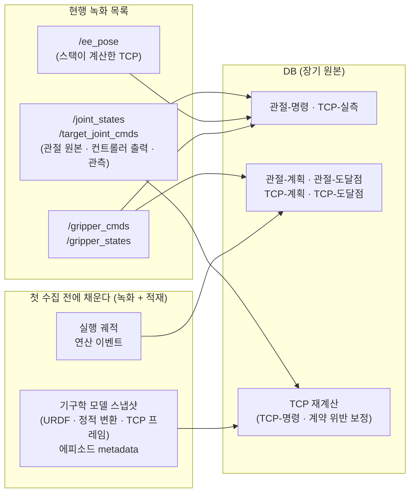

# 학습 데이터의 좌표 공간 — 관절 공간 대 데카르트 공간

> **보관본 (2026-09-21).** 이 문서는 갱신하지 않는다 — 본문의 상태 서술은 작성 시점 기준이다.
> 현행 정본: [learning/결정_기록.md](../../learning/결정_기록.md)

> **상태: 설계안 (2026-09-15, 같은 날 전제 변경 반영 · 기구학 모델 저장 방식 추가 · 영상 녹화 방식 반영 · 데카르트 설계 통합; 2026-09-17 1차 action 결정 반영).** 1차 학습의 팔 action 만 정했고(아래 결정), 나머지는 결정 전이다.
>
> 학습 데이터를 **관절 공간**과 **데카르트 공간(TCP pose)** 중 어느 쪽을 기준으로 모을지에 대한 의견과 근거를 정리한다.
> **전제: 수집된 데이터는 없다.** 기존 녹화본은 쓰지 않고 삭제한다. 그래서 이 문서가 드는 공백은 "과거 데이터를 어떻게 살리는가"가 아니라 **"첫 수집 전에 무엇을 채우는가"** 의 문제다. **rosbag 은 임시 버퍼다** — 여러 노드가 활발히 발행하는 메시지를 쓰기 대역폭이 높은 MCAP 에 먼저 담고, 오프라인 배치로 DB 에 적재한 뒤 곧 삭제한다. 장기 원본은 DB 이고, 학습 데이터셋은 DB 에서 필요한 항목만 뽑아 LeRobot v3 같은 형식으로 export 한다. **카메라 영상은 rosbag 에 담지 않는다** — `rdfp_image_recorder` 가 에피소드마다 mp4 로 직접 녹화하고, 적재가 그 mp4 를 DB 에 등록한다. 그래서 영상의 장기 원본은 DB 와 mp4 파일이다. 지금 녹화 목록에 있는 이미지 토픽은 두 방식의 부하를 비교하려는 임시 항목이다.
> **결론: 녹화·적재 원본은 관절 공간으로 남기고, 정책의 입출력은 데카르트를 우선한다.** 관절값을 보조 관측에 넣을지는 실험으로 정한다. 녹화나 적재에서 빠지면 되돌릴 수 없는 항목(기구학 모델·에피소드 metadata·관절 이름·실행 궤적·연산 이벤트)은 **첫 수집 전에 녹화 목록과 적재 경로에 넣는다** — 잃은 데이터가 아직 없으므로 지금이 가장 싸다. 기구학 모델은 실행 중인 스택에서 캡처한 **스냅샷**을 DB 에 한 번만 두고 에피소드가 해시로 참조한다(§3.6). 그리고 **지금의 적재는 스키마에 맞는 것만 옮기고 나머지를 조용히 버리므로**, rosbag 을 지우기 전에 무손실을 검증해야 한다(§3.5).
> **코드는 아직 고치지 않았다.** 이 문서의 권고는 대부분 코드 수정이 필요하다. 수정 대상과 내용은 §7.4 에 모았다.
> **결정 (2026-09-16 ~ 17): 1차 학습의 팔 action 은 관절-계획이다.** 이벤트(실행 궤적 · 연산 결과)로 녹화하고 export 가 연산 사이 공백을 규칙으로 채운다. 학습은 ACT 형식이며 관측은 관절(`qpos`)이다. 잠정 주기는 영상 10 Hz · 행동 레이블 10 Hz · 관절 관측 50 Hz 다(미확정). 샘플 구조는 [ACT_학습_샘플_구성.md](ACT_학습_샘플_구성.md) 경우 B. 이에 따라 §1.2, §7.1, 권고 6, §8 의 8 을 고쳤다. 데카르트로 옮기는 방향(단계 2)은 그대로다.
> 기존 두 문서는 각각 action 채널([일반 설계](학습_데이터_수집_설계.md))과 MoveIt 명령 단계([생성 설계](MoveIt_명령_체인과_트윈_데이터_생성.md))를 다룬다. 이 문서는 그 위의 질문인 "어느 공간을 기준으로 하는가"에 답하고, 두 문서의 권고를 하나의 단계별 계획으로 묶는다(§7).
> **데카르트 설계(`cartesian_training_data_representation_design.md`)를 2026-09-15 에 이 문서로 합쳤다.** TCP 계약의 책임 분담·준수 현황은 §5.6, 데카르트 명령 후보(TCP-명령 · TCP-계획 · TCP-실측 · TCP-도달점)는 §5.7, 적합성 시험은 §5.8, 측정 기록 K-1~K-3 은 부록 A.1 에 있다. 옮기면서 바꾼 것은 §7.3 에 적었다.

## 목차

1. [질문과 결론](#1-질문과-결론)
2. [용어](#2-용어)
3. [저장은 관절 공간이어야 한다](#3-저장은-관절-공간이어야-한다)
4. [정책 입출력은 데카르트를 우선한다](#4-정책-입출력은-데카르트를-우선한다)
5. [데카르트 표현의 세부와 대가](#5-데카르트-표현의-세부와-대가)
6. [관절을 최종 표현으로 택하는 경우](#6-관절을-최종-표현으로-택하는-경우)
7. [권고](#7-권고)
8. [열린 질문과 검증 계획](#8-열린-질문과-검증-계획)
- [부록 A. 근거 수치와 출처](#부록-a-근거-수치와-출처)
- [부록 B. 외부 자료](#부록-b-외부-자료)
- [부록 C. 관련 문서](#부록-c-관련-문서)

---

## 1. 질문과 결론

### 1.1 질문을 둘로 나눈다

"어느 공간으로 모을까"에는 서로 다른 두 질문이 섞여 있다.

| 질문 | 묻는 것 | 되돌릴 수 있는가 |
|---|---|---|
| **저장 공간** | 녹화(rosbag)·적재(DB)에 무엇을 원본으로 남기는가 | **없다.** 녹화에서 빠진 것은 재수집해야 하고, rosbag 은 적재 뒤 곧 지우므로 **적재가 버린 것도 같다** |
| **표현 공간** | 정책이 무엇을 관측으로 보고 무엇을 행동으로 내는가 | **있다 — 원천이 DB 에 적재된 범위 안에서.** export 의 매핑만 바꾸면 된다 |

이 구분은 일반 설계 §2 의 전제("적재는 비가역이고 export 매핑은 번복할 수 있다")에서 나온다. 두 질문을 섞으면 "학습에는 데카르트가 좋으니 데카르트로 저장하자"처럼, 되돌릴 수 있는 선택 때문에 되돌릴 수 없는 손실을 떠안게 된다.

**비가역 경계가 녹화와 적재 둘에 걸쳐 있다.** rosbag 은 쓰기 대역폭을 위한 임시 버퍼일 뿐 원본이 아니므로, 녹화 목록에 넣은 정보라도 적재 경로가 옮기지 않으면 rosbag 삭제와 함께 사라진다. 그래서 이 설계는 **적재가 필요한 것을 모두 옮긴다**는 조건 위에 서 있는데, 지금의 적재는 그 조건을 지키지 않는다(§3.5).

**"번복할 수 있다"에는 또 하나의 조건이 있다.** 관절 원본이 보장하는 것은 **표현 변환**(관절 ↔ TCP)을 재수집 없이 할 수 있다는 것이다. action 레이블을 명령 체인의 어느 **단계**(연산 · 실행 궤적 · 컨트롤러 출력)에서 뽑을지는 그 단계의 채널이 녹화·적재돼 있어야 고를 수 있다. **실행 궤적 채널(R1)은 2026-09-18 에 구현했고 연산 이벤트 채널(R2)은 아직 없으며, 둘 다 녹화 목록과 적재가 안 붙었다**(미구현 목록 R7 · I1). 수집된 데이터가 없으므로 이것은 한계가 아니라 **준비 항목**이다 — 첫 수집 전에 셋을 마치면 모든 데이터에서 레이블 단계를 고를 수 있다.

| action | 원천 | 현행 녹화 목록으로 | 준비 후 (§7.1) |
|---|---|:-:|:-:|
| 관절-명령 — 컨트롤러 출력 | `/target_joint_cmds` | ○ | ○ |
| 관절-계획 — 실행 궤적 + t+Δ | 실행 궤적 채널 | ✗ | ○ (권고 6) |
| 관절-도달점 — 연산의 목표 관절값 | 연산 이벤트 채널 | ✗ | ○ (권고 6) |
| TCP-명령 — 명령 관절의 TCP 궤적 | `/target_joint_cmds`(펑션베이는 보상 전 명령) + 스냅샷 | △ | ○ (권고 2·5 + FK 도구) |
| TCP-계획 — 실행 궤적의 TCP 궤적 | 실행 궤적 채널 + 스냅샷 | ✗ | ○ (권고 2·6 + FK 도구) |
| TCP-실측 — 실제 TCP 변화 | `/ee_pose` | ○ | ○ |
| TCP-도달점 — 연산 목표 pose | 연산 이벤트 채널 | ✗ | ○ (권고 6) |

- **TCP-명령의 △:** `/target_joint_cmds` 에 FK 를 걸면 되지만, 데이터 계층은 FK 를 하지 않으므로(§5.6) 스택 쪽 도구가 필요하다. 녹화 당시의 기구학 모델 스냅샷(권고 2)이 DB 에 없으면 그 도구가 무엇으로 계산했는지 보장할 수 없고, 펑션베이는 보상 전 명령(권고 5)이 없으면 오프셋이 섞인다. 스택이 명령 TCP 채널을 따로 발행하지는 않는다(§5.7).
- **"○"는 녹화와 적재가 둘 다 갖춰졌다는 뜻이다.** 원천 토픽이 녹화 목록에 있어도 적재가 버리면 DB 에는 없다(§3.5).
- **준비 항목은 무게가 다르다.** 녹화 목록·메시지 규약 수준(권고 3 · 5), 레코더 출력 보강(권고 12 의 녹화), 적재 경로 구현(권고 4 · 11 · 12 의 등록 · 13), 새 메시지와 캡처 구현(권고 2), 새 채널 구현(권고 6)으로 나뉜다. 권고 6 을 첫 수집의 전제로 둘지는 §8 의 8 에서 정한다 — 두지 않으면 그 사이 모은 데이터는 관절-명령 · TCP-명령 · TCP-실측에 머문다.

### 1.2 결론

| 층위 | 권고 | 핵심 근거 |
|---|---|---|
| 녹화·적재 원본 | **관절 공간 + 기구학 모델 스냅샷**. 스냅샷은 실행 중인 스택에서 캡처해 DB 의 모델 테이블에 한 번만 두고, 에피소드가 해시로 참조한다. 아직 없다 — 첫 수집 전에 만든다 (§3.6) | 관절에서 TCP 로는 계산으로 정확히 가지만, 반대 방향은 해가 하나로 정해지지 않는다 (§3) |
| 관측 | 1차 학습(관절-계획 행동, ACT)은 **관절 관측**(`/joint_states`, 잠정 50 Hz)을 `qpos` 로 쓴다(결정, 2026-09-17) — 행동이 관절 공간이기 때문이다. TCP 행동으로 옮기는 단계 2 에서는 **TCP pose** 를 기본으로 하고, 관절값은 선택이며 실험으로 정한다 (§8 의 5) | 과제가 데카르트로 정의돼 있다 (§4.1). 관절값은 팔꿈치 자세를 보여 주지만 공간 일반화를 해칠 수 있다 (§5.1) |
| 행동 (팔) | 1차 학습은 **관절-계획** 이다(결정, 2026-09-17) — 이벤트로 녹화하고 export 가 연산 사이 공백을 채우며, ACT 형식으로 학습한다(잠정: 영상 10 · 행동 10 · 관측 50 Hz, [ACT 문서](ACT_학습_샘플_구성.md) 경우 B). 관절-계획에는 백엔드마다 다른 보간과 펑션베이의 중력 보상 오프셋이 섞이지 않아 백엔드를 섞을 수 있다(§4.2). **관절-명령** 도 계속 녹화 · 적재해 단일 백엔드 비교 기준으로 쓴다(권고 1). 배치 쪽 TCP 계약이 갖춰지면 **TCP 목표**로 옮긴다 — 준비 후 수집한 데이터는 다시 모으지 않고 export 만 바꾼다 (§7.1) | 백엔드·기구에 덜 묶인다 (§4.2, §4.3). 절대/상대는 실행 방식에 따라 갈린다 (§5.4) |
| 그리퍼 | 현행 유지 (명령 = 심볼, 관측 = 개구 폭) | 이미 기구 독립적인 작업 공간 표현이다 |

### 1.3 범위

| 포함 | 제외 |
|---|---|
| MoveIt 으로 생성한 데이터 (트윈 연산, LLM 에이전트, 스크립트) — isaac · functionbay | teleop 출처 |
| 팔의 좌표 공간 (그리퍼는 §1.2 대로 현행 유지) | 실행 경로 변경 (데카르트 스트리밍) |

**teleop 을 뺀 대가는 작지 않다.** leader-follower 경로에서는 조작자의 의도가 애초에 데카르트다 — `teleop_retarget` 의 목표 `PoseStamped` 가 `ee_twist_node` 에서 twist 로 바뀌어 servo 로 들어간다(일반 설계 §3.1). 이 프로젝트에서 데카르트 action 의 가장 자연스러운 출처이고, MoveIt 생성 데이터에는 없는 **교정 행동**이 나오는 출처이기도 하다(생성 설계 §9.1). 그 목표 pose 는 지금 어느 녹화 목록에도 없다(`/servo_node/delta_twist_cmds` 만 있다). teleop 을 다룰 때 이 문서의 결론을 다시 본다 — **teleop 으로도 모을 계획이면 그 토픽을 첫 수집 전에 녹화 목록과 적재 경로에 넣는다.** 녹화나 적재에서 빠진 정보는 되돌릴 수 없다는 §1.1 의 이유가 그대로 적용된다.

---

## 2. 용어

| 용어 | 뜻 |
|---|---|
| 관절 공간 | 팔 관절 7개의 위치 `q ∈ ℝ⁷` (rad). Panda 관절 이름·순서는 컨트롤러의 `joints` 파라미터를 따른다 |
| 데카르트 공간 / TCP pose | 그리퍼 파지 중심(TCP)의 위치·자세. 기준 프레임은 `panda_link0` 이다. 의미 계약의 정본은 [rdfp_framework_design.md](../../rdfp_framework_design.md) §2.1 이다 |
| 순기구학 (FK) | `q` → TCP pose. URDF 와 TCP 변환 상수만 있으면 결정적으로 계산된다 |
| 역기구학 (IK) | TCP pose → `q`. 해가 없거나 여러 개일 수 있다 |
| 기구학 모델 스냅샷 | 실행 중인 스택에서 캡처한 URDF · 정적 변환 · `base_frame`/`ee_frame` · 팔 관절 순서의 묶음. **내용 해시**와 **기구학 지문** 두 해시로 식별한다 (§3.6) |
| 절대 목표 / 델타 | 절대 목표는 `panda_link0` 기준의 목표 pose 다. 델타는 현재 pose 에 더할 변화량이다 |
| 표현 변환 | 같은 물리량을 다른 공간으로 옮기는 것 (관절 → TCP). 원본과 모델만 있으면 재수집 없이 된다 |
| 레이블 단계 | action 레이블을 명령 체인의 어느 단계에서 뽑는가 — 연산 · 실행 궤적 · 컨트롤러 출력 · 관측이며, 레이블 이름에서는 차례로 **도달점 · 계획 · 명령 · 실측** 으로 부른다(아래 "action 레이블 이름"). 그 단계의 채널이 녹화·적재돼 있어야 한다. 실행 궤적은 MoveIt 의 계획 궤적에 속도 배율을 적용해 컨트롤러로 보낸 궤적이다 ([생성 설계](MoveIt_명령_체인과_트윈_데이터_생성.md) §2.1 의 L0 ~ L4) |
| 녹화 | 로봇 스택이 발행하는 데이터를 파일에 담는 단계다. 경로가 둘이다 — rosbag2 가 녹화 목록(`config/recording_topics*.list`)의 토픽을 MCAP split 으로 담고(`scripts/record_rosbag.sh`, 아래 "임시 버퍼"), `rdfp_image_recorder` 가 카메라 영상을 에피소드마다 mp4 로 담는다(아래 "레코더 mp4"). **되돌릴 수 없다** — 녹화하지 않은 토픽은 나중에 만들어 낼 수 없어 재수집해야 한다 |
| 적재 (import) | 녹화된 rosbag split 을 읽어 DB(PostgreSQL)에 넣는 단계다 (`ros2 run rdfp import`). `/session` 의 상태 전이로 에피소드를 나누고, 에피소드마다 한 트랜잭션으로 타입별 writer 가 테이블 행을 쓴다. **되돌릴 수 없다** — rosbag 은 적재 뒤 곧 지우므로, 적재가 옮기지 않은 것은 녹화하지 않은 것과 같다. 현재 구현 방식은 아래 "적재 projection" 이다 (§3.5) |
| export | DB 에서 학습 데이터셋을 만드는 단계다. 어느 채널을 관측으로, 어느 것을 행동으로 쓸지(매핑)와 그 표현(관절 / TCP, 자세 표현 등), 채널을 frame clock 에 맞추는 재표본화를 여기서 정한다. **번복할 수 있다** — DB 에 원천이 있으면 매핑을 바꿔 다시 만들면 된다. 아직 구현되지 않았다 |
| 임시 버퍼 (rosbag) | 쓰기 대역폭을 위해 먼저 담는 MCAP split. 카메라 영상은 담지 않는다. DB 적재 뒤 곧 삭제한다. 원본이 아니다 |
| 레코더 mp4 | `rdfp_image_recorder` 가 에피소드마다 녹화하는 mp4 + 프레임별 sidecar(jsonl) + metadata(json). rosbag 을 거치지 않고, DB 와 함께 영상의 장기 원본이다 (§3.4) |
| 적재 projection / 무손실 폴백 | 현재 구현 방식은 메시지를 통째로 저장하지 않고, 타입별 writer 가 정한 필드만 테이블 컬럼으로 옮기며 (projection) 나머지는 버린다(예: `JointState.name`, `PoseStamped.header.frame_id`). writer 가 없는 타입과 헤더가 없는 메시지는 통째로 버린다. **무손실 폴백**은 그렇게 통째로 버려지는 메시지를 원래의 직렬화 바이트(raw CDR) 그대로 보존하자는 제안이다 (§3.5, 권고 13) |
| latched 토픽 (TRANSIENT_LOCAL) | 발행자가 마지막 메시지를 붙들고 있다가 늦게 구독한 쪽에 한 번 보내 주는 토픽이다. ROS 2 에서는 QoS 의 `durability = TRANSIENT_LOCAL` 이고, ROS 1 의 latched publisher 에서 온 말이다. `/robot_description` · `/tf_static` · `/session` 이 그렇다. 대개 스택 기동 때 한 번만 발행되므로 rosbag 에서는 **첫 split 에만** 담기고, 에피소드가 시작되기 전 시각이라 **적재의 에피소드 창 밖으로 떨어진다** (§3.5, §3.6) |
| action 레이블 이름 | **공간-단계** 로 부른다. 공간은 **관절** · **TCP** 둘이고, 단계는 **도달점**(연산 하나의 목표 — 연산마다 한 점) · **계획**(실행 궤적을 t+Δ 에서 보간) · **명령**(컨트롤러가 내보낸 값) · **실측**(실제로 움직인 결과) 넷이다. 예: 관절-명령, TCP-도달점. 관절 대안은 셋(§1.1), TCP 대안은 넷(§5.7)이다. 생성 설계의 M1 ~ M3, 옛 데카르트 설계의 C1 ~ C4 와의 대응은 §2 끝의 대응표에 있다 |
| 적합성 시험 | 스택의 `/ee_pose` 가 TCP 계약을 지키는지 스택 쪽 도구로 확인하는 시험. 데이터 계층의 처리 경로에는 들어가지 않는다 (§5.8) |
| 조밀 / 키포즈 정책 | 조밀 정책은 frame clock 주기로 행동을 낸다 (관절-명령 · 관절-계획 · TCP-명령 · TCP-계획 · TCP-실측). 키포즈 정책은 연산 하나에 도달점 하나를 낸다 (관절-도달점 · TCP-도달점) |

> **CDR (Common Data Representation)** — ROS 2 메시지를 바이트로 직렬화하는 형식이다. OMG 가 DDS 용으로 정한 표준이며, ROS 2 는 노드 사이에 메시지를 주고받을 때 이 형식을 쓴다. rosbag2 의 MCAP 파일도 메시지를 CDR 바이트 그대로 담고, 해독에 필요한 메시지 정의 텍스트(`.msg` 내용)를 스키마로 함께 넣는다.
>
> - **바이트만으로는 읽을 수 없다.** CDR 에는 필드 이름이나 타입 정보가 없고 값만 정해진 순서로 이어져 있어, 메시지 정의가 있어야 해독된다. 그래서 무손실 폴백은 바이트와 함께 타입 이름과 스키마 텍스트를 저장한다.
> - **스키마 텍스트가 있으면 ROS 를 설치하지 않아도 해독된다.** 현재 구현된 적재도 이 방식이다 — `rdfp/rosbag/mcap_reader.py` 는 `mcap_ros2` 의 `read_ros2_messages` 로 파일 안의 스키마를 써서 메시지를 복원한다.

**action 레이블 이름 대응.** 이름은 공간(열)과 단계(행)의 조합이다. 괄호는 다른 문서에서 쓰던 이름이다.

| 단계 \ 공간 | 관절 | TCP | 명령 체인의 자리 (생성 설계 §2.1) |
|---|---|---|---|
| **도달점** — 연산 하나의 목표. 연산마다 한 점 | 관절-도달점 (M3) | TCP-도달점 (C4) | 연산 (L0) |
| **계획** — 실행 궤적을 t+Δ 에서 보간 | 관절-계획 (M2) | TCP-계획 (C2) | 실행 궤적 (L2) |
| **명령** — 컨트롤러가 내보낸 값 | 관절-명령 (M1) | TCP-명령 (C1) | 컨트롤러 출력 (L3) |
| **실측** — 실제로 움직인 결과 | (다루지 않는다) | TCP-실측 (C3) | 관측 (L4) |

M1 ~ M3 은 [생성 설계](MoveIt_명령_체인과_트윈_데이터_생성.md) §6 의 이름이고, C1 ~ C4 는 이 문서에 합치기 전 데카르트 설계의 이름이다. 두 번호는 공간마다 따로 매겨져, 같은 번호가 같은 단계를 뜻하지 않았다 — 3 은 관절에서 연산(M3), TCP 에서 관측(C3)이었다.

---

## 3. 저장은 관절 공간이어야 한다

### 3.1 변환은 한 방향으로만 결정적이다

| 방향 | 필요한 것 | 결과 |
|---|---|---|
| 관절 → TCP (FK) | URDF, TCP 변환 상수 | **하나로 정해진다.** mock 실측에서 FK 결과와 `/ee_pose` 가 938쌍 모두 오차 0.0000 mm · 0.0000 mrad 였다 (K-1) |
| TCP → 관절 (IK) | URDF, TCP 상수, **해 선택 규칙** | **하나로 정해지지 않는다** |

TCP → 관절이 하나로 정해지지 않는 이유는 다음과 같다.

- **여유 자유도.** TCP pose 는 6개의 구속이고 Panda 관절은 7개다. 같은 손끝 pose 에 대해 팔꿈치가 한 원을 따라 도는 **1차원 자기운동(self-motion)** 이 남는다.
- **이산 분기.** 같은 pose 에 팔꿈치 위/아래, 손목 뒤집힘 같은 서로 떨어진 해가 여러 개 있다.
- **해 선택은 풀이기에 달려 있다.** IK 는 초기값(seed)·풀이기·관절 한계 처리에 따라 다른 해를 돌려준다. 원래 시연에서 팔이 어느 해로 움직였는지는 TCP 기록에 남지 않는다.

따라서 **관절을 기록하면 데카르트 표현은 언제든 만들 수 있지만, 데카르트만 기록하면 원래 관절 궤적을 되살릴 수 없다.** 현재 `/ee_pose` 도 `/joint_states` 의 FK 결과라서([CLAUDE.md](../../../CLAUDE.md)의 `/ee_pose` 항목), 관절이 저장돼 있으면 `/ee_pose` 는 **새 정보를 더하지 않는다.** 더하는 것은 "그때 스택이 어떤 TCP 정의로 계산했는가"뿐이다.

### 3.2 되돌릴 수 없는 쪽에 정보 손실이 없는 표현을 둔다

녹화와 적재는 비가역이고(rosbag 은 적재 뒤 곧 지운다) export 는 번복할 수 있으므로, **정보 손실이 없는 표현(관절)을 비가역 쪽에 둔다.**

같은 원본으로 해 볼 수 있는 실험은 두 축으로 나뉘고, 재수집이 필요한지가 서로 다르다.

| 실험 축 | 바꾸는 것 | 예 | 재수집 없이 되는가 |
|---|---|---|---|
| **표현 공간** | 같은 단계의 레이블을 관절로 쓸지 TCP 로 쓸지 | 관절-명령 ↔ TCP-명령, 관절-계획 ↔ TCP-계획, 관절-도달점 ↔ TCP-도달점 | **된다.** 관절에서 FK 로 결정적으로 계산된다(§3.1) |
| **레이블 단계** | 같은 공간에서 레이블을 명령 체인의 어느 단계에서 뽑을지 — 명령 · 계획 · 도달점 | 관절-명령 ↔ 관절-계획 ↔ 관절-도달점. 같은 데이터로 관절-명령 정책과 관절-계획 정책을 학습해 비교하거나, isaac 에서 관절-계획으로 학습한 정책을 펑션베이에 배치한다(§8 의 6) | **그 단계의 채널이 녹화·적재돼 있어야 된다** |

레이블 단계는 남아 있는 다른 단계에서 역산할 수 없다. 컨트롤러 출력은 실행 궤적을 보간·보정한 결과라 계획 경유점과 실행 시작 시각 t₀ 가 이미 사라졌고, 궤적만으로는 연산의 목표(named target 인지, 어떤 pose 인지)·구간 경계·속도 배율을 알 수 없다. 그런데 연산과 실행 궤적은 HTTP · 메서드 호출 · 액션 goal · 스트리머 내부로만 전달되어 어느 토픽에도 남지 않는다 — Humble 의 rosbag2 는 서비스·액션을 녹화하지 못한다(생성 설계 §3.1). 수집된 데이터가 없으므로, 첫 수집 전에 채널을 만들면(권고 6) 모든 데이터에서 레이블 단계를 고를 수 있다(§1.1).

외부 사례 중 DROID(Franka Panda, 여러 장소에서 수집)도 같은 선택을 했다. 관측과 행동을 **관절과 데카르트 둘 다** 기록하고 표현 선택을 사용자에게 맡긴다(부록 B).

### 3.3 TCP 정의는 아직 바뀌고 있다

이 프로젝트에서 TCP 의 정의와 품질은 짧은 기간에 여러 번 바뀌었고, 아직 끝나지 않았다. 원인은 TCP 정의가 데이터가 아니라 **기동 시점 상수**에 있다는 것이다 — `ee_pose_publisher` 의 `ee_frame` 은 launch 인자이고 기본값은 `panda_hand` 다. 아래 사건들은 기존 데이터를 살리자는 근거가 아니다 — **수집을 시작한 뒤에도 TCP 정의가 바뀔 수 있다**는 증거다.

| 사건 | 내용 | 데카르트만 저장했다면 |
|---|---|---|
| `panda_hand` → `grasp_center` (펑션베이) | 두 프레임은 149 mm, 90° 떨어져 있다. 파지 중심과 실제 손끝도 약 40 mm 다르다 | 정의가 바뀌기 전 데이터의 TCP 가 다른 점을 가리킨 채 남는다 |
| 45° 이중 회전 | mock·Isaac 프로파일에 `frames.ee` 가 없는 이유다. 넣으면 클라이언트의 45° 와 겹쳐 90° 가 된다 | 자세 레이블이 45° 단위로 어긋날 수 있다 |
| Isaac 원점 계약 위반 | 지금은 `panda_hand`(손 장착면)를 발행한다. 파지 중심은 약 0.1 m 앞이다 | 스택끼리 데이터를 섞을 수 없다 |
| 새 값 주기 약 18 Hz | 50 Hz 로 발행하지만 TF 경유라 새 값은 약 18 Hz 다 (K-2) | 보간 품질이 영구히 18 Hz 에 묶인다 |
| 시계 되감기 시 멈춘 값 | Unity 를 재시작하면 `/ee_pose` 가 한 값을 계속 발행한다 | 멈춘 값이 정상 관측으로 적재된다 |
| 개폐 축 규약 미정 | 손가락 개폐 방향에 어느 축을 대응시킬지 정하지 않았다. `panda_link7` 기준 yaw 가 isaac −45°, 펑션베이 +90° 다 | **규약이 정해지고 두 스택의 변환이 기록되기 전에는 자세 레이블을 섞을 수 없다.** 원점 차이와 같은 상수 강체 변환이라, 변환이 기록돼 있으면 나중에 보정할 수 있다 |

관절 원본과 기구학 모델이 있으면 이 오류들은 **다시 계산해서 고칠 수 있다.** 데카르트만 있으면 그 시점의 오류를 고칠 재료가 없어 그대로 남는다. 단, **모델은 지금 데이터에 남지 않는다** — 채울 공백은 §3.4, 저장 방식은 §3.6 에 있다.

> **데이터 계층은 FK 를 하지 않는다는 원칙(§5.6)과 충돌하지 않는다.** 그 원칙("데이터 계층은 `/ee_pose` 의 계산 방법을 모른다")은 **정상 경로**에 관한 것이다. 이 문서의 주장은 **복구 수단**에 관한 것이다 — 계약 위반을 나중에 고칠 재료가 데이터에 남아 있어야 한다. 데이터 계층은 모델을 저장하되 해석하지 않고, 재계산은 §5.8 의 적합성 시험처럼 스택 쪽 도구가 맡는다.

### 3.4 관절을 원본으로 삼으려면 채워야 할 공백

현행 녹화 목록(`config/recording_topics.list`, `recording_topics_isaac.list`)은 관절 원본을 담고 있지만, 그것만으로는 TCP 를 다시 계산할 수도, 어느 TCP 로 계산된 데이터인지 가릴 수도 없다. 공백은 **어디를 고쳐야 하는가**로 두 부류로 나뉘지만, **둘 다 첫 적재 전에 갖춰야 한다** — rosbag 은 적재 뒤 곧 지우므로 적재가 버린 것은 녹화에서 빠진 것과 똑같이 되돌릴 수 없다.

#### 녹화 쪽 — 녹화 목록·메시지 규약·채널

| 공백 | 영향 | 제안 |
|---|---|---|
| **기구학 모델이 데이터에 남지 않는다** | FK 를 다시 하려면 **녹화 당시의** 모델이 필요하다. 지금 파일로 계산하면 그사이 바뀐 모델이 섞인다. 게다가 모델은 파일 하나가 아니다 — URDF 는 launch 때 백엔드별 매핑으로 조립되고, 펑션베이 TCP(`grasp_center`)는 URDF 가 아니라 launch 의 정적 TF 이며, `ee_frame` 은 launch 인자다. `/robot_description` · `/tf_static` 은 녹화 목록에 없다. K-1 시험은 `/robot_description` 을 따로 녹화해서 했다 | 실행 중인 스택에서 캡처한 **기구학 모델 스냅샷**을 에피소드 시작 때 헤더 있는 전용 메시지로 발행한다 (권고 2, §3.6) |
| **데이터에 TCP 프레임 이름이 없다** | `/ee_pose` 는 `PoseStamped` 라 기준 프레임(`header.frame_id` = `panda_link0`)만 싣고, TCP 프레임 이름을 실을 필드가 없다. 토픽 이름도 두 스택이 같다(`/ee_pose`). 그래서 isaac(`panda_hand`)과 펑션베이(`grasp_center`)의 행을 DB 에서 구분할 수 없고, 권고 9 를 확인할 수단이 없다. `pose_stampeds` 에 `frame_id` 컬럼을 더해도 두 스택 모두 `panda_link0` 이라 구분되지 않는다 | 스냅샷의 `ee_frame` 과 기구학 지문(권고 2), 에피소드 metadata 의 `backend`(권고 3)로 가린다 |
| **백엔드 정보를 실을 규약이 없다** | 에피소드 단위 JSON 채널은 이미 있다 — `SessionCommand.metadata` 가 `/session` 으로 녹화되어 `sessions.metadata`(JSONB)로 적재된다. 그러나 `robot-twin-client` 가 자동으로 합치는 키는 `scene` · `seed` · `objects` 뿐이다 | 실을 키의 규약을 정한다 (권고 3) |
| **펑션베이 `/target_joint_cmds` 에 중력 보상 오프셋이 들어 있다** | `ready` 에서 joint4 +9.67 mrad 다. 명령 원본이 시뮬레이터에 묶이고, 같은 백엔드 안에서도 teleop(보상 없음)과 트윈(보상 포함)의 뜻이 다르다 | 보상 전 명령을 함께 녹화·적재한다 (권고 5, 일반 설계 권고 3) |
| **레코더 출력이 DB 등록에 필요한 정보를 싣지 않는다** | 적재는 에피소드를 `/session` 시작 메시지의 `header.stamp` 로 식별한다. 레코더도 녹화 경계를 같은 값(`_start_ts`)으로 잡지만 **어느 파일에도 쓰지 않는다** — 파일명은 벽시계 밀리초 문자열이고, `metadata.json` 의 `start_ts` 는 첫 프레임 시각이다. `metadata.json` 은 파일 하나를 **에피소드마다 덮어써** 마지막 것만 남고, `image_streams` 에 필요한 topic · codec · fps 가 없다(codec 은 `encoder_mode: auto` 가 하드웨어를 탐지해 고르므로 호스트마다 다를 수 있다). 녹화 때 쓰지 않으면 나중에는 첫 프레임 시각이 어느 에피소드 창에 드는지로 추정할 수밖에 없다 | 레코더 출력에 에피소드 키 · 에피소드별 metadata · topic · codec · fps 를 싣는다 (권고 12) |
| ~~**영상 보관 위치가 임시 디렉터리다**~~ **해소 (2026-09-18)** | 레코더 출력 기본값이 `/tmp/recordings` 였다. mp4 는 rosbag 과 달리 지우면 안 되는 장기 원본이다 | `/data/rdfp/recordings` 로 옮겼다 — rosbag 과 같은 데이터 루트다 |
| **실행 궤적·연산 이벤트 채널이 없다** | 관절-계획 · 관절-도달점 · TCP-계획 · TCP-도달점의 원천이다. 없이 모은 데이터에서는 이 레이블을 영영 만들 수 없다 | 채널을 신설한다 (권고 6). 구현이 필요한 작업이라 첫 수집의 전제로 둘지는 §8 의 8 에서 정한다 |

녹화 목록의 이미지 토픽(`/camera/image_raw` · `/isaac/camera/image_raw` 등)은 rosbag 녹화와 레코더 mp4 의 부하를 비교하려고 넣은 **임시 항목**이다. 영상 원본은 레코더 mp4 이므로, 펑션베이 녹화 목록에 카메라 토픽을 넣을 필요는 없다 — 펑션베이는 레코더가 `input_format: mjpeg` 로 압축 영상을 그대로 받는다.

#### 적재 쪽 — 적재 경로·스키마

| 공백 | 영향 | 제안 |
|---|---|---|
| **기구학 모델을 담을 테이블이 없다** | 스냅샷 메시지를 녹화해도 writer 가 없으면 적재가 버린다(§3.5) | `kinematic_models` 테이블 + `sessions` 의 참조 컬럼 + 스냅샷 writer (권고 2, §3.6) |
| **`joint_states` 테이블에 관절 이름이 없다** | 배열 순서가 암묵적인 계약이 된다. 게다가 **토픽마다 레이아웃이 다르다** — `/joint_states` 는 손가락 관절을 싣고 `/target_joint_cmds` 는 팔 7개다. 재생 시 `name` 이 빈 메시지가 나간다. 차원별 이름을 요구하는 export 형식(LeRobot v3 의 `features`)에서도 걸린다 | 이름 컬럼을 추가한다 (권고 4, 일반 설계 §10). **발행자가 `name` 을 채우는지도 첫 수집 전에 확인한다** — `target_joint_cmds_publisher` 는 컨트롤러 `joints` 파라미터 조회가 시간 초과되면 빈 `name` 으로 발행한다 |
| **레코더 mp4 를 DB 에 등록하는 경로가 없다** | `image_streams` · `image_frames` 는 적재가 rosbag 의 `sensor_msgs/Image` 를 `FrameRouter` 로 인코딩할 때만 채워진다. 적재는 레코더 mp4 를 읽지 않는다. 그래서 rosbag 에서 영상을 빼면 **DB 에 영상이 한 건도 남지 않고** export 에 영상 관측이 없다 | 적재 배치가 에피소드 id 를 만든 뒤 레코더 출력을 읽어 같은 트랜잭션으로 등록한다 (권고 12). 레코더가 DB 에 직접 쓰게 하지 않는다 — 녹화를 DB 에서 떼어 두려고 rosbag 을 둔 취지와 어긋난다 |

세 행 모두 권고 13(무손실 폴백)으로 대신할 수 없다. 모델 테이블과 영상 등록은 에피소드가 참조 무결성으로 가리키는 것이 목적이고, 관절 이름은 writer 가 있는 타입에서 스키마가 버리는 필드라 폴백이 받지 않는다.

### 3.5 DB 가 유일한 원본이 되는 조건

rosbag 을 적재 뒤 곧 지우면 DB 가 유일한 장기 원본이 된다. 이 설계는 **적재가 필요한 것을 모두 옮긴다**는 조건을 요구하는데, 현재 구현 방식은 writer 가 정의한 테이블에 맞는 것만 옮긴다 (projection). 다음은 오류 없이 버려진다.

| 버려지는 것 | 기록 | 이 문서에서의 영향 |
|---|---|---|
| `header` 가 없는 메시지 | debug 로그만 남긴다 | `/robot_description`(`std_msgs/String`) · `/tf_static`(`tf2_msgs/TFMessage`)을 녹화해도 버려진다. 기구학 모델은 헤더 있는 스냅샷으로 옮기므로(§3.6) 이 경로에 기대지 않는다 |
| writer 가 등록되지 않은 타입 | warning 한 줄 | 새로 만드는 스냅샷 메시지 · 실행 궤적 · 연산 이벤트 메시지는 writer 를 함께 만들지 않으면 여기에 걸린다. 영상은 rosbag 을 거치지 않으므로 해당하지 않는다(§3.4) |
| 에피소드 창 밖의 메시지 (`header.stamp` 기준) | 없다 | 에피소드 사이 구간, latched 샘플, **세션 시작 시점에 발행한 메시지**. **펑션베이의 경과시간 stamp 회차는 에피소드 전체가 창 밖으로 떨어진다** ([CLAUDE.md](../../../CLAUDE.md) 의 `header.stamp` 항목) |
| 스키마에 없는 필드 | 없다 | `JointState.name`, `PoseStamped.header.frame_id` (§3.4) |
| 원본 영상 (raw · JPEG) | 의도된 동작 | 레코더가 녹화 때 인코딩한 mp4 만 남는다 — 손실이 적재가 아니라 **녹화 시점에** 확정된다. 학습 데이터에서 흔히 받아들이는 손실 압축이다 |

마지막 행은 결정된 손실이다. **나머지 넷은 결정이 아니라 구현이 모르고 버리는 것이다.** rosbag 이 남아 있는 동안에는 드러나지 않다가, 지우는 순간 영구 손실이 된다.

**장기 원본은 DB 와 레코더 mp4 파일 둘이다.** rosbag 삭제는 mp4 를 건드리지 않는다. DB 의 `image_streams.mp4_path` 가 mp4 를 가리키므로 mp4 를 지우거나 옮기면 영상 관측이 끊긴다.

**삭제 경로도 이 조건을 지키지 않는다.** `delete_splits_after_import` 는 import 가 예외 없이 끝나면 **발견된 split 전부**를 지운다.

- **병렬 적재(`parallelism > 1`)에서 실패한 에피소드의 원본이 지워진다.** 워커는 예외를 잡아 `failed` 로 돌려주는데 요약은 `done` · `skipped` 만 센다. 실패가 요약에 드러나지 않은 채 종료 코드 0 으로 끝나고 split 이 삭제된다.
- **`episode_filter` 로 제외한 에피소드의 split 도 지워진다.**

지금은 기본값이 `false` 라 드러나지 않았을 뿐, 설계대로 삭제를 켜면 실제 손실이 된다. 대응은 셋이다.

| 대응 | 내용 | 판단 |
|---|---|---|
| **삭제 전 검증** | 토픽별로 mcap 메시지 수와 적재 행 수를 대조한다. 버린 메시지는 사유(헤더 없음 · 창 밖 · writer 없음)별로 세고, 허용 목록에 없는 손실이 있거나 실패·제외된 에피소드가 걸친 split 은 지우지 않는다. 영상은 DB 의 모든 에피소드에 mp4 가 등록됐는지, sidecar 줄 수 · metadata `nframe` · `image_frames` 행 수가 같은지, 어느 에피소드에도 등록되지 않은 고아 mp4 가 없는지 대조한다 — 끝나지 않은 에피소드는 적재가 버리지만 레코더 mp4 는 남는다 | **필수** (권고 11). 없으면 "적재 후 삭제"가 조용한 손실이 된다 |
| **무손실 폴백 테이블** | writer 가 없거나 헤더가 없는 메시지를 raw CDR 바이트 · 타입 이름 · 스키마 텍스트(MCAP 에 들어 있다) · `log_time` 으로 저장한다. 헤더 없는 메시지는 읽기 단계에서 버리기 전에 받아야 한다 | **권장** (권고 13). "DB 에 모두 저장한다"를 코드가 보장한다. 스키마가 버리는 필드(관절 이름)는 막지 못한다 |
| **초기 기간 MCAP 보관** | 스키마·적재 경로가 안정될 때까지 검증을 통과한 split 을 콜드 스토리지에 둔다 | **열린 질문** (§8 의 9). rosbag 을 쓰는 이유(쓰기 대역폭)가 삭제를 요구하지는 않으므로 순수한 저장 비용 결정이다 |

### 3.6 기구학 모델은 스냅샷으로 저장한다

§3.3 의 복구를 하려면 **그때 스택이 실제로 쓴** 모델이 DB 에 있어야 한다. 모델 하나를 한 행으로 두고 해시로 식별하며, 에피소드는 해시만 참조한다(내용 주소 방식).

#### `/ee_pose` 를 함께 저장해도 모델이 필요한 이유

`/ee_pose` 는 이미 `pose_stampeds` 로 적재되므로, 저장된 TCP 로 복구하면 모델이 필요 없지 않느냐는 물음이 생긴다. **§3.3 의 사례 넷은 실제로 그렇게 고칠 수 있다.** 두 TCP 정의의 차이가 상수 변환이라, 필요한 것은 URDF 가 아니라 `ee_frame` 이름과 그 변환값뿐이다.

| §3.3 의 사례 | 저장된 `/ee_pose` + 프레임 정보로 고칠 수 있는가 | 이유 |
|---|:-:|---|
| `panda_hand` → `grasp_center` · 45° 이중 회전 · Isaac 원점 계약 위반 · 개폐 축 규약 미정 | ○ | 두 TCP 사이가 상수 변환이다 |
| 새 값 주기 약 18 Hz | ✗ | 갱신 사이의 값이 애초에 기록되지 않았다 |
| 시계 되감기 시 멈춘 값 | ✗ | 관절은 정상으로 움직이는데 `/ee_pose` 만 멈춘다 |

그래도 모델을 저장하는 이유는 셋이다.

1. **TCP-명령 · TCP-계획이 모델로만 만들어진다.** 이 설계는 명령 TCP 채널을 스택이 따로 발행하지 않고, 관절 원천과 스냅샷으로 export 때 계산한다(§5.7). `/ee_pose` 는 **측정** 관절의 TCP 라 명령 관절(TCP-명령) · 실행 궤적(TCP-계획)의 TCP 를 대신하지 못한다. 모델을 빼면 조밀한 데카르트 레이블은 결과인 TCP-실측 하나만 남는다.
2. **`/ee_pose` 자체의 결함은 관절로 다시 계산해야만 복구된다.** 위 표의 ✗ 두 행이다. 관절로 계산한 TCP 는 관절과 같은 stamp · 같은 주기라, 관측과 행동의 시간 정렬도 함께 풀린다.
3. **저장된 `/ee_pose` 가 맞는지 검증하려면 모델이 있어야 한다.** 아래 "적재 때 검증한다"의 FK 대조가 없으면, 멈춘 값이나 다른 `ee_frame` 으로 계산된 값이 정상 관측으로 들어온다. 데카르트 값을 믿고 쓰려면 이 검증이 전제다.

그 밖에 팔꿈치 등 다른 링크의 위치(§5.1)나 특이점 판정용 야코비안처럼 녹화 때 정하지 않은 값도 모델이 있어야 나중에 만들 수 있다. 저장 비용은 무시할 만하다 — 모델은 내용 해시로 중복을 없애 가짓수만큼만 쌓인다(아래 "저장 위치"). 실제 비용은 메시지 타입 · writer · 테이블 · 캡처의 구현이다.

#### 담는 것 — FK 재계산에 필요한 최소와 식별 정보

| 항목 | 런타임 출처 | 필요한 이유 |
|---|---|---|
| URDF 전문 | `robot_state_publisher` 의 `robot_description` | `/ee_pose` 가 실제로 이 모델로 계산됐다 |
| 정적 변환 전체 | `/tf_static` — `world → panda_link0`, 펑션베이의 `panda_link7 → grasp_center` | URDF 밖에 있는 TCP 정의다 |
| `base_frame` · `ee_frame` | `ee_pose_publisher` 파라미터 | 어느 프레임이 TCP 인지 가린다 |
| 팔 관절 순서 | 컨트롤러 `joints` 파라미터. 컨트롤러가 없는 펑션베이는 백엔드 프로파일의 `arm_command.joint_names` | `joint_states` 배열을 해석하는 기준이다 |

담지 않는 것은 다음과 같다.

- **메시** — FK 에 필요 없다. URDF 안의 `package://` 경로만 남는다.
- **`joint_limits.yaml`** — MoveIt 파라미터이고 FK 와 무관하다.
- **중력 보상용 벤더 URDF**(`panda_ftsensor_robotiq`) — 권고 5 로 보상 전 명령을 남기면 필요 없다.

#### 파일이 아니라 실행 중인 스택에서 캡처한다

설치된 파일을 저장하면 "그때 스택이 쓴 모델"이 아니라 "그 파일로 만들 수 있었던 모델"이 된다. 둘이 실제로 갈린다.

- **URDF 는 launch 때 조립된다.** `MoveItConfigsBuilder` 가 xacro 에 `ros2_control_hardware_type` 과 Isaac 토픽 이름 같은 **백엔드별 매핑**을 넣는다.
- **`grasp_center` 는 파일이 아니라 launch 코드의 상수**이고, `ee_frame` 은 launch 인자다.
- 워크스페이스가 git 이 아니라서 **파일 대신 커밋 해시를 참조할 수도 없다.**

#### 해시를 두 개 둔다

| 해시 | 계산 대상 | 용도 |
|---|---|---|
| **내용 해시** | 정규화한 스냅샷 전체 | 중복 제거, 정확한 재현 |
| **기구학 지문** | 링크·관절의 이름 · 부모/자식 · `origin` · `axis` · `type`, 정적 변환, `base_frame` · `ee_frame` | "TCP 재계산 결과가 같은가"의 판정 |

지문이 따로 필요한 이유는 **백엔드마다 URDF 텍스트는 다르지만 기구학은 같기 때문**이다. 포크 URDF 는 원본과 링크·관절·한계·충돌형상이 같고, 더해진 것은 inertial 과 하드웨어 분기뿐이다. 내용 해시만 쓰면 isaac 과 펑션베이가 늘 "다른 모델"로 보여 권고 9 의 혼합 판정에 쓸 수 없다. 지문에 무엇을 넣고 수치를 어떻게 정규화할지는 §8 의 2 에서 정한다.

#### 저장 위치

| 테이블 | 내용 |
|---|---|
| `kinematic_models` (신설) | `content_hash`(PK) · `kinematic_hash` · `urdf` · `static_transforms` · `base_frame` · `ee_frame` · `arm_joint_names` |
| `sessions` (컬럼 추가) | `kinematic_model_hash` — `kinematic_models` 를 가리키는 FK. `sessions` 는 이름과 달리 에피소드 단위다 |

`sessions.metadata`(JSONB) 안에 넣지 않고 컬럼으로 두는 이유는 셋이다. **참조 무결성**이 생기고, **모델 없는 에피소드를 `NOT NULL` 로 막을 수 있고**, export 에서 **조인**이 쉽다. URDF 는 수십 KB 지만 DB 에는 모델 가짓수만큼만 쌓인다 — 스택이 떠 있는 동안 모델은 바뀌지 않으므로 에피소드마다 같은 스냅샷이 오고, 적재가 내용 해시로 upsert 해 한 행만 남긴다.

#### 운반 경로 — 에피소드 시작 때 헤더 있는 전용 메시지

| 방식 | 판단 |
|---|---|
| (a) `/robot_description` · `/tf_static` 을 그대로 녹화 | 둘 다 최상위 헤더가 없어 **헤더 없는 적재 경로가 필요**하다. latched 라 첫 split 에만 담기고, 에피소드와 연결할 단위가 없다. `ee_frame` · 관절 순서는 토픽에 없어 다른 경로와 조립해야 한다 |
| (b) `SessionCommand.metadata` 에 전문을 싣는다 | 새 IDL 이 필요 없다. 그러나 `robot-twin-client` · `session_teleop` 등 **클라이언트마다 캡처를 구현**해야 하고, 사람이 읽는 metadata 에 수십 KB 가 섞인다 |
| **(c) 에피소드 시작 때 헤더 있는 전용 메시지를 한 번 발행한다** | **채택.** 새 메시지 타입(`rdfp_msgs`)과 writer 하나가 든다 |

(c) 를 택하는 이유는 다음과 같다.

- **`header.stamp` 가 에피소드 창 안에 있어 기존 적재 경로를 그대로 탄다.** 헤더 없는 적재 경로와 latched split 문제가 함께 사라진다.
- **발행 시점은 세션 시작이 아니라 에피소드 시작이어야 한다.** 세션 시작은 에피소드 창 밖이라 적재가 버린다(§3.5).
- **캡처 주체가 `session_control_node` 하나로 모인다.** 이 노드는 `rdfp` 소속이라 `robot_control` 을 참조해도 계층 경계(`test_layer_boundary.py`)에 걸리지 않는다.
- **모델을 캡처하지 못하면 `START_EPISODE` 를 거부한다.** 모델 없는 에피소드는 §3.3 의 복구 수단을 잃는다. 스택이 아직 뜨지 않은 경우의 대기는 §8 의 1 에서 정한다.

#### 적재 때 검증한다

권고 11 의 삭제 전 검증에, **적재된 스냅샷과 `joint_states` 로 FK 를 다시 계산해 `/ee_pose` 와 대조하는 단계**를 넣는다. 불일치하면 캡처가 틀렸다는 뜻이고, §8 의 3 의 적합성 시험이 매 적재마다 돈다. 재계산은 §3.3 의 인용문대로 스택 쪽 도구가 맡는다.

---

## 4. 정책 입출력은 데카르트를 우선한다

### 4.1 과제가 데카르트로 정의돼 있다

이 플랫폼에서 과제를 기술하는 값은 모두 `panda_link0` 기준 pose 다.

- 물체 상태 `/scene/objects`, 고정물 좌표(`scene.fixtures_file`, `entry_point()`)
- 성공 판정 — peg 삽입 오차 최대 0.33 mm, 트레이 지름 여유 0.50 mm
- 정렬 규칙 — peg **바닥 끝**을 구멍 중심에 맞춘다

관측과 행동이 이 좌표계에 있으면 정책은 **"물체에 대한 손끝의 상대 위치"를 뺄셈 한 번으로** 다룬다. 관절로 주면 네트워크가 비선형 FK 를 스스로 배워야 한다.

**공간 일반화에서 차이가 가장 크다.** 물체가 10 cm 옆에 놓이면 TCP 절대 목표는 그만큼 평행이동할 뿐이지만, 관절 목표는 일곱 값이 비선형으로 함께 바뀐다. 시연 데이터가 적을수록(= 물체 배치를 촘촘히 덮지 못할수록) 이 차이가 일반화 성능을 가른다. 이 이점은 이 프로젝트에서 아직 측정하지 않았다(§8 의 4).

### 4.2 백엔드 사정이 레이블에 들어가지 않는다

같은 연산이라도 관절-명령에는 백엔드마다 다른 값이 들어간다(일반 설계 §3.2).

| 백엔드 | 관절 명령에 섞이는 것 |
|---|---|
| isaac | JTC 스플라인 보간, 100 Hz |
| functionbay | 선형 보간 50 Hz + **중력 보상 오프셋** — `ready` 에서 TCP 기준 **5.23 mm** 에 해당한다 (K-3) |

TCP 계약은 이런 사정을 **스택 내부에 가둔다.** 백엔드를 섞는 데이터셋에서 이 점이 중요하다.

> **공정하게 적으면, 백엔드 간 일관성만이 목적이라면 관절-계획(실행 궤적 + t+Δ)으로도 된다.** 계획 궤적은 보간·보상보다 위 단계에 있기 때문이다(생성 설계 §7.3). 단 관절-계획은 실행 궤적 채널을 녹화·적재한 데이터에서만 된다(§1.1). 데카르트 표현만의 이점은 §4.1(과제 좌표계·공간 일반화)과 §4.3(기구 독립성)이다.

> **백엔드 혼합을 막고 있는 것은 action 공간만이 아니다.** 영상은 레코더 mp4 로 녹화하지만 DB 에 등록하는 경로가 없어, rosbag 에서 영상을 빼면 **어느 백엔드의 에피소드에도 영상 관측이 없다**(§3.4, 권고 12). 그 밖에 렌더링·카메라 주기·처짐·접촉 모델의 차이도 크다. action 공간의 일관성은 혼합의 필요조건일 뿐 주된 장벽이 아니다.

### 4.3 기구가 바뀌어도 데이터가 남는다

- **관절 레이블은 Panda 전용이다.** 관절 수·한계·링크 길이가 다른 팔에는 옮길 수 없다. 설계서 §2.3 은 "Panda 가 아닌 로봇으로 가는 것은 별개의 큰 단계"라고 적고 있는데, 그 단계가 오면 관절 데이터는 새 팔의 정책 학습에 바로 쓸 수 없다.
- **그리퍼가 바뀌어도 마찬가지다.** Panda Hand 에서 Robotiq 2F-85 로 바뀌면 관절 궤적은 같아도 손끝 위치가 달라진다. TCP 계약은 "파지 중심"이라는 뜻을 고정하므로 그리퍼 교체를 스택이 흡수한다.
- **그리퍼 명령을 심볼로 바꾼 결정(2026-09-01)과 같은 논리다.** 설계서 §2.2 는 "그리퍼에 종속된 숫자는 다른 그리퍼로 옮기면 **틀린 값**이 되지만, 심볼은 이식된다"고 적었다. 팔에서 관절값이 그 숫자에 해당하고, TCP pose 가 심볼에 해당한다.

한계도 있다. 데카르트 표현이 이식을 공짜로 만들어 주지는 않는다 — 작업 영역, 도달 가능성, 동역학은 기구마다 다르다. 데카르트 표현은 **옮길 수 있는 부분을 최대로** 할 뿐이다.

### 4.4 외부 사례

| 데이터셋 · 모델 | 행동 공간 | 성격 |
|---|---|---|
| Open X-Embodiment (RT-1-X · RT-2-X) | **7D EE** (xyz, roll/pitch/yaw, 그리퍼). 기종마다 다른 구동을 이 형식으로 **대략** 사상하고 정규화·이산화한다 | 22개 기종 혼합 |
| DROID | **관절과 EE 둘 다** 기록한다 (`action.cartesian_position`, `action.joint_position`, 그리퍼), 15 Hz | Franka 단일 기종, 여러 장소 |
| ACT / ALOHA | **14D 관절 목표** (팔당 7). leader 팔의 관절값을 행동으로 쓴다 | 단일 기종 양팔, 정밀 작업 |

기종을 섞을수록 EE 공간으로, 단일 기종 정밀 작업일수록 관절 공간으로 간다. DROID 는 둘 다 남겨 결정을 미뤘는데, 이 문서의 권고와 같은 구조다. Open X-Embodiment 의 사상이 "대략"이라는 점도 기억할 만하다 — 데카르트로 통일해도 기종 간 의미가 완전히 같아지지는 않는다.

---

## 5. 데카르트 표현의 세부와 대가

### 5.1 팔꿈치 자세가 관측에서 사라진다

§3.1 의 자기운동 때문에, **TCP pose 가 같아도 팔의 상태는 다를 수 있다.** 이 차이가 실제로 문제가 되는 곳이 있다.

- **`panda_joint6` 의 하한(−0.0873 rad)은 손목 특이점과 같은 자리다.** 여기에 `joint_limit_margin`(0.1 rad) 안으로 들어가면 servo 가 `JOINT_BOUND` 로 전체를 멈추고, 빠져나오는 방향의 조그조차 막는다. 더 꺾여 자기충돌에 들어가면 MoveIt 도 거부하고, Isaac 재기동 말고는 빠져나올 방법이 없었다 (2026-09-06).
- TCP 만 보는 정책에게는 **안전한 자세와 한계 직전의 자세가 같은 관측**으로 보인다. 같은 관측에 결과가 다른 상태가 섞이는 것이다.

관절값을 보조 관측으로 넣으면 이 구분이 생긴다. 정책이 팔꿈치를 직접 조종하지는 못해도(실행 경로에서 관절 구성은 계획기가 고른다, §5.2), 한계 근처에서 `move_linear` 계획이 실패할 목표를 피해 다른 TCP 목표를 고를 수는 있다.

그러나 **기본으로 넣지는 않는다.** **선택**으로 두고 실험(§8 의 5)으로 정한다. 이유는 셋이다.

| 이유 | 내용 |
|---|---|
| 반대 증거가 있다 | 고유수용 상태를 입력으로 넣으면 정책이 그것에 과의존해 학습 궤적에 과적합하고 **공간 일반화가 나빠진다**는 실로봇 보고가 있다 (Zhao et al., 부록 B). 공간 일반화는 §4.1 이 데카르트의 핵심 이점으로 든 것이다. 손목 카메라를 전제한 결과라 그대로 옮길 수는 없다 |
| 영상에 이미 있다 | isaac 카메라는 외부 고정 카메라(`front_camera`)라 팔꿈치 구성이 영상에 보인다. 관절 관측이 더하는 것은 정보의 유무가 아니라 정밀도다 |
| 기구 독립성과 충돌한다 | 관절값은 Panda 전용이다(§4.3). 넣을 때는 export 가 뺄 수 있게 **기종 종속 필드**로 표시한다 |

관절은 저장돼 있으므로(§3) 이 결정은 export 에서 언제든 번복할 수 있다. 팔꿈치 자세 자체가 과제에 중요하다면 답은 관측이 아니라 **행동 공간**에 있다 — EE 에 팔꿈치 매개변수를 더한 행동 공간(End-Effector-Elbow)이 관절·EE 양쪽보다 나았다는 보고가 있다 (Mazzaglia et al., 부록 B).

### 5.2 실행하려면 변환 계층이 필요하다

관절 행동은 컨트롤러에 그대로 넣으면 된다. 데카르트 행동은 IK 나 계획을 한 번 거쳐야 하고, 그 단계가 어긋남의 원천이 된다.

| 실행 경로 | 상태 | 문제 |
|---|---|---|
| 트윈 `move_linear` | 사용 가능 | 연산 한 번이 계획 → 실행 → 완료 대기다. frame clock 주기의 조밀한 명령은 실행할 수 없다 (아래 명령 입도) |
| 트윈 `move_to_pose` | **배선되지 않았다** | 자유 공간 데카르트 목표를 받는 연산이 없다. `robot_control` 에는 IK(`compute_ik`)나 위치·자세 제약을 쓰는 코드가 없다. 배선 방식은 §8 의 12 |
| 조밀한 IK 스트리밍 | 없다 | 매 단계 IK 가 분기를 바꾸면 관절이 튄다. 특이점 근처에서는 관절 속도가 커진다 |
| servo twist | 채택하지 않았다 | MoveIt 경로에서는 비어 있다 — 발행자는 `teleop_keyboard` 와 `ee_twist_publisher` 뿐이다. 입력이 무차원(`unitless`)이라 같은 값이 isaac 130 mm/s, 펑션베이 54 mm/s 로 뜻이 다르다. 실행하려면 servo 를 써야 하는데, 속도 개루프라 재생 시 드리프트가 쌓이고 명령 없이도 팔이 흐르며 펑션베이의 servo 경로에는 중력 보상이 없다 |

비교하면, **관절 재생 경로(`target_joint_cmds`)는 드리프트가 없고 팔꿈치 자세까지 원본과 일치한다** ([replay_mock_stack_guide.md](../../collect/replay_mock_stack_guide.md)). 데카르트 **속도**가 필요하면 twist 를 녹화하지 않고 TCP-명령 · TCP-계획의 궤적을 물리 단위(m/s, rad/s)로 미분해 export 에서 만든다.

> **정정.** "물체를 쥐고 servo 로 올리면 옆으로 30 mm 샌다"는 실측은 servo 가 측정 상태를 되읽던 문제였고, 2026-09-07 에 `servo_joint_source:=commanded` + JTC `open_loop_control: true` 로 해결됐다(수평/수직 비율 0.83 → 0.01, [servo_vs_planned_motion.md](../../teleop/servo_vs_planned_motion.md) §4). 데카르트 표현에 반대하는 근거로 쓰면 안 된다.

#### 명령 입도

트윈의 연산 핸들러는 실행이 끝날 때까지 기다리므로, 트윈 연산으로 실행할 수 있는 명령의 입도가 정해진다.

| 명령 입도 | 트윈 연산으로 실행 | 근거 |
|---|:-:|---|
| frame clock 단위 (수~수십 Hz) | ✗ | 매 명령마다 계획 왕복과 완료 대기가 붙는다. 펑션베이는 수 mm 크기 명령이 거의 반영되지 않는다(§5.4) |
| 수 cm 이상 chunk 의 끝점 | △ | `move_linear` 연쇄로 가능하나 chunk 경계마다 정지·가속이 생겨 학습 데이터의 연속 운동과 다르다. 최소 입도는 §8 의 16 |
| 연산(구간) 단위 | ○ | 데이터를 만든 연산과 같은 단위다 |

그래서 **트윈 연산으로 되돌려 실행할 수 있는 데카르트 명령은 TCP-도달점뿐이다**(§5.7). 조밀한 TCP-명령 · TCP-계획 · TCP-실측을 실행하려면 데카르트 스트리밍 경로가 필요하고, 이는 실행 경로를 바꾸는 별도 결정이다(§1.3).

### 5.3 데이터를 만든 연산과 경로가 어긋날 수 있다

- `move_to_joints` · `move_to_named_target` 으로 만든 구간은 관절 공간 계획이라 **TCP 경로가 곡선**이다.
- 이 구간을 데카르트 목표로 다시 실행하면 지금은 `move_linear` 뿐이므로 **경로가 직선으로 바뀐다.** 자세 변화가 크면 계획이 실패하거나, planning scene 에 탁자가 없어 탁자를 통과할 수 있다.
- `move_to_pose` 를 배선하기 전까지는 관절 공간 구간의 데카르트 행동을 원래와 같은 경로로 실행할 수 없다. 레이블에는 **이동 방식(관절 공간/직선)** 을 함께 남겨야 한다 (§5.7 의 TCP-도달점).

| 데이터를 만든 연산 | 데카르트 목표로 재실행 | 정합 |
|---|---|:-:|
| `move_linear` | `move_linear` | ○ 같은 직선 경로 |
| `move_to_named_target` · `move_to_joints` | `move_linear` 로만 가능 | ✗ 경로가 직선으로 바뀐다 |
| 같음 | `move_to_pose` (배선 후, 권고 16) | ○ 관절 공간 경로 |

### 5.4 절대 목표와 상대 목표 — 실행 방식에 따라 갈린다

**저장은 이미 절대다.** `/ee_pose` 는 `panda_link0` 기준이고, 상대 표현은 export 에서 언제든 만든다. 정해야 하는 것은 **학습 표현**과 **배치 인터페이스**다.

#### 재관측 없이 목표를 잇는 실행 — 절대 목표여야 한다

펑션베이에서 스크립트가 "현재 + 델타"로 목표를 쌓았을 때 두 번 실패했다.

| 사례 | 결과 |
|---|---|
| ±60 mm 왕복 5회를 델타로 쌓았다 | **−103 mm** 밀렸고, 매 호출은 성공을 반환했다 |
| 위치는 절대, 자세만 현재 자세를 이어받았다 | 이동 16회 만에 접근축이 연직에서 **22.3°** 기울었다 (정상 약 1.25°) |

원인은 같다. 실행이 개루프이고 추종이 완벽하지 않다(처짐). 델타는 매번 **실제 위치**에서 출발하므로 추종 오차가 목표에 적분된다. `panda_link0` 기준 절대 목표는 매 단계 같은 기준점을 가리키므로 오차가 쌓이지 않는다.

**이 사례의 적용 범위는 "목표를 다시 관측하지 않고 이어 실행하는 경우"다.** TCP-도달점을 트윈 연산으로 연쇄 실행하는 배치가 여기에 속한다. 매 단계 다시 관측하는 **폐루프 정책**의 상대 행동에는 직접 근거가 되지 않는다.

#### 폐루프 정책 — 문헌이 갈린다

| 사례 | 행동 표현 |
|---|---|
| Diffusion Policy | 절대 위치 제어가 속도(상대) 제어보다 일관되게 우세하다고 보고한다. 오차 누적이 적고 행동 시퀀스 예측에 맞는다는 이유다 |
| RT-X · OpenVLA · State-free Policy | 상대 EE 행동을 쓴다 |

그래서 폐루프 정책의 절대/상대는 이 문서가 정하지 않고 실험으로 둔다.

> **펑션베이의 작은 명령 무응답은 표현과 무관한 제약이다.** 185 mm 이동은 95.7 % 반영되지만 8.2 mm 보정은 29 %, 5.8 mm 는 10 % 만 반영된다. 목표를 절대로 주든 상대로 주든 **작은 변위** 자체가 반영되지 않으므로, 목표 근처에서 작은 보정을 반복하는 정책은 펑션베이에서 거기 멈춘다 — 운용 기록은 "물러났다 다시 접근한다"를 대응으로 적고 있다. 절대 목표를 택하는 근거로 쓰지 않는다.

#### 배치 인터페이스의 합성 기준 — 별도 결정이다

정책이 상대값을 내면 배치 어댑터는 그것을 어디에 더할지 정해야 한다.

| 합성 기준 | 장점 | 실패 모드 |
|---|---|---|
| 측정 상태 | 현실과 어긋나면 되잡는다 | 처짐·추종 오차를 되읽어 명령에 적분한다 — servo 옆샘이 이것이었다 ([servo_vs_planned_motion.md](../../teleop/servo_vs_planned_motion.md) §3) |
| 명령 상태 | 처짐을 되읽지 않는다 — servo 옆샘 수정이 이쪽을 택했다 (`servo_joint_source:=commanded` + `open_loop_control: true`) | 정책의 델타가 현실과 어긋나도 되잡을 기준이 없어 흐른다 |

정책이 절대 목표를 내면 이 결정이 필요 없다. 어느 쪽이든 학습 레이블의 정의와 같아야 한다 (§8 의 7).

### 5.5 자세는 쿼터니언이 아니라 회전행렬 기반으로 표현한다

- **쿼터니언**은 `q` 와 `−q` 가 같은 자세라, 부호가 뒤집히는 순간 학습 입력·출력이 불연속해진다.
- **오일러각**은 짐벌락 근처와 ±π 경계에서 불연속하다.
- **회전행렬의 앞 두 열(6D)** 은 연속이고, 그람-슈미트로 회전행렬을 복원할 수 있다 (Zhou et al., 2019, 부록 B).

적재는 `/ee_pose` 의 쿼터니언(xyzw) 그대로 두고, 변환은 export 에서 한다.

### 5.6 TCP 계약 — 책임 분담과 준수 현황

#### 책임 분담 — 데이터 계층은 FK 를 하지 않는다

데이터 계층(에피소드 생성기 · 적재 · export)은 `/ee_pose` 가 **어떻게 계산되는지 알 필요가 없다.** 알아야 하는 것은 그 값이 무엇을 뜻하고 어떤 성질을 보장하는가, 즉 계약뿐이다. [scene_objects_guide.md](../../control/scene_objects_guide.md) §1 의 결정("좌표계·단위·쿼터니언 순서를 맞추는 책임은 전부 발행 노드에 있다")과 같은 방향이다.

| 책임 | 로봇 환경 (백엔드 스택) | 데이터 계층 |
|---|---|---|
| TCP 정의와 `/ee_pose` 계산 | 계약을 지켜 발행한다 | 소비한다 |
| 기구학 모델 (URDF · 정적 변환 · 관절 순서) | 에피소드마다 스냅샷으로 내보낸다 (§3.6) | **저장하되 해석하지 않는다** |
| TCP 재계산 (TCP-명령 · TCP-계획 · 계약 위반 보정 · 적재 검증) | 스택 쪽 FK 도구가 스냅샷으로 계산한다 | 결과를 소비한다 |
| 연산 목표 pose (TCP-도달점) | 트윈이 스택의 EE 프레임(`frames.ee`)으로 목표를 받아 연산 이벤트에 싣는다 | 소비한다 |
| 중력 보상 오프셋 | 내부에서 처리하고, 보상 전 명령을 따로 낸다 (권고 5) | 모른다 |
| 계약 준수 확인 | 적합성 시험을 통과시킨다 (§5.8) | 계약을 전제한다 |

#### 계약 항목

계약의 정본은 [rdfp_framework_design.md](../../rdfp_framework_design.md) §2.1 이다. 데이터 계층이 기대는 것은 **원점**(그리퍼 파지 중심) · **축**(z 는 접근 방향, 손가락 개폐 방향에 대응하는 축 하나) · **기준 프레임과 표현**(`panda_link0`, m, 쿼터니언 xyzw) · **시각**(같은 스택의 다른 관측 채널과 같은 시계) · **새 값의 주기**(발행 주기와 구분해 명시) · **연속성**(새 값이 없으면 이전 값을 반복 발행하지 않는다)의 여섯 항목이다. TCP 프레임 이름은 스택마다 달라도 되고, 정본 이름은 백엔드 프로파일의 `frames.ee` 다.

#### 준수 현황

| 항목 | isaac | functionbay |
|---|---|---|
| 원점 = 파지 중심 | ✗ `panda_hand` | ○ `grasp_center` |
| 개폐 축 규약 | 미정 (`panda_link7` 기준 yaw −45°) | 미정 (yaw +90°) |
| 새 값 주기 | ✗ 약 18 Hz | ✗ 약 18 Hz |
| 연속성 | 미확인 | ✗ 시계 되감기 시 멈춘 값 반복 |

- ⚠️ **isaac 에 TCP(`frames.ee`)를 정의하려면 `robot-twin-client` 를 함께 고쳐야 한다.** mock·Isaac 프로파일에 `frames.ee` 가 없는 것은 그 클라이언트의 `to_arm_command()` 가 이미 45° 를 곱하기 때문이며, 그대로 넣으면 90° 이중 회전이 된다(§8 의 14).
- 펑션베이의 TCP 는 description(Panda Hand)이 아니라 실제 그리퍼(Robotiq 2F-85)의 URDF 실측으로 얻은 상수(`grasp_center`)에 기대고 있다.

**이 표는 수집을 막지 않는다.** 네 항목 모두 관절 원본과, 준비 단계에서 적재한 기구학 모델 스냅샷(§3.6)으로 export 에서 다시 계산할 수 있다 — 원점과 개폐 축은 상수 강체 변환이고, 새 값 주기와 멈춘 값은 `/joint_states` 에서 FK 를 다시 걸면 관절 주기로 되살아난다.

계약이 막는 것은 **배치**다. 정책은 배치 때 스택이 내는 실시간 `/ee_pose` 를 관측하므로, 학습에 쓴 TCP 와 그 값의 정의·품질이 같아야 한다. 그래서 두 가지가 따른다.

- **녹화된 `/ee_pose` 는 계약을 지키기 전에는 스택끼리 섞지 않는다.** 섞을 때는 같은 TCP 정의로 다시 계산한 값을 쓴다. 어느 정의였는지는 에피소드가 참조하는 스냅샷의 `ee_frame` · 기구학 지문으로 확인한다(§3.6).
- **데카르트 표현으로 배치하는 시점은 계약 충족 이후다**(§7.1 의 단계 2). 데이터를 다시 모을 필요는 없다. 스택 쪽 수정은 권고 14 다.

### 5.7 데카르트 명령 후보 — TCP-명령 · TCP-계획 · TCP-실측 · TCP-도달점

**모든 데카르트 명령은 스택이 같은 TCP 정의로 만든 값에서 온다** — 데이터 계층은 FK 를 하지 않는다(§5.6). 다만 스택이 명령마다 TCP 채널을 따로 발행하지는 않는다. TCP-명령 · TCP-계획은 관절 원천과 기구학 모델 스냅샷(§3.6)으로 스택 쪽 도구가 export 때 계산하고, TCP-도달점만 트윈이 연산 때 해석해 싣는다.

| 정의 | 원천 | 만드는 주체 | 레이블의 성격 | 트윈 연산으로 실행 |
|---|---|---|---|:-:|
| **TCP-명령** — 명령 관절의 TCP 궤적 | `/target_joint_cmds`(펑션베이는 보상 전 명령) + 스냅샷 | 스택 쪽 FK 도구 | 컨트롤러가 내보낸 명령 | ✗ |
| **TCP-계획** — 실행 궤적의 TCP 궤적 (t+Δ) | 실행 궤적 채널 + 스냅샷 | 스택 쪽 FK 도구 | 계획된 목표 | ✗ |
| **TCP-실측** — 실제 TCP 변화 | `/ee_pose`, 또는 `/joint_states` + 스냅샷 | 스택(발행) 또는 스택 쪽 FK 도구 | 명령이 아니라 결과 | ✗ |
| **TCP-도달점** — 연산 목표 pose | 연산 이벤트 채널 | 트윈(연산 때 해석) | 연산 하나에 한 점인 의도 | ○ |

트윈 연산으로 실행할 수 있는지는 §5.2 의 명령 입도가 가른다.

#### TCP-명령 — 명령 관절의 TCP 궤적

- **펑션베이는 보상 전 명령으로 계산해야 한다.** 오프셋이 든 관절 명령을 그대로 TCP 로 바꾸면 `ready` 에서 `panda_link8` 기준 4.91 mm, 파지 중심 기준 5.23 mm 가 틀어진다(K-3). 권고 5 가 그 원천이다.
- 두 스택의 보간 방식(JTC 스플라인 대 선형 보간)은 TCP 로 옮겨도 남는다.
- 스택이 명령 TCP 채널을 따로 발행하는 안(`target_ee_pose` 재사용)은 쓰지 않는다. 보상 전 명령과 스냅샷이 있으면 같은 값을 다시 계산해 얻는다.

#### TCP-계획 — 실행 궤적의 TCP 궤적

- 관절-계획(생성 설계의 M2)을 데카르트로 옮긴 것이다. 백엔드의 보간·보상이 레이블에 들어가지 않는다.
- 실행 궤적 채널(권고 6)이 원천이다. `/display_planned_path` 로 대신하면 데카르트 계획의 시간축이 1/vs 배 틀린다(생성 설계 §5.3).

#### TCP-실측 — 실제 TCP 변화

- 추종 오차·부하 처짐·접촉에 의한 밀림이 레이블에 들어간다. 정책은 "명령"이 아니라 "일어난 결과"를 배우므로, 같은 값을 명령으로 넣으면 추종 오차만큼 덜 움직이는 편향이 생긴다. 매 단계 다시 판단하는 폐루프 정책에서는 다음 단계에서 보정될 수 있다. 편향의 크기는 같은 에피소드의 관절-명령 · TCP-명령과 대조해 잰다(§8 의 4).
- 녹화된 `/ee_pose` 를 쓰면 새 값의 주기(현재 약 18 Hz)가 Δ 의 하한을 정한다. `/joint_states` 에서 다시 계산하면 관절 관측 주기(isaac 100 Hz, 펑션베이 50 Hz)로 오른다.

#### TCP-도달점 — 연산 목표 pose

연산 하나를 한 레이블로 쓰는 키포즈 정책의 레이블이다(§7.1 의 단계 2). 원천은 연산 이벤트 채널(권고 6, 생성 설계 §8 의 2)이지만, **TCP 로의 환산은 채널이 아니라 export 가 한다** — 이 절 첫 문단의 *"데이터 계층은 FK 를 하지 않는다"* 와 같은 원칙이며 [R2 문서](R2_연산_이벤트_채널_구현_설계.md) §3.1 이 그렇게 정했다(2026-09-18).

| 연산 | 채널에 실리는 값 | TCP-도달점을 만드는 법 |
|---|---|---|
| `move_linear` | **tip link 기준 pose** + `target_frame`. 트윈의 `_resolve_frame` 이 EE 프레임 입력을 이미 옮긴 뒤라, 펑션베이(`frames.ee: grasp_center`)에서는 사용자가 준 값과 **149 mm 다르다**. isaac 은 `frames.ee` 가 없어 입력이 곧 tip 기준이다 — **같은 필드가 백엔드마다 뜻이 달라서** 프레임을 함께 싣는다 | 기구학 스냅샷(권고 2)의 tip→ee 변환을 건다 |
| `move_to_named_target` · `move_to_joints` | **목표 관절값**(지정하지 않은 관절을 현재값으로 채운 뒤). 이동 방식이 `named_target` · `joints` 로 함께 남는다(§5.3) | 스냅샷으로 FK 를 푼다 |
| `move_gripper_to_target` | **없다 — 이 채널에 싣지 않는다** | `/gripper_cmds` 가 이미 stamp 있는 이벤트이고 성패는 `/gripper_states` 의 `at_goal` 이 판정한다. 대가는 그리퍼가 `TIMEOUT` 으로 끝난 경우가 어느 채널에도 안 남는다는 것이다(R2 §1) |

**속도 배율은 실행 궤적 채널(R1)이 싣는다** — `velocity_scaling` · `time_scaling` 두 필드다.

### 5.8 적합성 시험

데이터 계층은 계산 방법을 모르지만, 스택은 **자기 `/ee_pose` 가 계약을 지키는지 시험할 수 있어야 한다.** 이 시험은 스택 쪽 검사 도구이며(권고 15) 데이터 계층의 처리 경로에는 들어가지 않는다. 기구학 일치 항목은 권고 11 의 적재 검증이 매 적재마다 이 도구로 돌린다.

| 항목 | 방법 | 판정 |
|---|---|---|
| 기구학 일치 | 스냅샷의 URDF · 정적 변환으로 `/joint_states` 에 순기구학을 적용해, 같은 stamp 의 `/ee_pose` 와 위치·자세를 대조한다 | 오차가 허용값 이하 |
| TCP 원점·축 | 그리퍼를 알려진 물체에 대고 `/ee_pose` 와 물체 pose 의 관계를 확인한다 | 계약의 원점·축과 일치 |
| 새 값의 주기 | 고유 stamp 의 개수를 녹화 시간으로 나눈다 | 계약의 주기 이상 |
| 연속성 | 같은 stamp · 같은 값의 연속 발행을 찾는다 | 새 값이 없는 구간에 발행이 없다 |

순기구학은 `robot_control.gravity.GravityCompensator._forward(q)` 를 쓸 수 있다. URDF 를 `urdf_parser_py` 로 읽어 모든 링크의 위치·회전을 계산하는 순수 numpy 코드다.

#### mock 스택 결과 (K-1 · K-2)

mock 스택에서 트윈과 같은 클라이언트로 named `extended` → named `ready` → 10 cm 데카르트 하강(vs 0.5)을 수행하며 `/joint_states` · `/ee_pose` · `/robot_description` 을 녹화했다. mock 의 `/ee_pose` 프레임은 `panda_hand` 다.

| 항목 | 결과 | 판정 |
|---|---|:-:|
| 기구학 일치 | 같은 stamp 938쌍에서 **위치 오차 0.0000 mm, 자세 오차 0.0000 mrad**. EE 이동 범위 x 232 mm · z 631 mm. 짝 없는 51건은 전부 녹화 시작 직후 샘플이다 | ○ |
| 새 값의 주기 | `/ee_pose` 989건 중 고유 stamp 355건. 발행은 50 Hz, **새 값은 약 18 Hz** | ✗ |
| TCP 원점 | `panda_hand` 는 파지 중심이 아니다 | ✗ |

`/ee_pose` 는 `/joint_states` 의 순기구학과 정확히 같으므로, 새 값의 주기 문제는 **계산이 아니라 TF 경유 구조에서 온다.** `robot_state_publisher` 의 `publish_frequency` 는 어느 launch 도 설정하지 않아 기본값(20 Hz)이며, 이것이 원인으로 추정한다. 연속성 위반은 `ee_pose_publisher` 가 최신 TF 의 stamp 를 그대로 찍기 때문이라, 직전과 같은 stamp 면 발행을 건너뛰면 된다(§8 의 15, 권고 14).

---

## 6. 관절을 최종 표현으로 택하는 경우

데카르트 우선은 기본값일 뿐이다. 다음 조건이면 관절 공간이 더 낫다.

| 조건 | 관절이 나은 이유 |
|---|---|
| 로봇·백엔드 하나에 고정한다 | §4.2·§4.3 의 이점이 사라진다. 관절-명령은 추가 비용 없이 지금 쓸 수 있다 |
| 고주파 반응형 정책을 쓴다 (ACT 류 chunk, 50~100 Hz) | 실행 루프에 IK 가 끼지 않는다. 컨트롤러에 바로 넣을 수 있다 |
| 팔꿈치 자세가 과제의 일부다 (좁은 공간, 장애물 사이) | TCP 로는 그 자세를 지정할 수 없다. 데카르트를 유지하려면 팔꿈치 매개변수를 행동에 더해야 한다 (§5.1) |
| 특이점·관절 한계 근처에서 작업한다 | IK 가 불안정한 영역을 피해 간다 |

반대로 데카르트가 나은 조건은 **여러 백엔드를 섞을 때, 물체 배치 일반화가 중요할 때, 기구 교체가 예정돼 있을 때, 트윈 연산 단위(키포즈)로 계획하는 상위 정책을 만들 때**다.

---

## 7. 권고

### 7.1 단계별 계획

수집된 데이터가 없으므로 단계는 **"무엇을 먼저 모으는가"가 아니라 "무엇을 먼저 export·배치하는가"** 로 나눈다. 녹화나 적재에서 빠지면 되돌릴 수 없는 항목은 첫 수집 전 **준비** 단계에 모은다. 그 뒤 수집한 데이터는 한 번의 녹화·적재로 아래 모든 단계의 표현을 DB 에서 export 할 수 있다. 단계 1 과 2 는 서로 독립이라 순서가 바뀔 수 있다. **1차 학습은 단계 1(관절-계획, ACT)이다(결정, 2026-09-17).** 단계 0 은 같은 데이터에서 뽑는 비교 기준이다.

| 단계 | 진입 조건 | 관측 | 행동 (팔) | 정책 형식 | 비고 |
|---|---|---|---|---|---|
| **준비 — 첫 수집 전** | — | — | — | — | **필수 · 녹화:** 기구학 모델 스냅샷 메시지와 캡처(권고 2), 에피소드 metadata 규약(권고 3), 펑션베이 보상 전 명령(권고 5), 레코더 출력 보강과 영상 보관 위치(권고 12). **필수 · 적재:** 모델 테이블과 스냅샷 writer(권고 2), 관절 이름 컬럼(권고 4), 레코더 mp4 등록(권고 12), 삭제 전 검증(권고 11). **필수 · 녹화 · 적재 (2026-09-17 권장에서 올림):** 실행 궤적·연산 이벤트 채널(권고 6) — 1차 학습 행동인 관절-계획의 원천이다. 없이 모은 데이터는 파이프라인 검증에만 쓴다(§8 의 8). **필수 항목 모두 코드 수정이 필요하며 아직 반영하지 않았다(§7.4)** |
| **0 — 비교 기준** | 준비의 필수 항목 | TCP 또는 관절 + 그리퍼 + 영상 | **관절-명령** · **TCP-실측** | 조밀 | **단일 백엔드만.** 녹화된 `/ee_pose` 는 스택별로만 쓴다. TCP-실측은 추종 오차만큼 덜 움직이는 편향이 있어 관절-명령과 대조해 정량화한다 (§5.7, §8 의 4) |
| **1 — 1차 학습: 관절-계획 (결정)** | 준비의 필수 항목 | 영상 + 관절(`qpos`) + 그리퍼. frame clock 은 카메라 프레임 | **관절-계획** (ACT chunk) · 관절-도달점 | 관절-계획 조밀 · 관절-도달점 키포즈 | **1차 학습이다(결정, 2026-09-17).** 잠정 주기는 영상 10 · 행동 10 · 관측 50 Hz, 샘플 구조는 [ACT 문서](ACT_학습_샘플_구성.md) 경우 B. 백엔드를 섞을 수 있다 (생성 설계 권고 3). 혼합 전에 펑션베이 영상이 DB 에 있어야 한다 |
| **2 — 데카르트 배치** | 배치 쪽 TCP 계약 — isaac `frames.ee` · 새 값 주기 · 연속성 · 개폐 축 규약(권고 14). 스택 쪽 FK 재계산 도구와 적합성 시험(권고 15) | TCP(위치 + 6D 자세) + 그리퍼 + 영상. 관절은 §8 의 5 결과에 따른다 | **TCP-계획** (t+Δ) · **TCP-도달점**. TCP-명령도 가능하다 | TCP-계획 조밀 · **TCP-도달점 키포즈** | **계약은 수집이 아니라 배치의 조건이다** — 학습용 TCP 는 준비 단계에서 적재한 모델 스냅샷으로 다시 계산하므로 데이터를 다시 모으지 않는다 (§5.6). TCP-계획 · TCP-도달점은 단계 1 의 채널도 요구한다. **TCP-도달점은 표현만 바뀌는 것이 아니라 키포즈 정책으로 정책 종류가 바뀐다** (관절-도달점의 데카르트판, teleop 데이터에는 정의되지 않는다). 관절 공간 구간을 재실행하려면 `move_to_pose` 배선이 필요하다(권고 16). 조밀한 데카르트 명령의 배치(데카르트 스트리밍)는 별도 결정이다(§5.2) |

### 7.2 권고 목록

1. **녹화·적재 원본은 관절 공간으로 한다.** 현행 `/joint_states` · `/target_joint_cmds` 녹화를 유지한다. `/ee_pose` 도 계속 녹화한다(단계 0 의 TCP-실측 원천이고, 계약을 지키는 스택에서는 그대로 관측으로 쓴다).
2. **기구학 모델을 스냅샷으로 저장한다.** 에피소드 시작 때 `session_control_node` 가 실행 중인 스택에서 URDF · `/tf_static` · `base_frame`/`ee_frame` · 팔 관절 순서를 캡처해 헤더 있는 전용 메시지로 한 번 발행한다. 적재는 내용 해시로 `kinematic_models` 에 upsert 하고, `sessions` 가 해시를 FK 로 참조한다. 기구학 지문을 함께 저장해 백엔드 간 동일성을 판정한다. 캡처하지 못하면 `START_EPISODE` 를 거부한다 (§3.6). *(새 제안)*
3. **첫 수집 전에 에피소드 metadata 규약을 정한다.** `SessionCommand.metadata` → `sessions.metadata` 에 `backend` 와 수집 조건을 싣는다. TCP 프레임·변환·관절 순서는 모델 스냅샷(권고 2)이 가지므로 metadata 에 중복하지 않는다. `robot-twin-client` 의 자동 병합 키에 더하고, teleop 경로(`session_teleop`)에서 누가 채우는지도 정한다. *(새 제안)*
4. **첫 적재 전에 `joint_states` 에 관절 이름 컬럼을 추가한다.** 토픽마다 배열 레이아웃이 달라 순서 규약만으로는 부족하고, 차원별 이름을 요구하는 export 형식에서도 필요하다. rosbag 은 적재 뒤 지우므로 이름을 버린 채 적재하면 되살릴 수 없다. **발행자가 `JointState.name` 을 채우는지는 첫 수집 전에 확인한다.**
5. **펑션베이 보상 전 명령을 첫 수집 전에 녹화·적재 대상에 넣는다.** 일반 설계 권고 3 을 재확인한다.
6. **실행 궤적·연산 이벤트 채널을 학습용 첫 수집 전에 만든다 (2026-09-17 권장에서 필수로).** 1차 학습 행동인 관절-계획의 원천이다. 계획은 연산이 실행될 때만 있으므로 이벤트(연산마다 실행 궤적 · 연산 결과 한 건)로 녹화하고, 10 Hz 목표 토픽은 두지 않는다 — 연산 사이 공백은 export 가 규칙으로 채운다([ACT 문서](ACT_학습_샘플_구성.md) §5.2). 관절-계획 · 관절-도달점 · TCP-계획 · TCP-도달점이 모두 이 채널을 요구하며, 채널 없이 모은 데이터는 파이프라인 검증에만 쓴다. 생성 설계 권고 2 를 재확인한다.
7. **관절 보조 관측은 선택으로 두고 실험으로 정한다** (§5.1, §8 의 5). 넣을 때는 기종 종속 필드로 표시한다.
8. **자세는 6D 로 표현한다. 절대/상대는 실행 방식에 맞춘다** — 재관측 없이 목표를 잇는 실행은 절대 목표, 폐루프 정책은 실험으로 정하고 배치 합성 기준을 함께 정한다 (§5.4).
9. **TCP 계약을 지키기 전에 녹화한 `/ee_pose` 는 스택끼리 섞지 않는다.** 섞을 때는 적재된 모델 스냅샷으로 같은 정의의 TCP 를 다시 계산해 쓴다. 섞였는지는 권고 2 의 기구학 지문·`ee_frame` 과 권고 3 의 `backend` 로 확인한다. 백엔드 혼합 전에 영상의 DB 등록 경로를 만든다(권고 12).
10. **같은 데이터로 관절-명령과 TCP-실측을 비교한다** (§8 의 4). 현행 녹화 목록만으로 되는 관절/데카르트 비교이며, §4.1 의 일반화 이점은 아직 측정하지 않았다. 권고 2 를 준비 단계에 넣으므로 이 실험의 데이터에도 어느 TCP 였는지가 남는다.
11. **rosbag 삭제 전에 적재의 무손실을 검증한다.** 토픽별로 MCAP 메시지 수와 적재 행 수를 대조하고, 버린 메시지는 사유(헤더 없음 · 에피소드 창 밖 · writer 없음)별로 센다. 허용 목록 밖의 손실이 있거나 실패·제외된 에피소드가 걸친 split 은 지우지 않는다. 적재된 모델 스냅샷과 `joint_states` 로 FK 를 다시 계산해 `/ee_pose` 와 대조하는 단계도 넣는다(스택 쪽 도구, §3.6). 영상은 mp4 등록 · 프레임 수 · 고아 mp4 를 대조한다(§3.5). 지금의 `delete_splits_after_import` 는 이 검증 없이 발견된 split 전부를 지우고, 병렬 적재에서는 실패한 에피소드의 split 까지 지운다 (§3.5). *(새 제안)*
12. **카메라 영상은 레코더 mp4 를 원본으로 하고, 적재가 DB 에 등록한다.** rosbag 에는 영상을 담지 않는다(녹화 목록의 이미지 토픽은 부하 비교용 임시 항목이다). **첫 수집 전에** `rdfp_image_recorder` 의 출력에 에피소드 키(`/session` 시작 메시지의 `header.stamp`) · 에피소드별 metadata(덮어쓰지 않는다) · topic · codec · fps 를 싣고, 출력 위치를 `/tmp` 밖의 장기 보관 경로로 옮긴다. **첫 적재 전에** 적재 배치가 에피소드 id 를 만든 뒤 레코더 출력을 읽어 `image_streams` · `image_frames` 에 같은 트랜잭션으로 등록하는 경로를 만든다. 등록을 레코더에 맡기지 않는 것은 녹화를 DB 에서 떼어 두려고 rosbag 을 둔 취지에 맞추기 위해서다. 펑션베이는 `input_format: mjpeg` 로 압축 영상을 그대로 받는다. 생성 설계 권고 7(펑션베이 녹화 목록 + 압축 영상 적재)을 이 방식으로 바꾼다. *(새 제안)*
13. **적재에 무손실 폴백 테이블을 둔다.** writer 가 없거나 헤더가 없는 메시지를 버리지 않고 raw CDR 바이트 · 타입 이름 · 스키마 텍스트 · `log_time` 으로 저장한다. "DB 에 모두 저장하고 export 에서 필요한 것만 뽑는다"는 설계 의도를 코드가 보장하게 된다. writer 가 있는 타입에서 스키마가 버리는 필드(권고 4)는 막지 못한다 (§3.5). *(새 제안)*
14. **스택의 TCP 계약 위반을 고친다.** 데이터 계층이 아니라 로봇 스택의 일이며, 데카르트 배치(단계 2)의 조건이다 — 수집은 막지 않는다(§5.6).
   - isaac 의 TCP 를 파지 중심으로 정의한다(`frames.ee`). `robot-twin-client` 의 45° 처리를 함께 정리한다(§8 의 14).
   - `/ee_pose` 의 새 값 주기를 올린다. `robot_state_publisher` 의 `publish_frequency` 를 먼저 올려 보고, 부족하면 `ee_pose` 노드가 TF 대신 `/joint_states` 로 직접 계산하게 한다(§8 의 15).
   - 새 값이 없을 때 이전 값을 반복 발행하지 않게 한다.
   - 손가락 개폐 방향의 축 규약을 정한다(§8 의 13).
15. **적합성 시험을 스택 검사 도구로 만든다.** 기구학 일치 · TCP 원점과 축 · 새 값의 주기 · 연속성을 한 번에 보고한다(§5.8). 권고 11 의 적재 검증과 export 의 TCP 재계산이 이 도구를 쓴다.
16. **`move_to_pose` 를 배선한다.** 관절 공간 연산으로 만든 구간을 데카르트 목표로 같은 경로로 재실행하려면 필요하다(§5.3, §8 의 12).

### 7.3 기존 문서와의 관계

| 문서 | 이 문서가 따르는 것 | 이 문서가 더하거나 바꾸는 것 |
|---|---|---|
| [일반 설계](학습_데이터_수집_설계.md) | 적재 비가역 · export 번복 가능 전제, 펑션베이 오프셋 분리 (권고 3) | EE 공간 action 을 범위 밖(§11 의 7)으로 두었는데, 이 문서가 방향을 제시한다. 적재 비가역 전제가 성립하기 위한 조건(삭제 전 검증, 무손실 폴백)을 더한다 |
| [생성 설계](MoveIt_명령_체인과_트윈_데이터_생성.md) | 실행 궤적·연산 이벤트 채널 신설, M2(관절-계획)를 팔 action 으로(단계 1, 2026-09-17 결정), M1(관절-명령)은 비교 기준(단계 0) | 데카르트 대응(TCP-실측 · TCP-계획 · TCP-도달점)과 넘어가는 조건을 정한다. 채널 신설을 학습용 첫 수집의 필수 준비로 당긴다(2026-09-17). 권고 7(펑션베이 녹화 목록 + 압축 영상 적재)을 레코더 mp4 등록으로 바꾼다 — 영상은 rosbag 에 담지 않는다 |

**데카르트 설계는 이 문서에 합쳤다(2026-09-15).** TCP 계약의 책임 분담과 준수 현황(§5.6), 데카르트 명령 후보(§5.7), 적합성 시험(§5.8), 명령 입도(§5.2), 스택 쪽 권고(14~16), 열린 질문(§8 의 12~16), 측정 기록(부록 A.1)을 옮겼다. 옮기면서 바꾼 것은 다음과 같다.

| 항목 | 데카르트 설계 | 이 문서 |
|---|---|---|
| TCP-명령(옛 C1)의 원천 | 스택이 명령 TCP 채널(`target_ee_pose` 후보)을 새로 발행한다 | 관절 명령(펑션베이는 보상 전 명령)과 모델 스냅샷으로 스택 쪽 도구가 다시 계산한다. 명령 채널 재사용 질문은 없어졌다 |
| 데이터 계층과 기구학 모델 | URDF · 관절 순서를 모른다 | 스냅샷으로 저장하되 해석하지 않는다 |
| 명령 1차안 | C4(TCP-도달점) | 단계 계획을 따른다 — 1차 학습은 관절-계획(2026-09-17 결정), 관절-명령 · TCP-실측은 비교 기준, TCP-도달점은 키포즈 정책으로 단계 2 |
| 계약 위반 데이터 | 스택이 고쳐지기 전 데이터는 스택별로만 쓴다 | 수집을 막지 않는다. 스냅샷으로 다시 계산해 보정하고, 계약은 배치 조건이다 |
| `/ee_pose` 의 반복 stamp | 적재 때 같은 stamp 샘플을 frame clock 보간에서 뺀다 | `/joint_states` 에서 다시 계산해 관절 주기로 되살린다 |
| 기존 녹화본으로 시험 | 권고했다 | 수집된 데이터가 없다는 전제라 뺐다 |

### 7.4 코드 수정이 필요한 항목

**이 문서의 권고는 대부분 코드 수정이 필요하며, 2026-09-15 현재 어느 것도 반영하지 않았다.** **구현 현황의 정본은 [학습_데이터_미구현_목록.md](../../learning/미구현_목록.md) 다(2026-09-17 코드 대조).** 아래 표는 설계 근거로 남긴다. 설계를 문서로 먼저 정리했고 구현은 뒤에 한다. 아래는 첫 수집 전에 끝나야 하는 것(§7.1 의 준비)과 export·배치 때 필요한 것으로 나눈 목록이다.

#### 첫 수집·첫 적재 전에 필요한 것

| 권고 | 수정 대상 | 내용 |
|---|---|---|
| 2 | `rdfp_msgs`(별도 저장소) · `rdfp/session/` · `rdfp/dataset/sql/schema.sql` · `rdfp/dataset/db/registry.py` · `rdfp/dataset/db/writers/` | 스냅샷 메시지 타입 신설. `session_control_node` 의 캡처·발행과 캡처 실패 시 `START_EPISODE` 거부. `kinematic_models` 테이블과 `sessions` 참조 컬럼. 스냅샷 writer |
| 3 | `robot-twin-client`(`mcp_server.py` 의 자동 병합 키) · `rdfp/teleop/`(`session_teleop`) | metadata 에 `backend` 등 규약 키를 채운다 |
| 4 | `rdfp/dataset/sql/schema.sql` · `joint_states` writer | 관절 이름 컬럼을 추가한다. `target_joint_cmds_publisher` 가 `name` 을 채우는지 확인한다 |
| 5 | `robot_control` 의 스트리밍 경로(`TrajectoryStreamer`) · 녹화 목록 · 적재 registry | 펑션베이의 보상 전 명령을 별도 토픽으로 발행하고 녹화·적재한다 |
| 6 (필수, 2026-09-17) | `robot_control/moveit/`(`MoveGroupClient`) · `robot_twin` · 메시지 타입 · writer · 테이블 | 실행 궤적·연산 이벤트 채널 (생성 설계 §12) |
| 11 | `rdfp/dataset/import_cmd.py` · `rdfp/dataset/ingest/pipeline.py` · 스택 쪽 FK 재계산 도구 | 삭제 전 검증 게이트. **지금 삭제 경로의 결함도 함께 고친다** — 병렬 적재에서 실패한 에피소드의 split 과 필터로 제외한 에피소드의 split 까지 지운다 (§3.5) |
| 12 | `rdfp/recorder/rdfp_image_recorder_node.py` · `robot_control/config/image_pipeline.yaml` · `rdfp/dataset/ingest/`(등록 경로 신설) · 녹화 목록 | **앞 절반은 2026-09-18 에 했다** — 레코더 출력에 에피소드 키 · 에피소드별 metadata · topic · codec · fps 를 실었고(R5), 출력 위치를 `/data/rdfp/recordings` 로 옮겼다(R6). **등록 경로도 2026-09-18 에 했다** — `ingest/media/recorder_registry.py` 가 에피소드 트랜잭션 안에서 `image_streams` · `image_frames` 를 채운다(I4). **남은 것**: 부하 비교 후 녹화 목록에서 이미지 토픽 빼기 |
| 13 (권장) | `rdfp/rosbag/mcap_reader.py` · `rdfp/dataset/ingest/pipeline.py` · `schema.sql` | 헤더 없는 메시지와 writer 없는 타입을 raw 로 보존하는 폴백 테이블 |

#### export·배치 때 필요한 것

| 권고 · 단계 | 수정 대상 | 내용 |
|---|---|---|
| 7 · 8 · 9 · 10 | export 도구(**2026-09-19 구현됨** — `rdfp/dataset/export/`) · 스택 쪽 FK 재계산 도구 | 6D 자세 변환, 관절 보조 관측의 기종 종속 필드 표시, 스냅샷 지문·metadata 를 이용한 혼합 검사, 재계산 TCP 생성 |
| 14 | `robot_control/moveit/ee_pose_publisher.py` · `robot_control/config/backends/isaac.yaml`(`frames.ee`) · `robot-twin-client`(`to_arm_command()`) · launch 의 `robot_state_publisher` 파라미터 | isaac TCP 정의와 45° 처리 정리, `/ee_pose` 새 값 주기, 같은 stamp 반복 발행 금지 |
| 15 | 스택 검사 도구 신설 (`robot_control.gravity.GravityCompensator._forward` 재사용) | 적합성 시험 네 항목. 권고 11 의 적재 검증과 export 의 TCP 재계산이 함께 쓴다 |
| 16 · 단계 2 | `robot_control/moveit/`(`MoveGroupClient`) · `robot_twin`(`move_to_pose` 연산) · 배치 어댑터 | pose 목표 계획, 관절 공간 구간의 데카르트 재실행, 데카르트 배치 (§5.2, §5.3) |

---

## 8. 열린 질문과 검증 계획

| # | 질문 | 검증 방법 | 관련 |
|---|---|---|---|
| 1 | 스냅샷 **캡처의 세부** — `session_control_node` 가 URDF · `/tf_static` · `ee_frame` · 관절 순서를 어떤 인터페이스로 얻는가(토픽 구독 / 파라미터 조회), 스택이 아직 뜨지 않았을 때 얼마나 기다리고 언제 `START_EPISODE` 를 거부하는가, 컨트롤러가 없는 펑션베이의 관절 순서를 어디서 읽는가 | 세 백엔드(mock · isaac · functionbay)에서 스택 기동 직후와 안정 후에 캡처해 스냅샷이 같은지, 거부가 제때 나는지 확인한다 | 권고 2, §3.6 |
| 2 | **기구학 지문의 정규화 범위** — 무엇을 넣고(관절 한계 · inertial 은 뺀다) 수치를 어떤 정밀도로 문자열화하며, 정적 변환의 순서를 어떻게 고정하는가 | mock · isaac · functionbay 의 URDF 로 지문을 계산해, 기구학이 같은 스택끼리는 같고 `ee_frame` 이 다르면 달라지는지 확인한다 | 권고 2·9, §3.6 |
| 3 | isaac · 펑션베이에서 관절 + 적재된 스냅샷으로 다시 계산한 TCP 가 `/ee_pose` 와 일치하는가. 두 스택이 원점 · 축 · 새 값 주기 · 연속성을 지키는가 | §5.8 의 적합성 시험 네 항목을 두 스택에서 수행한다. 기구학 일치 항목은 권고 11 의 검증에 넣으면 매 적재마다 돈다 | §3.3, §3.6, §5.6, §5.8, 권고 15 |
| 4 | 같은 데이터에서 관절-명령과 TCP-실측 중 어느 쪽이 성공률·배치 일반화가 높은가 | isaac 에서 `reset_scene(seed)` 로 배치를 바꿔 수집하고, 학습에 쓰지 않은 배치에서 평가한다. TCP-실측 편향은 같은 에피소드의 관절-명령 · TCP-명령과의 차이 분포로 함께 잰다 | §4.1, 권고 10 |
| 5 | 관절 보조 관측이 성공률·공간 일반화를 바꾸는가, joint6 한계 접근을 줄이는가 | 4 와 같은 실험에서 관측 구성만 바꿔, 학습에 쓰지 않은 배치의 성공률과 한계 접근 빈도를 함께 센다 | §5.1, 권고 7 |
| 6 | 관절-계획으로 isaac 에서 학습한 정책이 펑션베이에서 동작하는가 | 단계 1 뒤 교차 배치 실험. 데카르트 행동(단계 2)과 비교한다 | §4.2 |
| 7 | 배치 인터페이스의 형식과 상대 행동의 **합성 기준**(명령 상태 / 측정 상태) | 일반 설계 §11 의 6(배치 노드 설계)과 함께 정한다. 두 기준으로 같은 정책을 배치해 흐름과 되잡기를 비교한다 | §5.4 |
| 8 | **해소 (2026-09-17)** — 실행 궤적·연산 이벤트 채널(권고 6)을 학습용 수집의 **전제**로 둔다. 1차 학습 행동이 관절-계획이라, 채널 없이 모은 데이터는 학습에 쓸 수 없다 | 채널 전에 모은 데이터는 수집·적재 파이프라인 검증용으로 한정하고, 채널이 생긴 뒤 버린다 | 권고 6, §7.1 |
| 9 | 스키마·적재 경로가 안정될 때까지 **MCAP 을 보관**할 것인가 | 적재 코드의 변경 빈도와 저장 비용으로 판단한다. rosbag 을 쓰는 이유(쓰기 대역폭)는 삭제를 요구하지 않으므로 순수한 비용 결정이다. 보관한다면 권고 11 의 검증을 통과한 split 만 대상으로 하고 기한을 정한다 | 권고 11·13, §3.5 |
| 10 | **에피소드 창 밖 메시지를 버리는 것이 의도인가** — 에피소드 사이 구간(`IN_SESSION`)의 리셋·접근 동작 | 그 구간을 학습(교정 행동, 리셋 정책)에 쓸 계획이 있는지로 판단한다. 버린다면 권고 11 의 허용 사유로 명시하고, 창 밖 비율이 평소보다 크면(펑션베이 경과시간 stamp 회차) 삭제를 막는다 | 권고 11, §3.5 |
| 11 | **카메라 `header.stamp` 와 `/session` stamp 가 같은 시계인가** — 레코더는 둘을 비교해 녹화 경계를 정하므로, 어긋나면 프레임을 모두 버리거나 경계 밖 프레임을 담는다. 펑션베이는 `/output/*` 의 stamp 기준이 회차마다 바뀐 전력이 있는데, 카메라 토픽은 확인하지 않았다 | 백엔드마다 카메라 토픽과 `/session` 의 stamp 차이를 재고, 에피소드 경계 근처 프레임이 sidecar 에 맞게 담기는지 확인한다 | 권고 12 |
| 12 | `move_to_pose` 의 **배선 방식** — MoveGroup 의 위치·자세 제약 목표 대 `/compute_ik` + `move_to_joints` | 두 방식의 성공률과 경로를 isaac 에서 비교한다 | 권고 16, §5.2 |
| 13 | **TCP 축 규약** — 손가락 개폐 방향에 어느 축을 대응시킬지 | isaac(`panda_hand`) · functionbay(`grasp_center`)에서 개폐 방향을 확인하고 한 규약으로 맞춘다 | 권고 14, §5.6 |
| 14 | isaac 의 **TCP 원점 값**과 `robot-twin-client` 45° 처리의 정리 방식 | 파지 자세에서 물체 중심과 TCP 를 대조한다. 클라이언트와 트윈의 프레임 처리를 함께 고친다 | 권고 14, §5.6 |
| 15 | `/ee_pose` 의 **새 값이 약 18 Hz 인 원인**과 수정 방식, 연속성 위반의 수정 방식 | `/joint_states` 직접 계산으로 노드를 다시 쓰기 전에 `robot_state_publisher` 의 `publish_frequency` 를 먼저 올려 본다. 연속성은 직전과 같은 stamp 면 발행을 건너뛰게 한다 | 권고 14, §5.8 |
| 16 | chunk 끝점 방식의 **최소 입도** | 펑션베이 작은 명령 반응과 isaac 의 연산 지연을 측정한다 | §5.2 |

---

## 부록 A. 근거 수치와 출처

### A.1 측정·계산 기록

데카르트 설계에서 옮긴 기록이다. 생성 설계 부록 A 의 M 번호와 구분해 K 번호를 쓴다.

| # | 날짜 | 측정·계산 | 결과 |
|---|---|---|---|
| K-1 | 2026-09-13 | 적합성 시험 — 기구학 일치. `panda_mock`(격리 `ROS_DOMAIN_ID`), `create_move_group_client(backend='mock')`, named `extended` → `ready` → 10 cm 데카르트 하강, vs 0.5. URDF 는 녹화한 `/robot_description`, 순기구학은 `GravityCompensator._forward` | `/joint_states` 1881건 · `/ee_pose` 989건. 같은 stamp 쌍 938건에서 위치·자세 오차 0.0000 mm · 0.0000 mrad. 짝 없는 51건은 전부 녹화 시작 직후(가장 가까운 `/joint_states` 와 20~1020 ms 차) |
| K-2 | 2026-09-13 | 적합성 시험 — 새 값의 주기 (K-1 과 같은 녹화) | 989건 중 고유 stamp 355건 (중복 634건) |
| K-3 | 2026-09-13 | 펑션베이 중력 보상 오프셋이 TCP 에 주는 편차 (계산). `ready` 관절값에 일반 설계 A-5 의 오프셋(−0.00 −0.89 −0.49 +9.67 +0.70 +0.80 +0.00 mrad)을 더해 순기구학으로 비교 | `panda_link8` 4.91 mm (x +0.07, y −0.12, z +4.91) · 파지 중심(`panda_link7` z +0.256) 5.23 mm (x +1.76, y +0.03, z +4.92) |

### A.2 인용 수치와 출처

| 항목 | 값 | 출처 |
|---|---|---|
| FK 와 `/ee_pose` 일치 (mock) | 938쌍, 0.0000 mm · 0.0000 mrad | A.1 의 K-1 |
| `/ee_pose` 새 값 주기 | 989건 중 고유 stamp 355건 (약 18 Hz) | A.1 의 K-2 |
| 펑션베이 중력 오프셋 → TCP 편차 (`ready`) | 파지 중심 5.23 mm, `panda_link8` 4.91 mm | A.1 의 K-3 |
| 펑션베이 중력 오프셋 (`ready`) | joint4 +9.67 mrad | 일반 설계 §3.3 |
| `panda_hand` 와 `grasp_center` | 149 mm, 90° | [CLAUDE.md](../../../CLAUDE.md), [grasp_center_frame.md](../../backends/functionbay/grasp_center_frame.md) |
| 델타 누적 | ±60 mm 왕복 5회에 −103 mm | [CLAUDE.md](../../../CLAUDE.md) (arm 명령 채널 항목) |
| 자세 누적 | 이동 16회에 접근축 22.3° | [CLAUDE.md](../../../CLAUDE.md) (데카르트 목표 자세 항목, 2026-09-09) |
| 펑션베이 작은 명령 반영률 | 185 mm 95.7 %, 8.2 mm 29 %, 5.8 mm 10 % | [CLAUDE.md](../../../CLAUDE.md) (2026-09-09) |
| joint6 하한과 특이점 | −0.0873 rad, `JOINT_BOUND` 로 전체 정지 | [CLAUDE.md](../../../CLAUDE.md) (2026-09-06) |
| servo 부하 옆샘 (해결됨) | 수평/수직 0.83 → 0.01 | [servo_vs_planned_motion.md](../../teleop/servo_vs_planned_motion.md) §4 |
| 재생 경로 충실도 | `ee_twist` 드리프트 누적, `target_joint_cmds` 드리프트 없음 | [replay_mock_stack_guide.md](../../collect/replay_mock_stack_guide.md) |
| peg-in-hole 정밀도 | 삽입 오차 최대 0.33 mm, 트레이 지름 여유 0.50 mm | [CLAUDE.md](../../../CLAUDE.md) (2026-09-11) |
| TCP 정의의 위치 | `ee_frame` launch 인자, 기본 `panda_hand`. `header.frame_id` 는 `base_frame`(`panda_link0`) | `robot_control/moveit/ee_pose_publisher.py:19,59` |
| `grasp_center` 변환 | `panda_link7` 기준 (0, 0.0003, 0.25627), yaw 1.5708 정적 TF. launch 코드 상수 | `robot_control/launch_helpers/ee_pose.py:59-80` |
| `world → panda_link0` 변환 | 항등 정적 TF | `robot_control/launch_helpers/common.py:115-124` |
| URDF 조립 | launch 때 xacro. 백엔드별 매핑(`ros2_control_hardware_type`, Isaac 토픽 이름)을 넣는다 | `robot_control/launch_helpers/common.py:68-78` |
| 포크 URDF 와 원본의 차이 | 링크·관절·한계·충돌형상 동일. inertial 12개와 `gazebo`/`isaac` 하드웨어 분기가 더해진다 | `robot_control/launch_helpers/common.py:58-61` |
| 헤더 없는 메시지의 적재 | debug 로그만 남기고 건너뛴다 | `rdfp/rosbag/mcap_reader.py:59-66` |
| writer 없는 타입의 적재 | warning 한 줄 남기고 무시한다 | `rdfp/dataset/ingest/pipeline.py:224-230` |
| 에피소드 창 밖 메시지 | 어느 에피소드에도 속하지 않으면 yield 하지 않는다 | `rdfp/dataset/ingest/episode/dispatcher.py` (`assign_and_dispatch`) |
| 적재되는 메시지 타입 | registry 에 `std_msgs/String` 없음. 이미지는 `sensor_msgs/Image` 만 | `rdfp/dataset/db/registry.py:53-125` |
| 적재의 영상 경로 | `image_streams` · `image_frames` 는 rosbag 의 `Image` 에서 `FrameRouter` 가 만든다. 레코더 mp4 는 읽지 않는다 | `rdfp/launch/rdfp_collect.launch.py:78-79` |
| 레코더 출력 파일 | 파일명은 벽시계 밀리초 문자열. `metadata.json` 은 에피소드마다 덮어쓰고 `start_ts` 는 첫 프레임 stamp 다. 녹화 기준 `_start_ts`(`/session` 의 `header.stamp`)는 파일에 남지 않는다 | `rdfp/recorder/rdfp_image_recorder_node.py:676, 760-789`, [rdfp_image_recorder_node_guide.md](../../collect/rdfp_image_recorder_node_guide.md) §7 |
| 레코더 영상 인코더 | `encoder_mode: auto` 는 하드웨어 인코더를 탐지해 고르고, 모두 실패하면 libx264 | `rdfp/recorder/encoder_probe.py` |
| 레코더 출력 위치 기본값 | **`/data/rdfp/recordings`** (2026-09-18, 전에는 `/tmp/recordings`) | `robot_control/config/image_pipeline.yaml` |
| 적재의 에피소드 키 | `/session` 의 IN_EPISODE 전이 메시지 `header.stamp`. 끝나지 않은 에피소드는 버린다 | `rdfp/dataset/ingest/episode/detector.py:4-7, 138-141` |
| `image_streams` 컬럼 | `mp4_path` · `codec` · `pixel_format` · `container_fps` · `frame_id` · `width` · `height` · `frame_count`. `(episode_id, topic_id)` UNIQUE | `rdfp/dataset/sql/schema.sql:266-280` |
| `pose_stampeds` · `joint_states` 컬럼 | `frame_id` 없음, 관절 이름 없음 | `rdfp/dataset/sql/schema.sql:69-82, 191-205` |
| split 삭제 | `delete_splits_after_import` 기본 `False`. 켜면 import 가 예외 없이 끝났을 때 발견된 split 전부를 지운다 | `rdfp/dataset/config.py:124`, `rdfp/dataset/import_cmd.py:187-189` |
| 병렬 적재의 실패 집계 | 워커는 실패를 `failed` 로 돌려주고, 요약은 `done` · `skipped` 만 센다 | `rdfp/dataset/ingest/episode_worker.py:82-99`, `rdfp/dataset/ingest/pipeline.py:73-85` |
| 에피소드 metadata 채널 | `SessionCommand.metadata` → `sessions.metadata` (JSONB). 클라이언트 자동 병합 키는 `scene` · `seed` · `objects` | `rdfp/dataset/sql/schema.sql:29`, `robot-twin-client` `mcp_server.py:209-212` |
| 에피소드 metadata 의 녹화 | `/session` 이 두 녹화 목록에 모두 있어 `SessionCommand.metadata` 가 rosbag 에 남는다 | `rdfp_msgs/msg/SessionCommand.msg:16`, `config/recording_topics*.list` |
| 녹화 목록 | 기본(mock) · isaac 둘뿐. 이미지 토픽은 부하 비교용 임시 항목이다 | `config/recording_topics.list`, `config/recording_topics_isaac.list` |
| IK · 자세 제약 사용 코드 | `robot_control` 전체에 없음 | `compute_ik` · `PositionConstraint` · `OrientationConstraint` 검색 |
| isaac 카메라 | 외부 고정 `front_camera` (1.35, 0, **0.85**), 640×480, 설정 10 fps. **2026-09-20 에 탁자를 낮추며 같이 내리고 시선을 8° 위로 돌렸다**(수평 아래 24.905°). ⚠️ **실측 fps 는 설정과 다르다** — 간격 중앙값은 100 ms 인데 15 %가 200 ms 를 넘는다 (렌더를 거른다) | `robot_control/config/isaac_scene.json` |
| 순기구학 구현 | URDF 를 `urdf_parser_py` 로 읽어 모든 링크의 위치·회전을 계산하는 순수 numpy 코드 | `robot_control.gravity.GravityCompensator._forward(q)` |
| `/ee_pose` 의 stamp | 최신 TF 의 stamp 를 그대로 찍는다 | `robot_control/moveit/ee_pose_publisher.py:48,60` |
| `robot_state_publisher` 발행 주기 | launch 헬퍼가 `publish_frequency` 를 넘기지 않아 기본값(20 Hz)이다 | `robot_control/launch_helpers/common.py:127-134` |
| servo 입력 1.0 의 EE 속도 | isaac(`scale` 0.4) 130 mm/s, functionbay(`scale` 0.8) 54 mm/s | [CLAUDE.md](../../../CLAUDE.md) |
| 실행 궤적·연산 이벤트 채널 | **구현·검증됨 (2026-09-18 구현 · 09-19 isaac 확인)** — `motion/trajectory` · `motion/event` 가 `operation_id` 로 짝지어 발행·적재된다 | 생성 설계 §1.3.5, [R1](R1_실행_궤적_채널_구현_설계.md) · [R2](R2_연산_이벤트_채널_구현_설계.md) |

## 부록 B. 외부 자료

| 자료 | 이 문서에서 인용한 내용 |
|---|---|
| Open X-Embodiment Collaboration, *Open X-Embodiment: Robotic Learning Datasets and RT-X Models* — [arXiv:2310.08864](https://arxiv.org/abs/2310.08864) | 22개 기종 데이터를 7D EE action(xyz, rpy, 그리퍼)으로 대략 사상 |
| Khazatsky et al., *DROID: A Large-Scale In-The-Wild Robot Manipulation Dataset* — [arXiv:2403.12945](https://arxiv.org/abs/2403.12945), [데이터셋 문서](https://droid-dataset.github.io/droid/the-droid-dataset) | 관절·EE 공간 action 을 함께 기록, 15 Hz |
| Zhao et al., *Learning Fine-Grained Bimanual Manipulation with Low-Cost Hardware* (ACT/ALOHA) — [arXiv:2304.13705](https://arxiv.org/abs/2304.13705) | 14D 관절 목표 action, leader 관절값 사용 |
| Zhou et al., *On the Continuity of Rotation Representations in Neural Networks* (CVPR 2019) — [arXiv:1812.07035](https://arxiv.org/abs/1812.07035) | 쿼터니언·오일러각의 불연속, 6D 표현 |
| Zhao et al., *Do You Need Proprioceptive States in Visuomotor Policies?* — [arXiv:2509.18644](https://arxiv.org/abs/2509.18644) | 고유수용 상태 입력이 과의존·과적합을 낳아 공간 일반화를 해친다. 상태 없는 정책(상대 EE 행동, 손목 카메라)이 우세 |
| Mazzaglia et al., *Redundancy-aware Action Spaces for Robot Learning* (End-Effector-Elbow) — [arXiv:2406.04144](https://arxiv.org/abs/2406.04144) | 여유 자유도 팔에서 EE + 팔꿈치 행동 공간이 관절·EE 양쪽보다 우세 |
| Chi et al., *Diffusion Policy: Visuomotor Policy Learning via Action Diffusion* — [arXiv:2303.04137](https://arxiv.org/abs/2303.04137) | 절대 위치 제어가 속도 제어보다 일관되게 우세 |

## 부록 C. 관련 문서

- [rdfp_framework_design.md](../../rdfp_framework_design.md) — §2.1 TCP 계약(정본), §2.2 action/observation 과 그리퍼 심볼 결정, §2.3 Panda 고정 계약
- [학습_데이터_수집_설계.md](학습_데이터_수집_설계.md) — 일반 설계. 팔 action 채널, 펑션베이 오프셋 분리
- [MoveIt_명령_체인과_트윈_데이터_생성.md](MoveIt_명령_체인과_트윈_데이터_생성.md) — 생성 설계. 명령 구체화 단계 L0~L4, 관절 action 대안 M1~M3(이 문서 이름과의 대응은 §2), 실행 궤적·연산 이벤트 채널
- [ACT_학습_샘플_구성.md](ACT_학습_샘플_구성.md) — frame clock 을 카메라 프레임으로 두고 ACT 로 학습할 때의 샘플 구조. 관절-명령(50 Hz)과 관절-계획(10 Hz) 두 경우
- [topic_naming_contract.md](../../topic_naming_contract.md) — `ee_pose` · `target_ee_pose` 의 정규 이름
- [scene_objects_guide.md](../../control/scene_objects_guide.md) — `/scene/objects` 계약, 발행 노드가 변환을 맡는 결정(§1)
- [replay_mock_stack_guide.md](../../collect/replay_mock_stack_guide.md) — 관절 재생과 twist 재생의 충실도
- [servo_vs_planned_motion.md](../../teleop/servo_vs_planned_motion.md) — servo 되읽기 문제와 해결
- [grasp_center_frame.md](../../backends/functionbay/grasp_center_frame.md) — `grasp_center` 와 실제 손끝
- [rdfp_image_recorder_node_guide.md](../../collect/rdfp_image_recorder_node_guide.md) — 세션 구동 영상 레코더. 출력 파일과 sidecar 스키마
- [펑션베이_중력_보상.md](../../backends/functionbay/펑션베이_중력_보상.md) — 중력 보상 오프셋
