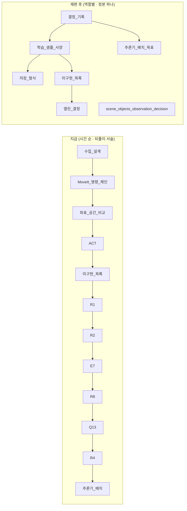

# docs/ 재편 계획

> **상태: 실행 완료 (2026-09-21) — 보관본.** 이 계획대로 재편했다. 결과는 [../INDEX.md](../INDEX.md).
> 계획과 달리 한 것: ① `collect/학습_데이터_전_과정_지도.md`(계획 작성 뒤 생긴 문서)는 `collect/` 에 두었다 → 현행 60건.
> ② `src/rdfp/rdfp/recorder/README.md` 는 줄이지 않고 정본 링크만 더했다(테스트 · 샘플 실행 절이 패키지 고유라서).
> ③ §6-18(세션 가이드의 흡수 문장)은 손대지 않았다. ④ 재편 직전 원본 전체는 `~/development/ros/rdfp_docs_backup_20260921/` 에 있다.
> 아래 본문의 경로는 **재편 전** 경로다.
> `docs/` 아래 markdown 80건(INDEX 제외)·2.4 MB 를 전수 검토한 결과와, 그것을 어떻게
> 합치고·나누고·옮길지의 안이다. 실행하면 이 문서는 `archive/` 로 보낸다.
>
> 검토 방법 — 문서마다 (1) 제목·절 구조, (2) 머리의 상태 선언, (3) 본문에 마지막으로
> 적힌 날짜, (4) 취소선(`~~`) 줄 수, (5) 다른 문서·코드·설정에서 오는 링크,
> (6) 삭제된 launch·CLI·필드 이름의 잔존 여부를 기계적으로 뽑고, 큰 문서는 결정·현황·
> 미결 절을 직접 읽었다. 코드 대조는 launch 파일 목록, `schema.sql` 의 테이블 목록,
> `robot_twin/config.py` 의 키, `scripts/`·`config/` 의 정본 파일로 했다.

---

## 목차

1. [진단 요약](#1-진단-요약)
2. [재편 원칙](#2-재편-원칙)
3. [목표 폴더 체계](#3-목표-폴더-체계)
4. [문서별 조치표](#4-문서별-조치표)
5. [합치기·나누기 상세](#5-합치기나누기-상세)
6. [내용 정정 목록 — 모순·구식](#6-내용-정정-목록--모순구식)
7. [링크·참조 갱신 목록](#7-링크참조-갱신-목록)
8. [실행 순서](#8-실행-순서)
9. [사용자가 정할 것](#9-사용자가-정할-것)

---

## 1. 진단 요약

### 1.1 숫자

| 항목 | 현재 | 재편 후 |
|---|---:|---:|
| markdown (INDEX 제외) | **80** | **59 현행 + 20 보관(`archive/`)** |
| 폴더 | 15 | **7 + `archive/`** |
| PDF 내보내기 | 7 (6건이 md 보다 낡음, 최대 40일) | 0 |
| 그 밖의 파일 (PNG · txt · yaml 사본 2 · sh 사본) | 5 | 0 |
| `INDEX.md` | 84 KB, "총 64개" 라고 적혀 있음 | 한 줄 요약표, 실제 개수 |

### 1.2 중복 (같은 내용이 두 곳 이상)

| 중복 | 근거 |
|---|---|
| `teleop/key_hold_user_guide.md` ≡ `teleop/key_hold_programmers_guide.md` | `diff` 로 **제목 한 줄 + 링크 한 줄**만 다르다. 그 링크(`servo_client_programmers_guide.md`)는 존재하지 않는 파일이다. `CLAUDE.md` 는 programmers 쪽을, `teleop/README.md`·`INDEX.md` 는 user 쪽을 가리킨다 |
| `omy_l100_docker_setup_and_usage.md` ⊂ `…_with_volumes.md` | 후자가 §3.6(볼륨·장치 매핑) 한 절을 더한 상위집합이다 (diff 77줄) |
| `rosbag2/record_rosbag.sh` vs `scripts/record_rosbag.sh` | docs 쪽은 옛 토픽 이름(`/ee_pose_publisher/ee_pose`, `/gripper_control/gripper_cmds`)이 박힌 낡은 사본이다 |
| `rosbag2/dataset_config.sample.yaml` vs `config/dataset_config.yaml` | docs 쪽에 환경변수 치환·`topics_file` 설명이 없다. `rosbag_config.sample.yaml` 은 코드가 더 이상 읽지 않는다(`src/` 에서 `rosbag_config` 를 참조하는 곳은 `src/rdfp/README.md` 뿐) |
| `recorder/ffmpeg_mp4_recorder_guide.md`(656줄) vs `src/rdfp/rdfp/recorder/README.md` | 둘 다 `FFMpegMp4Recorder` 생성자·상태 모델·예외를 설명한다 |
| Isaac sim_side 스크립트 일곱의 순서·역할 | `isaac_backend_skeleton.md` §6 · `isaac_bringup_runbook.md` §3 · `isaac_windows_setup.md` §7 세 곳 |
| Windows + WSL2 DDS 설정 | `isaac_backend_skeleton.md` §1 부록 · `isaac_windows_setup.md` |
| 펑션베이 실측값 | `미해결_작업`(87 KB) · `요청_목록`(102 KB) · `인수_체크리스트`(71 KB) · `이력_20260917`(94 KB) · `백엔드_설계`(51 KB) 가 서로 "정본은 저쪽"이라고 가리키며 같은 수치를 되풀이한다. 취소선 줄이 34 · 15 · 3 · 16 · 4 |
| 학습 데이터 설계 12건(480 KB) | 뒤 문서가 앞 문서의 결정·현황을 되풀이해 적는다 — 그리고 **그 되풀이한 자리에서 낡는다** (§1.4) |

### 1.3 폴더 배치가 어긋난 것

| 문서 | 지금 | 내용 |
|---|---|---|
| `camera/initial_requirements.md` | camera | **MP4 recorder** 요구사항 명세 (INDEX 도 지적) |
| `rosbag2/scene_objects_observation_decision.md` | rosbag2 | 학습 **입력** 에 넣을 것인가 — 학습 데이터 결정 |
| `gripper/grasp_center_frame.md` | gripper | 펑션베이 + Robotiq 전용 프레임·파지 높이 |
| `scene/isaac_scene_reset.md` | scene | Isaac 백엔드 구현 |
| `robot_twin/peg_in_hole_via_mcp_plan.md` | robot_twin | 펑션베이에서의 작업 기록 (교훈 전부 펑션베이 고유) |
| `camera/rdfp_camera_node_guide.md` · `rdfp_image_viewer_node_guide.md` | camera | `rdfp/camera/` 소속, `/session` 구동 — 수집 계층 |
| `environment/` · `session/` · `robot/` | 단일 문서 폴더 | 폴더가 문서 하나를 감싼다 |
| `omy_l100_*.md` · `OMY-L100 활용 절차.txt` | 루트 | OMY 는 이 워크스페이스에서 teleop 리더로만 쓴다 |
| `architecture.PNG` | 루트 | 참조하는 문서·코드가 없다 (`rdfp_framework_design.md` 는 mermaid 9개를 쓴다) |

### 1.4 모순·구식 (본문이 현재 코드·결정과 어긋남)

전체 목록은 §6. 대표적인 것:

| 문서 | 어긋난 서술 | 실제 |
|---|---|---|
| `rdfp_framework_design.md` §8·§9 | "데이터셋 export (LeRobot v3) **미구현**", "표준 토픽 이름 **설계안**", 미결 1(export 설계)·5(관절 이름 저장) | export 는 2026-09-19 구현(`.npz`, LeRobot 형식 **안 씀**), 그리퍼 채널 이름은 적용됨(`config/recording_topics*.list` 가 `/gripper_cmds`), `joint_names` 컬럼은 09-18 추가 |
| `robot_twin/robot_twin_design.md` 머리 | "**설계안 — 코드 미반영**" | 구현·운용 중. 사용 설명서는 "현행" |
| `rosbag2/데이터셋 후처리기 설계서.md` §3.3·§5.2 | `dataset` 단일 CLI + 서브커맨드, `rdfp/postproc/` 경로, 테이블 **5개** | 독립 명령 6개, `rdfp/dataset/`, `schema.sql` 테이블 **14개**(`motion_trajectories`·`motion_events`·`image_streams`·`image_frames`·`gripper_*`·`scene_objects`… 없음) |
| `rosbag2/데이터셋 후처리기 실환경 검증 절차.md` | `ros2 run rdfp dataset …` 13회, `rdfp/postproc/tests/` 7회 | 둘 다 없어진 이름 |
| `simulation/펑션베이_백엔드_설계.md` 머리 경고 | "시계 오프셋 2.22 s 가 이 문서에 없다", "그리퍼 스택 통합 **보류**" | 2.22 s 는 09-03 **폐기**, 그리퍼는 같은 문서 §9 가 "완료" |
| `simulation/gazebo_bringup_guide.md` §7 | "`teleop_keyboard` 는 `session_control` 없으면 기동 시 예외로 죽는다", `target_joint_states_publisher` | teleop 은 `wait_timeout_sec=0` 으로 살아남고 키만 무시한다; `target_joint_states_*` 는 launch 에서 제외된 구형 |
| `collect/학습_데이터의_좌표_공간_비교.md` §1.1 | "R2 는 **아직 없으며** 둘 다 녹화 목록과 적재가 안 붙었다" | R2 09-18 구현, I1 적재 완료 |
| `simulation/펑션베이_미해결_작업.md` §11 | "브랜치 `refactor/package-split`, 커밋되지 않음" | 워크스페이스가 git 저장소가 아니다 |
| `topic_naming_contract.md` §6 | "적용 순서 **(제안)**" 1~5 | 1~3 은 적용됨 (녹화 목록·코드가 정규 이름을 쓴다) |
| `INDEX.md` | "문서 총 64개", `펑션베이_벤더_메일_20260909_중력.md` · `key_hold_programmers_guide.md` 미등재, 상태 어휘 4개라 해 놓고 9개 사용(현황·구현 완료·설계 확정·검토·일부 실현) | — |

### 1.5 깨진 링크

| 위치 | 대상 |
|---|---|
| `CLAUDE.md` (2줄 · 3회) | `docs/gripper/GripperNode_Design.md` — 실제 파일은 `gripper_node_design.md` (대소문자) |
| `robot_twin/mcp_server_design.md` | `auto_episode_collection_draft.md` — 2026-09-14 삭제 |
| `teleop/key_hold_programmers_guide.md` | `../moveit/servo_client_programmers_guide.md` — 없음 |
| `robot_twin/robot_twin_design.md` | `file:///home/kwlee/mdt/share/extern_op/extern_op_revised.md` — 기계 로컬 경로 |
| `scene/isaac_scene_reset.md` | `## 7.` 절 번호 중복 (트윈 연산 · 관련 문서) |

---

## 2. 재편 원칙

1. **문서 종류를 넷으로 나누고 머리에 선언한다.** `절차`(사람이 실행하며 읽는다) ·
   `계약/사양`(코드와 1:1, 현행) · `설계/결정`(왜 그렇게 했나) · `이력`(갱신하지 않는다).
   상태 어휘도 이 넷 + `설계안`(미반영) + `구식`(어긋남 있음) **여섯으로 고정**한다.
2. **한 사실의 정본은 한 곳이다.** 다른 문서는 링크만 둔다 — 요약을 되풀이하면 그 자리에서
   낡는다 (§1.4 의 좌표 공간 문서·ACT §8 이 그 예다). `INDEX.md` 의 긴 요약도 같은 이유로
   없앤다.
3. **이력은 `archive/` 로 보내고 갱신하지 않는다.** 취소선으로 본문에 남기는 방식은
   문서를 두 배로 키우고(펑션베이 5건 합계 405 KB) 현행과 이력을 눈으로 가르게 만든다.
   보관본 머리에는 "작성 시점 기준, 상태 서술은 갱신하지 않음, 정본은 → 링크" 를 적는다.
4. **폴더는 코드 계층을 따른다.** `control/`(robot_control) · `collect/`(rdfp) ·
   `twin/`(robot_twin) · `backends/`(시뮬레이터·실기) · `teleop/` · `learning/`(학습 데이터
   설계) — 코드 패키지가 넷이므로 문서 폴더도 그 경계로 찾을 수 있게 한다.
5. **파일 이름에 공백을 쓰지 않는다** (`데이터셋 후처리기 설계서.md` → 링크마다 `%20`).
   한글 이름은 `_` 로 잇는다 — `CLAUDE.md` 의 규칙과 같다. 영문·한글 혼용은 그대로 둔다
   (일괄 개명은 링크 갱신 비용만 크고 얻는 것이 없다).
6. **생성물은 저장소에 두지 않는다.** PDF 7건 중 6건이 md 보다 낡았고(최대 40일) 나머지
   하나도 md 와 함께 갱신되지 않는다. 필요할 때 다시 만들면 된다.
7. **코드 옆 README(`src/**/README.md`, `launch/README.md`)는 건드리지 않는다.** 그쪽은
   패키지 소유이고, `docs/` 와의 중복은 `docs/` 쪽을 줄여 푼다.

---

## 3. 목표 폴더 체계

```
docs/
├── INDEX.md                         한 줄 요약표 (폴더별) + "하고 싶은 것 → 문서"
├── rdfp_framework_design.md         최상위 구조 (§8·§9 갱신)
├── topic_naming_contract.md         토픽 규약 (§6 적용 현황 갱신)
├── python_env_guide.md              ← environment/
│
├── control/                         제어 계층 — robot_control
│   ├── README.md                    ← moveit/README + gripper/README + camera/README
│   ├── move_group_client_user_guide.md
│   ├── move_group_jgpc_client_user_guide.md
│   ├── servo_client_user_guide.md
│   ├── gripper_node_design.md       계약
│   ├── gripper_action_node_guide.md ← + gripper_action_server_notes
│   ├── robotiq_2f_gripper_node_guide.md
│   ├── camera_nodes_guide.md        ← camera_node_guide + image_capture_node_guide
│   ├── image_viewer_node_guide.md
│   ├── opencv_camera_guide.md
│   ├── compressed_image_pipeline_design.md
│   └── scene_objects_guide.md       ← scene/
│
├── collect/                         수집 계층 — rdfp (세션 → 녹화 → 적재 → 재생)
│   ├── 수집_계층_얹기_절차서.md
│   ├── session_control_guide.md     ← session/
│   ├── session_camera_nodes_guide.md ← camera/rdfp_camera_node + rdfp_image_viewer_node
│   ├── rdfp_image_recorder_node_guide.md ← recorder/
│   ├── image_recorder_node_guide.md ← recorder/  (상태: 보조 — launch 없음)
│   ├── ffmpeg_mp4_recorder_guide.md ← recorder/
│   ├── rosbag_cli_user_guide.md     ← rosbag2/
│   ├── dataset_postproc_user_guide.md ← rosbag2/
│   ├── dataset_ingest_design.md     ← rosbag2/데이터셋 후처리기 설계서 (+ 운영 방안의 현행 부분)
│   └── replay_mock_stack_guide.md   ← replay/ (+ replay_approaches 를 배경 절로)
│
├── learning/                        학습 데이터 — 결정 · 사양 · 현황 · 열린 것
│   ├── 결정_기록.md                 (신규) D1~D13 + E7 §5.3 + 1차 목표 + 이유
│   ├── 학습_샘플_사양.md            (신규) 채널(R1·R2) · 샘플 구조 · 레이블 규칙 · 배치 규약
│   ├── 저장_형식.md                 ← E7_저장_형식_설계 (현행 사양 + 부록 C 실측)
│   ├── 추론기_배치_목표와_설계_이슈.md
│   ├── 미구현_목록.md               ← 학습_데이터_미구현_목록
│   ├── 열린_결정.md                 ← R4 + Q13 + R8 + 각 문서의 "열린 질문" 절
│   └── scene_objects_observation_decision.md ← rosbag2/
│
├── twin/                            REST 게이트웨이 · MCP
│   ├── robot_twin_user_guide.md
│   ├── robot_twin_design.md         (머리 상태 정정)
│   └── mcp_server_design.md
│
├── teleop/
│   ├── README.md
│   ├── external_input_adapters.md
│   ├── omy_leader_teleop_guide.md   (+ OMY-L100 활용 절차.txt 흡수)
│   ├── omy_l100_docker_setup.md     ← 루트 …_with_volumes.md
│   ├── teleop_retarget_node_guide.md
│   ├── clutch_pedal_guide.md
│   ├── key_hold_user_guide.md
│   ├── joystick_setup.md
│   ├── leader_follower_mirroring_design.md (상태: 현행 — 설계 근거)
│   └── servo_vs_planned_motion.md
│
├── backends/                        시뮬레이터 · 실기
│   ├── README.md                    (신규) 백엔드 비교표 + 프로파일 구조 + multi_simulator §0
│   ├── gazebo_bringup_guide.md      (상태: 미검증 · 보류)
│   ├── franka_panda_bringup_prep.md ← robot/
│   ├── isaac/
│   │   ├── isaac_bringup_runbook.md          절차 (정본)
│   │   ├── isaac_backend.md                  ← isaac_backend_skeleton 의 현행 부분
│   │   ├── isaac_windows_setup.md            (+ skeleton §1 Windows 부록)
│   │   └── isaac_scene_reset.md              ← scene/
│   └── functionbay/
│       ├── 펑션베이_백엔드_설계.md           (머리 경고 정정)
│       ├── 펑션베이_중력_보상.md
│       ├── 펑션베이_인수_체크리스트.md
│       ├── 펑션베이_요청_목록.md             (닫힌 절 본문을 부록 E 로 실제 이동)
│       ├── 펑션베이_남은_작업.md             ← 미해결_작업 의 §8·§9·§10 만
│       ├── grasp_center_frame.md             ← gripper/
│       └── peg_in_hole_via_mcp_plan.md       ← robot_twin/
│
└── archive/                         이력 — 갱신하지 않는다
    ├── README.md                    보관 규칙
    ├── learning/                    수집_설계 · MoveIt_명령_체인 · 좌표_공간_비교 · ACT 원문 ·
    │                                R1 · R2 · R4 · Q13 · R8 원문
    ├── functionbay/                 미해결_작업 원문 · 인수_체크리스트_이력_20260917 · 벤더 메일 2
    ├── isaac/                       isaac_phase_log (skeleton §2) · multi_simulator_backend_design
    ├── recorder_initial_requirements.md
    ├── dataset_postproc_verification_runbook.md  ← 실환경 검증 절차
    ├── rosbag2_operation_report.md  ← rosbag2 운영 방안 원문
    ├── leader_gripper_mapping_design.md
    └── 문서_재편_계획.md            (이 문서)
```

`data/README.md` 는 `data/` 에 그대로 두고 INDEX 에 등재한다(코드 옆 README 규칙).

---

## 4. 문서별 조치표

조치 어휘: **유지**(옮기지 않음) · **이동** · **합침**(→ 대상) · **분리** · **보관**(archive) ·
**삭제**. "정정" 열의 번호는 §6 의 항목이다.

### 4.1 루트

| 현재 | 조치 | 대상 | 이유 · 정정 |
|---|---|---|---|
| `INDEX.md` | 유지 · 재작성 | — | 한 줄 요약표로 슬림화, 개수·미등재·상태 어휘 정리 (§6-1) |
| `rdfp_framework_design.md` | 유지 | — | §8 표·§9 미결 갱신 (§6-2) |
| `topic_naming_contract.md` | 유지 | — | §6 적용 현황 (§6-3) |
| `environment/python_env_guide.md` | 이동 | `python_env_guide.md` | 단일 문서 폴더 해체 |
| `environment/python_env_guide.pdf` | 삭제 | — | md 보다 12일 낡음 |
| `omy_l100_docker_setup_and_usage.md` | 삭제 | — | `_with_volumes` 의 부분집합 |
| `omy_l100_docker_setup_and_usage_with_volumes.md` | 이동·개명 | `teleop/omy_l100_docker_setup.md` | OMY 는 teleop 리더 |
| `OMY-L100 활용 절차.txt` | 합침 | `teleop/omy_leader_teleop_guide.md` §3 | 컨테이너 기동 명령 세 터미널분 — 가이드 §3 이 `bridge.sh` 부터 시작해 그 앞 단계가 빠져 있다 |
| `architecture.PNG` | 삭제 | — | 참조 없음. 필요하면 framework_design 의 mermaid 가 대신한다 |

### 4.2 `control/` ← moveit · gripper · camera · scene

| 현재 | 조치 | 대상 | 이유 · 정정 |
|---|---|---|---|
| `moveit/README.md` · `gripper/README.md` · `camera/README.md` | 합침 | `control/README.md` | 세 "하려는 일 → 문서" 표를 한 진입점으로. 각 README 의 전체 그림·"세 가지만 기억한다" 는 절로 유지 |
| `moveit/move_group_client_user_guide.md` | 이동 | `control/` | — |
| `moveit/move_group_jgpc_client_user_guide.md` | 이동 | `control/` | — |
| `moveit/servo_client_user_guide.md` | 이동 | `control/` | — |
| `gripper/gripper_node_design.md` | 이동 | `control/` | 계약 정본. `CLAUDE.md` 의 대소문자 링크 정정 (§7) |
| `gripper/gripper_action_node_guide.md` + `gripper/gripper_action_server_notes.md` | 합침 | `control/gripper_action_node_guide.md` | 둘 다 액션 스택 한정. notes(388줄)를 "§9 액션 서버 계층 — 실측 노트" 로 붙인다. `GripperActionState` 삭제 경고는 한 곳에만 |
| `gripper/robotiq_2f_gripper_node_guide.md` | 이동 | `control/` | robot_control 노드 |
| `gripper/grasp_center_frame.md` | 이동 | `backends/functionbay/` | 펑션베이 + Robotiq 전용 (mock·Isaac 은 `frames.ee` 자체가 없다) |
| `camera/camera_node_guide.md` + `camera/image_capture_node_guide.md` | 합침 | `control/camera_nodes_guide.md` | 같은 `OpenCvCamera` 위의 robot_control 노드 둘. 각 노드는 절 하나 |
| `camera/image_viewer_node_guide.md` | 이동 | `control/` | — |
| `camera/opencv_camera_guide.md` | 이동 | `control/` | §11 "결론" 절은 뺀다 (가이드에 결론이 있을 이유가 없다) |
| `camera/compressed_image_pipeline_design.md` | 이동 | `control/` | 설계 근거, 현행 |
| `camera/rdfp_camera_node_guide.md` + `camera/rdfp_image_viewer_node_guide.md` | 합침 | `collect/session_camera_nodes_guide.md` | 둘 다 `rdfp/camera/`, `/session` 구동. Quick Start 의 `session_control_node` 기동 절차가 두 문서에 중복 |
| `camera/initial_requirements.md` | 보관 | `archive/recorder_initial_requirements.md` | recorder 요구사항 명세, 이력 |
| `scene/scene_objects_guide.md` | 이동 | `control/` | 계약 정본 |
| `scene/isaac_scene_reset.md` | 이동 | `backends/isaac/` | Isaac 구현. `## 7.` 중복 정정 |

### 4.3 `collect/` ← session · recorder · rosbag2 · replay · collect(절차서)

| 현재 | 조치 | 대상 | 이유 · 정정 |
|---|---|---|---|
| `collect/수집_계층_얹기_절차서.md` | 유지 | — | 수집 절차 정본 |
| `session/session_control_guide.md` | 이동 | `collect/` | — |
| `recorder/rdfp_image_recorder_node_guide.md` | 이동 | `collect/` | `rdfp_collect` 의 유일한 레코더 |
| `recorder/image_recorder_node_guide.md` | 이동 | `collect/` | 머리에 "보조 — 띄우는 launch 없음, 압축 미지원" 명시 (§9 에서 보관 여부 결정) |
| `recorder/ffmpeg_mp4_recorder_guide.md` | 이동 | `collect/` | `src/rdfp/rdfp/recorder/README.md` 와의 중복은 **src README 를 요약 + 링크로 줄여** 푼다 (원칙 7 의 예외 — 같은 클래스 API 를 두 곳에 유지할 이유가 없다) |
| `rosbag2/rosbag_cli_user_guide.md` | 이동 | `collect/` | — |
| `rosbag2/dataset_postproc_user_guide.md` | 이동 | `collect/` | — |
| `rosbag2/데이터셋 후처리기 설계서.md` | 이동·개명 | `collect/dataset_ingest_design.md` | 공백 제거. §3.2 경로 · §3.3 CLI · §5.2 스키마 갱신 (§6-4). `rosbag2 운영 방안` 의 **현행인 부분**(§4 디렉터리 구조 · §5.3 분할 · §8 재실행 규칙)을 "§0 rosbag 저장 구조" 로 흡수 |
| `rosbag2/데이터셋 후처리기 실환경 검증 절차.md` | 보관 | `archive/dataset_postproc_verification_runbook.md` | Phase 1~3 초기 검증용. 구 CLI·구 경로. 시나리오는 운영 가이드 §8 이 대신한다 |
| `rosbag2/rosbag2 운영 방안.md` | 분리 → 보관 | 현행 부분은 위 설계서로, 원문은 `archive/rosbag2_operation_report.md` | 909줄 중 systemd·인덱스 파일·retention(§9.2·§10·§12)은 구현되지 않았다. INDEX 의 "현행" 은 틀렸다 |
| `rosbag2/scene_objects_observation_decision.md` | 이동 | `learning/` | 학습 입력 결정 |
| `rosbag2/dataset_config.sample.yaml` · `rosbag_config.sample.yaml` · `record_rosbag.sh` | 삭제 | — | `config/`·`scripts/` 의 낡은 사본 |
| `rosbag2/scene_objects_observation_decision.pdf` | 삭제 | — | — |
| `replay/replay_mock_stack_guide.md` + `replay/replay_approaches.md` | 합침 | `collect/replay_mock_stack_guide.md` | approaches(221줄)는 "§0 배경 — 무엇을 명령할 것인가" 절로. `replay_panda_mock.launch.py` 주석 갱신 |

### 4.4 `learning/` ← collect 의 설계 문서 12건

§5.1 에 통합 설계가 있다.

| 현재 | 조치 | 대상 | 이유 |
|---|---|---|---|
| `학습_데이터_수집_설계.md` | 분리 → 보관 | §0 → `결정_기록.md`, §7~§9 → `학습_샘플_사양.md`, 원문 → `archive/learning/` | 결정은 §0 에 이미 모여 있다. 나머지는 대안 평가·실측 |
| `MoveIt_명령_체인과_트윈_데이터_생성.md` | 분리 → 보관 | §1.2 백엔드 차이표 → `backends/README.md`, §3 명령 체인 L0~L4 → `학습_샘플_사양.md`, 원문 → archive | 스스로 "근거 문서" 로 강등했고 §6~§8·§10.3·§11·§12 는 이미 비워져 있다 |
| `학습_데이터의_좌표_공간_비교.md` (106 KB) | 보관 | `archive/learning/` | 데카르트 단계는 **보류**(미구현 목록 §7, 배치 목표 §2 "백엔드 혼합 범위 밖"). §3.6 모델 스냅샷·§5.6 TCP 계약 권고만 `열린_결정.md` 에 항목으로 옮긴다 |
| `ACT_학습_샘플_구성.md` | 분리 → 보관 | 경우 B(§3·§5·§7) → `학습_샘플_사양.md`, §9 → `열린_결정.md`, 원문 → archive | 경우 A 는 비교 기준(E5)으로만 남아 사양에서 뺀다 |
| `R1_실행_궤적_채널_구현_설계.md` · `R2_연산_이벤트_채널_구현_설계.md` | 분리 → 보관 | §3.1 메시지 정의 · 불변식(`failed` 만 짝 궤적 없음) · t₀ 정의 → `학습_샘플_사양.md` "채널" 절, 원문 → archive | 구현 완료. 실측(t₀ 후보 22시행 등)은 보관본에 남는다 |
| `E7_저장_형식_설계.md` | 이동·개명 | `learning/저장_형식.md` | 현행 사양 + 결정 이유(§5.3) + 부록 C 실측. 코드·설정·스크립트 7곳이 가리키므로 파일은 유지하고 §3~§4 선택지 비교만 접는다 |
| `추론기_배치_목표와_설계_이슈.md` | 이동 | `learning/` | 목표 정본 |
| `학습_데이터_미구현_목록.md` | 이동·개명 | `learning/미구현_목록.md` | 구현된 행(R1·R2·R5·R6·I3·I4·E1~E7)은 "§9 이미 있는 것" 으로 접어 남은 것만 앞에 |
| `R4_…고려사항.md` · `Q13_…고려사항.md` · `R8_…설계.md` | 합침 → 보관 | `열린_결정.md` 의 절 셋, 원문 → archive | 셋 다 "결정 전", 서로 참조, 합계 48 KB. 한 문서의 절로 두면 결정될 때 한 곳만 고친다 |
| `학습_데이터_수집_설계.pdf` | 삭제 | — | — |

### 4.5 `twin/` ← robot_twin

| 현재 | 조치 | 대상 | 이유 · 정정 |
|---|---|---|---|
| `robot_twin_user_guide.md` | 이동 | `twin/` | — |
| `robot_twin_design.md` | 이동 | `twin/` | 머리 상태 정정, §2.5 정리, `file://` 링크 제거 (§6-5) |
| `mcp_server_design.md` | 이동 | `twin/` | 깨진 링크 제거, §8 남은 일 갱신 (§6-6) |
| `peg_in_hole_via_mcp_plan.md` | 이동 | `backends/functionbay/` | 교훈(지령 주기 · 정착 대기 · 트레이 모따기)이 전부 펑션베이 고유. `robot_twin_panda_functionbay.yaml` 주석 갱신 |
| `robot_twin_user_guide.pdf` · `mcp_server_design.pdf` | 삭제 | — | — |

### 4.6 `teleop/`

| 현재 | 조치 | 대상 | 이유 · 정정 |
|---|---|---|---|
| `README.md` | 유지 | — | 문서 수 갱신 |
| `key_hold_programmers_guide.md` | 삭제 | — | `key_hold_user_guide.md` 와 동일. `CLAUDE.md` 2곳 링크 갱신 |
| `key_hold_user_guide.md` · `clutch_pedal_guide.md` · `teleop_retarget_node_guide.md` · `external_input_adapters.md` · `joystick_setup.md` · `servo_vs_planned_motion.md` | 유지 | — | `servo_vs_planned_motion` 은 Isaac 에서 발견했지만 servo+JTC 공통 동작이고 코드 8곳이 가리키므로 옮기지 않는다 |
| `omy_leader_teleop_guide.md` | 유지 | — | txt 흡수 |
| `leader_follower_mirroring_design.md` | 유지 | — | 상태를 "현행 — 설계 근거" 로, §8 로드맵 1~4 완료 표시 |
| `leader_gripper_mapping_design.md` | 보관 | `archive/` | 전제 둘이 무효(트리거 관절 미확인, `GripperCommand` 가 숫자를 안 싣는다). 되살릴 때 인터페이스 결정이 먼저라고 스스로 적었다 |
| `clutch_pedal_guide.pdf` · `omy_leader_teleop_guide.pdf` | 삭제 | — | — |

### 4.7 `backends/` ← simulation · robot · scene · gripper · robot_twin 일부

| 현재 | 조치 | 대상 | 이유 · 정정 |
|---|---|---|---|
| (신규) | 생성 | `backends/README.md` | §5.3 |
| `simulation/multi_simulator_backend_design.md` | 분리 → 보관 | §0 → `backends/README.md`, 원문 → `archive/isaac/` | §1~§11 은 채택되지 않은 launch 재배치안. 삭제된 `rdfp_panda_mock` 7회 언급. §5 계약·§7 URDF 전략만 README 에 한 절로 |
| `simulation/isaac_bringup_runbook.md` | 이동 | `backends/isaac/` | 절차 정본 |
| `simulation/isaac_backend_skeleton.md` (1628줄) | 분리 | 현행 → `backends/isaac/isaac_backend.md`, §2 Phase 0~11 → `archive/isaac/isaac_phase_log.md`, §1 Windows 부록 → `isaac_windows_setup.md` | §0 결정 · §3 골격 · §4 재사용 · §5 하드웨어 · §6 운용 근거 · §7 함정 사전 · §8 열린 결정이 현행. Phase 로그 ~500줄은 완료된 이력. `rdfp_panda_isaac.launch.py`·`planning_scene_sync` 잔존 정정 |
| `simulation/isaac_windows_setup.md` | 이동 | `backends/isaac/` | §7 스크립트 표는 runbook §3 링크로 대체 (세 곳 중복 해소) |
| `scene/isaac_scene_reset.md` | 이동 | `backends/isaac/` | — |
| `simulation/펑션베이_백엔드_설계.md` | 이동 | `backends/functionbay/` | 머리 경고 정정 (§6-7) |
| `simulation/펑션베이_중력_보상.md` | 이동 | `backends/functionbay/` | — |
| `simulation/펑션베이_인수_체크리스트.md` | 이동 | `backends/functionbay/` | 절차 정본 |
| `simulation/펑션베이_요청_목록.md` | 이동 · 정리 | `backends/functionbay/` | 취소선 절 본문(A-2·A-3·B-1·B-4·B-5·B-6·B-7·B-10·B-12)을 부록 E 로 **실제로 옮긴다** — 지금은 "옮겼다" 고 적혀 있으나 본문에 그대로 있다. §0.1 이력 절 → archive |
| `simulation/펑션베이_미해결_작업.md` (1352줄) | 분리 → 보관 | §8 남은 작업 · §9 재현 절차 · §10 함정 → `backends/functionbay/펑션베이_남은_작업.md`, 원문 → `archive/functionbay/` | §0 이 스스로 "이 절과 §7 의 일부는 낡았다" 고 적었고 취소선 34줄. §11 저장소 상태는 삭제 |
| `simulation/펑션베이_인수_체크리스트_이력_20260917.md` | 보관 | `archive/functionbay/` | 스스로 보존본이라 선언 |
| `simulation/펑션베이_벤더_메일_20260903_정지.md` · `…_20260909_중력.md` | 보관 | `archive/functionbay/` | 발송본. 상태(회신 대기)는 요청 목록 §0 이 갖는다. 후자는 INDEX 미등재였다 |
| `gripper/grasp_center_frame.md` | 이동 | `backends/functionbay/` | — |
| `robot_twin/peg_in_hole_via_mcp_plan.md` | 이동 | `backends/functionbay/` | — |
| `simulation/gazebo_bringup_guide.md` | 이동 | `backends/` | 상태 "미검증 · 보류" (`ros_gz_sim` 미설치, 런타임 검증 없음). §7·§8 정정 (§6-8) |
| `robot/franka_panda_bringup_prep.md` | 이동 | `backends/` | 설계안 |

### 4.8 `archive/`

| 조치 | 내용 |
|---|---|
| 생성 `archive/README.md` | 규칙 셋 — ① 갱신하지 않는다 ② 보관본 머리에 "보관일 · 정본 링크 · 이 문서의 상태 서술은 작성 시점 기준" 을 붙인다 ③ 코드·설정에서 archive 를 가리키지 않는다(가리키던 곳은 정본으로 바꾼다) |
| 보관 목록 | §3 트리의 `archive/` 아래 20건 |

---

## 5. 합치기·나누기 상세

### 5.1 `learning/` — 12건을 7건으로

지금 12건은 2026-09-13~19 에 **결정에 이르는 순서**로 쓰였다. 결정이 났으니 읽는 순서를
**결정 → 사양 → 현황 → 열린 것** 으로 바꾼다.



**`결정_기록.md`** — 표 하나. 열: 번호 · 결정 · 날짜 · 상태(확정/잠정) · **이유** · 근거(보관본 링크).

| 번호 | 출처 | 내용 |
|---|---|---|
| D1~D13 | 수집_설계 §0 | 출처는 트윈만 · 팔 action 은 관절-계획 · 이벤트 녹화 · export 가 공백을 채움 · ACT · 채널 이름 |
| D14 | E7 §5.3 | LeRobot **형식은 안 쓰고** `ACTPolicy` 만 (`lerobot==0.4.4`) — 이유: 표준 로더의 균일 격자 · 0.1 ms 허용오차 · Python 3.10 |
| D15 | E7 §5 | 저장은 에피소드별 `.npz` + `metadata.json`, chunk 미리 계산, 정규화는 학습 때 |
| D16 | 추론기_배치 §3.1 | 1차는 isaac 줄, 두 줄의 데이터를 섞지 않음, 데카르트 단계 보류 |
| D17 | scene_objects_observation_decision §6 | 적재 O · 관측 X, 재검토 트리거 |
| D18 | 미구현_목록 §8 중 결정된 Q | 예: Q9(LeRobot) 해소 |
| (참고) | 2026-09-20 결정 | isaac 씬 기하(탁자 0.3 · 실린더 반지름 0.03 · 카메라 8° 상향) · 카메라 rgb8 · 녹화 목록에서 이미지 토픽 제외 — `추론기_배치` 의 "전제 변경" 주와 통일 |

**`학습_샘플_사양.md`** — "지금 파이프라인이 만드는 것" 만. 절: ① 채널(R1·R2 메시지 필드,
`operation_id` 짝, `failed` 불변식, isaac t₀ = goal 전송 시각) ② 명령 체인 L0~L4 표
③ 샘플 구조(`image` · `qpos[8]` · `action[k,10]` · `is_pad`) ④ 레이블 규칙 `plan(τ)` ·
그리퍼 one-hot · 관절-명령 비교 기준 ⑤ frame clock ⑥ 배치 규약(10 Hz · temporal
ensembling · `assert_compatible`) ⑦ 실측 상수(카메라 실효 주기 등, 출처 링크).
**대안 비교·권고 문장은 넣지 않는다** — 그건 결정_기록의 "이유" 열이다.

**`열린_결정.md`** — R4(metadata 규약) · Q13′(중력 보상 기록) · R8(보상 전 명령) 을 절로
합치고, ACT §9 · E7 §9 · 수집_설계 §0.5·§11 · 좌표_공간 §8 · 미구현_목록 §8 에 흩어진
"열린 질문" 표를 **하나로** 모은다. 이미 닫힌 것(Q9′ · Q1 · Q2′ 등)은 결정_기록으로.

### 5.2 `isaac_backend_skeleton.md` — 1628줄을 셋으로

| 절 | 줄 | 간다 |
|---|---:|---|
| §0 결정 사항 · §3 골격 · §4 재사용 · §5 하드웨어 · §6 운용 근거 · §7 함정 사전 · §8 열린 결정 | ~900 | `backends/isaac/isaac_backend.md` — 현행 |
| §1 배포 부록 "Windows 에서 Isaac 을 돌릴 때" | ~35 | `isaac_windows_setup.md` (이미 같은 내용) |
| §2 단계 계획 Phase 0~11 | ~500 | `archive/isaac/isaac_phase_log.md` — 전부 완료. 각 Phase 의 수용 기준 수치(정착 0.3 mrad 등)는 `isaac_backend.md` §3 에 표 하나로 남긴다 |

`§8 열려 있는 결정` 의 닫힌 항목(Q1~Q21 중 17건)도 phase log 로 보낸다 — "닫힌 항목은 지우지
않는다" 는 원칙은 archive 가 지킨다.

### 5.3 `backends/README.md` — 신규, 짧게

① 백엔드 비교표(`MoveIt_명령_체인` §1.2 를 옮기고 mock·gazebo 열 추가: 연동 방식 · 클라이언트 ·
시계 · `/scene/reset` · 카메라 형식 · 그리퍼 노드 · 실주행 검증 여부) ② 프로파일
`config/backends/<이름>.yaml` 한 줄 소개 + `src/robot_control/config/backends/README.md` 링크
③ `multi_simulator_backend_design` §0 "실제로 만든 것 / 왜 §4 가 아니었나" ④ 하위 폴더 안내.

### 5.4 펑션베이 — 8건 405 KB 를 7건으로

| 정본 | 갖는 것 |
|---|---|
| `펑션베이_백엔드_설계.md` | 구조 · 채널 · 계약 충족 현황 · 인자 |
| `펑션베이_인수_체크리스트.md` | **최신 실측값** (A·B·C 표) 과 측정 함정 — 이미 다른 문서들이 "정본은 체크리스트" 라고 가리킨다 |
| `펑션베이_요청_목록.md` | 벤더 요청의 상태 (살아 있는 8건 앞에, 닫힌 것은 부록) |
| `펑션베이_남은_작업.md` | 우리 쪽 남은 항목(§8) · 재현 절차(§9) · 함정(§10) — 새 파일, 300줄 이하 |
| `펑션베이_중력_보상.md` · `grasp_center_frame.md` · `peg_in_hole_via_mcp_plan.md` | 각각 현상 하나의 기록 |

원칙: **수치는 체크리스트에만**, 나머지는 절 번호로 가리킨다. 지금은 같은 수치(처짐 0.0097 rad,
τ 108.9/199.7 ms, 정지 33.5 s)가 다섯 문서에 있다.

### 5.5 그 밖의 합침

| 합침 | 방법 |
|---|---|
| `gripper_action_node_guide` + `gripper_action_server_notes` | notes 를 §9 로. 목차·"관련 문서" 절 병합. `GripperActionState` 삭제 경고는 §1 채널 표의 각주 하나로 |
| `camera_node_guide` + `image_capture_node_guide` | §1 "어느 노드인가"(현 camera/README 의 비교표) → §2 `camera_node` → §3 `image_capture_node` → §4 공통(`OpenCvCamera` 링크 · 트러블슈팅) |
| `rdfp_camera_node_guide` + `rdfp_image_viewer_node_guide` | 같은 틀. Quick Start 의 `session_control_node` 기동은 한 번만 적고 `session_control_guide` 링크 |
| `replay_mock_stack_guide` + `replay_approaches` | approaches 를 "§0 배경" 으로. 부록(데시메이션)은 유지 |
| `omy_leader_teleop_guide` + `OMY-L100 활용 절차.txt` | §3 앞에 "터미널 0 — OMY 컨테이너 (zenoh 라우터 · bringup · 확인)" 추가 |

---

## 6. 내용 정정 목록 — 모순·구식

이동·합침과 별개로 **문장을 고쳐야 하는 것**이다. 실행 시 §8 의 4단계에서 처리한다.

| # | 문서 | 고칠 것 |
|---|---|---|
| 1 | `INDEX.md` | 개수(64 → 실제), 미등재 2건, 상태 어휘를 여섯으로(§2-1), `rosbag2 운영 방안` 의 "현행" → 이력, `robot_twin_design` 의 "설계안" → 현행(설계 근거), `data/README.md` 등재, "문서 정비가 필요한 항목" 표는 이 계획으로 대체 |
| 2 | `rdfp_framework_design.md` | §8 표: export → 현행(`.npz`, LeRobot 형식 아님), 표준 토픽 이름 → 현행, "robot twin 주변 물체 정보" → 현행(`scene_objects` 변수 · `reset_scene`). §9: 1(export 설계) · 2(물체 위치 — `/scene/objects` 계약 완료) · 5(관절 이름 — `joint_names TEXT[]` 09-18) 닫힘. §2.1 `/ee_pose` TCP 계약은 좌표 공간 문서가 archive 로 가므로 링크를 `열린_결정.md` 로 |
| 3 | `topic_naming_contract.md` | §6 "(제안)" → 1~3 적용됨(날짜), 4~5 미구현. "지금 어긋난 곳" 절은 해소된 것을 지운다 |
| 4 | `dataset_ingest_design.md` (← 설계서) | §1.5·§3.2 `rdfp/postproc/` → `rdfp/dataset/`; §3.3 `dataset` 서브커맨드 → 독립 명령 6개 + `rosbag` 서브커맨드 5개; §5.1·§5.2 테이블 5 → 14(`schema.sql` 정본) — 특히 `motion_trajectories`·`motion_events`·`image_streams`·`image_frames`·`gripper_cmds`·`gripper_states`·`scene_objects`·`topics`; §9 에 I4(레코더 mp4 등록 · `episode_key`)와 `recordings_dir`; §10.1 에 sim 시계 겹침 함정(2026-09-20) |
| 5 | `robot_twin_design.md` | 머리 "설계안 — 코드 미반영" → "현행 — 설계 근거 · 결정 이력"; §2.5 제목 "`rdfp` 패키지 내부에 둔다" → "패키징 — `robot_twin` 독립 패키지 (2.5 의 분리 트리거 발동)" 로 본문 순서 바꿈; `file:///home/kwlee/…` 링크 → 저장소 밖 문서임을 글로 적고 링크 제거; §9 "rdfp 구현 격차" → "구현 현황" |
| 6 | `mcp_server_design.md` | `auto_episode_collection_draft.md` 링크 → `twin/robot_twin_user_guide.md` 의 자동 수집 절; §8 "실 스택 검증 (mock)" → 펑션베이 peg-in-hole 로 실증됨(09-11) · isaac 은 `robot-twin-collect` 로 65 에피소드 수집(09-20); `rdfp_panda_mock.launch.py` → `panda_mock` + `rdfp_collect` |
| 7 | `펑션베이_백엔드_설계.md` | 머리 경고에서 "시계 오프셋 2.22 s" 삭제(폐기), "그리퍼 스택 통합 보류" → 완료(§6 · §9 와 일치), "먼저 읽어야 할 문서" → `펑션베이_남은_작업.md` + 체크리스트 |
| 8 | `gazebo_bringup_guide.md` | 머리에 "미검증 · 보류 — `ros_gz_sim` · `ign_ros2_control` 미설치, 런타임 검증 없음, 백엔드 프로파일 없음"; §7 `teleop_keyboard` 죽는다 → 키만 무시; `target_joint_states_publisher` → `target_joint_cmds_publisher`; §8 후속 과제의 "Phase 1 launch 분리" · "`backend_isaac`" 삭제(Isaac 은 완료, launch 분리안은 폐기) |
| 9 | `isaac_backend.md` (← skeleton) | `rdfp_panda_isaac.launch.py` 3곳 → `rdfp_collect backend:=isaac`; `planning_scene_sync` 3곳은 Q8 이력이므로 phase log 로; D6 의 `enable_image_viewer` 기본 `true` → **`false`** (2026-09-20 변경) |
| 10 | `isaac_windows_setup.md` | §7 "스크립트 6개" → 일곱(`tune_grasp` 포함), 순서 표는 runbook §3 링크 |
| 11 | 삭제된 launch 이름의 잔존 | `rdfp_panda_*` 는 §6-6 · §6-9 두 곳만 현행 문서에 남는다(`multi_simulator` 는 archive 로 가므로 손대지 않는다). `omy_leader_teleop_guide`·`move_group_*`·`external_input_adapters` 등의 `panda_mock_jgpc` 는 **실존 launch** 라 그대로 |
| 12 | `학습_샘플_사양.md` 작성 시 | 좌표_공간 §1.1 의 "R2 는 아직 없다" 류 상태 문장은 옮기지 않는다 — 사양에는 상태가 없다 |
| 13 | `미구현_목록.md` | ACT §8 표·수집_설계 §0.5 에 있던 "되었다(날짜)" 행과 대조해 한 곳으로. C1~C5(데카르트) 는 "보류" 절로 접는다 |
| 14 | `펑션베이_남은_작업.md` 작성 시 | §11 저장소 상태(git) 삭제; §8 의 3(중력 처짐 방침) 은 09-11 보상으로 닫힘 — `펑션베이_중력_보상.md` 가 정본 |
| 15 | `펑션베이_요청_목록.md` | §0 요약 첫 문단의 "A-1 이 가장 중요했고" 시제 정리; "닫힌 항목은 부록 E 로 옮겼다" 를 사실로 만든다(본문 취소선 절 9개 실제 이동) |
| 16 | `isaac_scene_reset.md` | `## 7.` 둘 → `## 7.` 트윈 연산 · `## 8.` 관련 문서 |
| 17 | `leader_follower_mirroring_design.md` | 상태 줄 추가 "현행 — 설계 근거. §8 로드맵 1~4 완료(`teleop_mirror.launch.py` · `teleop_retarget`), 5(PoseTracking C++) 미착수" |
| 18 | `session_control_guide.md` | "옛 `session_control_client_guide.md` 를 흡수했다" 문장 삭제(이력) — 선택 |
| 19 | `opencv_camera_guide.md` | §11 결론 삭제 |
| 20 | `image_recorder_node_guide.md` | 머리에 "보조 — 2026-09-13 부터 어느 launch 도 띄우지 않는다. `CompressedImage` 미지원. 세션 구동 레코더가 기본" |

---

## 7. 링크·참조 갱신 목록

파일을 옮기면 **`docs/` 밖**의 참조가 깨진다. `CLAUDE.md` 가 경고하는 그 함정이다 — 실행 시
아래를 한 번에 치환하고 `py_compile`·YAML 파싱으로 확인한다. (`grep -rnoE 'docs/[^ )]+\.md'
src scripts config CLAUDE.md README.md` 결과, 2026-09-20)

| 옮기는 문서 | 가리키는 곳 |
|---|---|
| `gripper/gripper_node_design.md` → `control/` | `CLAUDE.md`(3, **대소문자도**) · `src/rdfp_msgs/README.md` · `src/robot_control/launch/README.md` · `robot_control/gripper/__init__.py` · `gripper_action_node.py` · `robotiq_2f_gripper_node.py` · `launch_helpers/gripper.py` · `setup.py` · `rdfp/teleop/teleop_keyboard.py` · `scripts/isaac/is_check_phase6.py` |
| `gripper/README.md` → `control/README.md` | `CLAUDE.md`(2) |
| `gripper/grasp_center_frame.md` → `backends/functionbay/` | `CLAUDE.md`(2) · `scripts/functionbay/fb_grasp.py` |
| `scene/scene_objects_guide.md` → `control/` | `CLAUDE.md`(2) · `src/rdfp_msgs/README.md` · `src/robot_control/README.md` · `config/isaac_scene.json` · `config/functionbay_scene.json` · `robot_control/scene/fixtures.py` · `scripts/isaac/is_check_phase3.py` |
| `scene/isaac_scene_reset.md` → `backends/isaac/` | `scripts/run_isaac_sim.sh`(2) · `robot_twin/config/robot_twin_panda_isaac.yaml` · `robot_twin/tests/test_arm_command_config.py` · `test_isaac_scene_recipe.py` |
| `camera/README.md` → `control/README.md` | `robot_control/camera/camera_node.py` · `image_capture.py` · `rdfp/camera/rdfp_camera_node.py` |
| `camera/compressed_image_pipeline_design.md` → `control/` | `src/robot_control/launch/README.md`(4) · `src/rdfp/launch/README.md` · `config/backends/README.md`(2) · `launch/panda_functionbay.launch.py`(2) · `backends/base.py` · `launch_helpers/camera.py` · `tests/test_camera_source.py` |
| `camera/rdfp_camera_node_guide.md` → `collect/session_camera_nodes_guide.md` | `src/rdfp/launch/README.md` |
| `recorder/*` → `collect/` | `src/rdfp/README.md`(3종 5회) · `src/rdfp/launch/rdfp_collect.launch.py`(2) · `rdfp/recorder/rdfp_image_recorder_node.py` |
| `session/session_control_guide.md` → `collect/` | `src/rdfp/README.md`(2) · `scripts/run_collect_isaac.sh` · `rdfp/session/__init__.py` · `session_control_node.py` · `tests/test_session_control_node.py`(2) |
| `rosbag2/dataset_postproc_user_guide.md` → `collect/` | `src/rdfp/README.md` · `scripts/clear_dataset.sh`(2) |
| `rosbag2/데이터셋 후처리기 설계서.md` → `collect/dataset_ingest_design.md` | `src/rdfp/README.md` · `config/dataset_config.yaml` |
| `rosbag2/데이터셋 후처리기 실환경 검증 절차.md` → archive | `src/rdfp/README.md` (링크 삭제) |
| `rosbag2/scene_objects_observation_decision.md` → `learning/` | `config/recording_topics.list` · `config/recording_topics_isaac.list` · `rdfp/dataset/db/registry.py` |
| `replay/replay_mock_stack_guide.md` → `collect/` | `CLAUDE.md`(2) · `src/rdfp/CLAUDE.md`(2) · `src/rdfp/README.md`(4) · `src/rdfp/launch/README.md`(4) · `src/rdfp/config/replay_panda_mock.yaml` |
| `replay/replay_approaches.md` → 합침 | `src/rdfp/launch/replay_panda_mock.launch.py`(2) → 합친 문서의 §0 |
| `collect/E7_저장_형식_설계.md` → `learning/저장_형식.md` | `CLAUDE.md`(4) · `config/image_pipeline.yaml` · `rdfp/dataset/export/writer.py` · `export_cmd.py` · `scripts/run_collect_isaac.sh` |
| `collect/R1_…` · `R2_…` → archive | `CLAUDE.md`(2, R2) · `robot_control/moveit/motion_trajectory_publisher.py` · `motion_event_publisher.py` · `move_group_jtc_client.py` → **`learning/학습_샘플_사양.md` 채널 절**로 (archive 를 코드가 가리키지 않는다) |
| `collect/ACT_학습_샘플_구성.md` → archive | `rdfp/dataset/export/motion_label.py` → `학습_샘플_사양.md` |
| `collect/추론기_배치_목표와_설계_이슈.md` → `learning/` | `config/isaac_scene.json` |
| `collect/수집_계층_얹기_절차서.md` (유지) | `README.md`(2) · `src/rdfp/launch/README.md`(2) · `scripts/run_collect_isaac.sh` — 변화 없음 |
| `simulation/isaac_backend_skeleton.md` → `backends/isaac/isaac_backend.md` | `CLAUDE.md`(2) · `src/robot_twin/README.md` · `robot_twin/config/robot_twin_panda_isaac.yaml` · `config/panda_real_joint_limits.yaml` · `scripts/isaac/is_backend.py` · `is_check_phase0.py` · `is_check_phase1.py` · `sim_side/setup_graph.py` · `scripts/run_isaac_sim.sh` |
| `simulation/isaac_bringup_runbook.md` → `backends/isaac/` | `scripts/run_collect_isaac.sh` · `scripts/run_isaac_sim.sh` |
| `simulation/multi_simulator_backend_design.md` → archive | `launch/panda_functionbay.launch.py` · `robot_control/functionbay/__init__.py` → `backends/README.md` |
| `simulation/펑션베이_*.md` → `backends/functionbay/` | `CLAUDE.md`(4+2+9+2) · `config/backends/README.md`(2) · `config/backends/functionbay.yaml` · `robot_twin/config/robot_twin_panda_functionbay.yaml`(2) · `launch/README.md`(2) · `launch_helpers/ee_pose.py` · `gripper/robotiq_2f_gripper_node.py` + 테스트 · `functionbay/stamp_alignment.py` · `scripts/functionbay/fb_checkup.py` · `fb_curl.py` · `fb_gains.py` · `fb_grasp.py` · `fb_move_peg.py` · `fb_sag_map.py` |
| `simulation/gazebo_bringup_guide.md` → `backends/` | `src/robot_control/launch/README.md`(2) |
| `robot_twin/*.md` → `twin/` | `src/robot_twin/README.md`(3) · `robot_twin/__init__.py` · `backends.py` · `config/robot_twin_panda01.yaml` · `…_isaac.yaml` · `…_functionbay.yaml`(2) |
| `robot_twin/peg_in_hole_via_mcp_plan.md` → `backends/functionbay/` | `robot_twin/config/robot_twin_panda_functionbay.yaml` |
| `teleop/key_hold_programmers_guide.md` 삭제 | `CLAUDE.md`(2) → `key_hold_user_guide.md` |
| `teleop/leader_gripper_mapping_design.md` → archive | `rdfp_framework_design.md` · `gripper/README.md`(합침 대상) |
| `moveit/*` → `control/` | `src/robot_control/launch/README.md`(2) · `robot_twin_design.md` · `robot_twin_user_guide.md` 등 docs 내부 |
| `environment/python_env_guide.md` → 루트 | `rdfp_framework_design.md` 외 docs 내부 4곳 |
| `CLAUDE.md` "External docs" 절 | 폴더 이름 전부(`docs/moveit/`·`docs/gripper/`·`docs/camera/`·`docs/recorder/`·`docs/session/`·`docs/rosbag2/`·`docs/replay/`·`docs/teleop/`) 다시 쓴다. "문서 파일 이름을 바꿀 때" 항목의 예시도 새 경로로 |

`docs/` 안의 상대 링크는 옮긴 뒤 §8 의 검사 스크립트로 잡는다 — 손으로 세지 않는다.

---

## 8. 실행 순서

한 번에 하지 않는다. 단계마다 **링크 검사가 0 이어야** 다음으로 간다.

| 단계 | 할 일 | 검증 |
|:-:|---|---|
| 0 | 링크 검사 스크립트를 먼저 만든다 — `docs/`·`src/`·`scripts/`·`config/`·`CLAUDE.md`·`README.md` 의 `](…\.md…)` · `docs/…\.md` 를 전부 뽑아 존재 여부를 확인. **지금 돌리면 §1.5 의 4건이 나와야 한다** (기준선) | 스크립트가 §1.5 를 재현 |
| 1 | **삭제·보관** — PDF 7 · PNG · rosbag2 사본 3 · `key_hold_programmers_guide` · `omy…usage.md`; `archive/` 생성 + README; 보관 대상 중 **분리가 필요 없는 것**(이력_20260917 · 벤더 메일 2 · initial_requirements · 실환경 검증 절차 · leader_gripper_mapping) 이동 | 링크 검사 (깨지는 것은 §7 의 항목뿐이어야 한다) |
| 2 | **폴더 이동 (내용 불변)** — `control/`·`collect/`·`learning/`·`twin/`·`backends/` 생성, 개명 없이 옮길 수 있는 것부터. `git mv` 가 없으므로 `mv` 뒤 §7 표대로 `sed` 치환 | 링크 검사 0 · `python3 -m py_compile` (참조 갱신한 `.py`) · `python3 -c 'import yaml…'` (`.yaml`) · `bash -n` (`.sh`) · `json.load` (`.json`) |
| 3 | **합침** (§5.5) — gripper · camera 2쌍 · replay · OMY txt · README 셋 | 링크 검사 · 합친 문서의 목차 재생성 |
| 4 | **분리 + 신규** — `isaac_backend_skeleton` 3분할 · `펑션베이_미해결_작업` → 남은_작업 · `요청_목록` 부록 이동 · `multi_simulator` → `backends/README.md` · `운영 방안` → ingest design §0 · **`learning/` 통합 4건**(결정_기록 · 학습_샘플_사양 · 열린_결정 · 저장_형식 개명). 이 단계가 가장 크므로 learning 은 별도 세션으로 잡는다 | 링크 검사 · 코드가 archive 를 가리키는 곳 0 (`grep -rn 'docs/archive' src scripts config`) |
| 5 | **내용 정정** (§6 의 20건) | 삭제된 이름 잔존 검사: `rdfp_panda_(mock\|isaac\|gazebo\|functionbay)` · `ros2 run rdfp dataset` · `rdfp/postproc` · `planning_scene_sync` · `GripperActionState`(경고 문장 제외) · `target_joint_states_publisher` 가 **현행 문서**에 0 |
| 6 | **INDEX 재작성** + `CLAUDE.md` External docs 절 + `README.md` 링크 | 링크 검사 · INDEX 의 문서 수 = `find docs -name '*.md' -not -path '*/archive/*' \| wc -l` − 1 |
| 7 | 이 계획을 `archive/` 로 | — |

예상 작업량 — 1·2 단계는 기계적(반나절), 3 단계 하루, 4 단계 이틀(learning 통합이 대부분),
5·6 단계 하루.

### 0 단계의 링크 검사 스크립트

`docs/` 안의 markdown 상대 링크와, 코드·설정·루트 문서가 적은 `docs/…\.md` 경로를 전부 뽑아
실재 여부를 본다. 2026-09-20 에 돌린 결과가 §1.5 다 (BROKEN 4 · EXTERNAL 1).

```bash
#!/usr/bin/env bash
cd ~/development/ros/rdfp_ws
# 1) docs 안의 markdown 상대 링크
while IFS= read -r f; do
  grep -oE '\]\(([^)]+\.md)(#[^)]*)?\)' "$f" | sed -E 's/^\]\(//; s/\)$//; s/#.*//' | sort -u |
  while read -r l; do
    case "$l" in http*|file:*) echo "EXTERNAL  $f -> $l"; continue;; esac
    p="$(printf '%b' "${l//%/\\x}")"                       # %20 → 공백
    [ -e "$(dirname "$f")/$p" ] || echo "BROKEN    $f -> $l"
  done
done < <(find docs -name '*.md')
# 2) 코드·설정·루트 문서의 docs/ 경로
grep -rnoE 'docs/[A-Za-z0-9_가-힣./%-]+\.md' \
  --include='*.py' --include='*.yaml' --include='*.yml' --include='*.sh' \
  --include='*.md' --include='*.json' --include='*.list' \
  src scripts config CLAUDE.md README.md |
while IFS=: read -r f n l; do
  p="$(printf '%b' "${l//%/\\x}")"
  [ -e "$p" ] || echo "BROKEN    $f:$n -> $l"
done
```

---

## 9. 사용자가 정할 것

실행 전에 답이 필요한 것이다. 답이 없으면 **굵은 기본안**으로 진행한다.

| # | 질문 | 선택지 |
|---|---|---|
| 1 | 학습 설계 원문 9건(수집_설계 · MoveIt_명령_체인 · 좌표_공간 · ACT · R1 · R2 · R4 · Q13 · R8)을 **보관**하나 **삭제**하나 | **보관** — 실측 부록(t₀ 22시행, 인코딩 측정 등)은 다시 만들 수 없다. 삭제하면 archive 는 11건이 된다 |
| 2 | PDF 7건 삭제 | **삭제** — 6건이 md 보다 낡았다. 외부에 보낼 일이 있으면 그때 생성 |
| 3 | `image_recorder_node_guide.md`(서비스 구동 레코더) | **유지 + "보조" 표기**. 노드를 없앨 계획이면 문서도 archive |
| 4 | `rosbag2 운영 방안.md` 의 미구현 부분(systemd · 인덱스 · retention) | **archive** — 구현할 계획이 생기면 그때 열린_결정에 항목으로 |
| 5 | 파일 이름 영문·한글 통일 | **하지 않는다** — 링크 갱신 비용만 크다. 공백만 없앤다 |
| 6 | `servo_vs_planned_motion.md` 위치 | **teleop 유지** (코드 8곳 참조). `backends/isaac/` 가 더 맞다고 보면 그때 옮긴다 |
| 7 | `learning/` 이라는 폴더 이름 | 대안 `dataset/` · `training_data/`. **`learning/`** — 수집(`collect/`)과 구분되는 "학습 데이터가 무엇이어야 하는가" |
| 8 | `INDEX.md` 의 긴 요약을 버리는 것 | **버린다** — 요약이 곧 두 번째 정본이 되어 낡았다(§1.4). 각 문서 머리의 상태·요약 블록이 대신한다 |
| 9 | 4 단계(learning 통합)를 지금 하나, 1차 학습(D4) 결과를 본 뒤 하나 | **지금** — 1차 학습이 결정을 바꾸면 결정_기록에 행을 더하면 된다. 통합을 미루면 그 사이 13건이 계속 서로 어긋난다 |
