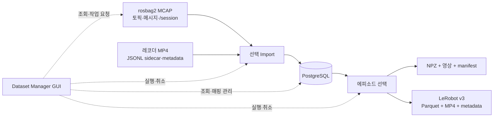

# RDFP Dataset Manager 사용자 가이드

## 1. 용도와 구성

Dataset Manager는 rosbag2의 토픽과 PostgreSQL 테이블을 비교하고, 필요한 데이터를 적재한 뒤 학습 데이터셋으로 내보내는 데스크톱 도구다. 현재 구현은 **MCAP 형식의 bag과 PostgreSQL**을 지원한다. ROS 노드나 시뮬레이터를 실행하지 않고 저장된 파일과 DB를 다룬다.

코드는 별도 패키지 [src/rdfp_gui_codex](../../src/rdfp_gui_codex/README.md)에 있다. GUI와 관리 서비스는 이 패키지에서 제공하고, 기존 데이터셋 writer·exporter·설정은 `rdfp`에서 가져온다.

| 화면 | 주요 기능 |
|---|---|
| 토픽·테이블 | 왼쪽 bag 토픽과 오른쪽 DB 테이블 비교, 연결된 항목 강조, 메시지 정의와 테이블 스키마 확인, 매핑 관리, 선택 Import |
| 데이터 | bag 메시지와 DB 행 조회, 토픽·에피소드 필터, 페이지 이동 |
| 에피소드 | DB ID별 목록, 테이블별 데이터 수와 영상 정보 확인, ID 범위를 지정한 Export |
| 영상 | 별도 레코더의 MP4·sidecar 목록 확인, 지정 프레임 미리보기, Import할 카메라 선택 |
| 작업 이력 | 조회·적재·Export 결과와 실패 원인 확인, 진행 중 작업 취소 |



설계 배경은 [design_gpt.md](design_gpt.md)에 있다. 이 문서는 현재 실행 가능한 기능과 제약을 설명한다.

## 2. 설치와 실행

### 2.1 Python 환경 준비

다음 명령은 `rdfp_ws` 루트에서 실행한다. Python 3.10 이상이 필요하다. Qt·영상 처리·학습 라이브러리와 ROS의 시스템 패키지가 충돌하지 않도록 **`--system-site-packages` 없이 별도 환경을 만든다.**

```bash
cd ~/development/ros/rdfp_ws
uv venv --python /usr/bin/python3 .venv-dataset-manager
uv pip install --python .venv-dataset-manager/bin/python \
  -r src/rdfp_gui_codex/requirements.txt
```

`uv`가 없다면 `python3 -m venv .venv-dataset-manager`로 환경을 만든 뒤 해당 환경의 `pip`로 같은 requirements 파일을 설치할 수 있다. Linux 데스크톱에서는 Qt의 시스템 라이브러리도 필요하다. `xcb` plugin을 읽지 못한다는 메시지가 나오면 배포판의 Qt xcb 의존성, 특히 `libxcb-cursor0` 설치 여부를 확인한다.

NPZ Export에는 기본 설치만 있으면 된다. LeRobot v3도 사용하려면 다음을 추가로 설치한다. CPU 환경에서도 Export할 수 있으며, PyTorch와 영상 라이브러리 때문에 설치 용량이 커진다.

```bash
uv pip install --python .venv-dataset-manager/bin/python --torch-backend=cpu \
  -r src/rdfp_gui_codex/requirements-lerobot.txt
```

LeRobot 연동은 `lerobot==0.4.4`를 기준으로 구현·검증했다. 설치 후 Export는 로컬에서 처리하며 Hub에 업로드하지 않는다.

### 2.2 DB와 경로 설정

기존 [config/dataset_config.yaml](../../config/dataset_config.yaml)을 사용한다. DB 접속 문자열은 YAML이 아니라 환경변수에 지정한다.

```bash
# 계정·주소·DB 이름은 실제 환경에 맞게 지정한다.
export RDFP_DB_DSN='postgresql://rdfp@localhost:5432/rdfp'
export RDFP_ROSBAG_DIR="$HOME/rosbag"
export RDFP_RECORDINGS_DIR='/data/rdfp/recordings'

./scripts/run_dataset_manager.sh
```

스크립트는 `.venv-dataset-manager/bin/python`을 우선 사용한다. 다른 환경은 `RDFP_MANAGER_PYTHON`으로 지정한다. 소스 경로를 직접 연결하므로 GUI 실행만을 위해 `colcon build`를 할 필요는 없다.

```bash
RDFP_MANAGER_PYTHON=/path/to/venv/bin/python \
  ./scripts/run_dataset_manager.sh --config /path/to/dataset.yaml
```

패키지를 빌드·설치한 환경에는 `rdfp_gui_codex` 패키지의 `dataset_manager` console entry point도 등록된다. 기존 `rdfp`가 설치된 ROS 환경에서 다음과 같이 실행할 수 있다. 이때도 빌드에 사용한 Python에 GUI 의존성이 설치되어 있어야 한다.

```bash
colcon build --symlink-install --packages-select rdfp_gui_codex
source install/setup.bash
ros2 run rdfp_gui_codex dataset_manager --config config/dataset_config.yaml
```

직접 모듈을 실행할 때의 이름은 `rdfp_gui_codex.manager_cmd`다. 소스 상태라면 두 패키지 경로를 함께 연결한다.

```bash
PYTHONPATH=src/rdfp_gui_codex:src/rdfp \
  .venv-dataset-manager/bin/python -m rdfp_gui_codex.manager_cmd \
  --config config/dataset_config.yaml
```

기존 빌드 산출물에 남아 있는 `ros2 run rdfp dataset_manager` 대신 새 패키지의 진입점을 사용한다. 패키지를 옮겨도 DB schema, `dm_*` 테이블, 설정 YAML, 로컬 작업 이력 경로는 그대로 사용하므로 위치 변경만을 이유로 DB를 초기화할 필요는 없다.

| 설정 | Manager에서 사용하는 의미 |
|---|---|
| `rosbag_dir` | 녹화본 선택창의 기본 경로 |
| `recordings_dir` | 외부 레코더 MP4·JSONL·metadata를 찾는 루트 |
| `output_mp4_dir` | 기존 DB에 등록된 영상의 상대 경로를 찾을 때 사용하는 추가 루트 |
| `db.dsn_env` | DSN을 읽을 환경변수 이름. 기본 `RDFP_DB_DSN` |
| `db.schema` | 조회·적재할 PostgreSQL schema. 기본 `public` |

기존 CLI와 설정 파일을 공유하지만, **Manager의 Import 대상은 화면에서 선택한 토픽·영상으로 정한다.** `topics_file`, `episode_filter`, `session_filter`, `on_existing_episode`, `parallelism`, `delete_splits_after_import` 설정을 그대로 실행하는 CLI 대체 화면은 아니다. GUI Import는 선택한 녹화본의 종료된 에피소드를 모두 처리하고, 교체 여부도 화면의 체크박스로 정한다. 원본 파일은 삭제하지 않는다.

### 2.3 처음 사용할 때

1. 설정 파일과 DSN 환경변수를 확인한다. DB 접속이 없어도 bag 조회는 가능하다.
2. **관리 DB 준비**를 누른다. 대상 schema에 기존 dataset 테이블과 `dm_*` 관리 테이블을 추가한다. 기존 데이터는 삭제하지 않는다.
3. **폴더 선택**으로 녹화본을 찾거나 **MCAP 선택**으로 파일 하나를 고른다.
4. **토픽 조회**, **DB 조회**를 각각 실행한다.

이미 사용 중인 DB의 schema가 현행 `schema.sql`과 다르면 먼저 스키마를 확인해야 한다. 관리 DB 준비는 `CREATE ... IF NOT EXISTS`를 사용하며, 기존 테이블의 열을 자동으로 변경하는 migration 도구는 아니다.

### 2.4 Wayland 연결 오류가 발생할 때

`Failed to create wl_display` 또는 Qt의 `wayland` platform plugin 오류가 나오면, X11 디스플레이가 제공되는 환경에서 다음과 같이 실행한다.

```bash
QT_QPA_PLATFORM=xcb ./scripts/run_dataset_manager.sh
```

실행 스크립트는 `DISPLAY`가 있고 세션이 X11이거나 `WAYLAND_DISPLAY`가 없는 경우 `xcb`를 자동 선택한다. 사용자가 `QT_QPA_PLATFORM`을 이미 지정했다면 그 값을 유지하므로, 위 명령으로 해당 실행의 값을 덮어쓸 수 있다. X11 디스플레이가 없는 환경에서는 이 방법으로 화면 연결 문제를 해결할 수 없다.

## 3. 토픽과 DB 데이터 확인

### 3.1 토픽·테이블 연결

토픽을 선택하면 연결된 테이블을 강조하고, 테이블을 선택하면 해당 토픽들을 강조한다. 같은 메시지 타입을 여러 토픽에서 사용하면 하나의 기본 테이블을 공유할 수 있다. 예를 들어 `/joint_states`와 `/target_joint_cmds`는 모두 `joint_states`에 저장되며 `topic_id`로 구분한다.

| 표시 | 의미 |
|---|---|
| 연결됨 | 기존 writer 또는 등록한 범용 매핑으로 Import 가능 |
| 미매핑 | 자동 적재 경로가 없어 테이블 등록이 필요 |
| 비활성 | 매핑을 해제한 상태. 저장된 행은 유지 |
| 스키마 충돌 | 같은 토픽의 메시지 타입·정의가 기존 매핑 또는 bag 내부에서 서로 다름 |
| 테이블 없음 | 매핑 대상 테이블이 DB에 없음 |
| 에피소드 경계 | `/session`에서 `sessions`를 만드는 특별한 경로 |

토픽 선택 시 아래 상세 영역에서 MCAP에 포함된 메시지 정의를 확인할 수 있다. **테이블 스키마**는 열, 기본값, 제약조건, 인덱스를 표시한다. 테이블 목록의 행 수는 PostgreSQL 통계에 따른 추정값이므로, 적재 직후 실제 값과 다를 수 있다.

### 3.2 실제 데이터 조회

- **메시지 보기**: 선택한 토픽의 원본 메시지, `header.stamp`, MCAP 기록 시각을 확인한다.
- **연결된 DB 데이터**: 선택한 토픽에 해당하는 DB 행만 보여준다. 공유 테이블에서도 다른 토픽이 섞이지 않는다.
- **테이블 데이터**: 테이블 전체를 조회하거나 에피소드 DB ID로 좁힌다.

한 페이지에 200건을 표시한다. 목록 검색과 열 정렬은 현재 페이지에 적용된다. 행을 선택하면 아래 상세 영역에서 내용을 읽을 수 있다. 큰 배열은 bag 미리보기에서 축약하며, DB의 `BYTEA` 값은 앞 256바이트와 전체 크기를 표시한다. 미리보기 축약은 저장된 원본을 바꾸지 않는다.

## 4. 매핑 관리

### 4.1 새 테이블 생성·등록

1. 미매핑 토픽 하나를 선택한다.
2. **테이블 생성·등록**에서 `custom_`으로 시작하는 테이블명을 입력한다.
3. 등록 내용을 확인한다. 이후 **토픽 조회**, **DB 조회**로 목록을 갱신한다.

범용 테이블은 메시지 필드를 임의로 SQL 열로 펼치지 않고 다음 정보를 저장한다.

| 열 | 내용 |
|---|---|
| `episode_id`, `topic_id` | 에피소드와 토픽 |
| `stamp_sec`, `stamp_nanosec` | 메시지의 `header.stamp` |
| `log_time_ns` | MCAP 기록 시각 |
| `source_file`, `source_ordinal` | 원본 파일 순번과 파일 내 메시지 순번 |
| `payload` | 메시지 내용인 JSONB. bytes와 비유한 수는 명시적인 표현으로 보존 |
| `raw_cdr` | 원본 CDR bytes |

이미 이 도구에서 만든 테이블을 같은 메시지 스키마의 다른 토픽과 공유할 수도 있다. 이때 DB 목록을 먼저 갱신한다. 일반 외부 테이블에 임의로 연결하거나, 기존 매핑의 스키마를 자동 변경하는 기능은 제공하지 않는다.

**범용 테이블 등록과 학습 feature 등록은 별개다.** NPZ·LeRobot Export는 현재 팔 관절·그리퍼·영상 데이터에 맞춰져 있다. 새 센서의 JSONB 데이터를 학습 입력으로 쓰려면 별도의 변환 코드가 필요하다.

### 4.2 매핑 해제와 테이블 삭제

| 작업 | 기존 데이터 | 재사용 |
|---|---|---|
| 매핑 해제 | 보존 | `다시 연결`로 활성화 가능 |
| 전용 테이블 삭제 | 테이블의 모든 행과 해당 관리 이력 삭제 | 필요하면 테이블을 다시 만들고 Import |

테이블 삭제는 이름을 직접 입력해 확인한다. 기본 테이블과 다른 토픽이 공유하는 테이블은 삭제할 수 없다. Manager가 생성한 테이블인지 DB 객체 ID까지 확인하고, 다른 DB 객체가 참조하면 `DROP ... RESTRICT`로 거부한다. MP4·bag 원본 파일은 삭제 대상이 아니다.

매핑 해제 상태는 Manager의 Import에 적용된다. 기존 `ros2 run rdfp import`는 이 관리 상태를 읽지 않는다.

## 5. 선택 Import

### 5.1 실행 순서

1. **bag 에피소드 확인**으로 `/session`에 종료 경계가 있는지 확인한다.
2. 토픽 목록에서 Import할 항목을 Ctrl/Shift로 선택한다.
3. 영상을 함께 등록하려면 **영상 → 레코더 목록 조회**에서 카메라를 선택한다.
4. **선택 토픽·영상 Import...**를 누르고 에피소드 수, 메시지 수, 영상 수, 구간 밖 제외 수를 확인한다.
5. 계획을 확인한 후 실행한다.

영상 선택은 **카메라 토픽 기준**이다. 선택된 카메라의 파일이 Import 대상 에피소드마다 있어야 한다. 영상이 없는 에피소드가 섞이면 계획 단계에서 실패하므로 녹화본 범위나 선택 카메라를 다시 확인한다.

### 5.2 시간축과 중복 처리

- 에피소드는 `/session`의 상태 전이로 나누고 `[시작, 종료)` 구간을 사용한다. 종료되지 않은 에피소드는 제외한다.
- 메시지 소속은 `header.stamp`로 판단한다. MCAP 기록 시각은 별도로 보존하지만 이를 ROS 시각 대신 사용하지 않는다.
- `header.stamp`가 없는 토픽은 browse할 수 있으나 현재 Import는 거부한다.
- 레코더 영상은 파일명이 아닌 metadata의 `episode_key`로 연결한다. sidecar의 프레임 번호 연속성, 시각 증가, 에피소드 범위, 프레임 수를 검사한다.
- bag과 영상 파일의 SHA-256을 계획에 기록하고 실행 전에 다시 확인한다.

기본 동작은 같은 원본의 같은 에피소드·토픽을 다시 적재하지 않는 것이다. 빠졌던 토픽만 추가해도 기존 에피소드 ID는 유지된다. **이미 적재된 선택 토픽 교체**를 켜면 선택한 토픽의 행만 교체한다. 다른 토픽과 에피소드 ID는 유지한다.

기존 CLI가 만든 에피소드처럼 원본 출처를 확인할 수 없거나, 서로 다른 원본이 같은 시작 시각을 가진 경우 자동 병합하지 않는다. 현재 `sessions`의 시작 시각 UNIQUE 제약을 유지하기 때문이다. 이런 원본은 별도 schema로 적재하거나 출처를 검증하는 migration을 먼저 수행해야 한다.

### 5.3 취소와 재실행

각 에피소드의 선택 토픽·영상 등록을 하나의 DB 트랜잭션으로 처리한다. 실패하거나 취소하면 현재 에피소드는 rollback하고 이미 commit한 에피소드는 남긴다. 같은 원본·선택으로 다시 실행하면 완료된 단위를 건너뛴다. 적재 이력과 실제 행 수가 다르면 조용히 건너뛰지 않고, 선택 토픽 교체가 필요하다고 알린다.

취소는 협력적으로 처리한다. 실행 중인 DB 요청이나 라이브러리 호출이 반환될 때까지 기다릴 수 있다. DB 연결 제한은 5초, 개별 SQL 제한은 30초, DB 잠금 대기는 5초다.

## 6. 에피소드별 조회와 Export

### 6.1 에피소드 선택

**에피소드 → 목록 조회**에서 DB ID, 작업 이름, 시작·종료 시각, 성공 여부를 확인한다. `success=NULL`은 실패가 아니라 미판정이다. **선택 에피소드 상세**는 테이블별 행 수와 등록된 영상 정보를 보여준다.

Export 창에는 선택한 ID가 들어가며 `1-5,8,12`처럼 직접 범위를 지정할 수도 있다. 이 ID는 bag의 에피소드 순번이 아닌 **DB의 `sessions.id`**다.

### 6.2 공통 옵션

| 옵션 | 기본값 | 의미 |
|---|---|---|
| 출력 경로 | 필수 | 아직 존재하지 않는 새 디렉터리 |
| 형식 | `npz` | `npz` 또는 `lerobot_v3` |
| 카메라 토픽 | 빈 값 | 카메라가 하나면 자동 선택. 여러 개면 하나를 명시 |
| Action 원천 | `joint_plan` | 계획 궤적. 실제 명령 관절값을 쓰려면 `joint_command` |
| 종료 이벤트 누락 허용 | 해제 | 종료 이벤트가 빠진 계획을 포함할지 결정. 기본은 해당 에피소드 제외 |

`joint_command`는 `/target_joint_cmds`가 필요하다. 두 방식 모두 `/joint_states`, 그리퍼 상태·명령, 등록된 영상이 학습 데이터 생성에 필요하다. 데이터의 종류는 수집한 백엔드와 목적에 맞춰 선택한다.

선택 에피소드의 관절 구성·순서가 다르면 내보내지 않는다. `joint_command`에서는 백엔드가 다른 에피소드도 섞지 않는다. 영상 파일 누락, frame clock 역행·중복, NaN/Infinity가 있는 학습 배열은 오류로 처리한다. 품질 판단은 기존 exporter의 관측·label 규칙을 사용하며, 센서별 관측 공백을 모두 판정하는 종합 품질 검사는 아니다.

### 6.3 NPZ

| 옵션 | 기본값 | 의미 |
|---|---|---|
| chunk 길이 | 20 | 기준 영상 프레임마다 담을 미래 action 수 |
| 첫 행동 오프셋 | 0.1초 | 기준 시각에서 첫 action까지의 간격 |
| 행동 간격 | 0.1초 | chunk 안의 action 사이 간격 |
| 영상 복사 | 사용 | 원본 MP4를 출력 디렉터리에 복사 |

```text
출력 디렉터리/
├── episodes/<DB ID>.npz
├── videos/<DB ID>.mp4       # 영상 복사를 선택한 경우
├── episodes.jsonl
├── metadata.json
└── rdfp_manifest.json
```

NPZ 배열과 `metadata.json`은 기존 RDFP exporter 형식을 유지한다. 영상을 복사하면 `episodes.jsonl`의 `mp4`는 출력 루트를 기준으로 한 상대 경로다. **`rdfp-train`에서 읽을 때 `recordings_dir`를 이 출력 루트로 지정한다.** 영상 복사를 끄면 원본 영상의 절대 경로를 기록하므로 다른 장비로 옮길 때 원본 영상도 준비해야 한다.

### 6.4 LeRobot v3

| 옵션 | 기본값 | 의미 |
|---|---|---|
| 출력 fps | 10 | 일정한 간격으로 생성할 학습 샘플 수/초 |
| 최대 영상 시차 | 0.2초 | 샘플 시각과 그 이전의 가장 가까운 카메라 프레임 사이 최대 차이 |

`observation.state`는 팔 관절 위치와 그리퍼 폭, `action`은 해당 시각의 팔 action과 그리퍼 one-hot, `observation.images.camera`는 RGB 영상이다. NPZ의 미래 action chunk를 LeRobot의 단일 action으로 오인하지 않도록, LeRobot에는 `a(t)`를 저장한다. 미래 구간은 학습 loader에서 정한다.

고정 fps로 바꿀 때 미래 영상을 가져오지 않고 이전 프레임을 선택한다. 영상 시차가 상한을 넘으면 Export가 실패한다. 실제 카메라 관측 구간 안에서만 샘플을 생성하며, 원래 에피소드 시각과 변환 후 프레임 수·반복 수·최대 시차는 manifest에 남긴다.

공식 `LeRobotDataset`으로 Parquet·MP4·v3 metadata를 만들고, 생성한 데이터셋을 다시 열어 각 에피소드의 첫·마지막 샘플과 전체 샘플 수를 확인한다. 출력의 에피소드 번호는 0부터 다시 부여되며 DB ID와의 대응은 `rdfp_manifest.json`에 기록한다.

### 6.5 결과 확정

Export는 별도 임시 디렉터리에서 수행한다. 생성과 검증이 끝나면 지정한 경로로 옮기며 기존 데이터셋을 덮어쓰지 않는다. 실패·취소 시 임시 결과는 정리한다. manifest에는 선택 옵션, 포함·제외 에피소드, 원본 출처, 출력 파일별 SHA-256을 기록한다.

## 7. 작업 이력과 운영 범위

작업 이력은 기본적으로 `~/.local/state/rdfp-dataset-manager/jobs.sqlite3`에 저장한다. `--state-dir`로 위치를 바꿀 수 있다. GUI는 파일·DB 작업을 별도 프로세스로 실행하므로 작업 중에도 화면과 취소 버튼을 사용할 수 있다.

현재 구현의 범위는 다음과 같다.

| 항목 | 현재 지원 범위 |
|---|---|
| bag | ROS 2 메시지 정의를 포함한 완성된 MCAP. SQLite3 bag 변환은 별도 작업 |
| 데이터 browse | 200건 단위 페이지. 전체 데이터에 대한 서버 검색·시각 인덱스는 미구현 |
| 영상 | 외부 레코더 MP4·sidecar 등록과 프레임 미리보기. bag Image 자동 인코딩·동영상 재생은 미구현 |
| 매핑 | 기본 writer와 JSONB/CDR 범용 테이블. 임의 SQL 변환·스키마 migration은 미구현 |
| Import | GUI에서 녹화본 하나의 완료된 에피소드 전체. 요청 파일 API에서는 시작 시각 목록 `starts`로 제한 가능 |
| Export | 한 번에 카메라 하나, 팔 관절·그리퍼 feature. 다중 카메라·사용자 feature 조합은 확장 필요 |
| 재실행 | Import 완료 단위 판별. 중단된 프로세스를 자동으로 재개하는 scheduler는 없음 |
| 동시 작업 | Manager끼리는 schema별 DB advisory lock으로 쓰기 충돌 방지. 기존 CLI·직접 SQL은 이 잠금을 사용하지 않음 |

**Manager의 Import·테이블 삭제·Export 중에는 기존 적재 CLI나 직접 SQL로 같은 schema를 수정하지 않는다.** 특히 기존 CLI의 `replace`는 에피소드 전체를 교체하므로 Manager의 선택 토픽 교체와 의미가 다르다.

프로세스 강제 종료 후 `RUNNING` 이력이 남을 수 있다. DB에서 완료된 에피소드를 확인한 뒤 새 작업으로 재실행한다. 정상적인 취소·실패에서는 작업 상태와 오류를 기록한다.

## 8. 코드 위치와 검증

### 8.1 패키지별 책임

`rdfp_gui_codex`에는 이번에 작성한 화면과 관리 서비스를 두고, `rdfp`에는 기존 데이터셋 공통 기능을 둔다. 의존 방향은 `rdfp_gui_codex → rdfp`이며, GUI와 요청 파일 CLI는 새 패키지의 `management/service.py`를 공유한다. 기존 `rdfp import/export` CLI가 이 서비스를 사용하는 것은 아니다.

아래 `management/`로 시작하는 경로는 모두 `src/rdfp_gui_codex/rdfp_gui_codex/`를 기준으로 한다.

| 위치 | 역할 |
|---|---|
| `src/rdfp_gui_codex/rdfp_gui_codex/gui/` | Qt 화면, 목록 모델, 작업 상태 표시 |
| `src/rdfp_gui_codex/rdfp_gui_codex/management/catalog.py` | MCAP 토픽·메시지·에피소드 조회 |
| `management/database.py` | DB catalog, 매핑, 관리 테이블, 데이터 browse |
| `management/ingest.py` | 계획 수립, 선택 토픽·영상 Import |
| `management/exporter.py` | NPZ·LeRobot v3 변환, 검증, manifest |
| `management/service.py`, `management/jobs.py` | GUI/CLI 공통 요청 처리, 프로세스 작업, 로컬 이력 |
| `src/rdfp_gui_codex/rdfp_gui_codex/manager_cmd.py` | GUI와 요청 파일 CLI 진입점 |
| `src/rdfp_gui_codex/tests/` | 임시 PostgreSQL·합성 MCAP·영상·Qt 통합 테스트 |
| `src/rdfp_gui_codex/requirements*.txt` | GUI와 선택적 LeRobot 의존성 |
| `src/rdfp/rdfp/dataset/` | 기존 DB 스키마·writer·설정·관측 및 label 변환 |

설치·실행 요약은 [패키지 README](../../src/rdfp_gui_codex/README.md), 패키지 구조와 worker 흐름은 [GUI 설계안 §5](데이터셋_관리_GUI_설계안.md#5-아키텍처)에 있다.

### 8.2 요청 파일 CLI

GUI 없이 같은 서비스를 호출할 수 있다. 예를 들어 아래 JSON을 `/tmp/dataset-request.json`에 작성하고 실행하면 토픽 목록을 출력한다.

```json
{"action": "scan", "args": {"source": "/data/rosbag/session_001"}}
```

```bash
./scripts/run_dataset_manager.sh --request /tmp/dataset-request.json
```

Import를 자동화할 때는 먼저 `plan_import` 결과를 확인하고 그 결과를 `import` 요청의 `args.plan`에 넣는다. `plan_import`의 `selected_topics`는 필수이며, `starts`는 에피소드 시작 ROS 시각을 나노초 정수로 지정하는 선택 항목이다. 요청 파일 CLI는 GUI와 같은 DB 검증을 수행하지만 GUI 확인창이나 작업 이력은 생성하지 않는다.

### 8.3 테스트

새 테스트는 운영 DB 대신 자체 PostgreSQL 프로세스와 임시 schema를 사용한다. PostgreSQL 서버 실행 파일이 없으면 DB 통합 테스트를 건너뛴다. LeRobot 미설치 시 해당 통합 테스트만 건너뛴다.

```bash
uv pip install --python .venv-dataset-manager/bin/python pytest
PYTHONPATH=src/rdfp_gui_codex:src/rdfp HF_HUB_OFFLINE=1 \
  .venv-dataset-manager/bin/python -m pytest \
  src/rdfp_gui_codex/tests -q
```
