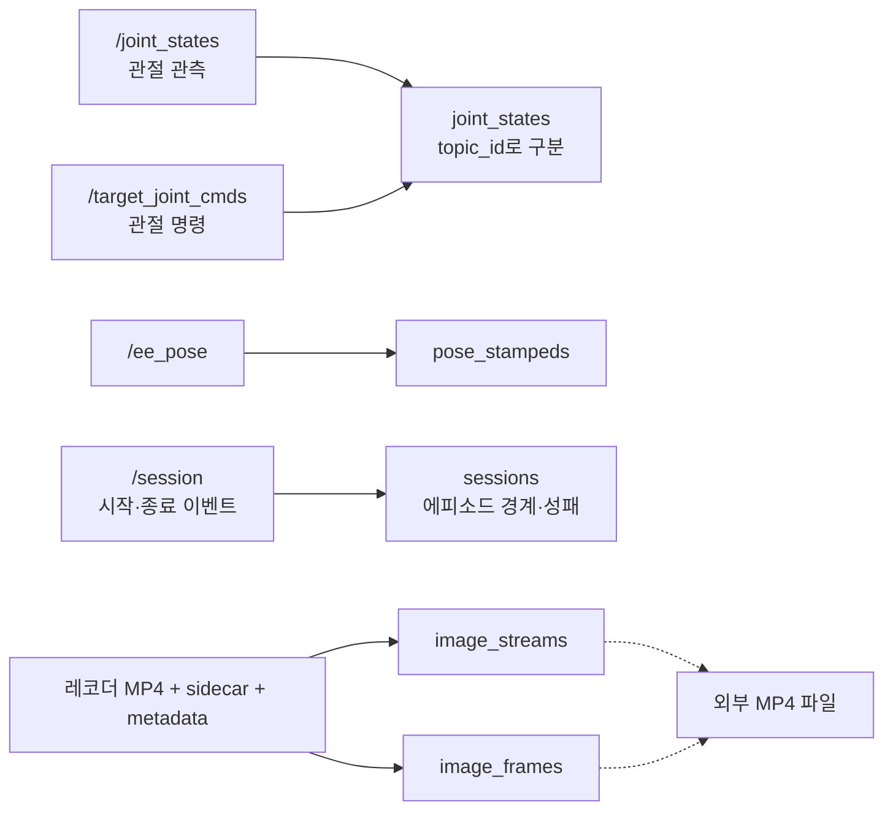
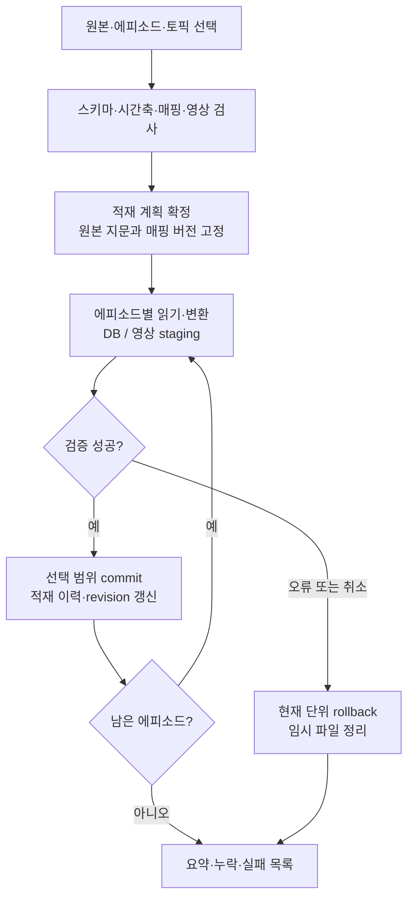
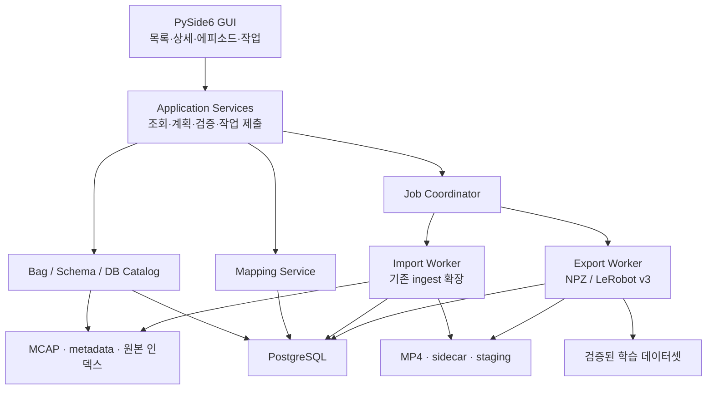

# RDFP 데이터셋 관리 GUI 설계안

> 작성일: 2026-11-03 · 갱신일: 2026-11-04 · 상태: 주요 기능 구현, 별도 패키지로 분리
>
> 대상: rosbag2, PostgreSQL, 레코더 영상, 에피소드, 학습 데이터셋의 조회와 관리.
> 현재 코드는 [src/rdfp_gui_codex](../../src/rdfp_gui_codex/README.md)에 있다. GUI·관리 서비스·테스트를 이 패키지로 옮겼으며, 기존 writer·스키마·설정·변환 기능은 `rdfp`에서 가져온다.
> 이 문서는 확장 계획을 포함한 설계안이다. §10.3은 현재 코드 배치이며, 나머지 제안 API·화면·관리 metadata가 모두 구현되었다는 뜻은 아니다. 실제 지원 범위와 실행 방법은 [사용자 가이드](Dataset_Manager_사용자_가이드.md)를 따른다.

주요 항목: [화면 구성](#3-화면-구성) · [데이터 탐색](#4-상세-조회와-데이터-browse) · [매핑 등록](#5-매핑-등록과-동적-테이블) · [삭제](#6-매핑-해제와-삭제) · [Import](#7-선택-토픽-import) · [에피소드](#8-에피소드-view) · [Export](#9-학습-데이터셋-export) · [내부 구조](#10-내부-구조와-기술-선택) · [구현 순서](#14-구현-순서와-완료-기준)

## 1. 설계 방향

이 도구는 **수집한 데이터가 어디에 저장되고, 어떤 변환을 거쳐 학습 데이터가 되는지 확인하는 관리 화면**으로 만든다. 사용자는 rosbag의 토픽과 DB 테이블을 나란히 보면서 매핑을 확인하고, 필요한 토픽을 적재한 뒤 에피소드를 골라 학습 데이터셋으로 내보낼 수 있다.

권장 이름은 **RDFP Dataset Manager**다. 첫 버전은 Linux 데스크톱 앱으로 만들고, 기존 Python 적재·export 코드를 공통 서비스로 연결한다. DBMS는 현재 코드가 사용하는 PostgreSQL을 우선 지원한다.

핵심 설계 결정은 다음과 같다.

| 항목 | 권장 방안 |
|---|---|
| 기본 화면 | 세로 구분선으로 좌우 분할. 왼쪽은 입력 소스와 토픽, 오른쪽은 DB 테이블 |
| 매핑 표시 | 선택한 토픽과 연결된 테이블을 함께 강조하고, 아래에 변환 규칙을 표시 |
| 동적 매핑 | 기존 타입은 검증된 writer 재사용. 새로운 타입은 스키마를 보존하는 JSONB 저장을 우선 제공 |
| 매핑 제거 | 매핑 해제, 적재 데이터 삭제, 물리 테이블 삭제를 별도 명령으로 구분 |
| Import | 실행 전 계획을 확인하고, 선택한 에피소드·토픽 범위만 적재 |
| 에피소드 | 원본 출처, 작업 성패, 적재 상태, 학습 가능 여부를 각각 표시 |
| Export | 기존 RDFP NPZ를 기본으로 제공하고, LeRobot v3는 별도 변환 프로파일로 추가 |
| 장시간 작업 | GUI 밖의 worker에서 실행. 진행률, 취소, 재시작 후 복구를 지원 |
| 기본 권한 | 조회로 시작하고, 적재·DDL·삭제는 해당 작업에 필요한 DB 권한으로 실행 |

### 1.1 범위와 용어

| 용어 | 이 문서에서의 의미 |
|---|---|
| 녹화본(recording) | 하나의 녹화 실행에서 생성된 metadata와 split 파일 묶음 |
| 에피소드 | `/session`의 시작·종료 이벤트로 구분되는 작업 구간. 현재 DB에서는 `sessions`의 한 행 |
| 매핑 | 입력 토픽·메시지 스키마를 저장 대상 및 변환 규칙과 연결한 정의 |
| 등록 | 테이블이나 매핑의 정의를 관리 목록에 추가하는 일. 데이터를 넣는 import와 다름 |
| 적재(import) | bag 메시지 또는 레코더 기록을 DB·영상 저장 구조에 반영하는 일 |
| 내보내기(export) | DB에 적재된 에피소드로 학습 데이터셋 파일을 생성하는 일 |

녹화 세션 디렉터리와 DB의 `sessions`를 같은 의미로 표시하지 않는다. 녹화본 하나에 여러 에피소드가 들어갈 수 있다.

이번 도구의 데이터 browse와 영상 재생은 파일·DB 조회다. 기존 `replay_gui`처럼 ROS 토픽을 재발행하거나 로봇을 초기 자세로 움직이는 기능은 포함하지 않는다.

## 2. 현재 구현에서 확인한 기반과 제약

### 2.1 재사용할 수 있는 구성

| 기능 | 현재 구현 | GUI에서의 활용과 보완 |
|---|---|---|
| 녹화본 탐색 | `rdfp/rosbag/catalog.py` | 날짜·세션 디렉터리와 `metadata.yaml`을 읽는 경로 재사용. 일반 bag 디렉터리 선택은 추가 |
| 메시지 읽기 | `rdfp/rosbag/mcap_reader.py` | MCAP 내장 스키마를 이용한 동적 역직렬화 재사용 |
| 타입별 저장 규칙 | `dataset/db/registry.py`의 `TypeBinding` | 기본 매핑의 기준. GUI에서 이 Python 파일을 편집하지 않음 |
| DB 스키마 | `dataset/sql/schema.sql` | 테이블 정의 비교 및 호환성 검사에 사용 |
| 적재 | `dataset/import_cmd.py`, `dataset/ingest/` | 에피소드 감지, writer, 영상 등록 재사용. 선택 범위 재적재는 확장 필요 |
| 레코더 영상 연결 | `ingest/media/recorder_registry.py` | MP4·sidecar·metadata와 에피소드 연결 |
| 학습 샘플 생성 | `dataset/export/` | 실제 프레임 시각, 관절 관측, 행동 레이블, NPZ 출력 재사용 |
| 기존 GUI | `dataset/replay_gui_cmd.py` | tkinter 기반이며 ROS 재발행·로봇 제어가 포함됨. 새 관리 GUI와 실행 경로 분리 |

MCAP reader는 내장 ROS 메시지 스키마를 이용하므로 해당 메시지 패키지가 설치되지 않아도 읽을 수 있는 경로가 이미 있다. 반면 기존 DB reader의 ROS 메시지 복원은 메시지 패키지를 요구할 수 있다. **DB 행을 화면에 표시하는 기능은 ROS 메시지 복원에 의존하지 않게 한다.**

### 2.2 매핑은 토픽과 테이블의 일대일 관계가 아니다

현재 registry는 **메시지 타입 → 테이블·writer·reader**를 연결한다. 예를 들어 `/joint_states`와 `/target_joint_cmds`는 모두 `sensor_msgs/msg/JointState`이며 `joint_states`에 함께 저장되고, `topic_id`로 구분된다.



현재 일반 메시지 registry에는 다음 10개 타입이 등록되어 있다. 실제 DB에 테이블이 존재하고 구조가 맞는지는 접속할 때 별도로 확인해야 한다.

| 메시지 타입 | 기본 테이블 |
|---|---|
| `geometry_msgs/msg/TwistStamped` | `twist_stampeds` |
| `control_msgs/msg/JointJog` | `joint_jogs` |
| `rdfp_msgs/msg/TargetJointStates` | `target_joint_states` |
| `rdfp_msgs/msg/MotionTrajectory` | `motion_trajectories` |
| `rdfp_msgs/msg/MotionEvent` | `motion_events` |
| `sensor_msgs/msg/JointState` | `joint_states` |
| `geometry_msgs/msg/PoseStamped` | `pose_stampeds` |
| `rdfp_msgs/msg/SceneObjects` | `scene_objects` |
| `rdfp_msgs/msg/GripperCommand` | `gripper_cmds` |
| `rdfp_msgs/msg/GripperState` | `gripper_states` |

`/session`은 일반 메시지 테이블에 그대로 복사하는 경로가 아니다. 이미지도 일반 registry와 별도 경로를 사용한다. 화면에서 이들을 ‘미매핑 토픽’으로 잘못 분류하지 않아야 한다.

### 2.3 GUI 구현 전에 반영해야 할 제약

1. **영상은 bag 밖에도 있다.** 현재 `recording_topics.list`는 카메라 토픽을 녹화하지 않는 구성이며, 레코더가 만든 영상과 sidecar를 등록한다. bag 목록만으로 전체 데이터의 존재 여부를 판단할 수 없다.
2. **같은 영상의 이중 등록을 막아야 한다.** bag 이미지 인코딩과 레코더 등록을 같은 에피소드·토픽에 함께 적용하면 `image_streams`의 유일성 제약과 충돌한다. import 계획에서 영상 원천을 하나로 확정한다.
3. **지원 형식을 구분해야 한다.** 현재 적재는 MCAP 경로를 사용한다. SQLite3 rosbag2와 추가 압축 방식은 adapter 확장 대상이다. bag 이미지 인코딩은 `Image`의 지원되는 8-bit raw 형식에 한정되며, `CompressedImage`와 depth 형식을 지원한다고 표시해서는 안 된다.
4. **현재 reader가 모든 메시지를 browse하기에 적합하지는 않다.** `header.stamp` 없는 메시지는 건너뛰고, split 전체를 메모리에 읽어 정렬한다. 목록·원본 browse에는 별도의 제한 조회와 원본 순서 인덱스가 필요하다.
5. **현재 중복 정책은 에피소드 단위다.** `skip`은 기존 에피소드의 누락 토픽을 채우지 못하고, `replace`는 에피소드 전체를 삭제·재생성하는 경로다. 선택 토픽 재적재에 그대로 사용하면 다른 토픽의 데이터까지 잃을 수 있다.
6. **에피소드 시작 시각만으로는 원본을 구분할 수 없다.** `sessions`의 현재 유일키는 `(start_sec, start_nanosec)`다. 시뮬레이터 재시작으로 시간이 반복되면 다른 녹화본이 충돌할 수 있다.
7. **같은 토픽 이름의 타입 변경을 감지해야 한다.** 현재 `topics.topic_name`은 UNIQUE이며, upsert는 기존 타입을 유지한다. GUI가 타입·스키마 차이를 먼저 발견해 충돌로 표시해야 한다.
8. **LeRobot v3 export는 새 기능이다.** 현재 exporter는 RDFP NPZ 형식이다. 기존 [저장 형식 설계](../learning/저장_형식.md)는 실제 프레임 시각을 보존하기 위해 이 방식을 선택했다. LeRobot 출력은 이 경로를 대체하지 않는 추가 기능으로 설계한다.

## 3. 화면 구성

### 3.1 기본 화면: 토픽과 테이블

```text
RDFP Dataset Manager
┌────────────────────────────────────────────────────────────────────────────┐
│ Bag [녹화본 선택]  영상 [레코더 폴더]  DB [프로파일]  [새로고침]             │
│ [토픽·테이블] [에피소드] [Export] [작업 이력] [설정]                        │
├───────────────────────────────────┬────────────────────────────────────────┤
│ 입력 소스                         │ PostgreSQL                             │
│ [bag 실제 목록 / 녹화 계획]        │ Schema [public]  [연결된 테이블만 □]    │
│ 검색 [                   ]        │ 검색 [                            ]    │
│ 선택 토픽        타입   건수 상태 │ 테이블          연결 토픽    적재 건수 │
│ ☑ /joint_states  JointState  ...  │ joint_states    2개          ...       │
│ ☑ /target_joint_cmds        ...   │ pose_stampeds   /ee_pose     ...       │
│ ☐ /scene/objects           ...   │ scene_objects   /scene/...   ...       │
│ ☐ /custom/status  Custom   미매핑 │ custom.*        ...          ...       │
│ ─ 별도 레코더 영상 ─              │ image_streams   카메라별               │
│ ☐ camera MP4 + sidecar            │ image_frames    카메라별               │
├───────────────────────────────────┴────────────────────────────────────────┤
│ 선택 관계: /joint_states → JointStateWriter → public.joint_states         │
│ 구분 조건: topic_id=...  | 저장 규칙 버전 ... | 조회 범위: 녹화본/에피소드  │
│ [상세] [메시지 구조 / 테이블 스키마] [데이터] [필드 매핑] [검사 결과]       │
│ 필드 트리, 페이지 단위 데이터, 숫자 그래프 또는 영상 미리보기              │
├────────────────────────────────────────────────────────────────────────────┤
│ [테이블 생성·등록] [매핑 해제] [Import...] [선택 범위 검사]                 │
│ 작업: 에피소드 8/20, 메시지 ..., 오류 ...                      [작업 보기] │
└────────────────────────────────────────────────────────────────────────────┘
```

세로 구분선을 드래그해 좌우 폭을 조절한다. 상세 영역은 아래쪽에 두되 별도 창으로도 열 수 있게 한다. 많은 연결선을 상시 그리면 화면이 복잡해지므로, 기본은 **행 강조 + 연결 대상 열 + 선택 관계 요약**이다. 선택한 항목의 관계만 보는 작은 그래프를 추가로 제공한다.

### 3.2 목록에서 보여줄 정보

| 목록 | 기본 열 | 상세 정보 |
|---|---|---|
| 토픽 | 선택, 이름, 타입, 메시지 수, 매핑 상태, 적재 상태 | 스키마 fingerprint, 직렬화 형식, 최초·최종 시각, 평균 주기·최대 공백, 원본 파일 |
| 테이블 | schema·이름, 연결 토픽 수, 선택 범위 행 수, 구조 상태 | 열·타입·NULL·기본값·PK·FK·인덱스, 크기, 전체 추정 행 수, 소유 구분 |
| 레코더 영상 | 카메라·토픽, 에피소드 연결, 프레임 수, 등록 상태 | MP4·sidecar·metadata 경로, 코덱, 해상도, 파일 존재 여부, frame clock |

bag의 전체 메시지 수와 특정 에피소드에 적재된 행 수를 곧바로 비교하지 않는다. 범위 밖 메시지, 영상 변환, `/session` 집계처럼 수가 달라지는 이유를 검사 결과에 표시한다. DB 전체 행 수의 추정치에는 `약` 표시를 붙이고, 정확한 count는 사용자가 요청한 범위에서 실행한다.

매핑과 적재 상태도 분리한다.

| 구분 | 상태 예시 |
|---|---|
| 매핑 상태 | 연결됨, 미매핑, 비활성, 스키마 충돌, 변환기 없음, 특수 처리 |
| 적재 상태 | 미적재, 일부 적재, 완료, 실패, 기존 데이터의 출처 미확인 |
| 학습 준비 상태 | 사용 가능, 필수 채널 없음, 시간축 충돌, 영상 없음, 레이블 검토 필요 |

‘매핑 있음’은 ‘이미 적재됨’을 뜻하지 않고, ‘적재 완료’는 ‘학습에 사용할 수 있음’을 뜻하지 않는다.

### 3.3 녹화 계획과 실제 목록

왼쪽은 **선택한 bag에 실제 저장된 토픽**을 기본으로 보여준다. 별도 ‘녹화 계획’ 모드에서는 `recording_topics.list`를 읽고 실제 목록과 비교한다.

- 계획에는 있지만 bag에는 없는 토픽은 ‘미수집’으로 표시한다. 발행되지 않았거나 녹화되지 않았을 가능성을 구분해 조사할 수 있게 한다.
- 계획 파일에는 이름만 있으므로, 타입을 알 수 없으면 ‘미확인’으로 남긴다. 파일만 보고 타입이나 데이터 존재를 추정하지 않는다.
- bag에만 있는 토픽도 숨기지 않는다. 적재 대상인지 사용자가 결정한다.
- 현재 활성 ROS graph에서 타입을 조회하는 기능은 선택 사항이며, 조회 결과를 과거 bag의 스키마로 간주하지 않는다.

## 4. 상세 조회와 데이터 browse

### 4.1 메시지 구조와 DB 스키마

메시지 구조는 트리로 보여준다. 필드 경로, ROS 타입, 배열 길이, 중첩 타입, 원본 정의를 확인할 수 있어야 한다. MCAP에 포함된 정의를 우선 사용하고, 로컬 메시지 패키지의 정의를 사용했다면 그 출처를 표시한다. 같은 타입 이름이라도 정의가 다르면 다른 스키마 버전으로 취급한다.

DB 스키마는 `information_schema`와 `pg_catalog`를 조회한다. ‘소스에 정의된 기대 구조’와 ‘실제 접속한 DB 구조’를 나란히 비교한다. 테이블명만 같다는 이유로 매핑 가능하다고 판단하지 않는다.

필드 매핑 탭에는 다음처럼 **보존·변환·미저장**을 구분한다.

| 메시지 필드 | 저장 대상 예 | 설명 |
|---|---|---|
| `header.stamp.sec/nanosec` | `stamp_sec`, `stamp_nanosec` | 원본 시각 정수 보존 |
| 토픽 이름 | `topic_id → topics` | 메시지 내용 밖의 토픽 정보를 FK로 저장 |
| 관절 이름·위치 배열 | writer가 정의한 배열 열 | 배열 순서와 관절 이름의 대응을 함께 확인 |
| `header.frame_id` 등 | writer별 상이 | 저장하지 않는 필드는 명시. DB에서 원본을 완전히 복원할 수 있다고 보장하지 않음 |

기본 writer의 변환 설명은 adapter가 제공하도록 한다. 임의 Python 실행문을 GUI에서 입력받아 변환기로 실행하는 기능은 두지 않는다.

### 4.2 데이터 탐색

- 메시지·행 목록은 기본 200건씩 조회하고, 안정적인 정렬 키를 이용해 다음 페이지를 읽는다.
- 시간, 에피소드, 토픽, 필드 조건으로 좁힐 수 있게 한다. 긴 배열은 접어서 보여주고 JSON 트리와 숫자 그래프를 함께 제공한다.
- bag 원본과 DB 변환 결과를 나란히 비교한다. 원본 위치 정보가 있는 신규 적재는 정확히 연결하고, 기존 행은 ‘시각 기반 후보’로 표시한다. 같은 stamp의 여러 메시지를 임의로 한 건으로 합치지 않는다.
- 영상은 DB의 `frame_index`와 sidecar 시각을 기준으로 찾는다. MP4의 명목 fps만으로 ROS 시각을 계산하지 않는다.
- 숫자 그래프는 미리보기용으로 축약할 수 있지만, 축약했다는 표시와 원본 보기 기능을 둔다.
- DB browse는 읽기 전용이다. 원본 수치 수정 대신 에피소드 태그·제외 사유 같은 관리 metadata를 편집한다.

### 4.3 시간 표시 규칙

| 시각 | 사용 목적 |
|---|---|
| ROS `header.stamp` | 현재 적재의 에피소드 배정과 메시지 시간축 |
| bag 기록 시각 `log_time_ns` | 원본 탐색, 수신 지연 확인, header 없는 메시지의 후보 시간축 |
| 에피소드 상대 시각 | 그래프·영상·이벤트를 함께 탐색하는 기본 표시 |
| 파일 생성 시각 | 파일 관리용. 에피소드 연결 기준으로 사용하지 않음 |

식별·정렬·경계 비교는 정수 나노초 또는 `(sec, nanosec)`로 처리한다. DB의 `TIMESTAMPTZ` 파생 열과 화면의 소수점 표시는 편의를 위한 값이다. 시뮬레이션 경과시간을 실제 달력 날짜처럼 표시하지 않는다.

`header.stamp`가 없는 토픽도 원본 browse에서는 보여준다. 적재하려면 매핑의 시간축을 `log_time` 등으로 명시해야 하며, `/session`과 같은 시간 기준인지 확인되지 않으면 에피소드 배정을 막는다. 시간 보정은 원본을 바꾸지 않고 보정 규칙·근거·버전을 기록한다.

## 5. 매핑 등록과 동적 테이블

### 5.1 두 종류의 저장 방식

| 방식 | 대상 | 저장 및 활용 |
|---|---|---|
| 기본 타입 adapter | 현재 registry가 지원하는 메시지 | 기존 테이블·writer·reader를 재사용. 현재 학습 exporter와 연결하기 쉬움 |
| 범용 메시지 adapter | 정의를 읽을 수 있지만 전용 writer가 없는 메시지 | 원본 스키마와 JSONB payload를 저장. 데이터 탐색 가능, 학습 feature 변환은 별도 등록 |

같은 구조를 가진 토픽은 테이블을 공유할 수 있고, 사용자가 별도 보관을 원하면 별도 테이블을 만들 수 있다. 기본값은 **동일 스키마 버전의 테이블 재사용**이다. 다른 구조를 가진 메시지를 타입 이름만 같다는 이유로 기존 테이블에 넣지 않는다.

범용 테이블 생성만으로 기존 NPZ exporter가 그 데이터를 자동으로 학습에 쓰는 것은 아니다. ‘저장 가능’, ‘원본 복원 가능’, ‘학습 feature로 사용 가능’을 매핑의 별도 capability로 표시한다.

### 5.2 등록 절차

1. 미매핑 토픽을 선택하고 **테이블 생성·등록**을 누른다.
2. 원본 메시지 정의와 샘플을 확인한다. 기본 adapter, 범용 JSONB, 호환되는 기존 테이블 등록 중 하나를 선택한다.
3. 대상 schema·테이블명, 시간 필드, 데이터 보존 방식, 에피소드 연결 규칙을 정한다.
4. 생성할 열·제약·인덱스와 필드 변환 결과를 미리 본다. 기존 테이블이라면 호환성 차이를 보여준다.
5. 하나의 DB 트랜잭션에서 테이블 생성과 매핑 버전 등록을 마친다.
6. 샘플 변환을 검증하고 매핑을 활성화한다. 실제 데이터 적재는 별도의 Import 명령으로 실행한다.

사용자가 입력한 이름을 SQL 문자열에 직접 붙이지 않는다. 허용된 schema와 식별자 규칙을 확인하고 `psycopg.sql.Identifier` 같은 식별자 조합 방식을 적용한다. 현재 `WriterBase`는 고정된 테이블명을 전제로 SQL을 구성하므로, 사용자 지정 이름을 받기 전에 이 경로도 보완해야 한다.

### 5.3 범용 테이블의 제안 구조

기본 저장 schema는 `dataset_custom`, 관리 metadata schema는 `dataset_admin`으로 구분하는 안을 권한다. 모두 신규 제안이며 현재 DB에 존재한다고 가정하지 않는다.

| 열 | 제안 타입 | 의미 |
|---|---|---|
| `id` | BIGINT PK | 행 식별자 |
| `episode_id` | BIGINT FK | `sessions.id`. 초기 버전은 에피소드에 속한 메시지만 적재 |
| `topic_id` | BIGINT FK | 토픽 식별자 |
| `mapping_revision_id` | UUID FK | 사용한 매핑 버전 |
| `source_file_id`, `source_ordinal` | UUID, BIGINT | 원본 split과 파일 내 메시지 순번 |
| `header_stamp_ns` | BIGINT, nullable | header에 시각이 있을 때만 저장 |
| `log_time_ns` | BIGINT | bag 기록 시각 |
| `event_time_ns` | BIGINT | 명시한 시간 규칙으로 선택·변환한 에피소드 배정 시각 |
| `payload` | JSONB | 원본 필드 구조를 보존한 메시지 값 |
| `raw_cdr` | BYTEA, nullable | 원본 바이트 보존을 선택했을 때 저장 |
| `import_unit_id` | UUID FK | 해당 행을 만든 적재 단위 |

기본 인덱스는 `(episode_id, topic_id, event_time_ns, id)`다. JSONB GIN 인덱스는 실제 검색할 필드와 부하를 확인한 뒤 추가한다. 메시지 식별에는 원본 파일·순번을 사용하며, stamp나 payload가 같다는 이유만으로 중복 제거하지 않는다.

64-bit 정수, byte 배열, NaN·Infinity처럼 JSON 표현에서 정보가 달라질 수 있는 값의 변환 규약을 정해야 한다. 비유한 수를 조용히 `null`이나 0으로 바꾸지 않는다. 태그가 있는 표현과 원본 타입 정보를 사용하고, 정확한 바이트 복원이 필요한 경우 `raw_cdr`를 보존한다. 알 수 없는 스키마·직렬화 방식은 목록과 원본 바이트 확인까지만 제공하고, 구조화 적재는 차단한다.

### 5.4 매핑 버전과 기존 테이블 등록

매핑은 토픽 선택 조건, 메시지 타입·스키마 fingerprint, 대상 테이블, adapter 버전, 시간 규칙을 포함한다. 기본 registry에서 가져온 매핑도 출처를 기록하며, GUI의 해제는 DB별 비활성 설정으로 관리한다.

데이터가 존재하는 매핑의 구조 변경은 새 버전으로 만든다. 기존 행이 어떤 변환 규칙으로 만들어졌는지 보존한다. 기존 임의 테이블을 등록할 때는 필수 열·타입·제약·writer 호환성을 확인하며, 맞지 않는 경우 조회 전용 등록 또는 별도 adapter 구현을 안내한다. GUI가 임의 테이블을 자동 변경하지 않는다.

## 6. 매핑 해제와 삭제

사용자가 원하는 ‘선택 토픽의 테이블 삭제’ 기능은 제공하되, 테이블을 공유하는 현재 구조에 맞게 작업 대상을 구분한다.

| 명령 | 효과 | 확인할 사항 |
|---|---|---|
| 매핑 해제 | 이후 import에서 해당 연결을 사용하지 않음 | 기존 행·테이블·영상을 보존. 다시 연결 가능 |
| 선택 데이터 삭제 | 선택 에피소드·토픽·적재 버전의 행 삭제 | 다른 토픽의 행은 보존. export 영향과 삭제 건수 표시 |
| 매핑 해제 및 전용 테이블 삭제 | 해제 후 해당 사용자 생성 테이블을 DROP | 다른 활성 매핑, FK, 실행 작업, 의존 export가 없는지 확인 |
| 에피소드 삭제 | 에피소드와 종속 데이터 삭제 | 모든 토픽·영상 등록·export 의존성을 별도로 미리 확인 |

예를 들어 `/target_joint_cmds`의 매핑을 해제해도 `joint_states`를 DROP하지 않는다. 그 테이블의 `/joint_states` 관측값까지 없어지기 때문이다. 기본 시스템 테이블과 외부에서 등록한 테이블은 일반 GUI의 DROP 대상에서 제외한다. GUI가 생성·소유한 전용 테이블은 삭제 조건을 통과한 경우 삭제할 수 있다.

삭제 확인 화면에는 대상 토픽·테이블·에피소드, 정확한 영향 범위, 공유 여부, 복구에 사용할 백업 유무를 표시한다. `DROP ... CASCADE`로 의존성을 우회하지 않는다. 확인 후 실행 시점에도 의존성을 재검사하고, 관련 import·export와 동시에 실행되지 않도록 잠근다.

DB 트랜잭션이 끝난 뒤에는 일반적인 Undo가 불가능하다는 점을 구분한다. 필요하면 삭제 전에 백업을 생성한다. 레코더 원본 MP4·bag은 데이터 삭제와 함께 자동 제거하지 않는다. 도구가 만든 파생 파일만 참조가 없어졌는지 확인한 뒤 별도 정리 작업으로 제거한다.

## 7. 선택 토픽 Import

### 7.1 실행 전 계획

토픽을 하나 이상 고른 뒤 Import를 누르면 다음 항목을 확인하는 화면을 연다.

| 항목 | 제안 기본값과 동작 |
|---|---|
| 원본 범위 | 현재 선택한 녹화본. 포함 split과 지문을 확정 |
| 에피소드 범위 | 감지된 에피소드 중 선택. 시작·끝 및 작업 label로 필터 |
| 대상 토픽 | 화면에서 선택한 토픽만 적재 |
| 필수 제어 토픽 | `/session`은 경계 해석을 위해 항상 읽음. 사용자가 고른 일반 데이터와 구분 |
| 영상 | 선택한 레코더 기록 또는 bag 이미지 중 하나. 미선택 영상까지 자동 등록하지 않음 |
| 중복 처리 | 동일 원본·매핑 버전으로 완료된 단위는 건너뛰기 |
| 오류 처리 | 실패한 에피소드의 선택 데이터는 rollback. 다른 에피소드 계속 여부 선택 |
| 원본 삭제 | 사용하지 않음. 기존 `delete_splits_after_import`를 GUI 작업에 자동 적용하지 않음 |

‘관절-계획 학습용’ 프리셋은 `/motion/trajectory`, `/motion/event`, 관절 관측, 그리퍼 명령·상태, 기준 카메라 등 필요한 채널을 제시한다. 부족한 채널을 알리되 임의로 선택을 늘리지 않는다. 탐색용 적재와 학습용 적재는 요구 조건이 다르다.

현재 `topics_file`과 `topics`는 합집합이므로 GUI 선택을 `topics`에 더하는 것만으로 범위가 제한되지 않는다. 실행 전 `ImportPlan`에서 최종 토픽 집합을 확정하고, 그 집합을 실제 reader·writer·영상 등록에 동일하게 전달해야 한다.

### 7.2 일부 토픽을 나중에 채우는 경우

예를 들어 에피소드 12에 `/joint_states`만 적재한 뒤 `/scene/objects`를 추가하면, 기존 `sessions.id`와 관절 데이터를 유지하면서 장면 데이터만 추가해야 한다.

이를 위해 `on_existing_episode`와 별도로 **에피소드 × 토픽 매핑 × 원본 범위**의 적재 단위를 관리한다.

- 같은 단위를 같은 설정으로 다시 실행하면 건너뛴다.
- 누락 토픽은 기존 에피소드에 추가한다.
- 다시 변환하려면 ‘선택 토픽 교체’를 사용한다. staging에 새 데이터를 준비하고, 해당 범위의 이전 행만 새 데이터로 교체한다.
- 출처를 알 수 없는 기존 행이 있으면 자동 중복 판정을 하지 않는다. 기존 데이터 등록 또는 명시적인 범위 교체를 요구한다.
- 하나의 에피소드에서 선택한 토픽 묶음을 하나의 commit 단위로 삼는다. 일부만 성공한 상태를 그 묶음의 완료로 표시하지 않는다.

`/motion/trajectory`와 `/motion/event`처럼 함께 해석하는 채널은 교체 후에도 조합이 맞는지 검사한다. 같은 에피소드·토픽에 대한 동시 작업은 직렬화한다.

### 7.3 처리 순서와 취소



취소는 이미 commit된 에피소드를 되돌리지 않는다. 현재 처리 단위를 정리한 뒤 중단하며, 완료·취소·실패 범위를 각각 남긴다. 재시도는 완료 이력을 기준으로 미완료 단위부터 수행한다.

DB와 파일 시스템은 하나의 트랜잭션이 아니다. 파생 MP4는 작업별 임시 경로에서 검증한 뒤 고유한 최종 경로로 게시하고, DB에는 준비가 끝난 파일만 연결한다. 파일 게시 후 DB commit에 실패하면 고아 파일이 될 수 있으므로 작업 journal로 복구한다. 기존 파일을 먼저 삭제하고 같은 경로에 덮어쓰는 방식은 사용하지 않는다.

## 8. 에피소드 View

### 8.1 목록과 상세

에피소드 목록은 **DB에 적재된 목록**을 기본으로 하고, ‘bag에서 감지된 미적재 에피소드’를 함께 표시하는 모드를 제공한다.

| 항목 | 표시 내용 |
|---|---|
| 식별 | 안정적인 episode UID, 현재 DB ID, 원본 녹화본, 녹화본 내 순서 |
| 구간 | 시작·종료 시각, 길이, clock domain |
| 작업 | task label, 백엔드·로봇 정보, seed 등 metadata |
| 성패 | 성공 / 실패 / 미판정. `success=NULL`을 실패로 바꾸지 않음 |
| 수집·적재 | 토픽별 건수, 누락 채널, 적재 버전, 원본 추적 가능 여부 |
| 품질 | 시간 역행, 큰 공백, 중복 stamp, 영상 누락, 짝이 없는 motion 이벤트 |
| 활용 | 사용자 태그, 제외 사유, export 이력 |

한 에피소드를 열면 같은 상대 시간축 위에서 영상, 관절 관측·명령, 그리퍼 상태, 장면 정보, motion 이벤트를 탐색한다. 영상 프레임이나 그래프 지점을 선택하면 해당 시각의 DB 행과 원본 후보로 이동한다.

토픽별 ‘데이터가 있는 구간’을 막대로 보여주면 빈 구간을 빠르게 찾을 수 있다. 연산의 완료·실패·취소 구간도 함께 표시한다. 작업 실패 에피소드가 곧 학습에 부적합한 것은 아니므로 자동 제외하지 않는다.

### 8.2 범위 선택

체크박스 선택, DB ID 목록·범위, 녹화본 내 순번 범위, 날짜·task·태그 필터를 제공한다. `12–30`처럼 번호를 입력하면 어떤 식별자의 범위인지 표시하고 양 끝을 포함한다. 실행 시에는 **현재 정렬 결과가 아니라 확정된 episode UID 목록**을 저장한다.

메시지 시간 범위는 현재 적재와 같은 `[start, stop)` 규칙을 사용한다. 초기 export 단위는 완전한 에피소드다. 에피소드 중간 잘라내기는 새 경계·행동 chunk·영상 구간을 함께 다시 정의해야 하므로 후속 기능으로 둔다.

시간 역행과 원본 순서 검사는 header 시각으로 정렬하기 **전**의 파일 순서에서 수행한다. 이미 정렬된 스트림만 검사해서 원본 시간축에 문제가 없다고 판정하지 않는다.

### 8.3 경계가 불완전한 데이터

현재 detector는 종료가 없는 마지막 에피소드를 제외한다. GUI에서는 이를 숨기지 않고 ‘종료 경계 없음’으로 보여준다. `/session`이 없는 bag도 토픽 browse는 가능하지만, 자동 에피소드 import는 차단한다.

수동 구간 지정은 후속 기능으로 제공하되 원본 이벤트와 별도의 boundary override로 기록한다. 수동 복구 구간에는 작성 이유와 provenance를 남기고, 기존 에피소드와의 중첩을 검사한다.

## 9. 학습 데이터셋 Export

### 9.1 Export 화면과 공통 사양

흐름은 **에피소드 선택 → 학습 프로파일 → 형식·출력 경로 → 검사·미리보기 → 실행**이다. 단순한 테이블 CSV 다운로드와 구분해 ‘학습 데이터셋 Export’로 표시한다.

| 설정 | 의미와 제안 기본값 |
|---|---|
| 형식 | RDFP NPZ 기본, LeRobot v3 선택 |
| 대상 | 확정된 에피소드 목록·내용 revision |
| observation | 팔 관절 순서, 그리퍼 폭, 카메라. 관절과 그리퍼 명령을 혼동하지 않음 |
| action 원천 | 기본 `joint_plan`; `joint_command`는 별도 프로파일 |
| 단위·구조 | rad, m, 좌표계, 관절 순서, 그리퍼 표현, dtype, shape를 명시 |
| frame clock | NPZ는 실제 카메라 stamp. 카메라가 여러 개면 기준 카메라 선택 필수 |
| 품질 정책 | 필수 채널 누락·시간축 불명확·파일 손상은 차단. 나머지는 사유별 검토 |
| 데이터 분할 | 선택 시 episode 또는 녹화본 단위 train/validation/test 분할. seed 고정 |
| 출력 경로 | 새 버전 디렉터리. 기존 결과 덮어쓰기 기본 금지 |

`scene_objects`는 기본 학습 observation에 넣지 않는다. 현재 목적은 ground truth를 활용한 라벨링·큐레이션이며, 실기에서 얻지 못하는 정보가 학습 입력에 섞이는 것을 막아야 한다. 사용자가 명시적으로 선택한 연구용 프로파일에서만 별도 feature로 내보낸다.

프리뷰는 생성될 샘플의 영상, state, action, 실제 참조 시각을 함께 보여준다. 레이블을 만들 수 있다는 사실만으로 observation과 action의 시간 의미가 맞는다고 가정하지 않는다.

### 9.2 RDFP NPZ 프로파일

현재 exporter의 기본값을 초기 프로파일로 사용한다.

| 설정 | 현재 기본값 | 의미 |
|---|---|---|
| `label` | `joint_plan` | 실행 궤적과 결과 이벤트를 이용한 행동 레이블 |
| `chunk_len` | 20 | 샘플마다 미리 계산할 미래 행동 수 |
| `delta_sec` | 0.1초 | 관측 시각에서 첫 행동까지의 오프셋 |
| `step_sec` | 0.1초 | chunk 내 행동 간격 |
| `joint_topic` | `/joint_states` | 실제 관절 관측 |
| `command_topic` | `/target_joint_cmds` | `joint_command` 프로파일의 명령 원천 |
| 팔 관절 순서 | 행동 채널에서 추출 | 손가락 관절을 팔 관절에 섞지 않음. 실행 전 확인 |

기존 출력 구조와 배열을 유지한다.

```text
dataset/
  metadata.json
  episodes.jsonl
  episodes/<episode_id>.npz
    frame_index       [N]
    t                 [N]
    qpos              [N, 팔 관절 수 + 1]
    action_arm        [N, chunk_len, 팔 관절 수]
    action_gripper    [N, chunk_len, 3]
    is_pad            [N, chunk_len]
```

기존 `t`의 의미를 임의로 바꾸지 않고 실제 frame clock을 사용한다. 데이터셋 이식성을 위해 GUI는 ‘영상 참조형’과 ‘영상 포함형’을 제공한다. 참조형은 현재처럼 외부 MP4를 사용하되 루트 경로 계약과 파일 검증 결과를 남긴다. 포함형은 영상 파일을 복사하고 manifest 경로를 조정하는 신규 packaging 기능이다.

현재 exporter는 필터에서 빠진 에피소드의 NPZ와 `episodes.jsonl` 행도 남길 수 있다. 또한 통계 누적과 채택 목록 결정의 순서를 검토해야 한다. GUI에서는 최종 채택 목록을 먼저 확정하고, **채택·제외 목록 및 통계 계산 대상이 일치하는지 검사한 뒤** 결과를 게시한다. train split이 있으면 학습용 정규화 통계는 train에서만 계산하고, 전체 데이터 통계와 구분한다.

### 9.3 LeRobot v3 프로파일

LeRobot v3는 Parquet 데이터, 영상, 에피소드 metadata를 함께 생성하는 형식이다. 여러 에피소드가 파일을 공유할 수 있으며 에피소드 경계는 metadata로 연결한다. 파일명만 바꾸거나 NPZ를 Parquet로 옮기는 것으로 변환이 끝나지 않는다. [공식 형식 설명](https://huggingface.co/docs/lerobot/main/en/lerobot-dataset-v3)

대표 구조는 아래와 같다. 세부 경로와 metadata 필드는 구현 시 고정한 LeRobot 버전의 writer가 생성하게 한다. [공식 v3 변환 안내](https://huggingface.co/docs/lerobot/main/en/porting_datasets_v3)

```text
dataset/
  meta/info.json
  meta/stats.json
  meta/tasks.parquet
  meta/episodes/chunk-000/file-000.parquet
  data/chunk-000/file-000.parquet
  videos/<camera_key>/chunk-000/file-000.mp4
```

초기 feature 프로파일은 다음처럼 명시한다. 이는 RDFP에 대한 제안이며, 모든 로봇에 적용되는 LeRobot 고정 규약은 아니다.

| feature | 제안 내용 |
|---|---|
| `observation.state` | 팔 관절 n개와 그리퍼 폭 1개 |
| `observation.images.<camera>` | 카메라별 동기화한 영상 |
| `action` | 팔 목표 n개와 현재 RDFP 그리퍼 one-hot 3개. 순서·단위·기호를 metadata에 기록 |
| task | 에피소드의 task label을 사용자 설명과 연결 |
| 기본 인덱스·시각 | writer 규약에 맞춰 생성. 원본 episode UID·원본 시각 연결은 별도 provenance manifest로 보존 |

그리퍼 폭을 action으로 요구하는 학습 코드에는 별도의 변환 프로파일이 필요하다. 실제 관측 폭을 명령값처럼 복사해 넣지 않는다. 생성된 데이터셋이 로드되는 것과 특정 policy가 이 action 표현을 받아들이는 것은 별도 검증 항목이다.

#### 9.3.1 시간축 변환

기존 RDFP NPZ는 불규칙한 실제 프레임 시각에서 미래 action chunk를 계산한다. LeRobot용 기본 프로파일은 표준 로더와의 호환성을 위해 **사용자가 고른 고정 fps 격자**를 사용하도록 제안한다. 기존 NPZ와 수치적으로 동일한 export라고 표시하지 않는다.

1. 에피소드별 `t_i = t_start + i / fps` 격자를 만든다. fps는 실제 분포를 보고 사용자가 확정하며 30으로 자동 가정하지 않는다.
2. 영상과 상태를 같은 격자에 맞춘다. 영상은 기본적으로 `t_i` 이전의 가장 가까운 프레임을 선택하고, 허용 시차를 초과하면 결손으로 처리한다. 반복·누락 프레임 수와 시차를 기록한다.
3. 상태 보간·유지 방식과 최대 공백을 프로파일에 명시한다. 큰 관측 공백을 정상 데이터처럼 메우지 않는다. 미래 관측을 쓰는 보간을 선택하면 오프라인 보간 정책임을 기록한다.
4. action은 시간 함수인 계획·명령 레이블을 격자 시각에서 평가한다. **NPZ의 `[N, k, n]` chunk를 평탄화하거나 첫 원소만 취해 LeRobot action으로 쓰지 않는다.**
5. 기본 action의 의미를 `a(t_i)`로 정하고, 미래 chunk는 학습 로더의 시간 오프셋으로 선택한다. `delta_sec`, `step_sec`를 재현하려면 fps 격자와의 관계를 검증한다. 정수 격자와 맞지 않는 요구는 별도 adapter가 없으면 거부한다.
6. 검증을 통과하지 못한 에피소드는 이유를 보여주고 제외 승인을 받거나 작업을 중단한다. 시간축을 중간에서 당겨 공백을 숨기지 않는다.

영상 재인코딩·재배치가 필요한 경우 원본 MP4는 보존한다. 재인코딩 여부, 코덱, 크기, 프레임 선택 규칙을 export manifest에 기록한다. 기존 영상을 그대로 연결하는 최적화는 시각·프레임 일치가 확인된 경우에만 적용한다.

#### 9.3.2 생성과 검증

공식 `LeRobotDataset` writer를 사용하고, 에피소드 저장 후 `finalize()`까지 수행한 다음 다시 열어 검증한다. 공식 문서도 finalize가 Parquet writer와 metadata를 마무리하는 데 필요함을 설명한다. [공식 생성·마무리 안내](https://huggingface.co/docs/lerobot/main/en/lerobot-dataset-v3#always-call-finalize-before-pushing)

라이브러리 버전과 포맷 버전 `v3.0`을 구분해 기록한다. `main` 문서는 변할 수 있으므로 구현 시 사용할 release와 의존성을 고정한다. ROS 환경과 학습 환경의 Python·NumPy·영상 의존성이 충돌하지 않도록 export worker 환경을 별도로 둘 수 있게 한다. Hub 업로드는 기본 기능에 포함하지 않고 로컬 파일 생성까지만 수행한다.

### 9.4 Export 결과와 재현성

출력은 임시 디렉터리에 생성하고 검증이 끝나면 같은 파일 시스템에서 최종 이름으로 게시한다. 실패·취소 결과는 완료된 데이터셋과 구분한다.

manifest에는 원본 지문, episode UID와 DB ID의 대응, 데이터 revision, 매핑·adapter 버전, feature 사양, 시간 정렬 규칙, 포함·제외 사유, 분할 seed, 코드·라이브러리 버전, 파일 checksum을 기록한다. 생성 후 NPZ 재읽기 또는 LeRobot loader 재읽기로 에피소드 수·shape·영상 참조·시간 경계를 검사한다.

## 10. 내부 구조와 기술 선택

### 10.1 권장 기술

**Python + PySide6(Qt Widgets)**를 권한다. 많은 행의 표, 필드 트리, 좌우 분할, 여러 상세 탭을 구성하기에 적합하다. 좌우 영역은 `QSplitter`, 목록은 `QTableView`와 `QAbstractTableModel`을 사용한다. [Qt Splitter 문서](https://doc.qt.io/qtforpython-6/PySide6/QtWidgets/QSplitter.html), [Qt Table Model 문서](https://doc.qt.io/qtforpython-6/PySide6/QtCore/QAbstractTableModel.html)

기존 tkinter GUI에 새 기능을 모두 붙이는 대신 데이터 관리 앱을 분리한다. 기존 Python 코드와 같은 언어로 서비스 계층을 구성하면서 UI 상태와 적재 로직을 분리하기 쉽다는 판단이다. 여러 사람이 원격 브라우저로 공동 작업하는 요구가 생기면 같은 서비스를 API 서버로 노출하는 방향을 검토한다.

### 10.2 구성도



GUI는 SQL과 writer를 직접 조합하지 않고 서비스에 요청한다. 장시간 읽기·변환·인코딩은 worker 프로세스에서 수행한다. MCAP 내장 스키마를 활용할 수 있는 작업까지 무조건 ROS 실행 환경을 요구하지 않는다.

서비스의 제안 인터페이스는 다음과 같다. 함수명은 설계상의 이름이다.

| 서비스 | 주요 요청 |
|---|---|
| Catalog | `scan_sources`, `list_topics`, `list_tables`, `describe_message`, `describe_table` |
| Browser | `page_messages`, `page_rows`, `preview_frame`, `compare_sample` |
| Mapping | `preview_mapping`, `register_mapping`, `disable_mapping`, `preview_delete` |
| Import | `plan_import`, `validate_import`, `submit_import` |
| Episode | `list_episodes`, `get_coverage`, `validate_episode`, `annotate_episode` |
| Export | `plan_export`, `preview_samples`, `submit_export` |
| Job | `get_status`, `cancel`, `retry_failed_units`, `get_events` |

현재 CLI가 사용하는 private 함수에 GUI가 직접 의존하지 않도록 공개 서비스 경계를 먼저 만든다. CLI와 GUI가 같은 계획·검증·변환 로직을 호출하게 한다. 기존 `rosbag export`가 선택 에피소드를 DB에 적재하는 의미로 쓰이는 경로와, 학습 파일 export의 용어도 GUI에서 명확히 구분한다.

### 10.3 코드 배치

GUI와 이번 구현의 관리 서비스는 별도 `ament_python` 패키지 `rdfp_gui_codex`로 분리되어 있다. 의존 방향은 `rdfp_gui_codex → rdfp`이며, 기존 writer·스키마·export 로직은 `rdfp`에서 재사용한다. `rdfp`의 기존 CLI는 새 패키지를 import하지 않는다.

```text
src/rdfp_gui_codex/
  package.xml, setup.py, setup.cfg
  requirements.txt, requirements-lerobot.txt
  rdfp_gui_codex/
    management/          # catalog, mappings, plans, jobs, Import·Export
    gui/                 # Qt 화면·목록 모델
    manager_cmd.py       # GUI·요청 파일 CLI 진입점
  tests/

src/rdfp/rdfp/dataset/    # 기존 공통 기능
  db/                    # 저장 구조·writer·reader
  ingest/                # 에피소드 감지·레코더 등록
  export/                # 관측·label·NPZ 변환
  sql/                   # DB 스키마 원본
```

현재 진입점과 설치 파일은 다음과 같다. 명령의 작업 디렉터리는 `rdfp_ws` 루트다.

| 항목 | 현재 위치·명령 |
|---|---|
| 소스 실행 | `./scripts/run_dataset_manager.sh` |
| ROS 패키지 실행 | 빌드·환경 소싱 후 `ros2 run rdfp_gui_codex dataset_manager --config config/dataset_config.yaml` |
| Python 모듈 | `rdfp_gui_codex.manager_cmd` |
| 기본 의존성 | `src/rdfp_gui_codex/requirements.txt` |
| LeRobot 추가 의존성 | `src/rdfp_gui_codex/requirements-lerobot.txt` |
| 테스트 | `src/rdfp_gui_codex/tests/` |

기존 실행 스크립트는 새 패키지와 `rdfp`의 소스 경로를 함께 연결한다. 설정은 계속 `config/dataset_config.yaml`을 사용한다. LeRobot 라이브러리는 해당 Export 경로에서 import하므로 DB·bag 조회만 할 때는 설치하지 않아도 된다.

## 11. 관리 metadata와 스키마 전환

### 11.1 신규 관리 테이블

아래는 필요한 논리 엔터티다. 실제 DDL은 구현 단계에서 migration으로 정의한다.

| 엔터티 | 핵심 정보 |
|---|---|
| `sources`, `source_files` | 녹화본 UID, 위치, 파일 목록·크기·checksum, storage 형식, 스캔 상태 |
| `message_schemas` | 타입 이름, 정의, fingerprint, 직렬화 형식 |
| `mapping_revisions` | 토픽 선택 조건, schema 버전, 저장 대상, adapter·시간 정책, 활성 여부 |
| `import_units` | episode UID·매핑 버전·원본 범위, 처리 상태, 건수, checksum, 오류 |
| `media_assets` | 영상 원본·파생 여부, 경로·checksum, 참조와 정리 상태 |
| `jobs`, `job_events` | 작업 계획, 진행 상태, heartbeat, 단위별 결과, 취소·복구 이력 |
| `export_runs` | 확정 에피소드 목록·revision, 프로파일, 출력 경로, manifest |
| `episode_annotations`, `audit_events` | 태그·제외 사유, 변경·삭제 이력 |

경로를 옮기거나 같은 bag을 다른 위치에서 다시 열어도 동일 원본임을 판별할 수 있어야 한다. 빠른 탐색은 크기·mtime 지문을 쓰고, import 확정 전에 파일 checksum을 확인한다. 같은 내용의 복사본은 같은 source에 다른 위치로 연결한다. 영상 연결에는 현재의 `episode_key` 외에도 녹화본 출처를 확인해 시뮬레이션 시각 반복에 따른 오연결을 막는다.

### 11.2 에피소드와 토픽 식별자 전환

이 부분은 부가 기능이 아니라 **여러 녹화본을 안전하게 합치는 선행 작업**이다.

1. 기존 `sessions.id`와 데이터 FK는 유지하고, 안정적인 `episode_uid`, 녹화본 ID, clock segment, 내용 revision을 추가한다.
2. 새 에피소드의 유일성은 `(recording_id, clock_segment_id, start_sec, start_nanosec)`로 관리한다. 같은 녹화본에서 clock이 역행하면 segment를 나누거나 검토 대상으로 차단한다.
3. 기존 행의 출처는 확보한 원본·로그로만 연결한다. 확인되지 않은 행은 legacy 출처 미확인 상태로 남기고 임의 bag에 연결하지 않는다.
4. 소비 코드가 새 키를 사용하도록 전환한 뒤 기존 전역 시작 시각 UNIQUE를 대체한다. 이 전에는 충돌 녹화본의 import를 막는다.
5. 토픽도 이름 외에 타입·스키마 버전을 구분하도록 확장한다. 기존 `topic_id`는 보존하되, 이름만으로 한 행을 찾는 upsert·조회·export 코드를 함께 변경해야 한다. 전환 전에는 동명 이종 스키마 import를 차단한다.
6. 기존 일반 메시지 테이블에도 `import_unit_id`, `source_file_id`, `source_ordinal` 같은 출처 필드를 추가한다. 기존 행은 nullable로 유지하고 신규 적재부터 기록한다. 영상 프레임은 레코더 asset·sidecar의 프레임 순번으로 출처를 연결한다. 이 정보 없이 stamp만으로 정확한 원본 대응이나 선택 버전 교체를 구현하지 않는다.

migration은 백업·검증·복구 절차를 포함한 별도 작업이다. GUI가 DB에 접속했다는 이유만으로 자동 실행하지 않는다. 읽기 전용 기능은 기존 스키마에서도 제공하되, 선택 재적재와 동적 매핑은 요구 버전이 충족된 DB에서만 활성화한다.

## 12. 작업 관리와 운영

### 12.1 상태와 진행률

작업 상태는 `QUEUED → VALIDATING → RUNNING → SUCCEEDED`를 기본으로 하고, `FAILED`, `CANCEL_REQUESTED`, `CANCELLED`, `INTERRUPTED`를 구분한다. 일부 단위만 완료된 경우 상태와 별도로 완료·실패·미처리 건수를 표시한다.

진행률은 스캔·변환·검증·게시 단계를 나누고 에피소드 수, 읽은 메시지 수, 적재 행 수, 생성 프레임 수를 보여준다. 전체량을 모르면 불확정 진행 표시를 사용한다. 취소 요청을 받았다고 즉시 취소 완료로 표시하지 않는다.

GUI 종료 시 실행 중인 worker 상태를 확인하고, 앱이 다시 시작되면 heartbeat와 journal을 통해 실제 실행 여부를 복구한다. 첫 버전은 에피소드 단위 재시작만 지원해도 충분하다. 완료 상태를 추측해 중복 INSERT하거나 staging을 무조건 삭제하지 않는다.

### 12.2 동시 실행과 일관성

export는 선택 에피소드의 내용 revision과 매핑 버전을 고정한다. DB snapshot을 사용하더라도 외부 MP4까지 보호되는 것은 아니므로, export 중인 media는 참조를 유지하고 삭제를 막는다. 긴 작업은 일관된 DB 읽기로 필요한 값을 staging에 추출한 뒤 파일 생성을 진행하는 방식을 우선한다.

import의 선택 범위 교체, 매핑 삭제, 에피소드 삭제는 해당 범위의 실행 작업과 충돌하지 않게 DB 잠금으로 제어한다. GUI 외부 CLI도 같은 서비스를 사용하도록 전환해야 이 규칙을 공유할 수 있다. 외부 직접 수정은 탐지 가능한 revision·지문을 비교해 작업을 중단하거나 재검증한다.

### 12.3 접속·성능·로그

- DB 프로파일은 현재처럼 `RDFP_DB_DSN` 등의 환경변수 참조를 저장한다. 비밀번호가 포함된 DSN을 작업 manifest나 로그에 남기지 않는다.
- 조회 계정, 적재 계정, DDL·삭제 계정의 권한을 분리할 수 있게 한다. 관리 권한이 없어도 기본 browse는 가능해야 한다.
- 대용량 bag의 색인 생성은 취소 가능한 백그라운드 작업으로 수행한다. 원본 파일을 변경하지 않는 별도 캐시를 사용한다.
- 원본 탐색은 파일 순서로 먼저 제공하고, header 시간 정렬이 필요하면 디스크 인덱스를 만든다. 기존 split 전체 메모리 정렬을 무제한 browse 경로에 사용하지 않는다.
- DB 조회는 페이지 크기와 statement timeout을 제한하고, UI 스레드에서 디스크·DB·영상 디코딩을 실행하지 않는다.
- 오류 로그에는 원본 파일, 토픽, episode UID, 매핑 버전, 실패 단계와 재시도 가능 여부를 남긴다. 손상 메시지를 조용히 누락시키지 않는다.

## 13. 추가로 권장하는 기능

| 기능 | 얻을 수 있는 효과 | 우선순위 |
|---|---|---|
| 에피소드별 채널 coverage·시간축 검사 | 누락 구간과 clock 불일치를 export 전에 발견 | 높음 |
| bag ↔ DB 샘플 비교 | writer가 보존하거나 버린 필드를 확인 | 높음 |
| 영상·sidecar 무결성 검사 | 파일 누락, frame count 불일치, 중복 등록 발견 | 높음 |
| 매핑·import·export 프로파일 저장 | 같은 작업을 반복할 때 조건이 달라지는 문제 방지 | 높음 |
| 태그·제외 사유·검토 이력 | 원본 삭제 없이 데이터셋 선별 | 중간 |
| dataset 버전 비교 | 추가·제외된 에피소드와 설정 차이 확인 | 중간 |
| 원본 위치 재연결 | 디스크 이동 후 checksum으로 파일 찾기 | 중간 |
| 작업 계획 파일·CLI 재실행 | GUI에서 확인한 조건을 자동화 작업에 재사용 | 중간 |
| 저장 용량과 고아 파일 검사 | DB와 영상 저장소의 불일치 정리 | 중간 |
| 새 수집 폴더 감시 | 녹화 종료 후 목록 갱신. 자동 import는 별도 선택 | 후속 |

새 GUI에 SQL 편집기, ROS 제어, 학습 실행, 원격 Hub 업로드까지 한꺼번에 넣지는 않는다. 현재 목적은 데이터의 구조·출처·품질을 확인하고 학습 파일을 만드는 과정이다.

## 14. 구현 순서와 완료 기준

### 14.1 단계별 범위

| 단계 | 구현 범위 | 완료 조건 |
|---|---|---|
| 1. 조회 MVP | MCAP·레코더·DB 목록, 매핑 표시, 스키마·데이터 browse, DB 에피소드 view | 기존 데이터와 일치하고 조회로 원본·DB가 변경되지 않음 |
| 2. 관리 기반 | provenance, episode UID, 스키마 버전, 작업 journal, migration | 시각·타입 충돌을 감지하고 기존 ID·FK를 보존 |
| 3. 선택 import | 계획 미리보기, 기존 adapter 적재, 누락 토픽 추가, 선택 교체·취소 | 재실행 중복 없음, 미선택 토픽 보존, DB·파일 복구 검증 |
| 4. 동적 매핑 | JSONB 테이블 생성·기존 테이블 등록·매핑 해제·삭제 | 사용자 정의 타입 적재 및 공유 테이블 보호 |
| 5. NPZ export | 범위 선택, feature 검사, 프리뷰, manifest, 영상 packaging | 현재 학습 로더가 읽고 채택 목록·통계가 일치 |
| 6. LeRobot v3 | 고정 격자 프로파일, 공식 writer, loader 검증 | 원본 대응·시간 오차 확인, 표준 loader로 수치·영상 재조회 |

1단계부터 사용자에게 쓸모 있는 조회 도구를 제공할 수 있다. 다만 선택 재적재·동적 삭제·LeRobot 변환은 각 선행 검증이 끝난 뒤 활성화한다.

### 14.2 주요 인수 테스트

| 시나리오 | 기대 결과 |
|---|---|
| `/joint_states`, `/target_joint_cmds` 동시 선택 | 같은 테이블 연결을 표시하고 topic별 데이터가 분리되어 보임 |
| 한 토픽의 매핑 해제·데이터 삭제 | 다른 토픽의 매핑과 행이 유지됨 |
| 미지원 커스텀 타입 등록 | 새 JSONB 테이블 생성 후 원본 필드·배열·시각을 확인 가능 |
| header 없는 메시지 | browse에서 누락되지 않으며, 시간 정책 없는 에피소드 import는 차단 |
| 부분 적재 후 다른 토픽 추가 | 기존 episode ID·UID·행이 유지되고 선택 토픽만 추가됨 |
| 같은 import 재실행 및 취소 후 재시도 | 완료 단위 중복 없음. 미완료 범위만 처리 |
| 두 녹화본의 같은 시작 stamp | 별도 출처로 구분하거나 migration 전 명시적 충돌 처리 |
| 같은 토픽 이름의 다른 스키마 | 자동 덮어쓰기·자동 타입 유지 없이 충돌로 보고 |
| bag 이미지와 레코더 영상 중복 | 실행 전에 원천 선택 요구. UNIQUE 오류까지 진행하지 않음 |
| DB commit 전후 worker 종료 | 기존 데이터 보존, staging·고아 파일을 journal로 판별 |
| 실패·미판정 에피소드 | 성패와 학습 적합성 정책을 분리하고 자동 성공 처리하지 않음 |
| motion 종료 이벤트 누락 | 레이블 신뢰성 경고와 제외 정책 적용. 통계·채택 목록 검증 |
| 불규칙 프레임의 LeRobot export | 원본 시각 대응과 반복·누락·시차 통계 제공. loader 재읽기 성공 |
| export 중 데이터 삭제 요청 | 참조 보호 또는 작업 충돌로 처리. 손상된 dataset 게시 없음 |
| 큰 bag의 browse | 전체 메시지 메모리 적재 없이 첫 페이지 제공, 취소·화면 조작 가능 |

초기 성능 목표는 색인이 준비된 목록·첫 페이지 조회 2초 이내, GUI 상태 갱신 0.5초 이내로 둔다. 이는 측정 전의 목표이며, 데이터 규모·스토리지·DB 환경을 기록한 성능 시험으로 조정한다. 긴 인코딩이나 DB 작업의 취소 완료 시간은 단계별로 측정하고 화면에 표시한다.

## 15. 근거 코드와 관련 문서

아래 코드를 기준으로 현재 구현과 제안 범위를 구분했다. 구현 시점에 변경된 부분은 다시 확인한다.

| 자료 | 확인한 내용 |
|---|---|
| [registry.py](../../src/rdfp/rdfp/dataset/db/registry.py) | 메시지 타입별 기본 매핑, 이미지·세션 특수 경로 |
| [schema.sql](../../src/rdfp/rdfp/dataset/sql/schema.sql) | 실제 테이블·FK·유일키, 영상 저장 구조 |
| [topics.py](../../src/rdfp/rdfp/dataset/db/topics.py), [episode_key.py](../../src/rdfp/rdfp/dataset/episode_key.py) | 토픽 이름과 에피소드 시작 시각 기반 식별의 제약 |
| [catalog.py](../../src/rdfp/rdfp/rosbag/catalog.py), [mcap_reader.py](../../src/rdfp/rdfp/rosbag/mcap_reader.py) | 원본 탐색·역직렬화·시각 필터·메모리 정렬 |
| [import_cmd.py](../../src/rdfp/rdfp/dataset/import_cmd.py), [pipeline.py](../../src/rdfp/rdfp/dataset/ingest/pipeline.py) | 적재 순서, 토픽 분류, 에피소드 단위 중복 처리 |
| [detector.py](../../src/rdfp/rdfp/dataset/ingest/episode/detector.py), [dispatcher.py](../../src/rdfp/rdfp/dataset/ingest/episode/dispatcher.py) | 에피소드 경계와 반열림 구간 |
| [recorder_registry.py](../../src/rdfp/rdfp/dataset/ingest/media/recorder_registry.py), [frame_router.py](../../src/rdfp/rdfp/dataset/ingest/media/frame_router.py) | 레코더 등록, bag 이미지 지원 범위 |
| [export_cmd.py](../../src/rdfp/rdfp/dataset/export_cmd.py), [writer.py](../../src/rdfp/rdfp/dataset/export/writer.py), [frame_clock.py](../../src/rdfp/rdfp/dataset/export/frame_clock.py) | 현재 NPZ 형식·기본값·실제 영상 시각 |
| [dataset_config.yaml](../../config/dataset_config.yaml), [recording_topics.list](../../config/recording_topics.list) | 운영 설정, 선택 범위, 카메라 별도 녹화 |
| [데이터셋 적재 운영 가이드](데이터셋_적재_운영_가이드.md), [데이터셋 적재 시스템 설계서](데이터셋_적재_시스템_설계서.md) | 기존 적재 운영과 구조 |
| [저장 형식 설계](../learning/저장_형식.md), [SceneObjects 관측 결정](../learning/scene_objects_observation_decision.md) | NPZ 선택 이유, frame clock, ground truth 활용 범위 |

외부 형식·UI API는 2026-11-03에 공식 문서를 확인했다. LeRobot 및 Qt 링크는 해당 설명 근처에 두었으며, 구현에서는 검증한 버전으로 고정한다.
