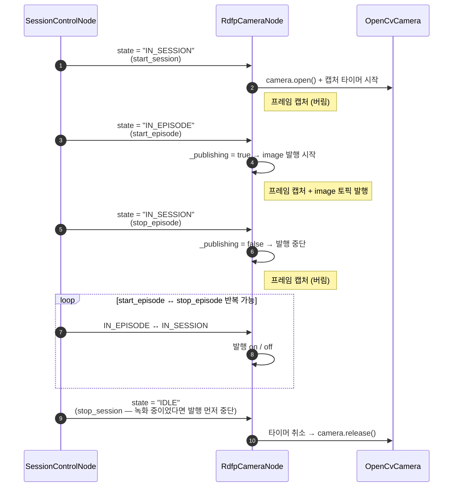
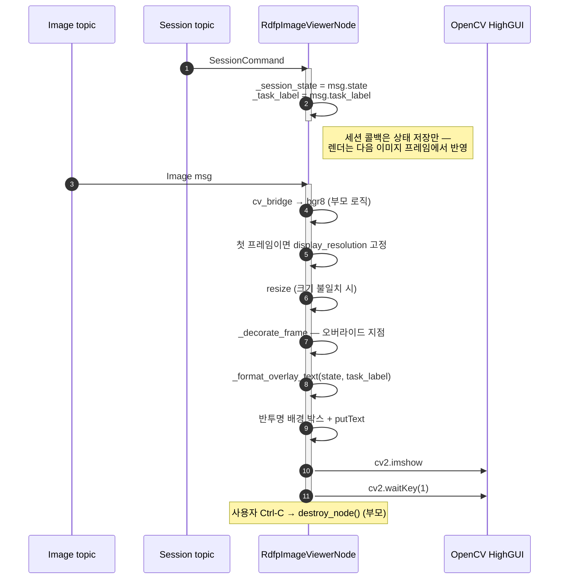

# 세션 인지 카메라·뷰어 노드 — `rdfp_camera_node` · `rdfp_image_viewer_node`

`rdfp/camera/` 의 노드 둘이다. 둘 다 **`/session` 을 구독**해 동작이 세션 상태를 따른다 —
카메라는 `IN_EPISODE` 구간에서만 이미지를 내고, 뷰어는 프레임에 세션 상태를 오버레이한다.
하드웨어 추상화와 부모 클래스는 제어 계층의 것을 그대로 쓴다
([../control/camera_nodes_guide.md](../control/camera_nodes_guide.md) ·
[../control/image_viewer_node_guide.md](../control/image_viewer_node_guide.md)).

> **`ros2 run rdfp …` 이다** — `robot_control` 에는 이 둘이 없다. 그리고 **세션 토픽은 `/session` 이라
> remap 이 필요 없다**: `session_control` 이 루트 상대(`session`)로 발행하므로 노드 이름이 붙지 않고,
> 두 노드도 같은 이름으로 구독한다. `/session_control/session` 은 namespace 를 줬을 때만 생기는
> 경로다 ([session_control_guide.md](session_control_guide.md)).

---

## 목차

- [A. `rdfp_camera_node` — 세션 상태에 따라 열고 닫는 카메라](#a-rdfp_camera_node--세션-상태에-따라-열고-닫는-카메라)
  - [A.1 개요](#a1-개요)
  - [A.2 사전 요구사항](#a2-사전-요구사항)
  - [A.3 Quick Start](#a3-quick-start)
  - [A.4 파라미터](#a4-파라미터)
  - [A.5 세션 상태별 동작](#a5-세션-상태별-동작)
  - [A.6 토픽 연결](#a6-토픽-연결)
  - [A.7 에러 처리](#a7-에러-처리)
  - [A.8 실전 예제](#a8-실전-예제)
  - [A.9 트러블슈팅](#a9-트러블슈팅)
- [B. `rdfp_image_viewer_node` — 세션 상태를 오버레이하는 뷰어](#b-rdfp_image_viewer_node--세션-상태를-오버레이하는-뷰어)
  - [B.1 개요](#b1-개요)
  - [B.2 사전 요구사항](#b2-사전-요구사항)
  - [B.3 Quick Start](#b3-quick-start)
  - [B.4 파라미터](#b4-파라미터)
  - [B.5 오버레이 표시 규칙](#b5-오버레이-표시-규칙)
  - [B.6 토픽 연결](#b6-토픽-연결)
  - [B.7 동작 흐름](#b7-동작-흐름)
  - [B.8 에러 처리](#b8-에러-처리)
  - [B.9 실전 예제](#b9-실전-예제)
  - [B.10 개발자 확장](#b10-개발자-확장)
  - [B.11 트러블슈팅](#b11-트러블슈팅)
- [관련 문서](#관련-문서)

---

## A. `rdfp_camera_node` — 세션 상태에 따라 열고 닫는 카메라

세션 상태에 따라 카메라를 열고/닫고, `IN_EPISODE` 구간에서만 이미지를 발행하는 노드 사용 가이드.

### A.1 개요

`RdfpCameraNode`는 `SessionControlNode`가 발행하는 세션 토픽의 상태 변경에
따라 `OpenCvCamera`를 제어하고, `IN_EPISODE` 구간에서만 `sensor_msgs/Image`를
`~/image_raw` private 토픽(기본 resolve 결과 `/rdfp_camera_node/image_raw`)으로
발행한다.

> 소속 패키지는 **`rdfp`** 다 (`src/rdfp/rdfp/camera/rdfp_camera_node.py`).
> `/session` 상태에 종속되는 수집 계층 노드이므로 제어 계층(`robot_control`)이
> 아니라 여기에 둔다. 카메라 하드웨어 추상화(`OpenCvCamera`)만 `robot_control`
> 것을 그대로 쓴다.

**[`CameraNode`](../control/camera_nodes_guide.md) 와의 차이:**

| 항목 | `CameraNode` (제어 계층) | `RdfpCameraNode` (수집 계층) |
|---|---|---|
| 세션 연동 | 없음 — 항상 발행 | `session` 구독. `IN_SESSION` 에 열고 `IN_EPISODE` 에 발행 |
| 카메라 열기 | 노드 시작 시 즉시 | 세션 시작 시 |
| 재연결 | **없음** — `exit 1` 로 supervisor 에 위임 | 자체 (`reconnect_interval_sec`, 기본 3.0) |
| `camera_status` | 매 tick 발행 | **바뀔 때만**, 기동 시 `DISCONNECTED` latch |
| 이미지 QoS | `SENSOR_QOS` depth **1** | `qos_profile_sensor_data` depth **5** |
| `CompressedImage` | 지원 (`compress_image`) | 없음 |
| `camera_info` | 매 프레임 | `IN_EPISODE` 에서만 |
| 종료 코드 | 초기화 실패 1 · 끊김 1 | 초기화 실패 1 |
| 테스트 | `camera/tests/` 38건 (되감기·마스킹) | 28건 (재연결·latch·late-join) |

두 노드는 **독립이며 동시에 띄울 수 있다.** `image_capture_node` 까지 셋 중 고르는
기준은 [README](../control/README.md) 를 본다.

**핵심 특징:**
- `IN_SESSION` 구간에서는 캡처만 수행하고 프레임을 버림 (카메라 warm-up)
- `IN_EPISODE` 전이 시 즉시 이미지 발행 시작
- 카메라 open 에 실패해도 `reconnect_interval_sec` 주기로 다시 시도해 회복한다
  (그 값이 0 이하일 때만 IDLE 전이까지 재시도하지 않는다)
- 캡처 중 연결이 끊기면 캡처 타이머를 멈추고 `reconnect_interval_sec` 주기로
  재연결을 시도한다. 성공하면 세션 상태를 유지한 채 발행이 재개된다
- `camera_status` 는 **상태가 바뀔 때만** 발행한다 (끊긴 카메라에서 초당 fps 회
  쏟아지지 않는다). 노드 시작 시 `DISCONNECTED` 를 한 번 latch 해 둔다

---

### A.2 사전 요구사항

```bash
# rdfp_msgs + rdfp 빌드
colcon build --packages-select rdfp_msgs robot_control robot_twin rdfp
source install/setup.bash
```

`SessionControlNode`가 실행 중이어야 세션 토픽이 발행된다.

---

### A.3 Quick Start

```bash
# 터미널 1: 세션 제어 노드
ros2 run rdfp session_control_node

# 터미널 2: 카메라 노드
ros2 run rdfp rdfp_camera_node --ros-args \
  -p camera_id:=0

# 터미널 3: 세션 제어
ros2 service call /session_control/start_session std_srvs/srv/Trigger
ros2 service call /session_control/start_episode std_srvs/srv/Trigger
# ... 이미지 발행 중 ...
ros2 service call /session_control/stop_episode std_srvs/srv/Trigger
ros2 service call /session_control/stop_session std_srvs/srv/Trigger

# 이미지 토픽 확인
ros2 topic hz /rdfp_camera_node/image_raw
```

`start_session` → 카메라 열림, `start_episode` → 이미지 발행 시작,
`stop_episode` → 발행 중단, `stop_session` → 카메라 닫힘.

---

### A.4 파라미터

| 파라미터 | 타입 | 기본값 | 설명 |
|----------|------|--------|------|
| `camera_id` | int \| str | `"0"` | 카메라 디바이스 ID 또는 영상 소스 경로. 필수 |
| `fps` | float | None | 캡처 FPS. None이면 카메라 기본값 사용 |
| `resolution` | str | None | `"WIDTHxHEIGHT"` 형식. None이면 카메라 기본값 사용 |
| `encoding` | str | `"bgr8"` | `cv_bridge` 이미지 변환 시 encoding (`bgr8`/`rgb8`/`mono8`) |
| `frame_id` | str | `"camera_link"` | Image 메시지의 `header.frame_id` |
| `reconnect_interval_sec` | float | `3.0` | 연결이 끊기거나 open 에 실패했을 때 재시도 주기(초). `0` 이하이면 재연결하지 않음 |

`fps`와 `resolution`을 생략하면 카메라 기본 설정을 사용한다.
실제 적용된 값은 `IN_SESSION` 전이 시 로그에 출력된다.

---

### A.5 세션 상태별 동작



#### 상태 전이 요약

| 전이 | 동작 |
|------|------|
| → `IDLE` | 타이머 취소, `camera.release()`, 플래그 리셋 |
| `IDLE` → `IN_SESSION` | `camera.open()`, 캡처 타이머 생성 (프레임 버림) |
| `IN_SESSION` → `IN_EPISODE` | 이미지 발행 시작 |
| `IN_EPISODE` → `IN_SESSION` | 이미지 발행 중단, 캡처는 계속 |
| `IN_SESSION` → `IDLE` | 타이머 취소, `camera.release()` |

---

### A.6 토픽 연결

#### 구독 토픽

| 토픽 | 타입 | QoS | 연결 방법 |
|------|------|-----|-----------|
| `session` | `rdfp_msgs/SessionCommand` | RELIABLE / TRANSIENT_LOCAL / depth=1 | 기본 `/session` — **remap 불필요**. namespace 운용 시에만 `-r session:=/<ns>/session` |

#### 발행 토픽

토픽은 모두 **private namespace(`~/`)** 로 선언되어 있어 노드 이름이
자동으로 prepend 된다. 기본 노드 이름 `rdfp_camera_node` 기준 resolve
결과는 아래 "기본 경로" 열에 표기한다.

| 토픽(선언) | 기본 경로 | 타입 | QoS |
|---|---|---|---|
| `~/image_raw` | `/rdfp_camera_node/image_raw` | `sensor_msgs/Image` | `qos_profile_sensor_data` (BEST_EFFORT / VOLATILE) |
| `~/camera_info` | `/rdfp_camera_node/camera_info` | `sensor_msgs/CameraInfo` | `qos_profile_sensor_data` |
| `~/camera_status` | `/rdfp_camera_node/camera_status` | `std_msgs/String` | `SYSTEM_QOS` (RELIABLE / TRANSIENT_LOCAL) |

`~/image_raw` 와 `~/camera_info` 는 **둘 다** `IN_EPISODE` 구간에서만 발행된다 —
발행 여부를 가르는 것이 프레임 단위의 `_publishing` 하나이기 때문이다.
`~/camera_status` 는 세션과 무관하게 상태가 바뀔 때 나간다.
`RdfpImageRecorder`와 연동하려면 양쪽 노드의 이미지 토픽을 동일 이름으로
remap 한다 (예: `-r ~/image_raw:=/rdfp/image_raw`).

#### 서비스

이 노드는 서비스를 제공하지 않는다. 카메라 제어는 세션 토픽 구독으로 자동 수행된다.

---

### A.7 에러 처리

| 상황 | 동작 |
|------|------|
| `camera.open()` 실패 (`RuntimeError`) | ERROR 로그 + `ERROR` status + `_open_failed=True`. 이후 `IN_EPISODE` 무시. 재연결 타이머가 걸리고, `IDLE` 전이 시 리셋 |
| `camera.read()` 실패 (None 반환, 연결은 유지) | WARNING (5초 throttle). 다음 타이머 콜백까지 대기 |
| `camera.read()` 실패 + `is_opened == False` (연결 끊김) | 캡처 타이머 정지 + `release()` + `DISCONNECTED` status. `reconnect_interval_sec` 주기로 재연결 시도 (`_publishing` 은 유지) |
| 알 수 없는 session state | WARNING 로그. `_prev_state` 변경하지 않음 |
| SIGINT / SIGTERM | `destroy_node()` → 타이머 취소 → `camera.release()` |

---

### A.8 실전 예제

#### 기본 사용

```bash
ros2 run rdfp rdfp_camera_node --ros-args \
  -p camera_id:=0 \
  -p fps:=30.0 \
  -p resolution:=640x480
```

#### RdfpImageRecorder와 연동

```bash
# 카메라 노드
ros2 run rdfp rdfp_camera_node --ros-args \
  -r ~/image_raw:=/rdfp/image_raw \
  -p camera_id:=0 \
  -p fps:=30.0 \
  -p resolution:=640x480

# 레코더 노드
ros2 run rdfp rdfp_image_recorder --ros-args \
  -r image:=/rdfp/image_raw \
  -p output_dir:=/data/rdfp/recordings \
  -p fps:=30 \
  -p resolution:=640x480
```

#### Launch 파일

```python
from launch import LaunchDescription
from launch_ros.actions import Node


def generate_launch_description():
    return LaunchDescription([
        Node(
            package='rdfp',
            executable='session_control_node',
        ),
        Node(
            package='rdfp',
            executable='rdfp_camera_node',
            parameters=[{
                'camera_id': '0',
                'fps': 30.0,
                'resolution': '640x480',
                'encoding': 'bgr8',
                'frame_id': 'camera_link',
            }],
            remappings=[
                ('~/image_raw', '/rdfp/image_raw'),
            ],
        ),
        Node(
            package='rdfp',
            executable='rdfp_image_recorder',
            parameters=[{
                'output_dir': '/data/rdfp/recordings',
                'fps': 30,
                'resolution': '640x480',
            }],
            remappings=[
                ('image', '/rdfp/image_raw'),
            ],
        ),
    ])
```

---

### A.9 트러블슈팅

#### A.1 카메라가 열리지 않음

**확인:**
```bash
# 세션 토픽이 발행되는지 확인
ros2 topic echo /session \
  --qos-durability transient_local --qos-reliability reliable

# 카메라 디바이스 존재 여부
ls -la /dev/video*
```

- `IN_SESSION` 상태가 도착해야 카메라가 열린다
- `camera open failed` 에러가 출력되면 `camera_id`와 디바이스 연결을 확인

#### A.2 이미지가 발행되지 않음

**확인:**
```bash
ros2 topic hz /rdfp/image_raw
```

- `IN_EPISODE` 상태가 도착해야 이미지가 발행된다
- 카메라 open이 실패한 상태(`_open_failed`)이면 `IN_EPISODE`가 무시된다.
  로그에서 `camera open had failed` 메시지를 확인
- remap이 올바르게 설정되었는지 확인

#### A.3 프레임 캡처 실패 경고

```
[WARN] frame read failed (camera_id=0)
```

**원인**: 카메라 연결이 끊겼거나 디바이스가 다른 프로세스에 점유됨.

**해결:**
- USB 카메라: 케이블 연결 확인 후 세션을 `IDLE` → `IN_SESSION`으로 재시작
- 네트워크 카메라: 스트림 URL과 네트워크 상태 확인

#### A.4 요청한 FPS/해상도와 실제 값이 다름

```
[WARN] Requested resolution ... differs from actual resolution ...
```

카메라가 요청한 값을 정확히 지원하지 않으면 가장 가까운 값으로 자동 조정된다.
실제 적용된 값은 `camera opened (resolution=…, fps=…)` 로그에서 확인할 수 있다.

---

## B. `rdfp_image_viewer_node` — 세션 상태를 오버레이하는 뷰어

세션 토픽 상태를 이미지 프레임 좌상단에 오버레이하는 뷰어 노드 사용 가이드.

### B.1 개요

`RdfpImageViewerNode` 는 ROS2 이미지 토픽을 OpenCV 윈도우에 표시하면서, 세션
토픽(`rdfp_msgs/msg/SessionCommand`) 의 현재 상태를 프레임 좌상단에 텍스트
오버레이로 보여주는 뷰어 노드다. `SessionControlNode` 와 함께 사용할 때 녹화
세션의 현재 상태(대기/준비/녹화)를 시각적으로 확인하는 용도에 적합하다.

> 소속 패키지는 **`rdfp`** 다 (`src/rdfp/rdfp/camera/rdfp_image_viewer_node.py`).
> `/session` 상태에 종속되는 수집 계층 노드이므로 제어 계층(`robot_control`)이
> 아니라 여기에 둔다. 베이스 클래스 `ImageViewerNode` 만 `robot_control.camera`
> 것을 상속한다.

**기존 `ImageViewerNode` 와의 차이:**

| 항목 | `ImageViewerNode` | `RdfpImageViewerNode` |
|---|---|---|
| 기본 뷰어 동작 | 수신 즉시 표시 | 부모 동작을 **그대로 상속** |
| 세션 토픽 구독 | 없음 | `session` 토픽 구독 (자동) |
| 오버레이 | 없음 | 상태 텍스트 좌상단 오버레이 |
| 확장 방식 | `_decorate_frame` 훅 제공 | 훅 **오버라이드**로 구현 |

**핵심 특징:**
- `ImageViewerNode` 를 상속하여 이미지 표시·해상도 처리·GUI 방어 로직은 모두 재사용
- 세션 퍼블리셔와 호환되는 `TRANSIENT_LOCAL` QoS 로 **late-join 시 직전 상태 즉시 수신**
- 세션 메시지 수신 전에도 초기값(`IDLE` / `""`) 으로 오버레이 정상 동작
- 반투명 흰색 배경 박스 + 짙은 적색 텍스트로 가독성 확보
- 렌더 실패 시 rate-limited(5초) 경고 후 원본 프레임 표시 — 화면 끊김 없음

---

### B.2 사전 요구사항

```bash
# cv_bridge + OpenCV
sudo apt install ros-humble-cv-bridge python3-opencv

# rdfp_msgs + rdfp 빌드
colcon build --packages-select rdfp_msgs robot_control robot_twin rdfp
source install/setup.bash
```

X/Wayland 세션이 있어야 한다. SSH 접속 시 `DISPLAY` 환경 변수 설정 또는
`ssh -X` 가 필요하다. 세션 토픽은 `SessionControlNode` 가 발행하지만, 미기동
상태라도 뷰어는 초기값(`IDLE`) 오버레이로 정상 실행된다.

---

### B.3 Quick Start

```bash
# 터미널 1: 세션 제어 노드 (없어도 뷰어 기동은 가능)
ros2 run rdfp session_control_node

# 터미널 2: 카메라 노드
ros2 run robot_control camera_node --ros-args \
  -p camera_id:=0 -p fps:=30 -p resolution:=640x480

# 터미널 3: 뷰어 노드
ros2 run rdfp rdfp_image_viewer_node --ros-args \
  -r image:=/camera_node/image_raw

# 터미널 4: 세션 상태 전이 예시
ros2 service call /session_control/set_task_label \
  rdfp_msgs/srv/SetString "{task_label: pick_apple}"
ros2 service call /session_control/start_session std_srvs/srv/Trigger
ros2 service call /session_control/start_episode std_srvs/srv/Trigger
# 오버레이 텍스트가 "pick_apple (Idle)" → "(Ready)" → "(Recording)" 으로 변함
```

`image` / `session` 두 토픽을 실제 퍼블리셔 토픽으로 remap 한다. 세션 상태가
바뀌지 않아도 이미지 스트림은 오버레이(`No Task (Idle)` 등) 와 함께 정상
표시된다.

---

### B.4 파라미터

#### 선택 파라미터

| 파라미터 | 타입 | 기본값 | 설명 |
|---|---|---|---|
| `resolution` | string | (없음) | `"WIDTHxHEIGHT"` 형식. 부모 `ImageViewerNode` 에서 상속. 미지정 시 첫 수신 이미지 크기 사용 |

ROS2 파라미터는 `resolution` 하나뿐이다. 오버레이 스타일·토픽 이름·윈도우
이름 등은 **모듈 상수** 로 고정되어 있으며, 커스터마이즈하려면 서브클래싱이
필요하다 ([개발자 확장](#b10-개발자-확장) 참조).

#### 내부 고정 상수

| 상수 | 값 | 의미 |
|---|---|---|
| `_DEFAULT_NODE_NAME` | `'rdfp_image_viewer_node'` | ROS2 노드 이름 |
| `_DEFAULT_WINDOW_NAME` | `'rdfp_image_viewer'` | OpenCV 윈도우 이름 |
| `_DEFAULT_SESSION_TOPIC` | `'session'` | 세션 토픽 기본 이름 (remap 가능) |
| `_OVERLAY_MARGIN_PX` | `10` | 좌상단 여백 |
| `_OVERLAY_PADDING_PX` | `6` | 텍스트 박스 내부 패딩 |
| `_OVERLAY_FONT_SCALE` | `0.7` | `cv2.FONT_HERSHEY_SIMPLEX` 배율 |
| `_OVERLAY_FONT_THICKNESS` | `2` | 텍스트 선 두께 |
| `_OVERLAY_TEXT_COLOR` | BGR `(2, 0, 153)` | 텍스트 색 (RGB `153, 0, 2`, 짙은 적색) |
| `_OVERLAY_BG_COLOR` | BGR `(255, 255, 255)` | 배경 박스 색 (흰색) |
| `_OVERLAY_BG_ALPHA` | `0.5` | 배경 박스 투명도 |
| `_OVERLAY_FAIL_LOG_INTERVAL_SEC` | `5.0` | 렌더 실패 경고 rate-limit |

---

### B.5 오버레이 표시 규칙

세션 메시지의 `state` / `task_label` 값에 따라 다음 규칙으로 텍스트가
구성된다.

#### 상태 → 접미사 매핑

| `state` | 접미사 |
|---|---|
| `IDLE` | `Idle` |
| `IN_SESSION` | `Ready` |
| `IN_EPISODE` | `Recording` |
| 그 외 | `Unknown State` |

#### task_label 폴백

`task_label` 이 빈 문자열(`""`) 이면 `"No Task"` 로 대체된다.

#### 최종 포맷

```
<label> (<suffix>)
```

예시:

| `state` | `task_label` | 오버레이 텍스트 |
|---|---|---|
| `IDLE` | `""` | `No Task (Idle)` |
| `IDLE` | `"pick_apple"` | `pick_apple (Idle)` |
| `IN_SESSION` | `"pick_apple"` | `pick_apple (Ready)` |
| `IN_EPISODE` | `"pick_apple"` | `pick_apple (Recording)` |
| `"FOO"` | `""` | `No Task (Unknown State)` |

#### 초기 상태

세션 메시지를 수신하기 전에는 내부 버퍼가 `state='IDLE'` / `task_label=''`
로 초기화되어 있어 `"No Task (Idle)"` 가 표시된다. `SessionControlNode` 가
미기동 상태여도 뷰어 동작에는 문제가 없다.

---

### B.6 토픽 연결

#### 구독 토픽

| 토픽 | 타입 | QoS | 연결 방법 |
|---|---|---|---|
| `image` | `sensor_msgs/Image` | `sensor_data` (BEST_EFFORT, KEEP_LAST 5) | `-r image:=/<publisher_topic>` |
| `session` | `rdfp_msgs/SessionCommand` | `TRANSIENT_LOCAL / RELIABLE / KEEP_LAST(1)` | 기본 `/session` — **remap 불필요**. namespace 운용 시에만 `-r session:=/<ns>/session` |

두 토픽 모두 remap 으로 실제 토픽에 연결한다. 세션 토픽의 QoS 는
`SessionControlNode` 발행 QoS 와 **정확히 일치** 시켜야 late-join 시 직전
상태를 즉시 받을 수 있다 — 본 노드는 이 조합을 내부적으로 고정한다.

#### 서비스 / 퍼블리셔

이 노드는 서비스와 퍼블리셔를 제공하지 않는다. 상태 변화는 세션 토픽
구독으로만 반영되며, 화면 출력 외 다른 부작용이 없다.

---

### B.7 동작 흐름



- **세션 콜백은 상태 저장만** 수행한다. 오버레이는 다음 이미지 프레임
  처리 시 `_decorate_frame` 에서 반영된다 (비동기 분리)
- **프레임 파이프라인은 부모 로직 그대로** 사용한다. 오버레이는
  resize 이후 / imshow 이전 한 지점에서만 끼어든다
- **렌더 실패는 원본 프레임 반환**. `cv2.error` 가 발생하면 5초 throttle
  WARNING 후 원본 프레임을 표시하므로 화면이 멈추지 않는다

---

### B.8 에러 처리

| 상황 | 동작 |
|---|---|
| GUI 백엔드 초기화 실패 (기동 시) | `RuntimeError` → `[FATAL]` → 노드 즉시 종료 (부모 `_create_window`) |
| 지원하지 않는 encoding | `CvBridgeError` → encoding 별 ERROR 1회 + 이후 drop (부모 `_on_image`) |
| 런타임 `cv2.error` (imshow/waitKey/resize) | WARNING (5초 throttle) + 프레임 drop (부모 `_on_image`) |
| 오버레이 렌더 중 `cv2.error` | WARNING (5초 throttle) + **원본 프레임 반환** (_decorate_frame) |
| 세션 메시지에 `state='FOO'` 등 미정의 값 | `"Unknown State"` 접미사로 표시 (크래시 없음) |
| 세션 메시지 미수신 | 초기값 `IDLE` / `""` 로 `"No Task (Idle)"` 표시 |
| SIGINT/SIGTERM, `ExternalShutdownException` | 윈도우 정리 → `rclpy.try_shutdown()` |

---

### B.9 실전 예제

#### 기본 사용 (세션 노드와 함께)

```bash
ros2 run rdfp session_control_node &
ros2 run rdfp rdfp_image_viewer_node --ros-args \
  -r image:=/camera_node/image_raw
```

#### 세션 노드 없이 단독 실행

세션 토픽이 없어도 초기값 오버레이(`No Task (Idle)`) 와 함께 정상 실행된다.

```bash
ros2 run rdfp rdfp_image_viewer_node --ros-args \
  -r image:=/camera_node/image_raw
```

#### 고정 해상도로 표시

```bash
ros2 run rdfp rdfp_image_viewer_node --ros-args \
  -r image:=/camera_node/image_raw \
  -p resolution:=800x600
```

#### Launch 파일

```python
from launch import LaunchDescription
from launch_ros.actions import Node


def generate_launch_description():
    return LaunchDescription([
        Node(
            package='rdfp',
            executable='session_control_node',
        ),
        Node(
            package='robot_control',
            executable='camera_node',
            parameters=[{
                'camera_id': '0',
                'fps': 30.0,
                'resolution': '640x480',
            }],
        ),
        Node(
            package='rdfp',
            executable='rdfp_image_viewer_node',
            parameters=[{
                'resolution': '640x480',
            }],
            remappings=[
                ('image', '/camera_node/image_raw'),
            ],
        ),
    ])
```

#### 녹화 세션 모니터링

`RdfpImageRecorder` 와 동일한 세션 토픽을 공유하여, 녹화 중인지 시각적으로
확인하는 구성.

```bash
ros2 run rdfp rdfp_image_recorder --ros-args \
  -r image:=/camera_node/image_raw \
  -p output_dir:=/data/rdfp/recordings -p fps:=30 -p resolution:=640x480 &

ros2 run rdfp rdfp_image_viewer_node --ros-args \
  -r image:=/camera_node/image_raw
```

`start_episode` 호출 시 뷰어에 `(Recording)` 이 표시되어 레코더 상태를 확인
가능.

---

### B.10 개발자 확장

이 노드는 `ImageViewerNode` 를 상속한 예시 구현이며, 내부 구조가 단순해
서브클래싱으로 쉽게 확장할 수 있다.

#### 확장 포인트 요약

| 바꾸고 싶은 것 | 수정 대상 |
|---|---|
| 상태 → 접미사 매핑 규칙 | `_STATE_SUFFIX` / `_UNKNOWN_SUFFIX` / `_NO_TASK_LABEL` |
| 표시 문자열 포맷 자체 | `_format_overlay_text()` |
| 렌더 스타일(색·폰트·여백) | `_OVERLAY_*` 모듈 상수 |
| 렌더 파이프라인 | `RdfpImageViewerNode._decorate_frame` 오버라이드 |
| 추가 토픽 구독 | `__init__` 에 구독자 생성 |
| ROS2 노드/윈도우 이름 | `_DEFAULT_NODE_NAME` / `_DEFAULT_WINDOW_NAME` 상수 또는 서브클래스에서 `super().__init__(node_name=..., window_name=...)` 호출 |

#### 서브클래스 스켈레톤

예: 우상단에 FPS 도 함께 표시하는 확장.

```python
import time
import cv2
import numpy as np

from rdfp.camera.rdfp_image_viewer_node import RdfpImageViewerNode


class FpsOverlayViewer(RdfpImageViewerNode):
    def __init__(self, **node_kwargs):
        super().__init__(**node_kwargs)
        self._last_ts = time.monotonic()
        self._fps = 0.0

    def _decorate_frame(self, frame: np.ndarray) -> np.ndarray:
        # 1) 세션 오버레이는 부모 구현으로 수행
        frame = super()._decorate_frame(frame)

        # 2) FPS 계산·표시 추가
        now = time.monotonic()
        dt = now - self._last_ts
        self._last_ts = now
        if dt > 0:
            self._fps = 0.9 * self._fps + 0.1 * (1.0 / dt)
        text = f'{self._fps:4.1f} FPS'
        cv2.putText(frame, text, (frame.shape[1] - 120, 30),
                    cv2.FONT_HERSHEY_SIMPLEX, 0.7, (255, 255, 255), 2)
        return frame
```

#### 주의사항

- **예외는 훅 안에서 흡수**한다. 부모 `_on_image` 는 `cv2.error` 만
  rate-limited 로그로 방어하므로, 훅에서 예상 외의 예외가 올라가면 콜백
  전체가 실패해 다음 프레임도 영향을 받는다
- **성능**: `_decorate_frame` 은 프레임마다 호출된다. 30fps 기준 ≤ 수 ms 로
  유지한다
- **in-place 수정**: 부모가 반환값을 사용하므로 `frame` 을 그대로 수정해도
  되지만, 원본을 다른 용도로 공유한다면 `frame.copy()` 후 수정한다
- **세션 메시지 처리**: `_on_session` 은 내부 버퍼 업데이트만 수행하고 렌더는
  하지 않는다. 추가 세션 관련 부작용이 필요하면 별도 메서드로 분리한다

---

### B.11 트러블슈팅

#### B.1 윈도우가 뜨지 않음

**원인 1**: `DISPLAY` 미설정 또는 X/Wayland 연결 불가.

```
[FATAL] RdfpImageViewerNode init failed: OpenCV GUI backend is not available
        (headless environment or missing display): ...
```

→ GUI 세션에서 실행하거나 `ssh -X` 로 재접속한다.

**원인 2**: 입력 이미지 토픽에 publisher 가 없음.

```bash
ros2 topic info -v /camera_node/image_raw   # Publisher count: 0 이면 미연결
```

세션 토픽은 없어도 뷰어는 기동되며 초기 오버레이를 표시하지만, 이미지 토픽이
없으면 아무 프레임도 렌더되지 않는다.

#### B.2 세션 상태가 반영되지 않음

**확인:**

```bash
# 세션 토픽이 발행되는지 확인 (TRANSIENT_LOCAL QoS 로 조회)
ros2 topic echo /session \
  --qos-durability transient_local --qos-reliability reliable

# 뷰어의 세션 구독이 연결되었는지
ros2 topic info /session -v
```

- `Subscription count` 에 `rdfp_image_viewer_node` 가 포함되어야 한다
- `--qos-durability` 가 일치하지 않으면 구독이 매칭되지 않는다 (뷰어는
  `TRANSIENT_LOCAL` 로 고정되어 있으므로 퍼블리셔가 `VOLATILE` 이면 연결 실패)
- remap 경로가 올바른지 확인

#### B.3 오버레이에 `(Unknown State)` 가 계속 뜸

세션 메시지의 `state` 값이 `IDLE` / `IN_SESSION` / `IN_EPISODE` 중 하나가
아니라는 뜻이다. `SessionControlNode` 외의 퍼블리셔가 발행하는 세션 토픽에
연결된 경우 발생할 수 있다.

```bash
ros2 topic echo /<session_topic> --field state --once
```

→ 퍼블리셔 구현을 점검하거나, 서브클래싱으로 `_STATE_SUFFIX` 매핑을 확장한다.

#### B.4 첫 프레임 이후 `resolution` 이 바뀌지 않음

**의도된 동작이다.** 첫 수신 프레임 크기를 고정해 중간에 publisher 해상도가
바뀌어도 표시 크기를 유지한다 (부모 `ImageViewerNode` 정책). 런타임 변경을
원하면 노드를 재시작한다.

#### B.5 로그에 `OpenCV HighGUI failure` 또는 `overlay rendering failed` 반복

- `OpenCV HighGUI failure` — 실행 중 X/Wayland 연결 단절. 디스플레이
  세션을 복구하거나 노드를 재시작한다
- `overlay rendering failed` — 드물게 발생하는 `cv2.error`. 5초 throttle
  로 로그가 제한되며 노드는 crash 하지 않는다. 프레임은 오버레이 없이
  계속 표시된다

#### B.6 `ImageViewerNode` 와 `RdfpImageViewerNode` 를 같은 프로세스에서 띄울 때

두 노드는 서로 다른 OpenCV 윈도우 이름(`image_viewer` / `rdfp_image_viewer`)
을 사용하므로 충돌하지 않는다. 한쪽의 `destroy_node()` 는 **자신이 만든
윈도우만** 닫도록 설계되어 있어 다른 뷰어에 영향을 주지 않는다.

---

## 관련 문서

- [RdfpImageRecorder Guide](rdfp_image_recorder_node_guide.md) — 이미지 녹화 노드
- [SessionControlNode Guide](session_control_guide.md) — 세션 제어 노드
- [ImageViewerNode Guide](../control/image_viewer_node_guide.md) — 부모 클래스 사용 가이드
- [CameraNode Guide](../control/camera_nodes_guide.md) — 이미지 토픽 발행자
- [RdfpCameraNode Guide](session_camera_nodes_guide.md) — 세션 연동 카메라 노드
- [RdfpImageRecorder Guide](rdfp_image_recorder_node_guide.md) — 동일 세션 토픽을 사용하는 녹화 노드
