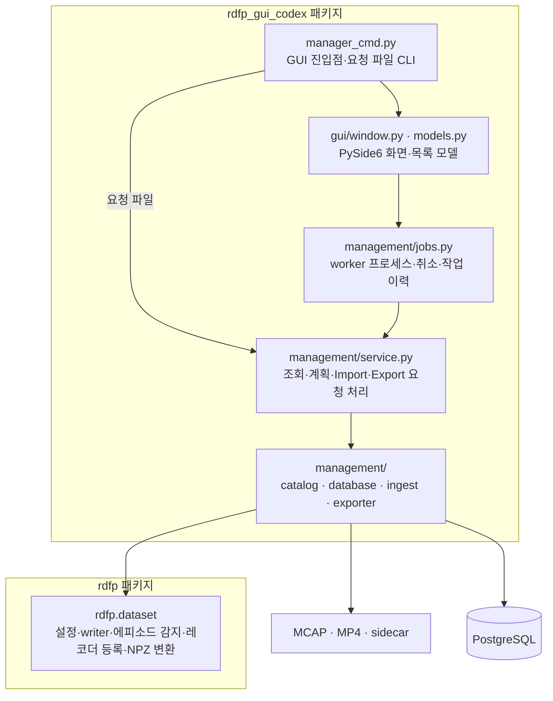

# 데이터셋 관리 GUI 설계안

> **상태: 설계안 및 패키지 구조 현행화 (2026-11-04).** rosbag2 녹화물 → PostgreSQL 적재 → 학습 샘플 Export를 관리하는 데스크톱 도구다.
> 실행 가능한 구현이 둘이다 — [src/rdfp_gui](../../src/rdfp_gui/README.md)(이 설계안의 원안 구조: 조회 · 점검을 `rdfp.dataset.inspect` 에 두고 GUI 는 PySide6, 적재 · export 는 `rdfp` CLI 서브프로세스; §8 의 1~3 단계, 2026-11-04) 와 [src/rdfp_gui_codex](../../src/rdfp_gui_codex/README.md)(아래 §5 가 설명하는 worker 프로세스 구조).
> §5, §6.3·6.4·6.7은 현재 구조를 설명한다. 그 밖의 화면·기능·단계별 계획에는 초기 제안과 미구현 항목이 포함되어 있다.
> 실제 사용법과 지원 범위는 [Dataset Manager 사용자 가이드](Dataset_Manager_사용자_가이드.md)를 따른다. 구현의 상세 설계 배경은 [design_gpt.md](design_gpt.md)에 있다.
>
> 관련 문서: [데이터셋_적재_시스템_설계서.md](데이터셋_적재_시스템_설계서.md)(적재 파이프라인 · 스키마),
> [데이터셋_적재_운영_가이드.md](데이터셋_적재_운영_가이드.md)(CLI 운영), [rosbag_명령_가이드.md](rosbag_명령_가이드.md),
> [../learning/저장_형식.md](../learning/저장_형식.md)(export 형식과 LeRobot 결정).

## 목차

- [1. 목적과 범위](#1-목적과-범위)
- [2. 지금 무엇이 불편한가](#2-지금-무엇이-불편한가)
- [3. 화면 구성](#3-화면-구성)
- [4. 기능](#4-기능)
- [5. 아키텍처](#5-아키텍처)
- [6. 설계 결정과 근거](#6-설계-결정과-근거)
- [7. 기존 코드와의 접점](#7-기존-코드와의-접점)
- [8. 단계별 구현 계획](#8-단계별-구현-계획)
- [9. 열린 질문](#9-열린-질문)
- [부록 A. 화면 스케치](#부록-a-화면-스케치)
- [부록 B. 동적 테이블의 열 생성 규칙](#부록-b-동적-테이블의-열-생성-규칙)

---

## 1. 목적과 범위

### 1.1 목적

| 하고 싶은 것 | 지금 | 이 도구 |
|---|---|---|
| bag 에 어떤 토픽이 얼마나 있나 | `ros2 run rdfp rosbag list-topics` | 왼쪽 패널 |
| DB 에 어떤 테이블이 있고 몇 행인가 | `stats` + `psql` | 오른쪽 패널 |
| 어느 토픽이 어느 테이블로 가나 | `db/registry.py` 를 읽는다 | 두 패널 사이의 **매핑 선** · 색 |
| 왜 이 토픽은 DB 에 없나 | 로그의 `no writer registered` 한 줄 | 매핑 없는 토픽을 **경고색**으로, 이유를 상세 패널에 |
| 메시지 구조 · 테이블 스키마 | 소스 · `\d` | 상세 패널 |
| 실제 데이터를 훑어본다 | `psql` · 재생 GUI | 데이터 브라우저 (bag 쪽 · DB 쪽 모두) |
| 골라서 적재한다 | `rosbag export --episodes 1-3` | 토픽 · 에피소드를 체크하고 **Import** |
| 에피소드 단위로 적재 결과를 본다 | `list` | 에피소드 뷰 (테이블별 행 수 · mp4 · 검증) |
| 범위를 정해 학습셋을 만든다 | `export --episodes` | 에피소드 뷰에서 범위 선택 → **Export** (npz · LeRobot v3) |
| 새 메시지 타입을 적재한다 | 테이블 · writer · reader 를 쓰고 registry 에 등록 | 매핑 없는 토픽을 골라 **테이블 생성** (동적 등록) |

### 1.2 범위에 넣지 않는 것

- **녹화 자체** (`rosbag.sh record`) 와 **재생** (`replay_gui`). 이 도구는 녹화가 끝난 뒤의 bag 과 DB 를 다룬다. 재생은 ROS 스택이 필요한 별개의 도구다.
- **DB 서버 관리** (생성 · 백업 · 사용자). `init-db` 는 호출만 한다.
- **학습 실행.** export 까지만 한다. 학습은 `rdfp-train` 의 몫이다.

### 1.3 사용자

이 워크스페이스로 데이터를 모으고 적재하는 사람. ROS 와 PostgreSQL 이 설치된 수집 PC 에서 띄운다. 원격 열람은 범위에 없다 (§9).

---

## 2. 지금 무엇이 불편한가

적재 경로에서 **데이터가 조용히 빠지는 함정**이 여럿 있고, 전부 CLI 출력만으로는 보이지 않는다. 이 도구의 가장 큰 가치는 이것들을 **보이게** 하는 것이다.

| 함정 | 지금 증상 | 이 도구가 보여 줄 것 |
|---|---|---|
| `metadata.yaml` 이 없는 세션은 조용히 제외 | `found 0 finalized split(s)` | 세션 목록에 **"미완료"** 표시 + `ros2 bag reindex` 버튼 |
| writer 가 없는 타입은 조용히 무시 | 경고 한 줄 | 토픽을 **매핑 없음** 색으로 |
| `header.stamp` 가 0 이거나 벽시계인 메시지는 에피소드 창 밖으로 | bag 에는 있는데 DB 에 없다 | 토픽별 **stamp 진단**: 0 비율, 에피소드 창 안 비율 |
| 시뮬레이터 재기동 뒤 sim 시계가 겹침 | 에피소드는 있는데 속이 빔 | 에피소드 **구간 겹침** 경고 |
| 레코더 mp4 와 에피소드가 안 맞음 (`episode_key`) | `image_frames: 0` | 에피소드마다 mp4 **매칭 상태** |
| 이미지 토픽 + 레코더 등록 동시 켜짐 | UNIQUE 위반으로 import 실패 | import 전 **사전 점검**에서 차단 |
| writer 가 필드를 흘림 (`getattr` 기본값) | 모든 행이 빈 값 | 데이터 브라우저에서 **빈 열**이 바로 보인다 |

---

## 3. 화면 구성

메인 윈도우는 **탭 셋** + 공통 하단 패널이다. 부록 A 에 스케치가 있다.

| 탭 | 보는 것 | 주된 조작 |
|---|---|---|
| **① 매핑** | 왼쪽 bag 토픽 · 오른쪽 DB 테이블 · 가운데 매핑 선 | 상세 보기, 데이터 브라우즈, 테이블 생성 · 매핑 제거, Import |
| **② 에피소드** | DB 의 에피소드 목록 + bag 에서 감지된(미적재) 에피소드 | 필터, 상세, 삭제, 범위 선택 → Export |
| **③ 세션(bag)** | `rosbag_dir` 의 날짜 · 세션 · split 트리 | 미완료 세션 복구, 삭제, 적재 여부 |
| **④ 설정** | `dataset_config.yaml` · `recording_topics.list` · DB 연결 | 읽기 · 검증 · 경로 바꾸기 |

**하단 패널 (공통)**: 작업 로그(실행 중인 CLI 의 출력), 진행률, 그리고 **"이 조작과 같은 CLI 명령"** 표시 (§6.4).

### 3.1 ① 매핑 탭

```
┌─ bag 토픽 ─────────────────┐    ┌─ DB 테이블 ──────────────────┐
│ ☐ /joint_states            │────│ joint_states        12,340 행│
│   sensor_msgs/msg/JointState│  ┌─│                               │
│ ☐ /target_joint_cmds        │──┘ │ pose_stampeds        4,100 행│
│   sensor_msgs/msg/JointState│    │ gripper_cmds            37 행│
│ ☐ /ee_pose                 │────│ ...                           │
│ ☐ /camera_image/compressed  │ ✖  │ image_streams (레코더 mp4)   │
│   sensor_msgs/msg/CompressedImage│ │ target_joint_states      0 행│ ← 토픽 없음
│ ☐ /session   (에피소드 경계)│ ◇  │ sessions                 82 행│
└────────────────────────────┘    └──────────────────────────────┘
```

- **토픽 행**: 이름 · 타입 · bag 안 메시지 수 · 상태 아이콘. 상태는 넷이다.
  - `●` 매핑됨 (registry 에 타입이 있다)
  - `◇` 특수 (`/session` → 에피소드 경계, `sensor_msgs/Image` → mp4)
  - `✖` **매핑 없음** — DB 에 들어가지 않는다. 이 도구가 가장 먼저 눈에 띄게 할 것이다
  - `△` 매핑은 있는데 **stamp 진단에 걸림** (§4.1)
- **테이블 행**: 이름 · 행 수 · 출처(내장 registry / 동적 등록 / 시스템 테이블) · 어느 토픽이 들어오는가. **같은 타입의 토픽 둘이 한 테이블로 가는 것**(`/joint_states` · `/target_joint_cmds` → `joint_states`)이 선 두 개로 보인다.
- 한쪽을 고르면 반대쪽 짝이 강조된다.

### 3.2 상세 패널

토픽을 고르면:
- **메시지 정의** — bag 의 MCAP 에 박힌 스키마 텍스트(`.msg` 정의)를 그대로 보인다. ROS 가 없어도 읽힌다.
- **통계** — 메시지 수, 첫 · 마지막 stamp, 평균 주기, `header.stamp == 0` 비율, 에피소드 창 안 비율.
- **매핑** — 가는 테이블, writer · reader 클래스, 열 대응(있으면).
- **[데이터 보기]** — bag 메시지를 시각순으로 페이지 단위로 펼친다 (§4.2).

테이블을 고르면:
- **스키마** — `information_schema` 로 읽은 열 · 타입 · NULL 여부 · 제약 · 인덱스. `schema.sql` 의 주석도 함께 보이면 좋다 (§9).
- **통계** — 행 수, 에피소드 수, `topic_id` 별 행 수.
- **[데이터 보기]** — 행을 페이지 단위로 펼친다. 에피소드 · 토픽으로 거른다.

---

## 4. 기능

### 4.1 bag 토픽 보기와 진단

- `rosbag_dir` 를 훑어 split 목록을 만든다 — `rdfp.rosbag.catalog.discover_splits` 그대로. **`metadata.yaml` 이 없는 세션도 트리에는 보인다**(③ 탭) — 적재 대상이 아니라는 표시와 함께. 지금은 CLI 가 이것을 조용히 건너뛰어 "왜 0 개인가"를 알 수 없다.
- 토픽별 타입 · 메시지 수는 `metadata.yaml` 에서 읽는다(빠르다). 스키마 텍스트와 stamp 진단은 MCAP 을 열어야 하므로 **토픽을 골랐을 때** 백그라운드로 읽는다.
- **stamp 진단**은 적재가 메시지를 거르는 기준과 같은 기준으로 센다 — `header.stamp` 가 없으면 적재가 버리고, 에피소드 `[start_ns, stop_ns)` 밖이면 적재가 버린다. 이 두 비율이 이 도구가 내는 가장 값진 숫자다. 벽시계 · sim 시계 불일치(펑션베이 회차 함정, Isaac 재기동 함정)가 여기서 드러난다.

### 4.2 데이터 브라우저

bag 쪽과 DB 쪽에 같은 모양의 표 뷰어를 둔다.

| | bag 메시지 | DB 행 |
|---|---|---|
| 원천 | `rdfp.rosbag.mcap_reader.iter_split_messages` | `SELECT … ORDER BY stamp LIMIT/OFFSET` |
| 페이지 | 1,000 건. split 단위로 읽어 메모리에 들고 있지 않는다 | 서버 커서 |
| 거르기 | 시간 범위 · 에피소드 | 에피소드 · `topic_id` · 시간 범위 |
| 셀 | 중첩 메시지는 트리로 펼친다 | 배열 · JSONB 는 펼친다 |
| 비교 | 같은 에피소드 · 같은 토픽의 bag 행 수와 DB 행 수를 **나란히** 보인다 → 빠진 것이 숫자로 보인다 | |

### 4.3 매핑 관리 — 테이블 생성 · 매핑 제거

지금 매핑의 정본은 **코드**다 — `rdfp/dataset/db/registry.py` 의 `MESSAGE_TYPE_REGISTRY` 가 타입 → (테이블 · writer · reader) 를 적고, 열 구성은 writer 가 손으로 쓴다(`joint_names TEXT[]` 처럼 뜻이 있는 열). GUI 에서 테이블을 **동적으로** 만들려면 그 옆에 두 번째 경로가 필요하다.

**두 종류의 매핑을 둔다.**

| | 내장 매핑 | 동적 매핑 |
|---|---|---|
| 정본 | `registry.py` (코드) | DB 의 `topic_tables` 테이블 (새로 만든다) |
| 열 | writer 가 뜻을 담아 설계 | 메시지 스키마에서 **규칙으로 생성** (부록 B) |
| writer / reader | 타입별 클래스 | 범용 `GenericWriter` / `GenericReader` 하나 |
| 우선순위 | **이긴다** | 내장에 없는 타입만 |
| GUI 에서 삭제 | **못 한다** | 할 수 있다 (§4.3.2) |

#### 4.3.1 테이블 생성 (등록)

매핑 없는 토픽을 고르고 **[테이블 생성]** 을 누르면:

1. MCAP 의 스키마 텍스트를 파싱해 열 목록을 **미리 보인다** (부록 B 규칙). 사용자가 테이블 이름을 바꿀 수 있다 (기본값: 타입 이름을 snake_case 로 — `rdfp_msgs/msg/ClutchState` → `clutch_states`).
2. `CREATE TABLE` 문을 보여 주고 확인을 받는다. 모든 동적 테이블은 내장 테이블과 같은 공통 열을 갖는다 — `id` · `episode_id`(FK, CASCADE) · `topic_id`(FK, RESTRICT) · `stamp_sec` · `stamp_nanosec` · `stamp_ts`(generated) — 그래야 에피소드 삭제 · `replace` 정책 · 에피소드 뷰가 그대로 먹는다.
3. `topic_tables(type_name, table_name, schema_text, created_at)` 에 한 행을 넣는다. **타입이 키다** — 토픽이 아니다. 내장 registry 와 같은 원칙이며(같은 타입의 다른 토픽이 같은 테이블로 간다), 어긋나면 "토픽은 매핑됐는데 타입이 같은 다른 토픽은 안 됐다"는 상태가 생긴다.
4. 적재 파이프라인은 `resolve_message_type()` 이 내장에서 못 찾으면 `topic_tables` 를 본다. 그래서 **CLI `import` 도 동적 매핑을 쓴다** — GUI 전용 경로가 아니다.

⚠️ **스키마 텍스트도 저장한다.** 같은 타입 이름에 다른 정의(필드가 추가된 bag)가 오면 `GenericWriter` 가 열 불일치를 **거부**한다. 조용히 NULL 로 채우면 `getattr` 기본값 함정과 같은 종류의 조용한 빈 열이 된다.

#### 4.3.2 매핑 제거

**두 단계로 나눈다.** 하나로 합치면 "매핑을 끄려다 데이터를 지우는" 사고가 난다.

| 조작 | 하는 것 | 데이터 |
|---|---|---|
| **등록 해제** | `topic_tables` 행만 지운다. 다음 import 부터 그 타입은 무시된다 | **남는다** — 테이블은 그대로 |
| **테이블 삭제** | `DROP TABLE` | 지운다. **행 수를 보여 주고 테이블 이름을 타이핑해야** 실행된다 |

- 내장 매핑(`joint_states` 등)은 둘 다 **못 한다**. 그 테이블은 export · 재생 · 다른 도구가 의존한다. 메뉴에 나오되 비활성이고 이유를 보인다.
- `topics` 행은 지우지 않는다. `ON DELETE RESTRICT` 가 있어 다른 테이블이 참조하면 어차피 못 지우고, 참조가 없어도 토픽 이름의 이력은 남겨 둘 가치가 있다.

### 4.4 Import

① 탭에서 토픽을 체크하고(기본: 매핑된 전부), ② 또는 ③ 탭에서 에피소드 · 세션을 고르고(기본: 미적재 전부) **[Import]** 를 누른다.

**사전 점검** (실행 전에 보여 주고 막는다):
- `output_mp4_dir` · DB 연결 · 스키마 (`ensure_schema`).
- 이미지 토픽이 체크됐는데 `recordings_dir` 도 켜져 있으면 **차단** — `image_streams` UNIQUE 위반으로 죽는 조합이다.
- 고른 에피소드 가운데 구간이 **겹치는 것**이 있으면 경고(sim 시계 되감김).
- 고른 에피소드가 이미 DB 에 있으면 `on_existing_episode` 정책(skip / replace / error)을 **여기서 고르게** 한다.

**실행**: `ros2 run rdfp import --config … ` 를 **서브프로세스로** 띄우고 출력을 하단 패널에 흘린다 (§6.3). 끝나면 요약 JSON 을 표로 보이고, `postproc_run.jsonl` 의 `episode_failed` 를 에피소드 뷰에 붉게 표시한다.

**토픽 부분 import** — 사용자가 토픽 일부만 체크한 경우:
- 지금 파이프라인은 **에피소드 단위 · 전 토픽**이다. 토픽 일부만 넣으면 그 에피소드의 나머지 토픽은 비어 있는 채로 커밋된다. 그 뒤에 나머지 토픽을 넣으려면 `replace` 로 에피소드를 통째로 다시 넣어야 한다(지금 구조).
- 그래서 **"토픽 추가 적재"** 를 따로 둔다: 이미 있는 에피소드에 대해 고른 토픽만, `(episode_id, topic_id)` 의 기존 행을 지우고 다시 넣는다 — 에피소드 하나가 트랜잭션 하나다. `import` CLI 에 `--topics` · `--only-topics-replace` 를 더하는 것으로 구현한다(§7). 이것이 §4.3.1 로 테이블을 새로 만든 뒤 **옛 에피소드에 그 토픽을 채우는** 길이기도 하다.

### 4.5 에피소드 뷰 (② 탭)

| 열 | 출처 |
|---|---|
| id · 시작 · 길이 · `task_label` · `success` | `sessions` |
| 백엔드 · seed · scene | `sessions.metadata` (JSONB — 있는 키만) |
| 테이블별 행 수 | 각 테이블 `GROUP BY episode_id` (캐시) |
| mp4 | `image_streams` 유무 · 프레임 수 · 파일 존재 여부 |
| 검증 | 아래 점검의 합 |
| export 이력 | 마지막 export 의 시각 · 형식 · 출력 경로 (§9 — 어디에 기록할지) |

**미적재 에피소드도 같은 표에 보인다** — bag 에서 감지(`episodes_from_splits`)했지만 `sessions` 에 없는 것은 회색 행이다. 지금 `rosbag list-episodes` 가 하는 일을 한 표에 합친다.

**에피소드 점검** (경고로 표시, 막지 않는다):
- 어느 메시지 테이블도 0 행 — 시계 겹침 함정의 전형이다.
- `image_streams` 는 있는데 `image_frames` 가 0 — 레코더 `pixel_format` 불일치의 전형이다.
- `motion_trajectories` 와 `motion_events` 의 `operation_id` 짝이 안 맞는다(`failed` 만 짝이 없어야 한다).
- `gripper_cmds` 가 0 행 — stamp 함정의 전형이다.

**상세**: 타임라인(토픽별 메시지 밀도를 한 줄씩), 테이블별 [데이터 보기], mp4 첫 프레임 썸네일(선택 — `cv2` 로 한 장만 읽는다).

**삭제**: `sessions` 행 삭제(CASCADE) + mp4 디렉터리 + (선택) bag 에서 에피소드 제거(`rosbag delete`). 운영 가이드 §8.6 의 절차를 버튼으로 옮긴 것이며, 같은 확인 규칙(행 수 보여 주고 타이핑 확인)을 쓴다.

### 4.6 Export

② 탭에서 범위(체크 또는 id 범위 · 필터 결과 전체)를 고르고 **[Export]** 를 누른다.

**공통 사전 점검**: frame clock 이 설 수 있는가(`image_frames` 가 있는가), `arm_joints` 가 정해지는가(`motion_trajectories.joint_names`), 카메라 토픽이 여럿이면 하나를 고르게 한다 — 전부 지금 `export` 가 예외로 멈추는 조건이고, 미리 보이는 것뿐이다.

| 형식 | 구현 | 비고 |
|---|---|---|
| **npz** (현행) | `rdfp.dataset.export.writer.export_dataset` 를 그대로 — `metadata.json` + `episodes.jsonl` + 에피소드별 `.npz`, mp4 는 상대 경로 참조 | 지금 학습(`rdfp-train`)이 읽는 형식 |
| **LeRobot v3** | 새 모듈 `export/lerobot_v3.py`. npz 산출물을 **입력으로** 받아 변환한다 (DB 를 다시 읽지 않는다) | **§6.5 를 먼저 읽는다** — 결정 28 과 부딪힌다 |

실행은 `ros2 run rdfp export …` 서브프로세스다. 끝나면 출력 디렉터리 · 샘플 수 · 제외된 에피소드 수(`assumed_full_duration`)를 보인다.

### 4.7 설정 (④ 탭)

- `dataset_config.yaml` 을 읽어 보이고 **Pydantic 검증 결과**를 보인다. 편집은 텍스트 그대로(구조 편집기는 만들지 않는다 — 설정 모델이 바뀔 때마다 GUI 를 고치게 된다).
- `recording_topics.list` 와 `dataset_config.yaml` 의 `topics_file` 이 **같은 파일인지** 확인한다 — 갈리면 녹화한 것과 적재하는 것이 어긋난다.
- DB 연결 시험. DSN 은 환경변수(`RDFP_DB_DSN`)에서만 읽고 **화면에 비밀번호를 보이지 않는다.**

---

## 5. 아키텍처

이 절은 2026-11-04 기준 `rdfp_gui_codex`의 실제 코드 배치를 설명한다. 화면별 확장 기능과 초기 설계의 구현 단계가 모두 완료되었다는 뜻은 아니다. 현재 기능 범위는 [사용자 가이드 §7](Dataset_Manager_사용자_가이드.md#7-작업-이력과-운영-범위)을 기준으로 확인한다.

### 5.1 화면·관리 서비스·기존 공통 기능



- 패키지 의존 방향은 **`rdfp_gui_codex → rdfp`**다. `package.xml`에 `rdfp`를 `exec_depend`로 선언하며, `rdfp`는 새 패키지를 import하지 않는다.
- 화면과 이번에 추가한 관리 서비스는 `rdfp_gui_codex`에 둔다. 기존 writer, DB 스키마, 설정, 관측·label 변환은 `rdfp`에서 가져온다.
- 조회와 변환은 GUI 밖의 Python worker 프로세스에서 실행한다. 기존 `ros2 run rdfp import/export`를 호출하는 방식은 아니다.
- GUI와 `--request` CLI는 같은 `management/service.py`를 사용한다. 기존 `rdfp` CLI의 전체 에피소드 교체와 Manager의 선택 토픽 교체는 서로 다른 계약이다.
- GUI 실행과 현재 지원하는 MCAP·레코더 Import에는 실행 중인 ROS 노드가 필요하지 않다. GUI용 테스트도 새 패키지에 있다.

### 5.2 패키지 위치와 실행

```text
src/rdfp_gui_codex/
    package.xml · setup.py · setup.cfg
    resource/rdfp_gui_codex
    README.md
    requirements.txt                       # Qt·DB·MCAP·영상 처리
    requirements-lerobot.txt               # 선택적 LeRobot v3 Export
    rdfp_gui_codex/
        __init__.py
        manager_cmd.py                     # dataset_manager 진입점
        gui/
            window.py · models.py
        management/
            common.py · catalog.py · database.py
            ingest.py · exporter.py · service.py · jobs.py
    tests/                                 # DB·MCAP·Qt·Export·worker 테스트

src/rdfp/rdfp/dataset/                      # 기존 공통 기능
    config.py
    db/                                    # registry·writer·reader
    ingest/                                # 에피소드 감지·레코더 등록
    export/                                # 관측·label·NPZ 변환
    sql/schema.sql                         # 기본 DB 스키마 원본
```

워크스페이스 루트에서 기존 스크립트로 실행한다. 스크립트가 두 패키지의 소스 경로를 연결한다. 의존성 설치 방법은 [패키지 README](../../src/rdfp_gui_codex/README.md)에 있다.

```bash
./scripts/run_dataset_manager.sh
```

ROS 환경에서 패키지를 빌드해 실행할 때는 다음 명령을 사용한다. 기존 `rdfp` 패키지가 설치되어 있고, 빌드에 사용한 Python에 GUI 의존성이 있어야 한다.

```bash
colcon build --symlink-install --packages-select rdfp_gui_codex
source install/setup.bash
ros2 run rdfp_gui_codex dataset_manager --config config/dataset_config.yaml
```

- Python 모듈 진입점은 `rdfp_gui_codex.manager_cmd`다.
- Qt와 LeRobot의 의존성은 새 패키지의 requirements 파일에서 관리한다.
- 기존 `rdfp.dataset.replay_gui_cmd`는 ROS 토픽 재발행을 위한 별도 GUI이며 이번 이동 대상이 아니다.
- 새 패키지의 `setup.cfg`는 테스트에 `addopts = -p no:anyio`와 `testpaths = tests`를 지정한다.

### 5.3 데이터 흐름 — 한 번의 Import

```text
사용자: bag 토픽·레코더 카메라 선택 → Import
  → gui/window.py가 plan_import 요청
  → management/jobs.py의 worker가 management/service.handle 호출
  → management/ingest.py가 원본·매핑·에피소드·영상 검사 후 계획 반환
  → GUI에서 계획 확인
  → 새 worker에서 import 요청 실행
  → 에피소드별 트랜잭션으로 선택 토픽·영상 등록
  → 진행 메시지·완료 결과 또는 오류를 GUI로 전달하고 작업 이력에 기록
```

GUI Import는 녹화본 하나의 종료된 에피소드를 모두 처리한다. 요청 파일 API는 `starts`로 에피소드 시작 시각 목록을 지정할 수도 있다. 실패·취소 시 현재 에피소드는 rollback하고 이미 commit한 에피소드는 유지한다.

---

## 6. 설계 결정과 근거

### 6.1 Qt(PySide6) — Tk 가 아니다

기존 `replay_gui` 는 Tk 다. 그런데 이 도구는 **표가 전부다** — 토픽 수백 · 행 수만 건 · 열 수십. Tk 의 `ttk.Treeview` 는 모델/뷰 분리가 없어 페이지네이션 · 정렬 · 셀 펼침을 손으로 짜야 하고, 두 패널 사이에 선을 긋는 것도 캔버스 수작업이다. Qt 는 `QAbstractTableModel` 로 지연 로딩이 자연스럽고, `QProcess` 가 서브프로세스 출력 스트리밍을 이벤트 루프에 녹여 준다.

대안으로 **웹(FastAPI + 브라우저)** 도 봤다. 원격 열람이 되고 `robot_twin` 이 이미 FastAPI 를 쓴다. 그러나 프런트엔드 빌드 체인이 하나 더 생기고, 로컬 파일(bag · mp4)을 다루는 도구를 HTTP 로 감싸는 비용이 지금은 이득보다 크다. 원격이 필요해지면 서비스 층은 그대로 두고 GUI 층만 갈아 끼울 수 있게 §5.1 처럼 자른다.

### 6.2 매핑의 정본은 둘이고, 코드가 이긴다

내장 매핑을 DB 로 옮기지 않는다. 내장 테이블의 열은 **뜻을 담아** 설계됐고(`joint_states.joint_names TEXT[]`, `gripper_states.width`), export · 재생 · 분석 쿼리가 그 열 이름에 의존한다. 그것을 메시지 스키마에서 기계적으로 생성한 열로 바꾸면 그 소비자들이 전부 깨진다. 동적 매핑은 **"아직 손으로 설계하지 않은 타입을 일단 담아 두는"** 길이다. 어떤 타입이 자주 쓰이게 되면 그때 writer 를 손으로 써서 내장으로 올린다 — 올리는 절차도 §7 에 적는다.

### 6.3 장시간 작업은 별도 Python 프로세스에서 실행한다

현재 구현은 `multiprocessing`의 `spawn` 방식으로 worker를 시작한다. worker는 `management/service.py`를 통해 조회·적재·Export 함수를 호출하고, 진행 메시지와 결과를 Queue로 돌려준다. GUI 프로세스는 화면 갱신과 사용자 입력을 처리한다.

작업 이력은 로컬 SQLite에 기록한다. 취소는 Event로 전달하며 처리 중인 단위가 취소 지점을 확인한 뒤 정리한다. GUI가 닫힐 때도 실행 중인 작업이 정리될 때까지 기다린다. 강제 종료된 작업을 자동 재개하는 기능은 아직 없다.

### 6.4 GUI와 요청 파일 CLI가 관리 서비스를 공유한다

GUI 없이 실행하려면 `manager_cmd.py`의 `--request`에 JSON 요청 파일을 넘긴다. GUI와 동일한 서비스·검증 로직을 사용한다.

```bash
./scripts/run_dataset_manager.sh --request /path/to/request.json
```

기존 `rdfp import/export` CLI와 입력·교체 정책이 같다는 뜻은 아니다. 초기 설계에서 제안한 ‘현재 조작에 해당하는 CLI 명령 복사’ 기능도 아직 구현하지 않았다. 요청 파일의 형식은 [사용자 가이드 §8](Dataset_Manager_사용자_가이드.md#8-코드-위치와-검증)에 있다.

### 6.5 LeRobot v3 export — 결정 28 과의 관계

> 이 절의 NPZ 입력 변환·직접 파일 생성 방식은 초기 제안이다. 현재 `rdfp_gui_codex`는 DB 관측·label을 읽어 공식 `lerobot==0.4.4` writer로 v3를 생성하고 loader로 다시 읽어 검증한다. 설치와 변환 규칙은 [사용자 가이드 §6.4](Dataset_Manager_사용자_가이드.md#64-lerobot-v3)를 따른다.

[저장_형식.md §5.3](../learning/저장_형식.md) 과 [결정_기록 28](../learning/결정_기록.md) 은 **LeRobot 데이터셋 형식을 쓰지 않는다**고 정했다(2026-09-19). 이유는 형식의 두 전제가 우리 데이터와 어긋나기 때문이다.

| LeRobot 로더의 전제 | 우리 데이터 | 변환하려면 |
|---|---|---|
| 프레임은 **고정 fps 격자**에 있고, 행동 chunk 는 `round(Δ·fps)` 로 **행을 이어 붙여** 만든다 | 실제 카메라 stamp(펑션베이 9.54~9.60 Hz, 흔들림 수십 ms). chunk 는 **미리 계산**해 저장 | `t` 를 균일 격자로 **덮어쓴다** — 실제 시각을 버린다 |
| 영상을 시각으로 찾되 허용오차 **0.1 ms** | 흔들림이 그 수백 배 | 영상 타임스탬프도 격자로 **다시 쓴다** |
| 에피소드 영상을 **하나의 mp4 에 이어 붙이고** 재인코딩(AV1) | 에피소드당 H.264 mp4 하나, `frame_index` 가 파일 안 프레임 번호 | 재인코딩 + 병합 — 손실 위에 손실, `frame_index` 계약이 깨진다 |

**그래서 이 도구의 LeRobot v3 export 는 "학습 형식"이 아니라 "교환용 파생물"로 둔다.**

- **npz 가 정본**이고, LeRobot v3 는 npz 를 **입력으로** 변환한다. DB 를 다시 읽지 않는다 → 변환이 틀려도 정본은 그대로다.
- 변환은 격자 재샘플(실제 `t` → `n/fps`)과 영상 병합·재인코딩을 **명시적으로** 하고, 그 사실을 `meta/info.json` 에 적는다(원 fps 실측값, 재샘플 방법). 우리 `metadata.json` 도 함께 넣어 둔다.
- 미리 계산한 chunk(`action_arm[k, n]`)는 LeRobot 의 `action` 한 행으로 **첫 스텝만** 넣고 로더가 `delta_timestamps` 로 다시 이어 붙이게 할지, chunk 를 통째로 한 feature 로 넣을지는 **쓰는 쪽(어느 정책 · 어느 로더)이 정해져야 결정된다** — §9.
- `lerobot` 패키지를 **import 하지 않고** 레이아웃을 직접 쓴다(`pyarrow` 로 parquet, `ffmpeg` 로 영상). 우리 환경은 Python 3.10 · `lerobot==0.4.4`(v2.1 형식을 읽는 버전)라 v3 를 쓰는 lerobot 은 이 venv 에 못 들어온다. 레이아웃은 **구현 직전에 lerobot 0.6.x 소스로 확인한다** — 아래는 2026-09 시점 소스를 읽어 적은 것이고 실행으로 확인되지 않았다:
  - `meta/info.json` · `meta/stats.json` · `meta/tasks.parquet` · `meta/episodes/chunk-NNN/file-NNN.parquet`
  - `data/chunk-NNN/file-NNN.parquet` — **여러 에피소드가 한 파일**에 들어가고 `episode_index` 열로 갈린다
  - `videos/<camera_key>/chunk-NNN/file-NNN.mp4` — 에피소드들이 **이어 붙어** 있고 에피소드 메타의 `from_timestamp` · `to_timestamp` 로 자른다
- 검증은 `rdfp-train` 쪽 별도 venv 에서 `LeRobotDataset` 으로 **열어 보는 시험**으로 한다. 이 워크스페이스 안에서는 못 한다.

이 절은 결정 28 을 **뒤집는 것이 아니라 예외를 여는 것**이다 — 결정 28 의 "변환기는 LeRobot 이 실제로 필요해질 때 만든다"가 그 때가 됐다는 뜻이고, 정본과 학습 경로는 그대로다. 결정_기록에 한 줄을 더해야 한다(§8).

### 6.6 파괴적 조작의 규칙

| 조작 | 확인 |
|---|---|
| 동적 매핑 등록 해제 | 한 번 확인 |
| 동적 테이블 삭제 · 에피소드 삭제 · bag 세션 삭제 | **행 수 · 파일 수를 보여 주고 이름을 타이핑** |
| 내장 테이블 삭제 · `init-db --drop` | GUI 에서 **하지 않는다** — CLI 로만 |
| Import `replace` | 덮어쓸 에피소드 목록을 보여 주고 확인 |

`init-db --drop` 을 빼는 이유는, 그것이 "실수로 한 번"에 수집 전체를 지우는 유일한 조작이기 때문이다. 운영 가이드 §8.6 의 전체 삭제 절차는 CLI 로 남긴다.

### 6.7 별도 패키지 `rdfp_gui_codex`로 분리 (2026-11-04)

GUI와 관리 서비스·테스트를 `src/rdfp_gui_codex`로 옮겼다. 패키지를 나눈 목적은 다음과 같다.

1. **설치와 실행을 따로 관리한다.** Qt와 선택적 LeRobot 의존성, 실행 진입점, 테스트 설정을 새 패키지에서 관리한다.
2. **기존 공통 코드는 재사용한다.** `rdfp_gui_codex`가 `rdfp`를 참조하고, writer·스키마·기존 변환 코드를 복사하지 않는다. 새 관리 서비스는 GUI와 요청 파일 CLI가 공유한다.
3. **구현 위치를 명확하게 한다.** 이 구현의 이름은 `rdfp_gui_codex`, console script는 `dataset_manager`다. 초기 제안의 패키지명 `rdfp_gui`와 실행명 `dataset_gui`는 **다른 구현**([src/rdfp_gui](../../src/rdfp_gui/README.md), `ros2 run rdfp_gui dataset_gui`)의 진입점이다 — 두 패키지는 서로 import 하지 않고 둘 다 `rdfp` 만 본다.

원래 `rdfp.dataset.gui`, `rdfp.dataset.management`, `rdfp.dataset.manager_cmd`에 있던 코드는 각각 `rdfp_gui_codex.gui`, `rdfp_gui_codex.management`, `rdfp_gui_codex.manager_cmd`로 이동했다. 테스트는 `src/rdfp_gui_codex/tests`에 있다. 패키지 분리로 DB의 `dm_*` 테이블 이름이나 로컬 작업 이력 위치를 변경하지 않았다.

---

## 7. 기존 코드와의 접점

아래 표는 초기 설계에서 검토한 확장 제안이다. `rdfp.dataset.inspect`, `dynamic_registry.py`, 추가 CLI 옵션과 경계 테스트를 이미 구현했다는 뜻은 아니다. 현재 코드는 §5의 `rdfp_gui_codex.management`에서 기존 `rdfp` 기능을 호출한다.

| 기능 | 재사용 | 고칠 것 |
|---|---|---|
| split · 세션 트리 | `rosbag.catalog.discover_splits` | `metadata.yaml` 없는 세션을 **돌려주는** 변형(`include_unfinalized=True`)이 필요하다 — 지금은 조용히 건너뛴다 |
| 에피소드 감지 | `ingest.episode.from_bag.episodes_from_splits` · `rosbag.episode_ops.build_views/lookup_exported` | 없다 |
| 토픽 타입 · 수 | `metadata.yaml` 파싱 (`catalog._parse_session_metadata`) | 토픽별 메시지 수를 `Split` 에 싣기 |
| 메시지 스키마 텍스트 | `mcap` 의 `Schema.data` | `mcap_reader` 에 스키마만 읽는 함수 추가 |
| stamp 진단 | `mcap_reader.iter_split_messages` 와 같은 규칙 | `rdfp/dataset/inspect/bag_inspect.py` (신규) |
| 매핑 조회 | `db.registry.MESSAGE_TYPE_REGISTRY` · `is_image_type` | `resolve_message_type()` 이 동적 매핑도 보게 (§4.3) |
| 동적 매핑 | — | `db/dynamic_registry.py` · `db/schema_from_msg.py` · `schema.sql` 의 `topic_tables` (신규) |
| Import | `import` CLI | `--topics` (부분 적재) · `--only-topics-replace` · `--progress-json` 추가 |
| 에피소드 목록 · 점검 | `list_cmd` · `stats_cmd` 의 쿼리 | `rdfp/dataset/inspect/db_inspect.py` 로 쿼리를 옮겨 CLI 와 GUI 가 함께 쓴다 |
| 사전 점검 | `cmd_import` 안의 검사들 | `rdfp/dataset/inspect/preflight.py` 로 꺼내 CLI · GUI 가 같은 함수를 부른다 |
| 계층 경계 | `robot_control/tests/test_layer_boundary.py` 의 모양 | 향후 테스트로 `rdfp`의 `rdfp_gui_codex` 역방향 import를 차단 |
| Export (npz) | `export` CLI · `export.writer.export_dataset` | `--progress-json` 추가 |
| Export (LeRobot v3) | `export.writer.load_episode` (npz 읽기) | `export/lerobot_v3.py` + `export --format lerobot_v3` (신규) |
| 삭제 | `rosbag delete` · 운영 가이드 §8.6 의 SQL | 에피소드 삭제를 CLI 로도 — `rdfp episode-delete`(신규, 작은 `*_cmd.py`) |

**동적 매핑을 내장으로 올리는 절차** (쓰이는 타입이 늘었을 때):
1. `schema.sql` 에 뜻 있는 열로 테이블을 다시 설계한다 (이름을 바꾸거나 `_auto` 접미를 뗀다).
2. writer · reader 를 쓰고 `MESSAGE_TYPE_REGISTRY` 에 등록한다. 내장이 동적을 이기므로 등록 즉시 새 경로가 쓰인다.
3. 옛 동적 테이블의 데이터를 옮기거나(SQL 한 번), 에피소드를 `--only-topics-replace` 로 다시 적재한다.
4. `topic_tables` 행을 해제하고 옛 테이블을 지운다.

---

## 8. 단계별 구현 계획

아래는 초기 단계 구분이다. 현재 구현은 이 순서를 그대로 따르지 않았으며, 세션 복구·에피소드 삭제·설정 편집 등은 후속 과제로 남아 있다. 완료 여부는 [사용자 가이드 §7](Dataset_Manager_사용자_가이드.md#7-작업-이력과-운영-범위)에서 확인한다.

| 단계 | 내용 | 끝나면 할 수 있는 것 |
|---|---|---|
| **1. 읽기 전용** | 패키지 `rdfp_gui_codex`와 조회 서비스·테스트, ① 매핑 탭(토픽 · 테이블 · 선 · 상세 · 데이터 브라우저), ③ 세션 트리(미완료 표시), ④ 설정 보기 | "왜 이 토픽이 DB 에 없나"가 보인다. 파괴적 조작이 없어 안전하게 배포한다 |
| **2. 실행** | Import(전 토픽) · Export(npz) 서브프로세스 · 하단 작업 패널 · CLI 명령 표시 · `--progress-json` | CLI 를 열지 않고 적재 · export 를 돈다 |
| **3. 에피소드 뷰** | ② 탭 · 점검 · 삭제(`episode-delete` CLI 포함) · `reindex` 버튼 | 적재 결과를 에피소드 단위로 검사하고 지운다 |
| **4. 동적 매핑** | `topic_tables` · `GenericWriter/Reader` · 테이블 생성 · 해제 · 삭제 · `--topics` 부분 적재 | 새 타입을 코드 수정 없이 담는다 |
| **5. LeRobot v3** | `export/lerobot_v3.py` · 결정_기록 갱신 · `rdfp-train` 쪽 열기 시험 | 교환용 데이터셋을 낸다 |

1단계만 해도 §2 의 함정 일곱 중 다섯이 보인다. **4 · 5 단계는 서로 독립이고 각각 설계 확인이 더 필요하다**(§9).

현재 패키지 위치와 실행 명령은 워크스페이스 README, 패키지 README, `docs/INDEX.md`, 사용자 가이드에 반영했다. 후속 기능을 구현할 때도 실제 지원 범위와 초기 제안을 구분해 갱신한다.

---

## 9. 열린 질문

1. **동적 테이블의 열 생성에서 중첩 메시지를 어디까지 펼치나.** 부록 B 는 한 단계만 펼치고 나머지는 JSONB 로 두는 안이다. 전부 펼치면 열이 수백 개가 되고(`JointTrajectory`), 전부 JSONB 면 쿼리가 불편하다.
2. **export 이력을 어디에 기록하나.** `sessions.metadata` 에 끼우면 수집 메타와 섞인다. 별도 `exports(episode_id, format, out_dir, exported_at)` 테이블이 깨끗하지만 스키마가 하나 는다.
3. **LeRobot v3 의 `action` 을 어떻게 놓나** — 첫 스텝만 두고 로더가 이어 붙이게 할지, 미리 계산한 chunk 를 feature 로 넣을지. 쓰는 쪽이 정해져야 한다. 그리고 **v3 레이아웃 자체를 lerobot 0.6.x 소스로 다시 확인**해야 한다 — 본문은 2026-09 에 읽은 소스 기억에 의존한다.
4. **원격 열람.** 수집 PC 와 분석 PC 가 다르면 Qt 데스크톱은 X 포워딩이나 VNC 다. 그때 서비스 층 위에 FastAPI 를 얹는 길(§6.1)을 열어 두었지만 지금 만들지는 않는다.
5. **`schema.sql` 의 주석을 GUI 에 보일 수 있나.** PostgreSQL `COMMENT ON COLUMN` 으로 옮기면 `information_schema` 로 읽힌다. 스키마 파일의 주석은 지금 사람이 읽는 설계 근거라 가치가 큰데, 두 곳에 두면 갈린다.
6. **mock 데이터.** mock 트윈 · mock 수집은 쓰지 않을 계획이라(2026-10-25) GUI 의 테스트 픽스처는 Isaac · 펑션베이 bag 의 작은 발췌로 만든다. `data/README.md` 의 검증용 bag(`ee_pose_bag`)이 후보다.

---

## 부록 A. 화면 스케치

```
┌──────────────────────────────────────────────────────────────────────────┐
│ rdfp 데이터셋 관리      [① 매핑] [② 에피소드] [③ 세션] [④ 설정]        │
├───────────────────────────────┬──────────────────────────────────────────┤
│ bag 토픽 (rosbag_dir: /data/…) │ DB 테이블 (rdfp @ localhost)             │
│ ☑ ● /joint_states        12k  │ ● joint_states          12,340  ← 2 토픽 │
│ ☑ ● /target_joint_cmds    4k  ├──┐                                       │
│ ☑ ● /ee_pose              4k  ├──┼─ ● pose_stampeds        4,100         │
│ ☑ ● /gripper_cmds          37 ├──┼─ ● gripper_cmds            37         │
│ ☑ ● /gripper_states       2k  ├──┼─ ● gripper_states       2,010         │
│ ☑ ● /scene/objects        400 ├──┼─ ● scene_objects          400         │
│ ☑ ● /motion/trajectory     41 ├──┼─ ● motion_trajectories     41         │
│ ☑ ● /motion/event          41 ├──┴─ ● motion_events           41         │
│ ☐ ✖ /camera_image/compressed  │    ◇ image_streams (레코더)    82         │
│ ☐ △ /servo_node/delta_twist…  │    ◇ image_frames          16,400         │
│   ◇ /session (에피소드 경계)  │    ○ target_joint_states        0  ← 토픽 없음│
│                               │    ○ joint_jogs                 0         │
├───────────────────────────────┴──────────────────────────────────────────┤
│ 상세: /camera_image/compressed — sensor_msgs/msg/CompressedImage          │
│  ✖ 매핑 없음: 적재는 sensor_msgs/Image 만 인코딩한다. 영상은 레코더 mp4 가 │
│    원본이다 (image_streams). 이 토픽은 녹화 목록에서 빼는 것이 맞다.       │
│  메시지 수 8,200 · 10.0 Hz · header.stamp==0: 0% · 에피소드 창 안: 98.7%    │
│  [메시지 정의] [데이터 보기]                 [테이블 생성…] (비활성: 이미지) │
├──────────────────────────────────────────────────────────────────────────┤
│ 작업: import  ▇▇▇▇▇▇▇▇░░░░ 8/12 에피소드   [중단]                          │
│ $ ros2 run rdfp import --config config/dataset_config.yaml \              │
│     --start-ns-in 1761300123000000000 …                        [복사]    │
│ 14:02:11 episode committed: id=83 rows={'joint_states': 1520, …} mp4=1    │
└──────────────────────────────────────────────────────────────────────────┘
```

## 부록 B. 동적 테이블의 열 생성 규칙

MCAP 에 박힌 `.msg` 정의 텍스트를 파싱해 열을 만든다. **내장 테이블과 같은 공통 열**이 먼저 온다.

| 공통 열 | 타입 | 출처 |
|---|---|---|
| `id` | `BIGSERIAL PRIMARY KEY` | |
| `episode_id` | `BIGINT NOT NULL REFERENCES sessions(id) ON DELETE CASCADE` | 적재가 넣는다 |
| `topic_id` | `BIGINT NOT NULL REFERENCES topics(id) ON DELETE RESTRICT` | 적재가 넣는다 |
| `stamp_sec` · `stamp_nanosec` · `stamp_ts`(generated) | 내장과 같다 | `header.stamp` — **없는 타입은 등록을 거부한다**(적재가 stamp 로 정렬 · 거르기 때문) |

| `.msg` 필드 | 열 |
|---|---|
| 기본형 (`float64` · `int32` · `bool` · `string` …) | 같은 이름, 대응 SQL 타입 (`DOUBLE PRECISION` · `INTEGER` · `BOOLEAN` · `TEXT`) |
| 기본형 배열 (`float64[]` · `string[]`) | `DOUBLE PRECISION[]` · `TEXT[]` — 내장 `joint_states.position` 과 같은 모양 |
| 중첩 메시지 (`geometry_msgs/Point position`) | **한 단계** 펼친다: `position_x` · `position_y` · `position_z` |
| 두 단계 이상 중첩 · 메시지 배열 (`Pose[]`) | `JSONB` 한 열 |
| `header` | 공통 열로 소비하고 `frame_id` 만 `TEXT` 열로 |

- 열 이름은 snake_case 그대로. 예약어와 겹치면 `_` 를 붙인다.
- **스키마 텍스트를 `topic_tables.schema_text` 에 저장**하고, 적재 때 bag 의 스키마와 비교해 다르면 거부한다 (§4.3.1).
- 인덱스는 내장과 같이 `(episode_id)` · `(topic_id)` · `(stamp_ts)` 셋.

`GenericWriter.row_values()` 는 같은 규칙으로 메시지를 평탄화한다. `GenericReader` 는 그 역이며, 재생이 요구하는 메시지 복원까지는 **1단계 중첩 · 기본형까지만** 보장한다 — JSONB 로 간 필드는 되돌리지 않는다(재생 대상 타입은 내장으로 올리는 것이 맞다).
