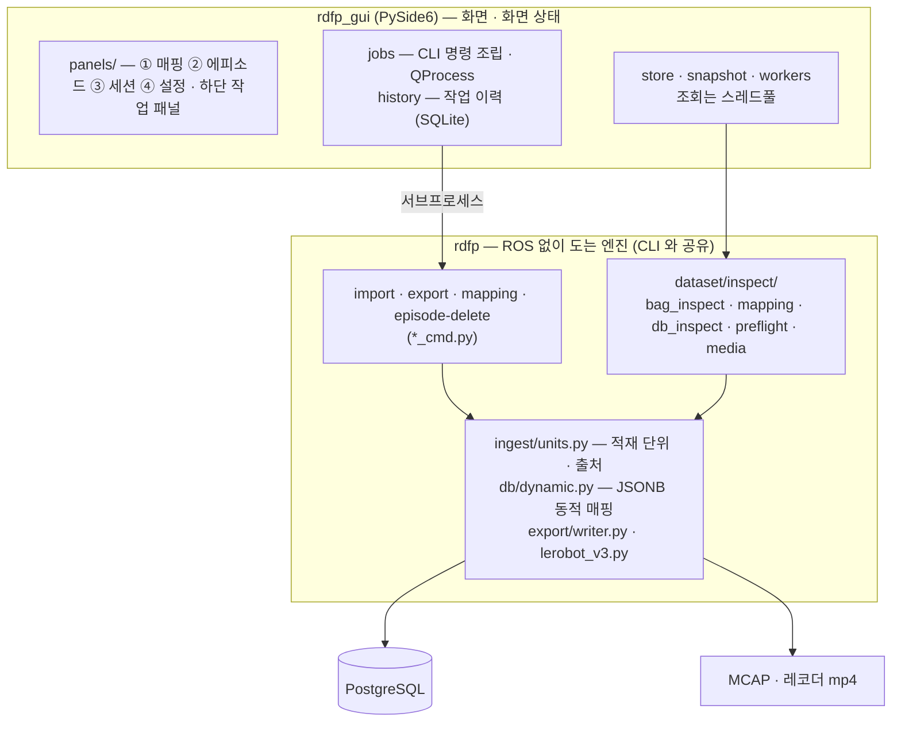

# 데이터셋 관리 GUI 설계안

> **상태: 구현 · 통합 완료 (2026-11-23).** rosbag2 녹화물 → PostgreSQL 적재 → 학습 샘플 Export 를 관리하는 데스크톱 도구다.
> 구현은 화면 [src/rdfp_gui](../../src/rdfp_gui/README.md)(`ros2 run rdfp_gui dataset_gui`) + 엔진 `rdfp.dataset`(조회 · 점검 `inspect/`, 적재 단위 `ingest/units.py`, 동적 매핑 `db/dynamic.py`, LeRobot `export/lerobot_v3.py`)이다.
> 2026-11-04~23 에는 `design_gpt.md` 를 따른 병행 구현 `rdfp_gui_codex` 가 있었다. 그 장점(선택 토픽 적재 · JSONB 동적 매핑 · 원자적 export · LeRobot v3 · 작업 이력)을 **`rdfp` 엔진으로 흡수**하고 그 패키지는 삭제했다 — 경위는 §6.7.
>
> 관련 문서: [데이터셋_적재_시스템_설계서.md](데이터셋_적재_시스템_설계서.md)(적재 파이프라인 · 스키마),
> [데이터셋_적재_운영_가이드.md](데이터셋_적재_운영_가이드.md)(CLI 운영), [rosbag_명령_가이드.md](rosbag_명령_가이드.md),
> [../learning/저장_형식.md](../learning/저장_형식.md)(export 형식과 LeRobot 결정).

## 목차

- [1. 목적과 범위](#1-목적과-범위)
- [2. 지금 무엇이 불편한가](#2-지금-무엇이-불편한가)
- [3. 화면 구성](#3-화면-구성)
- [4. 기능](#4-기능)
- [5. 아키텍처](#5-아키텍처)
- [6. 설계 결정과 근거](#6-설계-결정과-근거)
- [7. 구현 현황](#7-구현-현황-2026-11-23)
- [8. 남은 일](#8-남은-일)
- [9. 열린 질문](#9-열린-질문)
- [부록 A. 화면 스케치](#부록-a-화면-스케치)
- [부록 B. 동적 테이블의 열 생성 규칙 (폐기)](#부록-b-동적-테이블의-열-생성-규칙-폐기--2026-11-23)

---

## 1. 목적과 범위

### 1.1 목적

| 하고 싶은 것 | 지금 | 이 도구 |
|---|---|---|
| bag 에 어떤 토픽이 얼마나 있나 | `ros2 run rdfp rosbag list-topics` | 왼쪽 패널 |
| DB 에 어떤 테이블이 있고 몇 행인가 | `stats` + `psql` | 오른쪽 패널 |
| 어느 토픽이 어느 테이블로 가나 | `db/registry.py` 를 읽는다 | 두 패널 사이의 **매핑 선** · 색 |
| 왜 이 토픽은 DB 에 없나 | 로그의 `no writer registered` 한 줄 | 매핑 없는 토픽을 **경고색**으로, 이유를 상세 패널에 |
| 메시지 구조 · 테이블 스키마 | 소스 · `\d` | 상세 패널 |
| 실제 데이터를 훑어본다 | `psql` · 재생 GUI | 데이터 브라우저 (bag 쪽 · DB 쪽 모두) |
| 골라서 적재한다 | `rosbag export --episodes 1-3` | 토픽 · 에피소드를 체크하고 **Import** |
| 에피소드 단위로 적재 결과를 본다 | `list` | 에피소드 뷰 (테이블별 행 수 · mp4 · 검증) |
| 범위를 정해 학습셋을 만든다 | `export --episodes` | 에피소드 뷰에서 범위 선택 → **Export** (npz · LeRobot v3) |
| 새 메시지 타입을 적재한다 | 테이블 · writer · reader 를 쓰고 registry 에 등록 | 매핑 없는 토픽을 골라 **테이블 생성** (동적 등록) |

### 1.2 범위에 넣지 않는 것

- **녹화 자체** (`rosbag.sh record`) 와 **재생** (`replay_gui`). 이 도구는 녹화가 끝난 뒤의 bag 과 DB 를 다룬다. 재생은 ROS 스택이 필요한 별개의 도구다.
- **DB 서버 관리** (생성 · 백업 · 사용자). `init-db` 는 호출만 한다.
- **학습 실행.** export 까지만 한다. 학습은 `rdfp-train` 의 몫이다.

### 1.3 사용자

이 워크스페이스로 데이터를 모으고 적재하는 사람. ROS 와 PostgreSQL 이 설치된 수집 PC 에서 띄운다. 원격 열람은 범위에 없다 (§9).

---

## 2. 지금 무엇이 불편한가

적재 경로에서 **데이터가 조용히 빠지는 함정**이 여럿 있고, 전부 CLI 출력만으로는 보이지 않는다. 이 도구의 가장 큰 가치는 이것들을 **보이게** 하는 것이다.

| 함정 | 지금 증상 | 이 도구가 보여 줄 것 |
|---|---|---|
| `metadata.yaml` 이 없는 세션은 조용히 제외 | `found 0 finalized split(s)` | 세션 목록에 **"미완료"** 표시 + `ros2 bag reindex` 버튼 |
| writer 가 없는 타입은 조용히 무시 | 경고 한 줄 | 토픽을 **매핑 없음** 색으로 |
| `header.stamp` 가 0 이거나 벽시계인 메시지는 에피소드 창 밖으로 | bag 에는 있는데 DB 에 없다 | 토픽별 **stamp 진단**: 0 비율, 에피소드 창 안 비율 |
| 시뮬레이터 재기동 뒤 sim 시계가 겹침 | 에피소드는 있는데 속이 빔 | 에피소드 **구간 겹침** 경고 |
| 레코더 mp4 와 에피소드가 안 맞음 (`episode_key`) | `image_frames: 0` | 에피소드마다 mp4 **매칭 상태** |
| 이미지 토픽 + 레코더 등록 동시 켜짐 | UNIQUE 위반으로 import 실패 | import 전 **사전 점검**에서 차단 |
| writer 가 필드를 흘림 (`getattr` 기본값) | 모든 행이 빈 값 | 데이터 브라우저에서 **빈 열**이 바로 보인다 |

---

## 3. 화면 구성

메인 윈도우는 **탭 셋** + 공통 하단 패널이다. 부록 A 에 스케치가 있다.

| 탭 | 보는 것 | 주된 조작 |
|---|---|---|
| **① 매핑** | 왼쪽 bag 토픽 · 오른쪽 DB 테이블 · 가운데 매핑 선 | 상세 보기, 데이터 브라우즈, 테이블 생성 · 매핑 제거, Import |
| **② 에피소드** | DB 의 에피소드 목록 + bag 에서 감지된(미적재) 에피소드 | 필터, 상세, 삭제, 범위 선택 → Export |
| **③ 세션(bag)** | `rosbag_dir` 의 날짜 · 세션 · split 트리 | 미완료 세션 복구, 삭제, 적재 여부 |
| **④ 설정** | `dataset_config.yaml` · `recording_topics.list` · DB 연결 | 읽기 · 검증 · 경로 바꾸기 |

**하단 패널 (공통)**: 작업 로그(실행 중인 CLI 의 출력), 진행률, 그리고 **"이 조작과 같은 CLI 명령"** 표시 (§6.4).

### 3.1 ① 매핑 탭

```
┌─ bag 토픽 ─────────────────┐    ┌─ DB 테이블 ──────────────────┐
│ ☐ /joint_states            │────│ joint_states        12,340 행│
│   sensor_msgs/msg/JointState│  ┌─│                               │
│ ☐ /target_joint_cmds        │──┘ │ pose_stampeds        4,100 행│
│   sensor_msgs/msg/JointState│    │ gripper_cmds            37 행│
│ ☐ /ee_pose                 │────│ ...                           │
│ ☐ /camera_image/compressed  │ ✖  │ image_streams (레코더 mp4)   │
│   sensor_msgs/msg/CompressedImage│ │ target_joint_states      0 행│ ← 토픽 없음
│ ☐ /session   (에피소드 경계)│ ◇  │ sessions                 82 행│
└────────────────────────────┘    └──────────────────────────────┘
```

- **토픽 행**: 이름 · 타입 · bag 안 메시지 수 · 상태 아이콘. 상태는 넷이다.
  - `●` 매핑됨 (registry 에 타입이 있다)
  - `◇` 특수 (`/session` → 에피소드 경계, `sensor_msgs/Image` → mp4)
  - `✖` **매핑 없음** — DB 에 들어가지 않는다. 이 도구가 가장 먼저 눈에 띄게 할 것이다
  - `△` 매핑은 있는데 **stamp 진단에 걸림** (§4.1)
- **테이블 행**: 이름 · 행 수 · 출처(내장 registry / 동적 등록 / 시스템 테이블) · 어느 토픽이 들어오는가. **같은 타입의 토픽 둘이 한 테이블로 가는 것**(`/joint_states` · `/target_joint_cmds` → `joint_states`)이 선 두 개로 보인다.
- 한쪽을 고르면 반대쪽 짝이 강조된다.

### 3.2 상세 패널

토픽을 고르면:
- **메시지 정의** — bag 의 MCAP 에 박힌 스키마 텍스트(`.msg` 정의)를 그대로 보인다. ROS 가 없어도 읽힌다.
- **통계** — 메시지 수, 첫 · 마지막 stamp, 평균 주기, `header.stamp == 0` 비율, 에피소드 창 안 비율.
- **매핑** — 가는 테이블, writer · reader 클래스, 열 대응(있으면).
- **[데이터 보기]** — bag 메시지를 시각순으로 페이지 단위로 펼친다 (§4.2).

테이블을 고르면:
- **스키마** — `information_schema` 로 읽은 열 · 타입 · NULL 여부 · 제약 · 인덱스. `schema.sql` 의 주석도 함께 보이면 좋다 (§9).
- **통계** — 행 수, 에피소드 수, `topic_id` 별 행 수.
- **[데이터 보기]** — 행을 페이지 단위로 펼친다. 에피소드 · 토픽으로 거른다.

---

## 4. 기능

### 4.1 bag 토픽 보기와 진단

- `rosbag_dir` 를 훑어 split 목록을 만든다 — `rdfp.rosbag.catalog.discover_splits` 그대로. **`metadata.yaml` 이 없는 세션도 트리에는 보인다**(③ 탭) — 적재 대상이 아니라는 표시와 함께. 지금은 CLI 가 이것을 조용히 건너뛰어 "왜 0 개인가"를 알 수 없다.
- 토픽별 타입 · 메시지 수는 `metadata.yaml` 에서 읽는다(빠르다). 스키마 텍스트와 stamp 진단은 MCAP 을 열어야 하므로 **토픽을 골랐을 때** 백그라운드로 읽는다.
- **stamp 진단**은 적재가 메시지를 거르는 기준과 같은 기준으로 센다 — `header.stamp` 가 없으면 적재가 버리고, 에피소드 `[start_ns, stop_ns)` 밖이면 적재가 버린다. 이 두 비율이 이 도구가 내는 가장 값진 숫자다. 벽시계 · sim 시계 불일치(펑션베이 회차 함정, Isaac 재기동 함정)가 여기서 드러난다.

### 4.2 데이터 브라우저

bag 쪽과 DB 쪽에 같은 모양의 표 뷰어를 둔다.

| | bag 메시지 | DB 행 |
|---|---|---|
| 원천 | `rdfp.rosbag.mcap_reader.iter_split_messages` | `SELECT … ORDER BY stamp LIMIT/OFFSET` |
| 페이지 | 1,000 건. split 단위로 읽어 메모리에 들고 있지 않는다 | 서버 커서 |
| 거르기 | 시간 범위 · 에피소드 | 에피소드 · `topic_id` · 시간 범위 |
| 셀 | 중첩 메시지는 트리로 펼친다 | 배열 · JSONB 는 펼친다 |
| 비교 | 같은 에피소드 · 같은 토픽의 bag 행 수와 DB 행 수를 **나란히** 보인다 → 빠진 것이 숫자로 보인다 | |

### 4.3 매핑 관리 — 테이블 생성 · 등록 해제 · 테이블 삭제

매핑의 정본은 둘이고 **코드가 이긴다** (§6.2). 내장은 `rdfp/dataset/db/registry.py` 의 `MESSAGE_TYPE_REGISTRY`, 동적은 DB 의 `topic_tables` 다.

| | 내장 매핑 | 동적 매핑 |
|---|---|---|
| 정본 | `registry.py` (코드) | DB 의 `topic_tables` (`schema.sql`, 2026-11-23) |
| 열 | writer 가 뜻을 담아 설계 | **메시지 전체를 JSONB `payload` 한 열에** — 공통 열(`episode_id` · `topic_id` · `stamp_*`) 은 내장과 같다 |
| writer / reader | 타입별 클래스 | `GenericJsonbWriter` 하나 (reader 없음 — 재생 대상 타입은 내장으로 올린다) |
| 우선순위 | **이긴다** | registry 에 없는 타입만 |
| GUI 에서 삭제 | **못 한다** | 할 수 있다 (§4.3.2) |

**열을 펼치지 않고 JSONB 로 담는다** (2026-11-23 결정 — 부록 B 의 열 펼치기 안을 대신한다, §9-1). 펼치는 규칙은 중첩 · 배열에서 정할 것이 많고 틀리면 조용히 빈 열이 되지만, JSONB 는 메시지를 그대로 담아 잃는 것이 없다. JSON 으로 표현되지 않는 값은 태그를 붙여 남긴다 — `NaN` 은 `{"$float": "nan"}`, 바이트열은 `{"$bytes": …}`. 0 이나 null 로 바꾸지 않는다.

#### 4.3.1 테이블 생성 (등록)

매핑 없는(✖) 토픽을 고르고 **[테이블 생성…]** 을 누르면 이름(기본값: 타입의 snake_case 복수형 — `rdfp_msgs/msg/ClutchState` → `clutch_states`)과 **실행될 DDL 을 미리 보인다.** 확인하면 `ros2 run rdfp mapping register --type <타입> --table <이름>` 이 돈다.

- **타입이 키다** — 토픽이 아니다. 같은 타입의 다른 토픽도 이 테이블로 가고 `topic_id` 로 갈린다.
- bag 의 `.msg` 정의 텍스트와 그 지문을 `topic_tables` 에 저장한다. **정의가 다른 bag 은 적재가 거부한다** (조용히 섞으면 어느 행이 어느 정의인지 모른다).
- 이미 적재된 에피소드에는 **다음 Import 가 그 토픽을 채운다** (§4.4 의 적재 단위).
- 학습 export 가 이 테이블을 자동으로 쓰지는 않는다 — '담아 둘 수 있다'와 '학습 feature 로 쓸 수 있다'는 별개다.

#### 4.3.2 등록 해제와 테이블 삭제

**따로 둔다** — 합치면 "매핑을 끄려다 데이터를 지우는" 사고가 난다.

| 조작 | 하는 것 | 데이터 | 명령 |
|---|---|---|---|
| **등록 해제** | `topic_tables.active = false`. 다음 적재부터 그 타입을 무시 | **남는다** — 같은 정의로 다시 등록하면 이어 쓴다 | `mapping unregister --type T --yes` |
| **테이블 삭제** | `DROP TABLE … RESTRICT` + 등록 · 적재 이력 삭제 | 지운다. **행 수를 보여 주고 테이블 이름을 타이핑**해야 한다 | `mapping drop --type T --confirm <테이블> --yes` |

- 내장 매핑(`joint_states` 등)은 둘 다 **못 한다** — 버튼이 비활성이고 이유를 툴팁에 보인다. `topic_tables` 에 행이 없는 테이블은 `mapping drop` 이 거부한다.
- `topics` 행은 지우지 않는다 (다른 테이블이 `RESTRICT` 로 참조하고, 토픽 이름의 이력은 남길 가치가 있다).

**동적 매핑을 내장으로 올리는 절차** (쓰이는 타입이 늘었을 때): `schema.sql` 에 뜻 있는 열로 테이블을 설계하고 writer · reader 를 `MESSAGE_TYPE_REGISTRY` 에 등록한다(내장이 이기므로 그 즉시 새 경로가 쓰인다) → 옛 에피소드는 `import --topics <토픽> --only-topics-replace` 로 다시 채운다 → `mapping drop` 으로 옛 동적 테이블을 지운다.

### 4.4 Import

① 탭에서 토픽을 체크하고(기본: 매핑된 전부) **[Import…]** 를 누르면 에피소드(기본: 미적재 전부) · 정책 · **사전 점검** · 실행될 명령이 한 다이얼로그에 보인다. 실행은 `ros2 run rdfp import …` 서브프로세스다 (§6.3).

**사전 점검** (`rdfp.dataset.inspect.preflight.check_import` — **CLI 도 같은 함수를 부른다**):
- `output_mp4_dir` · DB 접속 · 스키마 · **적재 메타 테이블**(없으면 `init-db` 를 한 번 돌리라고 막는다 — 기존 행은 그대로다).
- 이미지 토픽이 체크됐는데 `recordings_dir` 도 켜져 있으면 **차단** — `image_streams` UNIQUE 위반으로 죽는 조합이다.
- 고른 에피소드 가운데 구간이 **겹치는 것**이 있으면 경고 (sim 시계 되감김).
- 이미 있는 에피소드는 정책(skip / replace / error)과 **선택 토픽 교체** 중 무엇이 일어나는지 보인다.
- 동적 매핑 토픽의 `.msg` 정의가 등록 때와 다르면 **차단**.

**적재 단위 = (에피소드, 토픽)** (2026-11-23 구현 — `rdfp/dataset/ingest/units.py`, 직렬 · 병렬 경로가 같은 함수를 쓴다):

| 이미 있는 에피소드를 만나면 | 동작 |
|---|---|
| 출처(녹화본)가 다르다 | **거부** — sim 시계가 되감긴 녹화본이 같은 키를 낸 것이다. 예전에는 조용히 속이 빈 에피소드가 됐다 |
| 종료 시각이 다르다 | **거부** — 같은 키의 다른 에피소드다 |
| 출처 기록이 없다 (이 구조 이전 적재) | 시작 · 종료 시각이 같으면 **연결(adopt)** 하고 계속한다. 옛 행에는 적재 이력을 채운다 |
| `skip` (기본) | **이미 적재된 토픽만 건너뛰고 빠진 토픽을 채운다** — 예전에는 에피소드를 통째로 건너뛰었다 |
| `--only-topics-replace` | 고른 토픽의 행만 지우고 다시 넣는다. 다른 토픽 · `sessions.id` 는 그대로다 |
| `replace` · `error` | 예전과 같다 (통째로 다시 / 멈춤) |

- 출처의 식별자는 **세션 디렉터리 이름**이다 — 내용 해시가 아니다. `rosbag delete` 가 split 을 다시 쓰면 해시가 바뀌어 같은 녹화본을 다른 출처로 오판하기 때문이다.
- `import --topics` 로 고르면 레코더 mp4 도 **그 목록에 든 카메라만** 등록한다. 이미 등록된 카메라는 건너뛴다(UNIQUE 위반 없음).
- 다시 돌린 `import` 가 넣을 것이 없으면 **bag 을 읽지 않는다** — 실측 79 초 → 0.5 초 (37만 건 bag, 65 에피소드).
- bag 에 이미지 토픽이 없으면 **ROS 없이 돈다** (`FrameRouter` 를 필요할 때만 import 한다).
- `postproc_run.jsonl` 의 `episode_failed` 를 에피소드 뷰에 표시하는 것은 **미구현**이다 (하단 로그에는 나온다).

### 4.5 에피소드 뷰 (② 탭)

| 열 | 출처 |
|---|---|
| id · 시작 · 길이 · `task_label` · `success` | `sessions` |
| 백엔드 | `sessions.metadata.backend` (있을 때만) |
| 테이블별 행 수 | 각 테이블 `GROUP BY episode_id` (동적 테이블 포함) |
| 영상 | `image_streams` 유무 · 프레임 수 · 파일 존재 여부 |
| 검증 | 아래 점검의 합 |
| **출처 (녹화본)** | `episode_sources` — `미연결` 은 이 구조 이전에 적재돼 아직 연결되지 않은 것, `(연결)` 은 시각 일치로 나중에 연결한 것 |

**미적재 에피소드도 같은 표에 보인다** — bag 에서 감지했지만 DB 에 없는 것은 회색 행이다.

**에피소드 점검** (경고로 표시, 막지 않는다): 어느 메시지 테이블도 0 행(시계 겹침 함정) · `image_streams` 는 있는데 `image_frames` 0(`pixel_format` 불일치) · `motion_trajectories` ↔ `motion_events` 짝 불일치(`failed` 만 짝이 없어야 한다) · `gripper_cmds` 0 행(stamp 함정) · mp4 파일 없음.

**상세**: 점검 · 영상 · 테이블별 [데이터 보기] · metadata, 그리고 **영상 프레임 미리보기**(프레임 번호 = `image_frames.frame_index`, PyAV 로 디코드 — 시각으로 찾지 않는다). 토픽별 밀도 타임라인은 **미구현**이다.

**삭제**: `ros2 run rdfp episode-delete --ids … --yes [--delete-files]` — 행 수 · 파일 목록을 보이고 id 를 타이핑해야 실행된다. bag 에서 빼는 것은 `rosbag delete` 의 몫이다.

### 4.6 Export

② 탭에서 범위를 고르고 **[Export…]** 를 누른다. 공통 사전 점검(`preflight.check_export`): frame clock 이 서는가 · 팔 관절이 정해지는가 · 카메라가 여럿이면 하나를 골랐는가.

| 형식 | 구현 | 비고 |
|---|---|---|
| **npz** (정본) | `export/writer.py` `export_dataset` — `metadata.json` + `episodes.jsonl` + 에피소드별 `.npz` | 학습(`rdfp-train`)이 읽는 형식 |
| **LeRobot v3** (교환용 파생물) | `export/lerobot_v3.py` — 공식 `lerobot==0.4.4` writer, 쓴 뒤 공식 loader 로 다시 연다 | **§6.5** — 결정 28 의 예외. lerobot 이 있는 파이썬(`RDFP_LEROBOT_PYTHON`)에서 돈다 |

공통 (2026-11-23):
- **원자적으로 게시한다** — 옆의 임시 디렉터리에 쓰고 끝까지 성공해야 출력 경로로 이름을 바꾼다. 실패 · 중단된 export 가 완성본처럼 남지 않는다. **내용이 있는 출력 경로는 거부한다**(덮어쓰면 이전 결과와 섞인다).
- **`manifest.json`** — 요청 · 채택 · 제외 에피소드와 파일별 sha256. export 이력은 DB 가 아니라 이 파일이 갖는다 (§9-2).
- **`--copy-media`** (npz) — mp4 를 트리 안 `videos/` 로 복사하고 `manifest.media_root = "dataset"`. `rdfp-train` 로더가 그 표시를 보고 트리 안에서 영상을 찾는다 — 학습 기계로 recordings 를 따로 옮기지 않아도 된다.

### 4.7 설정 (④ 탭)

- `dataset_config.yaml` 을 읽어 보이고 **Pydantic 검증 결과**를 보인다. 편집은 텍스트 그대로(구조 편집기는 만들지 않는다 — 설정 모델이 바뀔 때마다 GUI 를 고치게 된다).
- `recording_topics.list` 와 `dataset_config.yaml` 의 `topics_file` 이 **같은 파일인지** 확인한다.
- DB 연결 시험. DSN 은 환경변수(`RDFP_DB_DSN`)에서만 읽고 **화면에 비밀번호를 보이지 않는다.**

---

## 5. 아키텍처

### 5.1 세 층 — 두 패키지



- 의존은 **`rdfp_gui → rdfp` 한쪽**이다. `rdfp/tests/test_layer_boundary.py` 가 `rdfp` 의 GUI · Qt import 를, `rdfp_gui/tests/test_layer_boundary.py` 가 GUI 의 ROS import 를 막는다.
- **읽기는 함수 호출, 쓰기는 CLI** 다. 조회 · 점검은 `rdfp.dataset.inspect` 를 스레드풀에서 직접 부르고(적재 중에도 화면을 쓸 수 있다), DB · 파일을 바꾸는 일은 전부 `ros2 run rdfp …` 서브프로세스다. 그래서 적재 경로가 **하나**이고, GUI 조작은 그대로 CLI 명령이 된다.
- 나누는 기준: **ROS 없이 돌고 CLI 도 쓰면 `rdfp`, Qt 를 import 하거나 화면 상태를 들면 `rdfp_gui`.**

### 5.2 패키지 위치와 실행

```text
src/rdfp_gui/                      (ament_python, exec_depend rdfp)
  rdfp_gui/ main.py · app.py · context.py · snapshot.py · store.py · workers.py
            jobs.py · history.py · models.py · panels/ · tests/
src/rdfp/rdfp/dataset/
  inspect/      bag_inspect · mapping · db_inspect · preflight · media · findings
  ingest/       units.py (적재 단위 · 출처) · pipeline.py · episode_worker.py
  db/dynamic.py (topic_tables · GenericJsonbWriter)
  export/       writer.py (원자적 게시 · manifest · copy-media) · lerobot_v3.py
  import_cmd.py · export_cmd.py · mapping_cmd.py · episode_delete_cmd.py
  sql/schema.sql (ingest_sources · episode_sources · ingest_units · topic_tables)
```

```bash
pip install --user PySide6-Essentials ; sudo apt install libxcb-cursor0
colcon build --packages-select rdfp rdfp_gui && source install/setup.bash
ros2 run rdfp init-db                   # 적재 메타 테이블 (한 번 — 기존 행은 그대로다)
./scripts/run_dataset_gui.sh            # = ros2 run rdfp_gui dataset_gui --config …
```

### 5.3 데이터 흐름 — 한 번의 Import

```text
사용자: 토픽 체크 → [Import…] → 에피소드 · 정책 · 선택 토픽 교체 고름
  → preflight.check_import (CLI 와 같은 함수) — 막을 것은 OK 를 끈다
  → jobs.build_import_command → `ros2 run rdfp import --config … [--start-ns …] [--topics …]`
  → 하단 패널: 명령 표시 · 복사, 로그 스트리밍, 진행률(로그에서 읽는다), 작업 이력 기록
  → 끝나면 bag · DB · 에피소드를 다시 읽는다
```

---

## 6. 설계 결정과 근거

### 6.1 Qt(PySide6) — Tk 가 아니다

기존 `replay_gui` 는 Tk 다. 그런데 이 도구는 **표가 전부다** — 토픽 수백 · 행 수만 건 · 열 수십. Tk 의 `ttk.Treeview` 는 모델/뷰 분리가 없어 페이지네이션 · 정렬 · 셀 펼침을 손으로 짜야 하고, 두 패널 사이에 선을 긋는 것도 캔버스 수작업이다. Qt 는 `QAbstractTableModel` 로 지연 로딩이 자연스럽고, `QProcess` 가 서브프로세스 출력 스트리밍을 이벤트 루프에 녹여 준다. 웹(FastAPI)은 원격이 필요해질 때 같은 엔진 위에 얹는다(§9-4).

### 6.2 매핑의 정본은 둘이고, 코드가 이긴다

내장 매핑을 DB 로 옮기지 않는다. 내장 테이블의 열은 **뜻을 담아** 설계됐고(`joint_states.joint_names TEXT[]`, `gripper_states.width`), export · 재생 · 분석 쿼리가 그 열 이름에 의존한다. 동적 매핑은 **"아직 손으로 설계하지 않은 타입을 일단 담아 두는"** 길이다.

### 6.3 장시간 작업은 기존 CLI 를 서브프로세스로

적재 · export · 매핑 변경 · 에피소드 삭제는 `ros2 run rdfp …` 를 `QProcess` 로 띄운다. GUI 는 적재 로직을 갖지 않는다 — **적재 경로가 둘이 되면 이력과 정책이 갈린다**(2026-11 의 병행 구현이 실제로 그랬다, §6.7). 취소는 SIGTERM → 유예 뒤 SIGKILL 이고, 적재는 에피소드 단위 트랜잭션이라 진행 중인 에피소드만 되돌아간다. 실행한 명령 · 종료 코드 · 요약은 로컬 SQLite(`~/.local/state/rdfp-dataset-gui/jobs.sqlite3`)에 남는다.

### 6.4 GUI 조작 = CLI 명령

하단 패널에 **지금 조작과 같은 CLI 명령**이 보이고 복사된다. 터미널에서 같은 명령을 돌리면 같은 결과가 난다. 그래서 자동화(cron · 수집 스크립트)는 CLI 로 하면 되고, GUI 전용 요청 파일 형식(`--request <json>`)은 **두지 않는다** — 진입점이 셋이 되면 다시 갈라진다.

### 6.5 LeRobot v3 export — 결정 28 의 예외

[저장_형식.md §3.4](../learning/저장_형식.md#34-lerobot-형식-미채택-및-actpolicy-채택-근거) 와 [결정_기록 28](../learning/결정_기록.md) 은 **LeRobot 데이터셋 형식을 학습 형식으로 쓰지 않는다**고 정했다. 형식의 전제가 우리 데이터와 어긋나기 때문이다 — 고정 fps 격자, 행을 이어 붙여 만드는 chunk, 에피소드 영상을 이어 붙여 재인코딩. **그래서 LeRobot v3 는 "학습 형식"이 아니라 "교환용 파생물"이다.** npz 가 정본이고 학습 경로는 그대로다.

구현 (2026-11-23, `rdfp/dataset/export/lerobot_v3.py`):
- **공식 writer 를 쓴다.** `lerobot==0.4.4` 가 `codebase_version: v3.0` 을 쓰고 공식 loader 로 다시 읽힌다는 것을 `rdfp-train` venv 에서 확인했다. (이 절의 옛 판은 "0.4.4 는 v2.1 을 읽는 버전이라 v3 를 직접 써야 한다"고 적었는데 **틀렸다.**) 쓴 뒤 다시 열어 샘플 수와 첫 · 끝 샘플을 확인한다.
- **npz 가 아니라 DB 에서 만든다.** 격자 `t_i = t_0 + i/fps` 에서 행동 `a(t_i)` 가 필요한데, npz 의 chunk 는 실제 카메라 stamp 기준이라 격자 위의 값을 꺼낼 수 없다. 같은 레이블 함수(`plan(τ)` · 명령 보간)와 같은 관측 함수(`qpos`)를 격자 시각에서 평가한다.
- **영상** — 격자 시각 이전의 가장 가까운 프레임(인과적). 시차가 `max_skew_sec`(기본 0.2 s)를 넘으면 **공백을 메우지 않고 그 에피소드를 제외한다**(manifest `excluded`, 사유 `image_gap` — 나머지는 계속 내보낸다). 반복한 프레임 수 · 최대 시차는 `manifest.json` 에 남는다. 디코드는 PyAV 로 앞으로만 한다.
- **행동은 `a(t)` 한 행**이고 chunk 는 로더가 `delta_timestamps` 로 만든다(§9-3).
- **환경** — ROS 파이썬에는 lerobot 이 없다. `RDFP_LEROBOT_PYTHON`(lerobot + psycopg + pydantic + pyyaml 이 있는 파이썬 명령)을 GUI 가 쓰고, `PYTHONPATH` 로 같은 `rdfp` 소스를 본다.
- **실측** (Isaac 에피소드 1~3): 카메라 중앙 간격 0.1 s 인데 최대 1.3 s 공백이 있어 기본 시차로는 제외됐다. 1.5 s 로 풀면 544 프레임 · 격자 틱의 약 절반이 같은 프레임 반복이었다 — 실효 카메라 주기가 ~5 Hz 다. **fps 는 실측을 보고 고른다.**

### 6.6 파괴적 조작의 규칙

| 조작 | 확인 |
|---|---|
| 동적 매핑 등록 해제 | 한 번 확인 |
| 동적 테이블 삭제 · 에피소드 삭제 · bag 세션 삭제 | **행 수 · 파일 수를 보여 주고 이름을 타이핑** |
| 내장 테이블 삭제 · `init-db --drop` | GUI 에서 **하지 않는다** — CLI 로만 |
| Import `replace` · 선택 토픽 교체 | 덮어쓸 범위를 사전 점검에 보이고 확인 |

### 6.7 병행 구현의 통합 (2026-11-23)

2026-11-04 에 이 설계안을 따른 `rdfp_gui` 와, `design_gpt.md` 를 따른 `rdfp_gui_codex` 가 따로 구현됐다. 비교 결과:

- `rdfp_gui` 는 함정을 **보이게** 하는 진단(매핑 선 · stamp 진단 · 미완료 세션 · 에피소드 점검)과 **적재 경로 하나**(CLI 서브프로세스)가 강점이었다.
- `rdfp_gui_codex` 는 **선택 토픽 적재 · JSONB 동적 매핑 · 원자적 export · LeRobot v3 · 작업 이력**이 강점이었다. 그러나 적재기를 GUI 패키지 안에 따로 두어 **기존(CLI) 적재분과 호환되지 않았다** — 실측으로 기존 65 에피소드를 '출처 미확인 충돌'로 전부 거부했고, 에피소드마다 bag 을 다시 읽어 65 에피소드에 ~13 분이 걸렸다.

그래서 **화면은 `rdfp_gui`, 엔진은 `rdfp` 로 모으고 Codex 의 장점을 엔진으로 흡수했다.** 기존 적재분은 시각이 맞으면 **연결(adopt)** 하는 규칙으로 받아들였다. `rdfp_gui_codex` 는 Import 를 먼저 동결한 뒤 같은 날 패키지 · 실행 스크립트를 삭제했다. design_gpt 에서 가져오지 않은 것: GUI 전용 요청 파일 CLI(§6.4), 내용 해시 출처(§4.4), `raw_cdr` 보존(현재 리더가 원본 바이트를 들고 있지 않다 — JSONB 태그 표기로 대신한다).

---

## 7. 구현 현황 (2026-11-23)

| 기능 | 위치 | 상태 |
|---|---|---|
| 세션 트리(미완료 포함) · 토픽 요약 · 메시지 정의 · stamp 진단 · 열람 | `inspect/bag_inspect.py` | ✓ |
| 매핑 상태 `●◇✖△` (동적 포함) | `inspect/mapping.py` | ✓ |
| 스키마 · 행 수 · 에피소드 요약 · 점검 · 출처 | `inspect/db_inspect.py` | ✓ |
| import · export 사전 점검 (CLI 공유) | `inspect/preflight.py` | ✓ |
| 적재 단위 · 출처 · 옛 적재분 연결 · 키 충돌 거부 | `ingest/units.py` · `schema.sql` | ✓ |
| 선택 토픽 적재 · 나중에 채우기 · `--only-topics-replace` | `import_cmd.py` | ✓ |
| JSONB 동적 매핑 · 등록 / 해제 / 삭제 | `db/dynamic.py` · `mapping_cmd.py` | ✓ |
| 원자적 export · manifest · `--copy-media` | `export/writer.py` | ✓ (`rdfp-train` 로더 대응 포함) |
| LeRobot v3 | `export/lerobot_v3.py` | ✓ (lerobot 파이썬 필요) |
| 에피소드 삭제 CLI | `episode_delete_cmd.py` | ✓ |
| 영상 프레임 미리보기 · 작업 이력 | `inspect/media.py` · `rdfp_gui/history.py` | ✓ |
| `postproc_run.jsonl` 실패 표시 · 토픽 밀도 타임라인 · `--progress-json` | — | 미구현 |

---

## 8. 남은 일

1. 에피소드 뷰에 `postproc_run.jsonl` 의 실패를 표시하고, 토픽별 밀도 타임라인을 더한다.
2. 진행률을 로그 정규식이 아니라 `--progress-json` 으로 받는다 (로그 문구가 바뀌면 진행률이 멈춘다).
3. 결정_기록 28 의 예외 항목을 실제 사용처가 생기면 결정으로 승격한다.

---

## 9. 열린 질문

1. ~~동적 테이블의 열 생성에서 중첩 메시지를 어디까지 펼치나~~ → **JSONB 한 열로 결정** (2026-11-23, §4.3).
2. ~~export 이력을 어디에 기록하나~~ → **출력 트리의 `manifest.json`** (2026-11-23). DB 에 두면 수집 메타와 섞이고, 트리를 옮기면 이력이 따라가지 않는다.
3. ~~LeRobot v3 의 `action` 을 어떻게 놓나~~ → **`a(t)` 한 행, chunk 는 로더가** (2026-11-23, §6.5). 레이아웃은 lerobot 0.4.4 writer 가 정한다.
4. **원격 열람.** 수집 PC 와 분석 PC 가 다르면 Qt 데스크톱은 X 포워딩이나 VNC 다. 엔진이 `rdfp` 에 있으므로 그 위에 FastAPI 를 얹는 길이 열려 있다.
5. **`schema.sql` 의 주석을 GUI 에 보일 수 있나.** `COMMENT ON COLUMN` 으로 옮기면 `information_schema` 로 읽히지만 두 곳에 두면 갈린다.
6. **mock 데이터.** GUI 테스트 픽스처는 합성 bag 이다 — 실 bag 발췌(Isaac · 펑션베이)로 바꿀지.

---

## 부록 A. 화면 스케치

```
┌──────────────────────────────────────────────────────────────────────────┐
│ rdfp 데이터셋 관리      [① 매핑] [② 에피소드] [③ 세션] [④ 설정]        │
├───────────────────────────────┬──────────────────────────────────────────┤
│ bag 토픽 (rosbag_dir: /data/…) │ DB 테이블 (rdfp @ localhost)             │
│ ☑ ● /joint_states        12k  │ ● joint_states          12,340  ← 2 토픽 │
│ ☑ ● /target_joint_cmds    4k  ├──┐                                       │
│ ☑ ● /ee_pose              4k  ├──┼─ ● pose_stampeds        4,100         │
│ ☑ ● /gripper_cmds          37 ├──┼─ ● gripper_cmds            37         │
│ ☑ ● /gripper_states       2k  ├──┼─ ● gripper_states       2,010         │
│ ☑ ● /scene/objects        400 ├──┼─ ● scene_objects          400         │
│ ☑ ● /motion/trajectory     41 ├──┼─ ● motion_trajectories     41         │
│ ☑ ● /motion/event          41 ├──┴─ ● motion_events           41         │
│ ☐ ✖ /camera_image/compressed  │    ◇ image_streams (레코더)    82         │
│ ☐ △ /servo_node/delta_twist…  │    ◇ image_frames          16,400         │
│   ◇ /session (에피소드 경계)  │    ○ target_joint_states        0  ← 토픽 없음│
│                               │    ○ joint_jogs                 0         │
├───────────────────────────────┴──────────────────────────────────────────┤
│ 상세: /camera_image/compressed — sensor_msgs/msg/CompressedImage          │
│  ✖ 매핑 없음: 적재는 sensor_msgs/Image 만 인코딩한다. 영상은 레코더 mp4 가 │
│    원본이다 (image_streams). 이 토픽은 녹화 목록에서 빼는 것이 맞다.       │
│  메시지 수 8,200 · 10.0 Hz · header.stamp==0: 0% · 에피소드 창 안: 98.7%    │
│  [메시지 정의] [데이터 보기]                 [테이블 생성…] (비활성: 이미지) │
├──────────────────────────────────────────────────────────────────────────┤
│ 작업: import  ▇▇▇▇▇▇▇▇░░░░ 8/12 에피소드   [중단]                          │
│ $ ros2 run rdfp import --config config/dataset_config.yaml \              │
│     --start-ns-in 1761300123000000000 …                        [복사]    │
│ 14:02:11 episode committed: id=83 rows={'joint_states': 1520, …} mp4=1    │
└──────────────────────────────────────────────────────────────────────────┘
```

## 부록 B. 동적 테이블의 열 생성 규칙 (폐기 — 2026-11-23)

처음 안은 `.msg` 정의를 파싱해 기본형은 같은 이름의 열로, 중첩 메시지는 한 단계만 펼치고(`position_x` …), 그 아래와 메시지 배열은 JSONB 로 두는 것이었다. **채택하지 않았다** — 펼치는 규칙의 경계(어디까지 펼치나, 예약어, 배열의 배열)마다 정할 것이 생기고 틀리면 조용히 빈 열이 되는 반면, 메시지 전체를 JSONB `payload` 한 열에 담으면 잃는 것이 없다. 공통 열(`id` · `episode_id` · `topic_id` · `stamp_sec` · `stamp_nanosec` · `stamp_ts`)과 인덱스 셋은 그대로 내장 테이블과 같다. DDL 은 `rdfp/dataset/db/dynamic.py` 의 `create_table_sql()` 이 정본이다.
