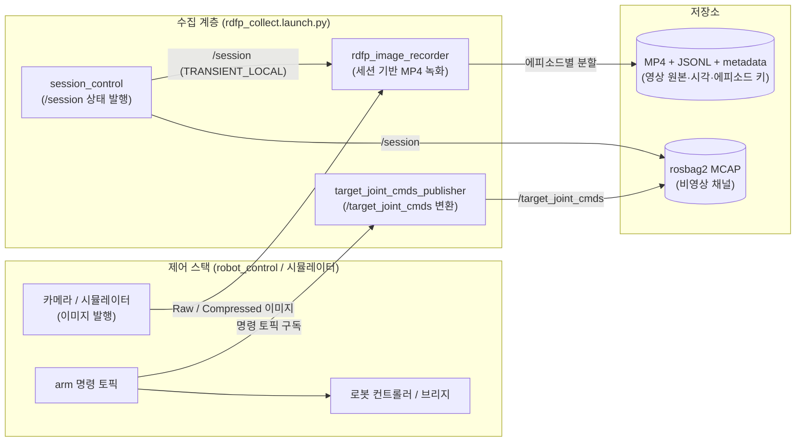
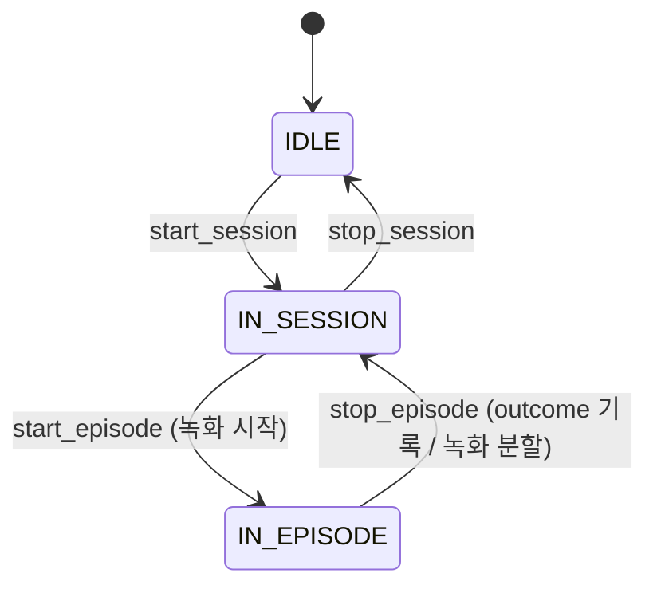

# `rdfp_collect` 사용 절차서 — 제어 스택 위에 수집 계층 올리기

`rdfp_collect.launch.py`는 **학습 데이터 수집 전용 노드만** 독립적으로 실행하는 launch 파일입니다. 로봇 제어 스택(MoveIt2, 컨트롤러, 카메라 드라이버 등)을 별도 터미널에서 먼저 기동한 뒤, 그 위에 수집 계층을 얹는 방식으로 동작합니다.

백엔드별 통합 launch 파일(`rdfp_panda_*`)은 모두 제거되었으므로, 현재 **`rdfp_collect.launch.py`가 수집 계층을 기동하는 유일한 공식 진입점**입니다.

```bash
# 터미널 1: 제어 스택 실행 (예: panda_mock)
ros2 launch robot_control panda_mock.launch.py

# 터미널 2: 수집 계층 실행
ros2 launch rdfp rdfp_collect.launch.py backend:=panda_mock
```

> **전체 파이프라인에서의 위치**
> 본 문서는 **생성 → 수집 → 적재 → Export → 학습 → 추론 배포**의 6단계 파이프라인 중 **② 수집** 단계의 백엔드 중립 운영 절차서입니다. 전체 파이프라인 개요는 [학습_데이터_파이프라인_개요.md](학습_데이터_파이프라인_개요.md)를 참고하십시오.

---

## 목차

1. [아키텍처 및 구성 요소](#1-아키텍처-및-구성-요소)
2. [백엔드별 기동 방법](#2-백엔드별-기동-방법)
3. [에피소드 수집 절차](#3-에피소드-수집-절차)
4. [영상 녹화 및 rosbag · DB 적재 연계](#recording-and-import)
5. [주요 주의사항 및 트러블슈팅](#5-주요-주의사항-및-트러블슈팅)
6. [Launch 인자 레퍼런스](#6-launch-인자-레퍼런스)
7. [관련 문서](#7-관련-문서)

---

## 1. 아키텍처 및 구성 요소

### 1.1 제어 계층과 수집 계층의 분리 구조

수집 계층은 구독자, 상태 머신, 서비스 서버를 중심으로 구성되어 제어 스택의 launch 기동 체인과 분리할 수 있습니다. 다만 관절 이름 조회에 제한 시간이 있으므로 제어 스택을 먼저 기동합니다(§1.2). 이 구조 덕분에 MoveIt2나 RViz 같은 무거운 제어 스택을 재시작하지 않고도 녹화 설정을 바꿔가며 수집 계층만 반복적으로 재기동할 수 있습니다.



그림에는 데이터에 남는 경로만 그렸습니다. 수집 계층의 `rdfp_image_viewer_node`(§1.2)는 운영자가 화면에서 세션·에피소드 상태를 확인하는 용도이며 아무것도 기록하지 않으므로, 꺼도(`enable_image_viewer:=false`, 헤드리스 수집) 수집 결과는 같습니다. 이 노드가 수집 계층에 있는 것은 데이터를 만들어서가 아니라 `/session`을 구독하기 때문입니다. 세션을 아는 노드는 제어 계층에 둘 수 없습니다.

### 1.2 실행되는 노드 목록

`rdfp_collect.launch.py`는 다음 **최대 4개의 노드**를 설정에 따라 실행합니다. **카메라 드라이버 노드는 포함하지 않으므로**, 로봇 제어 스택이나 시뮬레이터가 발행하는 이미지 토픽을 구독합니다.

| 노드 이름 | 소속 패키지 | 역할 | 활성화 조건 |
|---|---|---|---|
| `session_control` | `rdfp` | 세션 및 에피소드 상태 머신. `/session` 토픽(`TRANSIENT_LOCAL`) 발행 | 항상 실행 |
| `rdfp_image_viewer_node` | `rdfp` | 카메라 영상에 현재 세션/에피소드 상태를 오버레이하여 표시 | `enable_image_viewer:=true` |
| `rdfp_image_recorder` | `rdfp` | `/session` 상태에 따라 에피소드 단위로 MP4 및 `.jsonl` 사이드카 자동 녹화 | `enable_image_recorder:=true` |
| `target_joint_cmds_publisher` | `robot_control` | 백엔드별 arm 명령을 표준 `/target_joint_cmds`(`JointState`)로 변환 발행 | `arm_cmd_source` != `none` |

> **참고**: `target_joint_cmds_publisher`는 **`float64_multi_array` 모드에서 관절 이름을 지정하지 않은 경우** 타이머에서 컨트롤러의 `joints` 파라미터 조회를 시작합니다(`joint_names_timeout`, 기본 10초). 따라서 제어 스택을 먼저 띄워 두는 편이 관절 이름 조회에 훨씬 안전합니다.

---

## 2. 백엔드별 기동 방법

`backend:=<이름>` 인자를 지정하면 [config/backends/](../../src/robot_control/config/backends) 아래의 프로파일 YAML에서 **arm 명령 채널, 카메라 토픽, 해상도·FPS, 픽셀 포맷, `use_sim_time`, 압축 형식** 기본값을 자동으로 불러옵니다.

### 2.1 백엔드별 프로파일 매핑

| `backend` 값 | arm 입력 토픽 (`arm_cmd_source`) | 레코더 구독 토픽 (`input_format` / `pixel_format`) | 해상도 · FPS 정본 출처 | `use_sim_time` |
|---|---|---|---|---|
| `panda_mock` | `/panda_arm_controller/joint_trajectory` (`joint_trajectory`) | `/camera/image_raw` (`rawvideo` / `bgr8`) | `image_pipeline.yaml` | `false` |
| `panda_mock_jgpc` | `/panda_arm_controller/commands` (`float64_multi_array`) | `/camera/image_raw` (`rawvideo` / `bgr8`) | `image_pipeline.yaml` | `false` |
| `panda_isaac` | `/isaac/arm_command` (`joint_state`) | `/isaac/camera/image_raw` (`rawvideo` / **`rgb8`**) | **`isaac_scene.json`** | **`true`** |
| `panda_functionbay` | `/input/panda_joint` (`joint_state`) | `/camera_image_aligned/compressed` (**`mjpeg`** / `bgr8`) | **백엔드 프로파일** (`640x480` / `10`) | `false` |

> **우선순위 규칙**: **명시한 Launch 인자 > 백엔드 프로파일 > 코드 기본값** 순으로 적용됩니다. 예를 들어 `backend:=panda_isaac`을 주더라도 `image_recorder_fps:=15`를 함께 넘기면 인자 값이 프로파일 값을 덮어씁니다. (단, 카메라 주기와 어긋나면 영상 시간축이 틀어지므로 주의하십시오.)

### 2.2 터미널 실행 예시 (개발 및 디버깅용)

각 백엔드별로 **터미널 1**에 제어 스택을 먼저 완전히 올린 뒤, **터미널 2**에서 수집 계층을 실행합니다.

```bash
# 1) JTC Mock
ros2 launch robot_control panda_mock.launch.py
ros2 launch rdfp rdfp_collect.launch.py backend:=panda_mock

# 2) JGPC Mock
ros2 launch robot_control panda_mock_jgpc.launch.py
ros2 launch rdfp rdfp_collect.launch.py backend:=panda_mock_jgpc

# 3) Isaac Sim (시뮬레이터가 먼저 실행되어 Play 상태여야 함)
ros2 launch robot_control panda_isaac.launch.py
ros2 launch rdfp rdfp_collect.launch.py backend:=panda_isaac

# 4) FunctionBay (Unity 시뮬레이터와 ros_tcp_endpoint가 먼저 실행되어야 함)
ros2 launch robot_control panda_functionbay.launch.py
ros2 launch rdfp rdfp_collect.launch.py backend:=panda_functionbay
```

> **실제 데이터 수집 시 권장 사항 (`run_collect_*.sh` 사용)**
> Isaac Sim이나 FunctionBay 환경에서 **실제 학습 데이터를 대량 수집할 때는 위 명령을 직접 입력하지 않는 것을 권장**합니다. 대신 워크스페이스 루트의 [run_collect_isaac.sh](../../scripts/run_collect_isaac.sh) 또는 [run_collect_functionbay.sh](../../scripts/run_collect_functionbay.sh)를 사용하십시오.
>
> 이 스크립트들은 수집 계층과 `rosbag` 녹화를 묶어 실행하며, 실수하기 쉬운 4가지 요소(녹화 목록에서 카메라 토픽 제외, 레코더 출력과 `recordings_dir` 일치, `SIGINT`로 안전한 rosbag 종료, 종료 시 잔여 노드 정리)를 점검하거나 처리합니다. 래퍼가 실행한 구성 요소의 종료도 관리합니다. FunctionBay 스크립트는 추가로 SignalChart 종료, `/joint_states` 타임스탬프 정렬, 카메라 수신 여부까지 사전 검증합니다.
>
> 전체 기동 절차는 [isaac_bringup_runbook.md](../backends/isaac/isaac_bringup_runbook.md) §2 및 [펑션베이_시뮬레이터_사용법.md](../backends/functionbay/펑션베이_시뮬레이터_사용법.md) §2를 참고하십시오.

### 2.3 예외: Gazebo 백엔드 (프로파일 없음)

Gazebo는 `config/backends/` 프로파일이 제공되지 않으므로 필요한 인자를 수동으로 지정해야 합니다. Gazebo 센서의 기본 해상도(`640x480`)는 `panda.gazebo.xacro`에 정의되어 있으며, `simulate_camera` 기본값이 `false`이므로 뷰어와 레코더를 명시적으로 끕니다.

```bash
ros2 launch robot_control panda_gazebo.launch.py
ros2 launch rdfp rdfp_collect.launch.py use_sim_time:=true \
    camera_resolution:=640x480 \
    enable_image_viewer:=false enable_image_recorder:=false
```

*주의: `ros2 launch`는 선언되지 않은 인자(예: `enable_image_viewer_node:=false`, `image_recorder_auto_start:=false` 등 오타나 미지원 인자)를 오류나 경고 없이 조용히 무시합니다. 정확한 인자 이름은 [6. Launch 인자 레퍼런스](#6-launch-인자-레퍼런스)를 확인하십시오.* (세부 절차: [gazebo_bringup_guide.md](../backends/gazebo_bringup_guide.md) §7)

---

## 3. 에피소드 수집 절차

**수동 실행 순서는 제어 스택 → 수집 계층 → rosbag 녹화 시작 → 에피소드 실행 → 에피소드·세션 종료 → rosbag 정상 종료 → 적재입니다.** rosbag은 에피소드 시작 전에 실행해야 `/session` 경계와 로봇 메시지를 함께 기록합니다.

### 3.0 녹화 준비

워크스페이스 루트에서 ROS와 overlay 환경을 불러온 셸을 사용합니다. 처음 준비하는 경우 [적재 운영 가이드 §2](데이터셋_적재_운영_가이드.md#2-사전-준비)를 따릅니다.

**수동 기동 경로:** §2에서 제어 스택과 수집 계층을 기동한 뒤, 세 번째 터미널에서 녹화를 시작합니다. 아래 설정의 `rosbag_dir`이 `$RDFP_ROSBAG_DIR`과 같고, `recordings_dir`이 레코더 출력 위치와 같은지 확인합니다. `record --config`는 적재 설정과의 대조용이며 녹화 루트를 대신 지정하지 않습니다.

```bash
# 터미널 3 — 수집이 끝날 때까지 실행해 둔다
CFG=config/dataset_config.yaml
./scripts/rosbag.sh record --config "$CFG" --rosbag-dir "${RDFP_ROSBAG_DIR:?녹화 루트를 설정하세요}"
```

기본 녹화 목록은 모든 백엔드가 공유하는 [config/recording_topics.list](../../config/recording_topics.list)입니다. 녹화 프로세스가 시작되어 대상 토픽을 구독하는지 확인한 뒤 다른 터미널에서 §3.1 또는 §3.2를 실행합니다.

**수집 래퍼 경로:** Isaac·FunctionBay는 §2.2의 `run_collect_*.sh`가 rosbag도 실행하므로 위 명령을 중복 실행하지 않습니다. 래퍼가 수집 준비를 마친 뒤 에피소드를 실행하고, 적재에는 래퍼가 생성한 `dataset.yaml`을 사용합니다.

`session_control` 노드는 아래와 같은 상태 머신을 따릅니다. **에피소드 녹화 및 MP4 분할은 `IN_EPISODE` 상태인 구간에서만 수행**됩니다.



### 3.1 수동 수집 (단일 동작 검증용)

서비스 호출을 통해 에피소드 1회를 수동으로 기록하는 절차입니다.

```bash
# 1단계: 작업 라벨 설정 (반드시 에피소드 시작 전에 설정해야 함)
ros2 service call /session_control/set_task_label rdfp_msgs/srv/SetString \
    "{task_label: 'pick_block_a'}"

# 2단계: 세션 시작
ros2 service call /session_control/start_session std_srvs/srv/Trigger {}

# 3단계: 에피소드 시작 -> 작업 수행 -> 에피소드 종료
ros2 service call /session_control/start_episode std_srvs/srv/Trigger {}
#    ... 이 구간에서 teleop, 트윈 REST, 또는 스크립트로 로봇 조작 ...
ros2 service call /session_control/stop_episode rdfp_msgs/srv/StopEpisode \
    "{outcome: 'success'}"

# 4단계: 세션 종료
ros2 service call /session_control/stop_session std_srvs/srv/Trigger {}
```

> **주의 — 작업 라벨(`task_label`) 선행 설정 필수**
> `set_task_label` 서비스는 `IN_EPISODE` 상태에서 호출하면 거부됩니다. 빈 라벨로 시작한 에피소드는 이미 rosbag의 `/session` 메시지에 빈 값으로 기록되므로 추후 DB 재적재로도 복구할 수 없습니다.

* `stop_episode`만 `Trigger`가 아닌 `StopEpisode` 타입을 사용하는 이유는, 작업이 끝나는 시점에 판별되는 성패(`success`/`failure`)와 부가 정보를 `SessionCommand` 메시지에 함께 기록하기 위함입니다.
* 현재 상태 조회는 `/session_control/get_session_state` 서비스를 사용하십시오. (상세: [session_control_guide.md](session_control_guide.md))

### 3.2 Isaac 자동 반복 수집 (`robot-twin-collect`)

**Isaac에서** 여러 회차(N회)를 연속으로 수집할 때는 `robot-twin-client`의 `robot-twin-collect` CLI를 사용합니다. 트윈 REST API만 호출하므로 별도의 ROS 소싱 없이 실행할 수 있습니다.

```bash
cd ~/development/mdtpy/robot-twin-client
.venv/bin/robot-twin-collect --repeat 20
```

**FunctionBay는 `/scene/reset`이 없어 이 자동 반복 구동기를 사용할 수 없습니다.** [FunctionBay 사용법](../backends/functionbay/펑션베이_시뮬레이터_사용법.md) §2에 따라 트윈 REST로 에피소드 경계를 제어합니다. mock은 수집 경로 검증용이며 실제 물체 파지 학습 데이터 수집용이 아닙니다.

이 도구는 각 회차를 **`reset_scene` → `return_home` → `start_episode` → 작업 수행 → `verify` → `stop_episode`** 순서로 실행합니다.

* **초기 배치와 복귀를 에피소드 경계 밖에 두는 이유**: 물체 순간이동(`reset_scene`)이나 큰 복귀 동작(`return_home`)이 `IN_EPISODE` 구간에 포함되면, 학습 모델이 "시작하자마자 팔을 크게 휘두르는" 잘못된 행동을 학습하게 됩니다.
* **실패 회차도 반드시 닫아야 함**: 작업 검증에 실패하더라도 `outcome=failure`로 `stop_episode`를 호출해 에피소드를 닫아야 합니다. 열려 있는 상태로 두면 다음 회차의 `start_episode`가 HTTP 409 오류로 거부되어 이후 회차들의 에피소드 경계가 통째로 유실됩니다.
* **주의**: `robot-twin-stack` 명령은 쌓기 동작만 반복할 뿐 `/session` 상태를 제어하지 않으므로, 수집 계층을 띄워 놓아도 에피소드가 분할되지 않아 데이터가 0건으로 남습니다. Isaac의 자동 수집에는 `robot-twin-collect`를 사용하거나, 별도 구동기에서 에피소드 시작·종료를 명시적으로 호출합니다.

---

<a id="recording-and-import"></a>

## 4. 영상 녹화 및 rosbag · DB 적재 연계

### 4.1 영상(`rdfp_image_recorder`)과 비영상(`rosbag`)의 역할 분담

현재 수집 파이프라인에서는 **비영상 채널은 `rosbag`으로, 영상 채널은 `rdfp_image_recorder`가 생성한 MP4로 분리 저장**한 뒤 DB 적재(`import`) 시 `episode_key`로 결합합니다.

| 데이터 종류 | 수집 주체 | 저장 형식 및 경로 | 적재 시 처리 |
|---|---|---|---|
| **비영상 채널** (`/joint_states`, `/target_joint_cmds`, `/session` 등) | `./scripts/rosbag.sh record` | `<rosbag_dir>/YYYY-MM-DD/session_*/...mcap` | MCAP 파싱 후 PostgreSQL 테이블 적재 |
| **영상 채널** (카메라 이미지) | `rdfp_image_recorder` | `<output_dir>/session_<YYYYMMDD-HHMMSS.SSS>.mp4` (아래 세 파일이 에피소드마다 생성됨) | `RecorderRegistrar`가 MP4와 사이드카를 `image_streams`·`image_frames`에 등록 |

기본 `file_prefix=session`일 때 산출물은 다음과 같습니다. 접두사를 변경해도 세 파일의 `<start_ts>`는 같습니다.

```text
<output_dir>/session_<start_ts>.mp4
<output_dir>/session_<start_ts>.jsonl
<output_dir>/session_<start_ts>_metadata.json
```

metadata의 `episode_key`가 bag 에피소드와 영상을 연결하며, JSONL sidecar에는 프레임별 실제 시각이 들어 있습니다. 상세 형식은 [레코더 가이드 §7](rdfp_image_recorder_node_guide.md#7-출력-파일)을 따릅니다.

* **압축 이미지 직접 녹화**: `input_format:=mjpeg`인 백엔드(예: FunctionBay)에서는 `rdfp_image_recorder`가 JPEG 바이트를 별도 디코딩 없이 `ffmpeg`로 직접 전달하여 대역폭과 CPU 부하를 줄입니다.
* **서비스 구동 레코더는 별도 실행**: 과거의 서비스 구동 `image_recorder_node`는 `rdfp_collect.launch.py`에서 띄우지 않습니다. 해당 노드가 필요하면 [image_recorder_node_guide.md](image_recorder_node_guide.md)를 참고해 단독 실행하십시오.

### 4.2 녹화 종료 및 적재

§3에서 시작한 에피소드와 세션을 먼저 종료합니다. 수동 녹화는 터미널 3에서 Ctrl+C를 누르고 rosbag 프로세스 종료와 `metadata.yaml` 생성을 확인합니다. 래퍼를 사용한 경우 해당 백엔드 절차에 따라 정상 종료합니다. 녹화 중인 bag을 적재하지 않습니다.

조회와 적재에는 **같은 설정 파일**을 지정합니다. 래퍼 수집분은 래퍼가 생성한 `dataset.yaml`을 사용하고, 수동 수집분은 §3.0에서 확인한 설정을 사용합니다.

```bash
# 워크스페이스 루트, ROS·overlay 환경을 불러온 셸
CFG=config/dataset_config.yaml  # 래퍼 수집분이면 생성된 dataset.yaml 경로로 변경
./scripts/rosbag.sh list-episodes --config "$CFG"

# 위 목록의 순번으로 선택 — DB 에피소드 ID가 아님
./scripts/rosbag.sh export --config "$CFG" --episodes 1-3
```

여기서 `rosbag.sh export`는 bag에서 DB로 선택 적재하는 명령입니다. 학습 샘플을 만드는 `ros2 run rdfp export`와 다릅니다. DB 최초 준비·적재 완료 확인·bag 보관은 [적재 운영 가이드 §2~§3](데이터셋_적재_운영_가이드.md#2-사전-준비), 선택 인자는 [rosbag 명령 가이드](rosbag_명령_가이드.md)를 따릅니다.

---

## 5. 주요 주의사항 및 트러블슈팅

수집 계층은 설정이나 파라미터가 어긋나도 **명시적인 에러 없이 빈 데이터나 왜곡된 데이터를 생성하는 경우**가 많습니다. 아래 표를 통해 주요 함정을 사전에 점검하십시오.

| 문제 상황 / 함정 | 나타나는 증상 | 원인 및 확인 방법 | 해결 방법 |
|---|---|---|---|
| **해상도 불일치** | `image dropped: ... expected 1280x720` 경고 후 **0 프레임** 녹화 | 레코더의 `resolution`과 실제 카메라 이미지 해상도가 다름 (동영상 파일 입력 시 파일 해상도가 우선됨) | Mock/Gazebo는 `image_pipeline.yaml`을 실제 입력과 일치시킴. Isaac/FunctionBay는 `backend:=` 사용 |
| **픽셀 포맷 불일치** | `image dropped: encoding=rgb8 (expected bgr8)` 경고 후 **0 프레임** (`image_frames: 0`) | Isaac은 `rgb8`로 발행하지만 레코더 기본값은 `bgr8`임 | `backend:=panda_isaac` 사용 시 자동 설정됨. 수동 실행 시 `image_recorder_pixel_format:=rgb8` 지정 |
| **FPS 불일치** | 오류 없이 영상이 실제보다 **빠르거나 느리게 재생**됨 | 레코더가 고정 프레임률(CFR)로 인코딩하므로 선언된 FPS가 영상의 시간축이 됨 | FunctionBay는 시뮬레이터 XML의 `Publish_Frequency`(10 Hz)와 프로파일 `camera.fps` 일치 여부 확인 |
| **이미지 이중 적재 충돌** | `import` 사전 점검에서 중복 등록 위험으로 중단 | bag에 적재 대상 `sensor_msgs/msg/Image`가 있고 `recordings_dir`도 설정됨 | 둘 중 하나만 활성화 (기본 정책: `recording_topics.list`에서 카메라 토픽 주석 처리 유지) |
| **rosbag 토픽 목록 불일치** | 녹화한 토픽이 DB에 없거나, 적재 시 무시됨 | `rosbag.sh record`가 쓴 목록과 `dataset_config.yaml`의 `topics_file`이 서로 다른 파일을 가리킴 | 양쪽 모두 `config/recording_topics.list`를 가리키도록 유지 |
| **수동 인자 덮어쓰기 불일치** | 한쪽은 발행하는데 다른 쪽에서 수신/녹화가 전혀 안 됨 | `camera_image_topic`, `camera_resolution`, `camera_fps` 등을 제어 스택과 수집 계층 중 한쪽만 수정함 | `backend:=` 사용 중에도 명시적 override는 우선됨. 양쪽 설정 출처와 실제 토픽·해상도·FPS를 대조 |
| **타임스탬프(`header.stamp`) 누락/불일치** | `ros2 bag info`에는 메시지가 보이나 **DB 적재 시 0건으로 누락** | 적재기가 `header.stamp` 기준으로 에피소드 구간을 필터링하므로, 스탬프가 `0`이거나 `use_sim_time`이 제어 스택과 다르면 창 밖으로 제외됨 | 시뮬레이션 백엔드는 `use_sim_time` 일치 확인. FunctionBay는 `/joint_states` stamp가 벽시계 축인지 확인(체크리스트 C-4) — `run_collect_functionbay.sh`가 시작할 때 자동으로 점검함. `fb_checkup.py 180`의 `[3]` 블록은 정렬 전 원 stamp를 보는 벤더 추적용이므로 수집 판정에 쓰지 않음 |

**CFR과 실제 프레임 시각:** 설정 FPS는 MP4 재생 속도의 기준입니다. FunctionBay의 과거 실측은 9.54~9.60 Hz로, 10 FPS 영상의 길이가 실제 수집 구간보다 약 4% 짧았습니다. 실제 프레임 시각은 sidecar를 기준으로 읽습니다. 이 수치는 측정 사례이며, 시뮬레이터 XML의 주기를 변경하면 프로파일 `camera.fps`도 맞춰야 합니다.

**압축 이미지의 적재 제한:** 기존 bag 이미지 인코딩 경로는 `sensor_msgs/msg/Image`를 대상으로 하며 FunctionBay의 `CompressedImage`를 인코딩하지 않습니다. 압축 토픽을 bag 목록에 추가해도 영상 적재를 대신할 수 없으므로 레코더 MP4·sidecar·metadata를 보존합니다. 이 압축 토픽은 위 raw 이미지 중복 검사 대상도 아닙니다.

---

## 6. Launch 인자 레퍼런스

`ros2 launch rdfp rdfp_collect.launch.py --show-args`를 실행하면 **9개의 직접 선언 인자만 출력**됩니다. 나머지 이미지 파이프라인 관련 인자들은 `config_file`이 해석된 이후 `OpaqueFunction`(`_build_actions`) 내부에서 동적으로 선언되므로 `--show-args` 목록에 나타나지 않습니다.

### 6.1 직접 선언 인자 (`--show-args` 출력 대상)

| 인자 이름 | 기본값 | 허용값 / 설명 |
|---|---|---|
| `backend` | `''` | `panda_mock`, `panda_mock_jgpc`, `panda_isaac`, `panda_functionbay`. 지정 시 프로파일에서 아래 관련 인자들의 기본값을 자동 로드 |
| `arm_cmd_source` | `''` (프로파일 또는 `joint_trajectory`) | `joint_trajectory`, `float64_multi_array`, `joint_state`, `none` (`none`이면 `target_joint_cmds_publisher` 미실행) |
| `target_joint_cmds_input_topic` | `''` (프로파일 또는 source 기본값) | `target_joint_cmds_publisher`가 구독할 arm 명령 입력 토픽 |
| `arm_controller_node_name` | `/panda_arm_controller` | 관절 이름 목록을 조회할 컨트롤러 노드 이름 (`float64_multi_array` 모드에서 사용) |
| `image_recorder_input_format` | `''` (프로파일 또는 `rawvideo`) | `rawvideo` 또는 `mjpeg`. `mjpeg` 선택 시 압축 토픽을 디코딩 없이 직접 구독 |
| `camera_compressed_topic` | `''` (프로파일 또는 `/camera_image/compressed`) | `input_format:=mjpeg`일 때 구독할 압축 이미지 토픽 |
| `use_sim_time` | `''` (프로파일 또는 `false`) | `true` 또는 `false`. 시뮬레이션 `/clock` 사용 여부 |
| `log_level` | `info` | `session_control` 노드의 로그 레벨 (`debug`, `info`, `warn`, `error`, `fatal`) |
| `config_file` | `<robot_control share>/config/image_pipeline.yaml` | 아래 지연 선언 인자들의 기본값이 정의된 YAML 파일 경로 |

### 6.2 `image_pipeline.yaml` 기반 지연 선언 인자

다음 인자들은 `config_file`을 읽은 뒤 선언됩니다. `backend`를 지정하면 이 중 **`camera_image_topic`, `camera_resolution`, `image_recorder_fps`, `image_recorder_pixel_format`**의 기본값을 백엔드 프로파일(또는 `isaac_scene.json`)이 덮어씁니다.

* **카메라 관련**: `enable_camera`, `camera_image_topic`, `camera_resolution`, `camera_fps`, `camera_id`, `camera_frame_id`, `camera_info_topic`, `camera_status_topic`, `camera_compress_image`
* **뷰어 · 레코더 관련**: `enable_image_viewer`, `enable_image_recorder`, `image_recorder_fps`, `image_recorder_pixel_format`, `image_recorder_output_dir`, `image_recorder_lossless`, `image_recorder_bitrate`, `image_recorder_gop_size`, `image_recorder_preset`, `image_recorder_encoder_mode`

> **참고**: `image_recorder_auto_start` 인자는 `rdfp_collect.launch.py`에서 **선언되지 않습니다.** 세션 구동 레코더(`rdfp_image_recorder`)는 `/session` 토픽으로만 녹화를 제어하므로 해당 파라미터를 사용하지 않습니다 (`declare_image_pipeline_arguments(..., include_auto_start=False)`).

---

## 7. 관련 문서

* **학습 데이터 사양 및 설계**: [결정_기록.md](../learning/결정_기록.md) · [학습_샘플_사양.md](../learning/학습_샘플_사양.md)
* **Launch 및 백엔드 설정**: [src/rdfp/launch/README.md](../../src/rdfp/launch/README.md) · [config/backends/README.md](../../src/robot_control/config/backends/README.md) · [src/robot_control/launch/README.md](../../src/robot_control/launch/README.md)
* **세션 및 레코더 상세 가이드**: [session_control_guide.md](session_control_guide.md) · [rdfp_image_recorder_node_guide.md](rdfp_image_recorder_node_guide.md) · [image_recorder_node_guide.md](image_recorder_node_guide.md)
* **녹화 및 DB 적재 운영**: [rosbag_명령_가이드.md](rosbag_명령_가이드.md) · [데이터셋_적재_운영_가이드.md](데이터셋_적재_운영_가이드.md)
