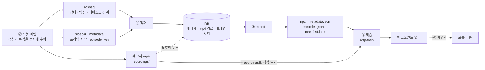

# 학습 데이터 파이프라인 개요

*생성 · 수집 · 적재 · export · 학습 · 추론 배치*

> 이 문서는 학습 데이터 파이프라인의 6단계 구조와 데이터 흐름을 설명한다. 각 단계를 넘어가기 위한 확인 조건(§4),
> 전체 실행 절차(§3), 단계 간 연계 시 주의사항(§5), 데이터 보관·복구 방법(§7)을 함께 정리했다.
> 각 단계의 세부 옵션과 운영 방법은 §8의 기준 문서를 참고한다.
>
> ⚠️ **명령어의 기준은 이 문서가 아니다.** §3은 전체 흐름을 파악할 수 있도록 실행 명령을 한곳에 모은 요약본이다.
> ①~④의 정본은 [isaac_bringup_runbook.md](../backends/isaac/isaac_bringup_runbook.md) §2이며, ⑤의 정본은
> `~/development/rdfp/rdfp-train/docs/학습_실행_절차.md`다. **내용이 다르면 해당 기준 문서를 따른다.**
>
> **구현 완료 여부와 남은 작업은** [미구현_목록.md](../learning/미구현_목록.md) §0의 A~E 표를 기준으로 확인한다.
> 이 문서는 단계별 구성과 흐름을 설명하며, 구현 현황 중에서는 현재 작업 진행을 가로막는 미해결 이슈만 다룬다.
>
> 에피소드 수, 샘플 수, 손실, 프레임 누락률 등 이 문서의 수치는 **2026-09-20 수집분에서 측정한 사례**다.
> 새로 수집하는 데이터가 충족해야 할 기준은 아니다.

---

## 1. 파이프라인 구조와 데이터 흐름

```
① 준비       빌드 · DB 스키마 · 데이터 루트                                 [rdfp_ws · ROS]
     ↓
② 생성·수집  로봇을 제어하면서(생성) 작업을 에피소드 단위로 기록한다(수집)  [rdfp_ws · ROS]
     ↓         → rosbag(비영상 채널) + 레코더 mp4(영상) + sidecar · metadata
③ 적재       bag 메시지를 DB에 저장하고, mp4는 경로와 프레임 시각만 등록한다 [rdfp_ws · ROS 불필요(§5.4)]
     ↓         → sessions(에피소드) · joint_states · motion_trajectories ·
     ↓           image_streams · image_frames …  (mp4 파일은 디스크에 유지)
④ export     DB에서 학습 샘플 디렉터리를 생성한다                            [rdfp_ws · ROS 불필요]
     ↓         → metadata.json + episodes.jsonl + manifest.json + 에피소드별 .npz
══════════════ 이 지점에서 저장소와 실행 셸을 전환한다 ══════════════
⑤ 학습       학습 샘플과 mp4로 정책 체크포인트를 생성한다                    [rdfp-train · ROS 없음]
     ↓         → 정책 모델 + 전처리기 + 후처리기 + rdfp_spec.json
⑥ 추론 배치  체크포인트를 로봇에 적용한다                                    [미구현 — P1~P3]
```

**영상 파일은 DB에 저장하지 않는다.** 적재 단계에서는 레코더 mp4의 **경로와 각 프레임의 시각**만 DB에 등록한다.
실제 파일은 `recordings/` 디렉터리에 남아 있으며 학습기가 이를 직접 읽는다. 따라서 mp4는 **②부터 ⑤까지 별도로 보관해야 하는 원본**이다(§7).



**②에서는 데이터 생성과 수집이 동시에 이루어진다.** 로봇을 움직이는 작업과 그 작업을 에피소드로 나누어 기록하는
과정은 순차적으로 분리되지 않는다. 수집 계층이 실행 중이어야 로봇의 동작을 데이터로 남길 수 있으며, 로봇이
정상적으로 움직이더라도 수집 계층을 실행하지 않으면 데이터는 한 건도 기록되지 않는다.

**④와 ⑤ 사이에서는 저장소와 실행 셸을 전환한다.** 두 단계는 `.npz`·json·mp4 **파일을 매개로 데이터를 주고받으므로**
실행 환경을 직접 연결할 필요가 없다.

| 작업 | 저장소 · 실행 환경 | 시작 방법 |
|---|---|---|
| Isaac 시뮬레이터 | `~/development/ros/rdfp_ws`의 `run_isaac_sim.sh` | 스크립트가 시뮬레이터의 Python·ROS 환경을 자동으로 구성한다 |
| ① 준비 · ② 수집 · ③ 적재 | `~/development/ros/rdfp_ws` | ROS 셸에서 `source ./.rdfprc`를 실행한다 |
| ② 작업 구동기 | `~/development/mdtpy/robot-twin-client` | 해당 저장소의 `.venv/bin/robot-twin-collect`를 실행한다. 트윈에 접속하는 HTTP 클라이언트이므로 **ROS가 필요 없다** |
| ④ export | `~/development/ros/rdfp_ws` | ROS 셸에서 `ros2 run rdfp export`를 실행하거나, **ROS 환경을 불러오지 않은 셸**에서 `python3 -m rdfp.dataset.export_cmd`를 실행한다(§5.4) |
| ⑤ 학습 | `~/development/rdfp/rdfp-train` | **ROS 환경을 불러오지 않은** 새 셸에서 해당 저장소의 `.venv`를 사용한다. DB나 ROS에 접속하지 않고 export 디렉터리와 mp4만 읽는다 |

### 1.1 혼동하기 쉬운 용어

| 용어 | 이 문서에서의 의미 |
|---|---|
| 수집 세션 | 여러 에피소드를 묶는 `/session`의 구간(`start_session` ~ `stop_session`) |
| 에피소드 | 학습용 작업 1회. DB에서는 **`sessions` 테이블의 한 행**에 해당한다. 테이블 이름 때문에 수집 세션과 혼동하기 쉽다 |
| bag 세션 · split | rosbag 녹화 디렉터리(`session_*`)와 그 안의 `.mcap` 파일. **에피소드와 1:1로 대응하지 않는다.** 하나의 bag에 여러 에피소드가 포함된다 |
| 레코더 metadata · sidecar | 레코더가 에피소드마다 생성하는 `*_metadata.json`(`episode_key`·토픽·fps)과 `.jsonl`(프레임 번호·시각). 적재 시 이 정보를 이용해 영상을 에피소드에 연결한다 |
| export의 `metadata.json` | 학습 샘플 디렉터리의 규약·통계·포함 에피소드·샘플 수를 담은 파일. **레코더 metadata와는 다른 파일이다** |
| export의 `manifest.json` | 요청·포함·제외 에피소드, 영상 기준 위치(`media_root`), 파일별 sha256을 담은 파일. 다른 머신으로 옮긴 뒤 손상·누락을 확인할 때 쓴다 |
| `rosbag export` | **③ 선택 적재**: bag에서 선택한 에피소드만 DB에 저장한다 |
| `ros2 run rdfp export` | **④ 학습 샘플 생성**: DB에서 `.npz` 디렉터리 구조를 생성한다 |

### 1.2 데이터 저장 위치와 사용 주체

아래는 데이터 루트를 `/data/rdfp`(`.rdfprc`의 `RDFP_DATA_ROOT`)로 설정한 예시다. 다른 경로를 사용한다면 ⑤의 인자도
함께 변경해야 한다. 새 셸에는 이전 셸의 환경변수가 전달되지 않는다.

| 대상 | 위치 | 생성 · 관리 주체 | 읽을 때 사용하는 설정 · 인자 |
|---|---|---|---|
| 적재 대기 bag | `rosbag/` | 수집 래퍼가 실행한 rosbag | `dataset.yaml`의 `rosbag_dir` |
| 보관 bag | `rosbag_imported/` | 사용자가 적재 후 이동 | 적재 대상에서 제외되며, 재적재 시 원본으로 사용 |
| 영상 원본 · sidecar · 레코더 metadata | `recordings/` | 세션 레코더 | `recordings_dir`(적재), `--recordings`(학습) |
| 적재 실행 기록 | `videos/_logs/postproc_run.jsonl` | `import` | `output_mp4_dir`. 레코더 방식에서는 `videos/`에 영상이 생성되지 않는다 |
| 적재 설정 | `dataset.yaml` | 수집 래퍼가 **실행할 때마다 다시 작성** | `init-db`·`import`·`export`의 `--config` |
| 학습 샘플 디렉터리 | `datasets/v2/` | `export` | export의 `--out`, 학습의 `--root` |
| 체크포인트 | `rdfp-train/outputs/<실행>/` | 학습 과정 | 학습의 `--out` |

`dataset.yaml`은 다음 수집을 실행할 때 덮어쓰므로 **수집을 마치면 사본을 보관한다**(§7). DSN은 실제 값이 아닌
환경변수 이름(`db.dsn_env`)으로 지정되어 있어 사본에 비밀번호가 저장되지 않는다.

---

## 2. 백엔드별 수집 방법

| 백엔드 | ②를 한 번에 실행하는 명령 | 비고 |
|---|---|---|
| **Isaac** | **있음**: `run_collect_isaac.sh --with-stack` | 스택·트윈·수집 계층·rosbag을 함께 실행하고 **자신이 실행한 구성 요소를 자동으로 정리한다.** 시뮬레이터는 포함하지 않는다. 시뮬레이터 기동에는 약 2분이 걸리며, 재기동 시 시뮬레이션 시각이 초기화된다 |
| mock · mock_jgpc | **없음** | 제어 launch → `rdfp_collect` → rosbag 순서로 수동 실행한다(절차서 §2·§3.0) |
| 펑션베이 | **있음**: `run_collect_functionbay.sh --with-stack` | Isaac용 래퍼와 같은 기능을 제공하며, 기동 전 **SignalChart 종료 여부, `/joint_states`의 stamp 시간축, 레코더의 카메라 데이터 수신 여부**를 추가로 확인한다. 솔버·시뮬레이터(Windows)·`ros_tcp_endpoint`·`/scene/start`는 포함하지 않는다. 전용 에피소드 구동기는 아직 없으며, `/scene/reset`이 없어 `robot-twin-collect`를 사용할 수 없으므로 트윈 REST로 에피소드 경계를 기록한다 |

**실제 학습 데이터는 Isaac과 펑션베이에서 수집한다.** mock 계열은 물체를 파지할 수 없어 학습 데이터를 생성하지
못하므로, **시뮬레이터 없이 수집 파이프라인을 시험할 때만** 사용한다. 펑션베이는 시뮬레이터(Windows)와
`ros_tcp_endpoint`가 있는 호스트에서만 실행된다. ③~⑤의 명령은 백엔드에 관계없이 동일하지만,
**데이터는 백엔드별로 분리해 보관한다**(§5.3).

---

## 3. 전체 과정의 실행 명령 — Isaac

아래는 Isaac으로 실제 데이터를 수집·학습하는 전체 절차다. mock과 펑션베이는 §2의 안내 문서를 참고한다.
**① 준비**(빌드·DB 스키마·`.rdfprc`)는 완료한 것으로 가정하며, 처음 실행한다면
[데이터셋_적재_운영_가이드.md](데이터셋_적재_운영_가이드.md) §2부터 진행한다.

**터미널별 수명주기**

| 터미널 | 수집 전 | 작업 중 | 수집 후 | 학습 전 |
|---|---|---|---|---|
| 1 — Isaac | 기동 후 Play | 실행 유지 | `--shutdown rdfp`로는 **종료되지 않는다** | GPU 자원 확보를 위해 종료한다 |
| 2 — 수집 래퍼(ROS) | 스택·트윈·수집 계층·녹화를 준비한다 | 실행 유지 | 수집 세션이 닫히면 자동으로 정리한다. **정리가 끝날 때까지 기다린다** | 이 셸이나 새 ROS 셸에서 적재·export를 실행한다 |
| 3 — 작업 구동기(HTTP) | 터미널 2의 `준비됐다` 메시지를 확인한 뒤 시작한다 | 에피소드 시작 → 작업 → 판정 → 에피소드 종료 | 수집 세션을 닫고 종료한다 | — |
| 새 학습 셸 | — | — | `.rdfprc`를 **불러오지 않은** 새 셸을 연다 | 입력을 점검한 뒤 학습한다 |

```bash
# ── ② 생성·수집 ────────────────────────────────────────── [ROS 셸]
# 터미널 1 — 시뮬레이터 기동에는 약 2분이 걸린다. [bringup] PLAY 이후 /clock이 갱신되는지 확인한다
cd ~/development/ros/rdfp_ws
./scripts/run_isaac_sim.sh --headless

# 터미널 2 — 로봇 스택·트윈·수집 계층·rosbag을 함께 실행한다
#   ⚠️ 먼저 .rdfprc를 불러온다. 생략하면 ~/rdfp_data에 저장되어 ⑤에서 찾지 못한다(§5.3)
cd ~/development/ros/rdfp_ws && source ./.rdfprc
printf '수집 데이터 루트: %s\n' "${RDFP_DATA_ROOT:?먼저 .rdfprc 를 소싱한다}"
./scripts/run_collect_isaac.sh --with-stack --shutdown rdfp

# 터미널 3 — 터미널 2의 "[collect] 준비됐다" 메시지를 확인한 뒤 작업을 시작한다(20회는 예시)
cd ~/development/mdtpy/robot-twin-client && .venv/bin/robot-twin-collect --repeat 20
#   작업이 끝나면 터미널 2가 녹화를 종료하고 ROS 구성 요소를 정리한다(시뮬레이터는 계속 실행됨).
#   ⚠️ 정리가 끝날 때까지 기다린다. 기록 중인 bag·mp4를 적재하면 데이터가 누락되거나 손상될 수 있다.

# ── ② → ③ 넘어가기 전에 (§4) ───────────────────────────── [ROS 셸]
cd ~/development/ros/rdfp_ws && source ./.rdfprc
ros2 run rdfp init-db --config "$RDFP_DATA_ROOT/dataset.yaml"       # 새 DB, 또는 2026-11-23 이전 구조의 DB에서 한 번 실행한다. 멱등이며 기존 행은 보존한다
./scripts/rosbag.sh list-episodes --config "$RDFP_DATA_ROOT/dataset.yaml"   # 새 에피소드의 export 열이 -인지 확인한다

# ── ③ 적재 · ④ export ──────────────────────────────────── [ROS 셸]
CFG="$RDFP_DATA_ROOT/dataset.yaml"
SUMMARY=$(mktemp); START=$(date +%Y-%m-%dT%H:%M:%S.%6N%:z)
ros2 run rdfp import --config "$CFG" > "$SUMMARY"; RC=$?
END=$(date +%Y-%m-%dT%H:%M:%S.%6N%:z)
#   이번 실행의 종료 코드·요약과 에피소드별 관절 관측·영상 프레임·mp4 파일을 확인한다(운영 가이드 §3.1)
./scripts/check_import.py --config "$CFG" --since "$START" --until "$END" --rc "$RC" --summary "$SUMMARY"
#   --episodes에는 DB의 에피소드 ID를 지정한다(list-episodes의 순번과는 다름). 생략하면 DB에서 영상이 있는 모든 에피소드를 포함한다.
ros2 run rdfp export --config "$CFG" --out "$RDFP_DATA_ROOT/datasets/v2"
#   출력 경로는 없거나 비어 있어야 한다. 내용이 있으면 거부한다(§5.4). 다른 머신으로 옮길 거면 --copy-media를 붙인다.
#   export 결과까지 확인한 뒤 적재가 검증된 bag만 rosbag_dir 밖으로 옮긴다(§5.3, 명령은 런북 §2).
#   다음 수집 때 덮어쓰므로 이번 dataset.yaml의 사본을 보관한다(§7).

# ── ⑤ 학습 ─────────────────────────────────────────────── [새 셸 · ROS 없음]
#   ⚠️ .rdfprc를 불러오지 않은 새 셸을 사용한다. GPU 자원을 경합하지 않도록 시뮬레이터를 먼저 종료한다.
~/development/ros/rdfp_ws/scripts/kill_stack.sh --isaac --dry-run   # 종료할 대상을 먼저 확인한다
~/development/ros/rdfp_ws/scripts/kill_stack.sh --isaac
cd ~/development/rdfp/rdfp-train
uv venv --python 3.10 && uv pip install -e .          # 처음 한 번

# 입력 점검 — 에피소드·샘플 수와 참조하는 .npz·mp4의 존재 여부를 확인한다. 데이터 내용의 정합성은 검사하지 않는다.
.venv/bin/python - /data/rdfp/datasets/v2 /data/rdfp/recordings <<'PY'
import json, sys
from pathlib import Path
root, videos = Path(sys.argv[1]), Path(sys.argv[2])
manifest = root / 'manifest.json'
if manifest.is_file() and json.loads(manifest.read_text()).get('media_root') == 'dataset':
    videos = root   # --copy-media — episodes.jsonl 의 mp4 가 트리 기준(videos/…)이다
meta = json.loads((root / 'metadata.json').read_text())
rows = [json.loads(l) for l in (root / 'episodes.jsonl').read_text().splitlines() if l.strip()]
missing = [str(p) for r in rows
           for p in (root / 'episodes' / f"{r['episode_id']}.npz", videos / r['mp4']) if not p.is_file()]
print(f"에피소드 {len(meta['episodes'])} · 샘플 {meta['samples']}")
# ⚠️ 학습기는 episodes.jsonl 의 모든 항목을 읽는다 — export 가 제외한 에피소드도 학습에 들어간다(§5.4)
dropped = [r['episode_id'] for r in rows if r['episode_id'] not in set(meta['episodes'])]
if dropped:
    print(f"제외됐는데 학습기가 읽는 에피소드: {dropped}")
if missing or not meta['episodes'] or meta['samples'] <= 0:
    sys.exit('학습을 시작하지 않는다 — 없는 파일:\n' + '\n'.join(missing))
PY

# 연동 확인 — 현재도 실행할 수 있다(40스텝, 1분 미만 소요). 정상 종료, 유한한 손실 값, final/ 생성을 확인한다.
#   40스텝 실행은 구성 요소가 정상적으로 연동되는지 확인하기 위한 것으로, 정책 품질을 평가하는 과정은 아니다.
.venv/bin/python -u -m rdfp_train.train \
    --root /data/rdfp/datasets/v2 --recordings /data/rdfp/recordings \
    --steps 40 --log-every 10 --save-every 0 --out /tmp/smoke && rm -rf /tmp/smoke

# 본 학습 — ⚠️ 먼저 train.py가 후처리기까지 저장하도록 수정해야 한다(§5.5).
#   현재 코드로도 학습은 가능하지만, 생성한 체크포인트를 그대로 추론에 사용할 수는 없다.
#   기본값은 20,000스텝이다. ⚠️ -u를 생략하면 표준 출력 버퍼링으로 인해 진행 로그가 실시간으로 표시되지 않는다.
#   실행할 때마다 새 출력 디렉터리를 사용한다. --out이 같으면 이전 실행의 체크포인트를 덮어쓴다.
#   pipefail을 설정하지 않으면 학습 프로세스가 실패해도 tee 때문에 실패 종료 코드가 전달되지 않는다.
set -o pipefail
OUT=outputs/act-$(date +%Y%m%d-%H%M) && mkdir -p "$OUT"
.venv/bin/python -u -m rdfp_train.train \
    --root /data/rdfp/datasets/v2 --recordings /data/rdfp/recordings \
    --out "$OUT" 2>&1 | tee "$OUT/run.log"

# 다른 터미널에서 100스텝마다 기록되는 loss·samples_per_s를 확인한다. 새 터미널이므로 절대 경로를 사용한다.
tail -f ~/development/rdfp/rdfp-train/outputs/act-<실행>/train_log.jsonl
```

`/data/rdfp`는 `.rdfprc`에 지정한 `RDFP_DATA_ROOT`이며, rdfp-train의 기본값도 같다. 따라서 `--root`와
`--recordings`는 생략할 수 있다. 명령을 한 줄이라도 변경하려면 **먼저 기준 문서를 확인한다.**

**에피소드를 추가로 수집한 뒤 다시 export할 때는 셸을 바꿀 필요가 없다.** export는 ROS 없이 실행할 수 있다(§5.4).
출력은 **새 버전 디렉터리**로 준다. 내용이 있는 경로는 거부된다.

```bash
# ROS 환경을 불러오지 않은 셸에서 DSN만 전달한다
cd ~/development/ros/rdfp_ws/src/rdfp
RDFP_DB_DSN=... python3 -m rdfp.dataset.export_cmd \
    --config /data/rdfp/dataset.yaml --out /data/rdfp/datasets/v3
```

---

## 4. 단계 전환 전 확인할 사항

이 파이프라인의 문제 대부분은 오류 메시지 없이 결과가 비어 있는 형태로 나타난다. 따라서 **명령이 종료되었다는
이유만으로 다음 단계로 넘어가지 말고, 이번에 처리한 대상의 결과를 반드시 확인해야 한다.** DB의 누적 합계(`stats`)나
이전 로그만 보면 이번 실행에서 누락된 항목을 파악하기 어렵다.

| 전환 | 확인할 사항 | 확인 방법 | 문제가 있을 때 참고할 절 |
|---|---|---|---|
| ① → ② | 스택·트윈·수집 노드가 실행 중이며, 데이터 루트·레코더 출력·`dataset.yaml`의 경로가 일치한다 | 수집 래퍼의 `[collect] 준비됐다` 메시지와 `echo $RDFP_DATA_ROOT`를 확인한다. 래퍼가 데이터 루트에서 경로를 한곳에서 정해 `dataset.yaml`까지 작성한다. 녹화 목록에 카메라 토픽이 살아 있으면 기동을 중단한다 | §5.2 · §5.3 |
| ② → ③ | 녹화가 종료되어 bag마다 `metadata.yaml`이 있다. 에피소드마다 레코더 mp4와 sidecar 파일이 생성되었고, 에피소드 경계가 정상적으로 기록되었다. **새 에피소드의 키가 DB에 등록되어 있지 않다** | `./scripts/rosbag.sh list-episodes --config "$RDFP_DATA_ROOT/dataset.yaml"`로 목록을 확인한다. 새 에피소드의 `export` 열은 `-`여야 한다(`yes`: 이미 DB에 존재, `?`: DB 확인 실패) | §5.3 |
| ③ → ④ | 적재가 오류 없이 완료되었고, 의도치 않게 건너뛴(`skipped`) 에피소드가 없다. 각 에피소드에 관절 데이터와 영상이 등록되어 있다 | `scripts/check_import.py`로 이번 실행의 종료 코드·요약(`failed`·`skipped`)과 에피소드별 관절 관측(`joints`)·영상 프레임(`frames`)·mp4 파일을 확인한다(§3) | §5.3 |
| ④ → ⑤ 연동 확인 | 의도한 에피소드만 포함되어 샘플이 생성되었다. 제외된 에피소드의 사유를 확인했다. 참조하는 `.npz`·mp4 파일이 실제로 존재한다. **export 단계에서 제외된 에피소드가 없거나, 제외된 에피소드를 학습에 포함할지 여부를 판단했다** | export 출력의 `N episode(s), M sample(s)`와 `excluded (…)` 줄, §3의 입력 점검 결과를 확인한다. 학습기는 mp4가 없으면 시작 시점에 `FileNotFoundError`로 중단된다. ⚠️ 현재 학습기는 제외된 에피소드도 읽는다(§5.4) | §5.4 |
| 연동 확인 → 본 학습 | 40스텝 시험이 정상 종료하고, 손실이 유한한 값이며, `final/`이 생성되었다. **체크포인트에 후처리기까지 함께 저장되는 상태인지 확인한다** | 시험 실행 결과와 `final/`의 파일을 확인한다. ⚠️ 현재 `train.py`는 후처리기를 저장하지 않으므로 코드 수정 후 본 학습을 진행한다 | §5.5 |
| ⑤ → ⑥ | 체크포인트 묶음(정책 모델·전처리기·**후처리기**·`rdfp_spec.json`)이 모두 있다. 추론 배치 코드에서 데이터 규약 검사(`ExportSpec.assert_compatible`)를 호출하도록 구현되어 있다 | `outputs/act/final/`의 파일을 확인한다. ⚠️ 현재는 후처리기를 저장하지 않는다 | §5.5 |

### 4.1 단계별 에피소드 수 불일치

**수집 회차 수, DB의 에피소드 수, export에 포함된 에피소드 수는 서로 다를 수 있다.** 단계별로 에피소드가 제외되는
조건이 다르며, 대부분 오류 없이 조용히 제외된다.

| 단계 | 제외되는 이유 | 확인할 곳 |
|---|---|---|
| ② 수집 | 에피소드 경계 연산이 거절된 회차는 에피소드가 생성되지 않는다 | `robot-twin-collect`의 회차별 결과·`--summary-json` |
| ② → ③ | `metadata.yaml`이 없는 bag(SIGKILL로 녹화를 종료한 경우)은 적재 대상에서 제외된다 | `import` 로그의 `found N finalized split(s)` |
| ③ 적재 | 같은 녹화본의 에피소드가 이미 모두 적재되어 있으면 건너뛴다(`skip`은 빠진 토픽만 채운다). **다른 녹화본이 같은 키를 내면 거부한다** | 요약의 `skipped`·`failed`, 로그의 `episode already present … nothing new`·`episode key collision` |
| ③ 적재 | 적재에 실패한 에피소드는 커밋되지 않는다 | 요약의 `failed`·종료 코드 1 |
| ④ export | 기본적으로 **영상이 있는 에피소드만** 포함한다 | export 출력의 에피소드 수 |
| ④ export | 시간 정보를 가정하여 채운 에피소드는 기본적으로 제외한다. `--keep-untrustworthy`로 포함할 수 있다 | export 출력의 `excluded (assumed full duration)` |
| ④ export | `--episodes`로 지정하지 않으면 DB에서 **영상이 있는 모든 에피소드**가 후보가 된다. 공용 DB에서는 이번 수집분 외의 에피소드도 포함될 수 있다 | 선택한 DB 에피소드 ID |
| ⑤ 학습 | ⚠️ **제외되지 않는다.** 학습기는 `episodes.jsonl`의 모든 항목을 읽으므로, export가 `metadata.json`에서 제외한 에피소드(`assumed_full_duration > 0`)도 학습에 들어간다 | §3 입력 점검의 `제외됐는데 학습기가 읽는 에피소드` |

- **`.npz` 파일 수로 포함된 에피소드 수를 판단하지 않는다.** export는 제외한 에피소드의 `.npz`도 진단용으로 남긴다.
  포함된 에피소드는 `metadata.json`의 `episodes`(또는 `manifest.json`의 `kept_episodes`)를 기준으로 확인한다. `episodes.jsonl`에는 제외된 에피소드도 남는다(`assumed_full_duration > 0` 인 줄).
- **작업 실패(`outcome=failure`)와 export 제외는 기준이 다르다.** 작업에 실패한 회차도 유효한 학습 데이터로
  포함된다. export에서 제외하는 것은 레이블을 신뢰할 수 없는 경우다.

---

## 5. 단계 간 연계에서 주의할 점

각 단계 내부의 주의사항은 해당 기준 문서에서 설명한다. 여기서는 **여러 단계에 걸쳐 있어 개별 문서에서 다루기
어려운 문제**를 단계 전환 순서대로 정리한다. 대부분은 **오류 메시지 없이 결과가 비거나 학습 품질이 저하되는
현상**으로 나타난다.

### 5.1 전체 요약

| 발생 구간 | 증상 | 오류 표시 여부 | 확인할 사항 | 상세 |
|---|---|:-:|---|---|
| ① → ② | 로봇은 정상적으로 움직이지만 데이터가 0건이다 | 실행 경로에 따라 다름 | `/session`의 상태가 전이하는가 | [수집 계층](#collection-stack) |
| ① → ② | 설정을 수정해도 반영되지 않는다 | 없음 | `colcon build`를 실행했는가 | [설정 변경 반영](#rebuild-config) |
| ② | 에피소드 라벨이 비어 있다 | 없음 | 에피소드 시작 전에 `task_label`을 지정했는가 | [라벨 지정](#episode-label) |
| ② → ⑤ | 학습기가 데이터를 찾지 못한다 | 시작 시 표시 | 수집 셸에서 `.rdfprc`를 불러왔는가 | [데이터 루트](#data-root) |
| ② → ④ | 학습은 완료되지만 결과가 좋지 않다 | 없음 | 하나의 데이터 루트에 두 백엔드의 데이터가 섞여 있는가 | [백엔드별 분리](#backend-roots) |
| ② → ③ | `import`가 `failed to load config: topics_file not found`로 중단된다(종료 코드 2) | 있음 | `dataset.yaml`의 `topics_file`이 실제 파일을 가리키는가 | [토픽 파일 경로](#topics-file) |
| ② → ③ | `import`가 사전 점검에서 영상 중복 등록으로 중단된다 | 있음 | 적재 대상에 `sensor_msgs/msg/Image` 토픽을 포함했는가 | [녹화·적재 토픽](#recording-topics) |
| ② → ③ | 에피소드는 있지만 관절 데이터가 0건이다 | 없음 | 이전 bag이 `rosbag_dir`에 남아 있는가 | [시간 구간 겹침](#overlapping-bags) |
| ② → ③ | 새 에피소드가 `episode key collision`으로 적재되지 않는다 | 있음. 요약의 `failed`·종료 코드 1 | 해당 키가 DB에 이미 있는가(`list-episodes --config`) | [에피소드 키 중복](#duplicate-key) |
| ③ | 다시 적재해도 이미 적재된 토픽의 내용이 바뀌지 않는다 | 없음 | `skip`은 빠진 토픽만 채운다. 바꿀 토픽을 `--only-topics-replace`로 지정했는가 | [에피소드 재적재](#replace-episode) |
| ② → ⑤ | 하나의 관측에 여러 행동 스텝이 대응한다 | 없음 | 프레임 간격의 분포가 어떠한가 | [프레임 누락](#frame-drops) |
| ② ↔ ⑤ | 수집과 학습이 모두 느려진다 | 없음 | Isaac과 학습이 같은 GPU를 사용하는가 | [GPU 동시 사용](#gpu-sharing) |
| ③ | ROS 환경이 없는 셸에서 `import`가 `ModuleNotFoundError`로 중단된다 | 있음 | 적재 대상에 `sensor_msgs/msg/Image` 토픽이 있는가 | [ROS 실행 환경](#ros-environment) |
| ④ → ⑤ | 학습 시작 시 `FileNotFoundError`가 발생한다 | 있음 | export 디렉터리와 mp4 디렉터리를 올바르게 지정했는가 | [영상 경로](#video-paths) |
| ④ | `export`가 `output directory is not empty`로 중단된다 | 있음 | 이미 내용이 있는 출력 경로를 주었는가 | [export 버전 관리](#export-version) |
| ⑤ → ⑥ | 학습은 완료되었지만 로봇이 비정상적으로 움직인다 | 없음 | 체크포인트 묶음과 배치 규약이 올바른가 | [체크포인트 구성](#checkpoint-components) |

---

### 5.2 준비 · 수집 연계 (① → ②)

<a id="collection-stack"></a>

#### 수집 계층을 실행해야 데이터가 기록된다
로봇이 정상적으로 움직이고 트윈도 성공을 반환하는데 데이터가 한 건도 남지 않을 수 있다. `/session`을 제어하는
구성 요소가 없어 **에피소드 경계가 생성되지 않기** 때문이다.

수집용 구동기는 **`robot-twin-collect`**다. 에피소드 1회는 `reset_scene → return_home → start_episode → 작업 →
verify → stop_episode` 순서로 진행된다.
- 구동기는 시작 전에 `session_state`를 읽을 수 있는지 확인한다. 트윈은 `session_control_node`가 없으면 수집 경계
  연산을 `503`으로 거절하므로, **시작 시점 확인에 실패하면 구동기 실행 자체가 중단된다.**
- 반면 수집 도중 특정 회차의 경계 연산이 거절되면(`FAILED`), 해당 회차만 실패로 기록하고 다음 회차로 넘어간다.

⚠️ **오류 없이 데이터가 0건이 되는 경우는 에피소드 경계를 기록하지 않는 방식으로 실행했을 때다.** 쌓기만 반복하는
`robot-twin-stack`이나 트윈 REST를 직접 호출하는 스크립트가 이에 해당한다. **작업에 실패한 회차도 에피소드를 종료해
기록해야 한다**(`outcome=failure`). 종료하지 않으면 상태 머신이 다음 `start_episode`를 거부하여 이후 회차에도
에피소드 경계가 기록되지 않는다.

<a id="rebuild-config"></a>

#### 설정을 수정한 뒤에는 `colcon build`를 실행한다
동일한 장면 설정을 **Isaac 스테이지(`scripts/isaac/sim_side/*`), 트윈(`run_robot_twin.sh`), scene 노드가 함께 읽는다.**
세 구성 요소 모두 **설치본(`install/`)을 사용한다.** `src/`의 `isaac_scene.json`이나 `twins/panda01.yaml`을
수정했다면 빌드한 뒤 **Isaac을 포함해 모두 다시 실행해야 한다.** 설정을 기동 시점에만 읽기 때문이다. 빌드를 빠뜨리면
세 구성 요소 모두 이전 값을 사용하므로, 설정을 수정해도 동작은 바뀌지 않는다.

세 구성 요소가 서로 다른 값을 쓰면 트윈의 `reset_scene`이 치수 불일치로 거부된다. scene 노드는 물체의 **위치를
검증하지 않으므로**, 치수는 같고 높이만 다른 경우 오류 없이 잘못된 위치 값으로 데이터를 수집한다.
`test_isaac_sim_side_scripts.py`의 `*_install_tree` 테스트는 세 구성 요소가 설치본에서 설정을 읽는지 검사한다.

---

### 5.3 수집 · 적재 · 학습 연계 (② → ③ / ② → ⑤)

<a id="episode-label"></a>

#### 라벨은 에피소드를 시작하기 전에 지정한다 (②)
`set_task_label`은 `IN_EPISODE` 상태에서 **거부된다.** 빈 라벨로 시작한 에피소드는 **다시 적재해도 수정할 수 없다.**
bag 안의 `/session` 메시지에 이미 빈 라벨이 기록되어 있기 때문이다.

<a id="data-root"></a>

#### 수집과 학습에서 같은 데이터 루트를 사용한다 (② → ⑤)
두 수집 래퍼(`run_collect_isaac.sh`·`run_collect_functionbay.sh`)는 `$RDFP_DATA_ROOT`가 없으면 **`~/rdfp_data`**에
데이터를 저장한다. 반면 `.rdfprc`는 이 값을 **`/data/rdfp`**로 설정하며, rdfp-train의 기본값도 `/data/rdfp`다.
따라서 `.rdfprc`를 불러오지 않고 수집하면 ②는 `~/rdfp_data`에 저장하고 ⑤는 `/data/rdfp`에서 데이터를 찾게 된다.
§3의 명령에서 매번 `source ./.rdfprc`를 먼저 실행하는 이유다.

<a id="backend-roots"></a>

#### 백엔드별로 데이터 루트를 분리한다 (② → ④)
`run_collect_isaac.sh`와 `run_collect_functionbay.sh`는 **기본 데이터 루트가 같다.** 설정을 바꾸지 않고 두 백엔드를
번갈아 사용하면 bag과 레코더 mp4가 같은 디렉터리에 저장되고, 적재한 데이터도 하나의 DB에 들어간다. `export`는
기본적으로 **영상이 있는 모든 에피소드**를 하나의 데이터셋에 포함한다. `dataset.yaml`도 나중에 실행한 래퍼가 덮어쓴다.

**현재의 레이블과 관측 조건에서는 백엔드별로 분리해 운용한다.** 두 백엔드의 카메라 설정은 모두 640×480·10 Hz지만,
장면과 시점이 다르고 실제 측정 주기도 다르다. 측정 사례에서 Isaac은 렌더링이 누락되어 평균 5 Hz 남짓이었고,
펑션베이는 9.5 Hz 안팎이었다. 또한 우리 쪽 중력 보상을 쓰는 펑션베이 씬(`t1`)에서는 `/target_joint_cmds`에 그 오프셋이 포함되어 있어
관절-명령 레이블이 해당 시뮬레이터에 의존한다. 데이터를 섞어도 **오류는 발생하지 않으며**, 학습 결과가 좋지 않은
것으로만 나타난다. 단일 정책 학습에 여러 백엔드의 데이터를 함께 사용하려면 이러한 차이를 처리할 방법을 먼저 설계해야 한다.

백엔드마다 `--data-root`를 다르게 지정하고, 적재와 export도 각 루트의 `dataset.yaml`을 사용해 따로 실행한다.
DB는 하나이므로 export할 때는 `--episodes`로 해당 백엔드의 에피소드만 선택한다. rdfp-train의 `--root`와
`--recordings`에도 해당 루트의 경로를 지정한다.

<a id="topics-file"></a>

#### `dataset.yaml`의 `topics_file`은 실제 파일을 가리켜야 한다 (② → ③)
`topics_file`이 없는 파일을 가리키면 `import`가 `failed to load config: topics_file not found: …`를 남기고 종료 코드 2로 중단된다.
수집 래퍼는 **실행할 때마다 `dataset.yaml`을 다시 작성하므로**, 래퍼를 다시 실행하면 설정 파일이 갱신된다.
직접 수정할 때는 **절대 경로**를 사용한다. `topics_file`의
상대 경로는 **해당 YAML 파일이 있는 디렉터리를 기준으로 해석된다.** 따라서 `/data/rdfp/dataset.yaml`에
`config/recording_topics.list`라고 적으면 `/data/rdfp/config/…`에서 파일을 찾는다.

```yaml
topics_file:    /home/kwlee/development/ros/rdfp_ws/config/recording_topics.list
```

<a id="recording-topics"></a>

#### 녹화 목록과 `topics_file`은 같은 파일을 가리켜야 한다 (② → ③)
모든 백엔드는 `config/recording_topics.list`를 공통 녹화 목록으로 사용한다. **`dataset.yaml`의 `topics_file`도
이 파일을 가리켜야 한다.** 수집 래퍼가 작성하는 설정도 이와 같다.

⚠️ **녹화 목록에 `sensor_msgs/msg/Image` 토픽을 포함하면 안 된다.** 적재 대상에 그 토픽이 있고 `recordings_dir`도
설정되어 있으면, bag의 이미지와 레코더 mp4가 같은 `(episode_id, topic_id)`로 `image_streams`에 등록되어 UNIQUE 제약을
위반하게 된다. 그래서 `import`는 **DB에 쓰기 전에 사전 점검에서 중단한다.** 공용 목록에서 카메라 항목을 주석 처리한
이유다. 압축 이미지(`sensor_msgs/msg/CompressedImage`, 펑션베이)는 이 검사와 인코딩 대상이 아니다.

<a id="overlapping-bags"></a>

#### 이전 bag과 새 bag을 함께 적재하지 않는다 (② → ③)
이 문제는 **적재할 bag이 섞일 때** 발생한다. 시뮬레이터를 다시 기동하면 시뮬레이션 시각이 0으로 초기화된다.
이전 bag과 새 bag을 같은 `rosbag_dir`에서 함께 읽으면 두 수집 회차의 시간 구간이 겹쳐 에피소드 경계가 뒤섞인다.
그 결과 새 에피소드의 관절 데이터가 **0건인 상태로 커밋된다.**

⚠️ **에피소드 자체가 누락되는 것이 아니라, 에피소드는 있는데 관절 데이터가 비어 있는 상태가 된다.**
`image_frames`는 레코더 sidecar의 `episode_key`를 기준으로 연결되므로 **영상 데이터만 정상적으로 등록되어**
문제를 알아차리기 어렵다.

적재 직후에는 §3의 `scripts/check_import.py`가 이번 실행의 에피소드별 `joints`(팔 관절 관측 행 수)를 보여 준다.
이미 적재된 DB 전체에서 찾을 때는 아래 질의를 사용한다. `joint_states` 테이블에는 명령 토픽 `/target_joint_cmds`도
함께 저장되므로 **`/joint_states` 토픽의 행만** 센다. 전체를 세면 명령만 기록된 에피소드도 정상으로 보인다.

```bash
# 적재 후 관절 관측이 없는 에피소드를 확인한다 (설정의 db.schema 가 public 이 아니면 search_path 를 맞춘다)
psql "$RDFP_DB_DSN" -c "select s.id from sessions s
  where not exists (select 1 from joint_states j join topics t on t.id = j.topic_id
                    where j.episode_id = s.id and t.topic_name = '/joint_states')"
```

**적재한 bag은 `rosbag_dir` 밖으로 옮긴다.** 명령은
[isaac_bringup_runbook.md](../backends/isaac/isaac_bringup_runbook.md) §2를 참고한다. 반드시 **세션 단위로** 옮긴다.
날짜 디렉터리 전체를 `mv`하면 같은 날 두 번째 실행부터 별다른 표시 없이 실패한다.

<a id="duplicate-key"></a>

#### 다른 녹화본이 DB와 같은 에피소드 키를 내면 적재가 거부된다 (② → ③)
**앞의 시간 구간 겹침 문제와는 다른 원인이며, 이전 bag을 옮겨도 예방할 수 없다.** 키를 비교하는 대상이 bag이 아니라
**이미 적재된 DB**이기 때문이다. 에피소드 키는 `/session`의 에피소드 시작 시각 `(start_sec, start_nanosec)`이며,
`sessions` 테이블에 UNIQUE 제약이 설정되어 있다. 시뮬레이션 시각은 재기동할 때마다 0부터 시작하므로, 새 수집
회차의 에피소드가 이전 회차의 에피소드와 **시작 시각이 정확히 같을** 수 있다.

적재는 에피소드마다 출처(녹화본 = bag 세션 디렉터리 이름)를 기록하고, 같은 키가 DB에 있으면 다음과 같이 처리한다.

- **출처가 다른 녹화본이거나 종료 시각이 다르면 정책과 관계없이 거부한다**(`episode key collision: …`). `replace`로도
  덮어쓰지 않는다. 해당 에피소드는 요약의 `failed`에 들어가고 종료 코드는 1이다(`parallelism: 1`이면 거기서 멈춘다).
- 출처 기록이 없는 에피소드(2026-11-23 이전에 적재)는 시작·종료 시각이 같으면 이번 녹화본에 **연결(adopt)**하고
  계속한다. 요약의 `adopted`에 센다.
- 같은 녹화본이면 `skip`이 이미 적재된 토픽만 건너뛰고 빠진 토픽을 채운다. 넣을 것이 없으면 `skipped`에 세고
  로그에 `episode already present (start_ns=…, id=…); nothing new`가 남는다.

키가 겹치는 빈도는 측정하지 않았다. 다만 시뮬레이션 시각은 스텝 단위로 증가하므로, 연속적인 시각을 가정했을 때보다
나노초까지 같은 값이 나올 가능성이 높다고 본다.

**확인 방법:** 적재 **전에** `./scripts/rosbag.sh list-episodes --config "$RDFP_DATA_ROOT/dataset.yaml"`을 실행한다.
새 bag의 에피소드인데 `export` 열이 `yes`라면 해당 키가 이미 DB에 있다(같은 녹화본을 다시 적재하는 경우가 아니면
거부된다). 적재 후에는 요약의 `failed`·`skipped`·`adopted`를 확인한다.

**조치 방법:** 새 에피소드만 남기려면 기존 에피소드를 `ros2 run rdfp episode-delete`로 지운 뒤 적재한다. 이때
`recordings/`에 같은 `episode_key`를 가진 기존 녹화가 남아 있으면 같은 카메라의 녹화 두 개를 하나의 에피소드에
연결하려다 `image_streams`의 UNIQUE 제약 위반으로 실패하므로, **`recordings/`에서도 기존 녹화를 제거한 뒤** 적재한다.
두 에피소드를 모두 보존하려면 **회차별 설정 파일**을 만들어 `rosbag_dir`·`recordings_dir`·`db.schema`·`output_mp4_dir`을
모두 회차별로 나눈다([운영 가이드](데이터셋_적재_운영_가이드.md) §3.2). 스키마만 나누면 레코더 녹화와 bag 인코딩 영상
경로가 겹친다.

**데이터 루트를 분리해도 DB의 키 중복 문제는 해결되지 않는다.** 루트별로 `recordings_dir`이 달라져 레코더 녹화의
검색 범위는 줄어들지만, 래퍼가 작성하는 `dataset.yaml`은 모두 같은 `RDFP_DB_DSN`과 `public` 스키마를 사용한다.
스키마를 나누려면 래퍼가 작성한 `dataset.yaml`의 `db.schema`를 고친 사본을 쓴다. 수집 회차까지 구분하는 식별 체계는
아직 구현하지 않았다.

<a id="replace-episode"></a>

#### 이미 적재한 에피소드에 수정 사항을 반영하려면

녹화 목록이나 설정을 고친 뒤 `import`를 다시 실행하면 기본 정책 `skip`은 **이미 적재된 (에피소드, 토픽) 단위만
건너뛰고 빠진 토픽을 채운다**(녹화 목록·동적 매핑에 토픽을 더한 경우). 이미 들어간 토픽을 다시 넣으려면
`ros2 run rdfp import --config "$CFG" --topics <토픽…> --only-topics-replace`를 쓴다. 고른 토픽의 행만 지우고 다시 넣으며,
다른 토픽과 DB 에피소드 ID는 그대로다. 에피소드를 통째로 다시 넣으려면 `replace`를 쓰며, 이 경우 DB의 에피소드 ID가
바뀐다(§7). 절차는 [운영 가이드](데이터셋_적재_운영_가이드.md) §8.7a를 참고한다.

<a id="frame-drops"></a>

#### 수집 중 누락된 카메라 프레임은 학습에 영향을 준다 (② → ⑤)
이 특성은 ②에서 발생하지만 ⑤에서야 드러난다. **측정 사례**인 2026-09-20 수집분 65개 에피소드에서 프레임 간격의
중앙값은 정확히 100 ms(설정 10 Hz)였다. 그러나 전체 간격의 15.2 %가 200 ms를 넘었고, 최대 간격은 2100 ms였다.
간격이 100 ms의 정수배라는 점에서, 단순히 처리 속도가 느려진 것이 아니라 **렌더링 자체를 건너뛰는 것**으로 볼 수 있다.

⚠️ **`metadata.json`의 `camera_hz`는 평균치이므로 프레임 간격의 편차나 간헐적 누락 양상을 드러내지 못한다.**
frame clock이 실제 stamp를 사용하므로 레이블의 시간 정합성은 유지된다. 다만 프레임이 누락된 구간에서는 하나의 관측에
여러 행동 스텝이 대응한다. **학습 결과가 좋지 않을 때 살펴봐야 할 원인 중 하나이며**, 해결하려면 수집 측을 수정해야 한다.

<a id="gpu-sharing"></a>

#### 수집과 학습이 GPU를 동시에 사용하지 않도록 한다 (② ↔ ⑤)
Isaac(②)과 학습(⑤)을 같은 호스트(머신)에서 동시에 실행하면 GPU 자원을 경합하여 **두 작업 모두 성능이 크게 저하된다.**
수집 래퍼의 `--shutdown rdfp`는 시뮬레이터를 종료하지 않으므로, 학습 전에 `./scripts/kill_stack.sh --isaac`로
종료한다(§3). ⑥ 추론은 학습이 끝난 뒤에 진행하므로 학습과 실행 시간이 겹치지 않는다.

---

### 5.4 적재 · export · 학습 연계 (③ → ④ → ⑤)

<a id="ros-environment"></a>

#### 적재와 export는 ROS 없이도 실행된다 (③ → ④)
**bag에 이미지 토픽이 없으면 `import`도 ROS 없이 실행된다.** 카메라는 bag에 담지 않으므로(영상은 레코더 mp4) 평소
적재가 이 경우다. `FrameRouter`(`sensor_msgs`)는 적재 대상에 `sensor_msgs/msg/Image` 토픽이 있을 때만 불러오며,
그때는 ROS 환경을 불러오지 않은 셸에서 `ModuleNotFoundError`가 발생한다.
`rdfp/dataset/export/`와 `export_cmd`는 ROS 모듈을 불러오지 않으며, 산출물도 numpy·json뿐이다.
**학습은 ROS 환경과 분리해 실행한다.**

**`ros2 run rdfp export`는 실행 방법 중 하나이며, export 자체가 ROS를 요구하는 것은 아니다.** 설치된 진입점을
사용하기 때문에 ROS 환경을 불러와야 할 뿐이다. `python3 -m rdfp.dataset.export_cmd`를 사용하면 ROS 환경을
불러오지 않은 셸에서도 실행할 수 있다(§3 끝). 이때 필요한 것은 `RDFP_DB_DSN`과 pip 의존성인
`psycopg`·`pydantic`·`PyYAML`·`numpy`다. 따라서 다시 export하기 위해 ROS 셸로 돌아갈 필요는 없다.

다만 **ROS와 분리되어 있다고 해서 Python 버전을 자유롭게 선택할 수 있는 것은 아니다.** ⑤의 Python 버전은 실제로
**3.10에 고정되어 있다**(§6). 이는 ROS 자체가 아니라 ⑥ 배치 환경과의 호환성을 위한 제약이다.

<a id="video-paths"></a>

#### export 디렉터리와 mp4의 경로 관계를 유지한다 (④ → ⑤)
`episodes.jsonl`의 `mp4`는 **`recordings_dir`을 기준으로 한 상대 경로**다. 현재 레코더는 하나의 디렉터리에
저장하므로 이 값에는 파일 이름만 들어간다(예: `"session_20260920-162849.763.mp4"`). 상대 경로를 사용하는 이유는
**다른 머신으로 데이터를 옮길 수 있도록 하기 위해서다.** 학습기는 `--root`(export 디렉터리)와
`--recordings`(mp4 디렉터리)를 **각각** 받는다. `--copy-media`로 내보내면 mp4를 트리 안 `videos/<episode_id>.mp4`로
복사하고 `episodes.jsonl`의 `mp4`도 트리 기준이 된다(`manifest.json`의 `media_root: "dataset"`). 그때 학습기는
`--recordings` 대신 트리 루트에서 영상을 찾는다.

다른 머신으로 옮길 때는 `datasets/v2/`와 `recordings/*.mp4`를 **모두** 복사한다(`--copy-media`로 내보냈다면
`datasets/v2/`만 복사하면 된다). 옮긴 뒤에는 `manifest.json`의 파일별 sha256으로 손상·누락을 확인할 수 있다. `.jsonl`·`_metadata.json`
sidecar는 적재할 때만 사용하므로 옮기지 않아도 된다. `rdfp_ws`도 옮길 필요가 없다. 명령은 rdfp-train README의
「D4」 §1을 참고한다.

파일 이름이 맞지 않으면 `Dataset`이 **시작 시점에** `FileNotFoundError`를 발생시킨다. 학습 도중에 뒤늦게
파일 누락으로 실패하지 않고, 시작 시점에 즉시 실패한다.

⚠️ **현재 학습기는 export가 제외한 에피소드도 읽는다.** export는 종료 이벤트가 없어 실행 시간을 가정한 에피소드
(`assumed_full_duration > 0`)를 `metadata.json`의 에피소드 목록과 정규화 통계에서 빼지만, `.npz`와 `episodes.jsonl`
항목은 남긴다(그 줄의 `assumed_full_duration` 이 0 보다 크다). rdfp-train의 `Dataset`은 `episodes.jsonl`을 모두 읽으므로 그 샘플이 학습에
들어가고, 정규화 통계는 그 샘플을 뺀 값이라 학습 데이터와 어긋난다. 학습기가 `metadata.json`의 목록으로 거르기 전까지는
§3 입력 점검의 `제외됐는데 학습기가 읽는 에피소드`가 비어 있는지 확인한다.

<a id="export-version"></a>

#### 다시 export할 때는 새 버전 디렉터리(`datasets/v3/` 등)를 사용한다

export는 출력을 옆의 임시 디렉터리(`.<이름>.partial-*`)에 쓰고 끝까지 성공했을 때만 이름을 바꿔 게시하므로, 중간에
실패해도 반쪽 데이터셋이 남지 않는다. **내용이 있는 출력 경로는 `output directory is not empty`로 거부한다.** 덮어쓰면
이전 결과와 섞이고, 이미 생성한 체크포인트가 어떤 데이터로 학습되었는지 확인할 수 없게 되기 때문이다. 에피소드를 추가·교체하거나 레이블·시간 격자
(`--label`·`--delta-sec`·`--step-sec`·`--chunk-len`)를 변경했다면 다시 export해야 한다. 학습 기록에도 데이터셋 버전과
출력 디렉터리를 함께 적는다.

---

### 5.5 학습 · 배치 연계 (⑤ → ⑥)

<a id="checkpoint-components"></a>

#### 체크포인트는 4가지 구성 요소가 모두 필요하다 — 현재는 3개만 저장된다 ⚠️
추론에 사용하려면 `outputs/act/final/`과 `step_XXXXXX/`에 다음 4가지 구성 요소가 함께 있어야 한다.

| 파일 | 용도와 누락 시 문제 | 현재 저장 여부 |
|---|---|:-:|
| 정책 모델(`save_pretrained`) | 정책 신경망 가중치. 누락 시 추론 자체를 실행할 수 없다 | 저장 |
| **전처리기**(`save_pretrained`) | 누락되면 **추론 노드가 정규화하지 않은 원본 값을 입력한다.** `lerobot` 0.4.4에서는 정규화를 정책 외부의 파이프라인에서 처리한다 | 저장 |
| **후처리기**(역정규화) | 누락되면 **정규화된 값이 그대로 관절 목표로 전달된다.** 오류 메시지 없이 로봇이 잘못된 위치로 움직인다 | **저장하지 않음** |
| `rdfp_spec.json` | 수집 측 배치 규약(`ExportSpec`), 스텝, 카메라 이름, 사용한 chunk 길이를 담는다 | 저장 |

현재 `train.py`는 `make_act_pre_post_processors()`가 반환하는 후처리기를 보관하지 않는다. 통계가 전처리기에
포함되어 있어 복원은 가능하지만, **D4를 실행하기 전에 후처리기까지 저장하도록 수정해야 한다.** 진행 상황의 기준
문서에도 이 작업이 선행 조건으로 명시되어 있다
([추론기_배치_스택_구성.md](../learning/추론기_배치_스택_구성.md) §5.1).

⚠️ **전처리기·후처리기 또는 규약이 맞지 않아도 오류가 발생하지 않는다.** 학습은 완료되었지만 로봇이 비정상적으로
움직이는 증상으로만 나타난다. 카메라 주기·Δ·행동 스텝·k·그리퍼 심볼 순서는 학습 시점과 배치 시점에 같아야 한다
(ACT 문서 §7). 이를 대조하는 함수가 `ExportSpec.assert_compatible()`이다(E6).
**배치 코드에서 이 함수를 실제로 호출하도록 구현하는 작업이 미구현 목록의 P3다.**

---

## 6. ⑤ 학습 환경과 제약

학습기는 **`~/development/rdfp/rdfp-train`**에 있다. `rdfp_ws`와 별도 저장소이며 ROS를 사용하지 않는다.

**현재 진행이 막힌 단계는 D4 학습 실행이다.** D1~D3(환경·`Dataset`·학습 루프)은 완료했으며, D4는
**후처리기 저장 문제**(§5.5)를 수정한 뒤 실행한다. 단계별 진행 상황은
[미구현_목록.md](../learning/미구현_목록.md) §0의 D 행을 기준으로 확인한다.

**2026-09-20 수집분의 측정 사례:** 에피소드 65개, 샘플 11,719개, `chunk_len` 20. 40스텝 시험 실행에서 손실은
41.0에서 7.1로 감소했으며, 체크포인트 하나의 크기는 197 MB였다.

### 6.1 Python 버전을 3.10으로 고정한 이유

환경은 `requires-python = ">=3.10,<3.11"`, `lerobot==0.4.4`로 지정되어 있다. **두 버전 모두 ⑥ 배치 환경을 고려한
선택이다.** `lerobot`은 0.5.0부터 Python ≥ 3.12를 요구하지만, **추론 노드는 ROS Humble의 Python 3.10에서
실행된다.** 학습 환경의 버전만 올리면 추론 노드에서 사용하기 위한 변환 단계(TorchScript·ONNX)를 추가하거나 프로세스를
분리해야 한다.

**이 제약은 LeRobot에만 해당하지 않는다.** ACT를 직접 가져와도 추론 노드는 Python 3.10용 `torch`를 사용해야 한다.
추론 노드를 별도 프로세스로 분리하지 않고 ROS 노드 내부에서 직접 실행하기로 설계한 데 따른 제약이다.

### 6.2 확정된 사항

| 항목 | 결정 내용 |
|---|---|
| 데이터셋 형식 | **LeRobot 형식 대신 자체 `.npz` 형식을 사용한다.** 단일 fps를 전제로 하지 않기 위해서다(E7 [§2.2](../learning/저장_형식.md#22-단일-fps-규약과의-충돌)). 다른 도구와 주고받을 때만 `--format lerobot_v3`로 교환용 파생물을 낸다(fps 격자로 다시 샘플링, `lerobot==0.4.4`가 있는 Python에서 실행 — [결정 39](../learning/결정_기록.md)) |
| 정책 | **`lerobot`의 `ACTPolicy`를 그대로 사용한다.** 정책과의 연동 기준은 파일 형식이 아니라 **배치 dict**다 |
| 영상 읽기 | **PyAV**를 사용한다. `cv2.CAP_PROP_POS_FRAMES`는 프레임당 21.51 ms로 4.8배 느리다(E7 부록 B) |

### 6.3 학습 결과가 좋지 않을 때 먼저 확인할 사항

- **검증용 데이터 분할이 없어 학습 종료 시점을 판단할 근거가 없다.** `--steps 20000`은 관례적으로 정한 값이다.
  과적합이 발생해도 손실 곡선의 모양으로만 짐작할 수 있으며, 에피소드가 적으면 과적합이 일찍 발생할 수 있다.
- **카메라 프레임이 누락된다**(§5.3). 설정에서 기대한 것보다 샘플 수가 적고, 하나의 관측에 여러 행동 스텝이 대응한다.
- **서로 다른 백엔드의 데이터가 섞였는지 확인한다**(§5.3).
- **export가 제외한 에피소드가 학습에 들어갔는지 확인한다**(§5.4). 정규화 통계와 학습 데이터가 어긋난다.

---

## 7. 데이터 보관과 복구

### 7.1 산출물별 삭제 영향과 복구 방법

| 산출물 | 위치 | 삭제 시 사라지는 내용 | 복구 방법 |
|---|---|---|---|
| rosbag(적재 대기 · 보관) | `rosbag/`·`rosbag_imported/` | 메시지의 **원본** | 복구할 수 없어 다시 수집해야 한다. 다만 DB에 적재되어 있다면 학습에는 지장이 없다 |
| **레코더 mp4 · sidecar · metadata** | `recordings/` | **영상의 유일한 원본.** 카메라 데이터는 bag에 저장하지 않는다 | **복구할 수 없다.** DB에는 경로만 있으며, export 디렉터리에서도 이 파일을 참조하고 학습기도 직접 읽는다 |
| DB | PostgreSQL | 에피소드·메시지·영상 등록 정보 | bag과 `recordings/`에 mp4·sidecar·metadata가 **모두** 남아 있으면 다시 적재할 수 있다. ⚠️ **에피소드 ID가 바뀌므로** 기존 export 디렉터리·체크포인트의 `episode_id`와 일치하지 않는다 |
| 적재 실행 기록 | `videos/_logs/postproc_run.jsonl` | 실행별 적재·건너뛰기 이력 | 실행 이력이므로 복구할 수 없다 |
| 학습 샘플 디렉터리 | `datasets/v2/` | export 결과 | DB에서 다시 export한다. export 조건이 같으면 같은 샘플이 생성된다 |
| 체크포인트 | `rdfp-train/outputs/` | 학습 결과 | 다시 학습해야 한다. 시간이 필요하며 **같은 결과는 보장되지 않는다.** 측정 사례에서 체크포인트 하나는 197 MB, 기본 설정의 전체 체크포인트는 약 1 GB였다 |

**bag을 `rosbag_imported/`로 옮기는 것은 삭제가 아니라 보관이다**(§5.3). 다시 적재해야 할 때 원본으로 사용한다.
같은 작업을 다시 수집하더라도 동일한 원본을 얻을 수는 없으므로, DB에 적재했다는 이유로 bag을 삭제하지 않는다.

### 7.2 수집부터 학습까지 남겨야 할 기록

나중에 체크포인트가 어떤 데이터로 만들어졌는지 추적할 수 있도록, 수집·export·학습 과정마다 다음 정보를 남긴다.

| 단계 | 기록할 내용 |
|---|---|
| 수집 | 당시의 `dataset.yaml` 사본, 백엔드, `task_label`, 시뮬레이터 재기동 여부 |
| 적재 | 이번에 적재한 DB 에피소드 ID 범위, 요약의 `failed`·`skipped` |
| export | 데이터셋 버전 디렉터리, 선택한 `--episodes`, `--label`·시간 격자 인자, 출력된 에피소드·샘플 수와 제외 사유 |
| 학습 | 사용한 데이터셋 버전, 학습 인자, 출력 디렉터리 |

### 7.3 모든 데이터를 삭제하고 다시 시작하는 경우

장면이나 조명을 변경하여 기존 데이터와 섞이면 안 되는 경우처럼, 수집한 데이터를 모두 삭제하고 다시 시작해야 할 때는
`scripts/reset_dataset.sh --config <적재에 쓴 설정>`을 사용한다([데이터셋_적재_운영_가이드.md](데이터셋_적재_운영_가이드.md)
**§8.6**). DB·적재 대기 bag·보관 bag·레코더 출력·적재 과정의 영상과 로그·학습 샘플의 6가지 항목을 설정의 경로대로
정리하고, 삭제 뒤 남은 것이 없는지 확인한다. 먼저 `--check-only`로 대상을 확인한다. **⑤의 체크포인트
(`rdfp-train/outputs/`)는 별도 저장소에 있으므로 이 6가지 항목에 포함되지 않는다.**

⚠️ **`scripts/clear_dataset.sh`만으로 모든 데이터가 삭제되지는 않는다.** 이 스크립트는 DB와 `videos/`만 삭제하며,
`--config`를 받지 않아 기본 설정 파일의 DB와 `$RDFP_VIDEOS_DIR`을 대상으로 한다.
`videos/`는 `FrameRouter`가 rosbag 이미지 토픽에서 추출한 mp4를 저장하는 위치다. 현재는 녹화 목록에서 카메라
토픽을 제외했으므로 **영상은 없고**, 에피소드별 빈 디렉터리와 **적재 실행 기록**(`_logs/postproc_run.jsonl`)만 있다.
`clear_dataset.sh`를 실행하면 이 기록도 함께 삭제되며, 종료 시 남은 항목의 수를 알려 준다. 실제 영상 원본이 있는
**세션 레코더의 `recordings/`, bag, 학습 샘플, 체크포인트는 그대로 남는다.**

---

## 8. 단계별 기준 문서 및 관련 문서

### `rdfp_ws` 저장소

| 단계 · 주제 | 문서 | 주요 내용 |
|---|---|---|
| ① 준비 · ③ 적재 | [데이터셋_적재_운영_가이드.md](데이터셋_적재_운영_가이드.md) | 의존성·빌드·`RDFP_DB_DSN`·설정(§2), 첫 적재와 확인(§3), 재적재·초기화·삭제(§8) |
| ② 수집 계층(백엔드 공통) | [수집_계층_얹기_절차서.md](수집_계층_얹기_절차서.md) | `rdfp_collect`의 4개 노드, 백엔드별 기동 방법, 에피소드 1회 수집, 주의사항 |
| ②~④ Isaac 명령 | [isaac_bringup_runbook.md](../backends/isaac/isaac_bringup_runbook.md) §2 | **①~④ 명령 순서의 기준 문서.** 터미널 구성·적재·bag 정리 |
| ② 펑션베이 기동 | [펑션베이_시뮬레이터_사용법.md](../backends/functionbay/펑션베이_시뮬레이터_사용법.md) §2 | 솔버 → 시뮬레이터 → endpoint → `/scene/start` → 수집 래퍼 |
| ② 로봇 조작 | [로봇_트윈_사용자_가이드.md](../twin/로봇_트윈_사용자_가이드.md) §5 | 트윈 REST로 로봇 팔을 움직이는 방법(curl·Python) |
| ③ 선택 적재 | [rosbag_명령_가이드.md](rosbag_명령_가이드.md) | `list-episodes`·`export`·`delete` |
| ③ 토픽 채우기 · 새 메시지 타입 | [데이터셋_적재_운영_가이드.md](데이터셋_적재_운영_가이드.md) §8.7a | `--topics`·`--only-topics-replace`, `ros2 run rdfp mapping`으로 새 메시지 타입을 JSONB 테이블에 등록 |
| ③~④ 데이터셋 GUI | [src/rdfp_gui/README.md](../../src/rdfp_gui/README.md) | `./scripts/run_dataset_gui.sh` — bag 토픽·DB 테이블·매핑·import·에피소드·export를 한 화면에서 |
| ③ 적재 설계 · 레코더 | [데이터셋_적재_시스템_설계서.md](데이터셋_적재_시스템_설계서.md), [rdfp_image_recorder_node_guide.md](rdfp_image_recorder_node_guide.md) | 적재 내부 구조·에피소드 식별 규칙, 레코더 mp4·sidecar·metadata(`episode_key`) |
| ④ export · ⑤ 환경 결정 | [저장_형식.md](../learning/저장_형식.md) | `.npz` 저장 형식과 선정 이유, ROS 분리([§3.3](../learning/저장_형식.md#33-ros-환경-분리-및-python-310-제약))·정책 결정([§3.4](../learning/저장_형식.md#34-lerobot-형식-미채택-및-actpolicy-채택-근거)), 디코딩 측정([부록 B](../learning/저장_형식.md#부록-b-영상-인코딩-및-디코더-성능-측정-2026-09-19)) |
| ⑥ 배치 규약 · 스택 | [학습_샘플_사양.md](../learning/학습_샘플_사양.md) §6, [추론기_배치_스택_구성.md](../learning/추론기_배치_스택_구성.md), [추론기_배치_목표와_설계_이슈.md](../learning/추론기_배치_목표와_설계_이슈.md) | 추론 시 준수할 규약, 스택 구성 및 후처리기(§5.1), 1차 목표(Isaac에서 쌓기) |
| **진행 상황 · 설계 결정** | [미구현_목록.md](../learning/미구현_목록.md) §0, [결정_기록.md](../learning/결정_기록.md) | A 연동·B 수집·C 적재/export·**D 학습**·E 추론 배치 현황(✅/미구현 P1~P3), 수집 대상·이유 결정 기록 |

### `~/development/rdfp/rdfp-train` 저장소

- `docs/학습_실행_절차.md` — **⑤ 명령 순서의 기준 문서.** 시작 전 확인 사항·연동 확인·본 학습·export 재실행.
- `README.md` — ⑤의 인자, 다른 머신으로 옮기는 방법, 구현 과정에서 확인한 주의사항(`spawn`·전처리기·mp4 무작위 접근).
