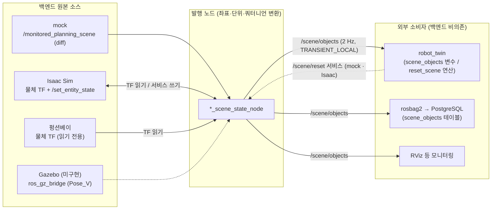
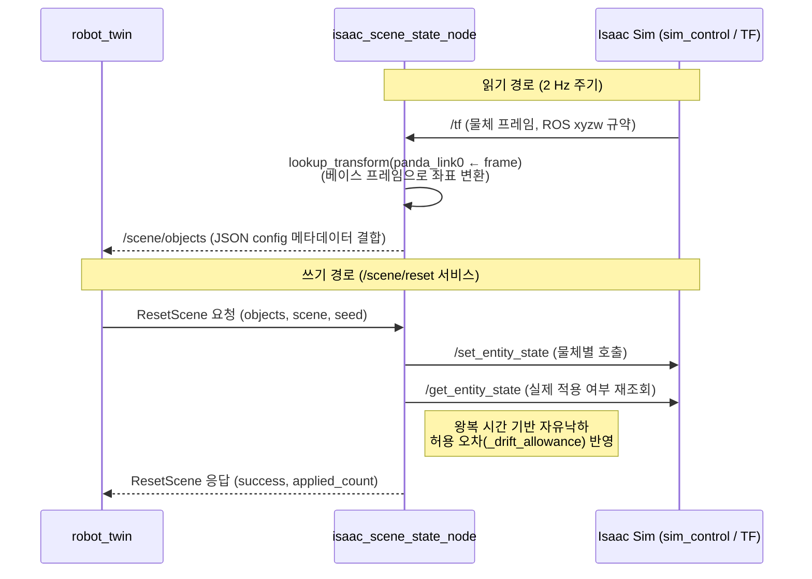

# Scene 물체 상태 계약 (`SceneObject` · `SceneObjects` · `ResetScene`)

이 문서에서 scene 은 로봇 작업 공간에 놓인 물체의 구성을 말한다. 이 문서는 scene 안 물체의 종류·크기·위치와 방향을 시뮬레이터 및 환경 구현과 무관하게 동일한 형식으로 주고받기 위한 **ROS 2 인터페이스 계약**과 **백엔드별 구현 구조**를 설명한다.

계약의 핵심은 `/scene/objects` 토픽(`rdfp_msgs/SceneObjects`)과 `/scene/reset` 서비스(`rdfp_msgs/srv/ResetScene`)다. 필드명, 단위, 기준 좌표계, 쿼터니언 성분 순서, QoS 규약까지 포함하므로, 발행자와 소비자가 이 계약만 준수하면 서로의 내부 구현에 의존하지 않고 동작할 수 있다.

> **계약 정본**: 메시지와 서비스의 필드 정의는 [`SceneObject.msg`](../../src/rdfp_msgs/msg/SceneObject.msg), [`SceneObjects.msg`](../../src/rdfp_msgs/msg/SceneObjects.msg), [`ResetScene.srv`](../../src/rdfp_msgs/srv/ResetScene.srv)를 기준으로 한다. 이 문서는 그 정의와 함께 발행 노드, Robot Twin, launch, 데이터셋 적재 과정의 동작과 제약을 설명한다.

---

## 목차

1. [개요 및 아키텍처](#1-개요-및-아키텍처)
2. [메시지 및 서비스 계약](#2-메시지-및-서비스-계약)
   - [2.1 채널 및 QoS 규약](#21-채널-및-qos-규약)
   - [2.2 `SceneObjects` — 시점별 전체 상태](#22-sceneobjects--시점별-전체-상태)
   - [2.3 `SceneObject` — 개별 물체 상태](#23-sceneobject--개별-물체-상태)
   - [2.4 `/scene/reset` (`ResetScene`) — scene 초기화 서비스](#24-scenereset-resetscene--scene-초기화-서비스)
3. [발행 대상과 MoveIt planning scene 의 관계](#3-발행-대상과-moveit-planning-scene-의-관계)
4. [백엔드별 구현 상세](#4-백엔드별-구현-상세)
   - [4.1 백엔드 비교 요약](#41-백엔드-비교-요약)
   - [4.2 공통 동작 규칙](#42-공통-동작-규칙)
   - [4.3 mock (`mock_scene_state_node`)](#43-mock-mock_scene_state_node)
   - [4.4 Isaac (`isaac_scene_state_node`)](#44-isaac-isaac_scene_state_node)
   - [4.5 펑션베이 (`functionbay_scene_state_node`)](#45-펑션베이-functionbay_scene_state_node)
5. [시스템 연동: Robot Twin · Launch · 데이터셋](#5-시스템-연동-robot-twin--launch--데이터셋)
   - [5.1 현재 물체 상태 조회 — 변수 `scene_objects`](#51-현재-물체-상태-조회--변수-scene_objects)
   - [5.2 scene 초기화와 배치 레시피 — 연산 `reset_scene`](#52-scene-초기화와-배치-레시피--연산-reset_scene)
   - [5.3 파지 목표 생성과 TCP 보정](#53-파지-목표-생성과-tcp-보정)
   - [5.4 launch 인자와 기동](#54-launch-인자와-기동)
   - [5.5 rosbag2 녹화와 DB 적재](#55-rosbag2-녹화와-db-적재)
6. [트러블슈팅 (주요 증상 및 원인)](#6-트러블슈팅-주요-증상-및-원인)
7. [파일 위치 및 참고 문서](#7-파일-위치-및-참고-문서)

---

## 1. 개요 및 아키텍처

mock(MoveIt planning scene), Isaac Sim, 펑션베이(FunctionBay), Gazebo는 내부적으로 물체를 표현하고 관리하는 방식이 서로 다르다. **백엔드별 발행 노드(`*_scene_state_node`)가 각 환경의 물체 정보를 공통 메시지 형식으로 변환**하고, 외부 소비자(Robot Twin, rosbag2, RViz 등)에는 단일 토픽과 서비스만 노출한다.



이 추상화 구조는 다음 두 가지 목적을 가진다.

1. **소비자 독립성**: 백엔드가 추가되더라도 Robot Twin과 데이터셋 적재 파이프라인은 수정할 필요가 없으며, 해당 백엔드용 발행 노드만 추가하면 된다. 좌표계, 단위, 쿼터니언 순서 변환의 책임은 전적으로 발행 노드에 있다.
2. **학습 데이터 기록**: `/scene/objects`는 rosbag2에 그대로 기록되어 학습 데이터셋의 일부가 된다. Robot Twin 전용 서비스로만 제공하면 물체 위치 이력이 데이터셋에 남지 않으므로 토픽 형태를 사용한다(`rdfp_msgs/GripperCommand`를 토픽으로 설계한 것과 같은 이유다).

---

## 2. 메시지 및 서비스 계약

### 2.1 채널 및 QoS 규약

`SceneObject` 는 물체 하나를 나타내고, `SceneObjects` 는 한 시점의 여러 물체 상태를 담는다. `/scene/objects` 토픽은 `SceneObjects` 메시지를 전달한다. 반면 scene을 변경하는 쓰기 경로는 토픽이 아니라 `/scene/reset` 서비스를 사용한다(선정 근거는 §2.4 참고).

| 채널 | 메시지/서비스 타입 | 방향 | QoS |
|---|---|---|---|
| `/scene/objects` (토픽) | `rdfp_msgs/SceneObjects` | 발행 노드 → 소비자 (기본 2 Hz) | `RELIABLE` / **`TRANSIENT_LOCAL`** / `KEEP_LAST (depth=1)` |
| `/scene/reset` (서비스) | `rdfp_msgs/srv/ResetScene` | Robot Twin → 발행 노드 | — |

#### QoS 설정 근거 및 주의사항

| QoS 항목 | 설정값 | 선정 근거 |
|---|---|---|
| **Reliability** | `RELIABLE` | 2 Hz의 저빈도 상태 채널이므로 재전송 부하가 매우 작다. 메시지가 유실되면 해당 시점의 전체 scene 스냅샷이 누락되므로 기록의 시간적 연속성을 위해 재전송을 사용한다 |
| **Durability** | `TRANSIENT_LOCAL` | 발행자가 마지막 메시지를 보관해 두었다가 **늦게 연결된 구독자에게 즉시 전달**한다. Robot Twin이나 레코더가 제어 스택보다 늦게 기동되더라도 다음 발행 주기(0.5초)를 기다리지 않고 현재 scene 상태를 바로 수신한다 |
| **History / Depth** | `KEEP_LAST` (`depth=1`) | 상태 토픽이므로 항상 최신 스냅샷만 유효하다. 과거 메시지를 누적해 전달하면 소비자가 오래된 상태를 처리하게 된다 |

> **보관된 최신 상태를 받으려면 구독 측도 `TRANSIENT_LOCAL`로 설정한다.** `TRANSIENT_LOCAL` 발행자를 `VOLATILE`로 구독해도 호환되지만, 연결 이후 새로 발행되는 메시지만 받는다. 반대로 `VOLATILE` 발행자를 `TRANSIENT_LOCAL`로 구독하면 호환되지 않는다. CLI에서 보관된 상태까지 확인하려면 다음 옵션을 지정한다.
>
> ```bash
> ros2 topic echo /scene/objects --qos-durability transient_local
> ```

호환성은 [ROS 2 공식 QoS 문서](https://github.com/ros2/ros2_documentation/blob/humble/source/Concepts/Intermediate/About-Quality-of-Service-Settings.rst)의 durability 표를 따른다. `SceneObjects.msg` 주석에 남아 있는 “volatile로 구독하면 매칭되지 않는다”는 설명은 잘못된 설명이다.

---

### 2.2 `SceneObjects` — 시점별 전체 상태

```text
std_msgs/Header  header
SceneObject[]    objects
```

- **`header.stamp` (필수)**: 노드가 사용하는 ROS 시계로 발행 시각을 기록한다. 적재는 이 값(`dataset/db/writers/base.py` 의 `extract_stamp`)으로 메시지를 에피소드 시간 구간에 배정한다(`ingest/episode/dispatcher.py`). 값을 설정하지 않으면 기본값 0 이 쓰인다. 메시지의 타임스탬프가 에피소드의 `[시작, 종료)` 구간 밖에 있으면 적재 대상에서 제외된다. 로봇 제어 자체는 정상 동작하므로 데이터를 열어보기 전까지 누락을 알아차리기 어렵다.
- **`header.frame_id` (로봇 베이스 프레임)**: 현재 스택에서는 `panda_link0`을 사용한다. Gazebo의 world 프레임처럼 로봇 베이스와 다른 좌표계를 쓰는 환경에서는 **발행 노드가 반드시 베이스 프레임으로 변환**해야 한다. DB의 `scene_objects` 테이블이 다른 테이블과 달리 `frame_id` 컬럼을 함께 저장하는 이유도, 좌표 변환 누락으로 인한 데이터셋 오염을 사후에 식별할 수 있게 하기 위함이다.
- **`objects` (빈 배열 허용)**: 빈 배열 `[]` 은 유효한 메시지이며 메시지 미수신 상태와 구분된다. 다만 현재 구현은 조회에 실패한 물체를 빼고 발행하므로(§4.2), 모든 물체의 TF 조회가 실패해도 빈 배열이 나간다. 따라서 빈 배열만으로 실제 scene 에 물체가 없다고 판단하면 안 된다.

---

### 2.3 `SceneObject` — 개별 물체 상태

```text
string              name
string              type
float64[]           dimensions
geometry_msgs/Pose  pose
```

`geometry_msgs/PoseArray` 대신 별도 구조체 배열을 정의한 이유는 물체별 식별자(`name`), 형상 종류(`type`), 크기(`dimensions`)를 함께 전달해야 하기 때문이다.

#### 필드별 상세 규약

1. **`name` (`string`)**
   - `SceneObjects.objects` 배열 내 **원소 순서는 보장되지 않는다.** 따라서 소비자는 배열 인덱스가 아니라 반드시 `name`으로 물체를 식별해야 한다.
   - `name` 은 빈 문자열일 수 없으며, 하나의 `SceneObjects.objects` 배열 안에서 고유해야 한다. 빈 이름이나 중복 이름이 있으면 Robot Twin 의 맵 변환이 실패한다(조용히 덮어쓰면 물체 하나가 사라지므로 오류로 드러낸다).
   - 백엔드가 달라지더라도 동일 물체는 같은 이름을 유지해야 한다. Robot Twin이 `projection: scene_object_map`을 통해 배열을 `{이름: {...}}` 형태의 맵으로 변환해 노출하는 것도 인덱스 의존성을 없애기 위해서다(§5.1).

2. **`type` (`string`)**
   - `shape_msgs/SolidPrimitive`의 형상 이름을 **소문자**로 사용하거나 `'mesh'`를 지정한다(`'box'`, `'sphere'`, `'cylinder'`, `'cone'`, `'prism'`, `'mesh'`).
   - `'prism'` 은 타입 매핑에는 있으나, 밑면 다각형(`SolidPrimitive.polygon`)을 실을 필드가 이 메시지에 없어 형상을 완전하게 표현하거나 복원할 수 없다. 사실상 쓰지 않는다.
   - `uint8` 상수 대신 문자열을 채택한 이유는 두 가지다. 첫째, Robot Twin의 `enums` 변환기가 최상위 필드만 처리하므로 배열 내부에 중첩된 정수 필드는 숫자 그대로 노출된다. 둘째, rosbag2와 DB에 그대로 기록되므로 문자열이 데이터셋 가독성 측면에서 유리하다.

3. **`dimensions` (`float64[]`)**
   - 단위는 **미터(m)**이며, 배열 길이와 각 원소의 의미는 `shape_msgs/SolidPrimitive` 표준 순서를 그대로 따른다.

   | `type` | 배열 길이 | 원소 의미 (순서 주의) |
   |---|:-:|---|
   | `box` | 3 | `[x, y, z]` |
   | `sphere` | 1 | `[반지름]` |
   | `cylinder` | 2 | **`[높이, 반지름]`** |
   | `cone` | 2 | `[높이, 반지름]` |
   | `prism` | 1 | `[높이]` — 밑면 다각형은 전달되지 않는다 |
   | `mesh` | 0 | `[]` (비어 있음) |

   > ⚠️ **`cylinder` 순서 주의**: `SolidPrimitive` 표준(`CYLINDER_HEIGHT=0`, `CYLINDER_RADIUS=1`)에 따라 치수는 **`[높이, 반지름]`** 순서로 지정한다. 설정 파일이나 노드를 작성할 때 두 값의 순서를 확인한다.
   >
   > ROS 표준 순서를 그대로 따르는 이유는 mock 백엔드가 planning scene의 `SolidPrimitive` 데이터를 별도 재배열 없이 직접 복사할 수 있게 하기 위함이다. 또한 `type`마다 `dimensions` 배열 길이가 달라지는 비정형(ragged) 구조 때문에, ROS IDL에서 `JointState` 방식의 병렬 배열(`string[] name` + `Pose[] pose` + ...)을 사용할 수 없어 구조체 배열을 채택했다.

4. **`pose` (`geometry_msgs/Pose`)**
   - 위치(`position`) 단위는 **미터(m)** 다. 방향(`orientation`)은 노름이 1인 단위 쿼터니언으로 표현하며, 성분 순서는 **ROS 표준 `xyzw`** 다.
   - ⚠️ **Isaac Sim의 `wxyz` 순서 주의**: Isaac Sim은 스칼라 우선(`wxyz`) 순서를 사용하므로 원본 값을 직접 읽는 어댑터는 ROS 메시지에 넣을 때 성분 순서를 맞춰야 한다. 현재 TF 기반 노드는 이미 ROS 규약으로 발행된 값을 받으므로 성분을 다시 재배열하지 않는다(§4.4). 성분 순서가 뒤바뀌어도 4개 실수값의 노름(norm)은 여전히 1이므로 타입 검사나 정규화 검사를 모두 통과하며, 오류 없이 **겉보기에는 유효하지만 실제로는 잘못된 회전 자세**로 처리된다. 예를 들어 회전 없음 `(w,x,y,z)=(1,0,0,0)`을 그대로 `(x,y,z,w)`로 해석하면 x축 180° 회전이 되어, 시뮬레이션이나 로그상에서 즉시 오류로 드러나지 않는다.
   - 따라서 노름 검사만으로는 부족하고 **알려진 기준 회전**(회전 없음 → `(0,0,0,1)`, 비대칭 회전 예: z축 90° 등)에 대한 검증을 함께 한다. 비교할 때는 `q` 와 `-q` 를 같은 회전으로 취급해야 하므로(§4.5) 성분별로 직접 비교하지 말고 단위 쿼터니언 내적의 절댓값이나 회전 행렬로 비교한다(Isaac 노드의 리셋 검증이 내적의 절댓값을 쓴다).

---

### 2.4 `/scene/reset` (`ResetScene`) — scene 초기화 서비스

```text
# 요청
SceneObject[] objects     # 새로 배치할 물체 (mock: 전체 목록, 빈 배열은 'scene 비우기')
string        scene       # 레시피 이름 (기록·진단용)
int64         seed        # 무작위 추출 seed (기록·진단용)
---
# 응답
bool   success            # 적용 성공 여부 (실패 시 message에 사유 기록)
string message
int32  applied_count      # 성공 시 요청 물체 수. 실패 시 0 (일부가 이미 옮겨졌을 수 있다)
```

- **백엔드별 동작 차이**: `mock` 은 planning scene 의 **world 물체 목록**을 요청한 목록으로 교체한다(로봇 상태 등 다른 부분은 건드리지 않는다). `Isaac` 은 스테이지(`setup_scene.py`)에 이미 있는 물체의 위치와 방향을 바꾸고 속도를 0 으로 초기화한다. 물체를 만들거나 지우지 않고 형상·치수도 바꾸지 않으므로, 빈 배열, 모르는 이름, `isaac_scene.json` 과 다른 형상·치수는 거부한다. 요청에 없는 물체는 그 자리에 그대로 둔다. 이름·형상 검사는 모든 물체를 먼저 보지만 이동은 물체마다 차례로 하므로, **중간에 실패하면 이미 옮긴 물체를 되돌리지 않는다** — 실패 응답의 `applied_count` 는 0 이어도 일부 물체가 이미 움직였을 수 있다(자세한 내용은 [isaac_scene_reset.md](../backends/isaac/isaac_scene_reset.md) 참고). `펑션베이`는 이 서비스를 제공하지 않는다(§4.5).

#### 설계 근거 요약

| 설계 질문 | 채택 방식 및 이유 |
|---|---|
| **왜 토픽이 아닌 서비스인가?** | scene 초기화는 호출자가 성공 여부를 즉시 확인하고 다음 단계로 넘어가야 하는 동기적 요청–응답 연산이다. 또한 학습 데이터셋에 기록되어야 하는 값은 명령("어디에 놓으라")이 아니라 **관측된 상태(`/scene/objects`)**이므로, 서비스 응답이 rosbag2에 남지 않아도 문제가 되지 않는다 (`session_control_node`의 서비스 제어 + `/session` 상태 토픽 구조와 동일하다) |
| **배치 출처는 어떻게 추적하는가?** | Robot Twin이 `reset_scene` 호출 결과(`outputs.objects`)를 반환하고, 호출자(`robot-twin-collect`)가 이를 `stop_episode`의 에피소드 메타데이터로 기록한다. 추출 알고리즘이 변경되면 같은 `seed`라도 다른 배치가 나오므로 재현성의 근거는 `seed`가 아닌 `objects`이며, `seed`는 실행 식별용 보조 정보다 |
| **왜 개별 추가/삭제를 두지 않는가?** | 개별 조작 API를 열면 배치 조합 로직이 클라이언트로 분산되어 초기 배치 상태가 데이터셋 메타데이터 외부에 남게 된다. 따라서 레시피 단위의 리셋 연산 하나만 제공한다 (목록 전체를 교체하는 것은 mock 이고, Isaac 은 요청한 물체만 옮긴다) |
| **왜 노드가 무작위 추출을 하지 않는가?** | 무작위 추출은 Robot Twin([`backends.py`](../../src/robot_twin/robot_twin/backends.py))이 담당하고 서비스에는 확정된 `objects`만 전달한다. 발행 노드가 직접 추출하면 동일 `seed`로도 백엔드마다 다른 배치가 생성될 수 있고, 트윈이 실제 명령한 배치를 알 수 없어 메타데이터 기록이 불가능해진다 |

---

## 3. 발행 대상과 MoveIt planning scene 의 관계

### 조작 대상(Dynamic Object)만 발행한다

`/scene/objects`에는 **로봇이 조작할 대상 물체만** 포함하며, 탁자나 펜스 같은 정적 환경 물체는 발행하지 않는다.

- **필터링 방식**: Isaac은 `isaac_scene.json`에서 `dynamic: true` 항목만 발행한다. mock 노드는 planning scene 의 world 물체를 구분 없이 발행하며, 조작 대상만 나가는 것은 현재 mock 구성의 레시피가 조작 대상만 등록하기 때문이다 — 나중에 탁자를 planning scene 에 넣으면 탁자도 `/scene/objects` 에 실린다. 펑션베이는 시뮬레이터 자체가 `static="false"`인 body만 TF로 출력한다. (구멍·트레이 같은 고정물은 별도의 `scene.fixtures_file`에서 관리하며 Robot Twin의 `fixtures` 변수로 제공한다.)
- **탁자의 물리적 존재**: 발행 목록에서 제외될 뿐, 시뮬레이터 내부(예: Isaac `setup_scene.py`)에는 탁자 prim이 정상적으로 생성되어 물체를 지지한다.

### `/scene/objects` 를 planning scene 으로 동기화하지 않는다

Isaac · 펑션베이 같은 물리 백엔드에서 관측한 물체 상태를 MoveIt planning scene 에 옮기는 노드는 두지 않는다. (mock 은 방향이 반대다 — planning scene 이 원본이고, 노드는 그것을 읽어 발행하며, mock 의 `/scene/reset` 은 planning scene 의 world 물체를 바꾼다.) 조작 대상을 planning scene에 등록하면 **파지 자세가 충돌 상태로 판정되어** 관절공간 계획이 `INVALID_MOTION_PLAN`(-2)으로 거부되기 때문이다.

> ⚠️ **수용된 위험 — 관절공간 이동 중 탁자 관통 가능성**
>
> 환경 물체(탁자 등)를 planning scene에 넣지 않으므로 `move_to_named_target` / `move_to_joints` 같은 관절공간 이동 시 팔이 탁자 영역을 통과해 손가락이 상판에 걸릴 수 있다(실측 시 그리퍼 고장처럼 보일 수 있음). 이는 설계 단순성을 위해 의도적으로 수용한 제한사항이다.
> - **자기충돌(self-collision) 검사**는 SRDF ACM을 통해 정상 동작한다.
> - **파지 동작(접근·하강·상승)**은 `GetCartesianPath`를 사용하며 `avoid_collisions` 기본값이 `False`이므로 planning scene 유무와 무관하다.

탁자 회피가 필요할 때 검토할 대안은 다음과 같다. 아래 항목은 현재 구현이 아닌 설계 대안이다.

| 대안 | 적용 방식 및 판단 근거 |
|---|---|
| 안전한 경유 자세 | SRDF `group_state`에 경유 자세를 정의해 이동 경로를 구성한다 |
| **탁자만 정적 등록** | launch 시점에 탁자를 상자 하나로 planning scene에 등록한다. `/scene/objects` 계약을 바꾸지 않고 환경 설정으로 다룰 수 있어 현재 설계에 가장 잘 맞는다 |
| 작업공간 제약 | `PositionConstraint`로 작업공간 z 하한을 제한하는 방안을 검토한다 |

### 자동 라벨링 시 지지면 정보 활용

`/scene/objects`에 탁자 정보가 없으므로, 데이터만으로 "블록이 탁자 위에 놓였는가"를 판정하려면 지지면 치수·높이를 외부 설정에서 참조해야 한다. 지지면 정보가 바뀌어 라벨이 어긋나는 문제를 피하려면 에피소드 시작 시 `sessions.metadata`(JSONB)에 초기 배치 및 지지면 정보를 함께 기록하는 방식을 고려할 수 있다.

---

## 4. 백엔드별 구현 상세

### 4.1 백엔드 비교 요약

| 항목 | mock | Isaac Sim | 펑션베이 (FunctionBay) | Gazebo (미구현) |
|---|---|---|---|---|
| **발행 노드** | `mock_scene_state_node` | `isaac_scene_state_node` | `functionbay_scene_state_node` | `gazebo_scene_state_node` |
| **상태 원천** | `/monitored_planning_scene` (diff) | `/tf` (`ROS2PublishTransformTree`) | `/tf` (시뮬레이터 ~29 Hz) | `ros_gz_bridge` (`Pose_V`) 예정 |
| **좌표 변환** | 2단계 합성 (`pose_math.py`) | `tf2` `lookup_transform` | `tf2` `lookup_transform` | 예정 |
| **쿼터니언** | ROS `xyzw` | TF 경유 시 `xyzw` (원본은 `wxyz`) | ROS `xyzw` (**`w < 0` 주의**) | 예정 |
| **메타데이터 파일** | 없음 (`/scene/reset`으로 전달) | `config/isaac_scene.json` (생성·읽기 겸용) | `config/functionbay_scene.json` (**읽기 전용**) | 예정 |
| **`/scene/reset` 지원** | ✅ (world 물체 목록 교체) | ✅ (`/set_entity_state` + 읽기 검증) | ❌ (**미제공** — 고정 배치) | 예정 |
| **물리 시뮬레이션** | ❌ (연동·기록 경로 검증용) | ✅ | ✅ | ✅ |

### 4.2 공통 동작 규칙

1. **이벤트 구독 + 주기 발행(기본 2 Hz)**: 물리 시뮬레이터는 물체가 연속적으로 움직이므로 주기 발행이 적합하다. 백엔드들이 같은 기본 주기를 사용하면 Robot Twin의 `staleness_ms` 기준을 공유하기 쉽다. 이벤트만 발행하면 물체가 정지한 정상 상태와 발행 중단을 구분하기 어려우므로 mock도 주기적으로 전체 상태를 발행한다. 발행 중단은 `staleness_ms`(현재 1000 ms)를 넘기면 `STALE`로 판정한다. `STALE` 은 `/scene/objects` **메시지 수신**이 끊긴 것만 감지한다 — Isaac·펑션베이 노드는 최신 TF 를 조회해 현재 ROS 시각으로 `header.stamp` 를 채워 발행할 뿐 TF 변환 자체의 타임스탬프 경과 시간은 검사하지 않으므로, `STALE` 이 아니더라도 실제 물체 관측값은 오래된 상태일 수 있다. 2 Hz는 `scene_publish_rate`로 조정 가능한 기본값이며, 주기를 바꿀 때는 stale 기준도 함께 검토한다.
2. **물체별 오류 처리**: 특정 물체의 정보를 변환하거나 조회하지 못하면(기하 정보 누락, TF 조회 실패) 그 물체를 발행 목록에서 빼고 경고 로그를 남긴 뒤 나머지 물체의 상태를 발행한다.
3. **읽기/쓰기 비대칭**: 발행 방향(`/scene/objects`)은 `type: 'mesh'`(`dimensions: []`)를 허용한다. 쓰기 방향은 백엔드마다 다르다 — mock 의 `/scene/reset` 은 primitive 변환만 지원하므로 `mesh` 를 `unsupported type 'mesh'` 오류로 거부하고, Isaac 은 설정에 등록된 기존 물체를 옮기며 요청의 형상·치수를 설정값과 비교한다. 어느 경우에도 이 메시지로 새 메시 기하를 만들 수는 없다 — 메시 경로/URI나 정점 데이터를 실을 필드가 없기 때문이다.

### 4.3 mock (`mock_scene_state_node`)

MoveIt planning scene을 원본으로 사용한다([`mock_scene_state_node.py`](../../src/robot_control/robot_control/scene/mock_scene_state_node.py)).

- **diff 누적 방식**: `/get_planning_scene` 서비스 폴링은 물체가 존재하는 상태에서도 간헐적으로 빈 world를 반환하는 불안정성이 관측되어 사용하지 않는다. 대신 `/monitored_planning_scene` 토픽(`is_diff=True`)을 구독해 노드가 내부적으로 전체 물체 상태를 누적 관리한다.
- **구독 QoS 차이 주의**: `move_group`이 `/monitored_planning_scene`을 **`VOLATILE`**로 발행하므로, 이 노드의 구독 QoS도 `VOLATILE`이어야 한다. 발행 측(`/scene/objects`)의 `TRANSIENT_LOCAL`과 혼동해 구독 측을 `TRANSIENT_LOCAL`로 설정하면 메시지를 한 건도 수신하지 못한다.
- **2단계 좌표 합성**: planning scene 물체의 베이스 기준 기하 pose 는 세 변환을 두 번 합성해 얻는다 — 먼저 `CollisionObject.pose ∘ primitive_poses[0]` 로 물체 헤더 프레임 기준 pose 를 만들고, 그다음 TF(`base ← header.frame_id`)를 적용한다. 즉 `TF(base ← header.frame_id) ∘ CollisionObject.pose ∘ primitive_poses[0]` 이다. 배포판별 `tf2_geometry_msgs` 시그니처 차이를 피하고 ROS 없이 단위 테스트를 수행하기 위해 순수 Python 모듈([`pose_math.py`](../../src/robot_control/robot_control/scene/pose_math.py))에서 합성을 수행한다.
- **다중 기하 처리**: 하나의 `CollisionObject`에 primitive가 여러 개 들어 있으면 첫 번째 primitive만 발행하고 경고를 남긴다. primitive 없이 mesh만 있으면 `type: 'mesh'`, `dimensions: []`로 발행한다.
- **한계**: planning scene 물체는 물리가 적용되지 않아 파지 실패나 낙하에도 pose가 변하지 않는다. 따라서 mock 데이터는 학습용 성패 판정이 아니라 **시스템 연동과 데이터 기록 경로의 검증용**으로만 사용한다.

> **서비스 폴링을 제외한 관측 근거**: 기존 조사에서는 물체가 있는 상태에서 `/get_planning_scene`을 1초 간격으로 10회 조회했을 때 world 물체 수가 `[3,0,0,0,0,0,3,3,3,0]`으로 나타났다. 요청 컴포넌트 마스크 변경, 다른 조회자 제거, RViz 종료 후에도 같은 현상이 관측되어 토픽의 diff를 누적하는 방식을 선택했다. 이는 당시 환경의 관측이며, MoveIt 서비스의 일반적인 보장이나 확정된 내부 원인으로 해석하지 않는다.

### 4.4 Isaac (`isaac_scene_state_node`)

`panda_isaac.launch.py`가 실행하는 노드다([`isaac/scene_state_node.py`](../../src/robot_control/robot_control/isaac/scene_state_node.py)).



- **TF 경유 변환**: Isaac의 `ROS2PublishTransformTree`가 내보내는 `/tf`를 `lookup_transform`으로 조회해 `panda_link0` 기준 pose를 얻는다. ROS TF 메시지에는 이미 ROS 규약의 쿼터니언이 들어 있다. `lookup_transform`은 프레임 간 변환을 구하며, Isaac 원본 배열의 `wxyz` 순서를 판별하거나 교정하는 함수가 아니다. 노드는 조회 결과의 `transform.transform.rotation`을 `obj.pose.orientation`에 그대로 대입한다. 따라서 이 경로에 수동 성분 재배열을 추가하지 않는다.
- **단일 메타데이터 소스**: TF에는 물체 이름·종류·치수가 포함되지 않으므로, 시뮬레이터 스테이지 생성 스크립트(`setup_scene.py`)와 동일한 [`config/isaac_scene.json`](../../src/robot_control/config/isaac_scene.json)을 읽어 속성을 채운다.
- **쓰기 검증 및 환경 의존성**: Isaac의 `isaacsim.ros2.sim_control` 확장이 제공하는 `/set_entity_state`를 호출한 뒤, rigid body가 아닌 prim에서 성공 응답을 내고도 위치가 변하지 않는 문제를 막기 위해 `/get_entity_state`로 실제 위치를 재조회해 검증한다(시뮬레이션 재생 중 자유낙하 시간 오차 `_drift_allowance` 반영). 만약 `ros-humble-simulation-interfaces` 패키지가 설치되지 않은 환경이라면 읽기(`/scene/objects`)만 유지하고 `/scene/reset` 서비스는 열지 않는다.

### 4.5 펑션베이 (`functionbay_scene_state_node`)

`panda_functionbay.launch.py`가 `create_functionbay_scene_node()`로 실행하는 노드다([`functionbay/scene_state_node.py`](../../src/robot_control/robot_control/functionbay/scene_state_node.py)).

- **TF 기반 읽기 전용 경로**: 시뮬레이터가 `static="false"`인 body(현재 씬 기준 `peg_round_16` → 계약 이름 `peg`)의 TF를 약 29 Hz로 발행하며, 노드가 이를 조회해 `/scene/objects`로 변환한다. 시뮬레이터가 이미 ROS 규약(`xyzw`)으로 쿼터니언을 발행하므로 별도 성분 변환을 하지 않는다.
- **음수 `w` 쿼터니언 주의**: 실측 시 항등 회전이 `(0, 0, 0, -1)`로 수신되는 경우가 있다. 수학적으로 $q$와 $-q$는 동일한 회전이지만, `w >= 0`을 가정하거나 성분을 단순 비교해 항등 여부를 판정하는 코드는 오작동할 수 있으므로 주의한다.
- **`functionbay_scene.json`의 성격**: [`config/functionbay_scene.json`](../../src/robot_control/config/functionbay_scene.json)은 시뮬레이터 XML(`t1__floating_*_vm.xml`)을 수정하는 파일이 아니라 TF에 없는 이름·종류·치수만 보충하는 **읽기 전용 메타데이터**다. 물체의 실제 초기 배치를 바꾸려면 시뮬레이터 XML의 `<origin xyz rpy>`를 수정하고 시뮬레이션을 재시작해야 한다.
- **치수 기준**: `peg` 치수는 `peg_round_16mm.obj` 경계 상자(지름 16.0 mm, 높이 50.0 mm)에서 산출했으며 `type: 'cylinder'`, `dimensions: [0.05, 0.008]`(높이 우선)을 사용한다.
- **⚠️ `/scene/reset` 미제공**: 시뮬레이터에 런타임으로 물체 pose를 변경하는 API가 없으므로 서비스 서버를 열지 않는다. 따라서 펑션베이 트윈(`rdfp01`)에서 `reset_scene`은 지원되지 않으며, 매 에피소드 동일한 초기 배치로 수집하는 것을 전제로 한다.

---

## 5. 시스템 연동: Robot Twin · Launch · 데이터셋

### 5.1 현재 물체 상태 조회 — 변수 `scene_objects`

Robot Twin REST API 는 물체 배열을 **물체 이름이 키인 JSON 객체**로 변환해 반환한다. 이 변환에는 `projection: scene_object_map` 을 사용한다.

```jsonc
{
  "header": {
    "stamp": { "sec": 1786944345, "nanosec": 868439364 },
    "frame_id": "panda_link0"
  },
  "objects": {
    "cube_0": {
      "type": "box",
      "dimensions": [0.05, 0.05, 0.05],
      "pose": {
        "position":    { "x": 0.382, "y": -0.135, "z": 0.025 },
        "orientation": { "x": 0.0, "y": 0.0, "z": 0.0, "w": 1.0 }
      }
    }
  }
}
```

- `staleness_ms: 1000`: 기본 2 Hz(0.5초 간격)로 발행되므로 1초 이상 새 메시지가 없으면 `STALE` 상태로 판정한다. 메시지 수신 기준이므로 원본 TF 의 최신성까지 보장하지는 않는다(§4.2). 물체를 파지하기 전에는 고정 좌표가 아니라 반드시 이 변수에서 현재 좌표를 조회해야 한다.

### 5.2 scene 초기화와 배치 레시피 — 연산 `reset_scene`

`mock01` · `panda01` 트윈에만 있다(펑션베이 트윈 `rdfp01` 에는 없다 — §4.5).

| 속성 | 설정값 및 설명 |
|---|---|
| `kind` | `sync` (`sync_timeout_sec: 10.0`) |
| `resource` | **`[scene, arm]`** — 팔이 이동 중이면 `409 RESOURCE_BUSY` 반환 |
| 입력 | `scene` (필수, 레시피 이름), `seed` (선택, 정수) |
| 출력 | `scene`, `seed`, `objects` (명령한 배치: `position`, `orientation`, `yaw_deg`), `applied_count` |
| 백엔드 | ROS 서비스 `/scene/reset` (`rdfp_msgs/srv/ResetScene`) |

- **자원 락에 `arm`을 포함한 이유**: `scene`만 잠그면 리셋 실행 중에 팔이 작업 공간으로 진입할 수 있다. “팔이 멈춰 있는지”를 사전조건으로 검사하는 방식도 검사와 자원 점유 사이에 팔이 움직일 수 있는 TOCTOU 경쟁 조건을 남긴다. 따라서 리셋이 `scene`과 `arm`을 함께 점유하도록 한다.
- **레시피 무작위 추출**: [`backends.py`](../../src/robot_twin/robot_twin/backends.py)의 `_sample_scene`이 `random.Random(seed)`로 값을 추출한다. 각 축의 좌표는 고정값 또는 `[최솟값, 최댓값]` 범위로 지정하며, 범위를 지정하면 그 구간의 균등분포에서 값을 추출한다. `yaw`(도 단위, z축 회전)도 같은 규칙을 따르며, 생략하면 회전 없음 `(0,0,0,1)`을 사용한다.

다음은 트윈의 `reset_scene` 설정에 들어가는 `scenes` 부분의 예제다. 전체 설정에서의 위치는 [`mock01.yaml`](../../src/robot_twin/config/twins/mock01.yaml)을 참고한다.

```yaml
scenes:
  one_cube:
    objects:
      - name: cube_0
        type: box
        size: [0.05, 0.05, 0.05]   # 메시지의 dimensions로 전달 (m)
        x: [0.35, 0.55]            # 범위에서 균등 추출 (m)
        y: [-0.15, 0.15]
        z: 0.025                   # 고정값 (m)
        yaw: [0, 90]               # z축 회전 범위 (도); 생략 시 회전 없음
```

현재 배치 레시피는 물체 위쪽에서 접근하는 파지 동작을 전제로 하므로 yaw 회전만 지정하고 roll 과 pitch 는 지정하지 않는다. 정육면체는 회전 대칭을 고려해 `[0, 90]`으로 범위를 잡고, 축대칭인 실린더는 yaw를 생략할 수 있다. 이는 레시피 작성 기준이며 샘플러가 대칭 범위를 자동으로 제한한다는 뜻은 아니다.

`reset_scene`의 `outputs.objects`는 **명령한 초기 배치**다. 물리 시뮬레이터에서 물체가 굴러가거나 미끄러진 뒤의 실제 위치는 `/scene/objects`에서 읽는다. 재현을 위해 초기 배치를 에피소드 메타데이터에 남기고, 학습·판정에는 관측 상태를 사용한다.

### 5.3 파지 목표 생성과 TCP 보정

**`grasp_pose_of_object`**: `pick_n_place`나 MCP 클라이언트는 `scene_objects`의 물체 정보를 받아 **물체 위쪽에서 접근해 물체 중심을 파지하는 목표 자세**를 계산한다. 정육면체(대칭 주기 90°)처럼 회전된 물체는 모서리를 집지 않도록 대칭 범위(최대 ±45°) 내에서 손목 yaw를 물체 yaw에 맞춘다. 반환 좌표는 손끝(TCP) 기준이다. 팔에 넘길 때의 변환은 경로마다 다르다.

- **Panda Hand 를 쓰는 mock·Isaac 트윈에 `move_linear` 목표를 직접 전달할 때**는 `to_arm_command()`로 `panda_link8` 기준(손끝보다 약 10.3 cm 위)으로 변환한다.
- **MCP 이동 도구**처럼 내부에서 변환하는 경로에는 변환 전(손끝 기준) 목표를 전달한다. MCP 서버는 트윈의 `move_linear` 에 `frame` 입력이 있는지로 변환 여부를 고른다.
- **펑션베이**처럼 트윈이 기준 프레임 변환을 자체적으로 처리하는 환경에서는 이 보정을 적용하지 않는다. 중복 변환이 적용되면 목표 높이가 10.3 cm 더 낮게 설정된다.

예를 들어 한 변이 5 cm인 큐브의 중심(`z=0.025 m`)을 손끝(TCP) 목표 높이로 삼아, 아래를 향한 파지 자세에서 보정 없이 `panda_link8` 목표 높이로 전달하면 손끝의 목표 높이는 약 `0.025 - 0.103 = -0.078 m`가 되어 바닥면 아래로 설정된다. 그래서 mock·Isaac 에 직접 전달할 때는 TCP 기준 목표를 `to_arm_command()`로 변환한 뒤 전달한다.

### 5.4 launch 인자와 기동

launch 헬퍼([`launch_helpers/scene.py`](../../src/robot_control/robot_control/launch_helpers/scene.py))는 모든 백엔드에서 동일한 인자 이름을 사용한다.

| launch 인자 | 기본값 | 설명 |
|---|---|---|
| `enable_scene` | `true` | 백엔드 scene 상태 노드 기동 여부 (`panda_mock`, `panda_mock_jgpc`, `panda_isaac`, `panda_functionbay` 모두 기본 활성화) |
| `scene_publish_rate` | `2.0` | `/scene/objects` 발행 빈도(Hz). 기본값 2.0 Hz 는 발행 간격 0.5초다 |

- **기본 활성화(`true`) 이유**: scene 노드는 기본 2 Hz 로 상태를 발행하며, 리셋 요청이 없으면 물체 배치를 바꾸지 않는다. 기본 활성화는 상태 기록 누락을 막고, mock·Isaac 에서 리셋 서비스를 쓸 수 있게 하기 위한 설정이다. 끄면 트윈의 `reset_scene` 은 `scene reset service ... is not available` 로 실패한다.
- **인자 이름 및 전제**: EE pose 헬퍼가 이미 `publish_rate`(50 Hz) 인자를 사용하므로 이름 충돌을 피하기 위해 `scene_publish_rate`를 사용한다. 기준 프레임(`base_frame`)은 EE pose와 반드시 일치해야 하므로 별도 인자로 재선언하지 않고 기존 `base_frame` 인자를 공유한다.
- **기동 순서 및 replay 제외**: 생성자가 `wait_for_service`를 호출하지 않으므로 `move_group`과 동시에 기동해도 안전하다. 초기에는 빈 목록을 발행하다가 상태가 수신되면 채워질 수 있다. `replay` 계열 launch에서는 DB에 저장된 과거 물체 상태를 재생하므로 라이브 scene 노드를 띄우지 않는다. 함께 띄우면 `/scene/objects`에 현재 상태와 과거 상태라는 두 출처가 섞인다.
- **확장 규칙**: 새 백엔드를 추가할 때는 `create_mock_scene_node()`를 수정하지 않고, `create_functionbay_scene_node()`처럼 기존 함수와 같은 launch 인자를 사용하는 백엔드별 노드 생성 함수를 추가한다.

### 5.5 rosbag2 녹화와 DB 적재

`/scene/objects`는 [`config/recording_topics.list`](../../config/recording_topics.list)에 포함되어 rosbag2로 녹화되며 PostgreSQL `scene_objects` 테이블에 적재된다.

- **저장 구조**: 메시지 1건을 DB 1행으로 저장하고, 물체 목록은 `objects` JSONB 컬럼에 저장한다. 이 구조는 메시지 단위의 읽기·쓰기 방식(reader 계약: 1행 = 1메시지)을 유지하고, 형상마다 길이가 다른 `dimensions` 를 공통 구조로 저장하기 위한 선택이다.
- **저장 형식은 REST 응답과 다르다**: DB 에서는 각 물체의 위치를 `position: [x, y, z]`, 방향을 `orientation: [x, y, z, w]` 배열로 저장한다(`pose` 객체로 감싸지 않는다 — [`writers/scene_objects.py`](../../src/rdfp/rdfp/dataset/db/writers/scene_objects.py)).

```sql
SELECT o->>'name' AS name, (o->'position'->>0)::float8 AS x
FROM scene_objects s, jsonb_array_elements(s.objects) o
WHERE s.episode_id = %s AND s.object_count > 0
ORDER BY s.stamp_ts DESC;
```

> `/scene/objects`를 학습 모델의 관측 입력(`observation`)으로 포함할지 여부는 미결 사항이다 → [scene_objects_observation_decision.md](../learning/scene_objects_observation_decision.md)

---

## 6. 트러블슈팅 (주요 증상 및 원인)

| 증상 | 원인 및 해결 방법 |
|---|---|
| 토픽은 보이지만 메시지가 한 건도 수신되지 않음 | QoS 호환성을 확인한다. 예를 들어 mock의 원본 토픽처럼 `VOLATILE`로 발행하는 토픽을 `TRANSIENT_LOCAL`로 구독하면 매칭되지 않는다. 반대 조합은 새 메시지를 수신한다 (§2.1, §4.3) |
| 물체 데이터가 DB의 어느 에피소드에도 속하지 않음 | `header.stamp` 가 에피소드 구간 밖이다. 채우지 않아 기본값 0 이 들어간 경우가 대표적이다 (§2.2) |
| 백엔드마다 물체 좌표계가 다르게 나옴 | 발행 노드에서 로봇 베이스 프레임(`panda_link0`) 변환 누락 (§2.2) |
| 자세가 겉보기엔 유효하나 실제로는 엉뚱한 방향임 | 쿼터니언 `wxyz` ↔ `xyzw` 순서 혼동. norm 검사로 걸러지지 않으므로 기준 회전(예: 항등 `(0,0,0,1)`)으로 검증한다 (§2.3) |
| `cylinder`의 높이와 반지름이 뒤바뀜 | `dimensions` 순서는 `[높이, 반지름]`이다 (§2.3) |
| mock에서 내부 오프셋을 가진 물체 위치만 어긋남 | `CollisionObject.pose` 나 `primitive_poses[0]` 합성 누락 (§4.3) |
| `reset_scene` 호출 시 `service is not available`로 즉시 실패 | `enable_scene:=false`로 실행했거나, Isaac 환경에서 `ros-humble-simulation-interfaces` 패키지가 누락됨 (§4.4, §5.4) |
| 펑션베이 트윈(`rdfp01`)에서 `reset_scene` 연산이 없음 | 펑션베이 시뮬레이터에 런타임 배치 API가 없어 의도적으로 미제공 (§4.5) |
| 회전된 정육면체를 잡을 때 파지 실패 | 손목 yaw를 물체 yaw에 맞추지 않음. `grasp_pose_of_object` 사용 (§5.3) |
| `reset_scene`이 `409 RESOURCE_BUSY` 반환 | `reset_scene`은 `[scene, arm]` 자원을 함께 잠그므로 팔 이동 중에는 거부됨 (§5.2) |
| scene 상태가 갱신되지 않고 멈춤 (`STALE`) | `staleness_ms`를 넘도록 새 메시지를 받지 못한 상태다. 발행 노드 종료, 통신 중단 또는 발행 주기와 stale 기준의 불일치를 확인한다 (§4.2) |
| mock에서 파지 성패가 관측되지 않음 | planning scene 물체는 물리가 없어 위치·방향이 변하지 않음. 연동·기록 경로 검증용이다 (§4.3) |
| Isaac에서 특정 물체가 `/scene/objects`에 보이지 않음 | 해당 물체의 TF가 발행되지 않았거나 `isaac_scene.json`에 누락됨 (§4.4) |
| MoveIt 관절공간 이동 중 팔이 탁자를 관통함 | 의도된 설계 제약. 탁자 같은 환경 물체를 planning scene 에 등록하지 않는다. 조작 대상은 파지 자세가 충돌로 판정되므로 동기화하지 않고, 환경 물체는 `/scene/objects` 에 없어 동기화할 것이 없다 (§3) |
| `mesh` 타입 물체를 `reset_scene`으로 배치할 수 없음 | 메시지에 메시 기하 필드가 없다. mock 은 primitive 만 변환하고, Isaac 은 이미 있는 물체만 옮긴다 (§4.2) |

---

## 7. 파일 위치 및 참고 문서

### 관련 소스 및 설정 파일

| 구분 | 경로 |
|---|---|
| 메시지 · 서비스 정의 (정본) | [`SceneObject.msg`](../../src/rdfp_msgs/msg/SceneObject.msg) · [`SceneObjects.msg`](../../src/rdfp_msgs/msg/SceneObjects.msg) · [`ResetScene.srv`](../../src/rdfp_msgs/srv/ResetScene.srv) |
| 발행 노드 (mock / Isaac / 펑션베이) | [`mock_scene_state_node.py`](../../src/robot_control/robot_control/scene/mock_scene_state_node.py) · [`isaac/scene_state_node.py`](../../src/robot_control/robot_control/isaac/scene_state_node.py) · [`functionbay/scene_state_node.py`](../../src/robot_control/robot_control/functionbay/scene_state_node.py) |
| 백엔드별 씬 설정 및 고정물 | `config/isaac_scene.json` · `config/functionbay_scene.json` · [`fixtures.py`](../../src/robot_control/robot_control/scene/fixtures.py) + `config/functionbay_fixtures.json` |
| pose 합성 (ROS 비의존) | [`pose_math.py`](../../src/robot_control/robot_control/scene/pose_math.py) |
| launch 헬퍼 | [`launch_helpers/scene.py`](../../src/robot_control/robot_control/launch_helpers/scene.py) |
| Robot Twin 설정 및 핸들러 | `src/robot_twin/config/twins/` (`mock01.yaml`, `panda01.yaml`, `rdfp01.yaml`) · [`backends.py`](../../src/robot_twin/robot_twin/backends.py) (`_sample_scene`, `_reset_scene`) |
| 녹화 목록 · DB 적재 | [`recording_topics.list`](../../config/recording_topics.list) · [`writers/scene_objects.py`](../../src/rdfp/rdfp/dataset/db/writers/scene_objects.py) · [`readers/scene_objects.py`](../../src/rdfp/rdfp/dataset/db/readers/scene_objects.py) · [`schema.sql`](../../src/rdfp/rdfp/dataset/sql/schema.sql) |
| 테스트 | `src/robot_control/robot_control/scene/tests/`, `isaac/tests/test_scene_state_node.py`, `functionbay/tests/test_scene_state.py` |

### 참고 문서

- [로봇_트윈_사용자_가이드.md](../twin/로봇_트윈_사용자_가이드.md) — §4.1 변수 응답 형식, §4.2 `reset_scene`, §4.4 자원 락, 자동 에피소드 수집
- [로봇_트윈_설계서.md](../twin/로봇_트윈_설계서.md) — §5.5 projection 어휘(`scene_object_map`), §6.3 `reset_scene`의 `[scene, arm]` 자원
- [isaac_scene_reset.md](../backends/isaac/isaac_scene_reset.md) · [isaac_bringup_runbook.md](../backends/isaac/isaac_bringup_runbook.md) — Isaac scene reset 상세 및 수집 루프
- [scene_objects_observation_decision.md](../learning/scene_objects_observation_decision.md) — 학습 입력 포함 여부(미결)
- [backends/README.md](../backends/README.md) — 백엔드 비교 및 공통 함정
- [robot_control/launch/README.md](../../src/robot_control/launch/README.md) · [rdfp/launch/README.md](../../src/rdfp/launch/README.md) — launch 헬퍼 인벤토리 및 인자 설계
