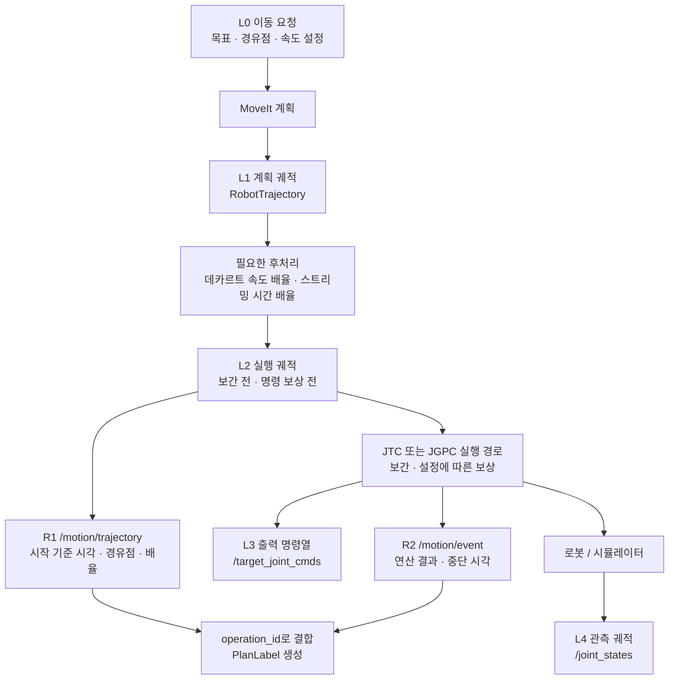

# L0~L4 명령 단계와 궤적 수집 가이드

L0~L4는 로봇의 이동 요청이 계획, 실행 궤적, 출력 명령을 거쳐 관측 결과로 이어지는 과정을 구분한다. 각 단계는 같은 동작을 서로 다른 관점에서 표현하므로, 수집 목적에 따라 필요한 데이터를 선택해야 한다. 특히 L0는 이동 요청이며, 그 자체가 시간에 따른 궤적은 아니다.

이 문서는 `rdfp_ws`의 팔 이동 경로를 기준으로 단계별 정의, 궤적 획득 방법, 기록 형식, 주요 API와 사용 예제를 설명한다. 학습 샘플의 기준은 [학습 샘플 사양](학습_샘플_사양.md), 수집 시스템의 기동과 운영 절차는 [학습 데이터 파이프라인 개요](../collect/학습_데이터_파이프라인_개요.md)를 따른다.

**목차**

1. [명령 단계의 전체 구조](#1-명령-단계의-전체-구조)
2. [단계별 정의와 궤적 획득 방법](#2-단계별-정의와-궤적-획득-방법)
3. [시간과 배율을 해석하는 방법](#3-시간과-배율을-해석하는-방법)
4. [핵심 클래스와 인터페이스](#4-핵심-클래스와-인터페이스)
5. [수집과 저장 절차](#5-수집과-저장-절차)
6. [주요 사용 예제](#6-주요-사용-예제)
7. [목적별 데이터 선택과 검증](#7-목적별-데이터-선택과-검증)
8. [관련 문서와 구현](#8-관련-문서와-구현)

## 1. 명령 단계의 전체 구조

### 1.1. 단계별 비교

| 단계 | 정의 | 대표 데이터 | 궤적을 얻는 방법 | 주요 용도 |
|---|---|---|---|---|
| L0 | 수행할 이동을 지정한 요청 | named target, 관절 목표, 데카르트 경유점, 속도 설정 | 요청만으로 궤적을 확정할 수 없다. 현재 상태와 계획 환경을 바탕으로 L1을 계산한다 | 작업 의도, 요청 이력, 실패 원인 분석 |
| L1 | MoveIt이 계산한 계획 궤적 | `moveit_msgs/RobotTrajectory` | 계획 API의 반환값 또는 서비스 응답의 `solution`을 확보한다 | 경로 검토, 충돌 회피 계획 분석 |
| L2 | 실행에 사용할 시간 배율을 반영한 궤적 | `/motion/trajectory`의 `MotionTrajectory` | 실행 시 발행되는 R1을 수집한다 | 관절-계획 학습 레이블, 실행 예정 시각 분석 |
| L3 | 실행 경로에서 출력된 관절 명령열 | `/target_joint_cmds`의 `JointState` | 시간순으로 명령 메시지를 수집한다 | 명령 재생, 보간·보상 결과 분석 |
| L4 | 로봇 또는 시뮬레이터가 보고한 상태열 | `/joint_states`의 `JointState` | 시간순으로 관측 메시지를 수집한다 | 실제 동작 확인, 추종 오차·지연 분석 |

L1과 L2는 연산 하나에 대한 여러 경유점을 묶어서 표현한다. L3와 L4는 여러 메시지를 시간순으로 모아야 궤적이 된다. L2의 경유점 간격, L3의 명령 주기, L4의 관측 주기는 서로 같다고 가정하지 않는다.

### 1.2. 계획부터 관측까지의 흐름



JTC는 `JointTrajectoryController`를 이용하는 실행 경로이며, JGPC는 클라이언트가 관절 명령을 순차적으로 발행하는 경로다. FunctionBay는 이 프로젝트에서 JGPC 클라이언트 경로를 사용하지만, ROS의 JGPC 컨트롤러를 반드시 거치는 것은 아니다. 백엔드 설정에 따라 시뮬레이터의 입력 토픽으로 직접 명령을 보낸다.

그림의 후처리 단계가 항상 궤적을 변경하는 것은 아니다. 관절 공간 계획은 MoveIt이 속도 배율을 반영하고, 이후 시간 배율을 적용하지 않으면 L1과 L2의 경유점과 시간이 같을 수 있다. 반면 데카르트 계획은 클라이언트가 속도 배율을 적용하므로 L1과 L2의 시간이 달라질 수 있다.

## 2. 단계별 정의와 궤적 획득 방법

### 2.1. L0: 이동 요청

#### 2.1.1. 정의와 특징

L0는 `move_to_named_target`, `move_to_joints`, `move_linear` 등의 호출에 전달된 목표와 실행 조건이다. named target은 SRDF에 정의된 관절 자세의 이름이며, 관절 목표는 관절별 목표값, 데카르트 목표는 지정된 기준 좌표계에서의 위치와 자세로 표현한다.

같은 L0를 다시 호출해도 같은 궤적이 나온다는 보장은 없다. 시작 관절 상태, planning scene의 장애물, 로봇 모델, 계획기 설정과 계획 과정이 결과에 영향을 준다. 따라서 L0 요청을 보관하는 것과 계획 궤적을 보관하는 것은 목적이 다르다.

#### 2.1.2. 수집과 궤적 획득

원래 요청을 보존하려면 호출부에서 연산명, 입력 인자, 호출 시각과 요청 식별자를 별도로 기록한다. 현재 R2의 목표 필드는 클라이언트가 해석한 목표이므로 원본 REST 요청을 완전히 복원하는 기록으로 사용할 수 없다. 예를 들어 일부 관절만 지정한 요청은 나머지 관절값을 채운 목표로 바뀔 수 있다.

L0에서 궤적을 구하려면 대응하는 계획 API를 호출한다. named target은 `plan_named_target()`, 관절 목표는 `plan_joints()`, 데카르트 경유점은 `plan_trajectory()` 또는 `plan_trajectory_async()`를 사용한다. 반환된 궤적이 L1인지, 클라이언트의 속도 배율 적용까지 끝난 값인지는 §2.2의 구분을 따른다.

### 2.2. L1: 계획 궤적

#### 2.2.1. 정의와 특징

L1은 MoveIt이 계산한 경로에 시간 정보를 부여한 계획 궤적이다. 팔의 관절 궤적은 `RobotTrajectory.joint_trajectory`에 있으며, `joint_names`와 각 경유점의 `positions`, `velocities`, `accelerations`, `time_from_start`로 표현한다. 속도와 가속도 배열의 존재 여부는 계획 결과에 따라 달라질 수 있다.

관절 공간 계획에서는 목표 관절 자세까지 이동하는 경로를 계획한다. 데카르트 계획에서는 말단 링크의 경유점을 따라가는 관절 경로를 구한다. 데카르트 경로가 일부만 계산되면 `fraction`이 1보다 작으므로, 전체 경로가 필요한 작업에서는 이를 확인해야 한다. 현재 동기 API의 기본 허용 기준은 0.60이며, 완전한 경로만 허용하려면 `fraction_threshold=1.0`을 명시한다.

#### 2.2.2. 수집과 궤적 획득

관절 공간의 L1은 `plan_named_target()` 또는 `plan_joints()`의 반환값으로 확보한다. 이 경로의 `velocity_scaling`은 MoveIt 계획 요청에 전달되므로, 반환값에 이미 반영되어 있다.

데카르트 경로에서는 `plan_trajectory_async()`가 반환하는 Future의 결과가 `GetCartesianPath.Response`다. `error_code`와 `fraction`을 확인한 뒤 `response.solution`을 읽으면 클라이언트가 속도 배율을 적용하기 전의 L1을 얻는다. 반면 동기 메소드 `plan_trajectory()`는 응답을 검증하고 속도 배율까지 적용한 `RobotTrajectory`를 반환한다. 속도 배율 적용 전의 값을 동기 방식으로 얻으려면 `velocity_scaling=1.0`을 명시한다.

`/display_planned_path`는 `moveit_msgs/DisplayTrajectory` 형식의 시각화 채널이며, 내부의 `trajectory` 배열에 계획 궤적이 담긴다. 발행 경로와 실행 여부에 따라 원하는 연산의 메시지가 없거나 여러 계획이 섞일 수 있으므로, 특정 호출의 L1은 해당 API 응답에서 직접 확보하는 편이 명확하다. 기본 수집 목록에는 이 토픽이 포함되지 않는다.

### 2.3. L2: 실행 궤적

#### 2.3.1. 정의와 특징

L2는 실행에 사용할 속도·시간 배율을 반영한 궤적이며, 컨트롤러나 스트리머의 보간 및 명령 보상 이전의 값이다. JTC 경로에서는 실행 액션으로 전달하는 궤적에 해당한다. JGPC 경로에서는 스트리머가 사용할 경유점과 발행 일정을 실행 시간축으로 표현한 것이다.

실행 요청 직전에 기록되므로 L2가 있다고 해서 로봇이 해당 궤적을 끝까지 이동했다는 뜻은 아니다. 실행 목표가 거부되거나 도중에 취소될 수 있으며, 실제 결과는 R2와 L4를 함께 확인해야 한다.

#### 2.3.2. 수집과 궤적 획득

`/motion/trajectory`를 구독하거나 녹화하면 연산마다 R1 메시지 한 건을 얻는다. `header.stamp`를 시작 기준 시각 `t₀`로 두고, 각 경유점의 절대 시각을 `t₀ + time_from_start`로 계산한다. 시간 배율은 메시지의 경유점에 이미 반영되어 있으므로 `velocity_scaling`과 `time_scaling` 필드를 다시 곱하지 않는다.

실행 결과는 `/motion/event`의 R2를 동일한 `operation_id`로 연결한다. 정상 종료 시에는 궤적의 마지막 시각까지, 중단 시에는 `truncated_at`까지를 유효 실행 구간으로 사용한다. DB에서는 같은 에피소드의 R1과 R2를 결합한다.

L2의 경유점 사이에서 임의 시각의 관절값을 얻으려면 보간이 필요하다. 현재 학습용 `PlanLabel`은 경유점 양쪽에 속도가 있으면 3차 Hermite 보간을, 없으면 선형 보간을 사용한다. 연산 시작 전에는 초기 관측값을, 연산 종료 후에는 정상 종료점 또는 중단 시각의 궤적 값을 유지한다. 이 값은 학습 레이블의 정의이며, 실제 컨트롤러의 보간 결과나 실제 정지 위치와 항상 같지는 않다.

### 2.4. L3: 출력 명령열

#### 2.4.1. 정의와 특징

L3는 실행 경로에서 로봇 또는 시뮬레이터 쪽으로 출력한 관절 명령을 시간순으로 모은 값이다. JTC 경로에서는 컨트롤러가 궤적을 보간하며, JGPC 경로에서는 `TrajectoryStreamer`가 발행 시각에 맞춰 명령을 생성한다. JGPC 스트리머에 `publish_rate`를 지정하면 위치를 선형 보간하고, 지정하지 않으면 원래 경유점의 시각에 맞춰 발행한다. 클라이언트를 백엔드 프로파일로 생성한 경우에는 프로파일의 발행 주기가 기본값으로 적용될 수 있다.

명령 보상이 설정된 백엔드에서는 L3에 보상값이 포함될 수 있다. FunctionBay의 모든 구성이 같은 보상을 사용하는 것은 아니며, 외부 중력 보상 적용 여부는 해당 프로파일과 솔버 설정에 따른다. 따라서 L3를 다른 백엔드의 실행 궤적으로 그대로 사용하면 보상 조건의 차이가 결과에 영향을 줄 수 있다.

#### 2.4.2. 수집과 궤적 획득

공통 수집 채널은 `/target_joint_cmds`다. `TargetJointCmdsPublisher`가 백엔드별 명령 형식을 `sensor_msgs/JointState`로 통일한다. Isaac에서는 `/isaac/arm_command`, FunctionBay에서는 `/input/panda_joint`가 원천 명령 채널이다. 실제 연결은 실행 중인 launch 설정을 확인한다.

`JointState` 입력은 위치·속도·effort를 복사하고, `Float64MultiArray` 입력은 관절 이름을 설정 또는 조회로 보충한다. `JointTrajectory` 입력은 마지막 경유점만 추출한다. 따라서 이 중계 노드에 여러 경유점을 가진 계획 궤적을 직접 연결해도 전체 궤적이 보존되지는 않는다. mock 등에서 수집 지점이 컨트롤러 입력인 경우에는 `/target_joint_cmds`가 컨트롤러 내부의 매 제어 주기 출력을 대표한다고 해석해서는 안 된다.

수집된 메시지를 `header.stamp` 순으로 정렬하고 `name`을 기준으로 관절 배열을 재배열하면 명령 궤적을 얻는다. 이 시각은 중계 노드가 원천 명령을 수신한 시각이며, 원본 발행 시각이나 로봇이 명령을 적용한 시각은 아니다. 메시지 사이의 값을 보간한다면 선택한 보간 방법을 분석 조건에 명시한다.

### 2.5. L4: 관측 궤적

#### 2.5.1. 정의와 특징

L4는 로봇 또는 시뮬레이터가 보고한 관절 상태를 시간순으로 모은 값이다. 물리계에서는 센서 측정과 상태 추정 결과이며, 시뮬레이터에서는 시뮬레이션 상태다. 명령 지연, 관성, 접촉, 제어 오차 등의 영향으로 L2·L3와 다를 수 있다.

`/joint_states`는 여러 관절의 상태를 포함할 수 있으므로 팔 관절을 이름으로 선택한다. 그리퍼의 실제 개구 폭과 도달 상태는 `/gripper_states`를 사용한다. 특히 FunctionBay에서는 TF 구성을 위해 그리퍼 관절에 고정값을 넣는 경로가 있으므로, `/joint_states`의 그리퍼 관절값을 실제 개구 폭으로 대체해서는 안 된다.

#### 2.5.2. 수집과 궤적 획득

`/joint_states`의 `header.stamp`, `name`, `position`을 수집하여 관측 관절 궤적을 구성한다. `velocity`나 `effort`가 비어 있으면 미제공 값으로 취급한다. 필요에 따라 위치의 시간 차분으로 속도를 추정할 수 있지만, 메시지에 포함된 속도와 구분하고 필터와 차분 간격을 기록한다.

말단의 공간 궤적이 필요하면 각 시각의 관절값에 동일한 로봇 모델과 기준 좌표계를 적용하여 순기구학을 계산한다. 이 방법은 L1~L4의 관절 궤적에 모두 적용할 수 있다. `/ee_pose` 역시 관절 상태로부터 계산된 값이므로 독립된 말단 센서의 측정값으로 해석하지 않는다. tip link와 TCP가 다르면 두 프레임 사이의 고정 변환을 추가로 적용한다.

카메라 영상은 관측을 보완하지만 관절 궤적 자체를 제공하지는 않는다. 현재 수집에서는 MP4와 sidecar를 보관하고 sidecar의 프레임 시각으로 관절 상태와 정렬한다.

## 3. 시간과 배율을 해석하는 방법

### 3.1. 속도 배율과 시간 배율

데카르트 계획 결과에 속도 배율 `v`를 적용할 때 `scale_trajectory_velocity()`는 위치를 유지하고 시각을 `t / v`, 속도를 `dq × v`, 가속도를 `ddq × v²`로 변경한다. 예를 들어 `v=0.2`이면 실행 시간은 5배가 된다. 관절 공간 계획의 배율은 MoveIt 시간 파라미터화 과정에서 적용되므로, 다른 배율로 각각 계획한 결과가 항상 이 단순한 비례식으로 일치한다고 가정하지 않는다.

JGPC의 시간 배율 `s`는 발행 일정을 `t × s`로 늘린다. R1 발행자는 저장할 궤적에도 이를 반영하여 속도는 `dq / s`, 가속도는 `ddq / s²`로 조정한다. 스트리머에 전달한 원래 `RobotTrajectory` 객체는 시간 배율을 반영한 기록 그 자체가 아니므로, 실행 데이터의 기준은 R1로 삼는다.

| 조건 | 데카르트 L1의 길이 | 속도 배율 적용 후 | JGPC 시간 배율 적용 후 L2 |
|---|---:|---:|---:|
| `v=1.0`, `s=1.0` | 2초 | 2초 | 2초 |
| `v=0.2`, `s=1.0` | 2초 | 10초 | 10초 |
| `v=0.2`, `s=1.5` | 2초 | 10초 | 15초 |

위 표는 동일한 L1에 배율만 적용한 계산 예다. 이미 `velocity_scaling=0.2`로 반환된 데카르트 궤적에 `scale_trajectory_velocity(..., 0.2)`를 다시 호출하면 의도보다 5배 더 느려진다. 반대로 저수준 `execute_trajectory()`나 `stream_trajectory()`의 `velocity_scaling` 인자는 기록용 배율 정보이며, 입력 궤적에 속도 배율을 새로 적용하지 않는다.

### 3.2. 시각 필드와 정렬 기준

| 데이터 | 시각의 의미 | 사용 방법 |
|---|---|---|
| L1 `time_from_start` | 계획 시작점부터의 상대 시각 | 실행 절대 시각이 정해지기 전의 계획 시간축 |
| R1 `header.stamp` | 실행 시작을 나타내도록 정한 기준 시각 `t₀` | 경유점의 상대 시각에 더한다 |
| R1 `trajectory.points[].time_from_start` | 배율 적용 후 경과 시간 | `t₀`와 합쳐 실행 시간축을 구성한다 |
| R2 `header.stamp` | 연산 결과를 기록한 시각 | 결과 도착과 처리 지연을 분석한다 |
| R2 `truncated_at` | 궤적 기준 유효 실행 구간의 끝 | `t₀ + truncated_at`을 레이블 구간의 끝으로 사용한다 |
| L3 `header.stamp` | 명령 중계 노드의 수신 시각 | 수집된 명령열을 시간순으로 정렬한다 |
| L4 `header.stamp` | 상태 메시지의 관측·정렬 기준 시각 | 백엔드의 시간 정렬 규약에 따라 명령과 비교한다 |

JTC의 `t₀`는 실행 목표를 보내기 직전이며, JGPC의 `t₀`는 첫 명령을 발행하기 직전에 정한다. 컨트롤러의 실제 보간 시작이나 물리적 운동 시작을 직접 측정한 값은 아니다. 특히 첫 경유점의 상대 시각이 0이 아니면 첫 명령의 예정 발행 시각도 그만큼 늦어진다.

시뮬레이션 시간과 벽시계 시간을 섞지 않는다. 모든 비교 대상은 같은 ROS 시간축을 사용해야 하며, rosbag의 수신 시각이나 Python의 `time.monotonic()`을 메시지의 `header.stamp` 대신 사용하지 않는다. FunctionBay 원시 출력의 시각은 회차에 따라 경과 시간일 수 있으므로, 학습 수집에는 시간 정렬을 거친 공통 관측 채널을 사용한다.

### 3.3. 정상 종료와 중단의 차이

| R2 `result` | 의미 | L2 해석 |
|---|---|---|
| `succeeded` | 해당 실행 경로의 완료 조건을 충족했다 | 정상 궤적 길이까지 사용한다 |
| `aborted` | 궤적 전달을 시도했으나 완료하지 못했다 | `truncated_at`에서 자른다. 목표 거부로 0일 수도 있다 |
| `failed` | 계획 실패·검증 실패 등으로 궤적 전달 단계에 도달하지 못했다 | 일반적으로 짝 R1이 없으며 실행 궤적을 만들지 않는다 |

JGPC 스트리머의 완료는 명령 발행의 완료다. JTC의 실행 성공 역시 상위 작업의 성공과 같지 않다. 물체를 제대로 잡았는지, 목표 위치에 놓았는지는 그리퍼 상태, 장면 상태 등 별도의 작업 결과로 판단한다.

R1 발행 자체가 실패하거나 수집 중 메시지가 누락될 수도 있다. 따라서 R1·R2의 짝이 없는 경우를 모두 정상적인 계획 실패로 처리하지 말고 `operation_id`, 결과와 수집 로그를 확인한다. 현재 `load_operations()`는 R2가 없는 R1을 전체 길이의 정상 종료로 가정하고 `assumed_full_duration`에 집계하므로 이 값도 검토해야 한다.

## 4. 핵심 클래스와 인터페이스

아래 시그니처는 인터페이스 설명용이며 실행 코드는 §6에 제시한다. 시그니처의 `self`는 생략했다. 상수 이름은 구현과 같으며, 주요 시간 제한은 `MOVE_GROUP_TIMEOUT_SEC=120.0`, `PLAN_TIMEOUT_SEC=20.0`, `TRAJECTORY_EXEC_TIMEOUT_SEC=120.0`이다. `DEFAULT_PLANNING_TIME=5.0`, `DEFAULT_JOINT_TOLERANCE=1e-4`이며, 계획 메소드에서 `velocity_scaling=None`은 클라이언트의 기본 설정을 사용한다는 뜻이다.

### 4.1. 클라이언트 생성과 공통 계획 API

```python
create_move_group_client(
    node: Node, *, backend: Optional[str] = None,
    mode: Optional[str] = None,
    arm_command_topic: str = DEFAULT_COMMAND_TOPIC,
    arm_command_format: Optional[str] = None,
    arm_command_joint_names: Optional[list[str]] = None,
    velocity_scaling: Optional[float] = None,
    check_action_server: bool = True, **kwargs,
) -> MoveGroupClient

MoveGroupClient.wait_until_ready(timeout_sec: float = READY_TIMEOUT_SEC) -> None
MoveGroupClient.close() -> None

MoveGroupClient.plan_named_target(
    name: str, *, velocity_scaling: Optional[float] = None,
    planning_time: float = DEFAULT_PLANNING_TIME,
    tolerance: float = DEFAULT_JOINT_TOLERANCE,
    timeout: float = MOVE_GROUP_TIMEOUT_SEC,
) -> RobotTrajectory

MoveGroupClient.plan_joints(
    joint_values: dict[str, float], *, velocity_scaling: Optional[float] = None,
    planning_time: float = DEFAULT_PLANNING_TIME,
    tolerance: float = DEFAULT_JOINT_TOLERANCE,
    timeout: float = MOVE_GROUP_TIMEOUT_SEC,
) -> RobotTrajectory

MoveGroupClient.plan_trajectory(
    waypoints: list[Pose], *, velocity_scaling: Optional[float] = None,
    fraction_threshold: Optional[float] = None,
    max_step: Optional[float] = None, jump_threshold: Optional[float] = None,
    timeout: float = PLAN_TIMEOUT_SEC,
) -> RobotTrajectory

MoveGroupClient.plan_trajectory_async(
    waypoints: list[Pose], *, max_step: Optional[float] = None,
    jump_threshold: Optional[float] = None,
) -> rclpy.Future

MoveGroupClient.scale_trajectory_velocity(
    trajectory: RobotTrajectory, velocity_scaling: float,
) -> RobotTrajectory
```

| API | 수행 내용 |
|---|---|
| `create_move_group_client()` | `backend` 또는 `mode`로 JTC/JGPC 구현을 선택한다. 백엔드 프로파일에서 토픽·관절 이름·발행 주기·보상 설정 등을 적용한다 |
| `wait_until_ready()` | 필요한 서비스·액션의 준비를 기다린다. 기본 제한 시간은 30초다 |
| `close()` | 클라이언트가 생성한 자원을 해제한다. 호출자가 생성한 ROS 노드는 별도로 정리한다 |
| `plan_named_target()` | SRDF 목표를 관절 목표로 해석하여 계획한다 |
| `plan_joints()` | 관절별 목표값을 바탕으로 계획한다 |
| `plan_trajectory()` | 데카르트 경로의 응답을 검증하고 속도 배율을 적용한다 |
| `plan_trajectory_async()` | `GetCartesianPath` 요청의 Future를 반환한다. 호출자가 응답 상태·`fraction`·`solution`을 처리한다 |
| `scale_trajectory_velocity()` | 궤적을 복사하고 시간·속도·가속도 배율을 변경한다 |

계획 API만 호출하면 로봇을 실행하지 않으며 R1·R2 실행 기록도 생성되지 않는다. 계획 실패를 포함한 연산 이력이 필요하면 고수준 이동 API의 실행 흐름과 호출부 기록을 사용한다.

### 4.2. 실행 API

```python
MoveGroupJtcClient.execute_trajectory(
    trajectory: RobotTrajectory, *,
    timeout: float = TRAJECTORY_EXEC_TIMEOUT_SEC,
    velocity_scaling: Optional[float] = None,
    operation: str = OPERATION_CARTESIAN,
    target_joint_names: Sequence[str] = (),
    target_joint_values: Sequence[float] = (),
    target_pose: Optional[Pose] = None,
) -> None

MoveGroupJgpcClient.stream_trajectory(
    trajectory: RobotTrajectory, *, time_scaling: float = 1.0,
    velocity_scaling: float = 1.0, publish_rate: Optional[float] = None,
    externally_spun: bool = False,
    target: Optional[OperationTarget] = None,
) -> int

TrajectoryStreamer.stream(
    trajectory: RobotTrajectory, *, time_scaling: float = 1.0,
    velocity_scaling: float = 1.0, publish_rate: Optional[float] = None,
    stop_event: Optional[threading.Event] = None,
    joint_names_timeout: float = DEFAULT_JOINT_NAMES_TIMEOUT_SEC,
    externally_spun: bool = False,
    target: Optional[OperationTarget] = None,
) -> int

TrajectoryStreamer.stop() -> None
```

`execute_trajectory()`는 R1을 발행하고 MoveIt의 실행 액션에 궤적을 전달한 뒤 결과에 따라 R2를 기록한다. `operation`의 기본값은 `'cartesian'`이므로 관절 목표의 궤적을 전달할 때는 `'joints'` 또는 `'named_target'`과 목표값을 명시한다.

`stream_trajectory()`는 JGPC 스트리머를 호출한다. `TrajectoryStreamer.stream()`은 관절 순서를 맞추고 필요에 따라 보간·보상을 적용하여 명령을 발행하며, R1·R2도 기록한다. 반환값은 발행한 명령 수이며 로봇이 도달한 경유점 수가 아니다. `stop()`은 스트리밍 중단을 요청한다.

`OperationTarget`은 `operation`, `joint_names`, `joint_values`, `pose`, `frame`을 저장하여 스트리머에 연산 종류와 해석된 목표를 전달한다. 일반적인 이동에서는 고수준 이동 API를 사용하면 클라이언트가 이러한 기록 정보를 구성한다. 저수준 API로 계획과 실행을 분리할 때는 호출부에서 목표 정보를 전달한다.

### 4.3. R1·R2 발행 인터페이스

```python
MotionTrajectoryPublisher.publish(
    trajectory: Union[RobotTrajectory, JointTrajectory], *,
    velocity_scaling: float = 1.0, time_scaling: float = 1.0,
    operation_id: Optional[str] = None, stamp=None,
) -> Optional[str]

MotionEventPublisher.publish_context(
    ctx: MotionContext, *, result: str, reason: str = '',
    truncated_at_sec: Optional[float] = None, stamp=None,
) -> bool
```

`MotionTrajectoryPublisher.publish()`는 시간 배율을 기록용 궤적에 반영하고 R1을 발행한 뒤 연산 ID를 반환한다. 발행에 실패하면 `None`을 반환한다. `velocity_scaling`은 이미 적용된 배율을 나타내는 메타데이터다. `MotionEventPublisher.publish_context()`는 같은 ID와 목표 정보를 가진 `MotionContext`에서 종료 결과를 발행하고 발행 성공 여부를 반환한다.

기존 JTC/JGPC 클라이언트를 사용한다면 호출부에서 이 메시지들을 추가로 발행할 필요가 없다. 독자적인 실행 경로를 구현할 때 시작 기준 시각, 연산 ID, 종료 결과를 연결하는 인터페이스로 사용한다.

| 메시지 | 주요 필드 | 역할 |
|---|---|---|
| `MotionTrajectory` | `header`, `operation_id`, `velocity_scaling`, `time_scaling`, `trajectory` | L2와 시간축을 저장한다. 내부의 `trajectory.header`는 비워 둔다 |
| `MotionEvent` | `header`, `operation_id`, `operation`, `result`, `reason`, `truncated_at` | 연산 종류, 종료 상태, 유효 구간을 저장한다 |
| `MotionEvent`의 목표 | `target_kind`, `target_joint_names`, `target_joint_values`, `target_pose`, `target_frame` | 해석된 목표를 저장한다. 데카르트 목표는 tip link와 TCP의 차이를 확인한다 |

### 4.4. 관절-계획 레이블 복원

```python
load_operations(conn: Any, episode_id: int) -> tuple[list, LabelStats]

PlanLabel(
    operations: Iterable[Operation], *, joint_names: Sequence[str],
    initial_positions: Sequence[float], episode_end: Optional[float] = None,
)
PlanLabel.at(tau: float) -> tuple
PlanLabel.chunk(t: float, *, k: int, step: float, delta: float) -> tuple[tuple, tuple]
```

`load_operations()`는 DB의 R1과 R2를 결합하여 `Operation` 목록과 진단 통계를 반환한다. `Operation`은 시작 시각 `t0`, 관절 이름, `Waypoint` 목록, 종료 시각 `end`, 결과, 연산 ID를 가진다. `Waypoint`는 상대 시각 `t`, 관절 위치, 선택적인 관절 속도를 가진다.

`PlanLabel.at(tau)`는 절대 시각 `tau`에 해당하는 L2 기반 관절값을 반환한다. `chunk()`는 `t + delta + j × step`(`j=0...k-1`)에서 평가한 값과 패딩 마스크를 반환한다. `delta`는 관측에서 행동까지의 시간차, `step`은 샘플 간격, `k`는 점의 개수다. 다음 연산에 걸치는 chunk도 생성하며 에피소드 종료 시각을 넘는 점을 패딩으로 표시한다.

## 5. 수집과 저장 절차

### 5.1. 수집 채널의 선택

기본 학습 수집에는 [공통 녹화 목록](../../config/recording_topics.list)을 사용한다. L2·R2·L3·L4와 에피소드 경계가 함께 있어야 계획 레이블과 관측을 대응시킬 수 있다. L0 원본 요청과 L1 계획 응답은 기본 녹화 대상이 아니므로 필요하면 호출부에서 추가 보관한다.

| 데이터 | 수집 채널 | 저장 위치 |
|---|---|---|
| 에피소드 경계 | `/session` | 세션·에피소드 정보 |
| L2 | `/motion/trajectory` | `motion_trajectories` |
| 실행 결과 | `/motion/event` | `motion_events` |
| L3 | `/target_joint_cmds` | `joint_states` |
| L4 팔 상태 | `/joint_states` | `joint_states` |
| 그리퍼 상태 | `/gripper_states` | 그리퍼 상태 기록 |
| 영상 관측 | 레코더가 구독하는 카메라 채널 | MP4와 시각 sidecar |

L3와 L4는 같은 메시지 타입이므로 같은 `joint_states` 테이블에 저장된다. 반드시 `topic_id`로 명령과 관측을 구분한다. 카메라 영상은 레코더를 통해 수집하며 기본 rosbag 녹화 목록에 추가하지 않는다.

### 5.2. 메시지 확인과 녹화

이미 제어 스택과 수집 계층이 실행 중인 ROS 셸에서 다음 명령으로 필수 채널을 확인한다. R1·R2는 연산 이벤트이므로 이동을 실행하지 않으면 메시지가 나오지 않을 수 있다.

```bash
ros2 topic echo /motion/trajectory --once
ros2 topic echo /motion/event --once
ros2 topic echo /target_joint_cmds --once
ros2 topic echo /joint_states --once
```

기존 녹화 프로세스가 없는 경우 워크스페이스 루트에서 다음 명령으로 공통 목록을 녹화한다. 이 명령은 rosbag 녹화만 시작하며, 제어 스택·세션 관리·영상 레코더의 기동을 대신하지 않는다.

```bash
./scripts/rosbag.sh record \
  --topics-file config/recording_topics.list \
  --rosbag-dir /data/rdfp/rosbag
```

운영 수집에서는 [학습 데이터 파이프라인 개요](../collect/학습_데이터_파이프라인_개요.md)의 백엔드별 절차에 따라 구성 요소를 기동하고 에피소드 경계를 기록한다. 수집 래퍼가 이미 rosbag을 실행했다면 별도 녹화 명령을 중복 실행하지 않는다. 적재 설정의 `topics_file`과 녹화 목록도 일치시킨다.

## 6. 주요 사용 예제

### 6.1. 관절 계획을 확인하고 선택적으로 실행하기

다음 예제는 `panda_mock` 스택이 실행 중이며 SRDF에 `ready` 목표가 있는 환경을 전제로 한다. 계획만 수행하는 것이 기본 동작이고, `--execute`를 전달하면 해당 계획을 실행한다. 별도 executor가 없는 독립 스크립트이며, ROS 콜백 안에서 동기 계획·실행 메소드를 호출하는 예제는 아니다.

```python
import argparse
import rclpy
from rclpy.node import Node
from robot_control.moveit.move_group_factory import create_move_group_client


def main():
    parser = argparse.ArgumentParser()
    parser.add_argument('--execute', action='store_true')
    args = parser.parse_args()
    rclpy.init(args=[])
    node = Node('trajectory_guide_example')
    try:
        with create_move_group_client(node, backend='panda_mock') as client:
            client.wait_until_ready()
            trajectory = client.plan_named_target('ready', velocity_scaling=0.2)
            jt = trajectory.joint_trajectory
            duration = jt.points[-1].time_from_start
            print('joint_names:', list(jt.joint_names))
            print('points:', len(jt.points))
            print('duration_sec:', duration.sec + duration.nanosec * 1e-9)
            if args.execute:
                client.execute_trajectory(
                    trajectory,
                    velocity_scaling=0.2,
                    operation='named_target',
                    target_joint_names=jt.joint_names,
                    target_joint_values=jt.points[-1].positions,
                )
    finally:
        node.destroy_node()
        rclpy.shutdown()


if __name__ == '__main__':
    main()
```

이 경로에서는 관절 공간 계획에 속도 배율이 이미 반영되어 있으며, 추가 시간 변경이 없으므로 실행할 때의 L2 경유점은 반환된 계획과 같다. 실행 시 R1에 시작 기준 시각이 추가되고 R2에 결과가 기록된다. 예제의 목표 기록은 계획 끝점으로 구성했으며, 원래 입력 이름 `ready`의 보존이 필요하면 호출 이력에 별도로 남긴다.

### 6.2. 데카르트 L1과 배율 적용 후 궤적을 나누어 얻기

아래 함수는 준비된 클라이언트와 `list[geometry_msgs.msg.Pose]` 형식의 경유점을 입력받는다. 경유점은 클라이언트의 기준 좌표계에서 표현한 tip link의 자세여야 한다. 함수는 계획과 배율 적용만 수행하고 실행하지 않는다.

```python
def plan_cartesian_pair(client, waypoints):
    l1 = client.plan_trajectory(
        waypoints,
        velocity_scaling=1.0,
        fraction_threshold=1.0,
    )
    execution_candidate = client.scale_trajectory_velocity(l1, 0.2)
    return l1, execution_candidate
```

`execution_candidate`는 속도 배율을 적용한 실행 후보이며, 아직 실제 실행 기록은 아니다. JTC에 이 값을 전달하면 해당 궤적이 L2로 기록된다. JGPC에서 추가 시간 배율을 사용하면 R1의 경유점 시간이 다시 조정된다. 계획과 실행 사이에 로봇 상태가 변할 수 있으므로 오래된 계획을 그대로 재사용하지 않는다.

### 6.3. JGPC의 시간 배율과 목표 기록

아래 함수는 준비된 `MoveGroupJgpcClient`를 사용하여 named target을 계획하고 실제로 스트리밍한다. `panda_mock_jgpc` 또는 `panda_functionbay`에 맞는 클라이언트를 팩토리로 생성한 뒤 사용한다.

```python
from robot_control.moveit.motion_event_publisher import OperationTarget


def stream_named_target(client, name):
    trajectory = client.plan_named_target(name, velocity_scaling=0.2)
    jt = trajectory.joint_trajectory
    target = OperationTarget(
        operation='named_target',
        joint_names=tuple(jt.joint_names),
        joint_values=tuple(jt.points[-1].positions),
    )
    return client.stream_trajectory(
        trajectory,
        velocity_scaling=0.2,
        time_scaling=1.5,
        publish_rate=50.0,
        target=target,
    )
```

속도 배율 0.2는 계획에 이미 적용되어 있다. `time_scaling=1.5`는 그 결과의 실행 시간을 추가로 1.5배 늘리고, `publish_rate=50.0`은 늘어난 시간축에서 명령을 생성할 주기를 지정한다. 반환되는 발행 건수, R1의 경유점 수, L4의 관측 건수는 서로 다를 수 있다.

### 6.4. 중단된 L2에서 학습 레이블 만들기

다음 예제는 ROS와 DB 없이 실행할 수 있는 계산 예다. 두 관절의 궤적을 100초에 시작하고 원래 2초 길이의 궤적을 1초 지점에서 중단했다고 가정한다. 속도를 제공하지 않았으므로 선형 보간한다.

```python
from rdfp.dataset.export.motion_label import Operation, PlanLabel, Waypoint

operation = Operation(
    t0=100.0,
    joint_names=('joint_a', 'joint_b'),
    waypoints=(
        Waypoint(t=0.0, positions=(0.0, 0.0)),
        Waypoint(t=2.0, positions=(1.0, -1.0)),
    ),
    end=101.0,
    result='aborted',
    operation_id='example-operation',
)
label = PlanLabel(
    [operation],
    joint_names=('joint_a', 'joint_b'),
    initial_positions=(0.0, 0.0),
    episode_end=102.0,
)
assert label.at(99.0) == (0.0, 0.0)
assert label.at(100.5) == (0.25, -0.25)
assert label.at(101.5) == (0.5, -0.5)
values, is_pad = label.chunk(101.0, k=4, step=0.5, delta=0.0)
assert values == ((0.5, -0.5),) * 4
assert is_pad == (False, False, False, True)
print(values, is_pad)
```

중단 뒤에는 원래 목표 `(1.0, -1.0)`이 아니라 중단 시각의 계획값 `(0.5, -0.5)`을 유지한다. 이는 L2 기반 레이블이며, 그 시각의 실제 로봇 위치는 L4에서 따로 확인한다.

실제 DB에서는 `operations, stats = load_operations(conn, episode_id)`로 연산 목록을 읽어 같은 `PlanLabel` 생성자에 전달한다. `conn`은 대상 데이터 스키마에 접근하도록 구성한 DB 연결이어야 한다. `initial_positions`는 에피소드 시작 시점의 L4에서 정한 관절 순서로 구하고, `episode_end`는 에피소드 종료 시각으로 지정한다.

## 7. 목적별 데이터 선택과 검증

### 7.1. 어떤 단계의 궤적을 사용할 것인가

| 확인할 내용 | 사용할 데이터 | 함께 확인할 조건 |
|---|---|---|
| 어떤 이동을 요청했는가 | L0 원본 요청, R2의 해석된 목표 | 원본 인자와 해석된 목표의 차이 |
| 어떤 경로를 계획했는가 | L1 | 시작 상태, 계획 환경, 데카르트 `fraction` |
| 언제 어느 자세를 실행하려 했는가 | L2와 R2 | 시작 기준 시각, 중단 시각, 배율 중복 적용 여부 |
| 실행 경로가 어떤 값을 출력했는가 | L3 | 백엔드의 수집 지점, 보간·보상 설정, 중계 지연 |
| 실제로 어떻게 움직였는가 | L4 | 관절 이름, 시간축, 관측 누락 |
| 현재 학습 사양의 팔 행동을 만들려면 무엇이 필요한가 | L2·R2와 초기 L4 | `PlanLabel`의 보간·중단·대기 구간 처리 |
| 명령과 관측의 추종 차이는 얼마인가 | L3와 L4 | 동일 관절·동일 시간축으로 정렬한 뒤 지연과 위치 차이를 구분 |

### 7.2. 수집 결과의 검증 항목

1. **관절 순서:** 배열 인덱스를 고정 관절로 가정하지 않고 `joint_names` 또는 `name`으로 대응시킨다. 이름이 없거나 위치 배열 길이와 다르면 수집 설정을 확인한다.
2. **시간축:** R1의 `t₀`, L3·L4의 stamp와 에피소드 경계가 같은 시간축인지 확인한다. 경유점 번호를 카메라 프레임 번호에 직접 대응시키지 않는다.
3. **연산 연결:** 같은 에피소드 안에서 `operation_id`로 R1과 R2를 연결한다. R2 누락에 대한 정상 종료 가정과 실행 중단을 구별한다.
4. **값의 미제공:** 빈 속도 배열을 0으로 채우지 않는다. `PlanLabel`에서는 보간 방식이 바뀌고, L3·L4에서는 미측정 값을 측정값처럼 해석하게 된다.
5. **수집 범위:** Servo 경로는 MoveIt의 연산별 계획 흐름과 다르며 현재 R1·R2를 생성하지 않는다. L3에는 Servo 명령이 함께 나타날 수 있으므로 R1이 없는 모든 명령을 수집 오류로 단정하지 않는다.
6. **완료의 의미:** 실행 API의 성공, 명령 발행 완료, 실제 목표 도달, 작업 성공을 구분한다. 물체 조작의 성공 여부는 별도 관측과 작업 판정으로 확인한다.

## 8. 관련 문서와 구현

| 자료 | 확인할 내용 |
|---|---|
| [학습 샘플 사양](학습_샘플_사양.md) | 채널 정의, 시간 정렬, 행동 레이블, 학습 샘플 규약 |
| [실행 궤적 채널 구현](실행_궤적_채널_구현.md) | R1 설계 근거, 발행·저장·복원 흐름 |
| [학습 데이터 파이프라인 개요](../collect/학습_데이터_파이프라인_개요.md) | 백엔드 기동, 수집, 적재, export 절차 |
| [클라이언트 팩토리](../../src/robot_control/robot_control/moveit/move_group_factory.py) | 백엔드별 구현과 기본 설정 선택 |
| [공통 계획 클라이언트](../../src/robot_control/robot_control/moveit/move_group_client.py) | 관절·데카르트 계획과 속도 배율 |
| [JTC 클라이언트](../../src/robot_control/robot_control/moveit/move_group_jtc_client.py) | 실행 액션, R1·R2 발행 지점 |
| [JGPC 클라이언트](../../src/robot_control/robot_control/moveit/move_group_jgpc_client.py) · [스트리머](../../src/robot_control/robot_control/moveit/trajectory_streamer.py) | 보간, 발행 일정, 보상, 중단 처리 |
| [명령 중계 노드](../../src/robot_control/robot_control/moveit/target_joint_cmds_publisher.py) | L3 메시지 변환, 수신 시각 기록 |
| [R1 메시지](../../src/rdfp_msgs/msg/MotionTrajectory.msg) · [R2 메시지](../../src/rdfp_msgs/msg/MotionEvent.msg) | 기록 필드와 시간 의미 |
| [R1 발행자](../../src/robot_control/robot_control/moveit/motion_trajectory_publisher.py) · [R2 발행자](../../src/robot_control/robot_control/moveit/motion_event_publisher.py) | 배율 반영과 연산 결과 기록 |
| [계획 레이블 계산](../../src/rdfp/rdfp/dataset/export/motion_label.py) | DB 연산 로드, 보간, action chunk 생성 |
