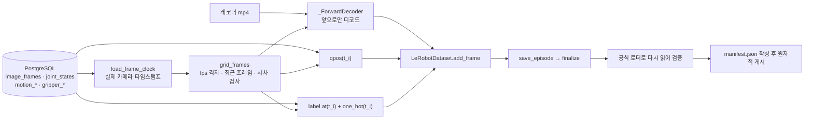

# LeRobot 형식 데이터셋 만들기

DB 에 적재한 에피소드로 LeRobot v3 형식의 데이터셋을 만드는 방법을 설명한다. LeRobot 형식이 무엇인지, RDFP 데이터를 그대로 넣을 수 없는 이유가 무엇인지, 그 문제를 어떻게 풀어 데이터셋을 만드는지를 차례로 다룬다.

## 목차

- [LeRobot 형식 데이터셋 만들기](#lerobot-형식-데이터셋-만들기)
  - [목차](#목차)
  - [1. 개요](#1-개요)
    - [1.1 문서의 범위](#11-문서의-범위)
    - [1.2 핵심 결론](#12-핵심-결론)
  - [2. LeRobot 데이터셋 형식](#2-lerobot-데이터셋-형식)
    - [2.1 디렉터리 구조](#21-디렉터리-구조)
    - [2.2 프레임 행과 데이터 항목](#22-프레임-행과-데이터-항목)
    - [2.3 로더의 시계열 조회 방식](#23-로더의-시계열-조회-방식)
  - [3. RDFP 데이터를 그대로 넣을 수 없는 이유](#3-rdfp-데이터를-그대로-넣을-수-없는-이유)
    - [3.1 RDFP 데이터의 시간 구조](#31-rdfp-데이터의-시간-구조)
    - [3.2 충돌 요약](#32-충돌-요약)
    - [3.3 고정 FPS 와 실제 카메라 시각](#33-고정-fps-와-실제-카메라-시각)
      - [3.3.1 관절-계획 레이블](#331-관절-계획-레이블)
      - [3.3.2 관절-명령 레이블](#332-관절-명령-레이블)
    - [3.4 타임스탬프 허용오차](#34-타임스탬프-허용오차)
    - [3.5 영상 저장 방식](#35-영상-저장-방식)
    - [3.6 학습 정본으로 삼지 않는 이유](#36-학습-정본으로-삼지-않는-이유)
  - [4. 해결 방법 — fps 격자 재샘플링](#4-해결-방법--fps-격자-재샘플링)
    - [4.1 전체 흐름](#41-전체-흐름)
    - [4.2 격자 만들기](#42-격자-만들기)
    - [4.3 영상 — 격자 시각 이하의 최근 프레임 선택](#43-영상--격자-시각-이하의-최근-프레임-선택)
    - [4.4 관측과 행동](#44-관측과-행동)
    - [4.5 데이터셋 feature 구성](#45-데이터셋-feature-구성)
    - [4.6 품질 검사와 검증](#46-품질-검사와-검증)
    - [4.7 NPZ 정본과의 차이](#47-npz-정본과의-차이)
  - [5. 핵심 함수와 클래스](#5-핵심-함수와-클래스)
    - [5.1 `export_lerobot_v3`](#51-export_lerobot_v3)
    - [5.2 `grid_frames`](#52-grid_frames)
    - [5.3 `_ForwardDecoder`](#53-_forwarddecoder)
    - [5.4 함께 쓰는 보조 함수](#54-함께-쓰는-보조-함수)
    - [5.5 사용하는 LeRobot API](#55-사용하는-lerobot-api)
  - [6. 사용 예제](#6-사용-예제)
    - [6.1 실행 환경 준비](#61-실행-환경-준비)
    - [6.2 fps 와 시차 한도 고르기](#62-fps-와-시차-한도-고르기)
    - [6.3 명령줄에서 export](#63-명령줄에서-export)
    - [6.4 GUI 에서 export](#64-gui-에서-export)
    - [6.5 만든 데이터셋 읽기](#65-만든-데이터셋-읽기)
    - [6.6 manifest 확인](#66-manifest-확인)
  - [7. 문제 대응](#7-문제-대응)
    - [7.1 증상별 대응](#71-증상별-대응)
  - [8. 코드 위치](#8-코드-위치)

---

## 1. 개요

### 1.1 문서의 범위

이 문서는 적재가 끝난 DB(PostgreSQL)와 레코더 mp4 에서 LeRobot v3 데이터셋을 만드는 경로를 다룬다. 수집과 적재 절차는 [학습_데이터_파이프라인_개요.md](../collect/학습_데이터_파이프라인_개요.md) 를 따른다. 학습에 사용하는 기준 데이터셋(이하 학습 정본)은 NPZ 형식이며 [저장_형식.md](저장_형식.md) 가 정의한다.

### 1.2 핵심 결론

| 질문 | 답 |
|---|---|
| LeRobot 형식으로 만들 수 있는가 | 있다. `export --format lerobot_v3` 가 공식 `lerobot==0.4.4` writer 로 v3.0 데이터셋을 쓴다 |
| 그대로 넣을 수 없는 이유 | LeRobot 은 프레임이 고정 fps 격자에 있다고 전제하지만, RDFP 의 프레임 타임스탬프는 실제 카메라 stamp 라 간격이 고르지 않다 |
| 해결 방법 | 사용자가 고른 fps 격자 위에서 영상 · 관측 · 행동을 다시 샘플링한다 |
| 변환에 따른 영향 | 영상과 레이블의 시간 위상이 최대 `max_skew_sec` 만큼 어긋나고, 영상이 다시 인코딩된다 |
| 용도 | 다른 도구와 데이터를 주고받기 위한 교환용 파생물이다. 학습 정본은 계속 NPZ 다(결정 28 · 39) |

---

## 2. LeRobot 데이터셋 형식

LeRobot 은 Hugging Face 가 관리하는 로봇 학습 라이브러리이며, 데이터셋 형식과 정책 모델(ACT 등)을 함께 제공한다. 이 시스템은 `lerobot==0.4.4` 를 쓰며, 이 버전이 쓰는 데이터셋 형식은 `codebase_version: v3.0` 이다.

### 2.1 디렉터리 구조

export 의 출력 경로(`--out`) 아래에는 LeRobot 데이터셋 루트인 `dataset/` 과 RDFP 가 남기는 `manifest.json` 이 함께 생긴다.

```
<--out 경로>/
├── manifest.json        # RDFP 기록 — 요청 · 채택 · 제외 에피소드, 재샘플 조건, 파일별 sha256
└── dataset/             # LeRobot 데이터셋 루트 (LeRobotDataset 의 root)
```

v3.0 은 에피소드마다 파일을 따로 두지 않고, 여러 에피소드를 크기 한도(데이터 100 MB, 영상 200 MB)까지 한 파일에 이어 붙인다. 에피소드 경계는 `meta/episodes/` 가 행 번호 범위(`dataset_from_index` · `dataset_to_index`)와 영상 안의 타임스탬프 구간(`videos/<key>/from_timestamp` · `to_timestamp`)으로 기록한다. 에피소드는 파일 사이에서 나뉘지 않는다 — 파일 전환은 에피소드 경계에서만 일어나며, 한도를 넘길 에피소드는 새 파일에 통째로 쓴다(한 에피소드가 한도보다 크면 그 파일은 한도를 넘는다). 데이터와 영상은 따로 파일을 넘기므로 한 에피소드의 데이터와 영상의 `file_index` 는 다를 수 있다. `chunk-NNN` 디렉터리 하나에는 파일이 최대 1000개(`chunks_size`) 들어가고, 넘으면 다음 chunk 로 간다. 경로 규칙은 `info.json` 의 `data_path`(`data/chunk-{chunk_index:03d}/file-{file_index:03d}.parquet`)와 `video_path`(`videos/{video_key}/chunk-{chunk_index:03d}/file-{file_index:03d}.mp4`)에 적힌다.

```
dataset/
├── meta/
│   ├── info.json                  # fps · feature 정의 · 경로 규칙 · codebase_version
│   ├── stats.json                 # feature 별 통계
│   ├── tasks.parquet              # 과제 문자열 목록
│   └── episodes/chunk-000/file-000.parquet   # 에피소드별 행 범위 · 영상 오프셋
├── data/chunk-000/file-000.parquet           # 프레임 행 (여러 에피소드)
└── videos/observation.images.camera/chunk-000/file-000.mp4   # 이어 붙인 영상
```

### 2.2 프레임 행과 데이터 항목

여기서 **프레임**은 카메라 이미지 한 장이 아니라 고정 fps 시간 격자의 한 스텝이다. RDFP exporter 가 카메라 이미지를 격자에 어떻게 대응시키는지는 §4.3 에 있다.

데이터셋은 프레임 하나를 행 하나로 저장한다. 행에는 데이터를 만드는 쪽이 정의한 데이터 항목(feature)과 writer 가 채우는 색인 열이 함께 들어간다. 이 문서의 절차에서 데이터 항목을 정의하고 값을 넣는 쪽은 RDFP exporter 다.

| 열 | 기록 주체 | 내용 |
|---|---|---|
| `observation.state` | RDFP exporter | 관측 벡터 |
| `action` | RDFP exporter | 그 시각의 행동 벡터 한 행 |
| `observation.images.<key>` | RDFP exporter | 영상 데이터 항목. 행에는 픽셀도 영상 안의 프레임 번호도 없다 — 로더가 행의 `timestamp` 에 그 에피소드의 영상 시작 오프셋(`videos/<key>/from_timestamp`)을 더한 타임스탬프의 프레임을 영상 파일에서 디코드하고, 디코드한 프레임의 타임스탬프가 `tolerance_s`(기본 0.1 ms) 안에서 맞는지 확인한다(§2.3) |
| `frame_index` | writer | 에피소드 안의 프레임 번호 |
| `timestamp` | writer | `add_frame` 에 `timestamp` 를 주지 않으면 `frame_index / fps` |
| `episode_index` · `index` · `task_index` | writer | 에피소드 번호 · 전체 행 번호 · 과제 번호 |

`timestamp` 를 생략하면 writer 는 `frame_index / fps` 를 기록한다. 사용자 지정 `timestamp` 를 저장할 수도 있지만, 로더는 `delta_timestamps` 를 FPS 기반 행 오프셋으로 변환하므로 불규칙한 시간 간격을 그대로 반영하지 못한다.

### 2.3 로더의 시계열 조회 방식

학습 로더(`LeRobotDataset`)는 `delta_timestamps` 로 현재 행 앞뒤의 값을 함께 조회한다. ACT 의 action chunk 도 이렇게 만든다.

| 단계 | 구현 | 의미 |
|---|---|---|
| 시차 검사 | `check_delta_timestamps(delta_timestamps, fps, tolerance_s)` — 데이터셋을 열 때 | 모든 시차가 `tolerance_s` 안에서 `1/fps` 의 정수배인지 확인하고, 아니면 `ValueError` 를 낸다 |
| 행 오프셋 변환 | `get_delta_indices`: `[round(d * fps) for d in delta_ts]` | 초 단위 시차를 행 오프셋으로 바꾼다 |
| 값 조회 | `query = 현재 행 + 오프셋` 을 에피소드의 행 범위로 자른다 | 행을 이어 붙여 시계열을 만든다. 에피소드 밖을 가리킨 오프셋은 `<key>_is_pad` 를 `True` 로 하고 값은 에피소드의 첫 행 또는 마지막 행으로 채운다 |
| 영상 조회 | 조회할 행의 `timestamp` 에 영상 안의 에피소드 시작 오프셋(`from_timestamp`)을 더한 타임스탬프의 프레임을 디코드하고, 그 차이가 `tolerance_s`(기본 `1e-4` 초) 안인지 확인한다. 영상 key 를 `delta_timestamps` 에 넣지 않으면 현재 행의 `timestamp` 하나만 조회한다 | 넘으면 `FrameTimestampError`(`ValueError` 의 하위 클래스)로 멈춘다 |

즉 로더는 "행 간격 = 시간 간격 = `1/fps`" 를 전제로 시계열을 조회한다. 영상 디코더(`video_backend`)는 지정하지 않으면 `torchcodec` 이 설치돼 있을 때 `torchcodec`, 아니면 `pyav` 다. 영상 인코딩 코덱(`vcodec`)의 기본값은 `libsvtav1` 이다.

---

## 3. RDFP 데이터를 그대로 넣을 수 없는 이유

### 3.1 RDFP 데이터의 시간 구조

RDFP 는 학습 샘플의 타임스탬프를 카메라 프레임에서 얻는다. 이것을 frame clock 이라 부르며, 프레임 하나가 학습 샘플 하나다. 다른 채널은 모두 이 타임스탬프에 맞춰 계산한다([학습_샘플_사양.md §3.2](학습_샘플_사양.md#32-frame-clock-과-재표본화)).

| 요소 | RDFP 의 방식 |
|---|---|
| 샘플 타임스탬프 | 레코더 sidecar 에 남은 실제 카메라 `header.stamp`. 고정 격자가 아니다 |
| 관측 | `/joint_states` 를 샘플 타임스탬프에서 선형 보간하고, 그리퍼 폭은 최근접 값을 쓴다 |
| 행동 | 레이블 함수(`plan(τ)` 또는 관절-명령 보간)를 `τ_j = t + Δ + j × step` 에서 평가한 chunk 를 미리 계산해 저장한다 |
| 영상 | 레코더가 녹화한 H.264 mp4 를 에피소드마다 하나씩 그대로 둔다 |

### 3.2 충돌 요약

| LeRobot 의 전제 | RDFP 의 실제 | 그대로 넣으면 생기는 일 |
|---|---|---|
| 행 간격이 정확히 `1/fps` | 프레임 간격이 고르지 않다 | 행 오프셋으로 만든 chunk 가 실제 타임스탬프와 어긋난다 |
| 행동 시차는 `1/fps` 의 정수배여야 한다 | 관절-명령의 행동 간격은 20 ms 이고, 카메라 프레임 간격은 약 100 ms 다 | 10 FPS 에서는 20 ms 간격의 시차 요청이 거부된다. 대신 연속 행을 쓰면 행동 간격이 100 ms 로 늘어난다 |
| 영상 조회 타임스탬프와 프레임 타임스탬프의 차이가 0.1 ms 이내 | 프레임 간격 편차가 수십 ms | 행 `timestamp` 와 영상 재생 시각을 맞추지 않으면 영상 조회에서 예외가 난다 |
| 영상을 다시 인코딩해 이어 붙인다 | 에피소드별 H.264 mp4 를 원본으로 유지한다 | 원본 영상을 그대로 쓸 수 없다 |

### 3.3 고정 FPS 와 실제 카메라 시각

실측한 카메라 프레임률은 설정값과 다르고, 회차마다도 다르다. 아래 값은 [저장_형식.md §2.2](저장_형식.md#22-단일-fps-규약과의-충돌) 에 정리된 측정 결과이며, 수집 환경과 회차에 따라 달라진다.

| 백엔드 | 설정 프레임률 | 실측 | 측정 조건 |
|---|---|---|---|
| 펑션베이 | 10 Hz | 9.54 ~ 9.60 Hz (회차마다 변동) | `r2` scene 수집 회차들 |
| isaac | 10 fps | 중앙값 간격 100 ms 이지만 평균 약 5 Hz. 렌더링 누락으로 최대 1.3 ~ 2.1 s 공백 | isaac 수집 에피소드([학습_데이터_파이프라인_개요.md](../collect/학습_데이터_파이프라인_개요.md)) |

#### 3.3.1 관절-계획 레이블

관절-계획 레이블의 행동 간격은 100 ms 라 명목상 프레임 간격과 같다. 그러나 100 ms 간격을 의도하고 10개 행 뒤의 값을 조회하더라도, 실제 행 간격이 105 ms 이면 그 값은 1.0 초가 아니라 1.05 초 뒤의 상태를 나타낸다. 이러한 차이는 행 오프셋 변환 자체로는 보정되지 않으며, 의도한 행동 시각과 레이블 시각의 불일치를 유발한다. 로더의 검사는 시차가 `1/fps` 의 정수배인지만 보므로 이 불일치를 오류로 알리지 않는다.

#### 3.3.2 관절-명령 레이블

관절-명령 레이블의 행동 간격은 20 ms 다. 이 간격은 10 FPS 데이터셋의 행 간격인 100 ms 로 표현할 수 없으며, 기본 허용오차에서는 `check_delta_timestamps()` 가 이를 거부한다. 검사를 통과하도록 허용오차를 늘리더라도 `round(d × fps)` 가 여러 시차를 같은 행으로 반올림하므로(0, 0, 0, 1, 1, …) 20 ms 간격의 정보를 복원할 수 없다. 데이터셋을 50 FPS 로 만들면 행 간격은 맞지만, 영상 행이 다섯 배로 늘어나 같은 프레임을 반복하게 된다.

### 3.4 타임스탬프 허용오차

로더는 행에 저장된 `timestamp` 와 영상 안의 에피소드 시작 오프셋으로 조회 타임스탬프를 계산한다. 이 타임스탬프와 디코드한 프레임의 타임스탬프 차이가 `tolerance_s`(기본 0.1 ms)를 넘으면 예외가 발생한다. writer 는 영상을 `fps` 로 인코딩하므로, 카메라 stamp 를 행 `timestamp` 로 저장하려면 시간 원점과 프레임 간격이 영상의 재생 시각과 일치하는지 확인해야 한다. 간격이 불규칙한 실제 stamp 는 이 조건을 만족하기 어렵다.

### 3.5 영상 저장 방식

LeRobot writer 는 프레임 이미지를 받아 영상을 새로 인코딩하고(기본 코덱 `libsvtav1`), 여러 에피소드를 한 파일에 이어 붙인다. RDFP 는 수집 시 생성한 H.264 영상을 원본으로 보관하고, 학습 정본을 만드는 과정에서 추가로 재인코딩하지 않는다. 측정 결과 AV1 은 디코드가 무거워 무작위 접근이 오히려 느렸다([저장_형식.md 부록 B](저장_형식.md#부록-b-영상-인코딩-및-디코더-성능-측정-2026-09-19)).

### 3.6 학습 정본으로 삼지 않는 이유

고정 격자로 다시 샘플링하면 위의 충돌은 모두 사라진다. 대신 영상과 레이블의 시간 위상이 어긋난다. 격자 시각과 촬영 시각이 일치하지 않을 수 있으므로, 현재 구현은 격자 시각 이하의 가장 최근 프레임을 선택한다. RDFP 는 실제 카메라 타임스탬프를 유지하는 편이 정확하다고 보고, 학습에는 chunk 를 미리 계산한 NPZ 를 쓴다(결정 28). 정책 모델 `ACTPolicy` 는 데이터셋 형식과 무관하게 배치 `dict` 만 받으므로, LeRobot 데이터셋 형식 없이도 LeRobot 의 ACT 를 그대로 쓸 수 있다([저장_형식.md §3.4](저장_형식.md#34-lerobot-형식-미채택-및-actpolicy-채택-근거)).

---

## 4. 해결 방법 — fps 격자 재샘플링

**LeRobot 형식이 필요한 경우는 다른 도구와 데이터를 주고받을 때다.** 이때는 **위상 오차를 받아들이고, 사용자가 고른 fps 격자 위에서 모든 채널을 다시 샘플링한다(결정 39)**.

### 4.1 전체 흐름



**NPZ 가 아니라 DB 에서 직접 만든다.** NPZ 의 chunk 는 실제 카메라 타임스탬프 기준이라 격자 시각의 값을 꺼낼 수 없기 때문이다. 대신 NPZ export 와 같은 레이블 함수와 관측 함수를 격자 시각에서 평가한다.

### 4.2 격자 만들기

에피소드마다 격자의 시작과 끝을 다음처럼 정한다.

| 값 | 정의 |
|---|---|
| `start` | `max(에피소드 시작 시각, 첫 프레임 타임스탬프)` (나노초) |
| `end` | `min(에피소드 종료 시각, 마지막 프레임 타임스탬프 + 1)` (나노초) |
| 격자 시각 | `stamp_ns_i = start + (i × 10⁹) // fps` (나노초 정수) |
| 범위 | `end` 미만인 점만 생성한다 |

따라서 에피소드 종료 시각은 제외하고, 마지막 프레임 타임스탬프는 격자와 일치하면 포함한다. 관측과 행동을 계산할 때는 이 값을 초 단위의 `t_i = stamp_ns_i / 10⁹` 로 바꿔 쓴다. 이후 절의 `t_i` 는 이 초 단위 시각이다. 첫 프레임보다 앞에서 시작하지 않으므로 모든 격자 시각에는 그 이하의 프레임이 반드시 있다.

### 4.3 영상 — 격자 시각 이하의 최근 프레임 선택

격자 시각마다 그 시각 이하의 가장 최근 프레임을 고른다. 격자 시각보다 나중에 촬영된 프레임은 쓰지 않는다.

가장 가까운 프레임이 아니라 이전 프레임만 쓰는 이유는 다음과 같다.

1. 추론 때 정책은 시각 t 에 t 이전에 촬영된 이미지만 가질 수 있으므로, 학습에서도 같은 조건을 만든다.
2. t 뒤에 촬영된 이미지에는 그 행의 행동 `a(t)` 로 팔이 움직이기 시작한 모습이 담겨 있어, 모델이 장면 대신 이 단서로 행동을 맞히는 법을 배울 수 있다. 이 경우 학습 손실은 낮지만 실제 로봇에서는 그 단서가 없어 성능이 떨어지고, 에러로 드러나지 않는다.
3. 시차가 항상 '이미지가 얼마나 오래되었나'(0 이상) 한 방향이 되어 `max_skew_sec` 를 추론 때 감수할 카메라 지연과 같은 뜻의 허용 지연으로 읽을 수 있다.

대가로 평균 시차는 최근접 선택(약 1/4 간격)보다 커져 약 1/2 간격이 된다.

```
카메라 프레임   F0        F1             F2   F3                    F4
시간 ──────────●─────────●──────────────●────●─────────────────────●──────▶
격자 (10 fps)  t0    t1    t2    t3    t4    t5    t6    t7    t8    t9
고른 프레임    F0    F0    F1    F1    F1    F3    F3    F3    F3    F4
                                                   └── 시차가 max_skew_sec 를 넘으면 그 에피소드 제외
```

| 처리 | 동작 |
|---|---|
| 같은 프레임 반복 | 프레임이 격자보다 성기면 같은 프레임을 여러 행에 쓴다. 반복 수는 `manifest.json` 의 `repeated_frames` 에 남는다 |
| 프레임 누락 | 두 격자 시각 사이에 프레임이 둘 이상 들어오면 마지막 것만 쓰고 나머지는 어느 행에도 들어가지 않는다. 카메라보다 낮은 fps 를 고르면 체계적으로 일어나고(10 Hz 카메라에 `--fps 5` 면 절반), 비슷한 fps 에서도 간격이 흔들리는 곳에서 가끔 일어난다 |
| 에피소드 경계 | 격자는 에피소드 시작과 첫 프레임 중 늦은 시각에서 시작해 에피소드 끝과 마지막 프레임 중 이른 시각에서 끝난다. 그 바깥의 프레임은 쓰지 않는다 |
| 시차 한도 | 격자 시각과 고른 프레임의 차이가 `max_skew_sec`(기본 0.2 s)를 넘으면 공백을 메우지 않고 **그 에피소드를 제외한다** — 행을 하나도 쓰지 않고(격자를 프레임을 쓰기 전에 모두 계산한다) `manifest.json` 의 `excluded` 에 `{episode_id, reason: image_gap, skew_sec, at_sec}` 로 남긴 뒤 다음 에피소드를 계속 내보낸다 |
| 타임스탬프 검사 | 프레임 타임스탬프가 비었거나 엄격히 증가하지 않으면 `ExportError` 를 낸다 |
| 디코드 | 격자에서 고른 프레임 번호가 단조 증가하므로 PyAV 로 앞으로만 디코드한다. 탐색이 필요 없다 |

시간 허용치가 두 군데 나오는데, 적용 단계와 의미가 다르다.

| 값 | 적용 단계 | 의미 | 기본값 |
|---|---|---|---|
| `max_skew_sec` | RDFP export (데이터셋을 만들 때) | 격자 시각과 원본 영상에서 고른 프레임의 타임스탬프 사이에 허용하는 차이 | 0.2 s |
| `tolerance_s` | LeRobot 로더 (데이터셋을 읽을 때) | 조회 타임스탬프와 재인코딩된 영상에서 디코드한 프레임의 타임스탬프 사이에 허용하는 차이 | 0.1 ms |

그래서 `--fps` 는 실측 카메라 주기에 맞춰 고른다 — 높이면 반복이, 낮추면 누락이 는다. writer 는 고른 프레임들로 영상을 새로 인코딩하므로 데이터셋의 `frame_index` 는 격자 스텝 번호이자 새 영상의 프레임 번호이며, 원본 레코더 mp4 의 프레임 번호와 다르다(npz 정본에서는 카메라 프레임 하나가 샘플 하나이고 `frame_index` 가 원본 mp4 의 프레임 번호다).

export 가 영상을 격자 시각에 맞춰 다시 인코딩하므로, 만든 데이터셋은 `tolerance_s` 검사를 통과한다. 위상 오차는 `max_skew_sec` 단계에서 이미 데이터에 들어간 것이다.

### 4.4 관측과 행동

관측의 보간과 행동의 평가는 모두 격자 시각 `t_i` 를 목표로 한다. §4.3 에서 고른 카메라 프레임의 원래 타임스탬프는 쓰지 않는다 — 프레임에서 쓰는 것은 붙일 프레임 번호와 시차뿐이다. 이렇게 하는 이유는 다음과 같다.

1. 행의 `timestamp` 가 `i/fps` 이므로, 상태와 행동이 정확히 그 시각의 값이어야 행의 타임스탬프와 내용이 일치한다.
2. 추론 때와 조건이 같다. 로봇은 현재 시각의 관절 상태를 읽지만 이미지는 가장 최근에 받은 프레임이라 조금 늦다.

| 항목 | 격자 시각 `t_i` 에서의 값 | 사용하는 함수 |
|---|---|---|
| 팔 관측 | `/joint_states`(`--joint-topic`)를 선형 보간. 관측 범위 밖은 양 끝 값을 유지한다 | `qpos(joints, widths, t)` |
| 그리퍼 관측 | `gripper_states` 폭의 최근접 값. 행이 없거나 값이 비었으면 `NaN` | `qpos` 에 포함 |
| 팔 행동 | 레이블 함수를 `t_i` 에서 평가한 한 행. 관절-계획이면 `plan(t_i)`(첫 연산 이전은 에피소드 시작의 관절 관측), 관절-명령이면 `/target_joint_cmds`(`--command-topic`) 보간(명령 공백에서는 직전 명령 유지, 첫 명령 이전은 에피소드 시작의 관절 관측) | `label_fn.at(t)` |
| 그리퍼 행동 | `t_i` 이하의 마지막 그리퍼 명령의 one-hot (`open` · `close` · `grasp`). 첫 명령 이전은 `open`, 모르는 심볼이면 전부 0 | `grip.one_hot(t)` |

행동은 chunk 가 아니라 격자 시각의 한 행 `a(t_i)` 이다. chunk 는 데이터셋을 읽는 쪽이 `delta_timestamps` 로 만든다. npz 정본의 chunk 는 관측 시각에서 Δ(기본 100 ms) 뒤부터 시작하지만, 이 형식의 행에는 그런 오프셋이 없다. 관측과 행동은 정확히 `t_i` 의 값이고 이미지는 `t_i` 이하의 가장 최근 프레임이므로(§4.3), 한 행 안에서 이미지가 상태 · 행동보다 최대 `max_skew_sec` 만큼 오래되었을 수 있다. 관측이나 행동에 `NaN` · `inf` 가 하나라도 있으면 `ExportError` 로 멈춘다. 그래서 `gripper_states` 가 적재되지 않은 에피소드는 그리퍼 폭이 `NaN` 이 되어 이 형식으로 내보낼 수 없다.

### 4.5 데이터셋 feature 구성

| feature | dtype | shape | 이름 |
|---|---|---|---|
| `observation.state` | `float32` | (관절 수 + 1,) | 팔 관절 이름들, `gripper_width_m` |
| `action` | `float32` | (관절 수 + 3,) | 팔 관절 이름들, `open`, `close`, `grasp` |
| `observation.images.camera` | `video` | (높이, 너비, 3) | `height`, `width`, `channels` |

데이터셋 정보는 `repo_id='local/rdfp'`, `robot_type='panda'` 이고, 프레임의 `task` 는 에피소드의 `sessions.task_label` 을 쓴다(없으면 `unspecified`). 관절 순서는 요청 목록의 첫 에피소드의 행동 채널에서 가져오며(`default_arm_joints` — 관절-계획은 첫 실행 궤적의 `joint_names`, 관절-명령은 `/target_joint_cmds` 의 이름), 다른 에피소드의 관절 순서가 다르면 `ExportError` 를 낸다. 이 검사는 품질 검사로 제외될 에피소드에도 적용된다. `--camera-topic` 을 주지 않으면 첫 에피소드의 카메라 토픽(카메라가 하나여야 한다)을 모든 에피소드에 쓴다. 영상 feature 의 높이 · 너비는 첫 채택 에피소드의 `image_streams` 값이다.

### 4.6 품질 검사와 검증

| 단계 | 동작 |
|---|---|
| 정상 종료를 가정한 에피소드 | 관절-계획 레이블에서 종료 이벤트가 누락되어 정상 종료로 가정한 연산(`assumed_full_duration`)이 있는 에피소드는 기본으로 뺀다. `--keep-untrustworthy` 로 포함하면 그 에피소드가 가정을 포함한다는 사실은 manifest 에 남지 않는다. 관절-명령 레이블에는 이 검사가 없다. 겹친 연산 · 궤적 없는 연산 수는 이 형식에서 기록하지 않는다 |
| 백엔드 혼합 | 관절-명령 레이블은 에피소드의 `sessions.metadata.backend` 가 첫 에피소드와 다르면 `ExportError` 를 낸다. 에피소드 metadata 에 `backend` 를 싣는 규약(R4)이 구현되지 않아 지금은 값이 모두 비어 있으므로, 이 검사는 실제로 걸리지 않는다. 백엔드를 섞지 않는 것은 에피소드를 고르는 쪽이 챙긴다 |
| 재읽기 검증 | 기록 완료 후 임시 디렉터리 안에서 공식 로더(`LeRobotDataset(..., video_backend='pyav')`)로 데이터셋을 다시 열어 전체 프레임 수를 확인하고, 각 에피소드의 첫 행과 마지막 행을 조회해(영상 디코드 포함) 읽기 가능 여부를 검증한다 |
| 원자적 게시 | 옆의 임시 디렉터리(`.<이름>.partial-*`)에 쓰고, 작업이 성공한 경우에만 출력 경로로 이름을 바꾼다. 비어 있지 않은 출력 경로와 디렉터리가 아닌 출력 경로는 시작할 때 거부하고, 빈 디렉터리는 받는다. 예외(Ctrl+C 포함)로 끝나면 임시 디렉터리를 지운다. 프로세스가 강제 종료되면 임시 디렉터리가 남을 수 있다 |
| manifest | 요청 · 채택 · 제외 에피소드, 파일별 sha256, 재샘플 조건, 에피소드별 대응표를 `manifest.json` 에 남긴다(§6.6) |

### 4.7 NPZ 정본과의 차이

| 항목 | NPZ (학습 정본) | LeRobot v3 (교환용) |
|---|---|---|
| 샘플 타임스탬프 | 실제 카메라 stamp | 고정 fps 격자 |
| 영상 | 원본 mp4 의 프레임을 그대로 가리킨다 | 격자 시각 직전 프레임을 다시 인코딩한다 |
| 관측 보간 목표 | 그 샘플의 카메라 프레임 타임스탬프 | 격자 시각 `t_i` (고른 프레임의 타임스탬프가 아니다, §4.4) |
| 행동 | 미리 계산한 chunk (`k × 관절`) | 격자 시각의 한 행. chunk 는 로더가 만든다 |
| 영상 · 레이블 위상 | 일치 | 최대 `max_skew_sec` 어긋남 |
| 미래 행동의 패딩 기준 | 요청 시각이 원래 에피소드 종료 시각을 넘는지로 판단한다 | 요청 행이 저장된 에피소드의 행 범위를 벗어나는지로 판단하고, 범위 밖 조회값은 경계 행의 값으로 대체한다 |
| 정규화 통계 | `metadata.json` | `meta/stats.json` (writer 가 계산) |
| 만드는 곳 | ROS 파이썬 또는 순수 파이썬 | `lerobot==0.4.4` 가 있는 파이썬 |

두 결과는 수치가 같지 않다. 무엇을 어떻게 바꿨는지는 LeRobot 쪽 `manifest.json` 의 `resampling` · `action_meaning` 항목이 설명한다.

두 형식의 장단점과 쓰는 곳은 다음과 같다. NPZ 를 학습 정본으로 정한 근거는 [저장_형식.md §3.4](저장_형식.md#34-lerobot-형식-미채택-및-actpolicy-채택-근거)에 있다.

| | NPZ (학습 정본) | LeRobot v3 (교환용) |
|---|---|---|
| 장점 | 영상 · 관측 · 레이블의 시각이 같은 카메라 타임스탬프라 위상 오차가 없다. 원본 mp4 를 재인코딩하지 않는다. chunk 를 실제 타임스탬프 기준으로 미리 계산하므로 로더가 행을 이어 붙이며 생기는 레이블 밀림이 없다. 공백이 큰 에피소드도 그대로 쓸 수 있다 | 공식 형식이라 다른 도구 · 정책 구현 · Hugging Face Hub 와 바로 호환되고, 공식 로더와 시각화 도구를 그대로 쓴다. chunk 길이와 시간 오프셋을 읽을 때 `delta_timestamps` 로 자유롭게 정한다 |
| 단점 | RDFP 전용 형식이라 읽으려면 `rdfp-train` 의 어댑터(`RdfpEpisodeDataset`)가 필요하다. `chunk_len` 상한 · Δ · 스텝 간격이 export 때 고정되어, 상한보다 긴 chunk 나 다른 Δ 가 필요하면 다시 export 한다 | 한 행 안에서 이미지가 최대 `max_skew_sec` 만큼 늦다(§4.4). 프레임 반복 · 누락이 생긴다(§4.3). 영상을 다시 인코딩한다. 시차 한도를 넘는 에피소드는 제외된다(Isaac 실측에서는 기본 한도 0.2 s 로 대부분 제외됐다). `lerobot==0.4.4` 가 설치된 파이썬이 필요하다 |
| 쓰는 곳 | RDFP 의 ACT 학습 | 외부 도구와 데이터 교환, 다른 프레임워크 실험 |

---

## 5. 핵심 함수와 클래스

모두 `rdfp/dataset/export/lerobot_v3.py` 에 있다. `lerobot` 은 함수 안에서 늦게 import 하므로, 이 모듈은 lerobot 이 없는 환경에서도 import 된다.

### 5.1 `export_lerobot_v3`

| 항목 | 내용 |
|---|---|
| signature | `export_lerobot_v3(conn, episode_ids: Sequence[int], *, out_dir: str, fps: int, max_skew_sec: float = 0.2, label: str = LABEL_PLAN, camera_topic: str = '', joint_topic: str = DEFAULT_JOINT_TOPIC, command_topic: str = DEFAULT_COMMAND_TOPIC, media_roots: Sequence[str] = (), repo_id: str = 'local/rdfp', skip_untrustworthy: bool = True) -> dict` |
| 입력 검사 | 에피소드가 없거나, `fps` 가 1 ~ 120 밖이거나, `max_skew_sec` 가 유한한 양수가 아니면 DB 를 건드리기 전에 `ExportError` 를 낸다. 그다음 `lerobot` 을 import 하고, 없으면 `ExportError` 를 낸다 |
| 수행 내용 | 에피소드마다 frame clock · 관절 · 레이블 · 그리퍼 데이터를 읽고, `grid_frames` 가 준 격자 시각마다 영상 프레임 · `observation.state` · `action` 을 만들어 `add_frame` 한다. 에피소드 끝에 `save_episode`, 모두 끝나면 `finalize` 하고 다시 읽어 검증한 뒤 manifest 를 쓰고 게시한다 |
| 반환값 | `{'output': 출력 경로, 'kept': [채택 에피소드], 'excluded': [제외 항목], 'frames': 전체 프레임 수}`. 제외 항목은 사유에 따라 `{episode_id, reason: 'assumed_full_duration', count}` 또는 `{episode_id, reason: 'image_gap', skew_sec, at_sec}` 다 |
| 실패 | 입력 조건과 격자 · 영상 · 품질 검사 실패에는 `ExportError` 를 쓴다. 보조 함수의 예외는 원래 형식 그대로 전달된다 — frame clock 은 `FrameClockError`, 관절 관측은 `ObservationError`, 레이블 생성은 `ValueError` 이고, DB 접근 · 영상 처리 · LeRobot API 의 예외도 마찬가지다. 어느 경우든 출력 경로로 게시되지 않는다. `export` 명령은 `ExportError` 를 메시지 한 줄로, 그 밖의 예외를 `export failed` 와 traceback 으로 기록하고 둘 다 종료 코드 1 을 낸다 |

### 5.2 `grid_frames`

| 항목 | 내용 |
|---|---|
| signature | `grid_frames(clock: FrameClock, fps: int, max_skew_sec: float) -> Iterator[tuple]` |
| 수행 내용 | 격자 시각마다 `(stamp_ns, frame_index, skew_sec)` 를 낸다. `frame_index` 는 그 시각 이하의 가장 가까운 프레임의 원본 mp4 안 번호(`image_frames.frame_index`)이고, `skew_sec` 는 격자 시각과 그 프레임 타임스탬프의 차이(초)다 |
| 예외 | 프레임 타임스탬프가 비었거나 엄격히 증가하지 않을 때 `ExportError`(데이터 손상이라 export 전체가 멈춘다). 시차가 `max_skew_sec` 를 넘을 때 `ImageGapError`(`ExportError` 의 하위 클래스) — `export_lerobot_v3` 가 잡아 그 에피소드만 제외한다 |

### 5.3 `_ForwardDecoder`

| 메서드 | signature | 수행 내용 |
|---|---|---|
| 생성자 | `_ForwardDecoder(path: str)` | PyAV 로 mp4 를 열고 첫 영상 스트림의 디코더를 준비한다 |
| `get` | `get(index: int) -> np.ndarray` | 요청한 프레임 번호까지 앞으로 디코드해 RGB 배열을 돌려준다. 같은 번호를 다시 요청하면 마지막 프레임을 그대로 준다. 번호가 줄어들거나 영상이 먼저 끝나면 `ExportError` |
| `close` | `close() -> None` | 컨테이너를 닫는다 |

### 5.4 함께 쓰는 보조 함수

NPZ export 와 같은 함수를 쓰므로 관측과 레이블의 정의가 두 형식에서 같다.

| 함수 | 위치 | signature | 수행 내용 |
|---|---|---|---|
| `load_frame_clock` | `export/frame_clock.py` | `load_frame_clock(conn, episode_id: int, *, topic: Optional[str] = None) -> FrameClock` | 에피소드의 카메라 프레임 타임스탬프 열과 에피소드 경계를 읽는다. 카메라가 여럿이면 `topic` 을 요구한다 |
| `FrameClock.interval_stats` | `export/frame_clock.py` | `interval_stats() -> dict` | 프레임 간격의 `count` · `min` · `max` · `mean` · `hz`. fps 와 시차 한도를 고를 때 본다. 프레임이 2개 미만이면 빈 dict 다 |
| `load_joint_series` | `export/observation.py` | `load_joint_series(conn, episode_id: int, topic: str, *, joint_names: Optional[Sequence[str]] = None) -> JointSeries` | `joint_states` 에서 한 토픽(`/joint_states` 또는 `/target_joint_cmds`)의 시간열을 팔 관절 순서로 읽는다. 행이 없거나 관절 이름이 비었거나 관절이 빠지면 `ObservationError` |
| `load_gripper_width` · `load_gripper_commands` | `export/observation.py` | `(conn, episode_id: int)` | `gripper_states` 의 폭, `gripper_cmds` 의 심볼 시간열 |
| `qpos` | `export/observation.py` | `qpos(joints: JointSeries, widths: GripperWidthSeries, t: float) -> tuple` | 팔 관절 선형 보간과 그리퍼 폭 최근접 값을 이은 관측 벡터 |
| `GripperCommandSeries.one_hot` | `export/observation.py` | `one_hot(t: float) -> tuple` | `t` 이하의 마지막 그리퍼 명령을 `open` · `close` · `grasp` 순서의 one-hot 으로 |
| `_build_label` | `export/writer.py` | `_build_label(conn, episode_id, clock, joints, *, label, arm_joints, command_topic)` | 레이블 함수(`PlanLabel` 또는 `CommandLabel`)와 `assumed_full_duration` 등 카운트를 만든다. 두 레이블 함수 모두 `at(τ)` 로 한 행을 준다 |
| `default_arm_joints` | `export/writer.py` | `default_arm_joints(conn, episode_id: int, *, label: str, command_topic: str = DEFAULT_COMMAND_TOPIC) -> tuple` | 행동 채널에서 팔 관절 순서를 얻는다. 관절-계획인데 `motion_trajectories` 가 없으면 `ExportError` |
| `resolve_media` | `export/writer.py` | `resolve_media(mp4_path: str, roots: Sequence[str]) -> str` | `image_streams.mp4_path` 를 `recordings_dir` · `output_mp4_dir` 아래에서 찾는다. 없으면 `ExportError('mp4 not found …')` |
| `episode_backend` | `export/dataset_meta.py` | `episode_backend(conn, episode_id: int) -> Optional[str]` | `sessions.metadata` 의 `backend`. 지금은 기록되지 않아 `None` 이다 |
| `staged_output` | `export/writer.py` | `staged_output(out_dir: str)` (context manager) | 임시 디렉터리에 쓰고 성공하면 이름을 바꿔 게시한다. 내용이 있는 출력 경로는 거부한다 |
| `write_manifest` | `export/writer.py` | `write_manifest(root: str, *, fmt: str, media_root: str, requested, kept, excluded, extra: Optional[dict] = None) -> dict` | 파일별 sha256 과 요청 · 채택 · 제외 내역을 `manifest.json` 으로 쓴다 |

### 5.5 사용하는 LeRobot API

| API | 쓰는 방식 |
|---|---|
| `LeRobotDataset.create(repo_id, fps, features, root, robot_type, use_videos)` | 첫 채택 에피소드에서 한 번 만든다. `root`(임시 디렉터리 아래 `dataset/`)는 존재하지 않는 디렉터리여야 한다. `vcodec` · `tolerance_s` 는 넘기지 않아 기본값(`libsvtav1` · `1e-4`)이다 |
| `add_frame(frame: dict)` | 격자 시각마다 `observation.state` · `action` · 영상 배열(RGB `uint8`) · `task` 를 넣는다. `timestamp` 는 주지 않아 writer 가 `frame_index / fps` 로 채운다 |
| `save_episode()` | 에피소드 하나를 데이터 · 영상 파일에 기록한다. 이때 영상을 인코딩하고, 에피소드 통계를 계산해 `meta/stats.json` 에 합친다 |
| `finalize()` | 데이터 · 메타데이터 parquet writer 를 닫는다. 호출하지 않으면 parquet footer 가 없어 데이터셋을 읽을 수 없다 |
| `LeRobotDataset(repo_id, root=..., video_backend='pyav')` | 검증을 위해 다시 연다 |

---

## 6. 사용 예제

### 6.1 실행 환경 준비

현재 구성된 ROS 파이썬 환경에는 lerobot 이 설치되어 있지 않다. 이 환경에서 `ros2 run rdfp export --format lerobot_v3` 를 실행하면 lerobot 을 불러오는 단계에서 `ExportError` 로 멈추므로, `lerobot==0.4.4` 와 `psycopg` · `pydantic` · `pyyaml` 이 있는 별도 파이썬 환경을 쓴다. 이 환경에서 export 모듈(`python -m rdfp.dataset.export_cmd`)을 직접 실행하고, `PYTHONPATH` 로 워크스페이스의 `rdfp` 소스를 보게 한다. 아래는 `rdfp-train` 의 venv 를 쓰는 예다. 이 venv 는 `lerobot==0.4.4` 를 고정하고 Python 3.10 을 요구하며(`pyproject.toml`), `pydantic` · `pyyaml` 은 이미 있고 `psycopg` 만 없어 `uv run --with` 로 더한다.

```bash
export RDFP_DB_DSN='<DSN>'     # dataset_config.yaml 의 db.dsn_env 가 가리키는 변수
# GUI 가 쓰는 실행 명령. 홈 경로는 확장한 값으로 지정한다
export RDFP_LEROBOT_PYTHON="uv run --no-project --python $HOME/development/rdfp/rdfp-train/.venv/bin/python --with psycopg[binary] --with pydantic --with pyyaml python"
```

`RDFP_LEROBOT_PYTHON` 은 GUI 가 `shlex.split()` 으로 나눠 명령 접두로 쓰고 뒤에 `-m rdfp.dataset.export_cmd …` 를 붙이는 값이라, 마지막 단어가 파이썬 실행 명령(`python`)이어야 한다. 값은 셸을 거치지 않으므로 따옴표 안의 `~` 는 홈 디렉터리로 확장되지 않는다 — `'… --python ~/development/…'` 처럼 쓰면 uv 가 `No interpreter found at path` 로 멈춘다. 위처럼 큰따옴표 안에 `$HOME` 을 쓴다. 명령줄에서 직접 실행할 때는 이 변수를 쓰지 않고 §6.3 처럼 명령을 그대로 적는다.

### 6.2 fps 와 시차 한도 고르기

출력 FPS 와 `max_skew_sec` 는 카메라의 명목상 설정값만으로 정하지 않고, 실측 프레임 간격과 필요한 행동 간격을 함께 고려해 정한다. 다음은 에피소드별 간격 통계를 출력하는 예다(카메라가 여럿인 에피소드는 `load_frame_clock(conn, ep, topic=…)` 로 토픽을 준다).

```python
import os
import psycopg
from rdfp.dataset.export.frame_clock import load_frame_clock

with psycopg.connect(os.environ['RDFP_DB_DSN']) as conn:
    for ep in (1, 2, 3):
        s = load_frame_clock(conn, ep).interval_stats()
        print(ep, f"hz={s['hz']:.2f} mean={s['mean']:.3f} max={s['max']:.3f}")
```

| 실측 | 고르는 방법 |
|---|---|
| `max` 가 `max_skew_sec` 보다 크다 | 허용 시차를 넘을 가능성이 있다. 실제 제외 여부는 선택한 FPS 의 각 격자 시각에서 계산한 시차로 정해지므로, 예를 들어 프레임 타임스탬프가 0 s · 0.21 s 이고 10 FPS · 한도 0.2 s 이면 격자 시차가 0 · 0.1 · 0.2 s 라 통과한다. 넘는 에피소드는 `image_gap` 으로 제외되므로, 그 에피소드가 필요하면 한도를 올린다 |
| `hz` 가 fps 보다 한참 낮다 | 같은 프레임이 여러 행에 반복된다. fps 를 실측 주기에 가깝게 낮춘다 |
| 학습 쪽 chunk 설계 | 행동 간격은 `1/fps` 의 정수배로 지정해야 한다. 예를 들어 100 ms 간격은 10 FPS 에서 한 행, 50 FPS 에서 다섯 행 간격으로 표현할 수 있다 |

참고로 구현 당시(2026-11-23) 개발 DB 의 isaac 에피소드 세 개를 10 FPS 로 export 한 측정에서는([데이터셋_관리_GUI_설계안.md §6.5](../collect/데이터셋_관리_GUI_설계안.md#65-lerobot-v3-export--결정-28-의-예외)), 중앙 간격이 0.1 s 였지만 최대 1.3 s 공백이 있어 기본 한도 0.2 s 를 넘었다(당시 구현은 export 전체를 멈췄고, 지금은 그 에피소드를 `image_gap` 으로 제외한다). 한도를 1.5 s 로 풀면 544 프레임이 나왔고, 그중 약 절반이 같은 프레임의 반복이었다. 실효 카메라 프레임률이 약 5 Hz 였기 때문이다. 에피소드 번호와 프레임 수는 DB 에 따라 달라진다.

### 6.3 명령줄에서 export

```bash
cd ~/development/ros/rdfp_ws
PYTHONPATH=src/rdfp uv run --no-project \
    --python ~/development/rdfp/rdfp-train/.venv/bin/python \
    --with 'psycopg[binary]' --with pydantic --with pyyaml \
    python -m rdfp.dataset.export_cmd \
    --config config/dataset_config.yaml \
    --out /data/rdfp/datasets/lerobot_v1 \
    --format lerobot_v3 --fps 10 --max-skew-sec 0.2 \
    --label joint_plan --episodes 1-20
```

| 인자 | 기본값 | 뜻 |
|---|---|---|
| `--config` | `config/dataset_config.yaml`(`RDFP_HOME` 또는 현재 디렉터리 기준) | DB 접속(`db.dsn_env`)과 영상 루트(`recordings_dir` · `output_mp4_dir`)를 읽는다 |
| `--out` | (필수) | 출력 경로. 없거나 비어 있어야 한다 |
| `--format` | `npz` | `lerobot_v3` 로 LeRobot 데이터셋을 만든다 |
| `--fps` | 10 | 격자 fps (1 ~ 120) |
| `--max-skew-sec` | 0.2 | 격자 시각과 영상 프레임의 최대 시차 |
| `--label` | `joint_plan` | `joint_plan`(관절-계획) 또는 `joint_command`(관절-명령) |
| `--episodes` | `image_streams` 가 있는 에피소드 전부 | 예: `1-3,7` |
| `--camera-topic` | (자동) | 카메라가 여럿이면 필수 |
| `--joint-topic` | `/joint_states` | 팔 관측 토픽 |
| `--command-topic` | `/target_joint_cmds` | 관절-명령 레이블과 그 관절 순서를 읽는 토픽 |
| `--keep-untrustworthy` | 꺼짐 | 정상 종료를 가정한 에피소드도 넣는다 |
| `--log-level` | `info` | 로그 수준 |

성공하면 `<채택 수> episode(s), <프레임 수> frame(s) -> <출력 경로> (LeRobot v3 @ <fps> fps)` 를 출력하고, 제외한 에피소드를 `excluded: episode <id> (<이유>)` 로 한 줄씩 보여 준다. `--chunk-len` · `--delta-sec` · `--step-sec` · `--copy-media` · `--arm-joints` 는 NPZ 전용이라 이 형식에서는 넘겨도 쓰지 않는다 — 관절 순서는 항상 `default_arm_joints` 가 정한다.

### 6.4 GUI 에서 export

데이터셋 관리 GUI(`ros2 run rdfp_gui dataset_gui`)의 에피소드 패널에서 export 형식을 LeRobot v3 로 고르면, GUI 가 `RDFP_LEROBOT_PYTHON` 의 파이썬으로 `-m rdfp.dataset.export_cmd … --format lerobot_v3 --fps <값> --max-skew-sec <값>` 명령을 만들어 실행한다. 이때 `PYTHONPATH` 는 GUI 자신이 import 한 `rdfp` 패키지의 상위 디렉터리로 지정한다. 이 변수가 없으면 명령을 만들지 않고 패널에 오류와 설정 예를 보여 준다. fps(1 ~ 120)와 시차 한도 입력은 LeRobot v3 에서만 켜지고 mp4 복사는 꺼진다. GUI 는 `--chunk-len` · `--delta-sec` · `--step-sec` 도 함께 넘기지만 이 형식에서는 쓰이지 않는다.

### 6.5 만든 데이터셋 읽기

출력 경로 아래 `dataset/` 이 LeRobot 데이터셋 루트다. ACT 처럼 chunk 가 필요하면 `delta_timestamps` 로 요청한다. 시차는 `1/fps` 의 정수배여야 한다.

```python
from lerobot.datasets.lerobot_dataset import LeRobotDataset

FPS, K = 10, 20
ds = LeRobotDataset(
    'local/rdfp', root='/data/rdfp/datasets/lerobot_v1/dataset', video_backend='pyav',
    delta_timestamps={'action': [(j + 1) / FPS for j in range(K)]})   # Δ = 0.1 s, step = 0.1 s

sample = ds[0]
print(sample['observation.state'].shape, sample['action'].shape, sample['action_is_pad'].sum())
```

위 예의 `(j + 1) / FPS` 는 NPZ 의 기본 시간 설정인 Δ = 0.1 s, step = 0.1 s 와 같은 상대 시각을 요청한 것이다. 다만 샘플 기준 시각이 다르므로(NPZ 는 실제 카메라 stamp, 이 데이터셋은 격자 시각) 값이 일치한다는 뜻은 아니다. 또한 저장된 격자의 마지막 시각은 마지막 카메라 프레임까지라 원래 에피소드 종료 시각보다 이를 수 있으므로, 같은 상대 시각을 요청해도 NPZ 와 패딩 마스크가 달라질 수 있다. 현재 행부터 시작하려면 `j / FPS` 를 쓴다. 영상 key 를 `delta_timestamps` 에 넣지 않았으므로 `observation.images.camera` 는 현재 행의 프레임 한 장이다.

### 6.6 manifest 확인

`manifest.json` 은 출력 경로 바로 아래에 있다. 재샘플 조건과 에피소드별 대응을 확인한다.

```bash
jq '{fps, max_skew_sec, label, camera_topic, kept_episodes, excluded}' \
   /data/rdfp/datasets/lerobot_v1/manifest.json
jq '.episodes[] | {source_episode_id, episode_index, frames, repeated_frames, max_image_skew_sec}' \
   /data/rdfp/datasets/lerobot_v1/manifest.json
```

| 항목 | 내용 |
|---|---|
| `format` · `media_root` · `dataset_dir` | `lerobot_v3` · `dataset` · `dataset` — 데이터셋 루트가 출력 경로 아래 `dataset/` 이다 |
| `requested_episodes` · `kept_episodes` · `excluded` | 요청 · 채택 · 제외 에피소드. `excluded` 항목은 `{episode_id, reason: 'assumed_full_duration', count}` 또는 `{episode_id, reason: 'image_gap', skew_sec, at_sec}` 다 |
| `files` | 출력 경로 기준 상대 경로별 sha256 (`manifest.json` 자신은 빠진다) |
| `fps` · `max_skew_sec` · `label` · `camera_topic` · `arm_joints` · `gripper_symbols` | 재샘플 조건과 벡터 구성 |
| `source_episode_id` · `episode_index` | DB 에피소드 id 와 LeRobot 에피소드 번호의 대응 |
| `first_index` · `frames` | 그 에피소드가 차지하는 전체 행 범위 |
| `origin_ns` | 첫 격자 시각(원래 시계 기준). LeRobot 의 `timestamp` 0 이 이 시각이다 |
| `repeated_frames` · `max_image_skew_sec` | 같은 프레임 반복 수와 최대 시차. 위상 오차의 크기를 보여 준다 |
| `lerobot_version` · `resampling` · `action_meaning` | 만든 환경과 재샘플 규칙 |
| `version` · `created_at` | manifest 형식 버전(1)과 작성 타임스탬프(UTC, ISO 8601) |

---

## 7. 문제 대응

### 7.1 증상별 대응

| 증상 · 메시지 | 확인 항목 | 대응 |
|---|---|---|
| ``LeRobot v3 export needs `lerobot==0.4.4` `` | 실행한 파이썬에 lerobot 이 있는가 | §6.1 의 별도 파이썬 환경에서 실행한다 |
| `ModuleNotFoundError: No module named 'psycopg'` | lerobot 환경에 `psycopg` 를 더했는가. `export_cmd` 를 import 하는 단계에서 멈춘다 | `uv run --with 'psycopg[binary]'` 로 실행한다(§6.1) |
| `No interpreter found at path ~/…` | `RDFP_LEROBOT_PYTHON` 에 `~` 를 따옴표 안에 썼는가 | `$HOME` 으로 확장한 경로를 쓴다(§6.1) |
| 출력에 `excluded: episode <id> (image_gap)` 가 있다 | 그 에피소드에 `max_skew_sec` 보다 긴 영상 공백이 있다. manifest 의 `skew_sec` 는 격자 시각과 선택 프레임 사이의 차이이고 `at_sec` 는 격자 시작부터의 경과 시간이다. 나머지 에피소드는 정상으로 내보내졌다 | 그 에피소드가 필요하면 `--max-skew-sec` 를 올린다. 한도를 올리면 그만큼 위상 오차를 받아들이는 것이다 |
| `joint_command label: do not mix backends` | 관절-명령 레이블로 서로 다른 백엔드의 에피소드를 골랐는가. 관절-명령은 백엔드별 보간 방식과 보상 설정의 영향을 받는다(펑션베이도 scene 에 따라 중력 보상 오프셋이 포함될 수 있다). 에피소드 metadata 에 `backend` 가 기록되지 않아 지금은 이 메시지가 나오지 않으므로(§4.6), 메시지가 없어도 섞였을 수 있다 | 백엔드별로 나눠 export 하거나 관절-계획 레이블을 쓴다. 관절-계획도 관절 구성과 순서는 같아야 한다 |
| `arm joints differ from episode <id>` | 에피소드마다 행동 채널의 관절 순서가 같은가 | 관절 구성이 같은 에피소드끼리 export 한다 |
| `has no motion_trajectories to take the arm joint order from; pass arm_joints explicitly (--arm-joints)` | 관절-계획 레이블인데 그 에피소드에 실행 궤적(R1)이 적재되지 않았는가. 이 형식은 `--arm-joints` 를 쓰지 않으므로 메시지의 안내대로 해도 풀리지 않는다 | 그 에피소드를 빼거나 `--label joint_command` 를 쓴다 |
| `has N cameras …; pass topic= to choose the frame clock` (`FrameClockError`) | 에피소드에 카메라가 여럿인가 | `--camera-topic` 을 준다 |
| `non-finite state/action at t=…` | 그 시각에 그리퍼 폭이나 관절 관측이 비어 있는가. `gripper_states` 행이 없는 에피소드는 항상 여기 걸린다 | 해당 에피소드의 적재 상태를 확인하거나 에피소드를 뺀다 |
| `no frames on the <fps> fps grid` | 에피소드 구간과 카메라 프레임 구간이 겹치는가(§4.2) | 그 에피소드의 `image_frames` 와 에피소드 경계를 확인하거나 에피소드를 뺀다 |
| `video ended before frame <n>` | 원본 mp4 의 실제 프레임 수가 `image_frames` 의 `frame_index` 보다 적은가 | 레코더 mp4 와 sidecar 를 확인하고 그 에피소드를 다시 적재하거나 뺀다 |
| `nothing to export after quality checks` | 고른 에피소드가 모두 정상 종료 가정(`assumed_full_duration`) 또는 영상 공백(`image_gap`)으로 제외됐는가 | 출력의 `excluded` 이유를 확인한다. `assumed_full_duration` 이면 `--keep-untrustworthy` 로 포함하고, `image_gap` 이면 `--max-skew-sec` 를 올린다 |
| `mp4 not found` | `dataset_config.yaml` 의 영상 루트(`recordings_dir` · `output_mp4_dir`)와 mp4 위치가 맞는가 | 설정을 고치거나 mp4 를 제자리에 둔다 |
| `output directory is not empty` · `output path exists and is not a directory` | 출력 경로에 이전 결과나 파일이 있는가 | 기존 결과를 지우거나 새 경로를 준다 |
| `export failed` 와 traceback | `ExportError` 가 아닌 예외(관측 · 레이블 · DB · 영상 · LeRobot)인가(§5.1) | traceback 의 마지막 메시지를 보고 해당 에피소드의 적재 상태를 확인한다 |
| 출력 경로 옆에 `.<이름>.partial-*` 가 남아 있다 | 이전 export 가 강제 종료됐는가 | 내용을 확인한 뒤 지운다 |
| 영상 화질 · 크기가 원본과 다르다 | 재인코딩 결과다(기본 코덱 `libsvtav1`, §3.5 · §4.7) | 원본 영상이 필요하면 NPZ 경로의 mp4 를 쓴다 |

---

## 8. 코드 위치

| 파일 | 내용 |
|---|---|
| [`rdfp/dataset/export/lerobot_v3.py`](../../src/rdfp/rdfp/dataset/export/lerobot_v3.py) | `export_lerobot_v3` · `grid_frames` · `_ForwardDecoder` |
| [`rdfp/dataset/export_cmd.py`](../../src/rdfp/rdfp/dataset/export_cmd.py) | `export` 명령과 `--format` · `--fps` · `--max-skew-sec` 인자 |
| [`rdfp/dataset/export/frame_clock.py`](../../src/rdfp/rdfp/dataset/export/frame_clock.py) | `FrameClock` · `load_frame_clock` · `interval_stats` |
| [`rdfp/dataset/export/observation.py`](../../src/rdfp/rdfp/dataset/export/observation.py) | `qpos` · 그리퍼 폭 · 그리퍼 명령 one-hot |
| [`rdfp/dataset/export/writer.py`](../../src/rdfp/rdfp/dataset/export/writer.py) | `staged_output` · `write_manifest` · `default_arm_joints` · `resolve_media` · 레이블 생성(`_build_label`) |
| [`rdfp/dataset/export/motion_label.py`](../../src/rdfp/rdfp/dataset/export/motion_label.py) | 관절-계획 레이블 `PlanLabel.at` · `load_operations` |
| [`rdfp/dataset/export/command_label.py`](../../src/rdfp/rdfp/dataset/export/command_label.py) | 관절-명령 레이블 `CommandLabel.at` |
| [`rdfp/dataset/export/dataset_meta.py`](../../src/rdfp/rdfp/dataset/export/dataset_meta.py) | `episode_backend` |
| [`rdfp_gui/jobs.py`](../../src/rdfp_gui/rdfp_gui/jobs.py) | GUI 의 export 명령 생성과 `RDFP_LEROBOT_PYTHON` |
| [`rdfp/dataset/tests/export/test_lerobot_v3.py`](../../src/rdfp/rdfp/dataset/tests/export/test_lerobot_v3.py) | 격자 · 시차 · 인자 검사 시험 |

관련 문서는 [저장_형식.md §3.4](저장_형식.md#34-lerobot-형식-미채택-및-actpolicy-채택-근거)(NPZ 정본과 LeRobot 형식 미채택 근거, 교환용 export 요약), [결정_기록.md](결정_기록.md)(결정 28 · 39), [데이터셋_관리_GUI_설계안.md §6.5](../collect/데이터셋_관리_GUI_설계안.md#65-lerobot-v3-export--결정-28-의-예외)(설계 배경)다.
