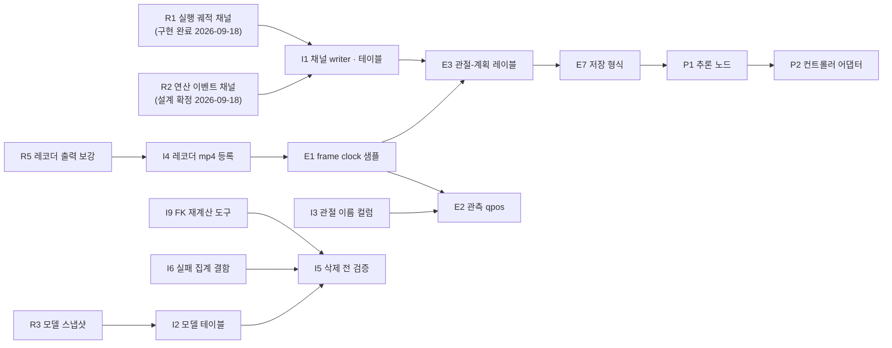

# 학습 데이터 — 미구현 목록

> **상태: 현황 목록 (2026-09-17 코드 대조).**
> **2026-09-21 재편** — 구현된 행은 각 절의 「구현됨」 표로 내렸다(날짜는 셀 안에). 남은 것만 위 표에 있다. 결정은 [결정_기록.md](결정_기록.md), 사양은 [학습_샘플_사양.md](학습_샘플_사양.md), 열린 질문은 [열린_결정.md](열린_결정.md) 로 옮겼다 — 이 문서의 §8 은 그쪽 통합표를 가리키는 요약만 남긴다.
> [결정_기록.md](결정_기록.md)(이하 "수집 설계") §0 의 결정 사항과 세 설계안 — [좌표 공간 문서](결정_기록.md), [생성 설계](학습_샘플_사양.md), [ACT 문서](학습_샘플_사양.md) — 가 요구하지만 **아직 구현되지 않은 항목**을 모은다.
> 모든 항목은 2026-09-17 에 코드를 직접 확인했고, "현재 상태" 열에 확인 근거(파일 · 행)를 적었다.
> **범위:** 데이터 출처는 트윈만 다룬다(수집 설계 D1). teleop 관련 항목은 넣지 않았다.
> **이 문서가 구현 현황의 정본이다.** 항목을 구현하면 "현재 상태"를 고치고 날짜를 적는다. 설계 문서들의 코드 수정 목록(좌표 공간 문서 §7.4 등)은 설계 근거로 남기고 현황은 여기서 관리한다.

## 목차

0. [1차 과제 진척 — isaac 쌓기](#0-1차-과제-진척--isaac-쌓기)
1. [요약](#1-요약)
2. [첫 수집 전 — 녹화](#2-첫-수집-전--녹화)
3. [첫 적재 전 — 적재 · 스키마 · 검증](#3-첫-적재-전--적재--스키마--검증)
4. [운영 설정](#4-운영-설정)
5. [export · 학습](#5-export--학습)
6. [배치 (추론)](#6-배치-추론)
7. [데카르트 단계 (보류)](#7-데카르트-단계-보류)
8. [구현보다 먼저 정해야 할 것](#8-구현보다-먼저-정해야-할-것)
9. [이미 있는 것 (참고)](#9-이미-있는-것-참고)
- [부록 A. 관련 문서](#부록-a-관련-문서)

---

## 0. 1차 과제 진척 — isaac 쌓기

과제 정의는 [추론기_배치_목표와_설계_이슈.md](추론기_배치_목표와_설계_이슈.md) §3.1, 단계별 실측 · 경위 원문은
[../archive/learning/1차_목표_진척_기록_20260920.md](../archive/learning/1차_목표_진척_기록_20260920.md) 다. 아래 단계는 **이 과제의 순서**이고, 각 단계가 쓰는
구현 항목(R · I · E · P)은 §2 이하에 있다.

| 단계 | 상태 | 결과 · 근거 |
|---|:-:|---|
| **A 배선** (A0~A6) | ✅ 2026-09-19 | 기하 성립 · 실측 20회 중 13회 완주. 전 경로(Isaac → 수집 → rosbag + 레코더 mp4 → `import` → `export`) 3 에피소드 410 샘플, 검증 전부 통과. R1 · R2 가 에피소드마다 짝으로 적재됐다. 함정 둘을 풀었다 — 이미지 토픽을 녹화 목록에서 빼기(UNIQUE 충돌), 레코더 `pixel_format: rgb8`(안 맞추면 모든 프레임이 조용히 버려진다) |
| **B 수집** (B1~B2) | ✅ 2026-09-20 | `robot-twin-collect` — **65 에피소드**(성공 58 · 실패 7). 결정 34 · 38 |
| **C 적재 · export** (C1~C2) | ✅ 2026-09-20 | 65 건 적재, 관절 데이터가 빈 에피소드 0 · mp4 65 = DB 65. export **11,719 샘플** · k=20. ⚠️ 카메라가 렌더를 걸러 **샘플이 설정 대비 60 %**(`camera_hz` 5.04 는 평균, 간격 중앙값은 정확히 100 ms) |
| **D 학습** — D1~D3 코드 | ✅ 2026-09-20 | `~/development/rdfp/rdfp-train` — Python 3.10 · `lerobot==0.4.4` · `dataset.py`(무작위 접근 불일치 0) · `train.py`(40 스텝 시험 손실 41.0 → 7.1) |
| **D4 학습 실행** | ⬜ | 절차: `rdfp-train/docs/학습_실행_절차.md`. ⚠️ **선행**: `train.py` 가 후처리기(역정규화)를 저장하지 않는다 — 돌리기 전에 고친다([추론기_배치_스택_구성.md](추론기_배치_스택_구성.md) §5.1) |
| **E 추론 배치** (E1~E3 = P1~P3) | ⬜ | [추론기_배치_스택_구성.md](추론기_배치_스택_구성.md) — 스택 구성 · 어댑터 · 앙상블 시각 문제 · 평가 루프. isaac → isaac 이라 `backend` 검사(P3)는 걸리지 않는다 |

**학습 결과가 안 좋을 때 먼저 볼 후보 둘** — 샘플이 설정 대비 60 % 인 것(위 C), 검증 분할이 없어 멈출 지점의 근거가 없는 것
(`rdfp-train/README.md` §D4).

---

## 1. 요약

**우선순위 표기:** **필수**는 그 단계 전에 끝나야 하는 것, **권장**은 없으면 품질이나 안전이 떨어지는 것, **보류**는 지금 결정(트윈만 · 관절-계획)에서는 필요 없는 것이다.

| 구분 | 항목 수 | 필수 | 권장 | 보류 | 언제까지 |
|---|---:|---:|---:|---:|---|
| 2. 녹화 | 8 | 7 | 1 | 0 | 학습용 첫 수집 전 |
| 3. 적재 · 스키마 · 검증 | 9 | 6 | 3 | 0 | 첫 적재 전 (삭제 검증은 rosbag 삭제를 켜기 전) |
| 4. 운영 설정 | 3 | 2 | 1 | 0 | 설계 완료 후 운영 전환 때 |
| 5. export · 학습 | 7 | 7 | 0 | 0 | 첫 학습 전 |
| 6. 배치 | 3 | 3 | 0 | 0 | 첫 배치 전 |
| 7. 데카르트 단계 | 5 | 0 | 0 | 5 | 단계 2 로 갈 때 |

항목 사이의 선후 관계는 다음과 같다. 화살표는 "앞이 끝나야 뒤를 할 수 있다"는 뜻이다.

---

## 2. 첫 수집 전 — 녹화

녹화에서 빠진 정보는 되돌릴 수 없으므로 **학습용 첫 수집 전에** 끝나야 한다(수집 설계 §0.4).

**남은 것은 R3 · R4 · R7(일부) · R8 이다.** R1 · R2 · R5 · R6 은 구현됐다(아래 「구현됨」 표) — R1 · R2 는 펑션베이 실주행 검증만 남았다.

| ID | 항목 | 근거 | 수정 대상 | 현재 상태 (코드 확인) | 선행 | 우선순위 |
|---|---|---|---|---|---|---|
| R3 | **기구학 모델 스냅샷** — 에피소드 시작 때 URDF · `/tf_static` · `base_frame`/`ee_frame` · 팔 관절 순서를 캡처해 헤더 있는 메시지로 발행. 캡처 실패 시 `START_EPISODE` 거부 | 좌표 공간 문서 권고 2 · §3.6 | `rdfp_msgs` 스냅샷 타입, `rdfp/session/session_control_node.py` | **없다.** 타입이 없고, `session_control_node` 에 `robot_description` · `tf_static` 참조가 없다 | §8 의 Q4 | **필수 — 그리고 sim→real 의 정당성("같은 구성인가")을 말하는 유일한 값이다**([배치 목표 문서](추론기_배치_목표와_설계_이슈.md) §4.2) |
| R4 | **에피소드 metadata 규약** — `backend`, ~~속도 배율~~(**뺀다 — R1 이 연산마다 싣는다**), 펑션베이 `publish_rate` · 씬, 계획 파이프라인, 생성 호스트, **중력 보상 설정**(Q13′ 가 요구한다). **고려사항: [열린_결정.md §R4](열린_결정.md) (2026-09-19)** — 권고는 **키 목록보다 배선이 먼저**다: `session_control_node` 가 launch 파라미터로 받은 기본값을 종료 메시지에 merge 하면 호출자가 무엇을 넘기든 채워진다. ⚠️ **지금 `teleop_keyboard` 는 metadata 를 통째로 비운다** | 좌표 공간 문서 권고 3, 생성 설계 권고 5 | `robot-twin-client` 의 `mcp_server.py`(자동 병합 키) | **일부만 있다.** 자동 병합 키는 `scene` · `seed` · `objects` 뿐이다(`mcp_server.py:211`). `backend` 등은 없다 | §8 의 Q5 | 필수 |
| R7 | **녹화 목록 정리** — R1 · R2 · R3 · R8 의 토픽을 넣고, 부하 비교용 임시 이미지 토픽을 정리한다. 펑션베이 녹화 목록을 만든다 | 좌표 공간 문서 §3.4, 생성 설계 권고 1 | `config/recording_topics*.list` (워크스페이스 루트) | **일부 (2026-09-18).** `/motion/trajectory` · `/motion/event` 를 두 목록에 넣었다. **남은 것**: R3(모델 스냅샷) · R8(보상 전 명령) 토픽, 임시 이미지 토픽 정리, **펑션베이 전용 목록**(카메라 이름이 `camera.compressed_topic` 이라 mock 목록으로는 한 장도 안 담긴다) | R3 · R8 | 필수 — **R3 · R8 · 펑션베이 목록만 남음** |
| R8 | **펑션베이 보상 전 명령** — 중력 보상을 더하기 전의 명령을 별도 토픽으로 발행. **설계 문서: [열린_결정.md §R8](열린_결정.md) (2026-09-19)** — 권고는 **지금 만들지 않는 것**이다. ① 위험한 절반(백엔드 혼합 · 이중 보상)은 **E7 의 Q13′**(`gravity_offset_included`)가 더 싸게 막고, ② **보상 전 명령은 R1 에서 복원된다** — 스트리머가 경유점을 **선형 보간**한 뒤 보상을 더하므로 기록된 stamp 에서 R1 을 보간하면 나온다. 그리고 그 사실이 더 큰 것을 드러낸다: **펑션베이 JGPC 에서는 관절-명령과 관절-계획이 사실상 같은 신호다**(그 사이에 판단하는 컨트롤러가 없다) — **의미 있는 A·B 비교는 isaac 이고 거기엔 오프셋이 없다.** 만들게 되면 별도 토픽(`sensor_msgs/JointState`, `joint_states` 테이블에 `topic_id` 로 구분 — 새 타입·테이블 없음) | 좌표 공간 문서 권고 5, 수집 설계 권고 5 | `robot_control/moveit/trajectory_streamer.py`, 녹화 목록 | **없다** | — | 권장 — 다시 볼 계기는 **스트리머의 보간이 바뀔 때**다(그때 R1 복원이 조용히 어긋난다). ⚠️ **teleop 은 계기가 아니다** — servo 경로에는 보상이 없어 걷어낼 오프셋이 없다. 대신 그쪽은 **팔이 처진 채로 조작되므로**, 펑션베이 teleop 을 모으게 되면 **"servo 경로에도 보상을 건다"가 먼저다** |

#### 구현됨 (이력 — 날짜와 검증은 셀 안에)

| ID | 항목 | 근거 | 수정 대상 | 현재 상태 (코드 확인) | 선행 | 우선순위 |
|---|---|---|---|---|---|---|
| R1 | **실행 궤적 채널** — 연산마다 한 건, 속도 배율을 적용한 실행 궤적(L2)을 `header.stamp` = t₀ 로 발행. 구현 설계: [학습_샘플_사양.md §1.2](학습_샘플_사양.md). 토픽 `motion/trajectory` · 타입 `rdfp_msgs/MotionTrajectory` (결정, 수집 설계 D13) | 수집 설계 D2 · D3, 생성 설계 권고 2 | `robot_control/moveit/` 의 `MoveGroupJgpcClient` · `MoveGroupJtcClient` 발행부, 토픽 이름 | **구현됨 (2026-09-18).** `rdfp_msgs/MotionTrajectory` · `robot_control/moveit/motion_trajectory_publisher.py` · 단위 시험 14건. 발행 지점 셋(JTC 의 `execute_trajectory_async` · `follow_trajectory_async`, 스트리머의 `stream`)이 배선됐고 isaac 관절 공간도 **계획·실행 분리**(Q2 의 (a))로 바뀌었다. **검증은 남았다** — 펑션베이 대조 미측정, 중단 행 미검증, 트윈 수집 전 과정 재통과 미완 | — (Q1 · Q2 · Q3 모두 해소) | 필수 — **검증만 남음** |
| R2 | **연산 이벤트 채널** — 연산마다 한 건, 연산 종류(이동 방식) · 해석된 목표 · 결과 · 끝난 시각 · 궤적 기준 중단 시각. **실효 속도 배율은 R1 이 싣는다.** 토픽 **`motion/event`** · 타입 **`rdfp_msgs/MotionEvent`**(결정, 수집 설계 D13). 구현 설계: [학습_샘플_사양.md §1.3](학습_샘플_사양.md) — **메시지 정의가 확정이라 §3.1 의 필드를 그대로 `.msg` 로 옮기면 된다**(결정 열) | 수집 설계 D3 · D5 · D13 | 메시지 타입(`rdfp_msgs`, 별도 저장소), `MoveGroupJtcClient` · `MoveGroupJgpcClient` · `TrajectoryStreamer` 발행부 | **구현됨 (2026-09-18).** `rdfp_msgs/MotionEvent` · `moveit/motion_event_publisher.py` · 발행 지점 셋(JTC 결과 콜백 · 스트리머 · JGPC 계획 콜백) · 단위 시험 26건. **mock(JTC) 실측으로 §5 검증표 전수 통과** — 불변식 `(R1 있음) ⇔ (result ≠ failed)` 성립, 중단 시각 정확. **펑션베이(JGPC)는 코드만 들어갔고 실주행 미검증**(시뮬레이터 없음) | — (Q1 해소) | 필수 — **펑션베이 검증만 남음** |
| R5 | **레코더 출력 보강** — 에피소드 키(`/session` 시작 메시지의 `header.stamp`)를 기록하고, metadata 를 에피소드마다 남기며, topic · codec · fps 를 싣는다 | 좌표 공간 문서 권고 12, 생성 설계 권고 7 | `rdfp/recorder/rdfp_image_recorder_node.py` | **구현됨 (2026-09-18).** metadata 가 `<prefix>_<start_ts>_metadata.json` 으로 **에피소드마다 한 벌**이 됐고(전에는 prefix 당 한 파일이라 덮어써서 마지막 것만 남았다), `episode_key`(`/session` IN_EPISODE 의 `header.stamp`) · `topic` · `codec`(ffmpeg 이 **실제로 고른** 값) · `fps` · `input_format` · `width`/`height` · `pixel_format` · `mp4`/`sidecar` 이름을 싣는다. 단위 시험 5건 + **실제 ffmpeg 로 에피소드 2개 → 파일 6개** 확인(각 metadata 가 자기 `episode_key` 를 갖고 sidecar 줄 수 = `nframe`). ⚠️ **`episode_key` 는 파일 이름의 벽시계와 다르다** — `use_sim_time` 스택에서는 둘이 무관하므로 적재는 반드시 metadata 안의 값을 봐야 한다 | — | 필수 |
| R6 | **레코더 출력 위치** — `/tmp` 밖의 장기 보관 경로로 옮긴다 | 좌표 공간 문서 권고 12 | `robot_control/config/image_pipeline.yaml` | **구현됨 (2026-09-18).** `output_dir: /data/rdfp/recordings` — rosbag(`/data/rdfp/rosbag`)과 같은 데이터 루트다. 서비스 구동 레코더의 코드 기본값(`image_recorder_node.py`)과 가이드·README 의 예제도 함께 바꿨다. 디렉터리는 노드가 없으면 만든다(`_prepare_output_dir`) | — | 필수 |

> R5 · R6 은 코드가 아니라도 **녹화 전에** 바뀌어야 한다. 레코더 mp4 는 rosbag 과 달리 지우면 안 되는 장기 원본이다(수집 설계 §7.3).

---

## 3. 첫 적재 전 — 적재 · 스키마 · 검증

rosbag 은 적재 뒤 지우므로 **적재가 버린 것도 되돌릴 수 없다**(좌표 공간 문서 §3.5).

| ID | 항목 | 근거 | 수정 대상 | 현재 상태 (코드 확인) | 선행 | 우선순위 |
|---|---|---|---|---|---|---|
| I2 | **기구학 모델 테이블** — `kinematic_models`(내용 해시 · 기구학 지문 · URDF · 정적 변환 · 프레임 · 관절 순서)와 `sessions.kinematic_model_hash`, 스냅샷 writer | 좌표 공간 문서 권고 2 · §3.6 | `schema.sql` · registry · writer | **없다.** 스키마에 해당 테이블 · 컬럼이 없다 | R3, §8 의 Q4 | 필수 |
| I5 | **rosbag 삭제 전 검증 게이트** — 토픽별 메시지 수 대 적재 행 수, 버린 사유별 집계, 실패 · 제외된 에피소드의 split 보존, FK 대조, mp4 대조 | 좌표 공간 문서 권고 11 | `rdfp/dataset/import_cmd.py` · `ingest/pipeline.py` | **없다.** `delete_splits_after_import` 가 켜지면 import 가 예외 없이 끝났을 때 발견된 split 전부를 지운다(`import_cmd.py:188~189`). 기본값은 `False` 라 지금은 드러나지 않는다(`config.py:124`) | I6 · I9 · I2 · I4 | 필수 — rosbag 삭제를 켜기 전 |
| I6 | **병렬 적재 실패 집계 결함** — 실패한 에피소드가 요약에 드러나지 않고 종료 코드 0 으로 끝난다 | 좌표 공간 문서 §3.5 | `ingest/pipeline.py` | **결함이 있다.** 워커는 예외를 `status='failed'` 로 돌려주지만(`episode_worker.py:87, 97`) 요약은 `done` · `skipped` 만 센다(`pipeline.py:76~85`) | — | 필수 |
| I7 | **무손실 폴백 테이블** — writer 가 없거나 헤더가 없는 메시지를 raw CDR · 타입 이름 · 스키마 텍스트 · `log_time` 으로 보존 | 좌표 공간 문서 권고 13 | `rdfp/rosbag/mcap_reader.py` · `pipeline.py` · `schema.sql` | **없다.** 헤더 없는 메시지는 debug 로그만 남기고 건너뛰고(`mcap_reader.py:59~66`), writer 없는 타입은 경고 후 무시한다 | — | 권장 |
| I8 | **rosbag `log_time` 역행 검사** — 파일 기록 순서에서 `log_time` 이 거꾸로 가면 경고 | 생성 설계 권고 6 | `rdfp/dataset/ingest/quality_gate.py` | **일부만 있다.** 품질 게이트는 토픽별 `header.stamp` 역행과 긴 공백만 경고한다(`quality_gate.py` 모듈 docstring). 파일 기록 순서의 `log_time` 역행은 보지 않는다 | — | 권장 |
| I9 | **스택 쪽 FK 재계산 · 적합성 시험 도구** — 스냅샷과 `joint_states` 로 TCP 를 다시 계산해 `/ee_pose` 와 대조. 기구학 일치 · TCP 원점과 축 · 새 값 주기 · 연속성 | 좌표 공간 문서 권고 15 · §5.8 | 스택 검사 도구 신설 (`robot_control.gravity.GravityCompensator._forward` 재사용) | **없다.** 해당 스크립트 · 모듈이 없다 | I2 | 권장 — I5 의 FK 대조와 데카르트 단계가 이 도구를 쓴다 |

#### 구현됨 (이력 — 날짜와 검증은 셀 안에)

| ID | 항목 | 근거 | 수정 대상 | 현재 상태 (코드 확인) | 선행 | 우선순위 |
|---|---|---|---|---|---|---|
| I1 | **실행 궤적 · 연산 이벤트 적재** — 두 채널의 writer · reader · 테이블 | 수집 설계 §10, 생성 설계 §12 | `rdfp/dataset/db/registry.py` · `writers/` · `readers/` · `sql/schema.sql` | **구현됨 (2026-09-18).** 테이블 `motion_trajectories` · `motion_events`(둘 다 `(episode_id, operation_id)` 인덱스로 짝짓는다), writer · reader 각 2개, registry 바인딩 2개, `schema_check` 등록, `drop.sql` 갱신, 단위 시험 10건. **실 PostgreSQL 로 스키마 적용 · writer→reader 왕복 · `ensure_schema` 를 검증했다.** 경유점은 jsonb(`{t, positions, velocities, accelerations}`)이고 `duration_sec` 는 마지막 점의 `t` 에서 나오는 GENERATED 컬럼이다 | R1 · R2 | 필수 |
| I3 | **`joint_states` 관절 이름 컬럼** | 좌표 공간 문서 권고 4 | `schema.sql` · `writers/joint_state.py` · `readers/joint_state.py` | **구현됨 (2026-09-18).** `joint_names TEXT[] NOT NULL DEFAULT '{}'` 와 위치 배열과의 길이 일치 CHECK. writer 가 `msg.name` 을 싣고 reader 가 되살린다. **발행자가 안 채웠으면 사실대로 비워 둔다** — `target_joint_cmds_publisher` 는 컨트롤러 `joints` 조회가 시간 초과되면 빈 이름으로 내며, export 의 `load_joint_series` 가 그런 행을 **거부**해 드러낸다 | — | 필수 |
| I4 | **레코더 mp4 등록 경로** — 적재 배치가 에피소드 id 를 만든 뒤 레코더 mp4 · sidecar 를 읽어 `image_streams` · `image_frames` 에 등록 | 좌표 공간 문서 권고 12, 생성 설계 권고 7 | `rdfp/dataset/ingest/` (신설) | **구현됨 (2026-09-18).** `ingest/media/recorder_registry.py` — `scan_recordings()` 가 출력 루트를 훑어 **`episode_key` 로 색인**하고(파일 이름의 벽시계로 맞추지 않는다 — sim time 스택에서는 무관하다), `RecorderRegistrar.register(episode_id, episode_ns)` 가 `image_streams` 1행 + sidecar 줄마다 `image_frames` 1행을 넣는다. **에피소드 트랜잭션 안에서 커밋 직전에** 부르며 직렬·병렬 두 경로에 모두 배선했다. 영상은 rosbag 에 없으므로 `topics` 행도 여기서 upsert 한다. 설정 키는 `recordings_dir`(없으면 등록 안 함). 시험 14건(실 PostgreSQL 왕복 포함) + **실제 레코더 출력 2 에피소드 → DB 등록** 확인. **sidecar 줄 수 ≠ `nframe` 이면 올린다** — 조용히 넘기면 프레임 인덱스가 밀린 채 적재된다 | R5 | 필수 |

---

## 4. 운영 설정

현재 시뮬레이터 설정은 연동 확인용이며, 설계가 끝나면 isaac · 펑션베이 모두 최종 값으로 다시 운영한다(수집 설계 D12).

| ID | 항목 | 근거 | 수정 대상 | 현재 상태 | 우선순위 |
|---|---|---|---|---|---|
| O1 | **최종 운영 주기 반영** — 카메라 10 Hz · 관절 관측 50 Hz (잠정, 확정 후 반영). 레코더 fps 도 카메라와 맞춘다 | 수집 설계 D8 · D10 · D12 | `robot_control/config/isaac_scene.json`(`camera.fps`), 펑션베이 시뮬레이터 XML, `image_pipeline.yaml`(레코더 fps), isaac 컨트롤러 update 주기 | **카메라는 반영했다 (2026-09-17)** — isaac `"fps": 10`(`isaac_scene.json`), 펑션베이 프로파일 `camera.fps: 10`(시뮬레이터 XML 10). 남은 것: isaac 관절 관측 100 Hz, 펑션베이 관절 관측 50 Hz 확정, isaac 10 Hz 렌더 부하 확인 | 필수 — 운영 전환 때 ⚠️ **실측이 설정대로 안 나온다 (2026-09-20, isaac 65 에피소드 11,654 간격).** 간격 중앙값은 **정확히 100 ms(10 Hz)** 이고 최솟값도 100 ms 인데, **15 %가 200 ms 를 넘고 값이 100 ms 의 정수배**다(p90 300 · p99 800 · 최대 2100). 느려진 것이 아니라 **렌더를 통째로 거른다.** 그 결과 **샘플이 설정 대비 60 %** 이고 export 의 `camera_hz` 는 평균이라 5.04 로 나온다 — 그 값만 보면 구조가 안 보인다. `/clock` 배속(0.945)과 GPU 열 제한은 **원인이 아니다**(둘 다 정상). **관절 관측을 50 Hz 로 내리기 전에 이것부터 본다** — 관측이 이미 성긴데 더 내리면 겹친다 |
| O2 | **펑션베이 시계 기준 운영 규칙** — `joint_state_fusion` 의 `stamp_source`(현재 기본 `auto`: 시뮬레이터 stamp 사용)를 `now` 로 둘지 정하고, 수집 전 점검 절차에 넣는다 | ACT 문서 §1.3 | `robot_control/functionbay/joint_state_fusion_node.py` 설정, 수집 절차 문서 | 점검 도구(`fb_checkup.py`)는 있다. 운영 규칙은 정하지 않았다 | 필수 — 펑션베이 수집 전 |
| O3 | **데이터 생성 중 servo 비활성** — `teleop_keyboard` 를 띄우지 않는다 | 생성 설계 권고 8 | 수집 절차 문서 (강제 장치 없음) | 절차로만 있다 | 권장 |

---

## 5. export · 학습

1차 학습은 ACT 형식, 경우 B(관절-계획)다(수집 설계 D2 · D6). **ACT 샘플 한 벌이 나온다 (2026-09-18)** — `rdfp/dataset/export/` 에 frame clock(E1) · 관절-계획 레이블과 chunk(E3) · 관측 `qpos`(E2) · 그리퍼 행동(E4) · 관절-명령 비교 기준(E5)이 들어갔다. **레코더 mp4 부터 `(observation, action)` 쌍까지 실측으로 이어지고, 두 레이블(계획/명령)을 같은 격자에서 견줄 수 있다.** **E1~E7 전부 구현됐다 (2026-09-19)** — `ros2 run rdfp export` 가 65 에피소드 · 11,719 샘플을 냈다(2026-09-20). 남은 것은 학습(D4)과 배치(§6)다.

| ID | 항목 | 근거 | 선행 | 우선순위 |
|---|---|---|---|---|

#### 구현됨 (이력 — 날짜와 검증은 셀 안에)

| ID | 항목 | 근거 | 선행 | 우선순위 |
|---|---|---|---|---|
| E1 | **frame clock 샘플 생성** — 에피소드 구간 안의 카메라 프레임마다 샘플 하나. 기준 시각은 sidecar 의 `stamp`, 영상은 mp4 의 `frame_index` 번째 프레임. **구현됨 (2026-09-18):** `rdfp/dataset/export/frame_clock.py` 의 `load_frame_clock(conn, episode_id, topic=)` 과 `arm_action_chunks(clock, label, ...)`. 카메라가 여럿이면 **고르라고 요구한다**(아무거나 고르면 영상과 레이블의 위상이 조용히 어긋난다). `interval_stats()` 로 **설정 fps 가 아니라 실측 간격**을 본다 — 펑션베이는 설정 10 Hz 가 실측 9.54~9.60 Hz 였다. 시험 10건(실 PostgreSQL) | 수집 설계 D7, ACT 문서 §3 | I4 | 필수 |
| E2 | **관측** — `qpos` 팔 7축은 `/joint_states` 를 t_i 에서 선형 보간, 그리퍼는 `/gripper_states` 의 `width` 최근접. **구현됨 (2026-09-18):** `export/observation.py` 의 `JointSeries` · `GripperWidthSeries` · `qpos()`. **관절을 이름으로 고른다** — 손가락 관절이 섞인 관측에서 팔만 뽑는 것이 I3 의 쓸모다. 시험 17건(실 PostgreSQL 포함) | 수집 설계 D10, ACT 문서 §3.1 | — (E1 · I3 · Q8 해소) | 필수 |
| E3 | **관절-계획 레이블 함수와 chunk** — plan(τ) (연산 중 보간 · 정상 종료 뒤 끝점 · 중단 뒤 중단 시각 값 · 첫 연산 전 초기 관측), τ_j = t_i + Δ + j × 100 ms, k 스텝, `is_pad`. **구현됨 (2026-09-18):** `rdfp/dataset/export/motion_label.py` 의 `PlanLabel.at(τ)` · `.chunk(t, k=, step=, delta=)` 와 `load_operations(conn, episode_id)`. ROS·DB 없이 도는 순수 계산이고 단위 시험 22건. **실 PostgreSQL 로 전 경로(메시지→writer→DB→레이블) 확인** — 2초 궤적을 1초에 중단한 연산에서 레이블이 **중단 자리(2.0)를 유지하고 궤적 끝점(3.0)으로 가지 않는다.** **E1 이 τ 격자를 주면서 완성됐다 (2026-09-18)** — `arm_action_chunks(clock, label, k=, step=, delta=)` 가 프레임마다 chunk 하나를 낸다. **전 사슬 실측**(레코더 ffmpeg → DB → frame clock × plan(τ))에서 네 구간이 모두 옳았다: 첫 연산 이전 · 실행 중 보간 · 끝점 유지 · **중단 뒤 멈춘 자리 유지**(궤적대로면 3.0 인데 2.0 을 유지) · 에피소드 끝 `is_pad` | 수집 설계 D5 · D9, ACT 문서 §5 | — (E1 · I1 · Q6 해소) | 필수 |
| E4 | **그리퍼 행동** — τ_j 이전 마지막 `/gripper_cmds` 를 0차 유지, one-hot(`open` · `close` · `grasp`). **구현됨 (2026-09-18):** `export/observation.py` 의 `GripperCommandSeries.one_hot()`. 심볼 순서가 **배치의 argmax 계약**이고, 모르는 심볼은 **전부 0** 이다(임의의 칸을 세우면 정책이 없는 명령을 배운다) | ACT 문서 §3.2 | — (E1 · Q7 해소) | 필수 |
| E5 | **관절-명령 비교 기준 레이블** — 관절-명령을 격자에서 보간(δ, 명령 공백은 직전 명령 유지). **구현됨 (2026-09-18):** `export/command_label.py` 의 `CommandLabel`. **`PlanLabel` 과 같은 인터페이스**라 `arm_action_chunks()` 에 바꿔 끼워 같은 격자에서 비교한다. **공백 임계는 명령 간격의 중앙값 × 2 로 추정**해 호출자가 백엔드(isaac 100 Hz / 펑션베이 50 Hz)를 몰라도 되게 했다 — 중앙값인 것은 긴 공백 몇 개가 평균을 끌어올리기 때문이다. `gap_intervals()` 가 공백 구간을 드러내 ACT §9 의 2 가 재려는 분포를 바로 볼 수 있다. 시험 17건 | 수집 설계 §0.4, ACT 문서 §4 | — (E1 해소) | 필수 — 비교 기준을 쓸 때 |
| E6 | **정규화와 데이터셋 metadata**. **구현됨 (2026-09-18):** `export/dataset_meta.py` 의 `RunningStats`(Welford 스트리밍) · `Normalizer` · `ExportSpec` · `build_metadata`. **`NaN` 은 그 차원만 건너뛰고 센다** — 펑션베이의 `width`(값이 없으면 NaN) 한 샘플이 통계를 통째로 `NaN` 으로 만들지 않게. **움직이지 않은 차원은 정규화하지 않고**(0 으로 나누면 `inf`) 관절 이름을 짚어 경고로 남긴다. **`ExportSpec.assert_compatible()` 이 배치 규약 불일치를 검사로 잡는다** — ACT §7 의 "카메라 주기·δ·T_a·k 가 같아야 한다"는 어긋나도 에러가 안 나서 "학습은 됐는데 잘 안 된다"로만 나타난다. `camera_hz` 는 실측이라 상대 20 %까지 봐준다. 시험 27건 · 2 에피소드 실측 확인. **`backend` 는 `sessions.metadata` 에서 읽고, 모델 지문은 I2 가 붙어야 채워진다** — 없으면 metadata 의 `notes` 가 "모른다"고 적는다 | ACT 문서 §3.3 · §7 | E2 · E3 (I2 는 지문 필드만) | 필수 |
| E7 | **저장 형식** — LeRobot v3 등. 단일 fps 규약에 맞게 chunk 를 미리 계산해 저장할지 정한다. **구현됨 (2026-09-19):** `export/writer.py` 의 `export_episode` · `export_dataset` 와 `export` CLI 가 `metadata.json` + `episodes.jsonl` + 에피소드별 `.npz` 를 만든다. 시험 23건(실 PostgreSQL 왕복). **`episodes.jsonl` 이 `LabelStats` 세 카운트를 싣고, 이벤트가 없어 정상 종료로 *가정한* 에피소드는 기본 제외한다.** **mock 실 수집으로 전 경로를 확인했다 (2026-09-19)** — 세션→에피소드→rosbag+레코더 mp4→`import`→`export` 로 82 샘플, §7 검증 전부 통과. 그 과정에서 **적재 writer 가 그리퍼 `goal` 을 흘리고 있던 것**을 찾아 고쳤다(`getattr(msg, 'label', '')` — 필드 이름이 `goal` 로 바뀐 뒤 기본값 때문에 조용했고, 스텁 시험도 같은 오류를 공유했다). **설계 문서: [저장_형식.md](저장_형식.md) (2026-09-19).** 권고는 **에피소드별 `.npz` + `metadata.json` 으로 먼저 내고, LeRobot 으로 가는 길만 열어 두는 것**이다 (변환기는 LeRobot 이 실제로 필요해질 때 만든다) — 형식 결정이 학습을 막고 있는데 **저장 형식은 번복할 수 있다**(DB 가 원본이다). **chunk 는 어느 쪽을 택하든 미리 계산한다** — frame clock 이 고정 격자가 아니라 실제 카메라 stamp 라(펑션베이 실측 9.54~9.60 Hz) 행을 이어 붙이면 레이블이 조금씩 밀리고, **틀린 양이 작아서 에러가 아니라 "학습이 잘 안 된다"로만 나타난다.** 비용은 20초 에피소드에서 **86 KB**(경우 B, k=10)로 같은 에피소드 mp4 의 3~9 % 다. **영상은 다시 인코딩하지 않는다** | ACT 문서 §8, 수집 설계 §11 의 4 | E3, §8 의 Q9 | 필수 |

---

## 6. 배치 (추론)

추론기 배치 노드는 아직 없다. 규약의 정본은 [학습_샘플_사양.md](학습_샘플_사양.md) §6, **isaac 1단계의 스택 구성과 확인된 걸림돌(후처리기 누락 · 앙상블 시각 문제)은 [추론기_배치_스택_구성.md](추론기_배치_스택_구성.md)** 에 있다.

| ID | 항목 | 근거 | 현재 상태 | 우선순위 |
|---|---|---|---|---|
| P1 | **추론 노드** — 카메라 10 Hz 마다 추론, temporal ensembling, 그리퍼 one-hot 을 심볼로 되돌려 `/gripper_cmds` 발행(같은 심볼은 다시 보내지 않음). 추론은 100 ms 안에 끝나야 한다. **정책은 `lerobot==0.4.4` 의 `ACTPolicy` 를 노드 안에서 그대로 부른다** — 학습도 같은 버전으로 맞췄으므로(E7 §5.3.3) 변환 단계가 없다. ⚠️ **Ubuntu 24.04(Python 3.12)로 옮겨 0.6.x 로 올릴 때 이 자리를 다시 본다** — 그때 노드와 학습의 버전이 갈리면 **TorchScript·ONNX 로 내보내거나** 프로세스를 나눈다 | ACT 문서 §7, [저장_형식](저장_형식.md) §5.2 · §5.3.3 | 없다 | 필수 |
| P2 | **컨트롤러 어댑터** — 10 Hz 목표를 계단으로 넣지 않고 보간해 넣는다. isaac 은 JTC 단일점 `time_from_start = Δ`(`open_loop_control: true` 는 이미 설정돼 있다), 펑션베이는 직전 명령에서 50 Hz 로 보간해 스트리밍하고 중력 보상을 건다 | 수집 설계 D11 · §9 | 없다. 재생용 `target_joint_cmds_executor`(JTC 단일점, `time_from_start` 기본 0)가 출발점이 될 수 있다 | 필수 |
| P3 | **학습 · 배치 조건 대조** — 배치 때의 카메라 주기 · Δ · 행동 스텝 · k 를 데이터셋 metadata(E6)와 대조해 어긋나면 거부. ⚠️ **`backend` 검사는 실기 배치에서 오히려 걸린다** — 일부러 다른 백엔드에 배치하는 것이 목표이므로, 판정은 백엔드 이름이 아니라 **기구학 지문**이어야 한다([배치 목표 문서](추론기_배치_목표와_설계_이슈.md) §4.2) | ACT 문서 §7 | 없다 | 필수 |
| P4 | **실기 백엔드 프로파일과 하드웨어 배선** — `config/backends/` 에 실기용이 없고 저장소에 franka 하드웨어 인터페이스가 없다. ⚠️ **`motion.gravity_compensation` 키를 넣지 않는다** — 실기 Panda 는 자체 보상한다 | [배치 목표 문서](추론기_배치_목표와_설계_이슈.md) §4.3 · §4.6 | 없다 | **1차 목표 완료 후 검토** — 지금 만들지 않는다. 1차의 산출물(예기치 못한 문제 목록)이 요구사항을 바꾼다 |
| P5 | **카메라 외부 파라미터 정합** — 실기 카메라를 시뮬레이터 카메라 자리에 맞춘다. 영상 도메인 갭 중 **가장 구체적이고 조치 가능한 부분**이다 | [배치 목표 문서](추론기_배치_목표와_설계_이슈.md) §4.4, `isaac_scene.json` | 없다 | **1차 목표 완료 후 검토** — 2단계 항목이다 |

---

## 7. 데카르트 단계 (보류)

1차 학습이 관절-계획이므로 지금은 필요 없다. 데카르트 배치(좌표 공간 문서 §7.1 의 단계 2)로 갈 때 필요하다. **수집은 막지 않는다** — 학습용 TCP 는 적재된 모델 스냅샷으로 다시 계산한다(좌표 공간 문서 §5.6).

| ID | 항목 | 근거 | 수정 대상 | 현재 상태 (코드 확인) |
|---|---|---|---|---|
| C1 | **isaac TCP 정의** — `frames.ee` 를 파지 중심으로 정의하고, `robot-twin-client` 의 45° 처리를 함께 정리(그대로 넣으면 90° 이중 회전) | 좌표 공간 문서 권고 14 | `robot_control/config/backends/isaac.yaml`, `robot-twin-client` 의 `pick_n_place.py` | `isaac.yaml` 의 `frames` 에 `tip` 만 있다(62~63행). 클라이언트가 `_HAND_YAW_RAD = π/4` 를 곱한다(`pick_n_place.py:49`, `to_arm_command()` 73행) |
| C2 | **`/ee_pose` 새 값 주기** — 발행 50 Hz 인데 새 값은 약 18 Hz | 좌표 공간 문서 권고 14 · §5.8 | launch 의 `robot_state_publisher` 파라미터, 또는 `ee_pose_publisher` 가 `/joint_states` 로 직접 계산 | `publish_frequency` 를 설정하는 launch 가 없다(기본 20 Hz) |
| C3 | **`/ee_pose` 연속성** — 새 값이 없을 때 같은 stamp 로 반복 발행하지 않는다 | 좌표 공간 문서 권고 14 | `robot_control/moveit/ee_pose_publisher.py` | 매 주기 최신 TF 를 조회해 그 stamp 로 발행하며, 직전과 같은 stamp 를 거르는 처리가 없다(48 · 60행) |
| C4 | **`move_to_pose` 배선** — 자유 공간 데카르트 목표 계획 | 좌표 공간 문서 권고 16 | `robot_control/moveit/`(`MoveGroupClient`), `robot_twin/backends.py` | `_not_wired` 로 등록돼 있다(`backends.py:728`). `robot_control` 에 IK 나 위치 · 자세 제약을 쓰는 코드가 없다 |
| C5 | **데카르트 export · 배치** — 6D 자세 변환, 재계산 TCP 레이블, 데카르트 스트리밍 | 좌표 공간 문서 권고 7 ~ 9 · §5.2 | export 도구, 배치 어댑터 | 없다 (데카르트 스트리밍은 별도 결정) |

---

## 8. 구현보다 먼저 정해야 할 것

**정본은 [열린_결정.md](열린_결정.md) §1 의 통합표다** (2026-09-21 에 옮겼다). 닫힌 것은 [결정_기록.md](결정_기록.md) 에 있다.
이 절에 있던 Q1~Q10 의 대응:

| 옛 ID | 상태 | 지금 어디 |
|---|---|---|
| Q1 (R1 · R2 채널 이름 · 타입) · Q2 (isaac L2) · Q6 (chunk 평가 · 보간) · Q7 (첫 그리퍼 명령 이전 = `open`) · Q8 (경계 프레임 · NaN) · Q9 (저장 형식) | **해소** | 결정_기록 11 · 16 · 24 · 25 · 27 · 28 |
| Q3 (isaac t₀ 정밀화) | 열림 | 열린_결정 O-2 |
| Q4 (기구학 지문) | 열림 | 열린_결정 O-10 |
| Q5 (metadata 키 목록) | 열림 | 열린_결정 O-8 · §R4 |
| Q10 (최종 운영 주기) | 열림 | 열린_결정 O-1 |
| Q7 의 남은 절반 (`close` 와 `grasp` 합치기) | 열림 | 열린_결정 O-5 |

## 9. 이미 있는 것 (참고)

미구현 항목과 헷갈리기 쉬운, 이미 동작하는 구성요소다.

| 구성요소 | 상태 | 비고 |
|---|---|---|
| 트윈 세션 · 에피소드 연산, `reset_scene`(isaac), `sessions.success` · `metadata` 적재 | 있다 | 생성 설계 §1.3.5. 수집 전 과정은 isaac 에서 통과 |
| 관절-명령 `/target_joint_cmds` 발행 · 녹화 · 적재 | 있다 | 원천: JTC `joint_trajectory` · `JointState` · `Float64MultiArray`. mock(JTC) 의 MoveIt 구간을 채우는 `controller_state` 원천(A′)은 없다 — 보류(수집 설계 권고 4) |
| `/joint_states` · `/ee_pose` · `/gripper_cmds` · `/gripper_states` · `/scene/objects` 녹화 · 적재 | 있다 | `joint_states` 는 2026-09-18 부터 관절 이름도 싣는다(I3 — `joint_names TEXT[]`). **그 전 데이터는 비어 있고** export 는 이름 없는 행을 거부한다 |
| `rdfp_image_recorder` 의 mp4 + 프레임별 sidecar(`frame_index` · `header.stamp`) | 있다 | 에피소드 키 · 에피소드별 metadata 를 싣고(R5) 적재가 `image_streams` · `image_frames` 에 등록한다(I4, 2026-09-18). 출력 위치는 `/data/rdfp/recordings`(R6) |
| JGPC 스트리밍의 50 Hz 보간(`publish_rate`)과 중력 보상 | 있다 | 배치 어댑터(P2)가 재사용할 수 있다 |
| 적재 품질 게이트(`header.stamp` 역행 · 긴 공백 경고) | 있다 | `log_time` 역행은 보지 않는다(I8) |
| `delete_splits_after_import` 옵션 | 있다 (기본 꺼짐) | 검증 없이 지운다 — 켜기 전에 I5 · I6 |
| 펑션베이 stamp 기준 점검 `fb_checkup.py` | 있다 | 운영 규칙은 O2 |
| 재생용 `target_joint_cmds_executor` | 있다 | 배치 어댑터(P2)의 출발점 |

---

## 부록 A. 관련 문서

- [결정_기록.md](결정_기록.md) — §0 결정 사항(D1 ~ D12), 권고, 배치 규약
- [결정_기록.md](결정_기록.md) — 권고 1 ~ 16, §3.5 적재 손실, §3.6 모델 스냅샷, §7.4 코드 수정 대상(설계 근거)
- [학습_샘플_사양.md](학습_샘플_사양.md) — 실행 궤적 · 연산 이벤트 채널(권고 2), 레이블 규칙(§10.3), 배치 규약(§11), 열린 질문(§13)
- [학습_샘플_사양.md](학습_샘플_사양.md) — 샘플 구조, 레이블 함수(§5.2), 배치(§7), 선결 항목(§8), 열린 질문(§9)
- [학습_샘플_사양.md §1.2](학습_샘플_사양.md) — R1 구현 설계: 궤적이 만들어지는 네 경로, 발행 지점, isaac 관절 공간 처리(Q2) · t₀ 후보(Q3), 검증
- [추론기_배치_목표와_설계_이슈.md](추론기_배치_목표와_설계_이슈.md) — **배치 목표**(백엔드별로 닫힌 두 줄, 각 줄의 끝에 같은 구성의 실기)와 그로부터 나온 이슈: **EE 프레임 B안이 펑션베이 줄의 전제 조건**, `assert_compatible` 의 `backend` 검사가 실기 배치를 막는다, 실기 백엔드·카메라 정합 부재, 우선순위 재조정
- [열린_결정.md §R4](열린_결정.md) — 에피소드 metadata(R4 · Q5): 생산자 셋과 규약 부재, **종료 시점에만 채워지는 문제**, 키 판정표(속도 배율은 빼고 보상 설정은 더한다), 검증을 어디까지 할지, 단계별 권고
- [열린_결정.md](열린_결정.md) — 중력 보상 오프셋을 데이터가 스스로 말하게 하는 방법(E7 Q13′): 값의 출처 넷 · 입도(첫 에피소드 문제) · 기록 형태 · `STRICT_KEYS` · 단계별 권고. **R4 의 키 목록에 보상 정보를 더해야 한다**는 것이 여기서 나온다
- [열린_결정.md §R8](열린_결정.md) — R8 설계: 중력 보상 오프셋이 관절-명령에 섞이는 문제, **보상 전 명령이 R1 에서 복원된다**는 것과 그래서 펑션베이 A·B 비교의 값어치가 작다는 것, 선택지 넷과 「지금 만들지 않는다」 권고
- [학습_샘플_사양.md §1.3](학습_샘플_사양.md) — R2 구현 설계: 연산의 끝을 아는 네 자리와 세 가지 어긋남(끝의 모양 · 중단 시각 · `operation_id` 전달), 메시지 형식과 발행 지점의 선택지·권고(Q1 의 남은 절반), 검증 표, 코드 위치 부록
