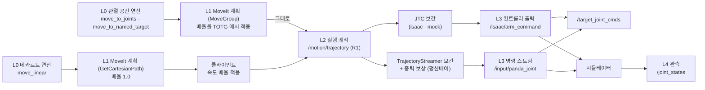
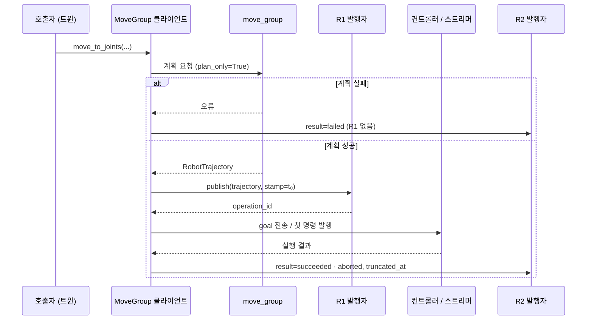
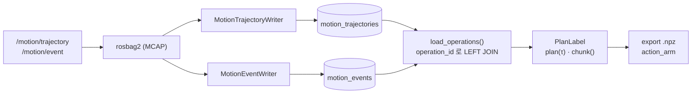

# 실행 궤적 채널 (R1) 구현

이 문서는 팔 동작 연산마다 컨트롤러로 보낸 궤적을 기록하는 실행 궤적 채널(R1)이 현재 어떻게 구현되어 있는지 설명한다. 시스템에 등장하는 다른 궤적과 무엇이 다른지, 왜 여러 형식의 궤적이 함께 존재하는지도 함께 다룬다. 채널 사양의 요약은 [학습_샘플_사양.md §1.2](학습_샘플_사양.md#12-실행-궤적-rdfp_msgsmotiontrajectory-r1) 에 있고, 짝 채널인 연산 이벤트(R2)는 같은 문서 §1.3 에 있다.

## 목차

1. [개요](#1-개요)
   - [1.1 실행 궤적이란](#11-실행-궤적이란)
   - [1.2 채널 계약 요약](#12-채널-계약-요약)
2. [시스템에 등장하는 궤적](#2-시스템에-등장하는-궤적)
   - [2.1 명령 체인과 궤적의 위치](#21-명령-체인과-궤적의-위치)
   - [2.2 궤적 형식 비교](#22-궤적-형식-비교)
   - [2.3 계획 궤적(L1)과 실행 궤적(L2)의 차이](#23-계획-궤적l1과-실행-궤적l2의-차이)
   - [2.4 여러 형식의 궤적이 필요한 이유](#24-여러-형식의-궤적이-필요한-이유)
3. [메시지 형식](#3-메시지-형식)
   - [3.1 `rdfp_msgs/MotionTrajectory` 필드](#31-rdfp_msgsmotiontrajectory-필드)
   - [3.2 전용 타입을 쓰는 이유](#32-전용-타입을-쓰는-이유)
   - [3.3 R2 와의 관계](#33-r2-와의-관계)
4. [발행 구현](#4-발행-구현)
   - [4.1 연산별 실행 경로](#41-연산별-실행-경로)
   - [4.2 t₀ 정의](#42-t₀-정의)
   - [4.3 `MotionTrajectoryPublisher`](#43-motiontrajectorypublisher)
   - [4.4 `MoveGroupJtcClient` 의 발행 지점](#44-movegroupjtcclient-의-발행-지점)
   - [4.5 `TrajectoryStreamer` 의 발행 지점](#45-trajectorystreamer-의-발행-지점)
   - [4.6 두 배율의 처리](#46-두-배율의-처리)
   - [4.7 실패 처리](#47-실패-처리)
5. [적재와 레이블 계산](#5-적재와-레이블-계산)
   - [5.1 녹화에서 export 까지](#51-녹화에서-export-까지)
   - [5.2 `motion_trajectories` 테이블](#52-motion_trajectories-테이블)
   - [5.3 `MotionTrajectoryWriter`](#53-motiontrajectorywriter)
   - [5.4 관절-계획 레이블 `PlanLabel`](#54-관절-계획-레이블-planlabel)
6. [사용 예제](#6-사용-예제)
   - [6.1 토픽 확인](#61-토픽-확인)
   - [6.2 클라이언트로 연산 실행](#62-클라이언트로-연산-실행)
   - [6.3 미리 계획한 궤적을 직접 실행](#63-미리-계획한-궤적을-직접-실행)
   - [6.4 DB 에서 연산 조회](#64-db-에서-연산-조회)
   - [6.5 레이블 계산](#65-레이블-계산)
7. [주의 사항](#7-주의-사항)
   - [7.1 시간 정렬](#71-시간-정렬)
   - [7.2 기록 범위](#72-기록-범위)
   - [7.3 실행 경로](#73-실행-경로)
   - [7.4 기록 실패](#74-기록-실패)
8. [코드 위치](#8-코드-위치)

---

## 1. 개요

### 1.1 실행 궤적이란

실행 궤적은 연산 하나를 실행할 때 MoveGroup 클라이언트가 컨트롤러로 넘긴 관절 궤적이다. 여기서 연산은 `move_to_named_target` · `move_to_joints` · `move_linear` 호출 한 번을 말하며, 그리퍼 동작과 servo 입력은 연산에 포함되지 않는다.

실행 궤적은 1차 학습(isaac 에서 블럭을 실린더 위에 쌓는 과제를 ACT 로 학습하는 첫 단계, [추론기_배치_목표와_설계_이슈.md §3.1](추론기_배치_목표와_설계_이슈.md#31-1차-목표--isaac-에서-쌓기-2026-09-19-확정))의 팔 행동인 관절-계획 레이블 `plan(τ)` 의 원천이다. export 는 이 궤적을 시각 τ 에서 평가해 "그 순간 계획상 팔이 있어야 할 자세"를 구한다.

이 채널은 주기 토픽이 아니다. 연산마다 정확히 한 건을 발행하고, 연산이 실행되는 동안 목표 자세를 반복해서 발행하지 않는다.

### 1.2 채널 계약 요약

| 항목 | 값 |
|---|---|
| 토픽 | `motion/trajectory` (루트 상대 이름, 네임스페이스 없이 띄우므로 `/motion/trajectory` 로 녹화된다) |
| 타입 | `rdfp_msgs/MotionTrajectory` |
| 발행 단위 | 연산마다 한 건, 컨트롤러로 넘기기 직전 |
| QoS | RELIABLE · VOLATILE · KEEP_LAST 10 |
| 발행자 | `MoveGroupJtcClient`(isaac · mock) 또는 `TrajectoryStreamer`(펑션베이 · mock_jgpc) — 한 연산에서 둘 중 한쪽만 발행한다 |
| 짝 채널 | `motion/event` (`rdfp_msgs/MotionEvent`, R2) — `operation_id` 로 짝짓는다 |
| 녹화 | `config/recording_topics.list` 에 포함 |
| 적재 테이블 | `motion_trajectories` (연산 하나가 한 행) |
| 소비자 | export 의 `PlanLabel` (관절-계획 레이블) |

QoS 를 이렇게 정한 이유는 채널의 성격에 있다. 한 건을 잃으면 그 연산의 레이블을 만들 수 없고 다음 메시지가 빈자리를 메워 주지도 않으므로 RELIABLE 을 쓴다. 실행 궤적은 상태가 아니라 이미 지나간 사건이므로 VOLATILE 을 쓴다. TRANSIENT_LOCAL 로 두면 늦게 붙은 녹화기가 이전 연산의 궤적을 다시 받아 중복 기록하게 된다. 대신 녹화기를 수집 전에 먼저 띄운다.

---

## 2. 시스템에 등장하는 궤적

### 2.1 명령 체인과 궤적의 위치

연산 하나는 의도(연산 호출)에서 관측(실제 관절값)까지 여러 단계를 거치며 구체화된다. 단계마다 서로 다른 형식의 궤적이 만들어진다.



L0 에서 L2 까지는 연산 종류에 따라 길이 갈린다. 관절 공간 연산은 MoveIt 이 계획할 때 속도 배율을 넣으므로 계획 결과가 곧 실행 궤적이고, 데카르트 연산은 배율 없이 계획된 궤적에 클라이언트가 배율을 적용한다(§2.3). L2 부터는 연산 종류와 무관하게 같은 경로를 탄다. 번호가 클수록 하드웨어에 가깝고 백엔드에 더 강하게 묶인다. R1 은 이 체인에서 백엔드와 무관한 마지막 단계인 L2 를 기록한다.

### 2.2 궤적 형식 비교

| 궤적 | 토픽 · 위치 | 타입 | 만드는 주체 | 시간축 | 점 밀도 | 녹화 | 쓰임 |
|---|---|---|---|---|---|:-:|---|
| 계획 궤적 (L1) | `/display_planned_path` | `moveit_msgs/DisplayTrajectory` | move_group | 속도 배율 적용 **전** (데카르트), `stamp` 0 | MoveIt 재표본 격자(약 10 Hz) | ✗ | RViz 표시 |
| **실행 궤적 (L2)** | **`/motion/trajectory`** | **`rdfp_msgs/MotionTrajectory`** | **MoveGroup 클라이언트 · 스트리머** | **두 배율 적용 후, `stamp` = t₀** | **경유점만 (보간 전)** | **○** | **관절-계획 레이블** |
| JTC goal | `ExecuteTrajectory` · `FollowJointTrajectory` 액션 | `moveit_msgs/RobotTrajectory` | 클라이언트 → move_group → JTC | L2 와 같다 | L2 와 같다 | ✗ (액션은 녹화되지 않는다) | 실제 실행 |
| 컨트롤러 출력 (L3) | `/isaac/arm_command` | `sensor_msgs/JointState` | JTC 보간 | 컨트롤러 주기 | 100 Hz | ✗ | 시뮬레이터 구동 |
| 스트리밍 명령 (L3) | `/input/panda_joint` | `sensor_msgs/JointState` | `TrajectoryStreamer` | 스트리머 일정 | `publish_rate`(펑션베이 50 Hz) | ✗ | 시뮬레이터 구동 (중력 보상 포함) |
| 관절-명령 | `/target_joint_cmds` | `sensor_msgs/JointState` | `target_joint_cmds_publisher` | 수신 시각 | L3 와 같다, 팔이 움직일 때만 | ○ | 비교 기준 레이블 |
| servo 단일점 궤적 | `/panda_arm_controller/joint_trajectory` | `trajectory_msgs/JointTrajectory` | `moveit_servo` | 주기마다 한 점 | 약 30 Hz | ✗ | 텔레오퍼레이션 |
| 관측 (L4) | `/joint_states` | `sensor_msgs/JointState` | `joint_state_broadcaster` · `joint_state_fusion` | 측정 시각 | 100 Hz / 50 Hz | ○ | 관측 `qpos` |

### 2.3 계획 궤적(L1)과 실행 궤적(L2)의 차이

관절 공간 연산(`move_to_named_target` · `move_to_joints`)에서는 MoveIt 이 계획할 때 속도 배율을 반영하므로 L1 과 L2 가 같다. 데카르트 연산(`move_linear`)은 다르다. Humble 의 `GetCartesianPath` 요청에는 속도 배율 필드가 없어 MoveIt 은 배율 1.0 기준의 궤적을 돌려주고, 클라이언트가 `scale_trajectory_velocity()` 로 시각을 `1/vs` 배 늘린다.

두 경로의 차이는 속도 배율을 넣는 시점에 있다. 기준은 MoveIt 이 궤적에 시간을 매기는 단계(TOTG 시간 파라미터화와 100 ms 재샘플)이며, 배율이 그 단계 안에서 들어가느냐 끝난 뒤에 곱해지느냐에 따라 적용 주체와 결과 궤적의 모양이 달라진다.

| 항목 | 관절 공간 연산 | 데카르트 연산 |
|---|---|---|
| 배율 전달 | `MotionPlanRequest.max_velocity_scaling_factor = vs` | 전달할 필드가 없음 |
| 적용 주체 | MoveIt (TOTG) | 클라이언트 (`scale_trajectory_velocity()`) |
| 적용 시점 | 시간을 매길 때 속도 한계로 반영한 뒤 100 ms 로 재샘플 | 100 ms 재샘플이 끝난 궤적에 시각을 곱함 |
| 경유점 간격 | 100 ms 유지, 점의 개수가 약 `1/vs` 배로 늘어남 | 점의 개수 유지, 간격이 `100 ms / vs` 로 늘어남 |
| 속도 · 가속도 | 속도 한계만 `vs` 배이고 가속도 한계(`max_acceleration_scaling_factor = 1.0`)는 그대로 | 궤적을 시간축으로 늘리므로 속도는 `vs` 배, 가속도는 `vs²` 배 |
| L1 과 L2 | 같음 | L2 가 L1 의 `1/vs` 배 길이 |

전체 실행 시간은 두 경로 모두 대략 `1/vs` 배가 되지만 가속 · 감속 구간의 모양은 다르다. 관절 공간 궤적에 `scale_trajectory_velocity()` 를 다시 적용하면 안 된다. 계획 단계에서 이미 배율이 들어갔으므로 실제 배율이 `vs²` 가 된다.

| 속도 배율 | L1 길이 | L2 길이 | L2 / L1 |
|---|---|---|---|
| 1.0 | 0.645 s | 0.645 s | 1.000 |
| 0.3 | 0.649 s | 2.163 s | 3.333 |
| 0.1 | 0.645 s | 6.451 s | 10.000 |

위 표는 isaac 에서 `ready` 자세부터 곧게 내려가는 데카르트 이동을 잰 값이다. 배율 0.1 에서 L1 을 기록했다면 레이블의 시간이 10배 틀렸을 것이다. 실제 실행 시간은 L2 를 시뮬레이터 배속(0.95)으로 나눈 값과 90 ms 안에서 일치했다.

`move_linear` 가 목표 자세를 IK 로 관절값으로 바꿔 `move_to_joints` 로 넘기지 않고 `GetCartesianPath` 를 쓰는 것은 끝점이 아니라 경로가 필요하기 때문이다. 두 방식은 끝점이 같아도 그 사이에 EE 가 지나가는 길이 다르다.

| 항목 | `GetCartesianPath` (`move_linear`) | IK 후 `move_to_joints` |
|---|---|---|
| 보간 공간 | 데카르트 공간 — 현재 EE 자세에서 목표까지 직선을 `max_step` 간격으로 나눈다 | 관절 공간 — OMPL 이 시작 관절값에서 목표 관절값까지 경로를 찾는다 |
| IK | 직선 위 점마다 직전 해에서 이어 푼다 | 끝점에서 한 번 푼다 |
| EE 경로 | 직선 | 대개 곡선이며 예측하기 어렵다 |
| EE 자세 | 경로 내내 보간된 값을 유지한다 | 중간에 자유롭게 바뀐다 |
| 관절 구성 | 연속으로 유지되고, 해가 튀면 `jump_threshold` 로 잡는다 | 7축의 여유 자유도 때문에 지금과 동떨어진 해가 나와 팔이 크게 돌 수 있다 |
| 실패 형태 | 직선의 일부만 풀리면 `fraction < 1.0` | 계획 실패 또는 우회 경로 |

파지 접근 · 하강 · 들어올리기, 여유가 0.5 mm 인 peg 삽입, 물체를 쥔 채 옮기기는 모두 직선 경로를 전제로 한다. 관절 공간 경로는 끝점만 보장하므로 하강 중에 손끝이 옆으로 휘어 물체나 탁자를 스칠 수 있다. 이렇게 `move_linear` 가 별도의 서비스를 쓰기 때문에 속도 배율도 위에서 설명한 대로 다른 시점에 적용된다.

### 2.4 여러 형식의 궤적이 필요한 이유

각 궤적은 서로 다른 소비자의 요구를 만족시키며, 하나의 형식으로 모든 요구를 채울 수 없다.

- **계획 궤적(L1)** 은 사람이 RViz 에서 계획 결과를 확인하는 용도다. 실행 조건(속도 배율, 시작 시각)을 모르므로 학습 레이블로 쓸 수 없다.
- **실행 궤적(L2)** 은 백엔드와 무관한 "의도된 움직임"이다. 보간과 중력 보상을 거치기 전이라 isaac(JTC)과 펑션베이(스트리밍)에서 같은 의미를 가지며, 경유점만 담아 연산 한 건이 메시지 한 건이다. 학습 레이블은 백엔드를 섞어도 뜻이 같아야 하므로 이 단계를 기록한다.
- **컨트롤러 출력 · 스트리밍 명령(L3)** 은 시뮬레이터가 실제로 따라가는 조밀한 설정값이다. 보간 방식이 백엔드마다 다르고(JTC 스플라인 100 Hz, 스트리머 선형 50 Hz) 펑션베이에는 중력 보상 오프셋이 더해져 있어, 학습 레이블로 쓰면 백엔드 고유의 성질이 섞인다.
- **관절-명령(`/target_joint_cmds`)** 은 L3 를 백엔드와 무관한 `JointState` 로 통일한 것이다. L2 기반 레이블과 비교하는 기준으로 쓴다. 다만 servo 출력도 같은 채널로 들어오므로 MoveGroup 연산만 골라낼 수 없다.
- **servo 단일점 궤적** 은 목표가 없는 속도 명령을 매 주기 위치 한 점으로 바꾼 것이다. 연산이라는 단위가 없어 R1 에 남지 않는다.
- **관측(L4)** 은 팔이 실제로 간 자세다. 명령과 관측을 분리해 두어야 물리 지연이나 추종 오차를 데이터에서 확인할 수 있다.

액션 goal 로 오가는 궤적(`ExecuteTrajectory`)은 L2 와 내용이 같지만 rosbag2 가 액션을 녹화하지 못한다. 그래서 같은 궤적을 토픽으로 한 번 더 발행해야 데이터로 남는다.

---

## 3. 메시지 형식

### 3.1 `rdfp_msgs/MotionTrajectory` 필드

```
std_msgs/Header header                     # stamp = t₀, frame_id = ''
string operation_id                        # 연산 UUID — R2 와 짝짓는다
float64 velocity_scaling                   # 계획 속도 배율 (기록용, 이미 반영됨)
float64 time_scaling                       # 스트리밍 재생 배율 (기록용, 이미 반영됨)
trajectory_msgs/JointTrajectory trajectory # 보간 전 · 중력 보상 전 경유점
```

| 필드 | 뜻 | 지켜야 할 것 |
|---|---|---|
| `header.stamp` | t₀ — 궤적의 0초가 시작된 시각 | 비우면 적재가 에피소드 창 밖으로 버린다 |
| `header.frame_id` | 항상 `''` | — |
| `operation_id` | 연산 UUID 문자열 | 같은 연산의 R2 와 같은 값이어야 한다 |
| `velocity_scaling` | 계획에 적용한 속도 배율. 배율을 쓰지 않은 경로는 1.0 | `time_from_start` 에 이미 반영돼 있으므로 다시 곱하지 않는다 |
| `time_scaling` | 스트리밍 재생 배율. JTC 경로는 1.0 | 위와 같다 |
| `trajectory.joint_names` | 경유점 배열의 관절 순서 | 레이블을 만들 때 이 이름으로 재배열한다 |
| `trajectory.points[].positions` | 관절 위치 — 보간 전 · 중력 보상 전 | — |
| `trajectory.points[].velocities` · `accelerations` | MoveIt 시간 파라미터화가 채운 값을 배율에 맞게 고친 값 | 비어 있으면 비운 채로 둔다 (0 으로 채우면 "정지"라는 뜻이 된다) |
| `trajectory.points[].time_from_start` | 두 배율을 적용한 실제 실행 시간 | t₀ + `time_from_start` 가 그 경유점의 절대 시각이다 |
| `trajectory.header` | 비운다 | 시각은 바깥 `header` 에만 둔다 |

### 3.2 전용 타입을 쓰는 이유

적재는 토픽 이름이 아니라 메시지 타입으로 writer 와 테이블을 고른다. 표준 `trajectory_msgs/JointTrajectory` 를 이 채널에 쓰면, 뜻이 다른 `JointTrajectory` 토픽(예: servo 의 단일점 궤적)이 녹화 목록에 들어오는 순간 같은 테이블에 섞인다. 전용 타입을 쓰면 "t₀ 기준 · 보상 전 · 배율 적용"이라는 채널의 의미를 타입이 보장한다.

전용 타입에는 연산 식별자와 배율도 함께 담을 수 있다. R2 와 시각(t₀)으로 짝지으면 시각 지터나 연달아 실행한 연산에 취약하므로 식별자로 짝짓는다.

### 3.3 R2 와의 관계

R1 은 "무엇을 보냈나"를, R2 는 "어떤 연산이었고 어떻게 끝났나"를 담는다. 같은 값을 두 메시지에 중복해 두지 않는다.

| `result` (R2) | R1 | `truncated_at` (R2) | 상황 |
|---|:-:|---|---|
| `succeeded` | 있음 | 궤적 길이 | 끝까지 실행했다 |
| `aborted` | 있음 | `[0, 궤적 길이]` 안의 중단 시각 | 실행 중 멈췄거나, goal 이 거부됐다(0) |
| `failed` | **없음** | 0 | 계획 실패 · 궤적 검증 실패 — 컨트롤러로 넘기지 못했다 |

`(R1 이 있다) ⇔ (result ≠ failed)` 가 이 두 채널의 불변식이다. 적재 검증은 이 불변식으로 짝이 맞지 않는 연산을 찾는다.

---

## 4. 발행 구현

### 4.1 연산별 실행 경로

트윈 연산은 모두 `create_move_group_client()` 가 만든 클라이언트를 거친다. 클라이언트 종류(JTC · JGPC)와 연산 종류(관절 공간 · 데카르트)에 따라 네 경로가 있지만, 모든 경로가 "계획만 받고 → 클라이언트가 실행"하는 같은 구조를 가진다. 그래서 클라이언트가 항상 실행 궤적을 손에 쥐고 있다.

| 경로 | 계획 | 속도 배율 적용 | 컨트롤러로 넘기는 곳 | R1 발행 지점 |
|---|---|---|---|---|
| JTC 관절 공간 (isaac · mock) | `plan_joints` / `plan_joints_async` (`plan_only=True`) | MoveIt 시간 파라미터화 | `ExecuteTrajectory` goal | `MoveGroupJtcClient._begin_motion` |
| JTC 데카르트 (isaac · mock) | `GetCartesianPath` | `scale_trajectory_velocity` | `ExecuteTrajectory` goal | `MoveGroupJtcClient._begin_motion` |
| JGPC 관절 공간 (펑션베이 · mock_jgpc) | `plan_joints` (`plan_only=True`) | MoveIt 시간 파라미터화 | `TrajectoryStreamer.stream` | `TrajectoryStreamer.stream` |
| JGPC 데카르트 (펑션베이 · mock_jgpc) | `GetCartesianPath` | `scale_trajectory_velocity` | `TrajectoryStreamer.stream` | `TrajectoryStreamer.stream` |

`execute_trajectory` 는 JTC 클라이언트에만 있고 스트리밍은 JGPC 클라이언트에만 있으므로, 한 연산이 두 번 발행되는 일은 없다.



### 4.2 t₀ 정의

t₀ 는 "궤적의 0초가 시작된 시각"이며, 두 백엔드 모두 R1 을 발행하는 순간이 t₀ 와 일치하도록 발행 지점을 골랐다. 발행 지점이 t₀ 에 맞춰 정해진 것이지, 발행 시각을 t₀ 로 쓴다는 규칙이 아니다.

#### 4.2.1 백엔드별 t₀

| 백엔드 | t₀ | 실제 보간 시작과의 차이 |
|---|---|---|
| isaac (JTC) | `ExecuteTrajectory` goal 을 보내기 직전의 노드 시각 | t₀ 가 약 12 ms 이르다 (경유점 간격 100 ms 의 12 %) |
| 펑션베이 (JGPC) | 첫 명령을 발행하기 직전의 노드 시각 | 1~11 ms |

#### 4.2.2 isaac 의 t₀ 후보 비교

isaac 에서는 t₀ 후보 넷을 비교해 goal 전송 시각을 골랐다.

| 후보 | goal 전송 기준 지연 (중앙값) | 흔들림 폭 |
|---|---|---|
| goal 전송 (채택) | 0 | — |
| `ExecuteTrajectory` 수락 | 1.9 ms | 1.9 ms |
| JTC `FollowJointTrajectory` 수락 | 3.6 ms | 4.7 ms |
| `controller_state.reference` 첫 변화 | 12.6 ms | 36.5 ms |
| `/isaac/arm_command` 첫 변화 | 31.9 ms | 19.3 ms |
| (참고) `/joint_states` 첫 변화 = 실제 움직임 | 120.0 ms | 68.8 ms |

goal 전송 시각은 클라이언트가 자기 시계로 바로 찍을 수 있고 샘플링 오차가 없다. 의미상 가장 가까운 `controller_state.reference` 는 57 Hz 로 샘플되어 오히려 흔들림이 가장 크다. 약 12 ms 의 편향은 한 제어 주기(17.5 ms)보다 정확히 알 방법이 없어 보정 상수로 넣지 않는다.

#### 4.2.3 t₀ 로 해결되지 않는 지연

팔의 물리 지연(약 120 ms)은 t₀ 를 어떻게 고르든 남는다. 이것은 t₀ 정의가 아니라 레이블과 관측의 정렬 문제로 다룬다([학습_샘플_사양.md §3](학습_샘플_사양.md#3-시간과-정렬)).

### 4.3 `MotionTrajectoryPublisher`

`robot_control/moveit/motion_trajectory_publisher.py` 에 있다. 생산자(JTC 클라이언트 · 스트리머)가 하나씩 갖고, 처음 쓸 때 만든다.

#### 4.3.1 상수와 보조 함수

| 이름 | signature | 수행 내용 |
|---|---|---|
| 상수 | `MOTION_TRAJECTORY_TOPIC = 'motion/trajectory'` | 루트 상대 토픽 이름 |
| 상수 | `DEFAULT_QOS_DEPTH = 10` | KEEP_LAST 깊이 |
| 함수 | `apply_time_scaling(jt: JointTrajectory, time_scaling: float) -> JointTrajectory` | `time_from_start` 에 배율을 곱하고 속도를 `1/s`, 가속도를 `1/s²` 배 한 새 궤적을 만든다. 배율이 1.0 이면 입력을 그대로 돌려준다 |
| 함수 | `trajectory_duration_sec(jt: JointTrajectory) -> float` | 마지막 경유점의 `time_from_start`(초). R2 가 중단 시각을 궤적 길이 안으로 자를 때 쓴다 |

#### 4.3.2 `MotionTrajectoryPublisher` 클래스

| 이름 | signature | 수행 내용 |
|---|---|---|
| 생성자 | `MotionTrajectoryPublisher(node: Node, *, topic: str = MOTION_TRAJECTORY_TOPIC, qos_depth: int = DEFAULT_QOS_DEPTH)` | RELIABLE · VOLATILE · KEEP_LAST 발행자를 만든다 |
| 정적 메서드 | `new_operation_id() -> str` | UUID4 문자열을 만든다. R2 의 `failed` 처럼 R1 없이 식별자가 필요할 때도 쓴다 |
| 메서드 | `publish(trajectory: RobotTrajectory \| JointTrajectory, *, velocity_scaling: float = 1.0, time_scaling: float = 1.0, operation_id: Optional[str] = None, stamp=None) -> Optional[str]` | 실행 궤적을 한 건 발행하고 연산 식별자를 돌려준다. `stamp` 가 없으면 노드 시계의 현재 시각을 쓴다. `time_scaling` 을 궤적에 반영하고 `trajectory.header` 를 비운 새 궤적을 싣는다. 예외를 밖으로 내보내지 않고, 실패하면 경고를 남기고 `None` 을 돌려준다 |

`publish()` 는 호출자의 궤적 객체를 고치지 않는다. ROS 2 파이썬 메시지는 대입이 참조로 이루어지므로, 실을 궤적의 `header` 를 그 자리에서 지우면 컨트롤러로 보내는 궤적의 `header` 까지 지워진다. 그래서 껍데기 `JointTrajectory` 를 새로 만들어 싣는다.

### 4.4 `MoveGroupJtcClient` 의 발행 지점

JTC 경로에서는 `_begin_motion()` 이 R1 을 발행하고 R2 에 넘길 연산 문맥(`MotionContext`)을 만든다.

#### 4.4.1 R1 · R2 발행 메서드

| 메서드 | signature | 수행 내용 |
|---|---|---|
| `_begin_motion` | `_begin_motion(trajectory: RobotTrajectory, velocity_scaling: Optional[float], *, operation: str, target_joint_names=(), target_joint_values=(), target_pose: Optional[Pose] = None) -> MotionContext` | 노드 시계로 t₀ 를 찍어 R1 을 발행하고, `operation_id` · t₀ · 궤적 길이 · 목표값을 담은 문맥을 돌려준다. goal 을 보내기 바로 앞에서 불러야 한다. 발행이 실패하면 `operation_id` 가 빈 문자열인 문맥이 된다 |
| `_finish_motion` | `_finish_motion(ctx: Optional[MotionContext], *, result: str, reason: str = '', truncated_at_sec: Optional[float] = None) -> None` | 문맥으로 R2 를 한 건 발행한다 |
| `_publish_failed` | `_publish_failed(*, operation: str, reason: str, target_joint_names=(), target_joint_values=(), target_pose=None) -> None` | 궤적을 넘기지 못한 연산을 새 식별자로 `failed` 처리한다. R1 은 없다 |

#### 4.4.2 실행 메서드

| 메서드 | signature | 수행 내용 |
|---|---|---|
| `execute_trajectory_async` | `execute_trajectory_async(trajectory: RobotTrajectory, *, timeout=GOAL_ACCEPT_TIMEOUT_SEC, velocity_scaling: Optional[float] = None, operation: str = OPERATION_CARTESIAN, target_joint_names=(), target_joint_values=(), target_pose=None) -> Future` | 궤적을 검증하고(실패하면 `failed`), `_begin_motion` 으로 R1 을 발행한 뒤 `ExecuteTrajectory` goal 을 보낸다. goal 이 거부되면 `aborted`(`truncated_at` 0)로 남긴다. `velocity_scaling` 은 기록용이며 궤적을 다시 스케일하지 않는다 |
| `execute_trajectory` | `execute_trajectory(trajectory: RobotTrajectory, *, timeout=TRAJECTORY_EXEC_TIMEOUT_SEC, velocity_scaling=None, operation=OPERATION_CARTESIAN, ...) -> None` | 위 비동기판을 부르고 결과까지 기다린다 |
| `_execute_joint_goal` | `_execute_joint_goal(joint_values: dict[str, float], *, velocity_scaling, planning_time, tolerance, started_at, timeout, what, operation) -> None` | 동기 관절 공간 경로. `plan_joints` 로 계획만 받고 `execute_trajectory` 로 실행한다 |
| `_execute_joint_goal_async` | `_execute_joint_goal_async(joint_values, *, velocity_scaling, planning_time, tolerance, what, operation, externally_spun=False, result_future=None) -> Future` | 비동기 관절 공간 경로(트윈이 쓰는 `move_to_named_target_async` · `move_to_joints_async`). 계획 완료 콜백에서 `_begin_motion` 을 부르고 `send_goal_async` 로 goal 을 보낸다 |
| `follow_trajectory_async` | `follow_trajectory_async(waypoints: list[Pose], *, velocity_scaling=None, fraction_threshold=None, max_step=None, jump_threshold=None, externally_spun=False) -> Future` | 데카르트 계획 → `scale_trajectory_velocity` → `_begin_motion` → goal 전송을 콜백 체인으로 잇는다 |

실행 결과는 `_on_execute_event()` 가 R2 로 남긴다. 성공이면 `succeeded`, 실패 코드나 예외면 `aborted` 이고 `truncated_at` 은 결과를 받은 시각에서 t₀ 를 뺀 값이다.

### 4.5 `TrajectoryStreamer` 의 발행 지점

JGPC 경로의 스트리밍 진입점(동기 `stream_trajectory`, 비동기 `stream_async` 를 쓰는 세 경로)은 모두 `TrajectoryStreamer.stream()` 으로 모인다.

#### 4.5.1 스트리밍 메서드

| 메서드 | signature | 수행 내용 |
|---|---|---|
| `stream` | `stream(trajectory: RobotTrajectory, *, time_scaling: float = 1.0, velocity_scaling: float = 1.0, publish_rate: Optional[float] = None, stop_event: Optional[threading.Event] = None, joint_names_timeout: float = ..., externally_spun: bool = False, target: Optional[OperationTarget] = None) -> int` | 발행 일정(`_build_samples`)을 펼친 뒤, 첫 명령 직전에 t₀ 를 찍어 R1 을 발행한다. 이어서 일정대로 명령을 보내고, 끝까지 보내면 `succeeded`, 중단 · 예외면 `aborted` 로 R2 를 남긴다. 발행한 명령 개수를 돌려준다 |
| `stream_async` | `stream_async(trajectory, *, time_scaling=1.0, velocity_scaling=1.0, publish_rate=None, ...)` | 스레드에서 `stream` 을 부른다 |
| `MoveGroupJgpcClient.stream_trajectory` | `stream_trajectory(trajectory: RobotTrajectory, *, time_scaling=1.0, velocity_scaling=1.0, publish_rate=None, externally_spun=False, target=None) -> int` | 프로파일의 `arm_command.publish_rate` 를 기본값으로 채워 `stream` 을 부른다 |

#### 4.5.2 싣는 값과 중단 시각

스트리머가 R1 에 싣는 것은 입력 궤적의 경유점이다. `publish_rate` 로 보간한 50 Hz 샘플은 싣지 않는데, 정보는 경유점에 있고 보간은 export 에서 다시 할 수 있기 때문이다. 중력 보상은 명령을 만들 때(`_build_command`) 더해지므로 입력 궤적의 경유점은 보상 전 값이다.

중단 시각(`truncated_at`)은 마지막으로 발행한 샘플의 일정상 시각이다. 이 일정에는 `time_scaling` 이 이미 반영되어 있어 R1 궤적의 시간축과 바로 맞는다.

### 4.6 두 배율의 처리

| 배율 | 궤적에 반영되는 시점 | 반영하는 곳 | R1 필드 |
|---|---|---|---|
| `velocity_scaling` | 계획 단계 | 관절 공간: MoveIt 시간 파라미터화, 데카르트: `scale_trajectory_velocity()` | 값을 기록만 한다 |
| `time_scaling` | 발행 단계 | 스트리머는 궤적을 고치지 않고 발행 일정에만 곱한다 | `apply_time_scaling()` 이 실을 궤적에 반영한다 |

`MoveGroupClient.scale_trajectory_velocity(trajectory: RobotTrajectory, velocity_scaling: float) -> RobotTrajectory` 는 `time_from_start` 를 `1/vs` 배, 속도를 `vs` 배 한 깊은 복사본을 돌려준다. 결과적으로 R1 의 `time_from_start` 는 두 배율을 모두 적용한 실제 실행 시간이 되고, 소비자는 배율 필드를 다시 곱하지 않는다.

### 4.7 실패 처리

| 상황 | R1 | R2 | 동작 |
|---|---|---|---|
| R1 발행 자체가 실패 | 없음 | `operation_id` 가 빈 R2 | 경고만 남기고 팔 동작은 계속한다 |
| 계획 실패 · 궤적 검증 실패 | 없음 | `failed` (새 식별자) | 호출자에게 예외를 올린다 |
| goal 거부 | 있음 | `aborted`, `truncated_at` 0 | 호출자에게 예외를 올린다 |
| 실행 중 중단 · 실패 | 있음 | `aborted`, 중단 시각 | 호출자에게 예외 또는 발행 개수를 돌려준다 |

기록은 로봇 동작을 막지 않는다. 기록이 빠진 연산은 학습에 쓸 수 없으므로 적재 검증에서 드러나게 한다.

---

## 5. 적재와 레이블 계산

### 5.1 녹화에서 export 까지



두 토픽은 `config/recording_topics.list` 에 들어 있다. 적재는 `header.stamp`(t₀)로 메시지를 에피소드 창에 배정하므로, t₀ 가 비어 있으면 그 연산은 어느 에피소드에도 속하지 못한다.

### 5.2 `motion_trajectories` 테이블

| 열 | 타입 | 내용 |
|---|---|---|
| `id` | `BIGSERIAL` | 행 식별자 |
| `episode_id` | `BIGINT` | `sessions(id)` 참조, 에피소드 삭제 시 함께 지워진다 |
| `topic_id` | `BIGINT` | `topics(id)` 참조 |
| `stamp_sec` · `stamp_nanosec` | `INTEGER` · `BIGINT` | t₀ |
| `stamp_ts` | `TIMESTAMPTZ` (GENERATED) | t₀ 의 시각 표현 |
| `operation_id` | `TEXT` | R2 와 짝짓는 값. 외래 키를 걸지 않는다 |
| `velocity_scaling` · `time_scaling` | `DOUBLE PRECISION` | 기록용 배율 |
| `joint_names` | `TEXT[]` | 경유점의 관절 순서 |
| `points` | `JSONB` | 경유점 배열 `[{t, positions, velocities, accelerations}, …]` |
| `point_count` | `INTEGER` (GENERATED) | 경유점 수 |
| `duration_sec` | `DOUBLE PRECISION` (GENERATED) | 마지막 경유점의 `t` — 궤적 길이 |

연산 하나가 한 행이고 궤적 전체가 그 행의 `points` 에 들어간다. `operation_id` 에 외래 키를 걸지 않는 이유는 두 채널 중 한쪽만 있는 것이 정상인 경우가 있기 때문이다. 계획에 실패한 연산은 이벤트만 있고, 이벤트 발행에 실패하면 궤적만 남는다.

### 5.3 `MotionTrajectoryWriter`

`rdfp/dataset/db/writers/motion_trajectory.py` 에 있다.

| 메서드 | signature | 수행 내용 |
|---|---|---|
| `row_values` | `row_values(episode_id: int, msg) -> tuple` | 메시지 하나를 한 행의 값으로 바꾼다. 경유점은 `Jsonb` 로 감싸 넘긴다 |
| `_point_to_dict` | `_point_to_dict(point) -> dict` | 경유점을 `{t, positions, velocities, accelerations}` 로 바꾼다. `t` 는 `time_from_start` 의 초 값이고, 비어 있는 속도 · 가속도는 빈 배열로 둔다 |

### 5.4 관절-계획 레이블 `PlanLabel`

`rdfp/dataset/export/motion_label.py` 에 있으며 ROS 와 DB 에 의존하지 않는 순수 계산이다. `load_operations` 만 커넥션을 인자로 받는다.

#### 5.4.1 자료형과 함수

| 이름 | signature | 수행 내용 |
|---|---|---|
| `Waypoint` | `Waypoint(t: float, positions: tuple, velocities: tuple = ())` | 경유점. `t` 는 궤적 기준 상대 시각 |
| `Operation` | `Operation(t0: float, joint_names: tuple, waypoints: tuple, end: float, result: str = 'succeeded', operation_id: str = '')` | 연산 하나 — R1 과 R2 를 합친 것. `end` 는 `t0 + truncated_at` |
| `load_operations` | `load_operations(conn, episode_id: int) -> tuple[list[Operation], LabelStats]` | 두 테이블을 `operation_id` 로 LEFT JOIN 해 연산 목록을 만든다. 이벤트가 없는 궤적은 끝까지 실행했다고 가정하고 `assumed_full_duration` 으로 센다 |
| `PlanLabel` | `PlanLabel(operations, *, joint_names: Sequence[str], initial_positions: Sequence[float], episode_end: Optional[float] = None)` | 에피소드 하나의 레이블 함수. `failed` 연산은 빼고, 경유점을 정본 관절 순서로 재배열하며, 관절이 빠지면 `ValueError` 를 낸다 |
| `PlanLabel.at` | `at(tau: float) -> tuple` | 시각 τ 의 계획 자세를 돌려준다 |
| `PlanLabel.chunk` | `chunk(t: float, *, k: int, step: float, delta: float) -> tuple[tuple, tuple]` | `τ_j = t + delta + j × step` 에서 `at` 을 평가해 k 스텝 action chunk 와 `is_pad` 를 돌려준다 |
| `PlanLabel.stats` | `LabelStats` | `operations` · `skipped_failed` · `assumed_full_duration` · `overlapping` 건수 |

#### 5.4.2 시각에 따른 레이블 값

`at(τ)` 의 값은 τ 의 위치에 따라 정해진다.

| τ 의 위치 | `plan(τ)` |
|---|---|
| 첫 연산 이전 | 에피소드 시작 시점의 관절 관측 (`initial_positions`) |
| 연산 실행 중 | 그 연산의 궤적을 `τ − t₀` 에서 보간 |
| 연산이 끝난 뒤 | 궤적을 `truncated_at` 에서 평가한 값 — 정상 종료면 끝점, 중단이면 멈춘 자리 |

경유점에 속도가 있으면 3차 Hermite 보간을, 없으면 선형 보간을 쓴다. 연산이 겹치면 t₀ 가 나중인 연산이 이긴다. 실제로 나중에 보낸 명령이 앞의 명령을 덮기 때문이다.

---

## 6. 사용 예제

### 6.1 토픽 확인

연산이 실행될 때마다 메시지가 한 건 나오는지 확인한다.

```bash
ros2 topic echo /motion/trajectory --field operation_id
ros2 topic echo /motion/trajectory --once --no-arr    # 배열은 생략하고 머리만 본다
ros2 topic info /motion/trajectory --verbose           # 발행자와 QoS 확인
```

### 6.2 클라이언트로 연산 실행

연산을 실행하는 쪽은 R1 을 직접 다루지 않는다. 클라이언트 메서드를 부르면 R1 과 R2 가 자동으로 발행된다.

```python
from robot_control.moveit import create_move_group_client, downward_pose

client = create_move_group_client(node, backend='panda_isaac')

client.move_to_named_target('ready', velocity_scaling=0.3)        # 관절 공간 연산 하나
client.move_to_joints({'panda_joint1': 0.2})                       # 나머지 관절은 현재값으로 채운다
client.follow_trajectory([downward_pose(0.45, 0.0, 0.55, 0.0)],     # 데카르트 연산 하나
                         velocity_scaling=0.1)
```

위 세 호출은 각각 `/motion/trajectory` 와 `/motion/event` 를 한 건씩 남긴다. 계획에 실패한 호출은 `/motion/event` 만 `failed` 로 남긴다.

### 6.3 미리 계획한 궤적을 직접 실행

계획과 실행을 호출자가 나눠 할 때는, 궤적에 이미 적용한 배율을 `velocity_scaling` 으로 넘겨야 R1 에 실행 조건이 바르게 기록된다. `execute_trajectory` 는 JTC 클라이언트(isaac · mock)에만 있다.

```python
plan = client.plan_trajectory(waypoints, velocity_scaling=1.0)   # 배율을 적용하지 않은 데카르트 계획 (L1)
scaled = client.scale_trajectory_velocity(plan, 0.1)             # 실행 궤적 (L2)
client.execute_trajectory(scaled, velocity_scaling=0.1)          # R1 에 velocity_scaling=0.1 로 기록된다
```

`plan_trajectory()` 는 `velocity_scaling` 을 생략하면 클라이언트의 기본 배율을 적용한 궤적을 돌려준다. 그 결과에 다시 `scale_trajectory_velocity()` 를 걸면 배율이 두 번 적용되므로, 배율을 직접 다룰 때는 위처럼 1.0 으로 계획한다.

`execute_trajectory_async` 는 goal 수락까지 내부에서 spin 하므로 executor 콜백 안에서 부르면 안 된다(§7.3).

### 6.4 DB 에서 연산 조회

#### 6.4.1 연산 목록

한 에피소드의 연산을 R1 · R2 를 합쳐 시간순으로 본다.

```sql
SELECT tr.stamp_ts, ev.operation, ev.result, tr.velocity_scaling,
       tr.point_count, tr.duration_sec, ev.truncated_at_sec
FROM motion_trajectories tr
LEFT JOIN motion_events ev
       ON ev.episode_id = tr.episode_id AND ev.operation_id = tr.operation_id
WHERE tr.episode_id = 42
ORDER BY tr.stamp_sec, tr.stamp_nanosec;
```

#### 6.4.2 짝 검사

짝이 맞지 않는 연산을 찾는다. 첫 번째 결과는 이벤트가 빠진 궤적, 두 번째 결과는 `failed` 가 아닌데 궤적이 없는 이벤트다.

```sql
SELECT tr.operation_id FROM motion_trajectories tr
LEFT JOIN motion_events ev USING (episode_id, operation_id)
WHERE tr.episode_id = 42 AND ev.id IS NULL;

SELECT ev.operation_id, ev.result FROM motion_events ev
LEFT JOIN motion_trajectories tr USING (episode_id, operation_id)
WHERE ev.episode_id = 42 AND tr.id IS NULL AND ev.result <> 'failed';
```

### 6.5 레이블 계산

export 를 거치지 않고 한 에피소드의 레이블을 직접 계산한다.

```python
import psycopg
from rdfp.dataset.export.motion_label import PlanLabel, load_operations

ARM = [f'panda_joint{i}' for i in range(1, 8)]

with psycopg.connect(dsn) as conn:
    ops, stats = load_operations(conn, episode_id=42)

label = PlanLabel(ops, joint_names=ARM, initial_positions=q_at_episode_start,
                  episode_end=episode_end_sec)
q_plan = label.at(t)                                             # 시각 t 의 계획 자세
values, is_pad = label.chunk(t, k=20, step=0.1, delta=0.1)       # action chunk
print(stats, label.stats)                                        # 가정 · 제외 · 겹침 건수
```

`stats.assumed_full_duration` 과 `label.stats.skipped_failed` · `overlapping` 을 함께 확인한다. 앞의 것은 `load_operations` 가, 뒤의 것들은 `PlanLabel` 이 센다.

---

## 7. 주의 사항

### 7.1 시간 정렬

- **t₀ 에는 약 12 ms 의 편향이 있다.** isaac 의 t₀ 는 실제 보간 시작보다 약 12 ms 이르다. 경유점 간격의 12 % 수준이며 보정하지 않는다.
- **물리 지연은 t₀ 와 별개다.** isaac 에서 팔이 실제로 움직이기 시작하는 것은 goal 전송 후 약 120 ms 이고 경유점 간격(100 ms)보다 크다. 같은 시각의 레이블과 관측이 그만큼 어긋난다.
- **개발 호스트(WSL2)에서는 시각이 어긋날 수 있다.** 펑션베이 스트리머는 명령 간격을 `time.monotonic()` 으로 재고 t₀ 는 노드 시계로 찍는다. 두 시계가 어긋나는 호스트에서는 t₀ + `time_from_start` 로 계산한 시각과 실제 발행 시각이 달라지므로, 학습 데이터는 이 현상이 없는 호스트에서 만든다.

### 7.2 기록 범위

- **servo 입력은 R1 에 남지 않는다.** servo 는 MoveGroup 클라이언트를 거치지 않으므로 텔레오퍼레이션 구간은 관절-계획 레이블에 없다. 그 출력은 `/target_joint_cmds` 에만 섞여 들어간다.
- **보상 전 값을 싣는다.** 펑션베이 중력 보상 오프셋은 R1 에 없다. 학습한 정책을 펑션베이에 배치할 때는 배치 경로에서 보상을 건다.
- **녹화기를 먼저 띄운다.** VOLATILE 이라 녹화기보다 먼저 실행된 연산은 기록되지 않는다.

### 7.3 실행 경로

- **계획과 실행 사이에 왕복이 하나 있다.** 그 사이 팔이 움직이면 MoveIt 의 `allowed_start_tolerance`(0.01 rad) 검사에 걸려 `CONTROL_FAILED` 가 난다. 접촉이 없으면 추종 오차가 약 0.0002 rad 이라 문제가 없지만, 손끝이 물체나 탁자에 눌린 뒤에는 접촉 채터로 간헐적으로 실패할 수 있다. 클라이언트는 자동 재시도를 하지 않으므로 접촉을 다루는 호출자가 재시도나 정착 대기를 둔다.
- **`execute_trajectory_async` 를 executor 콜백 안에서 부르면 멈춘다.** 이 메서드는 goal 수락을 `rclpy.spin_until_future_complete` 로 기다리므로, executor 스레드에서 부르면 future 가 영영 끝나지 않고 오류도 남기지 않는다. 비동기 체인에서는 `send_goal_async` 와 `add_done_callback` 을 쓴다.

### 7.4 기록 실패

- **발행 실패는 동작을 막지 않는다.** R1 발행이 실패하면 경고 로그만 남고 팔은 움직인다. 그 연산은 `operation_id` 가 빈 R2 로 남으므로 적재 후 §6.4.2 의 짝 검사로 찾는다.

---

## 8. 코드 위치

| 파일 | 내용 |
|---|---|
| [`rdfp_msgs/msg/MotionTrajectory.msg`](../../src/rdfp_msgs/msg/MotionTrajectory.msg) | 메시지 정의와 필드 주석 |
| [`robot_control/moveit/motion_trajectory_publisher.py`](../../src/robot_control/robot_control/moveit/motion_trajectory_publisher.py) | `MotionTrajectoryPublisher` · `apply_time_scaling` · `trajectory_duration_sec` |
| [`robot_control/moveit/move_group_jtc_client.py`](../../src/robot_control/robot_control/moveit/move_group_jtc_client.py) | `_begin_motion` · `_finish_motion` · `_publish_failed` · `execute_trajectory(_async)` · `_execute_joint_goal(_async)` · `follow_trajectory_async` |
| [`robot_control/moveit/trajectory_streamer.py`](../../src/robot_control/robot_control/moveit/trajectory_streamer.py) | `TrajectoryStreamer.stream` · `stream_async` |
| [`robot_control/moveit/move_group_jgpc_client.py`](../../src/robot_control/robot_control/moveit/move_group_jgpc_client.py) | `stream_trajectory` 와 스트리밍 진입점 |
| [`robot_control/moveit/move_group_client.py`](../../src/robot_control/robot_control/moveit/move_group_client.py) | `plan_named_target` · `plan_joints` · `plan_trajectory` (계획 전용) · `scale_trajectory_velocity` |
| [`robot_control/moveit/motion_event_publisher.py`](../../src/robot_control/robot_control/moveit/motion_event_publisher.py) | 짝 채널 R2 발행자 |
| [`rdfp/dataset/db/writers/motion_trajectory.py`](../../src/rdfp/rdfp/dataset/db/writers/motion_trajectory.py) | `MotionTrajectoryWriter` |
| [`rdfp/dataset/sql/schema.sql`](../../src/rdfp/rdfp/dataset/sql/schema.sql) | `motion_trajectories` 테이블 |
| [`rdfp/dataset/export/motion_label.py`](../../src/rdfp/rdfp/dataset/export/motion_label.py) | `Waypoint` · `Operation` · `PlanLabel` · `load_operations` |
| [`robot_control/moveit/tests/test_async_motion_wiring.py`](../../src/robot_control/robot_control/moveit/tests/test_async_motion_wiring.py) | 비동기 경로의 발행 배선을 구조로 검사하는 시험 |
| [`config/recording_topics.list`](../../config/recording_topics.list) | 녹화 목록 (`/motion/trajectory` · `/motion/event`) |
