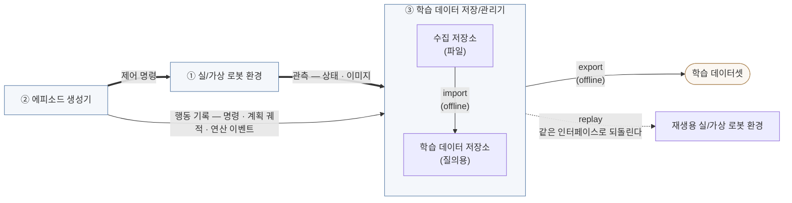
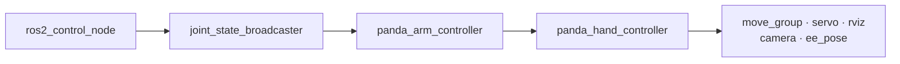
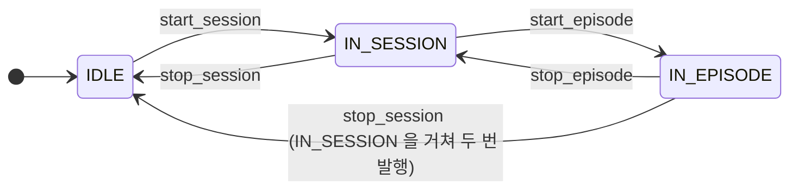
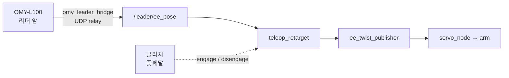
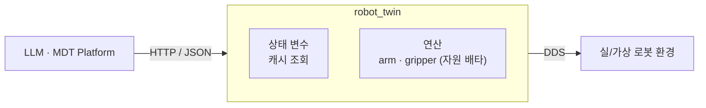
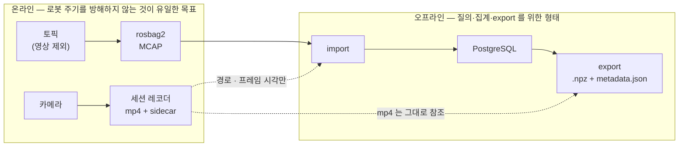
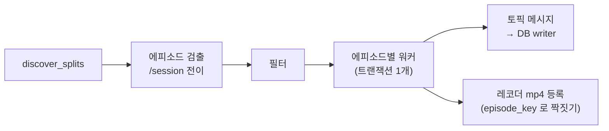
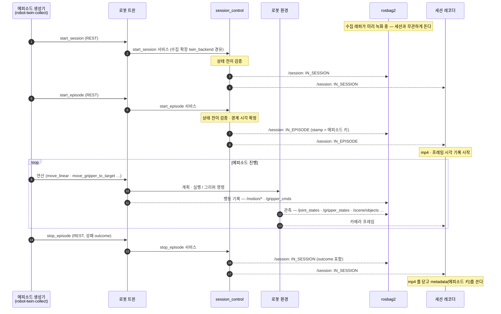
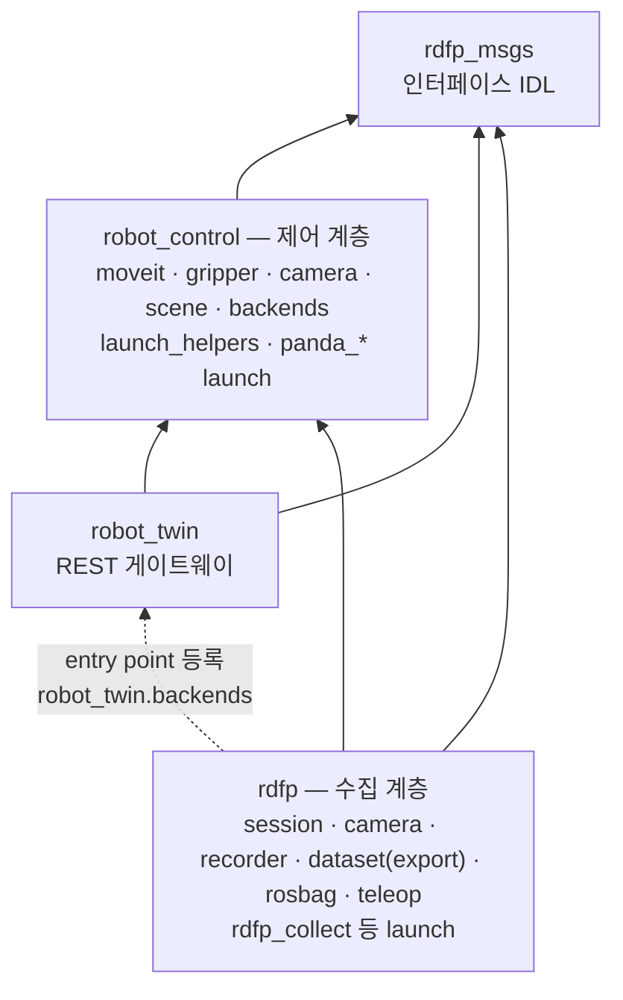

# rdfp 프레임워크 — 전체 구조와 설계

> **이 문서의 위치** — `rdfp_ws` 전체를 조망하는 **최상위 문서**다. 개별 노드·CLI 의
> 사용법은 [INDEX.md](INDEX.md) 가 가리키는 각 문서에 있고, 여기서는 **왜 이렇게
> 나뉘어 있는지**와 **서브시스템 사이의 계약**을 다룬다.
>
> **상태 표기** — 절마다 `현행`(코드와 일치) / `설계안`(코드 미반영) 을 표시한다.
>
> **현행화 2026-10-18.** 데이터를 실제로 만드는 순서(생성 → 수집 → 적재 → export → 학습)와 명령은
> [collect/학습_데이터_파이프라인_개요.md](collect/학습_데이터_파이프라인_개요.md) 가 잇는다 — 이 문서는 그
> 흐름이 **왜** 그렇게 나뉘어 있는지를 다룬다.

---

## 목차

- [1. 목적과 범위](#1-목적과-범위)
- [2. 서브시스템 경계와 표준 인터페이스](#2-서브시스템-경계와-표준-인터페이스)
- [3. 서브시스템 1 — 실/가상 로봇 환경](#3-서브시스템-1--실가상-로봇-환경)
- [4. 서브시스템 2 — 에피소드 생성기](#4-서브시스템-2--에피소드-생성기)
- [5. 서브시스템 3 — 학습 데이터 저장/관리기](#5-서브시스템-3--학습-데이터-저장관리기)
- [6. 에피소드 생명주기](#6-에피소드-생명주기)
- [7. 패키징 — ROS 워크스페이스에 전부 두는 것이 맞는가](#7-패키징--ros-워크스페이스에-전부-두는-것이-맞는가)
- [8. 현재 상태 요약](#8-현재-상태-요약)
- [9. 미결 항목](#9-미결-항목)

---

## 1. 목적과 범위

### 1.1 무엇을 만드는가

**imitation learning 용 로봇 학습 데이터를 생성·저장·관리하는 프레임워크**다. 로봇을
움직인 궤적을 에피소드 단위로 수집해, 학습에 바로 쓸 수 있는 데이터셋으로 내보내는 것이
최종 산출물이다. 지금 그 데이터를 만드는 것은 사람의 조작이 아니라 로봇 트윈의 MoveIt
연산이다(4.5).

로봇 제어 자체가 목적이 아니다. 제어는 **데이터를 만들기 위한 수단**이며, 그래서 이
프레임워크의 모든 설계 결정은 "그 데이터가 나중에 학습에 쓸 만한가"를 기준으로 판단한다.

### 1.2 세 서브시스템

번호는 이 문서의 장 순서(3장 환경 · 4장 생성기 · 5장 저장기)를 따른다. 저장기가 받는 것은
환경의 **관측**만이 아니다 — 생성기 쪽의 **행동 기록**(그리퍼 명령, MoveGroup 클라이언트가 내는
실행 궤적 · 연산 이벤트)도 함께 남겨야 (관측, 행동) 쌍이 된다(2.2).

세 서브시스템은 **각각 통째로 교체 가능**해야 한다. mock Panda 를 Isaac Sim 으로,
키보드를 리더 암으로, PostgreSQL 을 다른 저장소로 바꿔도 나머지가 그대로 동작하는 것이
목표다.

그래서 위 그림에는 **구조만 두고 구현물 이름을 넣지 않았다.** 지금 붙어 있는 것들은
아래와 같으며, 이 목록은 **고정된 것이 아니라 예시**다.

| 서브시스템 | 현재 구현 예 |
|---|---|
| ① 실/가상 로봇 환경 | Franka Panda — mock · Isaac Sim · 펑션베이, Gazebo(보류) · 실기(준비 중) (3.2) |
| ② 에피소드 생성기 | robot twin(LLM · 스크립트) · 키보드 teleop · leader-follower(OMY-L100) — **학습 데이터 출처는 당분간 트윈만** (4.5) |
| ③ 학습 데이터 저장/관리기 | 수집 저장소 = rosbag2(MCAP, 영상 제외) + 세션 레코더 mp4, 학습 데이터 저장소 = PostgreSQL (mp4 는 경로로 참조) |
| 학습 데이터셋 | ACT 샘플 트리 (`.npz` + `metadata.json`, 영상은 mp4 참조) → `rdfp-train`(LeRobot `ACTPolicy`) |

③ 안의 두 상자만 그림에 남긴 이유는 그것이 구현 선택이 아니라 **구조 그 자체**이기
때문이다 — 수집 경로와 질의 경로를 나누는 것이 이 서브시스템의 설계 핵심이다 (5.1).

### 1.3 설계 원칙

| 원칙 | 의미 |
|---|---|
| **인터페이스가 계약이다** | 서브시스템은 구현이 아니라 토픽·타입·QoS 규약으로 서로를 안다 |
| **에피소드 경계는 하나의 출처에서** | 세션 제어 노드가 확정해 `/session` 으로 발행한 상태가 유일한 시작·끝 신호다. 생성기는 요청만 하고, 녹화기 · 적재는 각자 판단하지 않는다 (6장) |
| **수집 경로에 DB 를 두지 않는다** | 로봇이 도는 동안에는 파일(MCAP · mp4)에만 쓴다 — DB 의 지연 · 장애를 수집 경로에서 떼어 낸다 (5.1) |
| **재생으로 기록과 제어 경로를 검증한다** | 저장된 명령을 같은 인터페이스로 되돌려 로봇이 움직이는지 본다. 기록 · 재생 경로가 성립한다는 검증이지, 작업 재현이나 학습 레이블의 정확성까지 보장하지는 않는다 (5.5) |
| **교체 가능성은 이름에서 시작한다** | 토픽 이름에 구현이 드러나면 교체할 수 없다 (2.3 — servo 입력 두 개가 예외로 남아 있다) |

---

## 2. 서브시스템 경계와 표준 인터페이스

### 2.1 인터페이스 계약 `현행`

서브시스템 사이의 채널이 곧 공통 언어다. 대부분 토픽이지만 서비스와 Python API 도 있다.
표는 **누가 내고 누가 받는지**를 정리한 것이고, 이름 자체의 정본은
[topic_naming_contract.md](topic_naming_contract.md) 다.

| 구분 | 역할 | 전달 | 제공자 → 소비자 | 이름 · 타입 |
|:-:|---|---|---|---|
| **입력** | 팔 제어 (계획 · 실행) | Python API | 트윈 → MoveGroup 클라이언트 → 백엔드 명령 채널 | `create_move_group_client(node, backend=...)` — 채널은 프로파일이 고른다 (3.2) |
| 입력 | 팔 제어 (속도) | 토픽 | teleop → `servo_node` | `/servo_node/delta_twist_cmds` · `TwistStamped` (규약의 예외, 2.3) |
| 입력 | 그리퍼 제어 | 토픽 | 트윈 · teleop → 그리퍼 노드 | `/gripper_cmds` · `rdfp_msgs/GripperCommand` (`goal` — 심볼) |
| 입력 | scene 배치 | 서비스 | 트윈 → scene 노드 | `/scene/reset` · `rdfp_msgs/ResetScene` — 펑션베이에는 없다 |
| **관측** | 팔·그리퍼 관절 상태 | 토픽 | 환경 → 트윈 · 저장기 | `/joint_states` · `sensor_msgs/JointState` |
| 관측 | 엔드이펙터 자세 (그리퍼 파지 중심, 아래 TCP 계약) | 토픽 | `ee_pose` 노드 → 트윈 · 저장기 | `/ee_pose` · `geometry_msgs/PoseStamped` |
| 관측 | 그리퍼 상태 | 토픽 | 그리퍼 노드 → 트윈 · 저장기 | `/gripper_states` · `rdfp_msgs/GripperState` (`width`/`stalled`/`at_goal`) |
| 관측 | 조작 대상 물체 | 토픽 | scene 노드 → 트윈 · 저장기 | `/scene/objects` · `rdfp_msgs/SceneObjects` |
| 관측 | 카메라 | 토픽 | 환경 → 세션 레코더 (bag 에는 담지 않는다) | 백엔드마다 다르다 — 아래 |
| **행동 기록** | 실행 궤적 · 연산 이벤트 | 토픽 | MoveGroup 클라이언트 → 저장기 | `/motion/trajectory` · `/motion/event` — `operation_id` 로 짝짓는다 |
| 행동 기록 | 팔 관절 명령 (정규화) | 토픽 | `target_joint_cmds_publisher`(수집 계층) → 저장기 · 재생 | `/target_joint_cmds` · `sensor_msgs/JointState` — 스택 고유 arm 명령을 옮겨 적는다 |
| **경계** | 에피소드 경계 요청 | 서비스 | 생성기 → `session_control_node` | `/session_control/{start,stop}_{session,episode}` · `set_task_label` |
| 경계 | 에피소드 경계 상태 | 토픽 (TRANSIENT_LOCAL) | `session_control_node` → rosbag2 · 세션 레코더 · 생성기 | `/session` · `rdfp_msgs/SessionCommand` |

**카메라는 다른 채널과 두 가지가 다르다.** **rosbag 에 담지 않고 세션 레코더가 mp4 로 직접
받으며**(5.1), 이름이 백엔드 경계에서 통일되지 않았다. 레코더가 받을 토픽 · `pixel_format` 은
백엔드 프로파일(`config/backends/<이름>.yaml` 의 `camera`)이 정한다.

| 백엔드 | 레코더 입력 | 비고 |
|---|---|---|
| mock | `/camera/image_raw` (`bgr8`) | |
| Isaac | `/isaac/camera/image_raw` (`rgb8`) | |
| 펑션베이 | `/camera_image_aligned/compressed` (JPEG) | 시뮬레이터 원본 `/camera_image/compressed` 를 `fb_camera_restamp` 가 관절과 같은 시계 축으로 재stamp 한 것. `/camera_image` 는 뷰어용으로 되살린 raw 다 |

> **위 표는 런타임에 보이는 절대 이름이다. 노드 코드는 상대 이름으로 선언한다** —
> `'/joint_states'` 가 아니라 `'joint_states'` 다. 그래야 백엔드 경계에서 remap 이 통하고, 로봇별 네임스페이스가 나중에 자동으로 붙는다. 채널을 새로 만들거나 이름을 바꿀 때의 규칙(단수/복수, remap 을 쓸 곳, 파라미터로 받아야 하는 예외)은 [topic_naming_contract.md](topic_naming_contract.md) 가 정본이다.

`/session` 만 성격이 다르다 — 로봇을 움직이는 명령이 아니라 **데이터 수집 구간을 선언**하는 신호이며, 에피소드 생성기와 저장기가 함께 본다. 생성기가 직접 발행하지 않는다 — 서비스로 요청하고, 세션 제어 노드가 상태 전이를 검증한 뒤 발행한다(6장).

**그래서 세션은 시스템에 하나다.** 로봇이 둘 이상이면 그것은 **공동 작업으로 하나의 학습 데이터를 만든다**는 뜻이지 각자 수집한다는 뜻이 아니다 — 나누면 한쪽의 `stop_episode` 가 다른 쪽 에피소드를 잘라 공동 작업이 하나의 시연으로 안 묶인다.
**서로 다른 학습 작업은 `ROS_DOMAIN_ID` 를 나눠서** 한다. 이 결정 때문에 `/session` 은 로봇별 네임스페이스에 들어가지 않는다 ([topic_naming_contract.md](topic_naming_contract.md) §2.5).

> **`/session` 의 QoS 는 `TRANSIENT_LOCAL` 이다.** 늦게 뜬 녹화기도 현재 상태를 보게 하기 위한 것이며, 구독자와 `ros2 topic echo` 모두 QoS 를 맞춰야 한다.

#### `/ee_pose` 의 TCP 계약 `설계안` (2026-09-14)

**소비자는 `/ee_pose` 를 어떻게 계산하는지 알 필요가 없다.** 순기구학, URDF, TCP 변환 상수는 로봇 환경(백엔드 스택) 내부의 사정이다. 계약은 그 값이 **무엇을 뜻하고 어떤 성질을 보장하는가**만 정한다. 스택마다 TCP 의 이름은 달라도 되며, 정본은 백엔드 프로파일의 `frames.ee` 다(launch 의 `ee_pose` 노드와 트윈의 `move_linear` 기본 프레임이 같은 값을 읽는다).

| 항목 | 계약 |
|---|---|
| 원점 | 그리퍼 파지 중심 (두 손가락 안쪽면 사이) |
| 축 | z 는 접근 방향. 손가락 개폐 방향에 대응하는 축을 하나로 정한다 (규약 미정) |
| 기준 프레임 · 표현 | `header.frame_id` = `panda_link0`, m, 쿼터니언 xyzw |
| 시각 | `header.stamp` 는 그 자세가 성립한 시각이며 같은 스택의 다른 관측 채널과 같은 시계다 |
| 새 값의 주기 | 명시한다. 발행 주기와 구분한다 |
| 연속성 | 새 값이 없으면 이전 값을 반복 발행하지 않는다 |

현재 준수 현황은 다음과 같다.

| 항목 | isaac | functionbay |
|---|---|---|
| 원점 | ✗ `panda_hand` — 손 장착면이며 파지 중심은 약 0.1 m 앞 | ○ `grasp_center` |
| 축 | z ○ · 개폐 축 규약 미정 | z ○ · 개폐 축 규약 미정 |
| 새 값의 주기 | ✗ 발행 50 Hz, 새 값 약 18 Hz (TF 경유, mock 실측) | ✗ 같다 |
| 연속성 | 미확인 | ✗ 시뮬레이터 재시작으로 시계가 되감기면 같은 값을 계속 발행한다 |

> ⚠️ isaac 에 `frames.ee` 를 넣으려면 `robot-twin-client` 의 `to_arm_command()` 가 곱하는
> 45° 를 함께 정리해야 한다 — 그대로 넣으면 90° 이중 회전이 된다.

teleop 의 목표 EE 자세는 같은 TCP 정의로 로봇 환경이 발행한다(`target_ee_pose`,
[topic_naming_contract.md](topic_naming_contract.md) §2.3). MoveIt 생성 데이터의 데카르트 명령은
채널을 따로 발행하지 않고, 관절 명령과 기구학 모델 스냅샷으로 같은 TCP 정의에 따라 다시 계산한다.
학습 데이터 쪽 설계(책임 분담 · 명령 후보 · 적합성 시험과 그 결과):
[archive/learning/학습_데이터의_좌표_공간_비교.md](archive/learning/학습_데이터의_좌표_공간_비교.md) §5.6~§5.8 (보관본 — 데카르트 단계는 보류, [learning/열린_결정.md](learning/열린_결정.md) §2).

### 2.2 action 과 observation 을 함께 남긴다 `현행`

imitation learning 데이터의 핵심은 **(관측, 행동) 쌍**이다. 그래서 같은 물리량을 두 개의
토픽으로 남긴다.

| | 토픽 | 의미 |
|---|---|---|
| action (팔, 학습에 쓰는 것) | `/motion/trajectory` + `/motion/event` | 연산마다 컨트롤러로 보낸 **계획 궤적**과 그 연산이 어떻게 끝났나 (관절-계획) |
| action (팔, 비교 기준) | `/target_joint_cmds` | 컨트롤러로 **나간 명령값** (관절-명령) |
| action (그리퍼) | `/gripper_cmds` | 보낸 **의도** (심볼) |
| observation (팔) | `/joint_states` | 실제 **도달값** |
| observation (그리퍼) | `/gripper_states` | 실제 **개구 폭** + 파지 여부 |

**팔은 숫자, 그리퍼는 심볼이다 — 비대칭이 의도적이다 (2026-09-01 결정).**

원래는 그리퍼 명령도 숫자(`position`/`max_effort`)였고, 근거는 "심볼을 쓰면 그 의미가
노드 상수에 남아 데이터셋이 자기 완결적이지 않게 된다"였다. 다시 따져 보니 그 숫자가
**그리퍼에 종속**이라는 대가가 더 컸다 — `position` 은 관절값이라 ROS 표준(개구 폭)과
뜻이 달랐고, Robotiq 2F-85 처럼 관절이 각도인 기구에서는 단위조차 m 가 아니다. 다른
그리퍼로 옮기면 그 숫자는 **틀린 값**이 되지만, 심볼은 "그 그리퍼에 맞게 쥐어라"로
남아 이식된다.

**자기 완결성은 관측 쪽이 맡는다.** `/gripper_states` 가 개구 폭(m)을 주기 발행하므로
"그때 실제로 얼마나 벌어져 있었나"는 데이터 안에 있다. 명령은 "무엇을 원했는가",
관측은 "무엇이었는가" — 팔에서 `/target_joint_cmds` 와 `/joint_states` 가 나뉘는 것과
같은 구조이며, 그리퍼는 그 명령 쪽 표현이 심볼일 뿐이다.

> **왜 액션이 아니라 토픽인가** — 액션 goal 전송은 서비스라 **rosbag2(Humble)가
> 기록하지 못한다.** 명령을 토픽으로 흘리고 `GripperNode` 가 자기 백엔드 방식으로
> 실행하는 구조를 택한 이유가 이것이다.

`/target_joint_cmds` 와 `/joint_states` 는 둘 다 `sensor_msgs/JointState` 라 DB 에서는 같은
테이블에 들어가고 `topic_id` 로만 구분된다. 이 구분이 사라지면 학습 데이터로서의 가치가 크게
떨어지므로, 녹화 목록에서 두 토픽을 함께 유지한다
([config/recording_topics.list](../config/recording_topics.list)).

> **재검토 → 방향 결정 (2026-09-13 → 2026-09-17)** — mock(JTC)에서 MoveIt 으로 움직인 구간은 `/target_joint_cmds` 가
> 비고, 펑션베이는 우리 중력 보상을 쓰는 씬에서 teleop 과 트윈의 명령이 보상 오프셋만큼 다르다(보상은
> 스트리밍 경로에만 얹힌다 — 현재 `r2` 씬은 벤더 솔버가 보상해 우리 보상을 껐다, 3.2). 대안·평가·권고:
> [learning/결정_기록.md](learning/결정_기록.md) (원문은 archive/learning/학습_데이터_수집_설계.md).
> MoveIt 으로만 데이터를 생성하는 경우의 설계는
> [learning/학습_샘플_사양.md](learning/학습_샘플_사양.md) §2 (명령 체인 L0~L4).
>
> **MoveIt 생성 데이터의 팔 action 은 계획 수준(관절-계획)이다 — 구현됐다 (R1 · R2 2026-09-18, export 2026-09-19).**
> MoveGroup 클라이언트가 실행 궤적(`/motion/trajectory`)과 연산 이벤트(`/motion/event`)를 내고, export 가
> 연산 사이 공백을 규칙으로 채워 ACT 형식 샘플을 만든다(`export --label joint_plan`, 기본). 주기는 잠정치
> 영상 10 Hz · 행동 스텝 100 ms · 관절 관측 50 Hz 이고 1차는 isaac 관측 100 Hz 를 그대로 쓴다(결정 22).
> 샘플 구조: [learning/학습_샘플_사양.md](learning/학습_샘플_사양.md) §4. `/target_joint_cmds` 는 계속 녹화하는
> 비교 기준이다(`--label joint_command`). 데이터 출처는 당분간 트윈만 다룬다(teleop 제외, 결정 3).
> 결정 사항 전체: [learning/결정_기록.md](learning/결정_기록.md).

### 2.3 계약은 두 겹이다 `현행 + 설계안`

경계가 하나가 아니라는 점을 구분해야 논의가 엉키지 않는다.

| 경계 | 계약 내용 | 정의된 곳 |
|---|---|---|
| **로봇 환경 ↔ MoveIt/컨트롤러** | `panda_arm_controller` / `panda_hand_controller` 액션, 관절 이름, TF 트리, `robot_description` (컨트롤러가 없는 펑션베이는 MoveGroup 클라이언트가 명령 채널로 직접 스트리밍한다) | [backends/README.md](backends/README.md) 「백엔드 비교」 (계약 원문은 archive/isaac/multi_simulator_backend_design.md §5) |
| **에피소드 생성기 ↔ 로봇 환경 · 저장기** | 2.1 의 채널 표 | 이 문서 · 이름은 [topic_naming_contract.md](topic_naming_contract.md) |

아래(백엔드 계약)는 **Panda 이름을 그대로 고정**하기로 이미 결정되어 있다. MoveIt 의
`moveit_controllers.yaml` 을 백엔드마다 다시 쓰지 않기 위해서다. mock / Gazebo /
Isaac Sim 을 바꾸는 데는 이것으로 충분하다 — **다만 "Panda 가 아닌 로봇"으로 가는 것은
그보다 큰 별개의 단계**라는 뜻이기도 하다.

#### 위쪽 경계 — servo 입력 이름의 예외

위쪽 채널은 2026-09-01 에 정규 이름(1단계)으로 정리됐다. 구현체 이름이 남은 것은 servo 입력
둘뿐이다.

| 이름 | 드러난 구현 | 상태 |
|---|---|---|
| `/servo_node/delta_twist_cmds` · `/servo_node/delta_joint_cmds` | MoveIt Servo 노드 | **규약의 예외로 둔다** ([topic_naming_contract.md](topic_naming_contract.md) §2.4) |
| ~~`/gripper_control/gripper_cmds`~~ | 그리퍼 노드 | **해소됨 (2026-09-02)** — `/gripper_cmds` 로 노드 이름을 뗐다 |

servo 입력을 두는 이유는 규약이 정리해 두었다 — moveit_servo 의 기본 이름이라 외부 자료와
맞고, 노드 상대(`~/`)라 네임스페이스를 저절로 따라가며, **모든 백엔드에서 twist 를 servo 가
받으므로 이름이 사실이다.**

**바꿀 조건도 규약을 따른다** — twist 를 **servo 가 아닌 것이 소비하는** 백엔드가 생기면 이름이
거짓이 되므로 그때 바꾸고, 반드시 2단계(로봇별 네임스페이스) **전에** 한다. 백엔드 수는 조건이
아니다 — 지금도 넷이지만 전부 servo 를 거친다. 바꿀 때는 생성기 · 녹화 목록 · 재생 경로가
함께 움직이고(코드 · 설정 12곳, 문서 17곳), DB 는 토픽 이름이 아니라 메시지 타입으로 writer 를
고르므로 깨지지 않는다.

---

## 3. 서브시스템 1 — 실/가상 로봇 환경

### 3.1 역할 `현행`

제어 명령을 받아 로봇을 움직이고, 상태와 이미지를 발행한다. **에피소드가 무엇인지 모르고
데이터가 어디로 가는지도 모른다** — 그것이 이 서브시스템을 교체 가능하게 만든다.

### 3.2 현재 구현 — Franka Panda 백엔드 `현행`

같은 Panda(MoveIt2 설정 · 관절 이름 · 컨트롤러 이름)를 백엔드 넷에 붙인다. 백엔드마다 다른
값(arm 명령 채널 · servo · 카메라 · scene · 시계)은 **백엔드 프로파일**
`robot_control/config/backends/<이름>.yaml` 한 파일에 모이고, launch · 트윈 · teleop ·
`rdfp_collect` 가 `backend:=<이름>` 하나로 그것을 읽는다. 비교표의 정본은
[backends/README.md](backends/README.md) 「백엔드 비교」다.

| 백엔드 | 연동 | 팔 실행 | 시계 | 학습 데이터 |
|---|---|---|---|---|
| `panda_mock` / `panda_mock_jgpc` | ros2_control mock hardware | JTC / JGPC | 벽시계 | ✗ — 배관 검증 전용 (파지 불가) |
| `panda_isaac` | ros2_control `TopicBasedSystem` (Isaac Sim) | JTC | `use_sim_time` | ○ — 1차 학습 데이터 |
| `panda_functionbay` | ros2_control 없음 — 토픽 직결 | JGPC 식 스트리밍 (`/input/panda_joint`, 50 Hz) | 벽시계 (스택이 stamp 를 정렬) | ○ — peg-in-hole |
| Gazebo | `ign_ros2_control` | JTC | `/clock` | ✗ — 미검증 · 보류 (프로파일 없음) |

실기는 [backends/franka_panda_bringup_prep.md](backends/franka_panda_bringup_prep.md) 에서 준비 중이다.

**펑션베이의 처짐 보상은 씬에 따라 주체가 다르다.** 이 시뮬레이터의 관절 제어는 중력을 잡지
않아 팔이 처지는데, 현재 씬 `r2`(`MMR-Build_260929`)는 **벤더 솔버가 보상**하므로 우리 보상을
껐다(2026-09-30 실측 — 얹으면 이중 보정으로 부호가 뒤집힌다). `t1` 씬에는 벤더 보상이 없어,
프로파일이 그 씬을 고르면(`sim_scene: t1`) 그 씬의 `gravity_compensation` 으로 스트리밍하는 명령점에 우리
보상(`−τ_g/Kp`)을 얹는다. 상세는
[backends/functionbay/펑션베이_중력_보상.md](backends/functionbay/펑션베이_중력_보상.md).

ros2_control 을 쓰는 스택은 컨트롤러 기동이 의도적으로 **순차적**이다
(`RegisterEventHandler(OnProcessExit)` 체인).

**팔 실행이 두 갈래**라는 점이 이 계층의 특징이다.

| | JTC (`panda_mock` · `panda_isaac`) | JGPC (`panda_mock_jgpc`) · 스트리밍 (`panda_functionbay`) |
|---|---|---|
| 컨트롤러 | `JointTrajectoryController` | `JointGroupPositionController` · 없음 (시뮬레이터가 받는다) |
| 명령 채널 | 액션 `/panda_arm_controller/follow_joint_trajectory` (MoveIt 실행). servo 는 토픽 `/panda_arm_controller/joint_trajectory` 로 낸다 | 토픽 `/panda_arm_controller/commands` · `/input/panda_joint` |
| MoveIt 실행 | 가능 | **불가** (`FollowJointTrajectory` 없음) — 클라이언트가 계획 뒤 직접 스트리밍한다 |
| 폐루프 | 예 | **아니오** — 정상 반환이 도달을 보장하지 않는다 |

`create_move_group_client(node, backend=...)` 가 프로파일에서 구현을 골라 이 차이를 흡수하므로
상위 코드는 분기하지 않는다. 런타임 자동 판별은 없다 — 펑션베이를 JTC 로 오판해 "계획은 되고
실행만 안 되는" 일이 있었다. 자세한 것은
[control/move_group_client_user_guide.md](control/move_group_client_user_guide.md).

### 3.3 다른 환경으로 교체할 때 `현행`

**백엔드 계약의 정본은 [backends/README.md](backends/README.md) 와 백엔드 프로파일(`config/backends/*.yaml`) 이다** (계약 원문: archive/isaac/multi_simulator_backend_design.md §5) —
반드시 제공해야 하는 것(관절 상태·컨트롤러 액션·TF·`robot_description`)과 보장 조건이
거기 있다. 새 백엔드는 프로파일 한 파일을 더하고, 값 하나가 파라미터 하나로 안 갈 때만
`robot_control/backends/` 에 클래스를 둔다. 여기서는 **데이터 수집 관점에서만** 덧붙인다.

1. **stamp 를 채우고, 한 시계 축에 둔다.** 저장기가 에피소드를 시각으로 자르므로 stamp 가
   0 이거나 다른 축(벽시계 ↔ sim time)이면 rosbag 에는 남고 DB 에만 **조용히** 빠진다.
   펑션베이는 stamp 기준이 회차마다 달라 스택이 경계에서 벽시계로 정렬한다.
2. **주기를 유지한다.** 실효 10 Hz 미만이면 재생이 계단식이 된다.
3. **그리퍼 상태는 `/gripper_states`(개구 폭)로 낸다.** `/joint_states` 의 손가락 관절은
   백엔드에 따라 가짜일 수 있다 — 펑션베이는 TF 를 세우려고 고정값을 주입한다.
4. **카메라의 형식 · 해상도 · fps 를 프로파일에 맞춘다.** 레코더는 선언과 다른 프레임을 경고만
   남기고 버리므로, 어긋나면 오류 없이 **0 프레임**이 되고 export 가 통째로 막힌다.
5. **시뮬레이터 재기동은 회차를 끊는다.** sim 시계가 0 으로 되감기면 에피소드 키가 겹친다 —
   다른 회차의 bag 을 함께 적재하지 않는다.

Gazebo 브링업 절차는 [backends/gazebo_bringup_guide.md](backends/gazebo_bringup_guide.md),
입력 어댑터 규약은 [teleop/external_input_adapters.md](teleop/external_input_adapters.md).

---

## 4. 서브시스템 2 — 에피소드 생성기

### 4.1 공통 책임 `현행`

로봇을 움직여 **의미 있는 궤적을 만들고**, 그 구간의 시작 · 끝을 세션 제어 노드에
**요청**한다(경계를 확정하고 `/session` 으로 알리는 것은 세션 제어 노드다, 6장). 구현이
셋이지만 이 두 가지는 동일하다.

에피소드 분할은 **`IN_EPISODE → IN_SESSION` 전이**를 기준으로 한다
([collect/session_control_guide.md](collect/session_control_guide.md)). 세션 노드
(`session_control_node`)는 수집 계층(`rdfp_collect`)이 띄우며, 없으면 생성기의 세션 · 에피소드
명령만 거절되고 로봇 조작은 그대로 된다.

### 4.2 키보드 teleop `현행`

`teleop_keyboard` 가 키 입력을 twist 로 바꿔 servo 에 직접 넣는다. 그리퍼는 `=`/`-`/`\`
키가 `/gripper_cmds` 에 심볼(`open`/`close`/`grasp`)을 발행한다. 붙을 스택은 `backend`
파라미터로 고른다(기본값 없음).

가장 단순하고 의존성이 없어 **다른 두 경로를 검증하는 기준선** 역할을 한다. 다만 servo 는
목표 없이 속도만 받아 측정 상태에서 IK 를 다시 풀기 때문에, 물체를 든 채 움직이는 정밀 작업은
트윈의 계획 연산이 맡는다([teleop/servo_vs_planned_motion.md](teleop/servo_vs_planned_motion.md)).

### 4.3 leader-follower teleop (OMY-L100) `현행`

리더 암의 자세를 팔로워에 상대 매핑한다. 관절 체계가 다른 이기종이라 **EE pose 기준
retargeting** 을 쓴다.

- 리더는 별도 저장소(`omy_leader_bridge`)이며 **ROS 2 Jazzy + zenoh** 라 런타임을
  공유하지 않는다. UDP 릴레이로 넘어온다.
- 클러치는 앵커를 다시 잡는 장치다. 데드맨으로 쓰려면 `pedal_timeout` 을 켜야 한다.
- **그리퍼 경로가 아직 없다** — 리더가 넘기는 것은 EE pose 하나뿐이라 그리퍼는 키보드로
  조작한다. 리더 트리거를 쓰던 설계는 `GripperCommand` 개편(2026-09-01)으로 전제가 무효가 되어
  보관했다 — [archive/leader_gripper_mapping_design.md](archive/leader_gripper_mapping_design.md).

### 4.4 LLM · 스크립트 기반 제어 (robot twin) `현행`

ROS 를 모르는 주체가 **HTTP/JSON 만으로** 로봇을 조작하게 하는 게이트웨이다. LLM 이
상태 변수를 읽고 연산을 조합해 태스크를 수행하는 것을 상정했고, 지금은 **학습 데이터를
만드는 주 경로**이기도 하다 — `robot-twin-client` 의 작업 CLI(`robot-twin-collect` 등)가 같은
REST 로 세션 · 에피소드 경계를 찍으며 작업을 반복한다. LLM 은 같은 저장소의 MCP 서버로 붙는다.

| 제공 | 내용 |
|---|---|
| 상태 변수 | `joint_states` / `ee_pose` / `gripper_state` / `scene_objects` / `session_state` / `named_targets`, 펑션베이는 `fixtures`(고정물 기하) |
| 연산 (arm) | `move_to_named_target` / `move_to_joints` / `move_linear` |
| 연산 (gripper) | `move_gripper_to_target` (`open`/`close`/`grasp`) |
| 연산 (scene) | `reset_scene` — `/scene/reset` 이 있는 백엔드만 (펑션베이 제외) |
| 연산 (수집 경계) | `start_session` / `stop_session` / `start_episode` / `stop_episode` — 수집 계층이 entry point 로 제공 (7.6) |
| 안전 | 자원 배타 락, E-stop, 연산 시간 제한(감시기가 넘긴 연산의 팔을 멈춘다) |

주변 물체 정보는 `/scene/objects` 계약(조작 대상만)으로 들어온다. 설정에는 `move_to_pose` ·
`move_gripper` 가 자리만 있고 호출하면 실패한다(미구현).

상세는 [twin/로봇_트윈_사용자_가이드.md](twin/로봇_트윈_사용자_가이드.md), 설계는
[twin/로봇_트윈_설계서.md](twin/로봇_트윈_설계서.md).

### 4.5 세 구현 비교

| | 키보드 | leader-follower | LLM (twin) |
|---|:-:|:-:|:-:|
| 제어 입력 | twist 직결 | pose → retarget | 연산 호출 |
| 궤적 품질 | 거칠다 | **사람 손 그대로** | 계획된 매끄러움 |
| 그리퍼 | 키 | 미연동 | 연산 |
| 자동화 | 불가 | 불가 | **가능** |
| 주 용도 | 검증·디버깅 | 사람 시연 | **학습 데이터 수집 — 현재 유일한 출처** |

**데이터 출처는 당분간 트윈 연산만 다룬다** (2026-09-17, [learning/결정_기록.md](learning/결정_기록.md)
결정 3). 이유는 **기록할 수 있는 것**에 있다.

- **action 을 만들고 추적할 수 있다** — 트윈 연산은 연산마다 컨트롤러로 보낸 계획 궤적
  (`/motion/trajectory`)과 그 연산이 어떻게 끝났는지(`/motion/event`)를 `operation_id` 로 짝지어
  남긴다. export 가 그것으로 관절-계획 action(2.2)을 구성하고, 샘플 하나하나가 어느 연산에서
  왔는지 거슬러 올라갈 수 있다.
- **수집 루프에 ROS 가 필요 없다** — 세션 경계 네 연산도 REST 로 내주므로, 작업 스크립트
  (`robot-twin-collect`)가 HTTP 만으로 경계와 동작을 함께 구동한다.
- **teleop 은 action 의 뜻이 다르다** — servo 경로는 목표 없이 속도만 보내므로 "무엇을 하려
  했나"가 기록에 남지 않는다. 그 분석은 뒤로 미뤘다.

teleop 경로는 데이터 출처에서 빠져 있을 뿐 동작은 유지한다.

---

## 5. 서브시스템 3 — 학습 데이터 저장/관리기

### 5.1 왜 2단 저장인가 `현행`

로봇이 도는 동안과 학습 데이터를 만드는 시점을 **분리**한다.

DB 를 수집 경로에 두지 않는 이유는 **DB 의 지연과 장애가 수집 경로로 번지지 않게** 하기
위해서다. DB 가 느려지거나 죽으면 그 영향이 로봇 제어 주기까지 올라온다. 이 설계가 없애는
것은 **수집의 DB 의존**이지 부하 자체가 아니다 — 파일 쓰기와 영상 인코딩도 CPU · 디스크를
쓰므로, 수집 머신의 자원은 따로 챙겨야 한다.

**영상은 rosbag 을 거치지 않는다.** 세션 레코더(`rdfp_image_recorder`)가 `IN_EPISODE` 구간만
mp4 로 직접 쓰고 프레임별 stamp 를 sidecar 로 남긴다. 적재는 그 mp4 를 옮기지 않고 경로와 프레임
시각만 DB 에 등록하므로, **레코더 mp4 가 영상의 유일한 원본**이다. raw 영상을 bag 에 담던 때보다
녹화 대역폭이 크게 줄고, 같은 영상을 두 번 인코딩하지 않는다.

대가로 **import 라는 단계가 하나 늘고**, 그 사이에는 DB 로 질의할 수 없다(bag 자체는
`rosbag list-episodes` 로 DB 없이 조회된다).

### 5.2 온라인 — 무엇을 녹화하는가 `현행`

녹화 대상은 [config/recording_topics.list](../config/recording_topics.list) **한 곳이
단일 출처**이며, `record_rosbag.sh` 와 `dataset_config.yaml`(`topics_file`)이 함께 읽는다.
목록은 **모든 백엔드 공용**이다(2026-10-18 통합) — 2.1 의 정규 채널 11개만 담고, 이름이
백엔드마다 다른 카메라와 벤더 원시 채널(`/output/*`)은 넣지 않는다.

수집은 래퍼(`scripts/run_collect_isaac.sh` · `run_collect_functionbay.sh`)가 rosbag 녹화와 수집
계층을 함께 띄우고, 레코더 출력 · bag 루트 · 적재 설정(`<데이터 루트>/dataset.yaml`)을 한
데이터 루트 아래에 맞춰 둔다.

> **rosbag2 세션에 `metadata.yaml` 이 없으면 조용히 건너뛴다 ⚠️**
> SIGKILL 로 죽거나 크래시하면 `import` 가 **성공적으로 종료하면서 빈 요약**을 낸다.
> `ros2 bag reindex -s mcap <session_dir>` 으로 복구한다.

### 5.3 오프라인 — import 파이프라인 `현행`

- 에피소드 식별자는 **`(start_sec, start_nanosec)`** 이고 UNIQUE 다. 대리키 `id` 는
  `BIGSERIAL`. 재import 는 `on_existing_episode`(`skip` 기본 / `replace` / `error`) 정책을
  따른다 — `skip` 이면 키가 이미 있는 에피소드는 **조용히** 빠진다.
- 에피소드 하나가 **하나의 트랜잭션**이다. 중간 실패는 그 에피소드만 롤백한다.
- 영상은 DB 에 넣지 않는다 — 레코더 metadata 의 **에피소드 키**(`/session` IN_EPISODE 의 stamp)로
  mp4 를 에피소드에 붙이고, 경로 1행과 프레임 시각 N행만 남긴다. 파일 이름(벽시계)으로 맞추면
  `use_sim_time` 스택에서 틀린다. (bag 에 담긴 `sensor_msgs/Image` 를 mp4 로 인코딩하던 경로도
  남아 있지만, 레코더 등록과 함께 켜면 같은 행을 두 번 넣어 UNIQUE 제약에 걸린다.)
- **적재는 ROS 가 필요하다** — 이미지 경로가 `sensor_msgs` 를 import 한다(7.1). export 부터는
  필요 없다.

### 5.4 저장 스키마 개요 `현행`

| 테이블 | 담는 것 |
|---|---|
| `sessions` | 에피소드(= 학습 단위). `(start_sec, start_nanosec)` UNIQUE |
| `topics` | 토픽 이름·타입 등록부. action/observation 구분의 근거 |
| `joint_states` | 관절 이름 · position/velocity/effort. `/joint_states` 와 `/target_joint_cmds` 를 `topic_id` 로 구분 |
| `motion_trajectories` / `motion_events` | 실행 궤적(R1) · 연산 이벤트(R2) — 관절-계획 action 의 원천 |
| `pose_stampeds` / `twist_stampeds` | EE 자세 / 속도 명령 |
| `gripper_cmds` / `gripper_states` | 그리퍼 명령(심볼)과 연속 상태 |
| `scene_objects` | 조작 대상 물체 배치 (라벨 · 큐레이션용) |
| `image_streams` / `image_frames` | mp4 파일 1행 + 프레임 시각 N행 |

정본은 `src/rdfp/rdfp/dataset/sql/schema.sql` 이다(옛 메시지용 `target_joint_states` ·
`joint_jogs` 도 남아 있다).

> **관절 이름은 2026-09-18 부터 저장한다** (`joint_names TEXT[]`). 그 전 데이터와, 발행자가
> `JointState.name` 을 안 채운 행은 비어 있다 — export 는 이름 없는 행을 **거부한다**(순서로
> 때우면 관절이 뒤바뀌어도 값 범위가 비슷해 드러나지 않는다).

### 5.5 재생 — 아키텍처 그림의 "재생용 로봇 환경" `현행`

저장된 에피소드를 **같은 토픽 계약으로 되돌린다.** 저장된 명령이 같은 인터페이스로 로봇을
움직이는지 보면 **기록과 제어 경로**가 성립하는지 — 빠진 채널 · 어긋난 시각 · 잘못된 관절
순서 같은 것 — 를 검증할 수 있다. 다만 로봇이 움직였다고 작업이 재현되거나 학습 레이블이
정확하다는 뜻은 아니다. 레이블 쪽은 export 의 검사(이름 없는 관절 행 거부 · 배치 규약 대조
`assert_compatible()` 등)와 학습 결과가 맡는다.

| 재생기 | 대상 | 방식 |
|---|---|---|
| `TopicMessageReplayer` | 비이미지 토픽 | k-way heap merge, 단일 워커 |
| `Mp4ImageReplayer` | 이미지 토픽 | 디코더 + 발행 스레드 + 백프레셔 큐 |

둘 다 **일회용**이다 (`start()` 재호출은 `RuntimeError`). `replay_gui` 가 둘을 같은
시각 앵커로 맞춰 구동한다. 재생용 스택 `replay_panda_mock` 은 arm 어댑터를 `replay_arm_path`
(`ee_twist` 기본 / `target_joint_cmds` / `none`) 로 하나만 고른다
([collect/replay_mock_stack_guide.md](collect/replay_mock_stack_guide.md)).

### 5.6 export — 학습 샘플 트리 `현행` (2026-09-19)

export 는 5.4 스키마에서 읽어 변환하는 **읽기 전용 소비자**다 — 저장 구조를 바꾸지 않고
추가됐다. 산출물은 `metadata.json` + `episodes.jsonl` + 에피소드별 `.npz`(`frame_index` · `t` ·
`qpos` · `action_arm` · `action_gripper` · `is_pad`)이고, 영상은 복사하지 않고 `recordings_dir`
기준 **상대 경로**로 mp4 를 가리킨다. 형식 정본은 [learning/저장_형식.md](learning/저장_형식.md).

| 설계 선택 | 이유 |
|---|---|
| 샘플 시각 = 실제 카메라 프레임 시각 (고정 fps 격자가 아니다) | 시각과 영상이 같은 근거를 갖는다 — 실측 fps 는 설정과 다르고 회차마다 다르다 |
| action chunk 를 **미리 계산해** 저장한다 | 프레임 간격이 고르지 않아 로더가 행을 이어 붙이면 레이블이 조금씩 밀린다 — 오류가 아니라 "학습이 잘 안 된다"로만 나타난다 |
| 정규화하지 않는다 (통계만 metadata 에) | 에피소드를 더해도 저장본을 다시 안 쓰고, 원값이라야 사람이 읽는다 |
| LeRobot 데이터셋 형식으로 변환하지 않는다 | 학습기(`rdfp-train`)가 이 트리를 직접 읽고 LeRobot 은 정책(`ACTPolicy`)만 쓴다 |
| ROS 를 import 하지 않는다 | 학습은 ROS 밖 별도 환경에서 한다 — 경계가 **파일**이다 (7.3) |

### 5.7 학습 — `rdfp-train` `현행 (코드)`

별도 저장소 `~/development/rdfp/rdfp-train`(Python 3.10, `lerobot==0.4.4`)이 export 트리를 읽어
`ACTPolicy` 를 학습한다. ROS 도 DB 도 필요 없다. 데이터 로더 · 학습 루프는 완성됐고 본 학습
실행(D4)이 남아 있으며, 그 전에 체크포인트가 후처리기(역정규화)까지 저장하도록 고쳐야 추론에
쓸 수 있다 — 진척은 [learning/미구현_목록.md](learning/미구현_목록.md) §0.

---

## 6. 에피소드 생명주기

한 에피소드가 세 서브시스템을 어떻게 지나가는지 `현행`. 아래는 현재의 데이터 출처인 트윈
경로다.

**생성기는 경계를 요청하고, 세션 제어기가 경계를 확정하며, 저장 계층은 그 경계를 따른다.**
생성기는 `/session` 을 직접 발행하지 않는다 — 서비스로 요청하면 세션 제어 노드가 상태 전이를
검증하고 경계 시각을 정해 발행한다. 생성기는 데이터가 어디 저장되는지 모르고, 저장기는 누가
로봇을 움직였는지 모른다. teleop 은 트윈을 거치지 않고 세션 서비스를 직접 부를 뿐 흐름은 같다.

**rosbag2 와 레코더가 같은 `/session` 메시지를 경계로 쓴다는 점이 핵심이다.** 나중에(오프라인)
적재가 bag 의 `/session` 전이로 에피소드를 자르고, 레코더 metadata 에 적힌 같은 에피소드 키로
mp4 를 그 에피소드에 붙인다 — 서로 다른 두 파일(MCAP · mp4)이 키 하나로 짝지어지는 이유다.
그 뒤 export 가 학습 샘플 트리를 만들고, 학습은 ROS 밖 `rdfp-train` 이 한다.

---

## 7. 패키징 — ROS 워크스페이스에 전부 두는 것이 맞는가

**절단선이 둘이라는 점을 먼저 구분한다.** 서로 직교하며 판단도 다르다.

| 축 | 무엇을 떼는가 | 상태 |
|---|---|---|
| **가로 — 계층** | 로봇 제어 계층(`robot_control`/`robot_twin`)을 학습 데이터 수집(`rdfp`) 아래로 | **완료** → 7.6 |
| **세로 — ROS 탈피** | 저장/관리기(`dataset`/`rosbag`)를 ROS 밖으로 | 보류 → 7.1~7.4 |

아래 7.1~7.5 는 **세로 축**에 대한 것이다. **결론부터: 지금은 옮기지 말고, 경계를
테스트로 고정한다.**

### 7.1 남은 결합 `현행`

저장/관리기는 **이미 대부분 ROS 와 무관하게 작성되어 있다** — ROS 를 import 하는 파일은 넷 중
하나 꼴이고, `rclpy` 는 재생 경로에만 있다. 특히 `export/` 에는 ROS import 가 한 줄도 없어,
소싱하지 않은 셸에서 `python3 -m rdfp.dataset.export_cmd` 로 돈다. ROS 없이 실행되는 CLI 는
`export` · `stats` · `list` · `init-db` · `rosbag` 조회이고, `import` 는 아래 2번 때문에 안 된다.
측정 수치는 금방 낡으므로 본문에 두지 않는다 — 회차별 측정은
[archive/제어_계층_분리_기록.md](archive/제어_계층_분리_기록.md) §1 에 있고, 살아 있는 측정은
7.4-2 의 경계 테스트가 맡아야 한다.

남은 결합은 두 종류다.

1. **본질적 결합** — 재생기(`*_replayer`, `image_message_reader`, `replay_cmd`, `replay_gui`)는
   ROS 토픽을 발행하는 것이 일이므로 ROS 가 필요하다. 이건 분리 대상이 아니다.
2. **우발적 결합** — ingest 의 이미지 경로(`ingest/media/ffmpeg_sink.py` ·
   `mp4_image_recorder.py`)가 `sensor_msgs.msg.Image` 를, `dataset/types.py` 가 타입 힌트용
   `Header` 를 **최상위에서 import** 해 `import` CLI 가 ROS 없이는 돌지 않는다. 현행 수집은 영상을
   bag 에 담지 않아 그 경로가 할 일이 없는데도 그렇다. MCAP 디코딩 자체는 ROS 를 요구하지
   않으므로(`mcap_ros2` 가 bag 에 박힌 스키마로 메시지를 만든다) **없앨 수 있는 결합**이다.

### 7.2 선택지

각 선택지가 **필연적으로** 갖는 제약만 적는다.

| | A. 현행 유지 | B. 워크스페이스 내 분리 | C. 저장소 분리 |
|---|---|---|---|
| 형태 | ament_python 패키지 하나 — 모듈 단위로 ROS 를 피한다 | 순수 파이썬 패키지 + 얇은 ROS 어댑터 패키지 | 별도 저장소의 순수 파이썬 패키지 (+ 이 워크스페이스에 어댑터) |
| 순수 코어를 ROS 없이 설치 · 테스트 | 부분적 — 모듈마다 다르고 지켜 주는 장치가 없다 | 가능 | 가능 |
| `ros2 run rdfp …` | 유지 | 어댑터가 유지 | 어댑터를 남기면 유지 |
| 버전 관리 | 하나 | 하나 | **둘 (동기화 비용)** |
| 지금 드는 비용 | 0 | 중간 | 높음 |

ROS 설치가 필요한지, `ros2 run` 이 남는지는 **저장소 위치가 아니라 패키지 의존과 어댑터를 두는지**가
정한다 — B · C 를 '코어 + 어댑터'로 적은 이유다. C 만의 필연적 비용은 저장소가 둘이 되는 것이다.

**현재 배포 구상 (2026-09-19 부터)** — 저장/관리기는 A 그대로 수집 머신에 있다. 학습기는 그것을
배포받지 않고 **export 산출물(파일)만** 읽는다 — 경계가 코드가 아니라 **파일**이라 `rdfp-train` 에는
ROS 도 DB 도 없다([learning/저장_형식.md](learning/저장_형식.md) §5.2). 데이터를 더 모아 다시
export 할 때도 소싱하지 않은 셸에서 돌린다(DB 접속만 있으면 된다).

### 7.3 권고 — 분리는 나중에, 경계는 지금

**지금 C 로 가지 않는 이유**는 아직 **실제 고통이 발생하지 않았기 때문**이다. 분리의 이득 중
가장 컸던 "ROS 없는 머신에서 학습한다"는 파일 경계로 이미 얻었고, 남은 이득(재사용 · 독자
릴리스)은 아직 가정이다. 비용(두 저장소 버전 동기화, CI 이중화, `rdfp_msgs` 의존 정리)은
확실하다. 확실한 비용을 가정된 이득에 지불하지 않는다.

**그렇다고 방치하면 안 되는 이유**는 경계가 침식되는 속도가 빠르기 때문이다. 우발적
결합(7.1-2)이 하나 늘 때마다 나중 분리 비용이 올라간다. **경계는 문서가 아니라 테스트로
지켜야 한다.**

#### 분리를 실행할 트리거

다음 중 하나가 실제로 발생하면 그때 C 로 간다.

- 학습 파이프라인이 **ROS 없는 머신/컨테이너**에서 저장소(DB)에 직접 접근해야 할 때 — export 파일
  경계로 지금은 피했다
- 다른 로봇 프로젝트가 이 데이터 계층을 **재사용**하려 할 때
- export 대상 포맷이 늘어 저장/관리기가 독자적인 릴리스 주기를 갖게 될 때

### 7.4 지금 할 수 있는 경계 강화 `설계안`

| # | 조치 | 효과 | 상태 (2026-10-18) |
|---|---|---|---|
| 1 | ingest 이미지 경로 · `types.py` 의 ROS 최상위 import 제거 (지연 import 또는 duck typing) | `import` CLI 전체가 ROS 없이 동작 | 미착수 |
| 2 | **"ROS 없이 import 되어야 하는 모듈" 목록을 테스트로 고정** | 침식을 CI 가 잡는다. `importorskip` 과 **반대 방향**의 테스트다 | 미착수 — `export/` 의 ROS 비의존도 지금은 손으로 확인했을 뿐이다 |
| 3 | ROS 의존 파일을 `dataset/ros/` 한 곳으로 모으기 | 현재 `db/*replayer` · `db/image_message_reader` · `ingest/media` 에 흩어져 있어 경계가 안 보인다 | 미착수 |
| 4 | `pyproject.toml` 을 미리 갖춰 두기 | C 로 갈 때 옮기기만 하면 된다 | 미착수 |

2번이 핵심이다. 지금 문서로만 "저장기는 ROS 와 무관하다"고 적어 두면, 다음 사람이
편의상 최상위 import 를 하나 추가하는 순간 조용히 깨진다. **export 가 학습 환경에서 도는 지금은
그 비용이 더 커졌다** — `export/` 에 ROS import 가 하나 들어가면 학습 환경의 재export 가 깨진다.

### 7.5 다른 서브시스템은 어떤가

- **로봇 환경**은 ROS 그 자체이므로 논의 대상이 아니다.
- **에피소드 생성기**의 키보드·리더 경로도 ROS 노드다. 다만 **robot twin 은 이미
  경계가 명확하다** — 12개 파일 중 ROS 없이는 import 되지 않는 것이 2개(`runtime`,
  `variables`)뿐이고(`backends` · `main` 은 지연 import) API·설정·세션·직렬화 계층은 ROS 없이
  테스트된다. 저장/관리기가 지향할 형태다. 트윈의 클라이언트(`robot-twin-client`)는 아예 별도
  저장소이고 표준 라이브러리만 쓴다.

### 7.6 가로 축 — 제어 계층 분리 `현행`

단일 `rdfp` 패키지를 **네 패키지**로 나누었다. 목표는 "학습 데이터 생성과 무관한
ROS 2 로봇 제어 스택"을 단독으로 쓸 수 있게 만드는 것이다 (1.2 의 ① 로봇 환경).

| 선 | 뜻 |
|---|---|
| 실선 `A → B` | **정적 의존** — A 가 B 를 import 하고 `package.xml` 에 선언한다. 반대 방향은 금지다 |
| 점선 `rdfp ⇢ robot_twin` | **런타임 확장 등록** — `rdfp` 가 `robot_twin.backends` 그룹에 세션 연산 팩토리를 등록하고, 트윈은 실행할 때 그룹을 조회할 뿐 `rdfp` 를 import 하지 않는다. 설치돼 있지 않으면 세션 연산만 비활성화된다 |

대상 로봇 description(`panda_ftsensor_robotiq`, 벤더 URDF + Robotiq 메시)은 코드가 없는 자산
패키지라 이 그림 밖에 둔다.

#### 왜 워크스페이스가 아니라 패키지인가

처음 제기된 안은 **워크스페이스** 분리였다. 그러나 ROS 2 에서 재사용·릴리스·의존의
단위는 **패키지**이고 워크스페이스는 빌드 디렉터리 + 오버레이일 뿐이다. 패키지가
하나인 채로 워크스페이스만 나누면 경계는 그대로 흐릿한데 이중 빌드·이중 source·
`install/` shadowing 위험만 는다. 반대로 패키지 경계가 깨끗하면 워크스페이스/저장소
분리는 나중에 디렉터리 이동 수준으로 싸진다. **순서가 있다.**

#### 경계를 지키는 방법

- **`test_layer_boundary.py`** (`robot_control` · `robot_twin`) — 패키지 안의 모든 소스를 AST 로
  파싱해 상위 계층(`rdfp`) import 와 `rdfp_msgs` 의 `SessionCommand` import 를 실패시킨다.
  `package.xml` 의존은 빌드 순서만 정할 뿐 import 방향을 막지 못하기 때문이다. 7.3 의 "경계는
  문서가 아니라 테스트로 지킨다"를 가로 축에서 실행한 것이다.
- **아래 계층이 위의 기능을 써야 하면 entry point** 로 받는다(위 그림의 점선). import 를 더하지
  않는다.
- **launch helper 는 설치 모듈**(`robot_control.launch_helpers`)이라 두 패키지의 launch 가 정규
  import 로 쓴다. `sys.path` 로 옆 파일을 끌어오던 방식은 패키지 경계를 넘지 못한다.

분리할 때 절단선을 어떻게 찾았고(역행 의존 조사) 무엇이 걸렸는지는
[archive/제어_계층_분리_기록.md](archive/제어_계층_분리_기록.md) §2 에 남겼다.

#### 남은 것

- **제어 계층은 아직 Panda 전용이다.** `moveit/` 자체는 사실상 로봇 무관하지만
  (하드코딩 10곳은 대부분 기본 인자값) launch 와 설정이 Panda 에 묶여 있다. 다른
  로봇에 붙일 수 있어야 재사용 가치가 생기므로, **범용 vs 로봇 전용**이 다음 절단선
  후보다 (`<robot>_bringup` + `<robot>_moveit_config` + 범용 라이브러리).
- **`rdfp_msgs` 는 나누지 않았다.** 인터페이스도 같은 선으로 갈리지만
  (scene/gripper vs session/target) 메시지 패키지는 가볍고, 나누면 버전을 맞출
  인터페이스 저장소가 둘이 된다. 실익이 생길 때 한다.
- **워크스페이스/저장소 분리는 여전히 보류다.** 트리거는 7.3 과 같다 — 실제 소비자가
  생기거나 릴리스 주기가 갈릴 때.

---

## 8. 현재 상태 요약

2026-10-18 기준. 1차 과제(isaac 쌓기)의 단계별 진척은 [learning/미구현_목록.md](learning/미구현_목록.md) §0 이 정본이다.

| 영역 | 상태 |
|---|:-:|
| mock 스택 (JTC / JGPC) — 배관 검증 전용 | 현행 |
| Isaac Sim 백엔드 (`TopicBasedSystem` + JTC) | 현행 — 1차 학습 데이터 |
| 펑션베이 백엔드 (토픽 직결 스트리밍, 처짐 보상은 현재 씬 `r2` 에서 벤더 솔버) | 현행 — peg-in-hole |
| Gazebo 백엔드 | 보류 (미검증) |
| 실기 Panda | 준비 중 |
| 백엔드 프로파일 (`config/backends/*.yaml`, `backend:=`) | 현행 |
| 키보드 teleop | 현행 |
| leader-follower teleop (팔) | 현행 |
| leader-follower **그리퍼** | 보관 (설계 전제 무효) |
| robot twin (상태 변수 + 연산) | 현행 |
| robot twin 주변 물체 정보 (`scene_objects` 변수 · `reset_scene` · `fixtures`) | 현행 |
| robot twin 수집 경계 연산 · 작업 CLI (`robot-twin-collect`) | 현행 — 65 에피소드 수집 (2026-09-20) |
| rosbag2 MCAP 수집 (녹화 목록 백엔드 공용) | 현행 |
| 세션 구동 녹화 (레코더 mp4 → 적재가 에피소드 키로 등록) | 현행 |
| import (DB) | 현행 — ROS 필요 |
| 재생 (토픽 / 이미지 / GUI) | 현행 |
| 데이터셋 export (에피소드별 `.npz` + `metadata.json`, ACT chunk 미리 계산 — LeRobot 형식은 쓰지 않는다) | 현행 (2026-09-19) — ROS 불필요 |
| 실행 궤적 · 연산 이벤트 채널 (R1 · R2, `motion/*`) | 현행 (2026-09-18) |
| 학습 (`rdfp-train`, `ACTPolicy`) | 코드 완성 (D1~D3) — 본 학습(D4) 전, 체크포인트에 후처리기 저장이 선행 |
| 추론 배치 (P1~P3) | 미구현 |
| 표준 토픽 이름 — 1단계 정규 이름 | 현행 (2026-09-01 적용). 2단계 로봇별 네임스페이스는 미구현 |
| 저장/관리기 ROS 비의존 경계 테스트 (7.4) | 미구현 |

---

## 9. 미결 항목

| # | 항목 | 내용 |
|---|---|---|
| ~~1~~ | ~~export 설계~~ | **닫힘 (2026-09-19)** — [learning/저장_형식.md](learning/저장_형식.md). 학습 데이터 쪽 열린 결정은 [learning/열린_결정.md](learning/열린_결정.md) 가 갖는다 |
| ~~2~~ | ~~물체 위치 정보~~ | **닫힘 (2026-09-01)** — 인터페이스는 `/scene/objects` · `/scene/reset` 계약([control/scene_objects_guide.md](control/scene_objects_guide.md)). 실기의 인식 노드는 실기 과제로 남는다([backends/franka_panda_bringup_prep.md](backends/franka_panda_bringup_prep.md) §6) |
| 3 | servo 입력 이름 | 2.3 · [topic_naming_contract.md](topic_naming_contract.md) §2.4. twist 를 servo 가 아닌 것이 소비하는 백엔드가 생기면 바꾸고, 2단계(로봇별 네임스페이스) **전에** 한다 |
| 4 | 경계 테스트 | 7.4-2. 저장/관리기의 ROS 비의존을 CI 로 고정 — export 가 학습 환경에서 돌게 되어 우선순위가 올라갔다 |
| ~~5~~ | ~~관절 이름 저장~~ | **닫힘 (2026-09-18)** — `joint_states.joint_names TEXT[]`. 이름 없는 행은 export 가 거부한다 |

---

## 참고 문서

**진입점**

- [INDEX.md](INDEX.md) — 저장소 전체 문서 인덱스 (주제별 찾기)
- [collect/학습_데이터_파이프라인_개요.md](collect/학습_데이터_파이프라인_개요.md) — 생성 → 수집 → 적재 → export → 학습 흐름과 명령
- [../README.md](../README.md) — 빌드·실행 최단 경로
- [../CLAUDE.md](../CLAUDE.md) — 비자명한 동작 목록

**서브시스템별**

| 서브시스템 | 문서 |
|---|---|
| 로봇 환경 | [backends/README.md](backends/README.md) (백엔드 비교 · 프로파일), [../src/robot_control/launch/README.md](../src/robot_control/launch/README.md) (제어 계열), [../src/rdfp/launch/README.md](../src/rdfp/launch/README.md) (수집 계열), [control/README.md](control/README.md) |
| 에피소드 생성기 | [twin/로봇_트윈_사용자_가이드.md](twin/로봇_트윈_사용자_가이드.md), [teleop/README.md](teleop/README.md), [collect/session_control_guide.md](collect/session_control_guide.md) |
| 저장/관리기 | [collect/데이터셋_적재_시스템_설계서.md](collect/데이터셋_적재_시스템_설계서.md), [collect/rdfp_image_recorder_node_guide.md](collect/rdfp_image_recorder_node_guide.md), [collect/replay_mock_stack_guide.md](collect/replay_mock_stack_guide.md) |
| 학습 데이터 | [learning/결정_기록.md](learning/결정_기록.md) (왜), [learning/학습_샘플_사양.md](learning/학습_샘플_사양.md) (무엇), [learning/저장_형식.md](learning/저장_형식.md) (export 형식), [learning/미구현_목록.md](learning/미구현_목록.md) (남은 것) |
| 설계 근거 | [twin/로봇_트윈_설계서.md](twin/로봇_트윈_설계서.md), [topic_naming_contract.md](topic_naming_contract.md), [teleop/leader_follower_mirroring_design.md](teleop/leader_follower_mirroring_design.md) |
