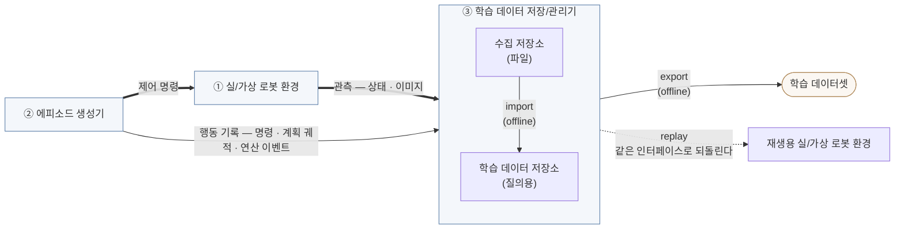
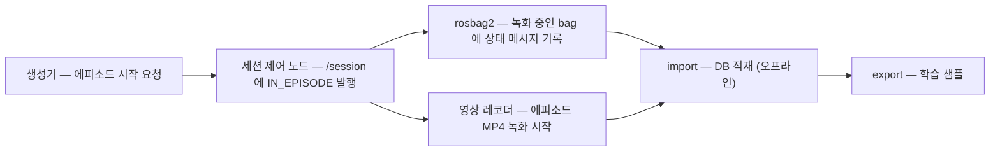
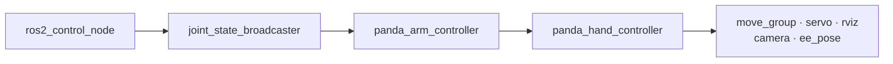
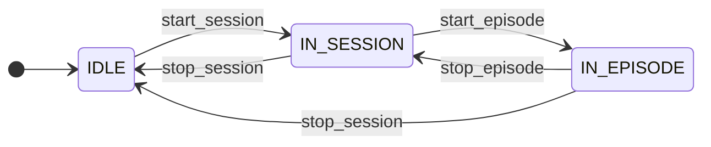
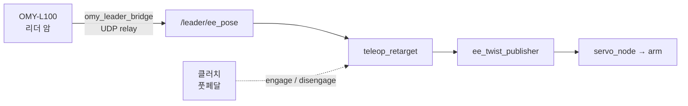
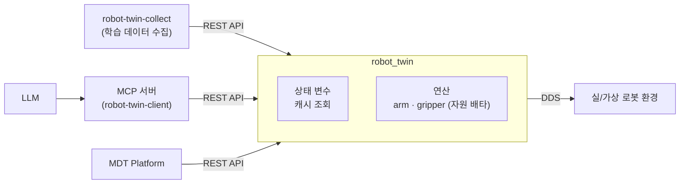
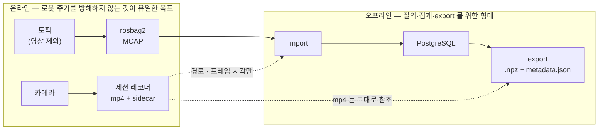
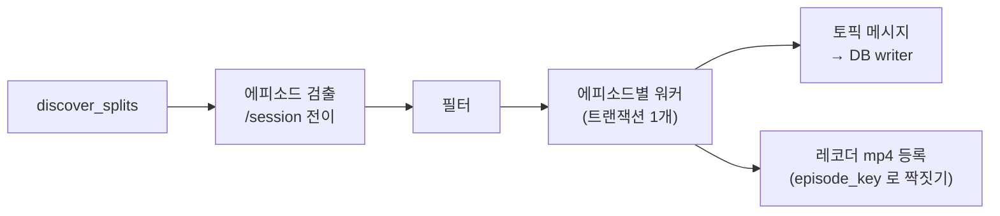
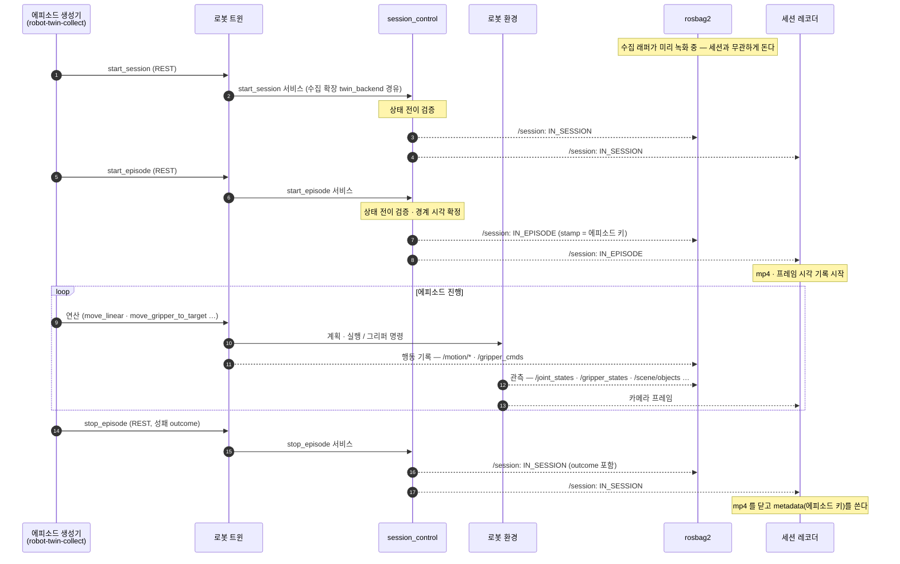
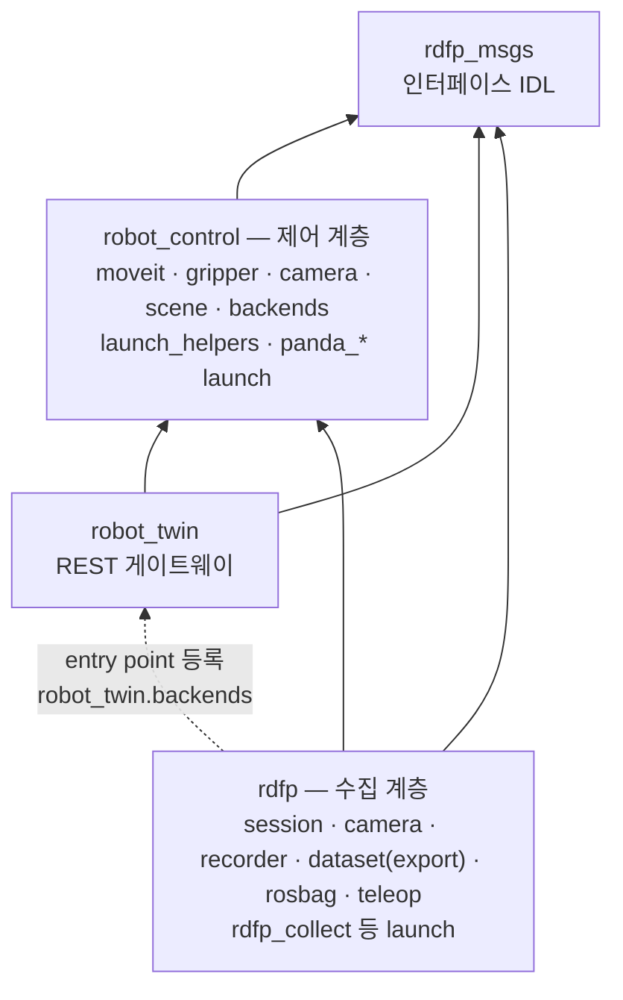

# rdfp 프레임워크 — 전체 구조와 설계

> **이 문서의 위치** — `rdfp_ws` 전체를 조망하는 **최상위 문서**다. 개별 노드·CLI 의 사용법은 [INDEX.md](INDEX.md) 가 가리키는 각 문서에 있고, 여기서는 **왜 이렇게 나뉘어 있는지**와 **서브시스템 사이의 계약**을 다룬다.
>
> **상태 표기** — 절마다 `현행`(코드와 일치) / `설계안`(코드 미반영) 을 표시한다.
>
> **기준일 2026-10-18.** 이 문서는 그날 기준의 프레임워크 구조와 설계 이유를 설명한다. 데이터 생성부터 학습까지의 실행 순서와 명령은 [collect/학습_데이터_파이프라인_개요.md](collect/학습_데이터_파이프라인_개요.md) 를 참고한다.

---

## 목차

- [1. 목적과 범위](#1-목적과-범위)
- [2. 서브시스템 경계와 표준 인터페이스](#2-서브시스템-경계와-표준-인터페이스)
- [3. 서브시스템 1 — 실/가상 로봇 환경](#3-서브시스템-1--실가상-로봇-환경)
- [4. 서브시스템 2 — 에피소드 생성기](#4-서브시스템-2--에피소드-생성기)
- [5. 서브시스템 3 — 학습 데이터 저장/관리기](#5-서브시스템-3--학습-데이터-저장관리기)
- [6. 에피소드 생명주기](#6-에피소드-생명주기)
- [7. 패키징 — ROS 워크스페이스에 전부 두는 것이 맞는가](#7-패키징--ros-워크스페이스에-전부-두는-것이-맞는가)
- [8. 현재 상태 요약](#8-현재-상태-요약)
- [9. 미결 항목](#9-미결-항목)

---

## 1. 목적과 범위

### 1.1 무엇을 만드는가

**rdfp 는 모방 학습(imitation learning)에 쓸 로봇 데이터를 수집하고 관리하는 프레임워크**다. 로봇의 관측값과 제어 명령을 에피소드 단위로 기록하며, 최종 산출물은 학습에 바로 쓸 수 있는 데이터셋이다. 지금 그 데이터를 만드는 것은 사람의 조작이 아니라 로봇 트윈의 MoveIt 연산이다(4.5).

로봇 제어 자체가 목적이 아니다. 제어는 **데이터를 만들기 위한 수단**이며, 그래서 이 프레임워크의 모든 설계 결정은 "그 데이터가 나중에 학습에 쓸 만한가"를 기준으로 판단한다.

### 1.2 세 서브시스템

번호는 이 문서의 장 순서(3장 환경 · 4장 생성기 · 5장 저장기)를 따른다. 저장기가 받는 것은 환경의 **관측**만이 아니다 — 생성기 쪽의 **행동 기록**(그리퍼 명령, MoveGroup 클라이언트가 내는 실행 궤적 · 연산 이벤트)도 함께 남겨야 (관측, 행동) 쌍이 된다(2.2).

세 서브시스템은 **각각 통째로 교체 가능**해야 한다. mock Panda 를 Isaac Sim 으로, 키보드를 리더 암으로, PostgreSQL 을 다른 저장소로 바꿔도 나머지가 그대로 동작하는 것이 목표다.

표는 세 서브시스템의 현재 구현을 보여 준다 — 바뀔 수 있는 예시라서 그림에는 넣지 않았다.

| 서브시스템 | 현재 구현 예 |
|---|---|
| ① 실/가상 로봇 환경 | Franka Panda — mock · Isaac Sim · 펑션베이, Gazebo(보류) · 실기(준비 중) (3.2) |
| ② 에피소드 생성기 | robot twin(LLM · 스크립트) · 키보드 teleop · leader-follower(OMY-L100) — **학습 데이터 출처는 당분간 트윈만** (4.5) |
| ③ 학습 데이터 저장/관리기 | 수집 저장소 = rosbag2(MCAP, 영상 제외) + 세션 레코더 mp4, 학습 데이터 저장소 = PostgreSQL (mp4 는 경로로 참조) |

**산출물**은 세 서브시스템 밖의 **학습 데이터셋**이다 — 지금은 ACT 샘플 트리(`.npz` + `metadata.json`, 영상은 mp4 참조)이고, 별도 저장소의 `rdfp-train`(LeRobot `ACTPolicy`)이 읽는다(5.6 · 5.7).

저장 · 관리 계층은 수집 중에 원본 파일을 기록하는 기능과, 수집 후 데이터를 DB 에 적재해 조회하는 기능으로 나뉜다(5.1). 그림의 ③ 안 두 상자가 이 둘이다.

**에피소드 하나는 이렇게 흐른다.** 생성기와 수집 노드가 주고받는 토픽과 서비스는 2장에서, 녹화 파일을 DB 에 적재하고 학습 샘플로 변환하는 과정은 5장에서 설명한다. 메시지 단위의 순서는 6장에 있다.

### 1.3 설계 원칙

| 원칙 | 의미 |
|---|---|
| **인터페이스가 계약이다** | 각 서브시스템은 상대의 구현을 모른 채, 정해진 인터페이스(토픽 · 서비스 · Python API, 2.1)로만 명령과 데이터를 주고받는다. ROS 토픽을 쓸 때는 토픽 이름 · 메시지 타입 · QoS 설정을 맞춘다 |
| **에피소드 경계는 하나의 출처에서** | 세션 제어 노드가 확정해 `/session` 으로 발행한 상태가 유일한 시작·끝 신호다. 생성기는 요청만 하고, 녹화기 · 적재는 각자 판단하지 않는다 (6장) |
| **수집 경로에 DB 를 두지 않는다** | 로봇이 도는 동안에는 파일(MCAP · mp4)에만 쓴다 — DB 의 지연 · 장애를 수집 경로에서 떼어 낸다 (5.1) |
| **재생으로 기록과 제어 경로를 검증한다** | 저장된 명령을 같은 인터페이스로 되돌려 로봇이 움직이는지 본다. 기록 · 재생 경로가 성립한다는 검증이지, 작업 재현이나 학습 레이블의 정확성까지 보장하지는 않는다 (5.5) |
| **교체 가능성은 이름에서 시작한다** | 토픽 이름에 구현이 드러나면 교체할 수 없다 (2.3 — servo 입력 두 개가 예외로 남아 있다) |

---

## 2. 서브시스템 경계와 표준 인터페이스

### 2.1 인터페이스 계약 `현행`

서브시스템 사이의 채널이 곧 공통 언어다. 대부분 토픽이지만 서비스와 Python API 도 있다. 표는 **누가 내고 누가 받는지**를 정리한 것이고, 토픽 이름은 [topic_naming_contract.md](topic_naming_contract.md) 의 명명 규칙을 따른다.

| 구분 | 역할 | 전달 | 제공자 → 소비자 | 이름 · 타입 |
|:-:|---|---|---|---|
| **입력** | 팔 제어 (계획 · 실행) | Python API | 트윈 → MoveGroup 클라이언트 → 백엔드 명령 채널 | `create_move_group_client(node, backend=...)` — 채널은 프로파일이 고른다 (3.2) |
| 입력 | 팔 제어 (EE 속도 — 직선 · 회전) | 토픽 | teleop → `servo_node` | `/servo_node/delta_twist_cmds` · `TwistStamped` (규약의 예외, 2.3) |
| 입력 | 팔 제어 (관절 속도) | 토픽 | `teleop_keyboard` → `servo_node` | `/servo_node/delta_joint_cmds` · `control_msgs/JointJog` (규약의 예외, 2.3) — 지금은 `panda_joint1` 개별 조작에만 쓴다 |
| 입력 | 그리퍼 제어 | 토픽 | 트윈 · teleop → 그리퍼 노드 | `/gripper_cmds` · `rdfp_msgs/GripperCommand` (`goal` — 심볼) |
| 입력 | scene 배치 | 서비스 | 트윈 → scene 노드 | `/scene/reset` · `rdfp_msgs/ResetScene` — 펑션베이에는 없다 |
| **관측** | 팔·그리퍼 관절 상태 | 토픽 | 환경 → 트윈 · 저장기 | `/joint_states` · `sensor_msgs/JointState` |
| 관측 | 엔드이펙터 자세 (`panda_link0` 기준 — 자세를 재는 지점은 백엔드마다 다르다, 아래 TCP 절) | 토픽 | `ee_pose` 노드 → 트윈 · 저장기 | `/ee_pose` · `geometry_msgs/PoseStamped` |
| 관측 | 그리퍼 상태 | 토픽 | 그리퍼 노드 → 트윈 · 저장기 | `/gripper_states` · `rdfp_msgs/GripperState` (`width`/`stalled`/`at_goal`) |
| 관측 | 조작 대상 물체 | 토픽 | scene 노드 → 트윈 · 저장기 | `/scene/objects` · `rdfp_msgs/SceneObjects` |
| 관측 | 카메라 | 토픽 | 환경 → 세션 레코더 (bag 에는 담지 않는다) | 백엔드마다 다르다 — 아래 |
| **행동 기록** | 실행 궤적 · 연산 이벤트 | 토픽 | MoveGroup 클라이언트 → 저장기 | `/motion/trajectory` · `/motion/event` — `operation_id` 로 짝짓는다 |
| 행동 기록 | 팔 관절 명령 (공통 메시지 형식) | 토픽 | `target_joint_cmds_publisher`(수집 계층) → 저장기 · 재생 | `/target_joint_cmds` · `sensor_msgs/JointState` — 백엔드별 관절 명령 채널을 이 형식으로 바꿔 발행한다(아래) |
| **경계** | 세션 · 에피소드 시작 및 종료 | 서비스 | 생성기 → `session_control_node` | `/session_control/{start,stop}_{session,episode}` |
| 경계 | 작업 라벨 설정 | 서비스 | 생성기 → `session_control_node` | `/session_control/set_task_label` — `IDLE` 또는 `IN_SESSION` 에서만 받는다(에피소드 중에는 거부) |
| 경계 | 에피소드 경계 상태 | 토픽 (TRANSIENT_LOCAL) | `session_control_node` → rosbag2 · 세션 레코더 · 생성기 | `/session` · `rdfp_msgs/SessionCommand` |

**`/target_joint_cmds` 는 백엔드별 관절 명령을 `JointState` 형식으로 발행한다.** 입력은 백엔드마다 다르다 — mock 은 컨트롤러의 `JointTrajectory` 토픽(`/panda_arm_controller/joint_trajectory`), mock JGPC 는 `Float64MultiArray` 명령 토픽, Isaac 은 ros2_control 이 시뮬레이터로 내는 관절 명령, 펑션베이는 `/input/panda_joint` 다. `JointTrajectory` 토픽을 입력으로 받을 때는 메시지마다 **마지막 궤적점**의 관절값을 기록한다. 이 토픽에 나오는 것은 servo 처럼 토픽으로 명령하는 경로뿐이라, mock 에서 MoveIt 이 컨트롤러 액션으로 보낸 궤적은 `/target_joint_cmds` 에 남지 않는다 — 그 궤적은 `/motion/trajectory` 가 기록한다. 타임스탬프는 노드가 명령을 받은 시각이다.

**카메라는 다른 채널과 두 가지가 다르다.** 첫째, 영상은 rosbag 에 담지 않는다 — 세션 레코더가 카메라 토픽에서 이미지를 받아 에피소드별 MP4 파일로 저장한다(5.1). 둘째, 카메라 토픽 이름과 픽셀 형식이 백엔드마다 다르며, 백엔드별 프로파일(`src/robot_control/config/backends/<이름>.yaml` — 이하 '백엔드 프로파일')의 `camera` 항목에서 지정한다.

| 백엔드 | 레코더 입력 | 비고 |
|---|---|---|
| mock | `/camera/image_raw` (`bgr8`) | |
| Isaac | `/isaac/camera/image_raw` (`rgb8`) | |
| 펑션베이 | `/camera_image_aligned/compressed` (JPEG) | `fb_camera_restamp` 가 원본 압축 영상(`/camera_image/compressed`)의 타임스탬프를 관절 상태와 같은 시간 기준에 맞춘 토픽이다. 뷰어는 이것의 압축을 푼 영상(`/camera_image`)을 사용한다 |

> **인터페이스 표에는 현재 실행 환경에서 보이는 토픽 이름을 적었다. 로봇별 토픽은 코드에서 `joint_states` 처럼 상대 이름으로 선언하는 것이 원칙이다**(`'/joint_states'` 가 아니다). 여러 로봇이 공유하는 세션 상태 토픽은 코드에서도 절대 이름 `/session` 을 쓴다(이유는 바로 아래). 로봇별 토픽을 상대 이름으로 선언하면 노드의 네임스페이스가 토픽 이름에도 적용된다. 백엔드에서 다른 이름을 쓰는 토픽은 launch 설정에서 remap 한다. 채널을 새로 만들거나 이름을 바꿀 때의 규칙(단수/복수, remap 을 쓸 곳, 파라미터로 받아야 하는 예외)은 [topic_naming_contract.md](topic_naming_contract.md) 가 정본이다.

`/session` 만 성격이 다르다 — 로봇을 움직이는 명령이 아니라 **데이터 수집 구간을 선언**하는 신호이며, 에피소드 생성기와 저장기가 함께 본다. 생성기가 직접 발행하지 않는다 — 서비스로 요청하고, 세션 제어 노드가 상태 전이를 검증한 뒤 발행한다(6장).

**하나의 학습 작업에 참여하는 로봇들은 `/session` 을 공유한다.** 여러 로봇이 공동으로 수행한 작업을 하나의 에피소드로 기록하기 위해서다 — 로봇마다 세션을 따로 두면 한쪽의 `stop_episode` 가 공동 작업을 중간에 잘라, 하나의 시연으로 묶이지 않는다. **서로 독립적인 학습 작업은 `ROS_DOMAIN_ID` 를 달리해 분리한다.** 이 결정 때문에 `/session` 은 로봇별 네임스페이스에 들어가지 않는다 ([topic_naming_contract.md](topic_naming_contract.md) §2.5).

> **세션 제어 노드는 `/session` 의 내구성(durability)을 `TRANSIENT_LOCAL` 로 설정해 마지막 상태 메시지 한 건을 보관한다**(`RELIABLE` · depth 1). 녹화기나 `ros2 topic echo` 를 `TRANSIENT_LOCAL` 로 구독하면 늦게 연결해도 마지막으로 발행된 상태 메시지 한 건을 받는다. `VOLATILE`(구독 기본값)로 구독하면 연결한 뒤 새로 발행되는 메시지부터 받는다 — 상태 전이뿐 아니라 `set_task_label` 도 현재 상태 그대로 메시지를 다시 발행한다.

#### `/ee_pose` — 지금 발행하는 값 `현행`

`ee_pose` 노드는 `panda_link0` 좌표계에서 본 TCP 의 위치와 방향을 TF 에서 조회해 `/ee_pose` 로 발행한다. 자세를 구할 TCP 프레임은 백엔드 프로파일의 `frames.ee` 로 지정한다. 펑션베이는 `grasp_center`(파지 중심)를 쓰고, 이 값을 지정하지 않은 mock 과 Isaac 은 기본값인 `panda_hand`(손 장착면)를 쓴다. 자세 값 자체는 순기구학(`/joint_states` → `robot_state_publisher` → TF)에서 나온다.

기본 설정에서 노드는 20 ms 마다(50 Hz, `publish_rate` 파라미터) 최신 TF 를 조회하고, 조회에 성공하면 TF 의 타임스탬프를 그대로 붙여 발행한다 — 그사이 TF 가 갱신되지 않았다면 같은 타임스탬프와 자세가 다시 발행될 수 있고, 조회에 실패한 회차는 발행하지 않는다.

아래는 이 값이 앞으로 보장해야 할 조건(설계안)과, 지금 그 조건을 얼마나 지키는지다.

#### `/ee_pose` 의 TCP 계약 `설계안` (2026-09-14)

**소비자는 `/ee_pose` 를 어떻게 계산하는지 알 필요가 없다.** 순기구학, URDF, TCP 변환 상수는 로봇 환경(백엔드 스택) 내부의 사정이다. 계약은 그 값이 **무엇을 뜻하고 어떤 성질을 보장하는가**만 정한다. 스택마다 TCP 의 이름은 달라도 되며, 기준 TCP 프레임은 백엔드 프로파일의 `frames.ee` 에서 지정한다(launch 의 `ee_pose` 노드와 트윈의 `move_linear` 기본 프레임이 같은 값을 읽는다).

| 항목 | 계약 |
|---|---|
| 원점 | 그리퍼 파지 중심 (두 손가락 안쪽면 사이) |
| 축 | z 는 접근 방향. 손가락 개폐 방향에 대응하는 축을 하나로 정한다 (규약 미정) |
| 기준 프레임 · 표현 | `header.frame_id` = `panda_link0`, m, 쿼터니언 xyzw |
| 시각 | `header.stamp` 는 그 자세가 성립한 시각이며 같은 스택의 다른 관측 채널과 같은 시계다 |
| 자세 값 갱신 주파수 | 명시한다. 발행 주파수와 구분한다 |
| 연속성 | 새 값이 없으면 이전 값을 반복 발행하지 않는다 |

현재 준수 현황은 다음과 같다.

| 항목 | isaac | functionbay |
|---|---|---|
| 원점 | ✗ `panda_hand` — 손 장착면이며 파지 중심은 약 0.1 m 앞 | ○ `grasp_center` |
| 축 | z ○ · 개폐 축 규약 미정 | z ○ · 개폐 축 규약 미정 |
| 설정 발행 주파수 | 50 Hz (`publish_rate` 기본값) | 50 Hz (`publish_rate` 기본값) |
| 실측 자세 갱신 주파수 | 미측정 | 미측정 |
| 연속성 | 미확인 | ✗ 시뮬레이터 재시작으로 시계가 되감기면 같은 값을 계속 발행한다 |

참고로 mock 에서는 TF 타임스탬프의 갱신 빈도가 약 18 Hz 였다. 두 환경 모두 같은 TF 경로(`robot_state_publisher` → `ee_pose` 노드)를 쓴다. 표의 ✗ 는 확인된 규약 불일치이고, '미측정' · '미확인' 은 아직 재지 않았다는 뜻이다.

> ⚠️ isaac 에 `frames.ee` 를 넣으려면 `robot-twin-client` 의 `to_arm_command()` 가 곱하는 45° 를 함께 정리해야 한다 — 그대로 넣으면 90° 이중 회전이 된다.

리더–팔로워 조작에서는 `teleop_retarget` 이 팔로워의 목표 자세를 계산해 `/follower/target_pose` 로 발행한다(4.3). 명명 규약에서 이 역할에 지정한 토픽 이름은 `target_ee_pose` 이며([topic_naming_contract.md](topic_naming_contract.md) §2.3 — 현재 설정은 아직 규약 이름을 쓰지 않는다), 목표 자세는 `/ee_pose` 와 같은 TCP 를 기준으로 표현한다. MoveIt 생성 데이터의 데카르트 명령은 채널을 따로 발행하지 않고, 관절 명령과 기구학 모델 스냅샷으로 같은 TCP 정의에 따라 다시 계산한다. 학습 데이터 쪽 설계(책임 분담 · 명령 후보 · 적합성 시험과 그 결과): [archive/learning/학습_데이터의_좌표_공간_비교.md](archive/learning/학습_데이터의_좌표_공간_비교.md) §5.6~§5.8 (보관본 — 데카르트 단계는 보류, [learning/열린_결정.md](learning/열린_결정.md) §2).

### 2.2 action 과 observation 을 함께 남긴다 `현행`

모방 학습 데이터의 핵심은 **(관측, 행동) 쌍**이다. 그래서 로봇에 보낸 명령과, 그 결과로 관측한 상태를 각각 기록한다.

| | 토픽 | 의미 |
|---|---|---|
| action (팔, 학습에 쓰는 것) | `/motion/trajectory` + `/motion/event` | 연산마다 컨트롤러로 보낸 **계획 궤적**과 연산의 종료 결과 (관절-계획) |
| action (팔, 비교 기준) | `/target_joint_cmds` | 컨트롤러로 **나간 명령값** (관절-명령) |
| action (그리퍼) | `/gripper_cmds` | 보낸 **의도** (심볼) |
| observation (팔) | `/joint_states` | 각 시각에 **관측한 관절 위치** (이동 중 포함 — export 가 카메라 프레임 시각에 맞춰 보간한다) |
| observation (그리퍼) | `/gripper_states` | 개구 폭(m) `width`, 정체 상태 `stalled`(힘을 내는데 움직이지 않음), 현재 명령의 달성 여부 `at_goal` — `at_goal` 의 판정식은 `open` · `close` · `grasp` 마다 다르다 |

**MoveIt 생성 데이터의 팔 action 은 계획 수준(관절-계획)이다 — 구현됐다 (R1 · R2 2026-09-18, export 2026-09-19).** MoveGroup 클라이언트가 실행 궤적(`/motion/trajectory`)과 연산 이벤트(`/motion/event`)를 내고, export 가 이 둘로 시각마다의 계획 관절값을 정해 ACT 형식 샘플을 만든다(`export --label joint_plan`, 기본). 첫 팔 동작 전에는 에피소드 시작 시점의 관절 관측값을 사용한다. 동작 사이에는 직전 동작이 끝난 시점의 계획 관절값을 유지한다. 동작이 중단됐다면 중단 시점의 계획값을 쓴다. 결과가 `failed` 이거나 궤적점이 없는 연산은 레이블 계산에서 제외한다.

설계 당시에는 영상 10 Hz, 관절 관측 50 Hz 를 기준으로 삼았고, 1차 Isaac 수집에서는 관절 관측을 100 Hz 로 기록한다(결정 22). export 는 실제 카메라 프레임 시각을 샘플 기준으로 삼고, 행동 스텝 간격은 기본 100 ms 로 둔다(`--step-sec 0.1`). 샘플 구조: [learning/학습_샘플_사양.md](learning/학습_샘플_사양.md) §4. `/target_joint_cmds` 는 계속 녹화하는 비교 기준이다(`--label joint_command`). 데이터 출처는 당분간 트윈만 다룬다(teleop 제외, 결정 3). 결정 사항 전체: [learning/결정_기록.md](learning/결정_기록.md).

**팔은 숫자, 그리퍼는 심볼이다 — 비대칭이 의도적이다 (2026-09-01 결정).** `/gripper_cmds` 에는 열기 · 닫기 · 파지(`open` · `close` · `grasp`) 명령을 기록하고, `/gripper_states` 에는 실제 개구 폭을 미터 단위로 기록한다.

초기 설계에서는 그리퍼에 보낸 `position` 과 `max_effort` 를 기록했다. 심볼을 쓰면 그 의미가 노드 상수에 남아 데이터셋만으로는 해석할 수 없다는 이유였다. 그런데 `position` 의 의미는 그리퍼마다 달랐다. 예를 들어 Robotiq 2F-85 의 `position` 은 관절 각도이므로 손가락 사이의 거리(m)로 해석할 수 없다. `open` · `close` · `grasp` 를 기록하면 그리퍼를 바꿔도 어떤 동작을 요청했는지 알 수 있다.

**자기 완결성은 관측 쪽이 맡는다.** `/gripper_states` 가 개구 폭(m)을 주기 발행하므로 "그때 실제로 얼마나 벌어져 있었나"는 데이터 안에 있다. 명령은 "무엇을 원했는가", 관측은 "무엇이었는가" — 팔에서 `/target_joint_cmds` 와 `/joint_states` 가 나뉘는 것과 같은 구조이며, 그리퍼는 그 명령 쪽 표현이 심볼일 뿐이다.

> **그리퍼 명령을 토픽으로 보내는 이유** — 그리퍼 명령을 rosbag 에 기록하기 위해 토픽(`/gripper_cmds`)으로 전송한다. ROS 2 액션은 목표(goal)를 서비스 요청으로 전달하는데, Humble 의 rosbag2 는 이 요청을 기록하지 못한다. `GripperNode` 는 토픽에서 명령을 받아 백엔드에 맞는 방식으로 실행한다.

`/target_joint_cmds` 와 `/joint_states` 는 둘 다 `sensor_msgs/JointState` 라 DB 에서는 같은 테이블에 들어가고 `topic_id` 로만 구분된다. 이 구분이 사라지면 학습 데이터로서의 가치가 크게 떨어지므로, 녹화 목록에서 두 토픽을 함께 유지한다 ([config/recording_topics.list](../config/recording_topics.list)).

> **재검토 → 방향 결정 (2026-09-13 → 2026-09-17)** — mock(JTC)에서 MoveIt 으로 움직인 구간은 `/target_joint_cmds` 가 비고, 펑션베이는 우리 중력 보상을 쓰는 씬에서 teleop 과 트윈의 명령이 보상 오프셋만큼 다르다(보상은 스트리밍 경로에만 적용된다 — 현재 `r2` 씬은 벤더 솔버가 보상해 우리 보상을 껐다, 3.2). 대안·평가·권고: [learning/결정_기록.md](learning/결정_기록.md) (원문은 archive/learning/학습_데이터_수집_설계.md). MoveIt 으로만 데이터를 생성하는 경우의 설계는 [learning/학습_샘플_사양.md](learning/학습_샘플_사양.md) §2 (명령 체인 L0~L4).

### 2.3 백엔드 인터페이스와 데이터 수집 인터페이스 `현행 + 설계안`

백엔드 인터페이스는 MoveIt 과 컨트롤러가 로봇에 명령을 전달하는 방식을 정한다. 데이터 수집 인터페이스는 에피소드 생성기, 로봇 환경, 저장 계층이 주고받는 명령과 관측값을 정한다. 둘은 바뀌는 조건이 달라 따로 다룬다.

| 경계 | 계약 내용 | 정의된 곳 |
|---|---|---|
| **백엔드** — 로봇 환경 ↔ MoveIt/컨트롤러 | `panda_arm_controller` / `panda_hand_controller` 액션, 관절 이름, TF 트리, `robot_description` (컨트롤러가 없는 펑션베이는 MoveGroup 클라이언트가 명령 채널로 직접 스트리밍한다) | [backends/README.md](backends/README.md) 「백엔드 비교」 (계약 원문은 archive/isaac/multi_simulator_backend_design.md §5) |
| **데이터 수집** — 에피소드 생성기 ↔ 로봇 환경 · 저장기 | 2.1 의 채널 표 | 이 문서 · 이름은 [topic_naming_contract.md](topic_naming_contract.md) |

백엔드 인터페이스는 **Panda 이름을 그대로 고정**하기로 이미 결정되어 있다. MoveIt 의 `moveit_controllers.yaml` 을 백엔드마다 다시 쓰지 않기 위해서다. mock / Gazebo / Isaac Sim 을 바꾸는 데는 이것으로 충분하다 — **다만 "Panda 가 아닌 로봇"으로 가는 것은 그보다 큰 별개의 단계**라는 뜻이기도 하다.

#### 데이터 수집 인터페이스 — servo 입력 이름의 예외

데이터 수집 인터페이스의 채널은 2026-09-01 에 정규 이름(1단계)으로 정리됐다. 구현체 이름이 남은 것은 servo 입력 둘뿐이다.

| 이름 | 드러난 구현 | 상태 |
|---|---|---|
| `/servo_node/delta_twist_cmds` · `/servo_node/delta_joint_cmds` | MoveIt Servo 노드 | **규약의 예외로 둔다** ([topic_naming_contract.md](topic_naming_contract.md) §2.4) |
| ~~`/gripper_control/gripper_cmds`~~ | 그리퍼 노드 | **해소됨 (2026-09-02)** — `/gripper_cmds` 로 노드 이름을 뗐다 |

servo 입력을 두는 이유는 규약이 정리해 두었다 — moveit_servo 의 기본 이름이라 외부 자료와 맞고, 노드 상대(`~/`)라 네임스페이스를 저절로 따라간다. 무엇보다 **현재 모든 백엔드에서 속도 명령을 받는 노드가 MoveIt Servo 이므로** `/servo_node/delta_twist_cmds` 라는 이름이 실제 수신자와 맞는다.

**바꿀 조건도 규약을 따른다** — 속도 명령을 **MoveIt Servo 가 아닌 노드가 받는** 백엔드를 추가할 때 공통 토픽 이름을 새로 정하고, 반드시 2단계(로봇별 네임스페이스) 도입 **전에** 한다. 백엔드 수는 조건이 아니다 — 지금도 넷이지만 전부 servo 를 거친다. 바꿀 때는 생성기 · 녹화 목록 · 재생 경로가 함께 움직이고(코드 · 설정 12곳, 문서 17곳), DB 는 토픽 이름이 아니라 메시지 타입으로 writer 를 고르므로 깨지지 않는다.

---

## 3. 서브시스템 1 — 실/가상 로봇 환경

### 3.1 역할 `현행`

로봇 환경은 제어 명령을 실행하고 관절 상태와 영상을 발행한다. 에피소드의 시작과 종료는 세션 제어 노드가 관리하고, 기록과 적재는 저장 계층이 맡는다. 로봇 환경이 이 두 가지에 관여하지 않기 때문에 다른 환경으로 통째로 바꿀 수 있다.

### 3.2 현재 구현 — Franka Panda 백엔드 `현행`

현재 백엔드 프로파일은 네 가지다. mock 은 팔 컨트롤러에 따라 두 프로파일(`panda_mock` · `panda_mock_jgpc`)을 쓰고, Isaac 과 펑션베이는 각각 하나를 쓴다. 아래 표에는 연동을 보류한 Gazebo 도 비교용으로 표시했다. 네 프로파일은 Panda 의 MoveIt 2 설정, 관절 이름, 컨트롤러 이름을 공유한다. 백엔드마다 다른 값(arm 명령 채널 · servo · 카메라 · scene · 시계)은 **백엔드 프로파일**(2.1) 한 파일에 모이고, launch · 트윈 · teleop · `rdfp_collect` 가 `backend:=<이름>` 하나로 그것을 읽는다. 비교표의 정본은 [backends/README.md](backends/README.md) 「백엔드 비교」다.

| 백엔드 | 연동 | 팔 실행 | 시계 | 학습 데이터 |
|---|---|---|---|---|
| `panda_mock` / `panda_mock_jgpc` | ros2_control mock hardware | JTC / JGPC | 벽시계 | ✗ — 제어 · 수집 노드 간 연동 확인용. 물체 파지는 지원하지 않는다 |
| `panda_isaac` | ros2_control `TopicBasedSystem` (Isaac Sim) | JTC | `use_sim_time` | ○ — 1차 학습 데이터 |
| `panda_functionbay` | ros2_control 없음 — 토픽 직결 | JGPC 식 스트리밍 (`/input/panda_joint`, 50 Hz) | 벽시계 (스택이 stamp 를 정렬) | ○ — peg-in-hole |
| Gazebo | `ign_ros2_control` | JTC | `/clock` | ✗ — 미검증 · 보류 (프로파일 없음) |

실기는 [backends/franka_panda_bringup_prep.md](backends/franka_panda_bringup_prep.md) 에서 준비 중이다.

**펑션베이의 처짐 보상은 씬에 따라 주체가 다르다.** 이 시뮬레이터의 관절 제어는 중력을 잡지 않아 팔이 처지는데, 현재 씬 `r2`(`MMR-Build_260929`)는 **벤더 솔버가 보상**하므로 우리 보상을 껐다(2026-09-30 실측 — 함께 적용하면 이중 보정으로 부호가 뒤집힌다). `t1` 씬에는 벤더 보상이 없어, 프로파일이 그 씬을 고르면(`sim_scene: t1`) 그 씬의 `gravity_compensation` 으로 스트리밍하는 명령점에 우리 보정값(`−τ_g/Kp`)을 적용한다. 상세는 [backends/functionbay/펑션베이_중력_보상.md](backends/functionbay/펑션베이_중력_보상.md).

ros2_control 을 쓰는 스택은 컨트롤러 기동이 의도적으로 **순차적**이다 (`RegisterEventHandler(OnProcessExit)` 체인).

**팔 실행이 두 갈래**라는 점이 이 계층의 특징이다.

| | JTC (`panda_mock` · `panda_isaac`) | JGPC (`panda_mock_jgpc`) · 스트리밍 (`panda_functionbay`) |
|---|---|---|
| 컨트롤러 | `JointTrajectoryController` | `JointGroupPositionController` · 없음 (시뮬레이터가 받는다) |
| 명령 채널 | 액션 `/panda_arm_controller/follow_joint_trajectory` (MoveIt 실행). servo 는 토픽 `/panda_arm_controller/joint_trajectory` 로 낸다 | 토픽 `/panda_arm_controller/commands` · `/input/panda_joint` |
| 계획 궤적 전달 방식 | MoveIt(`move_group`)이 `FollowJointTrajectory` 액션으로 컨트롤러에 궤적을 전달한다 | 클라이언트가 MoveIt 으로 계획한 궤적의 관절 위치를 명령 토픽에 순서대로 발행한다 — `move_group` 의 실행 기능은 쓸 수 없다(`FollowJointTrajectory` 서버가 없다) |
| 폐루프 | 예 | **아니오** — 정상 반환이 도달을 보장하지 않는다 |

`create_move_group_client(node, backend=...)` 가 프로파일에서 구현을 골라 이 차이를 흡수하므로 상위 코드는 분기하지 않는다. 런타임 자동 판별은 없다 — 펑션베이를 JTC 로 오판해 "계획은 되고 실행만 안 되는" 일이 있었다. 자세한 것은 [control/move_group_client_user_guide.md](control/move_group_client_user_guide.md).

### 3.3 다른 환경으로 교체할 때 `현행`

**백엔드 계약의 정본은 [backends/README.md](backends/README.md) 와 백엔드 프로파일이다** (계약 원문: archive/isaac/multi_simulator_backend_design.md §5) — 백엔드는 관절 상태 · TF · `robot_description` 을 제공하고, 팔 명령을 전달하는 방식은 백엔드 프로파일(`arm_command`)에 명시한다. `panda_mock` · `panda_isaac` 은 컨트롤러 액션(JTC)을 쓰고, `panda_mock_jgpc` 는 JGPC 의 명령 토픽(`/panda_arm_controller/commands`)으로, `panda_functionbay` 는 시뮬레이터의 입력 토픽(`/input/panda_joint`)으로 관절 위치를 보낸다(3.2). 보장 조건도 거기 있다. 새 백엔드는 먼저 프로파일로 정의한다. 프로파일의 설정값만으로 구현할 수 없는 동작이 있을 때(예: 값 하나가 여러 파라미터를 함께 바꿔야 할 때) `robot_control/backends/` 에 클래스를 추가한다. 여기서는 **데이터 수집 관점에서만** 덧붙인다.

1. **타임스탬프에는 에피소드 시작 · 종료 시각과 같은 시계를 쓴다.** 적재기는 메시지의 `header.stamp` 로 에피소드 구간에 속하는지 판정하므로, 타임스탬프가 0 이거나 두 시계의 기준이 다르면(벽시계 ↔ sim time) bag 에 기록된 메시지도 구간을 벗어나 적재 대상에서 빠진다 — 오류는 나지 않는다. 펑션베이는 stamp 기준이 회차마다 달라 스택이 경계에서 벽시계로 정렬한다.
2. **주기를 유지한다.** `ee_twist` 경로로 재생할 때는 Servo 에 전달되는 속도 명령의 실효 주파수를 확인한다. 현재 설정에서는 10 Hz 미만이면 동작이 끊기고, 10~29 Hz 에서는 움직임이 계단식으로 나타날 수 있다([collect/replay_mock_stack_guide.md](collect/replay_mock_stack_guide.md)).
3. **그리퍼 상태는 `/gripper_states`(개구 폭)로 낸다.** `/joint_states` 의 손가락 관절은 백엔드에 따라 가짜일 수 있다 — 펑션베이는 TF 를 세우려고 고정값을 주입한다.
4. **입력 영상의 픽셀 형식과 해상도를 레코더 설정에 맞춘다.** 레코더는 입력 형식이나 해상도가 설정과 다른 프레임을 건너뛰고 경고만 남긴다. 그래서 설정이 어긋나면 에피소드에 유효한 프레임이 하나도 남지 않을 수 있고, 그 에피소드로는 영상 기반 학습 샘플을 만들 수 없다. ⚠️ 지금 export 는 그런 에피소드를 건너뛰지 않는다 — 영상 스트림 행은 있는데 프레임이 0 인 에피소드가 대상에 들어 있으면 `has no camera frames` 로 **명령 전체가 실패**한다. 설정 fps 는 MP4 인코딩(컨테이너의 고정 프레임률)에 쓰는 값이라 어긋나도 프레임을 버리지는 않고 MP4 재생 속도만 달라진다 — 학습 샘플의 시각은 실제로 기록한 프레임의 타임스탬프로 정한다(5.6).
5. **에피소드 시각에 시뮬레이션 시간을 쓰는 환경에서는 시뮬레이터를 재시작할 때 수집 회차를 나눈다.** 지금은 Isaac(`use_sim_time: true`)이 해당한다 — mock 과 펑션베이는 벽시계 기준이다(펑션베이는 관측 시각을 벽시계에 맞춘다). 시계가 0 부터 다시 시작하면 두 회차의 시간 구간이 겹칠 수 있으므로, 재시작 전후에 기록한 bag 은 따로 적재한다(함께 적재하면 겹친 구간의 메시지가 다른 에피소드에 들어가거나 빠진다). 새 에피소드의 시작 시각이 DB 에 저장된 에피소드와 초 · 나노초까지 같으면 중복 키 처리 정책(`on_existing_episode`, 5.3)이 적용된다.

Gazebo 브링업 절차는 [backends/gazebo_bringup_guide.md](backends/gazebo_bringup_guide.md), 입력 어댑터 규약은 [teleop/external_input_adapters.md](teleop/external_input_adapters.md).

---

## 4. 서브시스템 2 — 에피소드 생성기

### 4.1 공통 책임 `현행`

로봇을 움직여 **의미 있는 궤적을 만들고**, 그 구간의 시작 · 끝을 세션 제어 노드에 **요청**한다(경계를 확정하고 `/session` 으로 알리는 것은 세션 제어 노드다, 6장). 구현이 셋이지만 이 두 가지는 동일하다.

그림은 세션 제어 노드의 내부 상태다. 에피소드 도중 `stop_session` 을 호출하면 노드는 `/session` 에 `IN_SESSION` 과 `IDLE` 을 차례로 발행한 뒤 내부 상태를 `IDLE` 로 바꾼다. 구독자는 첫 메시지로 에피소드 종료를, 두 번째 메시지로 세션 종료를 확인한다 — 그래서 아래의 에피소드 종료 판정은 `stop_episode` 를 거치지 않은 경우에도 성립한다.

적재기는 `/session` 상태가 `IN_EPISODE` 로 바뀐 메시지의 시각을 에피소드 시작으로, 이어서 `IN_SESSION` 으로 바뀐 메시지의 시각을 종료로 기록한다. 녹화가 끝날 때까지 종료 메시지가 없으면 그 에피소드는 적재 대상에서 빠진다(경고 로그 `unfinished episode discarded`) — 녹화가 에피소드 도중에 끊기면 마지막 에피소드를 잃는다는 뜻이다 ([collect/session_control_guide.md](collect/session_control_guide.md)). 세션 노드 (`session_control_node`)는 수집 계층(`rdfp_collect`)이 띄우며, 없으면 생성기의 세션 · 에피소드 명령만 거절되고 로봇 조작은 그대로 된다.

### 4.2 키보드 teleop `현행`

`teleop_keyboard` 는 직선 이동과 회전 키를 `TwistStamped` 속도 명령으로 바꿔 MoveIt Servo 에 보낸다. 첫 번째 관절(`panda_joint1`)만 움직일 때는 `/servo_node/delta_joint_cmds` 로 `JointJog` 명령을 보낸다(두 명령은 동시에 활성화되지 않는다). 그리퍼는 `=`/`-`/`\` 키가 `/gripper_cmds` 에 심볼(`open`/`close`/`grasp`)을 발행한다. 붙을 스택은 `backend` 파라미터로 고른다(기본값 없음).

키보드로 속도 명령을 보내면 Servo 와 로봇의 응답을 바로 확인할 수 있어, 리더 암이나 트윈을 연결하기 전에 **팔 제어 경로를 점검하는 기준선**으로 쓴다. 다만 servo 는 목표 없이 속도만 받아 측정 상태에서 IK 를 다시 풀기 때문에, 물체를 든 채 움직이는 정밀 작업은 트윈의 계획 연산이 맡는다([teleop/servo_vs_planned_motion.md](teleop/servo_vs_planned_motion.md)).

### 4.3 leader-follower teleop (OMY-L100) `현행`

두 로봇 팔은 관절 구성이 다르므로(이기종), 관절이 아니라 **끝단(EE) 자세를 기준으로** 옮긴다. 클러치를 연결한 시점의 두 팔 끝단 자세를 각각 기준으로 삼고, 이후 리더 팔 끝단의 위치와 방향이 변한 만큼 팔로워의 목표 자세를 갱신한다.

- 리더는 별도 저장소(`omy_leader_bridge`)이며 **ROS 2 Jazzy + zenoh** 라 런타임을 공유하지 않는다. UDP 릴레이로 넘어온다.
- 클러치를 연결하면 그 순간의 리더 팔 자세와 팔로워 팔 자세가 각각 기준(앵커)이 된다. 이후 리더 팔의 자세 변화량을 팔로워의 기준 자세에 반영해 목표 자세를 계산한다 — 클러치를 풀고 리더 팔만 옮긴 뒤 다시 연결하면 팔로워는 제자리에서 이어 움직인다. 페달을 누르는 동안만 리더 암의 움직임을 전달하려면 페달 노드를 `hold` 모드로 실행한다. `pedal_timeout` 은 페달 신호(하트비트)가 끊겼을 때 추종을 해제하기까지의 시간(초)이며, `teleop_mirror` 런치에서 페달을 켜고 `hold` 모드를 고르면 0.3 초가 기본으로 들어간다. `toggle` 모드는 하트비트를 보내지 않으므로 런치가 타임아웃을 0(감시 안 함)으로 되돌린다 — 이 모드는 데드맨이 아니다.
- **그리퍼 경로가 아직 없다** — 리더가 넘기는 것은 EE pose 하나뿐이라 그리퍼는 키보드로 조작한다. 리더 트리거를 쓰던 설계는 `GripperCommand` 개편(2026-09-01)으로 전제가 무효가 되어 보관했다 — [archive/leader_gripper_mapping_design.md](archive/leader_gripper_mapping_design.md).

### 4.4 LLM · 스크립트 기반 제어 (robot twin) `현행`

로봇 트윈은 상태 조회와 로봇 조작 기능을 **REST API(HTTP/JSON)** 로 제공하는 게이트웨이다 — 호출하는 쪽은 ROS 를 몰라도 된다. 현재는 `robot-twin-client` 의 `robot-twin-collect` 가 이 API 로 로봇 동작과 에피소드의 시작 · 종료를 요청해 **학습 데이터를 수집한다**(경계를 확정하는 것은 세션 제어 노드다). LLM 은 같은 저장소의 MCP 서버를 통해 같은 API 를 쓴다.

| 제공 | 내용 |
|---|---|
| 상태 변수 | `joint_states` / `ee_pose` / `gripper_state` / `scene_objects` / `session_state` / `named_targets`, 펑션베이는 `fixtures`(고정물 기하) |
| 연산 (arm) | `move_to_named_target` / `move_to_joints` / `move_linear` |
| 연산 (gripper) | `move_gripper_to_target` (`open`/`close`/`grasp`) |
| 연산 (scene) | `reset_scene` — `/scene/reset` 이 있는 백엔드만 (펑션베이 제외) |
| 연산 (수집 경계) | `start_session` / `stop_session` / `start_episode` / `stop_episode` — 수집 계층이 entry point 로 제공 (7.1) |
| 안전 | 자원 배타 락, E-stop, 연산 시간 제한 — 연산이 제한 시간을 넘으면 감시기가 그 연산을 시간 초과(`FAILED` · `TIMEOUT`)로 실패 처리한다. MoveGroup 을 쓰는 연산이면 실패 처리에 앞서 팔 컨트롤러에 정지를 요청한다(요청이라 정지를 보장하지는 않는다. 정지 요청을 전달하지 못하면 연산 오류에 팔이 계속 움직일 수 있음을 표시하고, 서버 로그에 비상 정지 안내를 남긴다) |

주변 물체 정보는 `/scene/objects` 계약(조작 대상만)으로 들어온다. 설정에는 `move_to_pose` · `move_gripper` 가 자리만 있고 호출하면 실패한다(미구현).

상세는 [twin/로봇_트윈_사용자_가이드.md](twin/로봇_트윈_사용자_가이드.md), 설계는 [twin/로봇_트윈_설계서.md](twin/로봇_트윈_설계서.md).

### 4.5 세 구현 비교

| | 키보드 | leader-follower | 로봇 트윈 (스크립트 · LLM) |
|---|:-:|:-:|:-:|
| 제어 입력 | 직선·회전 속도(`TwistStamped`) 또는 개별 관절 속도(`JointJog`) | pose → retarget | REST API 로 연산 호출 |
| 팔 동작 생성 방식 | 키 입력을 속도 명령으로 변환 | 리더 팔의 자세 변화를 팔로워의 속도 명령으로 변환 | 작업 목표에 맞춰 MoveIt 으로 관절 궤적을 계획한 뒤 백엔드별로 실행(3.2) |
| 그리퍼 | 키 | 키보드로 조작(리더 입력 미연동) | 연산 |
| 자동화 | 불가 | 불가 | **가능** |
| 주 용도 | 검증·디버깅 | 사람 시연 | **학습 데이터 수집 — 현재 유일한 출처** |

**데이터 출처는 당분간 트윈 연산만 다룬다** (2026-09-17, [learning/결정_기록.md](learning/결정_기록.md) 결정 3). 이유는 **기록할 수 있는 것**에 있다.

- **action 을 만들고 추적할 수 있다** — MoveIt 으로 팔을 움직일 때는 실행에 사용한 관절 궤적을 `/motion/trajectory` 에, 연산의 종료 결과를 `/motion/event` 에 기록한다(그리퍼 명령이나 세션 시작 · 종료 같은 다른 트윈 연산은 여기에 남지 않는다). export 는 같은 에피소드에서 `operation_id` 가 일치하는 두 기록을 연결해 팔의 행동 레이블(관절-계획, 2.2)을 만든다. 실행 궤적에 대응하는 종료 이벤트가 없으면, export 는 팔이 계획된 궤적을 끝까지 실행했다고 가정해 레이블을 만들고 그 건수를 `episodes.jsonl` 의 `assumed_full_duration` 에 기록한다(5.7 의 주의 참조). `.npz` 에는 `operation_id` 가 저장되지 않으므로, 특정 행동값의 생성 근거는 같은 에피소드의 DB 기록과 **그 행동 스텝의 시각**(5.6)을 대조해 확인한다 — 관측 직후 연산이 바뀌는 구간에서는 관측 시각 `t` 만으로 대조하면 다른 연산을 찾게 된다.
- **작업 스크립트를 실행하는 쪽에 ROS 가 필요 없다** — `robot-twin-collect` 는 REST API 로 로봇 동작과 세션 · 에피소드의 시작 · 종료를 함께 요청한다.
- **teleop 은 action 의 뜻이 다르다** — teleop 에서는 Servo 에 보낸 속도 명령을 기록한다(리더–팔로워는 목표 자세도 계산한다, 2.1). 현재 학습에 쓰는 관절-계획 레이블은 MoveIt 의 계획 궤적과 연산 결과로 만들기 때문에, teleop 데이터에서 행동 레이블을 만드는 방법은 별도 과제로 남겨 두었다.

teleop 경로는 데이터 출처에서 빠져 있을 뿐 동작은 유지한다.

---

## 5. 서브시스템 3 — 학습 데이터 저장/관리기

### 5.1 왜 2단 저장인가 `현행`

로봇이 도는 동안과 학습 데이터를 만드는 시점을 **분리**한다.

로봇을 제어하는 동안에는 데이터를 파일에만 기록하고, 수집이 끝난 뒤 DB 에 적재한다. 이렇게 하면 DB 의 응답 지연이나 장애가 제어 주기에 영향을 주는 일을 막을 수 있다. 이 설계가 없애는 것은 **수집의 DB 의존**이지 부하 자체가 아니다 — 파일 기록과 영상 인코딩에 필요한 CPU 와 디스크 자원은 수집 장비에서 따로 확보해야 한다.

**영상은 rosbag 을 거치지 않는다.** 세션 레코더(`rdfp_image_recorder`)가 `IN_EPISODE` 구간만 mp4 로 직접 쓰고 프레임별 stamp 를 sidecar 로 남긴다. 적재는 그 mp4 를 옮기지 않고 경로와 프레임 시각만 DB 에 등록하므로, **레코더 mp4 가 영상의 유일한 원본**이다. raw 영상을 bag 에 담던 때보다 녹화 대역폭이 크게 줄고, 같은 영상을 두 번 인코딩하지 않는다.

대가로 **import(적재) 단계가 하나 는다.** 새로 수집한 데이터를 DB 에서 조회하려면 먼저 적재해야 한다. 적재 전에도 `./scripts/rosbag.sh list-episodes` 로 bag 에 기록된 에피소드 목록을 확인할 수 있다(DB 가 필요 없다).

### 5.2 온라인 — 무엇을 녹화하는가 `현행`

**모든 백엔드가 같은 11개 토픽을 녹화 대상으로 지정한다**(2026-10-18 통합). 이 목록에는 2.3 의 두 Servo 입력(`/servo_node/delta_twist_cmds` · `/servo_node/delta_joint_cmds`)도 포함된다. 수집 중 메시지가 발행되지 않은 토픽은 bag 에 기록할 데이터가 없다 — 예컨대 teleop 을 쓰지 않으면 Servo 입력에는 발행자가 없다. 백엔드마다 이름이 다른 카메라 토픽과 벤더 원시 토픽(`/output/*`)은 제외한다. 목록 파일은 [config/recording_topics.list](../config/recording_topics.list) 하나이며, 녹화 스크립트(`record_rosbag.sh`)는 이 파일을 직접 읽고, 적재기는 설정(`dataset_config.yaml`)의 `topics_file` 로 같은 목록을 읽는다.

수집은 래퍼(`scripts/run_collect_isaac.sh` · `run_collect_functionbay.sh`)가 rosbag 녹화와 수집 계층을 함께 띄우고, 레코더 출력 · bag 루트 · 적재 설정(`<데이터 루트>/dataset.yaml`)을 한 데이터 루트 아래에 맞춰 둔다.

> **`metadata.yaml` 이 없는 녹화 세션은 적재에서 빠진다 ⚠️** 녹화가 강제로 종료되어(SIGKILL · 크래시) 세션 디렉터리에 `metadata.yaml` 이 생성되지 않으면, `import` 는 그 세션을 녹화 중이거나 비정상 종료된 것으로 보고 **세션 단위로 건너뛴다** — 경고는 남지 않는다. 적재할 세션이 하나도 없으면 처리 건수가 0 인 상태로 **정상 종료**한다. `.mcap` 파일이 있는데도 `import` 로그에 `found 0 finalized split(s)` 가 나오면 먼저 그 세션의 `metadata.yaml` 을 확인한다. 파일이 있으면 디렉터리 구조(`<날짜>/session_*`)와 날짜 · 토픽 필터를 확인한다. `ros2 bag reindex -s mcap <session_dir>` 로 `metadata.yaml` 을 복구한다. 복구에 성공하면 `import` 를 다시 실행하고 처리 건수를 확인한다. 녹화 래퍼가 rosbag 을 SIGINT 로 끝내는 것은 이 파일이 남게 하기 위해서다.

### 5.3 오프라인 — import 파이프라인 `현행`

- 에피소드 식별자는 **`(start_sec, start_nanosec)`** 이고 UNIQUE 다. 대리키 `id` 는 `BIGSERIAL`. 재import 는 `on_existing_episode`(`skip` 기본 / `replace` / `error`) 정책을 따른다. 기본 정책 `skip` 에서는 같은 시작 시각의 에피소드가 이미 DB 에 있으면 다시 적재하지 않으며, 건너뛴 수는 실행 요약의 `skipped` 항목에 나온다(에피소드마다 INFO 로그도 남는다).
- 에피소드 하나가 **하나의 트랜잭션**이다. 중간 실패는 그 에피소드만 롤백한다.
- 영상은 DB 에 넣지 않는다 — 레코더 metadata 의 **에피소드 키**(`/session` IN_EPISODE 의 stamp)로 mp4 를 에피소드에 붙이고, 경로 1행과 프레임 시각 N행만 남긴다. 파일 이름(벽시계)으로 맞추면 `use_sim_time` 스택에서 틀린다. (bag 에 담긴 `sensor_msgs/Image` 를 mp4 로 인코딩하던 경로도 남아 있지만, 레코더 등록과 함께 켜면 같은 행을 두 번 넣어 UNIQUE 제약에 걸린다.)
- **적재는 ROS 가 필요하다** — 이미지 경로가 `sensor_msgs` 를 import 한다(7.2). export 부터는 필요 없다.

### 5.4 저장 스키마 개요 `현행`

| 테이블 | 담는 것 |
|---|---|
| `sessions` | 에피소드(= 학습 단위). `(start_sec, start_nanosec)` UNIQUE |
| `topics` | 토픽 이름·타입 등록부. action/observation 구분의 근거 |
| `joint_states` | 관절 이름 · position/velocity/effort. `/joint_states` 와 `/target_joint_cmds` 를 `topic_id` 로 구분 |
| `motion_trajectories` / `motion_events` | 실행 궤적(R1) · 연산 이벤트(R2) — 관절-계획 action 의 원천 |
| `pose_stampeds` / `twist_stampeds` | EE 자세 / 속도 명령 |
| `joint_jogs` | 키보드로 개별 관절을 조작할 때 `/servo_node/delta_joint_cmds` 로 보낸 관절 속도 명령 |
| `gripper_cmds` / `gripper_states` | 그리퍼 명령(심볼)과 연속 상태 |
| `scene_objects` | 조작 대상 물체 배치 (라벨 · 큐레이션용) |
| `image_streams` / `image_frames` | mp4 파일 1행 + 프레임 시각 N행 |

정본은 `src/rdfp/rdfp/dataset/sql/schema.sql` 이다(옛 메시지용 `target_joint_states` 도 남아 있다).

> **관절 이름은 2026-09-18 부터 저장한다** (`joint_names TEXT[]`). 그 전 데이터와, 발행자가 `JointState.name` 을 안 채운 행은 비어 있다 — export 는 이름 없는 행을 **거부한다**(순서로 때우면 관절이 뒤바뀌어도 값 범위가 비슷해 드러나지 않는다).

### 5.5 재생 — 아키텍처 그림의 "재생용 로봇 환경" `현행`

저장된 에피소드를 **같은 토픽 계약으로 되돌린다.** 저장된 명령이 같은 인터페이스로 로봇을 움직이는지 보면 **기록과 제어 경로**가 성립하는지 — 빠진 채널 · 어긋난 시각 · 잘못된 관절 순서 같은 것 — 를 검증할 수 있다. 다만 로봇이 움직였다고 작업이 재현되거나 학습 레이블이 정확하다는 뜻은 아니다. export 는 실행할 때 관절 이름 같은 샘플 생성에 필요한 정보를 검사한다(이름 없는 관절 행 거부 등). 학습 규약과 배치 규약의 호환성은 export 가 자동으로 보지 않으므로 `ExportSpec.assert_compatible()` 을 따로 호출해 검사해야 한다.

| 재생기 | 대상 | 방식 |
|---|---|---|
| `TopicMessageReplayer` | 비이미지 토픽 | k-way heap merge, 단일 워커 |
| `Mp4ImageReplayer` | 이미지 토픽 | 디코더 + 발행 스레드 + 백프레셔 큐 |

각 재생기 인스턴스에서 `start()` 는 **한 번만** 호출할 수 있다(두 번째 호출은 `RuntimeError` — 다시 재생하려면 새로 만든다). `replay_gui` 는 재생할 데이터 중 가장 이른 타임스탬프를 공통 기준으로 삼고, 모든 재생기에 같은 재생 시작 시각을 전달해 함께 출발시킨다. 재생용 스택 `replay_panda_mock` 은 arm 어댑터를 `replay_arm_path` (`ee_twist` 기본 / `target_joint_cmds` / `none`) 로 하나만 고른다 ([collect/replay_mock_stack_guide.md](collect/replay_mock_stack_guide.md)).

### 5.6 export — 학습 샘플 트리 `현행` (2026-09-19)

`ros2 run rdfp export` 는 DB 에 저장된 에피소드(5.4 의 테이블)를 읽어 학습 샘플 파일을 만든다. 이 명령은 DB 의 데이터와 스키마를 변경하지 않는다. 산출물은 `metadata.json` + `episodes.jsonl` + 에피소드별 `.npz`(`frame_index` · `t` · `qpos` · `action_arm` · `action_gripper` · `is_pad`)이고, 영상은 복사하지 않고 `recordings_dir` 기준 **상대 경로**로 mp4 를 가리킨다. 형식 정본은 [learning/저장_형식.md](learning/저장_형식.md). 이름이 같은 `./scripts/rosbag.sh export` 는 다른 명령이다 — bag 에서 선택한 에피소드를 DB 에 적재할 때 사용한다(5.3).

| 설계 선택 | 이유 |
|---|---|
| 샘플 시각 = 실제 카메라 프레임 시각 (고정 fps 격자가 아니다) | 각 샘플의 관측 시각 `t` 에는 해당 영상 프레임에 기록된 타임스탬프를 쓴다. 이렇게 하면 실제 촬영 간격이 일정하지 않아도 영상과 로봇 관측값을 같은 시각에 맞출 수 있다 — 실측 fps 는 설정과 다르고 회차마다 다르다 |
| action chunk 를 **미리 계산해** 저장한다 | 카메라 프레임 사이의 간격은 일정하지 않다. 다음 프레임의 행동값을 차례로 이어 붙이면 학습에서 정한 행동 간격과 어긋날 수 있다. 따라서 export 할 때 관측 시각 `t`(`.npz` 의 `t`)를 기준으로 각 행동 시각 `t + delta_sec + j × step_sec`(j 는 0 부터; 기본 `--delta-sec 0.1` · `--step-sec 0.1`)를 계산해 팔과 그리퍼의 행동값을 같은 시각에 맞춰 저장한다. 이 어긋남은 로더나 학습기에서 오류를 내지 않으므로 export 에서 미리 막는다 |
| 관측값과 팔 행동값은 원래 단위로 저장한다 (정규화하지 않는다) | 저장된 값을 로봇의 관측값 · 명령값과 직접 비교할 수 있다. 학습 시 정규화에 필요한 통계는 `metadata.json` 에 기록한다 — 에피소드를 더해 통계가 바뀌어도 기존 샘플을 다시 쓸 필요가 없다 |
| 그리퍼 명령(`action_gripper`)은 원-핫 벡터로 저장한다 | 성분 순서는 `open` · `close` · `grasp` 이며, `close` 는 `[0, 1, 0]` 이다. 첫 그리퍼 명령이 기록되기 전에는 export 가 행동 레이블에 `open` 을 부여한다. 그 시점의 실제 그리퍼 상태는 관측된 개구 폭으로 확인한다 |
| LeRobot 데이터셋 형식으로 변환하지 않는다 | 학습기(`rdfp-train`)가 이 트리를 직접 읽고 LeRobot 은 정책(`ACTPolicy`)만 쓴다 |
| ROS 를 import 하지 않는다 | 학습은 ROS 밖 별도 환경에서 한다 — 경계가 **파일**이다 (7.4) |

### 5.7 학습 — `rdfp-train` `현행 (코드)`

별도 저장소 `~/development/rdfp/rdfp-train`(Python 3.10, `lerobot==0.4.4`)이 export 로 만든 샘플과 레코더의 MP4 파일을 읽어 `ACTPolicy` 를 학습한다. ROS 도 DB 도 필요 없다. 데이터 로더 · 학습 루프는 완성됐고 본 학습 실행(D4)이 남아 있다. 현재 학습 코드는 체크포인트에 정책과 전처리기(정규화)를 저장하는데, 추론에서 행동값을 원래 단위로 되돌리려면 후처리기(역정규화)도 함께 저장해야 한다 — 진척은 [learning/미구현_목록.md](learning/미구현_목록.md) §0.

⚠️ **기본 export 에서는 종료 결과를 가정한 에피소드(`assumed_full_duration > 0`)가 `metadata.json` 의 에피소드 목록과 정규화 통계에서 빠진다.** `.npz` 파일과 `episodes.jsonl` 항목은 남는다(그 줄의 `assumed_full_duration` 이 0 보다 크다). 다만 현재 학습기는 `episodes.jsonl` 에 남은 항목을 모두 읽으므로 해당 샘플이 학습에 포함될 수 있다 — 이때 정규화 통계도 그 샘플을 뺀 값이라 학습 데이터와 어긋난다. 학습기가 `metadata.json` 의 목록으로 거르기 전까지는 export 의 경고 로그와 `episodes.jsonl` 의 `assumed_full_duration` 을 확인한다.

---

## 6. 에피소드 생명주기

한 에피소드가 세 서브시스템을 어떻게 지나가는지 `현행`. 아래는 현재의 데이터 출처인 트윈 경로다.

**생성기는 경계를 요청하고, 세션 제어기가 경계를 확정하며, 저장 계층은 그 경계를 따른다.** 생성기는 `/session` 을 직접 발행하지 않는다 — 서비스로 요청하면 세션 제어 노드가 상태 전이를 검증하고 경계 시각을 정해 발행한다. 생성기는 데이터가 어디 저장되는지 모르고, 저장기는 누가 로봇을 움직였는지 모른다. teleop 은 트윈을 거치지 않고 세션 서비스를 직접 부를 뿐 흐름은 같다.

**같은 `/session` 메시지가 두 곳에서 다른 시점에 쓰인다는 점이 핵심이다.** 수집 중에 rosbag2 는 `/session` 메시지를 다른 토픽과 함께 **기록만** 하고, 영상 레코더는 이 메시지를 받아 에피소드별 영상을 녹화한다. 수집이 끝난 뒤(오프라인) 적재기는 bag 에 기록된 `/session` 상태 변화로 에피소드 구간을 구하고, 레코더 메타데이터의 `episode_key` 로 각 구간에 해당하는 mp4 파일을 찾는다 — bag 하나에 여러 에피소드가 기록돼 있어도 된다. 그 뒤 export 가 학습 샘플 트리를 만들고, 학습은 ROS 밖 `rdfp-train` 이 한다.

---

## 7. 패키징 — ROS 워크스페이스에 전부 두는 것이 맞는가

패키징 결정은 두 가지이고, 서로 독립이다. **제어 계층과 데이터 수집 계층은 별도 패키지로 나눴고(7.1), 저장/관리 기능을 ROS 환경에서 떼어 내는 방안은 검토한 뒤 보류했다(7.2~7.6).**

| 결정 | 무엇을 떼는가 | 상태 |
|---|---|---|
| **계층 분리** | 로봇 제어 계층(`robot_control`/`robot_twin`)을 학습 데이터 수집(`rdfp`) 아래로 | **완료** → 7.1 |
| **ROS 탈피** | 저장/관리기(`dataset`/`rosbag`)를 ROS 밖으로 | 보류 → 7.2~7.6 |

7.2~7.6 의 결론은 **지금은 옮기지 말고, 경계를 테스트로 고정한다**는 것이다.

### 7.1 계층 분리 — 제어 계층과 수집 계층 `현행`

단일 `rdfp` 패키지를 **네 패키지**로 나누었다. 목표는 "학습 데이터 생성과 무관한 ROS 2 로봇 제어 스택"을 단독으로 쓸 수 있게 만드는 것이다 (1.2 의 ① 로봇 환경).

| 선 | 뜻 |
|---|---|
| 실선 `A → B` | **정적 의존** — A 가 B 를 import 하고 `package.xml` 에 선언한다. 반대 방향은 금지다 |
| 점선 `rdfp ⇢ robot_twin` | **런타임 확장 등록** — `rdfp` 는 `robot_twin.backends` 에 세션 제어용 팩토리(`rdfp.session.twin_backend`)를 등록한다. `robot_twin` 은 세션 제어가 필요할 때 등록된 팩토리를 불러온다(`ep.load()` — 이때 `rdfp` 모듈이 로드된다). 따라서 `robot_twin` 코드에서 `rdfp` 를 직접 import 할 필요가 없다. `rdfp` 가 설치돼 있지 않으면 세션 연산만 비활성화된다 |

대상 로봇 description(`panda_ftsensor_robotiq`, 벤더 URDF + Robotiq 메시)은 코드가 없는 자산 패키지라 이 그림 밖에 둔다.

#### 왜 워크스페이스가 아니라 패키지인가

**패키지를 먼저 나눈다.** ROS 2 에서는 패키지 단위로 코드를 재사용하고 릴리스하며 의존 관계를 선언한다. 워크스페이스만 나누면 코드의 의존 관계는 그대로이고, 두 환경을 각각 빌드하고 불러와야(source) 한다. 이때 한쪽 환경에 설치한 패키지가 다른 쪽의 패키지를 가릴 수 있다(`install/` shadowing). 패키지 간 의존 관계를 먼저 정리해 두면 이후 워크스페이스나 저장소를 분리하기도 쉽다. 처음에는 워크스페이스 분리가 제안됐으나 이 이유로 패키지 분리를 먼저 했다.

#### 경계를 지키는 방법

- **`test_layer_boundary.py`** (`robot_control` · `robot_twin`) — 각 패키지의 파이썬 소스를 AST 로 파싱해 검사한다. 수집 계층인 `rdfp` 를 직접 불러오거나 `rdfp_msgs` 에서 `SessionCommand` 를 가져오는 코드가 있으면 테스트가 실패한다(실행 중 모듈 로딩을 막는 장치가 아니라 빌드 시험이다). `package.xml` 에는 빌드와 실행에 필요한 패키지를 선언할 뿐이라, 제어 계층의 파이썬 코드가 수집 계층을 직접 불러오는지는 이 테스트가 검사한다. 7.4 의 "경계는 문서가 아니라 테스트로 지킨다"를 계층 분리에서 실행한 것이다.
- **아래 계층이 위의 기능을 써야 하면 entry point** 로 받는다(위 그림의 점선). import 를 더하지 않는다.
- **launch helper 는 설치 모듈**(`robot_control.launch_helpers`)이라 두 패키지의 launch 가 정규 import 로 쓴다. `sys.path` 로 옆 파일을 끌어오던 방식은 패키지 경계를 넘지 못한다.

패키지를 나눌 때 조사한 의존 관계와 분리 과정에서 발견한 문제는 [archive/제어_계층_분리_기록.md](archive/제어_계층_분리_기록.md) §2 에 정리했다.

#### 남은 것

- **제어 계층은 아직 Panda 전용이다.** `moveit/` 자체는 사실상 로봇 무관하지만 (하드코딩 10곳은 대부분 기본 인자값) launch 와 설정이 Panda 에 묶여 있다. 다른 로봇에 붙일 수 있어야 재사용 가치가 생기므로, 다음으로 검토할 방안은 여러 로봇이 공유할 수 있는 라이브러리와 Panda 전용 실행 · 설정을 별도 패키지로 나누는 것이다(`<robot>_bringup` + `<robot>_moveit_config` + 범용 라이브러리).
- **`rdfp_msgs` 는 나누지 않았다.** 인터페이스도 같은 선으로 갈리지만 (scene/gripper vs session/target) 메시지 패키지는 가볍고, 나누면 버전을 맞출 인터페이스 저장소가 둘이 된다. 실익이 생길 때 한다.
- **워크스페이스/저장소 분리는 여전히 보류다.** 분리 조건은 7.4 와 같다 — 실제 소비자가 생기거나 릴리스 주기가 갈릴 때.

---

### 7.2 저장/관리기에 남은 ROS 결합 `현행`

**학습 샘플 생성과 bag 조회는 ROS 없이 실행할 수 있다.** 현재 ROS 가 필요한 작업은 토픽을 다시 발행하는 재생과, 이미지 처리 모듈을 불러오는 DB 적재(`import`, 아래 2번)다. ROS 없이 실행되는 CLI 는 `export` · `stats` · `list` · `init-db` · `rosbag` 조회다.

`export/` 는 ROS 모듈을 불러오지 않으므로 ROS 환경을 설정하지 않은 셸에서도 `python3 -m rdfp.dataset.export_cmd` 로 실행할 수 있다. 마찬가지로 ROS 가 없는 환경에서는 `rdfp` 와 조회에 필요한 파이썬 패키지를 설치한 뒤 `python3 -m rdfp.rosbag.cli list-topics --rosbag-dir <경로>` 로 bag 의 토픽을 조회할 수 있다. `./scripts/rosbag.sh` 로 실행할 때는 ROS 2 환경이 필요하다(내부에서 `ros2 run` 을 부른다).

ROS 를 import 하는 파일 수 같은 측정 수치는 금방 낡으므로 본문에 두지 않는다 — 회차별 측정은 [archive/제어_계층_분리_기록.md](archive/제어_계층_분리_기록.md) §1 에 있고, 이 조건을 계속 만족하는지는 7.5-2 에서 제안하는 자동 테스트로 확인한다.

남은 결합은 두 종류다.

1. **본질적 결합** — 재생기(`*_replayer`, `image_message_reader`, `replay_cmd`, `replay_gui`)는 ROS 토픽을 발행하는 것이 일이므로 ROS 가 필요하다. 이건 분리 대상이 아니다.
2. **우발적 결합** — ingest 의 이미지 경로(`ingest/media/ffmpeg_sink.py` · `mp4_image_recorder.py`)가 `sensor_msgs.msg.Image` 를, `dataset/types.py` 가 타입 힌트용 `Header` 를 **최상위에서 import** 해 `import` CLI 가 ROS 없이는 돌지 않는다. 현행 수집은 영상을 bag 에 담지 않아 그 경로가 할 일이 없는데도 그렇다. MCAP 디코딩 자체는 ROS 를 요구하지 않으므로(`mcap_ros2` 가 bag 에 박힌 스키마로 메시지를 만든다) **없앨 수 있는 결합**이다.

### 7.3 선택지

각 선택지가 **필연적으로** 갖는 제약만 적는다.

| | A. 현행 유지 | B. 워크스페이스 내 분리 | C. 저장소 분리 |
|---|---|---|---|
| 형태 | ament_python 패키지 하나 — 모듈 단위로 ROS 를 피한다 | 순수 파이썬 패키지 + 얇은 ROS 어댑터 패키지 | 별도 저장소의 순수 파이썬 패키지 (+ 이 워크스페이스에 어댑터) |
| 순수 코어를 ROS 없이 설치 · 테스트 | 부분적 — 모듈마다 다르고 지켜 주는 장치가 없다 | 가능 | 가능 |
| `ros2 run rdfp …` | 유지 | 어댑터가 유지 | 어댑터를 남기면 유지 |
| 버전 관리 | 하나 | 하나 | **둘 (동기화 비용)** |
| 지금 드는 비용 | 0 | 중간 | 높음 |

ROS 설치가 필요한지, `ros2 run` 이 남는지는 **저장소 위치가 아니라 패키지 의존과 어댑터를 두는지**가 정한다 — B · C 를 '코어 + 어댑터'로 적은 이유다. C 만의 필연적 비용은 저장소가 둘이 되는 것이다.

**현재 배포 구상 (2026-09-19 부터)** — 저장/관리기는 A 그대로 수집 머신에 있다. 학습기는 그것을 배포받지 않고 **파일 두 가지** — export 로 만든 샘플 트리와 레코더가 저장한 MP4 파일(`recordings_dir`) — 를 읽는다. 학습 머신으로 옮길 때는 둘 다 가져가야 한다. 경계가 코드가 아니라 **파일**이라 두 입력만 있으면 `rdfp-train` 에는 ROS 도 DB 도 필요 없다([learning/저장_형식.md §3.3](learning/저장_형식.md#33-ros-환경-분리-및-python-310-제약)). 샘플을 다시 생성할 때는 데이터셋 설정 파일(`--config`, 생략하면 기본 경로)과 DB 접속 환경이 필요하며 — 설정을 못 찾으면 DB 에 접속하기 전에 종료한다 — ROS 환경을 불러오지 않은 셸에서도 export 를 실행할 수 있다.

### 7.4 권고 — 분리는 나중에, 경계는 지금

**저장 · 관리 기능은 당분간 현재 저장소에서 유지한다** (7.3 의 C 로 가지 않는다). 분리의 가장 큰 이득이던 "ROS 없는 머신에서 학습한다"는 이미 얻었다 — 학습기는 export 결과를 파일로 읽으므로 ROS 없이 실행된다. 남은 이득(다른 프로젝트의 재사용 · 독자 릴리스)은 아직 필요가 생기지 않았다. 반면 별도 저장소로 나누면 두 저장소의 버전 동기화, CI 이중화, `rdfp_msgs` 의존 정리가 당장 든다. 그래서 독립 배포나 재사용이 실제로 필요해질 때까지(아래 조건) 현재 구성을 유지한다.

**그렇다고 방치하면 안 되는 이유**는 ROS 의존성이 늘어도 아무 오류가 나지 않기 때문이다. 우발적 결합(7.2-2)이 하나 늘 때마다 나중 분리 비용이 올라가고, 특히 export 가 불러오는 모듈에 ROS 의존성이 하나라도 추가되면 ROS 가 없는 학습 환경에서 샘플을 다시 만들 수 없다. 그래서 ROS 가 설치되지 않은 환경에서도 export 에 필요한 Python 모듈을 불러올 수 있는지 CI 에서 확인하는 테스트를 제안한다(7.5-2) — **경계는 문서가 아니라 테스트로 지켜야 한다.**

#### 별도 저장소로 분리할 조건

다음 중 하나가 실제로 발생하면 그때 C 로 간다.

- 학습 파이프라인이 **ROS 없는 머신/컨테이너**에서 저장소(DB)에 직접 접근해야 할 때 — export 파일 경계로 지금은 피했다
- 다른 로봇 프로젝트가 이 데이터 계층을 **재사용**하려 할 때
- export 대상 포맷이 늘어 저장/관리기가 독자적인 릴리스 주기를 갖게 될 때

### 7.5 지금 할 수 있는 경계 강화 `설계안`

| # | 조치 | 효과 | 상태 (2026-10-18) |
|---|---|---|---|
| 1 | ingest 이미지 경로 · `types.py` 의 ROS 최상위 import 제거 (지연 import 또는 duck typing) | `import` CLI 전체가 ROS 없이 동작 | 미착수 |
| 2 | **"ROS 없이 import 되어야 하는 모듈" 목록을 테스트로 고정** | ROS 를 설치하지 않은 환경에서 대상 모듈을 불러온다. 새로 추가한 ROS 의존성 때문에 모듈을 불러올 수 없으면 CI 테스트가 실패한다 (`importorskip` 은 같은 상황에서 건너뛴다) | 미착수 — `export/` 의 ROS 비의존도 지금은 손으로 확인했을 뿐이다 |
| 3 | ROS 의존 파일을 `dataset/ros/` 한 곳으로 모으기 | 현재 `db/*replayer` · `db/image_message_reader` · `ingest/media` 에 흩어져 있어 경계가 안 보인다 | 미착수 |
| 4 | `pyproject.toml` 을 미리 갖춰 두기 | C 로 갈 때 옮기기만 하면 된다 | 미착수 |

2번이 핵심이다 — 이유는 7.4 에 있다.

### 7.6 다른 서브시스템은 어떤가

- **로봇 환경**은 ROS 그 자체이므로 논의 대상이 아니다.
- **에피소드 생성기**의 키보드·리더 경로도 ROS 노드다. 다만 **robot twin 은 이미 경계가 명확하다** — 12개 파일 중 ROS 없이는 import 되지 않는 것이 2개(`runtime`, `variables`)뿐이고(`backends` · `main` 은 지연 import) API·설정·세션·직렬화 계층은 ROS 없이 테스트된다. 저장/관리기가 지향할 형태다. 별도 저장소 `robot-twin-client` 의 HTTP 클라이언트와 예제는 파이썬 표준 라이브러리만 사용한다. 같은 저장소의 MCP 서버를 실행할 때는 `mcp` 옵션으로 추가 패키지를 설치한다(`uv sync --extra mcp`).

## 8. 현재 상태 요약

2026-10-18 기준. 1차 과제(isaac 쌓기)의 단계별 진척은 [learning/미구현_목록.md](learning/미구현_목록.md) §0 이 정본이다.

| 영역 | 상태 |
|---|:-:|
| mock 스택 (JTC / JGPC) — 연동 확인용 | 현행 |
| Isaac Sim 백엔드 (`TopicBasedSystem` + JTC) | 현행 — 1차 학습 데이터 |
| 펑션베이 백엔드 (토픽 직결 스트리밍, 처짐 보상은 현재 씬 `r2` 에서 벤더 솔버) | 현행 — peg-in-hole |
| Gazebo 백엔드 | 보류 (미검증) |
| 실기 Panda | 준비 중 |
| 백엔드 프로파일 (`backend:=`) | 현행 |
| 키보드 teleop | 현행 |
| leader-follower teleop (팔) | 현행 |
| leader-follower **그리퍼** | 보관 (설계 전제 무효) |
| robot twin (상태 변수 + 연산) | 현행 |
| robot twin 주변 물체 정보 (`scene_objects` 변수 · `reset_scene` · `fixtures`) | 현행 |
| robot twin 수집 경계 연산 · 작업 CLI (`robot-twin-collect`) | 현행 — 65 에피소드 수집 (2026-09-20) |
| rosbag2 MCAP 수집 (녹화 목록 백엔드 공용) | 현행 |
| 세션 구동 녹화 (레코더 mp4 → 적재가 에피소드 키로 등록) | 현행 |
| import (DB) | 현행 — ROS 필요 |
| 재생 (토픽 / 이미지 / GUI) | 현행 |
| 데이터셋 export (에피소드별 `.npz` + `metadata.json`, ACT chunk 미리 계산 — LeRobot 형식은 쓰지 않는다) | 현행 (2026-09-19) — ROS 불필요 |
| 실행 궤적 · 연산 이벤트 채널 (R1 · R2, `motion/*`) | 현행 (2026-09-18) |
| 학습 (`rdfp-train`, `ACTPolicy`) | 코드 완성 (D1~D3) — 본 학습(D4) 전, 체크포인트에 후처리기 저장이 선행 |
| 추론 배치 (P1~P3) | 미구현 |
| 표준 토픽 이름 — 1단계 정규 이름 | 현행 (2026-09-01 적용). 2단계 로봇별 네임스페이스는 미구현 |
| 저장/관리기 ROS 비의존 경계 테스트 (7.5) | 미구현 |

---

## 9. 미결 항목

아직 결정이 필요한 것과, 그 결정을 내릴 조건이다. 구현 여부는 8장이 맡는다.

| # | 항목 | 결정 조건 |
|---|---|---|
| 3 | servo 입력 이름 | 2.3 · [topic_naming_contract.md](topic_naming_contract.md) §2.4. twist 를 servo 가 아닌 것이 소비하는 백엔드가 생기면 바꾸고, 2단계(로봇별 네임스페이스) **전에** 한다 |
| 4 | 경계 테스트 | 7.5-2. 저장/관리기의 ROS 비의존을 CI 로 고정 — export 가 학습 환경에서 돌게 되어 우선순위가 올라갔다 |

### 완료된 결정

| # | 항목 | 결정 |
|---|---|---|
| 1 | export 설계 | 2026-09-19 — [learning/저장_형식.md](learning/저장_형식.md). 학습 데이터 쪽 열린 결정은 [learning/열린_결정.md](learning/열린_결정.md) 가 갖는다 |
| 2 | 물체 위치 정보 | 2026-09-01 — 인터페이스는 `/scene/objects` · `/scene/reset` 계약([control/scene_objects_guide.md](control/scene_objects_guide.md)). 실기의 인식 노드는 실기 과제로 남는다([backends/franka_panda_bringup_prep.md](backends/franka_panda_bringup_prep.md) §6) |
| 5 | 관절 이름 저장 | 2026-09-18 — `joint_states.joint_names TEXT[]`. 이름 없는 행은 export 가 거부한다 |

---

## 참고 문서

**진입점**

- [INDEX.md](INDEX.md) — 저장소 전체 문서 인덱스 (주제별 찾기)
- [collect/학습_데이터_파이프라인_개요.md](collect/학습_데이터_파이프라인_개요.md) — 생성 → 수집 → 적재 → export → 학습 흐름과 명령
- [../README.md](../README.md) — 빌드·실행 최단 경로
- [../CLAUDE.md](../CLAUDE.md) — 비자명한 동작 목록

**서브시스템별**

| 서브시스템 | 문서 |
|---|---|
| 로봇 환경 | [backends/README.md](backends/README.md) (백엔드 비교 · 프로파일), [../src/robot_control/launch/README.md](../src/robot_control/launch/README.md) (제어 계열), [../src/rdfp/launch/README.md](../src/rdfp/launch/README.md) (수집 계열), [control/README.md](control/README.md) |
| 에피소드 생성기 | [twin/로봇_트윈_사용자_가이드.md](twin/로봇_트윈_사용자_가이드.md), [teleop/README.md](teleop/README.md), [collect/session_control_guide.md](collect/session_control_guide.md) |
| 저장/관리기 | [collect/데이터셋_적재_시스템_설계서.md](collect/데이터셋_적재_시스템_설계서.md), [collect/rdfp_image_recorder_node_guide.md](collect/rdfp_image_recorder_node_guide.md), [collect/replay_mock_stack_guide.md](collect/replay_mock_stack_guide.md) |
| 학습 데이터 | [learning/결정_기록.md](learning/결정_기록.md) (왜), [learning/학습_샘플_사양.md](learning/학습_샘플_사양.md) (무엇), [learning/저장_형식.md](learning/저장_형식.md) (export 형식), [learning/미구현_목록.md](learning/미구현_목록.md) (남은 것) |
| 설계 근거 | [twin/로봇_트윈_설계서.md](twin/로봇_트윈_설계서.md), [topic_naming_contract.md](topic_naming_contract.md), [teleop/leader_follower_mirroring_design.md](teleop/leader_follower_mirroring_design.md) |
