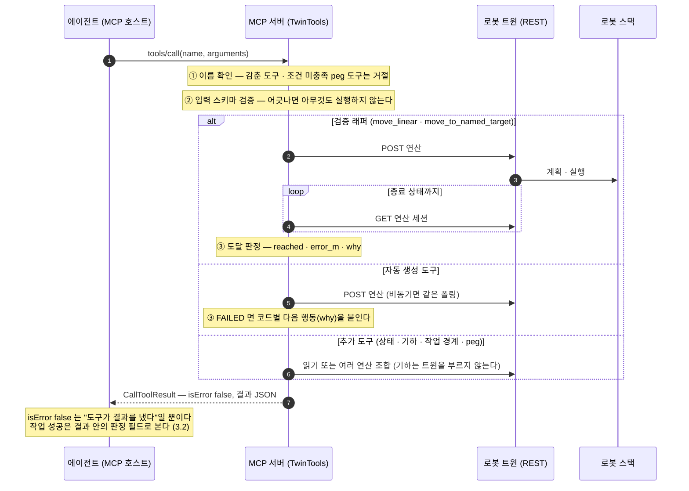
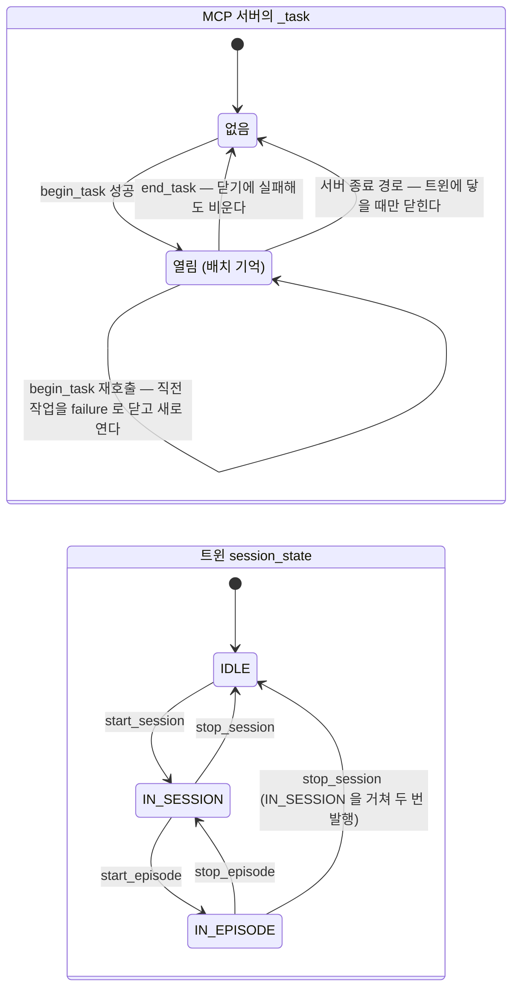
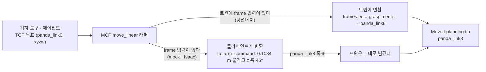

# 로봇 트윈 MCP 서버 설계서

작성 2026-08-18 · 현행화 2026-10-18 · 구현 완료 (v1, 2026-09-11 peg 도구 · 프롬프트, 2026-10-18 입력 검증)

> 최초 작성 당시 트윈은 `rdfp` 패키지의 `twin/` 서브패키지였다. 이후 제어 계층 분리로 **독립 패키지 `robot_twin`** 이 되었고, 본 문서의 경로는 그 기준으로 갱신되어 있다.
> 클라이언트 쪽 파이썬 패키지도 `robot_twin` 에서 **`robot_twin_client`** 로 이름이 바뀌었다(`src/robot_twin_client/`).
>
> **읽는 순서** — §1 (무엇을 · 어디에) → §2 (어떤 도구가 어디서 오나) → **§3 (호출하면 무엇이 돌아오고 무엇을 봐야 하나)** → §4 (좌표 · 실패 · 복구의 한계) → §5 (왜 그렇게 정했나). 무엇을 어떻게 고쳤는지의 이력과 검증 기록은 부록이다.

---

## 목차

- [1. 목적과 범위](#1-목적과-범위)
- [2. 도구 구성 — 생성 규칙과 책임 분담](#2-도구-구성--생성-규칙과-책임-분담)
- [3. 호출 · 결과 계약](#3-호출--결과-계약)
- [4. 좌표 · 실패 · 복구의 제약](#4-좌표--실패--복구의-제약)
- [5. 설계 결정](#5-설계-결정)
- [6. 남은 일](#6-남은-일)
- [7. 참고](#7-참고)
- [부록 A. 트윈 쪽 변경 — 능력을 클라이언트에게 알리기](#부록-a-트윈-쪽-변경--능력을-클라이언트에게-알리기)
- [부록 B. MCP 서버 쪽 변경 이력](#부록-b-mcp-서버-쪽-변경-이력)
- [부록 C. 검증 기록](#부록-c-검증-기록)

---

## 1. 목적과 범위

### 1.1 무엇을 풀려는가

LLM 에이전트가 **프로그램을 작성하지 않고** 대화만으로 로봇의 상황을 확인하고, 트윈이 제공하는 연산을 조합해 사용자가 요구한 작업을 수행하게 한다.

목표 시나리오는 다음 한 문장이다.

> "박스를 반시계 방향 50도로 옮겨줘."

이 요청을 풀려면 에이전트가 (a) scene 에 무엇이 어디 있는지 읽고, (b) 파지 자세를 만들고, (c) 50도 회전한 목표 좌표를 계산하고, (d) 이동·파지·해제를 순서대로 실행해야 한다. **네 가지**가 모두 도구로 제공되어야 조합이 성립한다.

여기에 더해, 이 워크스페이스는 모방학습 데이터 플랫폼이므로 **같은 실행을 학습 데이터로 남기고 싶은 경우**가 있다. 그때만 에피소드 경계를 찍는 도구가 추가로 필요하다 — 조작의 필수 요소가 아니라 **선택적으로 얹는 층**이며, 경계 없이도 위 네 가지는 그대로 동작한다(§3.5).

### 1.2 왜 MCP 서버인가

트윈은 이미 REST API 를 갖고 있으므로 에이전트가 HTTP 를 직접 호출하게 할 수도 있다. 그러나 MCP 를 쓰는 이유는 **도구 발견(discovery)과 스키마 전달을 프로토콜이 담당**하기 때문이다. 에이전트는 `tools/list` 한 번으로 무엇을 할 수 있는지와 각 도구의 입력 스키마를 안다. 엔드포인트 목록을 프롬프트에 적어 넣는 방식은 연산이 늘 때마다 프롬프트를 고쳐야 하고, 그 동기화가 깨지는 순간 조용히 틀린다.

**MCP 는 스키마를 전달할 뿐 검증하지 않는다.** 호스트가 호출 전에 확인해 줄 수도 있지만 보장이 아니므로, 잘못된 인자를 거르는 것은 MCP 서버의 일이다(§3.3).

### 1.3 배치

```
Claude Code / Desktop
        │  MCP (stdio)
        ▼
  robot-twin-mcp          ~/development/mdtpy/robot-twin-client
        │  HTTP
        ▼
   robot_twin             rdfp_ws (ROS 노드)
        │  ROS 2
        ▼
  로봇 스택 / 시뮬레이터
```

MCP 서버는 **트윈의 클라이언트일 뿐**이며 ROS 를 알지 못한다. 이 경계를 지킨 것이 설계의 뼈대다 — 자세한 근거는 §5.1.

### 1.4 기동 — 최소 경로

**한 번만 하는 등록**과 **매번 하는 기동**을 구분한다. 섞으면 매번 등록하려 든다. 전체 사용법(펑션베이 · `.mcp.json` · 두 번째 트윈)의 정본은 `~/development/mdtpy/robot-twin-client/README.md` 의 "MCP 서버" 절이다 — 기동 절차는 경로 · extra 이름 · 클라이언트 종류에 따라 자주 바뀌어, 두 곳에 두면 어긋난다.

#### 등록 — 한 번만

MCP 서버는 stdio 로 말하므로 **클라이언트가 프로세스를 띄운다.** 사람이 실행하는 것이 아니라 Claude Code 에 등록해 두는 것이다.

```bash
cd ~/development/mdtpy/robot-twin-client
./sbin/register_mcp_server.sh          # 기본 user scope — 모든 프로젝트에서 잡힌다
```

등록 정보는 `~/.claude.json` 에 남아 **재부팅해도 유지된다.** `mcp_server.py` 를 고쳐도 재등록은 필요 없다 — 등록된 명령이 `uv run` 이라 매번 현재 소스를 쓴다(세션을 새로 시작하거나 `/mcp` 에서 재연결하면 반영된다). 다시 등록하는 것은 **등록 내용 자체가 바뀔 때**뿐이다 — 트윈 포트 · 호스트 · ID 변경, 두 번째 트윈 추가(`--name`), 프로젝트 디렉터리 이동, 새 PC.

> `--scope local` 로 등록하면 **등록할 때의 프로젝트 디렉터리에서만** 잡힌다. 로봇 작업은 보통 `rdfp_ws` 쪽에서 하므로 거기서 도구가 보이지 않는다. 기본이 `user` 인 이유다.

트윈마다 포트와 ID 가 다르다. MCP 서버의 기본값은 mock 트윈(:8801 · `panda01`)이므로 나머지는 등록할 때 둘 다 준다 — **포트만 바꾸면** 도구 목록을 가져올 때 `HTTP 404` 다.

| 트윈 | 기동 | 등록 인자 |
|---|---|---|
| mock | `./scripts/run_robot_twin.sh` | (기본값) |
| Isaac | `./scripts/run_robot_twin.sh --isaac` | `--port 8802 --twin-id panda_isaac` |
| 펑션베이 | `./scripts/run_robot_twin.sh --functionbay` | `--port 8803 --twin-id panda_functionbay` — 시뮬레이터 순서와 함정은 README "펑션베이 로봇에 붙기" |

#### 기동 — 매번

배치도(§1.3)의 **아래에서 위로** 띄운다. 각 층은 아래 층이 없으면 기다리지 않고 실패한다.

```bash
# 터미널 A — 로봇 스택
rdfp_env                                          # ROS 환경 + overlay + 워크스페이스로 cd
ros2 launch robot_control panda_mock.launch.py

# 터미널 B — 트윈
rdfp_env
./scripts/run_robot_twin.sh

# Claude Code — /mcp 로 확인 (mock 이면 도구 18개)
```

도구 수는 트윈 카탈로그에 따라 달라진다 — mock · Isaac 은 **18개**, 펑션베이는 **21개**다(§2.1).

**터미널마다 `rdfp_env` 를 켠다.** 셸은 ROS 를 자동으로 켜지 않고(옵트인), `rdfp_env` 가 ROS 배포판 환경 · `RDFP_*` 변수 · overlay 를 한 번에 얹는다. `source install/setup.bash` 만 하면 `ros2` 는 돌지만 `ROS_DOMAIN_ID` 가 비어 다른 터미널과 서로를 보지 못한다 — "노드는 떴는데 토픽이 안 보인다"로만 나타난다. 환경 구성 전체는 [python_env_guide.md §2.3](../python_env_guide.md).

**순서가 중요하다.** MCP 서버는 도구 목록을 트윈 카탈로그에서 가져오므로, 트윈보다 먼저 연결하면 `tools fetch failed` 로 잡힌다. 그 상태면 `/mcp` 에서 재연결한다.

세션/에피소드 연산(`begin_task` / `end_task`)까지 쓰려면 다른 터미널에서 수집 계층을 얹는다 —
`ros2 launch rdfp rdfp_collect.launch.py backend:=<mock|isaac|functionbay>`(제어 스택과 같은 백엔드).
없으면 그 연산만 `503 PRECONDITION_FAILED` 로 거절되고 나머지 도구는 그대로 된다 — 사용자 가이드 §1.2 참고.

#### 이상할 때

| 증상 | 확인 |
|---|---|
| `/mcp` 목록에 아예 없음 | 등록 직후라면 Claude Code 세션을 새로 시작 |
| `tools fetch failed` | 터미널 B 의 트윈이 떠 있는지 |
| `HTTP 404` | 등록한 `--twin-id` 가 트윈 설정의 `twin.id` 와 같은지 |
| 도구는 보이는데 팔이 안 움직임 | 터미널 A 의 스택 — 트윈 로그에 `MoveGroup client ready` 가 찍혔는지 |

한 번에 좁히려면 `~/development/mdtpy/robot-twin-client` 에서 다음을 실행한다. 서버 기동과 도구 조회를 각각 판정해 어디가 끊겼는지 알려준다.

```bash
./sbin/check_mcp_server.sh                                            # mock (:8801)
./sbin/check_mcp_server.sh --port 8803 --twin-id panda_functionbay    # 펑션베이
```

---

## 2. 도구 구성 — 생성 규칙과 책임 분담

MCP 서버가 새로 작성한 로직은 거의 없다. 클라이언트 프로젝트가 MCP 이전부터 세 층으로 나뉘어 있었고, 그것이 그대로 MCP 도구의 층이 되었다. 서버는 **배선과 정책**(무엇을 감추고, 무엇을 바꿔 끼우고, 무엇을 확인할지)만 담당한다.

| 모듈 | 역할 | MCP 에서의 쓰임 |
|---|---|---|
| `client.py` | 트윈 HTTP 래퍼. `run()` 이 sync/async 를 모두 처리 | 자동 생성 도구의 실행 경로 |
| `ops.py` | 검증 래퍼 (`COMPLETED` ≠ 도달), 실패 코드별 다음 행동(`FAILURE_HINTS`) | `_OVERRIDES` 의 구현, 실패 문장 |
| `pick_n_place.py` | 기하 헬퍼 + **프레임 보정(`to_arm_command`)** + 합성 시퀀스 | 기하 계산 도구 + `move_linear` 의 프레임 보정 (§4.1) |
| `peg_in_hole.py` (2026-09-11) | peg 절차 · 판정 (파지 오프셋 · 기하 사전 확인 · 앉음 확인) | peg 도구 4개의 구현 (§2.5) |
| `mcp_server.py` | 도구 표 · 입력 검증 · 오류 문장 · 작업 상태 · MCP 배선 | 서버 본체 |

### 2.1 생성 규칙

```
GET /operations (mock · Isaac 11개 / 펑션베이 10개)
   │
   ├─ _HIDDEN 에 있으면        → 버린다            (4개)
   ├─ _OVERRIDES 에 있으면     → 검증 래퍼로 교체  (2개)
   └─ 나머지                    → 그대로 도구화     (5개 / 4개)
                                        +
                            _EXTRA (카탈로그 밖)  (11개 — fixtures 변수가 있으면 peg 4개 더해 15개)
                                        ↓
                       도구 18개 (펑션베이 21개)
```

카탈로그가 백엔드마다 다르므로 도구도 달라진다 — 펑션베이는 `/scene/reset` 이 없어 트윈 설정에
`reset_scene` 연산이 없고, 대신 고정물 변수 `fixtures` 가 있어 peg 도구가 붙는다. 판별은 둘 다
백엔드 이름이 아니라 **카탈로그**(`GET /operations` · `GET /variables`)로 한다.

### 2.2 도구 목록과 정의 출처

| 분류 | 도구 | 설명 · 스키마 출처 | 노출 조건 | 성공 판정 (§3.2) |
|---|---|---|---|---|
| **자동 생성** | `move_gripper_to_target` · `move_to_joints` · `reset_scene` · `stop_session` · `stop_episode` | **트윈 카탈로그** (`description` · `inputs_schema`) | 카탈로그에 있으면 — `reset_scene` 은 펑션베이에 없다 | `status` |
| **검증 래퍼** | `move_linear` · `move_to_named_target` | **MCP 서버** (`_OVERRIDES`) | 늘 | `reached` |
| 상태 | `read_state` · `read_states` · `list_state_variables` · `get_resource_status` | MCP 서버 (`_EXTRA`) | 늘 | `quality` |
| 기하 (로봇을 움직이지 않음) | `pose_above` · `pose_rotated_about_base_z` · `grasp_pose_of_object` | MCP 서버 | 늘 | 계산 결과 |
| 작업 경계 | `begin_task` · `end_task` | MCP 서버 | 늘 (세션 연산이 없으면 호출이 `503` 으로 실패) | 예외 여부 · `closed` |
| 안전 | `emergency_stop` · `release_emergency_stop` | MCP 서버 | 늘 | 예외 여부 |
| **peg-in-hole** | `peg_status` · `pick_peg` · `place_peg` · `move_peg` | MCP 서버 (절차는 `peg_in_hole.py`) | 트윈이 **`fixtures` 변수**를 내놓을 때 (펑션베이) | `seated` · 예외 여부 |

**검증 래퍼가 raw 연산을 감추는 이유**

| 도구 | 이유 |
|---|---|
| `move_linear` | 계획의 일부만 실행돼도 `COMPLETED` 로 끝난다. `ops.move_linear_verified` 가 `outputs.final_pose` 를 목표와 비교해 `reached` 를 판정한다(범위는 §4.1). 좌표는 TCP 기준으로 받고 프레임 처리는 이 래퍼가 맡는다 |
| `move_to_named_target` | JGPC · 펑션베이 스택은 open loop 라 정상 종료해도 도달 보장이 없다. `outputs.closed_loop` 로 판정하고, 판정 불가면 `why` 로 사유를 돌려준다 |

**감춘 연산**

| 도구 | 이유 |
|---|---|
| `move_to_pose`, `move_gripper` | 미구현 — 호출하면 `EXECUTION_ABORTED` |
| `start_session`, `start_episode` | 여는 경로를 `begin_task` 하나로 좁혀 짝을 보장 (§5.6) |

감춘 연산과 조건이 맞지 않는 peg 도구는 이름으로 직접 불러도 실행하지 않는다 — peg 도구는 "이 트윈에는 `fixtures` 가 없다"는 사유로 거절한다.

### 2.3 단일 출처의 범위

트윈 설정의 `description` · `inputs_schema` 가 **자동 생성 도구의 단일 출처**다. 트윈 YAML 에 연산을 추가하면 MCP 서버 코드를 건드리지 않아도 도구가 늘고, 그 도구의 설명과 스키마는 서버에 중복 정의가 없다(트윈 쪽 변경은 부록 A).

**그 밖의 도구는 서버가 자기 정의를 갖는다** — 검증 래퍼 · 상태 · 기하 · 작업 경계 · peg 도구의 설명과 스키마는 `mcp_server.py` 에 있다. 그래서 트윈이 바뀌어도 저절로 따라오지 않고, 실제로 어긋난 적이 있다.

- `read_state` 설명이 트윈에서 이미 없어진 변수(`gripper_last_command_result`)를 권하고 있었다(2026-10-18 수정).
- 검증 래퍼 `move_linear` 의 스키마는 트윈 연산이 받는 `velocity_scaling` · `frame` 을 노출하지 않는다 — 에이전트는 속도를 정할 수 없고, 래퍼는 늘 `0.2` 로 부른다(§6).

그리고 두 카탈로그 모두 **처음 한 번만 읽고 캐시한다**(§4.4) — 트윈이 설정을 바꿔 재시작하면 MCP 서버도 다시 띄워야 한다. 정리하면, 설정 단일 출처는 **자동 생성 대상의 중복 정의를 없앤 것**이지 MCP 도구 전체가 트윈과 어긋날 수 없다는 뜻이 아니다.

### 2.4 설명 보강

카탈로그 설명을 그대로 쓰지 않고 한 가지를 덧붙인다.

```python
if op.get('resource'):
    text += f"\n\n점유 자원: {', '.join(op['resource'])}. 같은 자원을 쓰는 연산이 "
            "실행 중이면 RESOURCE_BUSY 로 거부되므로, 먼저 끝나기를 기다렸다가 다시 부른다."
```

자원 경합은 **트윈 전체의 공통 규약**이라 개별 연산 설명에 적을 성질이 아니다. 그렇다고 빠뜨리면 에이전트가 409 를 받고 같은 호출을 반복한다. 규약은 서버가 붙이고 설정에는 연산 고유의 내용만 둔다.

### 2.5 peg-in-hole 도구 — 절차를 도구로 올린 첫 사례

앞의 도구들은 연산 하나를 감싸거나 좌표를 계산할 뿐이다. peg 도구 넷은 다르다 —
**여러 연산에 걸친 절차와 그 판정**을 통째로 가진다. 구현은 트윈이 아니라 클라이언트
(`robot_twin_client.peg_in_hole`)에 있고, MCP 서버는 **설명과 스키마만** 얹는다.

| 도구 | 자연어 지시 | 돌려주는 것 |
|---|---|---|
| `peg_status` | *"어디 있어?"* · 목적지 해석 | `at` · `destinations` · `tilt_deg` |
| `move_peg` | *"다른 hole 로 옮겨서 꽂아줘"* | `seated` · `error_m` |
| `pick_peg` | *"peg 을 뽑아줘"* | `grasp_gap_m` — **`place_peg` 에 그대로 넘긴다** |
| `place_peg` | *"거기에 꽂아줘"* | `seated` · `error_m` |

**`peg_status` 가 없으면 *"다른 hole"* 을 해석할 수 없다.** `fixtures` 변수를 직접
읽게 하면 에이전트가 peg 이 어느 자리 위에 있는지 **발자국 계산**을 해야 하는데, 그
산수는 틀려도 조용하다. 도구가 대신 풀어 `destinations` 로 준다.

**수치를 도구 설명에 적지 않는다.** 손끝 오프셋 · 입구 높이 · 정상 파지 간격 · 반경
여유는 전부 코드가 갖는다. 적으면 에이전트가 그것으로 산수를 하게 되고, 틀려도 조용하다.
설명이 말하는 것은 **언제 무엇을 부르고 실패를 어떻게 읽는가** 다 — 시험이 그 경계를
지킨다 (`test_descriptions_carry_no_magic_numbers`).

**실패 문장이 `holding` 으로 갈린다.** 쥔 채로 멈췄으면 *"재시도하지 말고, 열지도 말고,
사람에게 알려라"*, 움직이기 전이면 *"로봇 상태는 안전하다"*. 놓아도 되는 상황과 놓으면
물체를 잃는 상황이 겉보기로 같아서, 말해 주지 않으면 에이전트가
`move_gripper_to_target open` 을 부른다.

**고정물이 없는 트윈에서는 목록에서 뺀다**(2026-10-18) — 고정물 위치를 `fixtures` 변수에서
읽으므로, 보이게 두면 에이전트가 부르고 첫 읽기에서 실패한다.

### 2.6 프롬프트 — `peg_in_hole` (2026-09-11)

서버가 `prompts/list` · `prompts/get` 을 제공한다. 프롬프트 하나가 있다.

**경계가 요점이다.**

| | 담는 것 |
|---|---|
| **코드** | 수치와 절차 — 에이전트가 틀릴 여지를 없앤다 |
| **프롬프트** | 언제 무엇을 읽고, 실패를 어떻게 읽고, **무엇을 하면 안 되는가** |

가장 중요한 한 줄은 *"`move_gripper_to_target open` 을 직접 부르지 않는다"* 이다. 그
도구는 목록에 그대로 보이고(다른 작업에는 필요하다) 부르면 성공하는데, 고정물 밖에서
놓으면 **물체를 영구히 잃는다** — 그래서 **도구 이름을 대어** 막는다.

⚠️ **프롬프트 시험은 프로토콜 위에서 돈다.** `_PROMPTS` 를 채워도 핸들러를 등록하지
않으면 클라이언트에는 아무것도 안 보인다 — 단위 시험은 그것을 통과시킨다.

---

## 3. 호출 · 결과 계약

이 문서에서 가장 중요한 계약은 하나다 — **도구 호출이 정상으로 끝났다고 로봇 작업이 성공한 것은 아니다.**

### 3.1 호출 흐름



거절 · 입력 검증 실패 · 트윈의 4xx/5xx · 통신 오류 · peg 절차의 실패는 예외로 잡혀 **`isError: true`** 와 복구 안내 문장으로 돌아온다(§3.4). 어느 경우에도 프로토콜 오류로 올리지 않는다(§5.12).

### 3.2 결과를 읽는 법

| 확인 대상 | 어디서 오나 | 뜻 | 성공으로 보려면 |
|---|---|---|---|
| MCP `isError` | 모든 도구 | 도구가 결과를 내지 못했다 — 거절 · 입력 검증 실패 · 트윈 4xx/5xx · 통신 오류 · 예외로 끝나는 절차(작업 경계를 못 연 `begin_task`, peg 실패) | `false` 여도 **작업 성공은 아니다** — 아래 필드를 본다 |
| `status` | 자동 생성 도구 (트윈 연산 세션을 그대로 돌려준다) | 연산의 종료 상태 | `COMPLETED`. `FAILED` 면 `error.code` 와 `why` 를 읽는다 — **이때도 `isError` 는 `false` 다** |
| `reached` · `error_m` · `why` | `move_linear` · `move_to_named_target` | 도달 판정 | `reached: true`. 연산이 `FAILED` 여도 예외가 아니라 `reached: false` 로 온다. `move_to_named_target` 은 open loop 스택에서 `false` + `why` 가 정상일 수 있다 |
| `closed` · `errors` | `end_task` | 에피소드 · 세션 종료 결과 | `closed: true`. `false` 면 `errors` 에 어느 쪽이 실패했는지 있다 |
| `warnings` | `begin_task` | 서버가 직전 작업이나 남은 세션을 대신 닫았다 | 비어 있으면 깨끗하게 시작했다 (§3.5) |
| `seated` · `error_m` | `place_peg` · `move_peg` | 삽입 판정 | **성공일 때만 온다.** 앉지 않으면 `isError: true` 이고, 문장이 쥔 채 멈췄는지를 알려 준다 |
| `quality` | `read_state` · `read_states` | 값이 신선한가 | `OK` 가 아니면 값을 쓰지 않는다 (`reason` 에 사유) |

> `FAILED` · `reached: false` · `closed: false` 를 `isError` 로 올리지 않은 것은 v1 의 선택이다. 도달 판정이나 닫기 실패는 "도구가 결과를 냈다"에 가깝지만, 연산 `FAILED` 는 MCP 규약상 도구 실행 실패로 볼 수도 있다 — 열린 결정이다(§6).

### 3.3 입력 검증

`tools/call` 의 인자는 실행 전에 **그 도구가 `tools/list` 로 내건 스키마**로 확인한다(`TwinTools._validate`, 2026-10-18). 스키마는 목록과 같은 출처에서 꺼낸다 — 자동 생성 도구는 트윈 카탈로그, 나머지는 서버의 도구 표.

어긋나면 **아무것도 실행하지 않고** `isError: true` 로 돌려준다. 문장에 어느 인자가 무엇을 어겼는지와 "스키마를 다시 보고 고쳐서 부른다"는 안내가 붙는다.

| 입력 | 그 전 (2026-10-18 이전) | 지금 |
|---|---|---|
| `move_to_named_target` 에 `velocity_scaling: 2.0` (상한 1.0) | 트윈까지 그대로 전달됐다 | 거절 — 트윈은 호출되지 않는다 |
| `end_task` 에 필수 `outcome` 누락 | `KeyError: 'outcome'` | 거절 — 빠진 인자 이름을 말한다 |

**트윈도 검증하지만 서버가 기대지 않는 이유** — 트윈의 JSON Schema 검증은 `jsonschema` 가 설치돼 있을 때만 돌고, 항상 도는 도메인 검증은 타입 등 일부만 본다. 설치되지 않은 수집 머신에서는 범위 위반이 MoveIt 까지 내려간다. 또 검증 래퍼와 추가 도구는 트윈 연산 하나로 대응되지 않으므로 트윈이 대신 확인할 수 없다.

### 3.4 오류 문장 — 다음 행동을 함께 준다

오류 문장이 에이전트의 유일한 피드백 채널이라, 코드만 던지면 같은 호출을 그대로 재시도한다. 그래서 문장마다 복구 방법을 담는다.

**호출이 거절된 경우** (`isError: true`)

| 원인 | 덧붙이는 안내 |
|---|---|
| 입력 검증 실패 | 아무것도 실행하지 않았다 — 스키마(필수 인자 · 허용 범위 · 타입)를 다시 보고 고쳐서 부른다 |
| `RESOURCE_BUSY` | `get_resource_status` 로 확인하고 끝난 뒤 다시 부른다 |
| `PRECONDITION_FAILED` (`503`, 세션 생성 전) | 백엔드 부재다(MoveIt · `session_control_node`) — 기동 직후면 한 번 더, 그래도 같으면 사람에게 알린다 |
| `INVALID_INPUT` (트윈이 거절) | 메시지에 허용되는 값이 있으면 그중에서 고른다 |
| `NOT_FOUND` | `list_state_variables` 로 확인한다 |
| `TimeoutError` | 로봇이 아직 움직일 수 있다. `read_state('ee_pose')` 로 확인 |
| peg 실패 — 쥔 채 멈춤 | 같은 호출을 재시도하지 않는다. 그리퍼를 열면 물체를 잃으므로 판단이 서지 않으면 사람에게 알린다 |
| peg 실패 — 움직이기 전 | 로봇 상태는 안전하다 |

**접수 뒤 실패**(`FAILED`)는 코드별 다음 행동을 붙인다 — 정본은 클라이언트의 `ops.FAILURE_HINTS` 이고, 검증 래퍼의 `why`, 자동 생성 도구 결과의 `why`, 작업 경계의 오류 문장이 같은 문장을 쓴다.

| 코드 | 덧붙이는 안내 |
|---|---|
| `PLANNING_FAILED` | 로봇은 움직이지 않았다 — 같은 목표로는 결과가 같으니 목표나 시작 자세를 바꾼다 |
| `EXECUTION_ABORTED` · `TIMEOUT` | 로봇이 경로 중간이거나 아직 움직이는 중일 수 있다 — `ee_pose` 로 위치부터 확인한다 |
| `PRECONDITION_FAILED` | 상태 불일치다 — 재시도가 아니라 `session_state` 를 보고 상태를 맞춘다 |

같은 `PRECONDITION_FAILED` 가 두 표에 있는 것은 트윈이 두 자리에서 내기 때문이다 — `503` 은 "백엔드가 없다", `FAILED` 는 "상태가 안 맞는다"라 행동이 다르다.

### 3.5 작업 경계 — `begin_task` · `end_task`

학습 데이터로 남길 때만 쓰는 층이다(§1.1). 여는 경로는 `begin_task` 하나다(§5.6).

| 도구 | 하는 일 (순서대로) |
|---|---|
| `begin_task` | ① 열린 작업이 있으면 failure 로 닫는다 → ② 트윈 `session_state` 가 `IDLE` 이 아니면 `stop_session` → ③ `scene` 을 주면 `reset_scene` (**에피소드 밖**) → ④ `start_session` → ⑤ `start_episode` (실패하면 세션을 닫고 오류로 끝난다) |
| `end_task` | `stop_episode`(outcome + metadata) → `stop_session` — **어느 한쪽이 실패해도 나머지를 시도한다.** 서버가 기억한 배치(`scene` · `seed` · `objects`)를 metadata 에 자동으로 합친다(§5.7) |

세션 연산은 `outputs` 로 부른다 — 세션 연산은 동기라 `run` 은 `FAILED` 를 예외 없이 돌려주고, 그러면 에피소드가 안 열렸는데 작업이 시작된 것으로 보고된다.

**두 상태가 따로 있다** — MCP 서버 메모리의 `_task` 와 트윈의 `session_state` 다. 평소에는 같이 움직이지만 어긋날 수 있다.



| 상황 | MCP `_task` | 트윈 | 데이터에 남는 것 |
|---|---|---|---|
| 정상 | 열림 → 없음 | `IN_EPISODE` → `IDLE` | 에피소드 경계 + outcome + 배치 metadata |
| `end_task` 를 잊고 다시 `begin_task` | 직전 작업을 failure 로 닫고 새로 연다 | 닫혔다가 다시 `IN_EPISODE` | 직전 에피소드는 **failure** + 배치 metadata(`aborted_by: begin_task`). 실제 성패와 달라도 바로잡을 수 없다 |
| `end_task` 의 `stop_*` 실패 | 비운다 | 열린 채 남을 수 있다 | `closed: false` · `errors`. 다음 `begin_task` 가 남은 세션을 닫는다(아래 행) |
| MCP 서버만 재시작 (`_task` 유실) | 없음 | `IN_EPISODE` 그대로 | 다음 `begin_task` 가 `stop_session` 으로 닫는다 — **경계는 생기지만** outcome 과 배치 metadata 는 없다. `warnings` 로 알린다 |
| MCP 연결 종료 | 종료 경로(`finally`)가 failure 로 닫으려 한다 | 트윈에 닿으면 닫힌다 | 강제 종료 · 통신 장애면 **닫지 못하고** 세션이 열린 채 남는다 — 다음 `begin_task` 가 위 행처럼 정리한다 |

`IN_EPISODE` 에서 `stop_session` 을 받으면 세션 제어 노드가 `IN_SESSION` → `IDLE` 을 연달아 발행하므로, 적재는 그 에피소드를 정상적으로 자른다. 잃는 것은 경계가 아니라 **의도한 outcome 과 서버가 기억하던 배치**다.

### 3.6 목표 시나리오의 조합

"박스를 반시계 50도로 옮겨줘"가 도구로 풀리는 경로다. **조작만 하는 경우**가 기본이다 (§1.1).

```
read_state('scene_objects')                   → 물체와 그 좌표
grasp_pose_of_object(objects[0])              → 파지 자세
pose_above(grasp)                             → 접근 지점
move_linear(above) → move_linear(grasp)       → reached 확인하며 진행
move_gripper_to_target('grasp')               → status 확인 — COMPLETED 면 at_goal 이 섰다
pose_rotated_about_base_z(grasp, 50)          → 목표 좌표 (쿼터니언 포함)
move_linear(...) → move_gripper_to_target('open')
```

그리퍼 성공 판정은 `gripper_state` 의 **`at_goal`** 하나다 — `stalled` 은 관측일 뿐이다(`grasp` 의
판정식이 `stalled` 이라 함께 서지만, 판정은 노드가 이미 적용해 둔다). 트윈의 `move_gripper_to_target` 은
`at_goal` 이 설 때까지 기다리므로 `COMPLETED` 면 선 것이고, 헛닫힘처럼 끝내 서지 않으면 시간 초과로
`FAILED` 다.

**같은 실행을 학습 데이터로 남기려면** 앞뒤에 경계를 두른다. 이때 물체는 `read_state` 가 아니라 `begin_task` 가 돌려준다 — scene 을 새로 배치하면서 그 배치를 서버가 기억해 `end_task` 의 metadata 로 넘기기 때문이다(§5.7).

```
begin_task(task_label, scene='one_cube')      → 실제 배치 objects  ← read_state 대신
   … 위와 동일 …
end_task(outcome='success')                   → closed 확인. 배치는 자동으로 metadata 에
```

펑션베이는 `reset_scene` 이 없으므로 `begin_task` 에 `scene` 을 주지 않는다 — 씬을 건드리지 않고
경계만 연다. 물체 좌표는 `read_state('scene_objects')` 로 읽는다.

---

## 4. 좌표 · 실패 · 복구의 제약

### 4.1 좌표 — 기준점 · 변환 주체 · 도달 판정

세 가지를 구분해야 좌표가 헷갈리지 않는다.

| 개념 | 뜻 | 지금 |
|---|---|---|
| **표현 프레임** | 좌표를 무엇 기준으로 적나 | 모든 도구가 `panda_link0` 기준, m, 쿼터니언 xyzw |
| **목표 기준점 (TCP)** | 그 좌표에 무엇을 갖다 대나 — 도구 설명이 "손끝"이라 부르는 점 | **백엔드마다 다른 점이다.** mock · Isaac 은 Panda TCP(`panda_link8` 에서 0.1034 m, 두 손가락 사이), 펑션베이는 `grasp_center`(두 패드의 중점 — **실제 손끝은 약 40 mm 아래**) |
| **명령 지점** | MoveIt 이 실제로 움직이는 링크 | planning tip `panda_link8` — 어느 백엔드든 같다 |

기하 도구(`grasp_pose_of_object` / `pose_above` / `pose_rotated_about_base_z`)는 **목표 기준점** pose 를 돌려준다. 에이전트가 다루는 좌표는 "그리퍼의 기준점이 어디 가야 하는가" 여야 이해할 수 있기 때문이다. TCP 정의 자체는 최상위 설계서의 TCP 계약을 따른다([../rdfp_프레임워크_전체_구조와_설계.md](../rdfp_프레임워크_전체_구조와_설계.md) §2.1).

기준점에서 명령 지점으로의 **변환은 정확히 한 곳에서** 한다. 어디서 할지는 트윈의 능력이 정한다 — 판별은 백엔드 이름이 아니라 **카탈로그**로 한다(`move_linear` 의 `inputs_schema` 에 `frame` 입력이 있는가, `_twin_resolves_frames()`).



변환이 빠지면 5 cm 큐브(중심 z=0.025)를 집을 때 손끝이 z = -0.078 로 **바닥을 파고든다.** 반대로
**두 번 하면** 10 cm 어긋난다 — `frame` 을 스스로 해석하는 스택에 `to_arm_command` 를 얹었다가 그리퍼가
10.3 cm 아래를 겨냥한 적이 있다. 보정 대상은 `move_linear` 하나뿐이다 — `move_to_named_target` 은 관절
공간 이동이라 기준점이 무관하다. 회귀는 `tests/test_to_arm_command.py` 가 막는다.

> mock · Isaac 프로파일에 `frames.ee` 를 넣어 트윈이 변환하게 하는 것이 정석이지만, 그대로 넣으면
> `to_arm_command` 의 45° 와 겹쳐 **90° 이중 회전**이 된다. 이미 녹화된 `/ee_pose` 의 기준도 달라지므로,
> 둘을 함께 정리할 때까지 지금처럼 둔다.

**`move_linear` 의 `reached` 가 보장하는 범위**

| 판정 | 지금 |
|---|---|
| 위치 | **xyz 각 축 오차의 최댓값**이 허용 오차(기본 5 mm, `tolerance_m`) 이하인가 |
| 자세 | **보지 않는다** |
| 비교하는 값 | 트윈이 연산 종료 시점에 찍은 `outputs.final_pose` — **정착을 기다리지 않는다** |

마지막 행이 open loop 스택에서 문제다. 펑션베이는 명령 스트리밍이 끝난 뒤에도 팔이 한동안 움직이므로
(실측: 종료 1.5 초 뒤 오차 64.8 mm → 정착 후 −0.6 mm), 도달했는데 `reached: false` 가 나올 수 있다.
클라이언트 함수(`move_linear_verified`)는 정착 대기(`settle_sec`)를 갖고 있지만 MCP 래퍼가 넘기지 않는다(§6).

### 4.2 타임아웃 — 무엇이 무엇을 멈추나

타임아웃마다 **기다리기를 그만두는 것**과 **로봇을 멈추는 것**이 다르다.

| 층 | 기본값 | 넘으면 — 기다리기를 그만둔다 | 정지 요청 | 실제 정지 |
|---|---|---|---|---|
| HTTP 요청 하나 (`RobotTwinClient(http_timeout_sec=)`) | 30초 | 그 요청의 응답을 포기한다. **동기 연산의 `sync_timeout_sec` 보다 길어야 한다** — 동기 연산은 POST 응답이 그 뒤에 온다 | 보내지 않는다 | 보장 없음 |
| 비동기 연산 폴링 (`RobotTwinClient.run(timeout_sec=)`) | 120초 | `TimeoutError` (오류 문장이 `ee_pose` 확인을 시킨다) | 보내지 않는다 | 보장 없음 — 로봇은 계속 움직일 수 있다 |
| MCP 호스트의 도구 호출 타임아웃 | 호스트 설정 | 에이전트가 결과를 못 받는다. 서버의 작업 스레드는 계속 돈다 | 보내지 않는다 | 보장 없음 |
| 트윈 감시기 (`max_duration_sec`, 연산별) | 연산 설정 | 연산 세션을 `FAILED` + `TIMEOUT` 으로 끝낸다 | **팔 컨트롤러에 정지를 보낸다** (MoveGroup 연산만) | 요청일 뿐 확정은 아니다. 그리퍼는 멈추지 않는다 |

클라이언트 쪽 세 층은 모두 **기다림만 끝낸다** — 로봇을 멈추는 것은 트윈 감시기와 `emergency_stop` 뿐이다(트윈 쪽 정지 수단은 사용자 가이드 §9.2 · §9.3). 긴 연산이 잦으면 호스트 타임아웃을 늘려야 한다 — 호스트가 먼저 끊으면 로봇은 계속 움직이는데 에이전트는 결과를 모른다.

### 4.3 복구는 보장이 아니라 시도다

작업 경계의 정리(§3.5)는 모두 **트윈에 닿을 수 있을 때**만 성립한다. 서버 종료 경로는 `finally` 가 실행돼야 돌고, 강제 종료 · 통신 장애에서는 닫지 못한다. `_end_task` 는 닫기에 실패해도 `_task` 를 비우므로, 남은 세션은 다음 `begin_task` 가 트윈의 `session_state` 를 보고 정리한다.

**동시 호출에 대한 보호가 없다.** `_task` 접근에 락이 없다. MCP 클라이언트는 보통 도구를 하나씩 호출하지만 프로토콜은 동시 요청을 허용하므로, `begin_task` 두 개가 겹치면 상태가 꼬일 수 있다. v1 은 단일 세션 · 순차 호출을 전제한다.

### 4.4 카탈로그를 한 번만 읽는다

`TwinTools` 는 연산 카탈로그와 변수 카탈로그를 처음 쓸 때 한 번 읽고 캐시한다. 트윈 기동 후 바뀌지 않는다는 전제인데, **트윈을 재시작하면서 설정을 바꾸면 MCP 서버가 낡은 목록을 유지한다.** 현재는 MCP 서버를 재시작(`/mcp` 재연결)해야 한다.

### 4.5 mock 백엔드에서는 파지 판정이 서지 않는다

mock 은 손가락에 effort 상태가 없어 `grasp` 의 `at_goal` 이 영영 서지 않는다 — `move_gripper_to_target
grasp` 는 mock 에서 시간 초과로 끝난다. 물리도 없어 물체가 움직이지 않으므로 `scene_objects` 로 작업
성패를 관측할 수도 없다. **mock 은 배선 검증용**이다. 파지와 물체 이동은 물리가 있는 Isaac · 펑션베이에서
확인한다 — Isaac 은 effort 로 파지를 판정해 `grasp` 가 통과하고, 펑션베이에서는 peg-in-hole 을 자연어
지시로 왕복했다(§6).

### 4.6 보안 — 인증 없는 경로가 그대로 위임된다

트윈은 **인증·TLS 가 없다**(설정 파일에 명시된 전제 — 노출 범위 통제는 망 수준의 책임). MCP 서버는 그 API 를 LLM 에이전트에게 위임하는 경로이므로, **에이전트가 곧 로봇을 움직일 수 있는 주체**가 된다.

- MCP 서버를 등록한 클라이언트는 트윈과 같은 신뢰 경계 안에 있어야 한다.
- 작업공간 한계·속도 제한을 **프롬프트로 지시하면 안 된다.** 입력 검증(§3.3)은 스키마가 정한 범위만 막고, 작업공간 한계는 강제하지 않는다(§6).

### 4.7 SDK 2.0 의 API 안정성

`fastmcp` 제거, `Tool.input_schema`(파이썬 필드명) ↔ `inputSchema`(전송 별칭) 등 1.x 와 차이가 크다. SDK 업그레이드 시 `mcp_server.py` 의 배선부를 다시 확인해야 한다. 프로토콜 왕복 테스트(부록 C)가 이 회귀를 잡는 장치다.

---

## 5. 설계 결정

### 5.1 MCP 서버를 트윈 안이 아니라 밖에 둔다

**결정**: 별도 프로세스로 트윈의 HTTP API 를 호출하는 어댑터로 만든다. ROS 노드를 새로 만들지 않는다.

**근거**: 트윈이 자원 락·ETag·E-stop 의 **단일 중재자**다. MCP 서버가 자체 ROS 노드를 가지면 ROS 클라이언트가 둘이 되고, 그 순간 `409 RESOURCE_BUSY` 가 무의미해진다
— 락은 트윈을 거치는 요청만 볼 수 있기 때문이다.

**부수 효과**: MCP 서버가 ROS 를 몰라도 되므로 `source install/setup.bash` 없이 어느 머신에서나 돈다.

### 5.2 코드 위치 — 클라이언트 프로젝트 안

**후보**: (a) 클라이언트 프로젝트(`robot-twin-client`) 안 (b) 별도 uv 프로젝트 (c) `rdfp_ws` 의 ROS 패키지(`robot_twin`)

**결정**: (a).

**근거**: 재사용할 자산(`client.py` / `ops.py` / `pick_n_place.py`)이 전부 거기 있다. (b) 는 path 의존성으로 참조해야 하고 헬퍼를 고칠 때마다 두 저장소를 오간다. (c) 는 ROS 의존이 전혀 없는 코드를 colcon 빌드에 묶는다 — 트윈이 별도 패키지가 된 뒤에도 마찬가지다. MCP 서버는 HTTP 만 쓰므로 ROS 워크스페이스에 있을 이유가 없다.

### 5.3 도구 구성 — 하이브리드

**후보**: (a) 전부 자동 생성 (b) 전부 손으로 선별 (c) 자동 생성 + 오버라이드

**결정**: (c).

**근거**: (a) 는 코드가 가장 적고 트윈과 항상 동기화되지만, raw `move_linear` 가 노출되어 "거짓 성공"(§2.2) 문제가 그대로 남고 미구현 연산도 새어 나간다. (b) 는 통제가 강하지만 트윈에 연산을 추가할 때마다 MCP 쪽도 고쳐야 해 두 곳이 어긋난다.

(c) 는 **기본은 자동, 위험한 것만 명시적 예외**라는 형태로 양쪽 성질을 모두 얻는다. 예외 목록이 짧게 유지되는 한 유효하다 — 예외로 둔 도구는 서버가 정의를 따로 가지므로 트윈과 어긋날 수 있다(§2.3).

### 5.4 상태 변수를 resource 가 아니라 tool 로 노출

**결정**: 상태 변수를 MCP resource 가 아니라 **tool** (`read_state` 등)로 노출한다.

**근거**: MCP 의 세 원시 타입은 *누가 호출을 결정하는가*로 갈린다.

| | 결정 주체 |
|---|---|
| resource | 애플리케이션(호스트) — 사용자가 첨부하거나 앱이 컨텍스트에 넣는다 |
| tool | **모델** — 필요할 때 스스로 호출한다 |

"박스를 옮겨줘"를 받은 에이전트는 **작업 도중에** "지금 물체가 어디 있지?"를 스스로 확인해야 한다. resource 로만 노출하면 클라이언트 지원에 따라 모델이 읽지 못한다.

애초 구상은 "상태 변수 → resource, 연산 → tool" 이었으나 이 이유로 바꾸었다. resource 병행 노출은 v1 범위에서 제외했다(§6).

### 5.5 설명은 트윈 설정에 두고 API 로 가져온다

**후보**: (a) MCP 서버에 하드코딩 (b) 트윈 설정에 두고 카탈로그로 받는다

**결정**: (b).

**근거**: (a) 를 택하면 연산의 의미가 두 저장소에 나뉘어 살고, 트윈 동작이 바뀌었을 때 설명이 조용히 낡는다. 설명은 연산의 일부이므로 연산이 정의된 곳에 있어야 한다.

**대가**: 트윈 스키마 변경(부록 A)이 선행 작업으로 필요했다. 그만큼의 값은 한다 — 트윈이 자기 능력을 스스로 설명하는 구조가 되었고, MCP 이외의 클라이언트도 그 설명을 쓸 수 있다.

### 5.6 여는 연산은 감추고 닫는 연산은 남긴다

**결정**: `start_session` / `start_episode` 를 감추고, `stop_session` / `stop_episode` 는 노출한다. 여는 경로는 `begin_task` 하나뿐이다.

**근거**: 실패 모드가 비대칭이다.

- 에이전트가 `begin_task` 후 `end_task` 를 잊는다 → **서버가 닫을 수 있다.** 다음 `begin_task` 가 failure 로 닫고, 연결이 끊기면 종료 경로가 닫으려 한다(강제 종료 · 통신 장애에서는 못 닫는다 — §3.5).
- 에이전트가 raw `start_episode` 를 직접 부른다 → **서버가 모른다.** 추적하지 않는 에피소드가 열린 채 남고 그 배치를 기억하는 주체가 없다.

닫는 연산을 남기는 이유는 **이전 실행이 남긴 세션을 에이전트가 스스로 정리**할 수 있어야 하기 때문이다. 여는 쪽만 좁히면 그 목적이 달성되면서 복구 수단은 남는다.

### 5.7 작업 상태를 서버가 소유하고 metadata 를 자동 병합한다

**결정**: `TwinTools` 가 열린 작업의 `scene` / `seed` / `objects` 를 들고 있다가 `end_task` 의 metadata 에 자동으로 합친다.

**근거**: 재현의 근거는 seed 가 아니라 **실제 배치**다 — 추출 방식이 바뀌면 같은 seed 가 다른 배치를 만든다. 에이전트가 `begin_task` 의 반환값을 기억했다가 `end_task` 에 되돌려 주기를 기대하면, 잊는 순간 재현 불가능한 에피소드가 영구히 남는다(기록이 끝난 뒤에는 고칠 수 없다).

에이전트가 명시한 값이 우선하고 서버 값은 `setdefault` 로 채운다. 배치는 서버 메모리에 있으므로 서버가 재시작되면 잃는다(§3.5).

### 5.8 합성 스킬 — 처음에는 빼고, 필요가 확인된 것만 올린다

**v1 결정 (2026-08)**: 원시 연산 + 기하 헬퍼 + 작업 경계 래퍼까지. `pick_and_place` 같은 합성 스킬을 도구 하나로 노출하지 않는다.

**근거**: 합성 스킬은 성공률이 가장 높지만 에이전트가 조합을 배우지 못하고, 변형 요청("중간에 멈춰줘", "순서를 바꿔줘")에 대응할 수 없다. 조합이 실제로 자주 실패하는 것을 확인한 뒤에 추가하는 편이 낫다 — 먼저 넣으면 조합 경로가 잘 도는지 알 수 없다.

**그 뒤 (2026-09-11)**: peg-in-hole 에서 처음으로 합성 도구(`pick_peg` · `place_peg` · `move_peg`)를 올렸다(§2.5). 여유 0.5 mm 의 삽입은 파지 오프셋 · 기하 사전 확인 · 앉음 확인이라는 **수치 판정**이 절차의 실체였고, 그것을 에이전트가 원시 연산으로 흉내 내면 조용히 틀렸다.

**현재 원칙 — 다음 중 하나가 확인될 때만 합성 도구로 올린다.**

1. 원시 연산의 조합이 실제로 반복해서 실패한다.
2. 절차 안에 에이전트가 하면 **틀려도 조용한** 수치 판정이 있다(오프셋 · 허용 오차 · 정착 판정 등).
3. 실패하면 되돌릴 수 없는 상태가 있어, 실패 지점마다 다른 다음 행동을 말해 줘야 한다(peg 의 "쥔 채 멈춤").

올릴 때도 수치는 코드에 두고 설명에는 쓰지 않는다(§2.5).

### 5.9 `mcp` 를 optional extra 로

**결정**: `pyproject.toml` 의 `[project.optional-dependencies]` 에 둔다(`mcp`, 그리고 입력 검증용 `jsonschema`).

**근거**: MCP SDK 가 pydantic / starlette / uvicorn 등 30개 이상을 끌고 온다.
`RobotTwinClient` 만 쓰는 쪽이 그 비용을 질 이유가 없다 — 이 프로젝트는 "표준 라이브러리만 쓴다"가 특징이었다.

**따라오는 제약**: `__init__.py` 가 `mcp_server` 를 import 하면 안 된다. 그러면 extra 없는 환경에서 `import robot_twin_client` 자체가 실패한다. 주석으로 명시했고 테스트로 확인한다.

### 5.10 low-level `Server` API 사용

**결정**: 편의 API(`MCPServer`) 대신 `mcp.server.lowlevel.Server` + `add_request_handler` 로 `tools/list` · `tools/call` · `prompts/*` 를 직접 구현한다.

**경위**: 설치된 SDK 가 **2.0.0** 이었고 `mcp.server.fastmcp` 가 제거되어 있었다. 후속 편의 API 인 `MCPServer` 는 도구 스키마를 **파이썬 함수 시그니처에서만** 뽑는다 (`add_tool(fn, ...)`). 카탈로그의 `inputs_schema` 를 그대로 쓰려면 시그니처를 동적 합성해야 하는데, 그건 얻는 것보다 잃는 게 많다.

low-level 은 `types.Tool(name=, description=, input_schema=)` 를 직접 만들 수 있어 설계 의도(§5.3)에 정확히 맞는다.

**대가**: low-level 핸들러는 입력을 아무것도 확인하지 않는다 — 스키마는 클라이언트로 전달될 뿐이다. 그래서 서버가 직접 검증한다(§3.3).

### 5.11 블로킹 IO 를 스레드로 내린다

**결정**: 도구 실행을 `asyncio.to_thread(tools.call, ...)` 로 감싼다.

**근거**: `RobotTwinClient` 은 `urllib` 기반 동기 호출이고 팔 이동은 수십 초가 걸린다. MCP SDK 는 asyncio 이므로 이벤트 루프에서 직접 돌리면 **그동안 상태 조회조차 응답하지 못한다.** 카탈로그 조회(`tools/list`)도 HTTP 이므로 같이 내렸다.

### 5.12 도구 실패를 프로토콜 오류가 아니라 `isError` 결과로

**결정**: 도구 실행 중의 모든 예외를 잡아 `CallToolResult(is_error=True, content=[...])` 로 돌려준다.

**근거**: MCP 는 **프로토콜 오류**(JSON-RPC error — 잘못된 요청 · 없는 메서드 등)와 **도구 실행 오류**(결과의 `isError`)를 구분하고, 도구가 실패한 사실은 후자로 보고하도록 한다. 프로토콜 오류는 호스트가 "호출 자체가 실패했다"로 다뤄 모델에게 문장을 보여 주지 않을 수 있다 — 그러면 에이전트가 실패를 읽고 다른 방법을 시도할 수 없다. `isError` 결과는 모델의 컨텍스트로 들어가므로, 거기에 **복구 방법을 함께 담는다**(문장 목록은 §3.4).

결과 판정 필드(`status` · `reached` · `closed` …)와 `isError` 의 관계는 §3.2 다.

### 5.13 설명을 한국어로 작성

**결정**: 트윈 설정의 `description` 과 MCP 도구 설명을 한국어로 쓴다.

**근거**: 출처인 설계서·사용자 가이드가 한국어이고, 최신 모델은 한국어 도구 설명을 문제없이 다룬다.

**유보**: 이 프로젝트는 로그·예외 메시지를 영어로 쓰는 관례가 있고 description 도 기계가 읽는 문자열이라는 점에서 영어가 나을 여지가 있다. 재검토 대상으로 남긴다.

---

## 6. 남은 일

| 항목 | 내용 |
|---|---|
| ~~실 스택 검증~~ | **완료.** 펑션베이에서 peg-in-hole 을 자연어 지시로 왕복 5회 실증했다(2026-09-11, [../backends/functionbay/peg_in_hole_via_mcp_plan.md](../backends/functionbay/peg_in_hole_via_mcp_plan.md)) — 합성 스킬(`pick_peg` · `place_peg` · `move_peg`)을 실제로 추가했다. isaac 에서는 같은 클라이언트의 `robot-twin-collect` 로 65 에피소드를 모았다(2026-09-20) |
| **open loop 스택의 도달 판정** | MCP `move_linear` 래퍼가 정착 대기(`settle_sec`)를 넘기지 않아, 펑션베이에서 스트리밍 종료 순간의 값으로 `reached` 를 판정한다(§4.1). open loop 인지 판별할 방법(예: 트윈 결과의 `closed_loop`)을 정한 뒤 정착을 기다리게 한다 |
| **`FAILED` 를 `isError` 로 올릴지** | 자동 생성 도구 · 검증 래퍼의 `FAILED` 는 지금 `isError: false` 다(§3.2). MCP 규약에 맞추려면 올리는 편이 맞지만 에이전트가 받는 결과의 모양이 바뀐다 — 결정이 필요하다 |
| **`move_linear` 래퍼가 숨기는 입력** | `velocity_scaling`(늘 0.2) · `frame` 을 노출하지 않는다(§2.3). 프로파일 기본 속도(Isaac 1.0 · 펑션베이 0.4)와도 다르다 |
| **자세 오차 판정** | `reached` 는 위치만 본다(§4.1) |
| **트윈 쪽 스키마 검증** | `jsonschema` 가 없으면 트윈은 범위를 보지 않는다. MCP 경유는 서버가 막지만(§3.3) REST 를 직접 부르는 클라이언트는 그대로다 — 수집 머신에 설치하거나 필수 의존으로 올린다 |
| **작업공간 한계 강제** | `move_linear` 래퍼에 좌표 범위 검사. 한계값이 셋업에 달려 있어 임의로 넣지 않았다 |
| **resource 병행 노출** | 상태 변수를 MCP resource 로도 노출해 사용자가 컨텍스트에 첨부할 수 있게 한다 |
| **카탈로그 갱신** | §4.4 — 명시적 갱신 도구 또는 TTL |
| **다중 트윈** | 현재 서버 하나가 트윈 하나를 본다. 여러 대는 서버를 여러 개 등록한다 |

---

## 7. 참고

- [로봇_트윈_사용자_가이드.md](로봇_트윈_사용자_가이드.md) — 트윈 REST API, 변수·연산
  목록, §9 정지 수단 · 감시기, 부록 A.1 새 연산 구현(`description` 작성 지침)
- [로봇_트윈_설계서.md](로봇_트윈_설계서.md) — 트윈 자체의 설계 근거
- [로봇_트윈_사용자_가이드.md](로봇_트윈_사용자_가이드.md) §5.10 자동 에피소드 수집 루프 · [../backends/isaac/isaac_bringup_runbook.md](../backends/isaac/isaac_bringup_runbook.md) §2 (`robot-twin-collect`) — 세션/에피소드
  경계와 `reset_scene` 의 설계 경위
- [../backends/functionbay/peg_in_hole_via_mcp_plan.md](../backends/functionbay/peg_in_hole_via_mcp_plan.md) — peg 도구를 만든 경위와 실증 기록
- [../rdfp_프레임워크_전체_구조와_설계.md](../rdfp_프레임워크_전체_구조와_설계.md) §2.1 — TCP 계약
- `~/development/mdtpy/robot-twin-client/README.md` — 설치·등록·사용법 (최소 기동 경로는 §1.4)

---

## 부록 A. 트윈 쪽 변경 — 능력을 클라이언트에게 알리기

MCP 서버가 도구 목록을 만들려면 **트윈이 자기 능력을 기계가 읽을 수 있는 형태로 내놓아야** 한다. v1 에서 그 요구를 맞추려고 트윈을 어떻게 고쳤는지의 기록이다.

### A.1 변경 전 상태와 문제

트윈은 이미 두 카탈로그 엔드포인트를 갖고 있었다.

| 엔드포인트 | 내놓던 것 |
|---|---|
| `GET /variables` | `name`, `source_type`, `staleness_ms`, `units`, `schema_version` |
| `GET /operations` | `name`, `kind`, `resource`, `idempotent`, `inputs_schema`, `endpoint` |

`inputs_schema` 가 **이미 JSON Schema** 라는 점이 결정적이었다 — MCP 의 `Tool.inputSchema` 가 요구하는 형식과 같으므로 변환이 필요 없다.

문제는 **설명이 없다는 것**이었다. 설정 파일에는 `twin.description` 최상위 한 줄만 있었고, 변수와 연산에는 사람이 읽는 주석만 YAML 주석으로 달려 있었다. 주석은 파서가 버리므로 API 로 나갈 수 없다.

이것이 왜 치명적인가 — **LLM 의 도구 선택은 description 에 거의 전적으로 의존한다.** 이름만 있는 도구는 에이전트가 이름에서 의미를 추측하게 만들고, 추측이 틀리면 로봇이 잘못 움직인다.

### A.2 변경 내역 (코드·설정 3개 + 문서 1개)

경로는 `rdfp_ws/src/robot_twin/` 기준이다. 트윈은 **독립 ROS 패키지**이며 제어 계층에 속한다(워크스페이스 안의 의존은 `robot_control` · `rdfp_msgs` 뿐이다).

#### (1) `robot_twin/config.py` — 스키마에 필드 추가

```python
class VariableConfig(_Base):
    name: str
    description: str = ''      # 추가
    source: SourceConfig
    ...

class OperationConfig(_Base):
    name: str
    description: str = ''      # 추가
    kind: OperationKind
    ...
```

**이 변경이 없으면 YAML 만 고쳐도 트윈이 기동조차 못 한다.** 설정 모델의 공통 베이스가 `model_config = ConfigDict(extra='forbid')` 이기 때문이다 — 선언되지 않은 키는 오타로 간주해 거부한다. 이 정책 자체는 유지하는 것이 맞다(오타를 조용히 넘기지 않는다). 필드를 명시적으로 추가하는 것이 올바른 대응이다.

기본값을 `''` 로 둔 이유는 **기존 설정 파일과의 호환**이다. 도커 마운트 등으로 외부 YAML 을 쓰는 배치가 있으므로, 필수 필드로 만들면 그 설정들이 전부 깨진다.

#### (2) `robot_twin/api.py` — 카탈로그 응답에 실어 보내기

```python
# GET /variables
{'name': v.name, 'description': v.description, 'source_type': ..., ...}

# GET /operations
{'name': o.name, 'description': o.description, 'kind': o.kind, ...}
```

**YAML 에만 넣으면 목적을 이루지 못한다.** MCP 서버는 HTTP 로만 트윈을 보므로, 설정에 있는 값이 API 로 나오지 않으면 존재하지 않는 것과 같다.

#### (3) `src/robot_twin/config/robot_twin_panda01.yaml` — 설명 19건 작성

변수 8개, 연산 11개 전부에 `description` 을 채웠다(당시 기준 — 지금은 출하 설정 셋, mock · Isaac ·
펑션베이가 모두 `description` 을 갖고, 변수는 그리퍼 결과 변수가 `gripper_state` 로 합쳐지는 등
정리되어 6~7개다). 작성 원칙은 셋이다.

**원칙 1 — "무엇"에서 끝내지 않고 "언제"를 적는다.**

```yaml
- name: scene_objects
  description: >-
    scene 안 물체들의 현재 위치·자세·크기. ... **물체를 집기 전 파지 좌표를 여기서
    얻는다** — 고정 좌표를 쓰면 물체가 그 자리에 없다. ...
```

에이전트는 도구를 고를 때 "이게 뭔가"보다 "지금 이걸 불러야 하나"를 판단한다.

**원칙 2 — 완료가 성공을 뜻하지 않는 연산은 그 사실을 적는다.**

```yaml
- name: move_linear
  description: >-
    ... **완료가 도달을 뜻하지 않는다** — 경로가 잘려도 성공으로 끝날 수 있으므로,
    도달이 중요하면 ee_pose 를 읽어 목표와 비교한다.
```

이걸 적지 않으면 에이전트가 거짓 성공 위에 다음 동작을 쌓는다.

**원칙 3 — 스키마로 막을 수 없는 함정을 적는다.**

`joint_states` 에는 "`move_to_joints` 에 그대로 되돌려 주면 finger 관절이 섞여 실패한다"를, `scene_objects` 에는 "cylinder 의 dimensions 는 `[높이, 반지름]`"을 넣었다. 둘 다 타입 검사를 통과하고 런타임에만 드러나는 오류다.

미구현 연산 둘(`move_to_pose`, `move_gripper`)에는 **"호출하지 말 것"** 과 대체 연산을 명시했다. MCP 서버가 이들을 감추지만(§2.2), 설명 자체를 방어선으로 한 겹 더 둔 것이다.

#### (4) 문서 — `docs/twin/로봇_트윈_사용자_가이드.md` 부록 A.1

"새 연산 구현" 절의 YAML 예제에 `description` 을 넣고, **주석이 아니라 데이터**라는 설명을 붙였다(당시 §8.2, 지금은 부록 A.1). 앞으로 연산을 추가하는 사람이 빠뜨리지 않게 하기 위해서다.

---

## 부록 B. MCP 서버 쪽 변경 이력

프로젝트: `~/development/mdtpy/robot-twin-client`. 경로는 지금 이름(`src/robot_twin_client/`)으로 적는다.

### B.1 v1 (2026-08)

| 파일 | 상태 | 내용 |
|---|---|---|
| `src/robot_twin_client/mcp_server.py` | **신규** | 서버 본체 (당시 ~505행, 지금 ~800행) |
| `src/robot_twin_client/client.py` | 수정 | 공개 메서드 3개 추가 — `read_raw`, `variables`, `operations` |
| `src/robot_twin_client/__init__.py` | 수정 | `mcp_server` 를 **import 하지 않는다**는 주석 |
| `pyproject.toml` | 수정 | `mcp` optional extra, `robot-twin-mcp` entry point |
| `README.md` | 수정 | MCP 절 추가 |
| `tests/conftest.py` | 수정 | `FakeTwin` 에 카탈로그 메서드 5개 |
| `tests/test_mcp_server.py` | **신규** | 단위 (당시 37건) |
| `tests/test_mcp_protocol.py` | **신규** | 프로토콜 왕복 (당시 7건) |

**`client.py` 에 공개 메서드를 추가한 이유** — MCP 서버가 처음에는 `twin._request('/operations')` 처럼 사설 메서드를 직접 찔렀다. 두 가지가 문제였다 — (a) 캡슐화를 깨고, (b) 테스트에서 가짜 트윈을 끼우기 어렵다(사설 메서드까지 흉내 내야 한다). 세 메서드를 공개로 올려 해결했다.

```python
def read_raw(self, name: str) -> dict:   # quality/reason 포함 원본
def variables(self) -> list:             # GET /variables
def operations(self) -> list:            # GET /operations
```

`read_raw` 가 기존 `read` 와 따로 있는 이유는 **품질을 예외로 바꾸지 않기** 위해서다. `read` 는 `quality != OK` 면 예외를 던지는데, 에이전트에게는 "값이 낡았다"는 사실 자체가 판단 근거이므로 그대로 넘겨야 한다.

### B.2 그 뒤에 더한 것

| 시기 | 내용 |
|---|---|
| 2026-09-11 | peg 도구 4개(`peg_status` · `pick_peg` · `place_peg` · `move_peg`)와 프롬프트 `peg_in_hole` (§2.5 · §2.6), `tests/test_peg_tools.py` |
| 2026-09-11 이후 | `move_linear` 의 프레임 보정을 **트윈 능력에 따라** 켜고 끈다 — 카탈로그의 `move_linear` 가 `frame` 입력을 가지면 보정하지 않는다 (§4.1), `tests/test_to_arm_command.py` |
| 2026-10 | 세션 경계를 `outputs` 로 불러 `FAILED` 를 오류로 센다, 접수 뒤 실패에 코드별 다음 행동(`ops.FAILURE_HINTS`)을 붙인다, `503 PRECONDITION_FAILED` 안내를 "백엔드 부재"로 고친다 (§3.4) |
| 2026-10-18 | peg 도구를 `fixtures` 변수가 있는 트윈에서만 연다 (§2.2), `read_state` 설명의 옛 변수 `gripper_last_command_result` 를 `gripper_state` 로 고친다 |
| 2026-10-18 | **호출 전 입력 스키마 검증** (`TwinTools._validate` · `InvalidToolInput`, §3.3) — `jsonschema` 를 `mcp` extra 에 명시. `end_task` 설명을 실제 동작("다음 `begin_task` 가 failure 로 닫는다")으로 고친다 — 전에는 "경계를 잃는다"고 했다(§3.5) |

---

## 부록 C. 검증 기록

| 종류 | 건수 | 무엇을 지키는가 |
|---|---|---|
| 단위 (`test_mcp_server.py`) | 53 | 도구 구성 규칙, 검증 래퍼 동작, 기하 도구가 로봇을 건드리지 않음, 작업 경계 짝(**거절된 세션 연산 포함**), **입력 검증**(범위 · 필수 인자 · 카탈로그 스키마), 좌표 프레임 보정, 오류 문장, 도구 설명이 실제 변수 · 동작과 맞음 |
| 프로토콜 (`test_mcp_protocol.py`) | 11 | 초기화 → `tools/list` → `tools/call` 왕복, 프롬프트 조회, 스키마가 전송을 견디는지, 도구 실패가 세션을 끊지 않는지, **스키마 위반이 `isError` 로 오고 로봇을 움직이지 않는지** |
| peg 도구 (`test_peg_tools.py`) | 12 | 네 도구 노출과 **`fixtures` 없는 트윈에서의 감춤 · 직접 호출 거절**, `place_peg` 가 `grasp_gap_m` 을 요구, 설명에 수치가 없음(`test_descriptions_carry_no_magic_numbers`), 쥔 채 실패와 움직이기 전 실패의 문장이 다름 |
| 프레임 보정 (`test_to_arm_command.py`) | 10 | TCP → `panda_link8` 변환(오프셋 · 45°), 프레임을 해석하는 트윈에는 보정하지 않음 |

클라이언트 저장소 전체는 **222건 통과**다(2026-10-18, `.venv` 의 pytest). 새로 넣은 검증 시험은 옛 동작으로 되돌린 사본에서 모두 실패함을 확인했다.

**프로토콜 테스트를 따로 둔 이유**: 단위 테스트는 `TwinTools` 를 직접 호출하므로 **배선이 틀려도 통과한다.** 메모리 트랜스포트로 진짜 `ClientSession` 을 붙여 프로토콜 위에서 도는지 확인한다.

특히 고정한 것들:

- `move_to_pose` / `start_episode` 가 **프로토콜에도 나타나지 않는다**
- 이름으로 직접 찔러도 감춘 도구는 실행되지 않는다
- 스키마를 어긴 입력은 트윈을 부르지 않는다
- `begin_task` 의 호출 순서가 `reset_scene → start_session → start_episode` (scene 리셋이 에피소드 **밖**)
- `stop_episode` 가 실패해도 `stop_session` 을 시도한다
- 세션 연산이 거절(`FAILED`)되면 `begin_task` 는 오류로 끝나고 세션을 남기지 않으며, `end_task` 는 `closed: false` 다
- 종료 경로가 열린 작업을 닫는다
