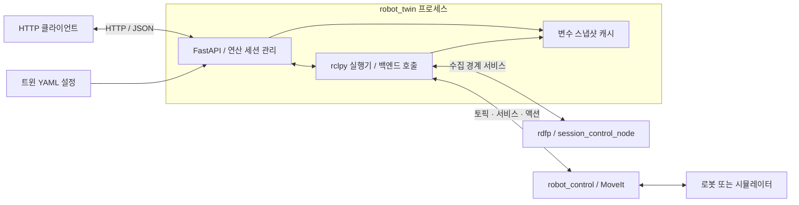
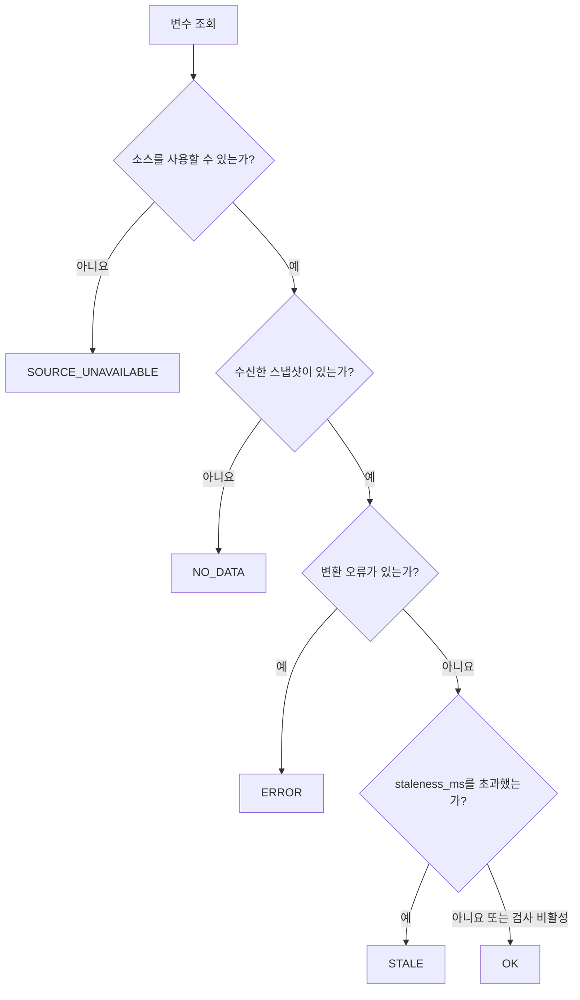
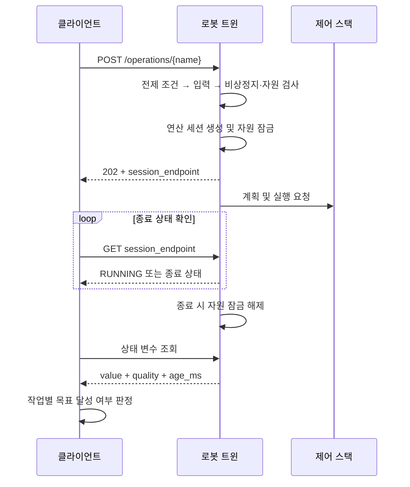
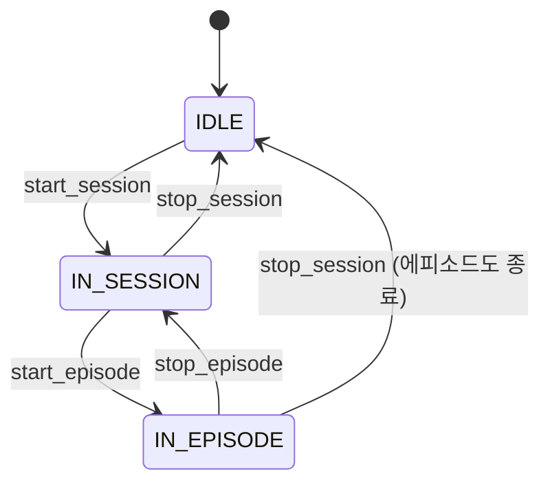
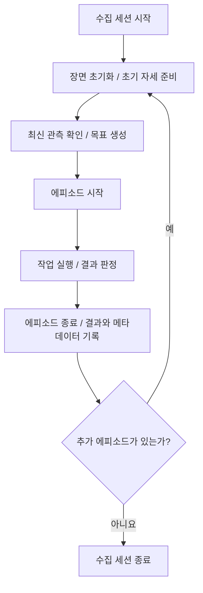

# 로봇 트윈 사용자 가이드

`robot_twin`은 HTTP/JSON으로 로봇의 상태를 조회하고 제어 기능을 호출하는 ROS 2
게이트웨이다. 클라이언트 환경에 ROS 2를 설치하지 않아도 curl, Python, Java 등에서
같은 REST API를 사용할 수 있다. 제공할 변수와 연산은 YAML 설정으로 정의한다.

이 문서는 현재 소스와 기본 제공 설정을 기준으로 실행 방법, API 계약, 예제와 운영
제약을 설명한다. 설계 근거는 [로봇 트윈 설계서](로봇_트윈_설계서.md)를 참고한다.
API는 `extern_op`의 외부 시스템 연동 규약을 따른다.

> 현재 트윈은 인증·권한 검사·TLS를 제공하지 않는다. API에 접근할 수 있는 주체는
> 로봇 제어 명령도 보낼 수 있으므로 신뢰된 폐쇄망에서 운용한다. 운영 조건은 9.1절을 참고한다.

## 목차

| 장 | 내용 |
|---|---|
| [1. 빠른 시작](#1-빠른-시작) | 설치, 백엔드 선택, 실행 및 종료 |
| [2. 시스템 구조](#2-시스템-구조) | 구성 요소, 연산 세션과 수집 세션의 구분 |
| [3. 클라이언트 인터페이스](#3-클라이언트-인터페이스) | 엔드포인트, 상태 조회, 연산 실행, 오류 처리 |
| [4. 상태 변수와 연산](#4-상태-변수와-연산) | 변수 구조, 연산별 입력과 완료 판정, 자원 잠금 |
| [5. 예제 프로그램](#5-예제-프로그램) | 호출, 재시도, 취소, 도달 검증, 데이터 수집 |
| [6. 로봇 연동 설정](#6-로봇-연동-설정) | 설정 파일과 백엔드 프로파일 |
| [7. 여러 트윈 운용](#7-여러-트윈-운용) | HTTP 주소와 ROS 그래프 분리 |
| [8. 기능 확장](#8-기능-확장) | 상태 변수, 그리퍼 목표, 장면 레시피 추가 |
| [9. 운영](#9-운영) | 접근 통제, 정지 수단, 시간 제한, 재시작 |
| [10. 문제 해결](#10-문제-해결) | 증상별 원인과 조치 |
| [11. 알려진 제약](#11-알려진-제약) | 미구현 기능과 응답의 한계 |
| [부록 A. 새 연산 구현](#부록-a-새-연산-구현-개발자용) | 핸들러 등록과 구현 규칙 |

처음 사용하는 경우에는 1장과 5.1절부터 읽는다. 클라이언트 개발자는 2~5장과 9장의
정지·재시작 동작을, 설정 및 운영 담당자는 6~10장을 함께 확인한다.

## 1. 빠른 시작

### 1.1 사전 조건

ROS 2와 워크스페이스의 기본 의존성을 설치한 환경에서 실행한다. 트윈의 Python
의존성은 다음과 같다. `jsonschema`는 선택 항목이지만, 설정에 선언한 입력 범위와
추가 필드 제한을 적용하려면 설치해야 한다.

```bash
python3 -m pip install --user fastapi 'uvicorn[standard]' 'pydantic>=2' PyYAML jsonschema
```

워크스페이스 루트에서 필요한 패키지를 빌드하고 설치 환경을 불러온다.

```bash
cd ~/development/ros/rdfp_ws
colcon build --packages-select rdfp_msgs robot_control robot_twin
source install/setup.bash
```

수집 세션·에피소드 기능을 사용할 때는 `rdfp`와 수집 계층의 의존성도 설치·빌드한다.
이미 구성된 워크스페이스에서는 해당 프로젝트의 빌드 절차를 따른다.

**제어 스택·수집 계층·트윈을 실행하는 터미널마다 같은 ROS 환경을 준비한다.** 트윈은 설정의
`ros.domain_id`(31)와 `rmw`로 셸 값을 덮어쓰지만, 제어 스택과 수집 계층은 셸 값을 그대로 쓴다.
`source install/setup.bash`만 한 새 터미널은 도메인이 0이라 트윈과 스택이 서로를 보지 못하고,
증상은 변수의 `NO_DATA`뿐이다. 이 워크스페이스에서는 `rdfp_env`로 켠다(`.rdfprc` → `.ros2rc`가
Humble 기준으로 아래 두 값을 설정한다). `rdfp_env`가 없는 환경이면 직접 지정한다.

```bash
rdfp_env                                   # 또는 아래 두 줄
export ROS_DOMAIN_ID=31
export RMW_IMPLEMENTATION=rmw_fastrtps_cpp
```

트윈은 셸 값을 덮어쓸 때 기동 로그에 그 사실을 남긴다(셸 값이 다르면 WARN).

### 1.2 제어 스택과 백엔드 선택

팔 이동에는 MoveIt과 해당 백엔드의 제어 스택이 필요하다. 시뮬레이터를 사용하는 경우에는
시뮬레이터를 먼저 실행한 뒤 제어 스택과 트윈을 시작한다.

| 백엔드 | 제어 스택 실행 | 트윈 ID (`config/twins/<ID>.yaml`) | `twin.backend` | 팔 실행 방식 |
|---|---|---|---|---|
| FunctionBay | 시뮬레이터와 통신 연결을 준비한 뒤 `./scripts/run_panda_functionbay.sh` | `rdfp01` | `panda_functionbay` | JGPC |
| Isaac Sim | 시뮬레이터 재생 후 `./scripts/run_panda_isaac.sh` | `panda01` | `panda_isaac` | JTC |
| mock (쓰지 않을 계획) | `./scripts/run_panda_mock.sh` | `mock01` | `panda_mock` | JTC |

트윈은 **환경마다 ID가 다르다**(2026-10-25). 클라이언트는 접속할 트윈의 ID를 지정한다
(예: `/api/v1/robot_twins/panda01`). 포트는 셋 다 8801이며 동시에 띄우지 않는다.
어느 환경에 접속했는지는 트윈 메타(`GET /api/v1/robot_twins/<ID>`)의 `backend`로 확인한다.

JTC는 컨트롤러의 액션 결과를, JGPC는 명령 스트리밍 결과를 기준으로 연산을 종료한다.
JGPC의 정상 종료는 실제 목표 도달을 보장하지 않는다. `move_linear`는 두 모드 모두
부분 경로만 실행할 수 있으므로 4.2절의 완료 판정 기준을 확인한다.

시뮬레이터 준비 절차는 [Isaac 실행 절차서](../backends/isaac/isaac_bringup_runbook.md)와 [FunctionBay 사용법](../backends/functionbay/펑션베이_시뮬레이터_사용법.md)을 참고한다.
기본 제어 스택은 그리퍼 노드와 백엔드별 장면 상태 노드를 함께 실행한다.
장면 노드는 `enable_scene:=false`로 비활성화할 수 있다.

수집 경계 연산을 사용할 때는 별도 터미널에서 수집 계층을 실행한다. 다음 예의 `panda_mock`은
사용하는 백엔드에 따라 `panda_isaac` 또는 `panda_functionbay`로 변경한다.

```bash
ros2 launch rdfp rdfp_collect.launch.py backend:=panda_mock
```

학습 데이터를 기록하려면 수집 노드뿐 아니라 rosbag과 영상 레코더도 필요하다.
`run_collect_isaac.sh`, `run_collect_functionbay.sh`의 사용법은
[수집 계층 실행 절차서](../collect/수집_계층_얹기_절차서.md)를 참고한다.
수집 계층이 준비되지 않으면 수집 경계 연산은 HTTP `503 PRECONDITION_FAILED`로 거부된다.

### 1.3 트윈 시작

실행 스크립트는 설치본 `install/robot_twin/share/robot_twin/config/twins/`의 설정을 사용한다.

```bash
./scripts/run_robot_twin.sh --twin rdfp01          # FunctionBay
./scripts/run_robot_twin.sh --twin panda01   # Isaac
./scripts/run_robot_twin.sh --twin mock01          # mock
```

`--twin <ID>`는 `config/twins/<ID>.yaml`을 바로 연다. **ID가 곧 파일 이름**이며, 파일의 `twin.id`와 다르면
기동을 거부한다. 없는 ID를 주면 설치된 ID와 백엔드를 보여 준다. 트윈을 추가하거나 삭제할 때는 설정 파일을
넣거나 빼고 다시 빌드하며, 스크립트는 고치지 않는다. `--backend`는 없앴다.

사용자 설정은 `--config`로 지정한다. 이때 `--twin`은 함께 주지 않는다(그 파일의 `twin.id`·`twin.backend`가 정한다).

```bash
./scripts/run_robot_twin.sh --config /path/to/my.yaml
```

소스 트리의 트윈 설정을 변경했다면 다시 빌드한 뒤 트윈을 재시작한다.
`robot_control`의 백엔드 프로파일이나 장면 정의도 변경했다면 해당 패키지도 다시 빌드한다.

```bash
colcon build --packages-select robot_twin
source install/setup.bash
```

직접 실행할 때도 같은 인자를 쓴다.

```bash
ros2 run robot_twin robot_twin --twin panda01
ros2 run robot_twin robot_twin \
  --config "$(ros2 pkg prefix robot_twin)/share/robot_twin/config/twins/mock01.yaml"
```

`--twin`·`--config` 중 하나는 필수이며 둘을 함께 쓸 수 없다. `--config`의 상대 경로는 프로세스의 작업 디렉터리를 기준으로 해석되므로,
실행 위치에 영향을 받지 않도록 절대 경로 사용을 권장한다.
`--host`, `--port`는 설정의 HTTP 주소를 덮어쓰며, `--log-level`은
`critical`, `error`, `warning`, `info`, `debug` 중에서 선택한다.

기동 시 설정을 검증하고 ROS 구독을 등록한다. 이후 HTTP 서버 실행과 MoveGroup
클라이언트 초기화가 병행되므로 로그 출력 순서는 고정되지 않는다.
`MoveGroup client ready`는 클라이언트 초기화 완료를 나타낸다.
JTC에서는 초기화 중 기존 팔 궤적에 대한 취소 요청도 수행한다(9.7절).

### 1.4 상태 확인과 예제의 기본 주소

셸 예제는 다음 두 변수를 사용한다. `H`는 호스트 주소이며, `B`는 트윈의 API 기본 주소다.
응답의 `session_endpoint`는 `/api/v1/...`로 시작하는 경로이므로 `H` 뒤에 연결한다.

```bash
H=http://127.0.0.1:8801
B=$H/api/v1/robot_twins/mock01
curl -sS "$B/health" | python3 -m json.tool
```

세 백엔드 모두 같은 `H`와 `B`를 사용한다. 접속한 트윈의 환경은 다음으로 확인한다.

```bash
curl -sS "$B" | python3 -c 'import json, sys; print(json.load(sys.stdin)["backend"])'
```

`move_group: READY`는 트윈 내부의 MoveGroup 클라이언트가 초기화되었다는 뜻이다.
컨트롤러의 액션 서버 가용성이나 실제 목표 도달까지 보장하지 않으므로, 연산 결과와
변수 품질도 확인한다. 초기화 오류는 `move_group_error`에 표시된다.

### 1.5 종료

Foreground 실행은 `Ctrl+C`로 종료한다. Background 실행은 해당 실행에서 생성된 프로세스 그룹을
확인한 뒤 종료한다. 다른 프로그램과 공유하는 프로세스 그룹을 종료하지 않도록 주의한다.

```bash
ps -eo pid,pgid,args | rg 'lib/robot_twin/robot_twin'
# 확인한 프로세스 그룹 번호를 지정한다.
# kill -TERM -- -12345
```

**트윈 종료는 로봇 정지 명령이 아니다.** JTC 컨트롤러는 이미 받은 궤적을 계속 실행할 수 있다. JGPC는 추가 명령 발행이 중단되지만, 마지막 명령에 대한 물리적 응답은 계속될 수 있다. 그리퍼 명령도 자동 취소되지 않는다.

종료 전 필요한 정지 요청을 보내고 실제 정지 상태를 확인한다. 실행 중인 연산 세션은 다음과 같이 조회한다.

```bash
curl -sS "$B/operations/sessions?status=RUNNING"
```

트윈이 종료된 동안에는 연결 오류가 발생한다. 재시작하면 메모리의 연산 세션 기록이 사라지므로 이전 연산 세션을 조회할 때 `404`가 반환된다.

### 1.6 대화형 API 문서

| URL | 용도 |
|---|---|
| `http://127.0.0.1:8801/docs` | Swagger UI에서 엔드포인트 확인 및 호출 |
| `http://127.0.0.1:8801/openapi.json` | OpenAPI 명세 조회 |

세 백엔드 모두 같은 주소다. 사용자 설정에서 HTTP 포트를 바꿨다면 그 포트로 접속한다. 제어 엔드포인트를 실행하면 실제 로봇 명령이 전달된다.

## 2. 시스템 구조



토픽 변수는 상시 구독으로 받은 최신 스냅샷을 반환한다. 조회 시마다 로봇에 새 측정을 요청하지 않으므로, 값의 수신 시각과 품질을 함께 확인해야 한다. 정적 변수는 최초 조회 시 제공자에서 값을 가져와 캐시한다.

트윈 하나는 프로세스 하나와 로봇 하나에 대응한다. ROS 도메인 설정은 프로세스 단위로 적용된다. `rdfp` 수집 계층은 선택 사항이며 `robot_twin.backends` 진입점(entry point)으로 연결한다.

### 두 종류의 세션

| 구분 | 용도 | 생성 및 종료 | 조회 방법 |
|---|---|---|---|
| **연산 세션** | 개별 HTTP 연산의 실행 상태 추적 | 연산 요청마다 생성하며 동기 연산도 포함 | `session_endpoint`, `/operations/sessions` |
| **수집 세션** | 여러 학습 에피소드를 묶는 작업 단위 | `start_session`부터 `stop_session`까지 | `session_state` 변수 |

수집 세션을 시작하는 `start_session` 호출도 하나의 연산 세션을 생성한다. 수집 세션·에피소드의 시작과 종료를 처리하는 네 연산을 이 문서에서는 **수집 경계 연산**이라 부른다. 두 종류의 세션은 서로 다른 수명과 상태를 갖는다.

## 3. 클라이언트 인터페이스

### 3.1 엔드포인트

기본 경로는 `/api/v1/robot_twins/{twin_id}`다. 아래 표의 경로는 이 기본 경로를 기준으로 한다.

| 메서드 | 경로 | 용도 |
|---|---|---|
| GET | 기본 경로 자체 | 트윈 메타데이터, 실행 모드, 변수·연산 이름 목록 |
| GET | `/health` | 클라이언트 초기화 상태, 비상정지 상태, 변수 품질 |
| GET | `/variables` | 변수 목록과 설명 |
| GET | `/variables?names=a,b` | 여러 변수 조회 |
| GET | `/variables/{name}` | 개별 변수 조회 |
| GET | `/variables/{name}?refresh=true` | 정적 변수 강제 갱신 |
| HEAD | `/variables/{name}` | 현재 ETag 조회 |
| GET | `/resources` | 설정에 선언된 자원의 점유 상태 |
| GET | `/operations` | 연산 목록과 입력 스키마 |
| POST | `/operations/{name}` | 연산 실행 |
| GET | `/operations/{name}/sessions` | 특정 연산의 실행 기록 |
| GET | `/operations/sessions` | 전체 연산 세션; `?status=RUNNING` 등으로 필터링 |
| GET | `/operations/sessions/{session_id}` | 연산 세션 상태 조회 |
| DELETE | `/operations/sessions/{session_id}` | 연산 세션 취소 요청 |
| POST | `/estop` | 신규 연산 잠금 및 정지 요청 |
| DELETE | `/estop` | 신규 연산 잠금 해제 |

트윈 목록은 `GET /api/v1/robot_twins`로 조회한다. 각 프로세스는 자기 트윈 하나만 반환하며, 다른 트윈을 탐색하는 레지스트리 기능은 제공하지 않는다.

주요 조회 응답은 다음과 같이 해석한다.

| 응답 | 필드와 의미 |
|---|---|
| 기본 경로 GET | `backend`: 접속한 트윈의 환경(`panda_mock`·`panda_isaac`·`panda_functionbay`) — 트윈 ID로는 환경을 알 수 없다. `closed_loop`: JTC이면 `true`, JGPC이면 `false`. 트윈의 실행 모드를 나타내며 개별 요청의 목표 달성을 보장하지 않음 |
| `/health` | `estop`: `ENGAGED` 또는 `RELEASED`, `running_sessions`: 현재 실행 중인 연산 세션 수 |
| `/resources` | 연산 설정에서 사용하는 자원 목록. 기본 mock·Isaac은 `arm`, `gripper`, `scene`, FunctionBay는 `arm`, `gripper` |

`GET /operations/sessions?status=...`에는 `RUNNING`, `COMPLETED`, `FAILED`, `CANCELLED`를 사용할 수 있다. 대소문자를 구분하며, 빈 문자열이나 그 밖의 값은 `400 INVALID_INPUT`으로 거부한다. 필터를 생략하면 모든 상태의 보관 중 세션을 반환한다. 비상정지 응답의 필드와 정지 범위는 [9.2절](#92-정지-수단)을 참고한다.

### 3.2 상태 변수 응답

`GET /variables/joint_states`의 응답 예시는 다음과 같다. 관절 목록은 설명을 위해 축약했다.

```json
{
  "name": "joint_states",
  "quality": "OK",
  "stamp": {"sec": 1786187482, "nanosec": 326478824},
  "received_at": "2026-08-08T11:11:22.412000Z",
  "age_ms": 11,
  "schema_version": 1,
  "value": {
    "header": {
      "stamp": {"sec": 1786187482, "nanosec": 326478824},
      "frame_id": "panda_link0"
    },
    "position": {"panda_joint1": 0.0, "panda_joint2": -0.785},
    "velocity": {"panda_joint1": 0.0, "panda_joint2": 0.0},
    "effort": {"panda_joint1": null, "panda_joint2": null}
  }
}
```

본문의 `Content-Type`은 `application/json`이다. 응답 헤더에는 스냅샷 세대 번호를 나타내는 `ETag`와 `Cache-Control: no-cache, must-revalidate`가 포함된다.

#### 시각과 데이터 품질

| 필드 | 기준 | 의미 |
|---|---|---|
| `stamp` | 원본 메시지의 `header.stamp` | 발행 측이 부여한 시각. 헤더가 없는 값은 `null` |
| `received_at` | 트윈의 벽시계, UTC | 마지막 수신 또는 정적 값 조회 시각 |
| `age_ms` | 트윈의 벽시계 | 조회 시각과 수신 시각의 차이. `OK`·`STALE` 판정에 사용 |
| `ETag` | 수신 세대 번호 | 새 데이터 수신 시 변경; 값이 같아도 변경 |
| `quality` | 조회 시점에 판정 | 소스 가용성, 수신 여부, 변환 오류, 경과 시간을 반영 |

Isaac의 `stamp`는 시뮬레이션 시각일 수 있다. 서로 다른 시계를 사용할 수 있으므로 `stamp`와 `received_at`을 직접 빼서 데이터 지연을 계산하지 않는다.



| `quality` | 의미 | 조치 |
|---|---|---|
| `OK` | 설정된 품질 조건 충족 | 값을 사용한다. 이벤트성·정적 변수는 경과 시간을 검사하지 않을 수 있다. |
| `STALE` | 수신한 값이 시간 임계값 초과 | 발행 주기와 통신 상태를 확인한다. |
| `NO_DATA` | 아직 수신한 값이 없음 | 기동 상태, 소스 구현 여부, QoS와 토픽 설정을 확인한다. |
| `SOURCE_UNAVAILABLE` | 소스 사용 불가 | `reason`을 확인한다. 토픽 발행자가 없으면 `NO_PUBLISHER`다. |
| `ERROR` | 값 변환 실패 | `error`와 메시지 형식을 확인한다. |

정의된 변수에 값이 없으면 HTTP `200`과 품질 정보로 응답한다. `404`는 정의되지 않은
변수 이름에 사용한다. `NO_DATA`, `SOURCE_UNAVAILABLE`, `ERROR`에는 `age_ms`가 없을 수 있다.
정적 소스 조회 실패는 원인에 따라 `SOURCE_NODE_DOWN` 또는 `SERVICE_UNAVAILABLE`로 보고된다.

#### JSON 변환

| 원본 | JSON 표현 |
|---|---|
| `NaN`, 양·음의 무한대 | `null` |
| `JointState` 병렬 배열 | `joint_state_map` 설정 시 `{관절 이름: 값}` 객체 |
| `SceneObjects.objects[]` | `scene_object_map` 설정 시 `{물체 이름: 정보}` 객체 |
| 정수 열거형 | `enums` 설정에 따라 문자열 심볼과 원래 정수 필드로 변환 |
| ROS 시간 | `{"sec": ..., "nanosec": ...}` |
| JavaScript 안전 정수 범위를 초과한 정수 | 문자열 |
| Python `bytes`·`bytearray` | 길이 정보인 `{"__bytes__": N}` |

원본 메시지의 필드는 지정된 변환 규칙에 따라 유지되며 `header`도 포함된다.
길이는 m, 각도는 rad 등 원본 단위를 사용한다. 이미지 전송은 상태 변수 API의 용도가 아니다.

#### 조건부 조회와 ETag

`ETag`(entity tag)는 응답의 버전을 식별하는 데 사용하는 HTTP 표준 헤더다. 트윈은 상태 변수 스냅샷의 **수신 세대 번호**를 큰따옴표로 감싸 `ETag` 값으로 반환한다. 예를 들어 세대 번호가 1532이면 `"1532"`를 반환하며, 아직 수신한 값이 없으면 `"0"`을 반환한다.

수신 세대 번호는 새 메시지를 받을 때마다 바뀐다. 메시지 내용이 이전과 같더라도 새로 수신했다면 다른 번호가 부여된다. 모든 변수가 하나의 공통 카운터를 사용하므로, 번호의 차이를 특정 변수의 수신 횟수나 경과 시간으로 해석해서는 안 된다. 클라이언트는 이전 `ETag`와 현재 `ETag`가 같은지만 비교한다.

| 용도 | 방법 |
|---|---|
| 반복 조회 시 전송량 줄이기 | 이전 응답의 `ETag`를 `If-None-Match` 요청 헤더에 지정한다. 새로 수신한 데이터가 없으면 서버는 응답 본문 없이 `304 Not Modified`를 반환한다 |
| 새 데이터 수신 여부 확인 | 이전 조회 이후 `ETag`가 바뀌었는지 확인한다. `HEAD /variables/{name}`을 사용하면 응답 본문을 받지 않고 `ETag`만 조회할 수 있다 |
| 중복 처리 방지 | 이미 처리한 스냅샷의 `ETag`와 같으면 해당 데이터의 처리를 생략한다 |

세대 번호는 트윈 프로세스의 메모리에서 관리하며, **트윈을 재시작하면 1부터 다시 부여한다.** 따라서 재시작 전후에 서로 다른 스냅샷에 같은 번호가 부여될 수 있다. 이전 `ETag`를 계속 사용하면 데이터가 달라졌는데도 `304`를 받을 수 있으므로, 트윈이 재시작되면 클라이언트에 저장한 `ETag`를 초기화한다.

다음 예제는 첫 조회에서 받은 `ETag`로 조건부 조회를 요청한다.

```bash
ETAG=$(curl -sS -D- -o /dev/null "$B/variables/joint_states" \
  | awk 'tolower($1)=="etag:" {gsub("\r", "", $2); print $2}')
curl -sS -o /dev/null -w '%{http_code}\n' \
  -H "If-None-Match: $ETAG" "$B/variables/joint_states"
```

**`304`는 새로 수신한 데이터가 없다는 뜻이며, 기존 데이터가 여전히 유효하다는 뜻은 아니다.**
새 메시지가 수신되지 않는 동안에도 유효 시간이 지나거나 발행 노드가 종료되면 변수의 `quality`가 달라질 수 있다. 따라서 조건부 조회를 사용하더라도 주기적으로 `If-None-Match` 헤더 없이 조회하여 `quality`를 확인한다(5.5절).

#### 정적 변수 갱신과 여러 변수 조회

정적 변수인 `named_targets`, `fixtures`는 최초 조회 시 값을 가져와 무기한 캐시한다. `refresh=true`로 다시 조회하거나 트윈을 재시작해 갱신한다.

```bash
curl -sS "$B/variables/named_targets?refresh=true"
curl -sS "$B/variables?names=joint_states,ee_pose"
```

강제 갱신에 실패하면 기존 정적 캐시를 유지한다. 일반 조회에서는 정적 소스의 실패 후 재시도에 최소 5초 간격이 적용되지만, `refresh=true`는 이 대기 간격을 적용하지 않고 즉시 조회한다. 다른 소스에는 `refresh`가 영향을 주지 않는다.

여러 변수의 조회 결과는 `{"values": {"joint_states": {...}, "ee_pose": {...}}}`처럼 `values` 객체 안에 변수별 응답을 담는다. 이름 하나라도 정의되어 있지 않으면 요청 전체가 `404`로 실패한다. 일괄 조회에는 `refresh`가 지원되지 않으므로 정적 값을 강제로 갱신하려면 개별 변수 경로를 사용한다.

여러 변수를 한 번에 조회해도 각 변수는 별도의 스냅샷이다. 변수 간 동시 측정이나 동일 조회 시점은 보장하지 않는다. 시간 정합이 필요하면 동일한 시계 기준인지 확인한 뒤 각 `stamp`를 비교한다.

### 3.3 연산 실행과 상태 전이

연산별 동기·비동기 방식은 고정되어 있으며 `/operations`의 `kind`에 표시된다.
요청 본문은 `{"inputs": {...}}` 형식이다.

동기 연산(`sync`)은 실행을 기다린 뒤 HTTP `200`과 종료 상태를 반환한다.
다음은 그리퍼 열기 성공 응답의 예다.

```json
{
  "status": "COMPLETED",
  "outputs": {
    "target": "open",
    "goal": "open",
    "width": 0.0799,
    "stalled": false,
    "at_goal": true
  }
}
```

비동기 연산(`async`)은 HTTP `202`와 `session_endpoint`를 반환한다. 같은 주소는
`Location` 헤더에도 포함된다.

```json
{
  "status": "RUNNING",
  "phase": "EXECUTING",
  "session_endpoint": "/api/v1/robot_twins/mock01/operations/sessions/9e024bc5700c"
}
```

클라이언트는 해당 주소를 조회해 종료 상태를 확인한다. 작업이 빠르게 끝나면 최초
`202` 응답에도 이미 종료 상태가 포함될 수 있으므로 응답의 `status`를 확인한다.



| `status` | 의미 |
|---|---|
| `RUNNING` | 처리 중 |
| `COMPLETED` | 백엔드 처리 정상 종료; 실제 목표 달성 기준은 연산별로 다름 |
| `FAILED` | 실패 종료; `error.code` 확인 |
| `CANCELLED` | 클라이언트의 취소 요청에 따라 종료; `error` 없음 |

처리 단계인 `phase`는 `EXECUTING` 또는 `CANCELING`이다. 계획 단계는 별도로 구분하지
않으며 계획 시간도 `EXECUTING`에 포함된다. 시간 초과로 종료하면 `FAILED`·`TIMEOUT`,
비상정지 요청 전달 후 종료 처리하면 `FAILED`·`ESTOP_ENGAGED`로 기록한다.
비상정지 요청을 전달하지 못한 경우(`halted: false`)에는 신규 연산만 차단하고 기존
연산은 실행을 계속한다. 별도의 사용자 취소가 없다면 실제 실행 결과에 따라
`COMPLETED` 또는 `FAILED`로 끝난다. 어느 종료 상태도 물리적 정지 확인을 대신하지 않는다.

#### 연산 취소와 완료 확인

`DELETE /operations/sessions/{session_id}`는 취소를 요청한다. 현재 취소를 지원하는
대상은 MoveGroup을 사용하는 비동기 팔 연산이다. 그리퍼·장면 초기화·수집 경계 연산은
`501 CANCEL_UNSUPPORTED`로 거부하며, 이 요청으로 팔 정지나 사용자 취소 상태를 설정하지 않는다.

접수 응답은 HTTP `202`이며, 취소 처리 중에는 다음 상태를 반환한다.

```json
{"status": "RUNNING", "phase": "CANCELING"}
```

이후 같은 주소를 GET으로 조회해 최종 `CANCELLED` 여부를 확인한다. 처리 시점에 따라
`202` 응답에 이미 종료 상태가 포함될 수도 있다. 시간 초과 등 다른 사유가 먼저
기록되면 `FAILED`로 끝날 수 있으므로 응답 코드를 취소 완료로 해석하지 않는다.
이미 종료된 세션은 `409 NOT_CANCELLABLE`, 정지 전달 실패는 `501 CANCEL_UNSUPPORTED`다.

### 3.4 오류 처리

연산 세션을 생성하기 전의 거부는 HTTP 4xx·5xx와 `error`로 응답한다. 요청 형식 자체가
잘못된 경우(본문이 JSON이 아니거나 객체가 아닌 경우, 쿼리 값의 타입이 틀린 경우)도 같은
형식의 `400 INVALID_INPUT`이며, `message`에 위치(`body`, `query.refresh` 등)와 사유가 들어가고
`error.details`에 FastAPI가 준 원본 목록이 남는다. 연산 입력 검증 실패와 코드가 같으므로
둘의 구분은 `message`로 한다.
세션 생성 후 실패는 동기 연산의 응답 또는 비동기 연산의 조회 응답에서
HTTP `200`, `status: FAILED`, `error`로 보고한다.

| HTTP | `error.code` | 의미 |
|---|---|---|
| 400 | `INVALID_INPUT` | 요청 형식(본문 JSON·쿼리) 또는 연산 입력 검증 실패 |
| 404 | `NOT_FOUND` | 정의되지 않은 변수 또는 연산 |
| 404 | `SESSION_NOT_FOUND` | 연산 세션 만료·축출 또는 트윈 재시작으로 기록 없음 |
| 409 | `RESOURCE_BUSY` | 필요한 자원이 다른 연산에 의해 점유됨 |
| 409 | `ESTOP_ENGAGED` | 비상정지 잠금으로 신규 연산 거부 |
| 409 | `NOT_CANCELLABLE` | 이미 종료된 연산 세션의 취소 요청 |
| 501 | `CANCEL_UNSUPPORTED` | 정지 요청을 전달하지 못해 취소를 접수하지 않음 |
| 503 | `PRECONDITION_FAILED` | MoveGroup 클라이언트 또는 수집 서비스가 준비되지 않음 |

사전 검사는 백엔드 준비 상태 → 입력 → 비상정지 및 자원 순으로 수행한다.
그리퍼와 장면 연산은 MoveGroup 준비 상태를 검사하지 않는다. 필요한 노드나 서비스가
없으면 실행 단계에서 실패할 수 있다.

| 실행 중 `error.code` | 의미 및 후속 조치 |
|---|---|
| `PLANNING_FAILED` | 계획 실패. 이 요청의 이동은 실행되지 않았으며 목표, 충돌, 시작 자세를 확인한다. |
| `EXECUTION_ABORTED` | 실행 거부, 컨트롤러 오류, 미구현 핸들러 등. 실제 상태를 확인한 뒤 복구한다. |
| `TIMEOUT` | 실행 시간 제한 초과. 팔 연산은 정지를 요청하지만 전달·정지 완료는 별도로 확인한다. |
| `ESTOP_ENGAGED` | 비상정지 처리로 연산 세션 종료 |
| `PRECONDITION_FAILED` | 수집 서비스 등이 현재 상태에서 명령을 거부. 수집 상태를 확인한다. |

`PRECONDITION_FAILED`는 사전 검사에서 HTTP `503`으로, 동기 실행 중 거부에서는
HTTP `200`과 `FAILED`로 나타날 수 있다.

자원 경합 응답에는 점유한 연산과 연산 세션 주소가 포함된다.

```json
{
  "error": {
    "code": "RESOURCE_BUSY",
    "message": "resource 'arm' is occupied by move_to_named_target",
    "resource": "arm",
    "operation": "move_to_named_target",
    "occupied_by": "/api/v1/robot_twins/mock01/operations/sessions/9e024bc5700c"
  }
}
```

현재 기본 백엔드는 `planned_duration_ms`를 채우지 않으므로 `estimated_remaining_ms`와
`Retry-After`가 제공되지 않는다. 클라이언트는 지수 백오프와 무작위 지연을 적용한다.
서버는 요청을 대기열에 넣지 않는다.

폴링 중 `404`가 발생하면 연산 완료로 간주하지 않는다. 기록이 사라졌을 뿐 최종 결과는
알 수 없으므로 현재 로봇 상태를 확인한다. 통신 오류 뒤 명령을 재전송하면 중복 실행될 수
있다는 점도 고려한다.

## 4. 상태 변수와 연산

### 4.1 상태 변수

| 변수 | 소스 | 주요 값 | 필요한 계층 |
|---|---|---|---|
| `joint_states` | `/joint_states` | 이름별 관절 위치·속도·토크 | 제어 |
| `ee_pose` | `/ee_pose` | 엔드이펙터의 위치·자세 | 제어 |
| `gripper_state` | `/gripper_states` | `goal`, `width`, `stalled`, `at_goal` | 제어 |
| `scene_objects` | `/scene/objects` | 이름별 물체 종류·크기·위치·자세 | 제어 |
| `named_targets` | 정적 SRDF 조회 | 그룹별 사전 정의 자세 이름 | 제어 |
| `fixtures` | 정적 설정 파일 | 고정물의 위치와 형상; FunctionBay 전용 | 제어 |
| `session_state` | `/session` | 수집 상태와 작업 라벨 | 수집 |

#### 관절과 엔드이펙터

`joint_states.value.position`은 `{관절 이름: rad}` 형식이다. 손가락 관절이 포함될 수 있으므로 `move_to_joints`에 전달할 때는 팔 관절만 선택한다.
그리퍼 개구 폭은 `gripper_state.width`를 사용한다. Panda 손가락 관절값은 개구 폭과 다르며, FunctionBay의 손가락 관절에는 TF 구성을 위한 고정값이 포함될 수 있다.

`ee_pose`는 `PoseStamped` 구조를 유지하므로 위치는 `value.pose.position`에 있다.

```json
{
  "header": {"stamp": {"sec": 10, "nanosec": 0}, "frame_id": "panda_link0"},
  "pose": {
    "position": {"x": 0.3, "y": 0.0, "z": 0.5},
    "orientation": {"x": 1.0, "y": 0.0, "z": 0.0, "w": 0.0}
  }
}
```

`header.frame_id`는 좌표의 기준 프레임이다. 이 값과 별개로 해당 pose가 가리키는 로봇의 지점은 백엔드에 따라 다르다. FunctionBay는 `grasp_center`, mock·Isaac은 `panda_hand`를 사용하므로 이동 목표와 비교할 때 4.2절의 프레임 규칙을 적용한다.

#### 그리퍼 상태

`gripper_state`는 주기적으로 발행되는 상태다. 단순한 갱신 여부는 명령 완료를 뜻하지 않는다.
`move_gripper_to_target`은 발행 이후 수신한 상태에서 요청한 `goal`과 `at_goal: true`를 확인한 뒤 정상 종료한다.

| 필드 | 의미 |
|---|---|
| `goal` | 상태에 기록된 명령 이름 |
| `width` | 개구 폭, m; 값을 구할 수 없는 상태 변수 값은 `null`일 수 있음 |
| `stalled` | 구동 중 움직임이 제한된 상태 |
| `at_goal` | 해당 명령에 정의된 완료 조건 충족 여부 |

`at_goal: false`만으로 진행 중과 실패를 구분할 수 없다. 폭의 변화, 명령 종류, 경과 시간을 함께 확인한다. `grasp`의 완료는 접촉에 의해 멈춘 상태를 나타내며, 원하는 물체를 안정적으로 파지했는지는 별도 관측이 필요하다.

#### 수집 상태

`session_state.value.state`는 `IDLE`, `IN_SESSION`, `IN_EPISODE` 중 하나다. `task_label`도 같은 값에 포함된다. 상태 전이 시에 발행하므로 기본 설정에서는 `staleness_ms: null`을 사용한다. `transient_local` 구독으로 늦게 연결한 트윈도 마지막 상태를 받을 수 있다.

수집 노드가 없으면 처음에는 `NO_DATA`, 발행자 부재가 확인된 뒤에는 `SOURCE_UNAVAILABLE`과 `NO_PUBLISHER`로 표시될 수 있다.

#### 장면 물체

`scene_objects.value.objects`는 배열이 아닌 물체 이름별 객체다.

```json
{
  "header": {"stamp": {"sec": 10, "nanosec": 0}, "frame_id": "panda_link0"},
  "objects": {
    "cube_0": {
      "type": "box",
      "dimensions": [0.05, 0.05, 0.05],
      "pose": {
        "position": {"x": 0.4, "y": 0.0, "z": 0.025},
        "orientation": {"x": 0.0, "y": 0.0, "z": 0.0, "w": 1.0}
      }
    }
  }
}
```

물체는 배열 순서가 아닌 이름으로 선택한다. 빈 객체 `{}`도 유효한 빈 장면이다. `dimensions` 순서는 상자가 `[x, y, z]`, 구가 `[반지름]`, 원기둥이 `[높이, 반지름]`이다.

mock은 MoveIt 계획 장면을, Isaac·FunctionBay는 시뮬레이터의 물체 TF를 장면 상태로 변환한다. mock에는 물리적 파지·낙하가 없으므로 이 변수로 실제 조작 성공을 판정할 수 없다. 물체 목록과 고정물의 포함 범위는 백엔드의 장면 설정을 따른다.

#### 사전 정의 자세와 고정물

`named_targets.value`의 예는 다음과 같다.

```json
{"hand": ["close", "open"], "panda_arm": ["extended", "ready"]}
```

팔 이동에는 `panda_arm`의 이름을 사용한다. 이 변수는 이름 목록만 제공하며 목표 관절값을 반환하지 않는다. MoveGroup 관련 조회가 준비되지 않으면 품질 오류가 발생하며, 준비된 뒤 재조회할 수 있다.

FunctionBay의 `fixtures`는 프로파일의 `scene.fixtures_file`에서 읽는다. MoveGroup 초기화와 무관하게 조회할 수 있다. 값에는 기준 좌표계인 `frame`과 고정물별 정보인 `fixtures`가 포함된다.

| 고정물 필드 | 의미 |
|---|---|
| `position` | 부품 원점 |
| `entry_point` | 삽입구 중심 |
| `floor_point` | 알려진 경우의 내부 바닥 위치 |
| `depth`, `inner_diameter` | 알려진 경우의 깊이와 내경 |
| `outer_extent_xy` | 고정물이 차지하는 수평 범위 |

알 수 없는 치수나 위치는 필드 자체가 생략된다. 누락 값을 `0`으로 대체하지 않는다. `position`과 `entry_point`를 구분하고, 고정물 영역의 접촉 높이를 탁자 높이와 동일하게 가정하지 않는다. 시뮬레이터 장면이 변경되면 고정물 설정 파일도 갱신해야 한다.

### 4.2 연산별 사용법

현재 접속한 트윈의 `/operations` 응답이 사용할 연산과 입력 스키마의 기준이다. 기본 설정에 선언되어 있어도 핸들러가 없는 연산이 있으므로 아래 구현 상태를 확인한다.

| 연산 | 방식 | 자원 | 지원 상태 |
|---|---|---|---|
| `move_to_named_target` | 비동기 | `arm` | 구현됨 |
| `move_to_joints` | 비동기 | `arm` | 구현됨 |
| `move_linear` | 비동기 | `arm` | 구현됨 |
| `move_gripper_to_target` | 동기 | `gripper` | 구현됨 |
| `reset_scene` | 동기 | `scene`, `arm` | mock·Isaac만 제공 |
| `start_session`, `stop_session` | 동기 | 없음 | 수집 계층 필요 |
| `start_episode`, `stop_episode` | 동기 | 없음 | 수집 계층 필요 |
| `move_to_pose` | 비동기 | `arm` | 선언되어 있으나 핸들러 미구현 |
| `move_gripper` | 비동기 | `gripper` | 선언되어 있으나 핸들러 미구현 |

미구현 연산은 사전 검사를 통과하면 접수된 뒤 `FAILED`와 `EXECUTION_ABORTED`로 종료된다. 정의되지 않은 연산은 HTTP `404 NOT_FOUND`로 거부된다.

#### 완료 판정 요약

| 연산 | `COMPLETED`의 의미 | 추가 확인 |
|---|---|---|
| 관절·이름 자세 이동, JTC | 컨트롤러가 성공 결과 반환 | 정밀 검증이 필요하면 관절 상태 비교 |
| 관절·이름 자세 이동, JGPC | 명령 스트리밍 완료 | 상태가 안정된 뒤 목표 관절값과 비교; 이름 목록만으로 목표 관절값은 알 수 없음 |
| `move_linear` | 허용된 비율의 직선 경로 실행 완료 | 부분 경로 여부와 실제 위치·자세 확인 |
| `move_gripper_to_target` | 요청한 명령의 `at_goal` 충족 | 의도한 물체의 파지·유지 여부는 별도 판정 |
| `reset_scene` | 장면 서비스가 요청 배치를 처리 | 최신 `scene_objects`에서 안착 후 위치 확인 |
| 수집 경계 연산 | 수집 상태 전이 처리 | `session_state` 및 실제 기록 파일 확인 |

#### `move_to_named_target`: 사전 정의 자세로 이동

```json
{"inputs": {"target": "ready", "velocity_scaling": 0.3, "max_duration_sec": 60}}
```

`target`은 필수다. 먼저 `named_targets`를 조회해 팔 그룹에 등록된 이름을 선택한다. 빈 이름과 팔 그룹에 없는 이름은 접수 단계에서 `400 INVALID_INPUT`으로 거부되며, 없는 이름이면 `message`에 사용할 수 있는 이름 목록이 함께 나온다. 이름 목록을 2초 안에 얻지 못하면 이 대조를 건너뛰고 접수하며, 그때 없는 이름은 실행 단계에서 `FAILED`·`EXECUTION_ABORTED`로 끝난다. 출력은 4.3절의 공통 이동 결과다.

JTC에서는 목표 궤적에 대한 액션 성공을 확인한다. JGPC에서는 명령 발행 완료만 알 수 있으므로, 수치로 도달을 검증해야 한다면 목표 관절값을 가진 `move_to_joints`를 사용한다.

#### `move_to_joints`: 관절값 지정 이동

```json
{
  "inputs": {
    "joints": {"panda_joint1": 0.0, "panda_joint2": -0.785, "panda_joint4": -2.356},
    "velocity_scaling": 0.3,
    "max_duration_sec": 60
  }
}
```

`joints`는 비어 있지 않은 `{관절 이름: rad}` 객체다. 입력하지 않은 팔 관절은 현재값으로 목표를 보완한다. 이는 최종 목표를 고정한다는 뜻이며, 계획된 경로 중 다른 관절이 전혀 움직이지 않는다는 보장은 아니다.

팔 그룹의 관절만 전달한다. `joint_states.position`에 포함된 손가락 관절을 함께 보내면 실행 단계에서 실패할 수 있다. 관절 이름의 그룹 소속과 관절 한계는 트윈의 입력 검사에서 모두 검증하지 않으며 MoveIt 계획 단계에서 확인한다.

#### `move_linear`: 직선 경로 이동

```json
{
  "inputs": {
    "pose": {
      "position": {"x": 0.3, "y": 0.0, "z": 0.5},
      "orientation": {"x": 1.0, "y": 0.0, "z": 0.0, "w": 0.0}
    },
    "velocity_scaling": 0.2,
    "max_step": 0.01,
    "max_duration_sec": 60
  }
}
```

| 입력 | 기본값 | 의미 |
|---|---|---|
| `pose.position` | 필수 | 목표 위치, m |
| `pose.orientation` | 필수 | 단위 쿼터니언, ROS 순서 `x,y,z,w`; 노름 허용 오차 `1e-3` |
| `velocity_scaling` | 서버·백엔드 기본값 | 속도 배율; 기본 입력 스키마 범위 0.01~1.0 |
| `max_step` | 0.01 m | 데카르트 경로 보간 간격 |
| `jump_threshold` | 5.0 | 관절 공간 급변 검사 임계값; 0은 검사 비활성화 |
| `max_duration_sec` | 60초 | 연산 실행 시간 상한; 계획 시간만을 뜻하지 않음 |
| `min_fraction` | 0.95 | 실행을 허락하는 최소 계획 비율; 범위 0 초과 1.0 이하. 미만이면 움직이지 않고 `PLANNING_FAILED` |
| `frame` | `ee_frame`, 없으면 `tip_frame` | 목표 pose가 가리키는 로봇 지점; 기본 설정에서는 FunctionBay만 입력 허용 |

좌표를 표현하는 기준은 현재 클라이언트의 `panda_link0`다. `frame`은 기준 좌표계를 바꾸는 입력이 아니라 **어느 로봇 지점을 목표 위치·자세로 이동할지** 지정하는 입력이다.

| 백엔드 | 목표 지점 및 관측 프레임 |
|---|---|
| FunctionBay | 기본 목표와 `ee_pose`가 모두 `grasp_center`. `frame: panda_link8`을 지정하면 끝 링크 목표로 해석 |
| mock·Isaac | 목표는 `panda_link8`, `ee_pose`는 `panda_hand`. 기본 구성에서 위치는 같지만 z축 회전이 다름 |

FunctionBay에서는 `grasp_center`와 `panda_link8` 사이에 약 149 mm의 위치 차이가 있어 변환이 필요하다. 트윈은 기본 목표를 TF로 변환한다. mock·Isaac에서는 별도의 회전 관계가 있으므로 관측 자세와 명령 자세를 그대로 비교하지 않는다. 상위 클라이언트가 수행하는 `to_arm_command` 변환을 다시 적용해 이중 보정하지 않도록 한다.

`frame_id`는 현재 입력이 아니다. 미지원 입력 필드와 범위 위반을 일관되게 거부하려면 `jsonschema`를 설치한다. 설치하지 않으면 스키마 검증을 건너뛰고 도메인 검사만 수행한다.

직선 경로는 장애물을 우회하지 않는다. 계획 비율(`fraction`)은 요청 경로 중 MoveIt이 계획해 낸 비율(0~1)이며, `min_fraction`(기본 0.95)에 못 미치면 실행하지 않는다. 기본값이 MoveGroup 클라이언트 라이브러리의 기본(0.60)보다 엄격한 것은 `COMPLETED`가 요청 거리를 크게 못 간 이동을 가리지 않게 하기 위해서다. 부분 경로를 감수할 대략적인 이동에서만 낮춘다.

| 계획 비율 | 처리 결과 |
|---|---|
| `min_fraction` 미만 | `PLANNING_FAILED`; 이동 실행하지 않음 |
| `min_fraction` 이상, 1.0 미만 | 계획된 부분 경로만 실행하며 정상 종료 가능 |
| 1.0 | 전체 경로 실행; JGPC에서는 실제 도달 여부를 추가 확인 |

성공(`COMPLETED`)한 `move_linear`의 `outputs.fraction`에는 계획 비율이 실린다. `min_fraction` 미만은 실행되지 않으므로 값은 `min_fraction`~1.0(기본 0.95~1.0)이며, 1.0 미만이면 부분 경로만 실행된 것이다. **`fraction`은 도달 판정이 아니다.** JTC에서는 실제로 간 경로 비율과 거의 같지만, JGPC(open loop)에서는 명령한 범위일 뿐이고, 어느 쪽이든 1.0이어도 정착 전에 읽었거나 처짐·접촉으로 덜 갔을 수 있다. 도달 여부는 아래처럼 `final_pose`로 판정하고, `fraction`은 도달하지 못했을 때 원인을 가르는 데 쓴다.

| 도달하지 못했을 때 `fraction` | 원인 | 대응 |
|---|---|---|
| 1.0 미만 | 경로 도중 IK 해 없음 또는 관절 급변 (기하 문제) | 같은 목표로 재시도해도 결과가 같다. 경유점이나 자세를 바꾼다 |
| 1.0 | 계획은 끝까지 됐으나 덜 감 (정착 전 측정, 처짐, 접촉) | 정착을 기다려 다시 읽거나, 물러났다 다시 접근한다 |

도달 검증에는 동일한 기준 좌표계와 로봇 지점으로 표현한 목표·관측 pose를 사용한다. JGPC에서는 상태가 안정된 뒤 비교한다. 위치만 비교하면 자세 오차를 놓칠 수 있다(5.6절).

#### `move_gripper_to_target`: 그리퍼 명령

```json
{"inputs": {"target": "open"}}
```

`target`은 필수이며 허용 목록은 `/operations`의 `inputs_schema.properties.target.enum`에서 확인한다. 목록은 `backend.labels`에서 생성된다. 목표 폭과 구동력은 로봇 측 그리퍼 설정이 결정한다.

| 기본 명령 | 용도 | 완료 조건 |
|---|---|---|
| `open` | 그리퍼 열기 | 목표 자세 도달 및 `stalled: false` |
| `close` | 물체를 파지하지 않고 닫기 | 목표 자세 도달 및 `stalled: false` |
| `grasp` | 접촉한 물체에 힘을 가하며 닫기 | `stalled` 조건 충족 |

위 표의 `open`·`close` 완료 조건은 코드상 목표 도달과 `not stalled`의 조합이다.
파지에는 `grasp`를 사용한다. `grasp`의 `at_goal`은 원하는 물체를 집었다는 판정까지 포함하지 않으므로 작업 성공은 장면 관측 등으로 확인한다.

트윈은 `/gripper_cmds`로 명령을 발행하고 `/gripper_states`의 완료 상태를 기다린다. 이 경로를 사용하면 명령을 토픽으로 기록할 수 있다. 출력에는 `target`, `goal`, `width`, `stalled`, `at_goal`이 포함된다. 팔 이동의 공통 출력은 포함되지 않는다.

기본 시간 제한은 mock·Isaac 5초, FunctionBay 12초다. FunctionBay는 기본 프로파일에서 명령을 목표값까지 2초에 걸쳐 점진적으로 변경한다(`command_ramp_sec: 2.0`). 명령 발행 이후 관절이 목표를 따라가 `at_goal`에 도달하는 시간도 필요하므로 제한을 12초로 설정한다. Robotiq 노드는 개구 폭을 측정하지 않으므로 변수와 연산 결과의 `width`는 `null`이며, 이를 폭 0으로 해석하지 않는다.

시간 초과 응답은 그리퍼 정지를 뜻하지 않는다. mock에서는 물리적 접촉에 의한 `stalled`를 관측할 수 없어 `grasp`가 시간 초과로 끝날 수 있으며, 기능 확인에는 `open`·`close`를 사용한다.

#### `reset_scene`: 레시피에 따른 물체 배치

```json
{"inputs": {"scene": "one_cube", "seed": 42}}
```

`scene`은 필수이며 허용 목록은 연산 입력 스키마에서 조회한다. `seed`는 생략 시 0이다. 레시피의 각 축이 숫자이면 고정 좌표, `[최소, 최대]`이면 균등 추출 범위다.

| 백엔드 | 지원 범위 | 기본 레시피 |
|---|---|---|
| mock | 계획 장면의 물체 재구성 | `one_cube`, `cube_and_ball` |
| Isaac | 기존 물체의 위치·자세와 속도 재설정; 생성·삭제·형상 변경 제외 | `two_objects`, `one_block`, `initial` |
| FunctionBay | 연산 미제공 | 없음 |

Isaac의 `two_objects`는 두 물체를 무작위 배치하고, `one_block`은 블록을 무작위 배치하며 실린더는 초기 위치에 둔다. `initial`은 장면 정의의 초기 위치로 배치한다. Isaac에서는 `simulation_interfaces`와 `isaacsim.ros2.sim_control` 서비스가 필요하다. 상세 조건은 [Isaac 장면 초기화](../backends/isaac/isaac_scene_reset.md)를 참고한다.

응답에는 `scene`, `seed`, `objects`, `applied_count`가 포함된다. **`outputs.objects`는 레시피에서 추출해 서비스에 전달한 배치다.** 물리 시뮬레이터에서 안착한 뒤의 측정값은 `scene_objects`로 별도 확인한다. 재현을 위해 seed뿐 아니라 요청 배치와 관측 배치를 함께 기록하는 것이 적절하다.

장면 초기화는 `scene`과 `arm`을 함께 점유한다. 팔 이동 중에는 `409 RESOURCE_BUSY`로 거부된다. 기본 시간 제한은 10초다. 레시피 이름 오류는 스키마 검증이 활성화되면 `400`, 검증을 건너뛴 경우에는 실행 단계의 실패로 나타날 수 있다.

초기화는 에피소드를 시작하기 전에 수행한다. 물체의 순간적인 재배치가 작업 데이터에 포함되지 않도록 초기 조건 설정과 수집 구간을 분리한다.

#### 수집 경계 연산

상태 전이는 `rdfp`의 `session_control_node`가 관리한다. 트윈은 서비스를 호출하며
`/session` 상태 토픽은 직접 발행하지 않는다.



| 연산 | 입력 | 동작 |
|---|---|---|
| `start_session` | 선택 `task_label` | 수집 세션 시작 및 작업 라벨 설정 |
| `stop_session` | 없음 | 수집 세션 종료; 열린 에피소드도 종료 |
| `start_episode` | 없음 | `IN_SESSION`에서 에피소드 시작 |
| `stop_episode` | 선택 `outcome`, `metadata` | 에피소드 종료 및 결과 기록 |

`task_label`은 수집 시작 시 지정한다. `outcome`은 `success` 또는 `failure`이며,
생략은 판정하지 않았다는 뜻이다. `metadata`는 JSON 객체다. 작업 실패도 수집 목적에
따라 유효한 데이터가 될 수 있다.

```json
{
  "inputs": {
    "outcome": "failure",
    "metadata": {"seed": 42, "scene": "one_cube"}
  }
}
```

수집 노드가 없으면 사전 검사에서 `503`, 현재 상태에 맞지 않는 요청은 실행 결과에서
`FAILED`와 `PRECONDITION_FAILED`로 나타난다. 트윈은 작업 실패 시 에피소드를 자동으로
닫지 않으므로 클라이언트가 종료를 요청하고 결과를 확인해야 한다.

### 4.3 이동 연산의 공통 출력

`move_to_named_target`, `move_to_joints`, `move_linear`는 다음 필드를 사용한다.

| 필드 | 의미 |
|---|---|
| `closed_loop` | JTC이면 `true`, JGPC이면 `false` |
| `final_pose` | 종료 처리 시 조회한 `ee_pose` 캐시 값; `PoseStamped` 구조 |
| `final_joints` | 종료 처리 시 조회한 `joint_states` 캐시 값 |
| `measured_age_ms` | `final_pose`·`final_joints` 중 더 오래된 쪽이 트윈에 수신된 뒤 결과 작성 시점까지 지난 시간(ms) |

변수가 없거나 수신·변환에 실패하면 `final_*` 필드가 생략될 수 있다. 캐시 조회이므로 동작 종료 시점의 새 측정이라고 보장하지 않는다. 출력에는 변수별 `quality`가 없으며, `measured_age_ms`만으로 발행자 가용성까지 판단할 수 없다. 정밀 검증에는 변수를 다시 조회해 품질과 좌표계를 확인한다.

`measured_age_ms`는 결과에 함께 실린 `final_*`를 다시 조회하지 않고 그대로 써도 되는지 판단하는 데 쓴다. 트윈의 벽시계로 잰 값이며, 3.2절의 `age_ms`와 같은 방식으로 계산한다. 원본 메시지의 `stamp`는 사용하지 않는다.

- **JTC**: 값이 발행 주기 수준이면 `final_pose`를 목표와 바로 비교해도 된다. 값이 수백 ms 이상이면 연산 도중 상태 발행이 끊긴 것이므로 `final_*`를 버리고 변수를 다시 조회한다.
- **JGPC에서는 판단 근거로 쓸 수 없다.** JGPC는 명령 발행을 마친 시점에 결과를 만들고, open loop라서 그 시점에 팔이 아직 목표를 향해 움직이고 있을 수 있다. `measured_age_ms`는 값이 *수신된 뒤* 지난 시간일 뿐 *팔이 멈춘 뒤의 측정인지*는 알려 주지 않는다. 따라서 값이 작아도 `final_*`는 정착 전 자세일 수 있다. JGPC에서는 `ee_pose`가 멈출 때까지 기다린 뒤 변수를 다시 읽어 판정한다(4.2절 완료 판정 요약).

어느 경우든 `measured_age_ms`는 센서 지연이 아니다. 시뮬레이터나 하드웨어에서 측정한 뒤 트윈에 도착하기까지의 시간은 포함하지 않는다. 또한 값이 작다고 내용이 최신이라는 보장도 없다. 발행자가 같은 값을 계속 보내면 값이 작게 나온다.

`move_linear`는 성공 시 `fraction`(계획 비율)을 추가로 싣는다(4.2절). 그리퍼 결과는 이 공통 출력과 별개의 형식이다.

실패·취소 예외, 시간 초과 또는 [비상정지 (E-stop)](#92-정지-수단)로 중단 처리할 때는 가능한 경우 `stopped_at`에 `ee_pose` 캐시 값을, `final_joints`에 관절 상태를 담는다. `stopped_at`은 `PoseStamped` 구조이며, 중단 처리 시 조회한 값이지 정지 완료를 확인한 측정값은 아니다. 이 경로에서는 `final_pose`를 생성하지 않는다. 조회 가능한 값이 없으면 해당 필드는 생략된다.

모든 실패·취소 응답에 `stopped_at`이 있는 것은 아니다. 동기 연산의 일반 실패에는 중단 상태가 첨부되지 않으며, 사용자 취소 후 백엔드가 정상 반환한 경우에는 `CANCELLED`여도 백엔드 출력인 `final_pose` 등이 남을 수 있다. 연산 결과의 `NaN`과 무한대는 변수 응답과 동일하게 `null`로 변환한다.

### 4.4 자원 잠금

같은 자원은 한 번에 하나의 연산 세션만 점유한다. 충돌 요청은 대기하지 않고
`409 RESOURCE_BUSY`로 거부된다.

| 자원 | 연산 |
|---|---|
| `arm` | 팔 이동 연산, `reset_scene` |
| `gripper` | 그리퍼 연산 |
| `scene` | `reset_scene` |
| 없음 | 수집 경계 연산 |

팔과 그리퍼는 독립 자원이므로 병렬 실행할 수 있다. `reset_scene`은 두 자원을 모두
확보하거나 어느 것도 확보하지 않는다. 수집 상태는 여러 호출에 걸쳐 유지되므로
연산 단위의 자원 잠금이 아닌 수집 상태 기계로 관리한다.

## 5. 예제 프로그램

이 장은 API 사용 예제다. Python 예제는 5.2절의 클라이언트와 앞 절의 함수를 같은 모듈에 정의한 뒤 사용한다. 제어 호출은 실제 동작을 발생시키므로 목표와 허용 오차는 해당 로봇 구성에 맞게 지정한다.

별도 저장소 `mdtpy/robot-twin-client`에는 `robot_twin_client`와
`robot-twin-mcp`, `robot-twin-collect`, `robot-twin-peg` 등의 도구가 있다.
아래 예제는 API 동작을 설명하기 위한 독립적인 예제이며, 해당 패키지의 구현과 동일하지는 않다.

### 5.1 curl로 연산 실행

다음 스크립트는 mock의 이름 자세 이동 후 그리퍼를 연다. 종료 상태를 확인한 뒤 다음
단계를 실행한다. 파일로 저장해 실행한다.

```bash
#!/usr/bin/env bash
set -euo pipefail
H=http://127.0.0.1:8801
B=$H/api/v1/robot_twins/mock01
field() { python3 -c "import json,sys; print(json.load(sys.stdin)['$1'])"; }

curl -sS --fail-with-body "$B/health" | python3 -m json.tool
RES=$(curl -sS --fail-with-body -X POST "$B/operations/move_to_named_target" \
  -H 'Content-Type: application/json' \
  -d '{"inputs":{"target":"ready","velocity_scaling":0.3,"max_duration_sec":60}}') \
  || { echo "$RES" >&2; exit 1; }
EP=$(echo "$RES" | field session_endpoint)
DEADLINE=$((SECONDS + 90))

while :; do
  STATE=$(curl -sS --max-time 10 --fail-with-body "$H$EP")
  STATUS=$(echo "$STATE" | field status)
  [ "$STATUS" = RUNNING ] || break
  if (( SECONDS >= DEADLINE )); then
    echo "조회 대기 시간 초과: $H$EP (연산은 취소되지 않음)" >&2
    exit 1
  fi
  sleep 1
done
[ "$STATUS" = COMPLETED ] || { echo "$STATE" >&2; exit 1; }

RES=$(curl -sS --max-time 30 --fail-with-body -X POST \
  "$B/operations/move_gripper_to_target" \
  -H 'Content-Type: application/json' -d '{"inputs":{"target":"open"}}') \
  || { echo "$RES" >&2; exit 1; }
[ "$(echo "$RES" | field status)" = COMPLETED ] \
  || { echo "$RES" >&2; exit 1; }
echo "$RES"
```

`--fail-with-body`를 지원하는 curl을 사용한다. 통신 오류로 스크립트가 종료되어도
서버에서 이미 접수한 동작이 취소되는 것은 아니다.

### 5.2 Python 클라이언트

Python 표준 라이브러리만 사용한다. HTTP 오류, 실행 실패, 클라이언트의 대기 시간 초과를
서로 다른 예외로 처리한다. `run()`은 종료 상태를 반환하고, `outputs()`는 `COMPLETED`를
확인한 뒤 출력을 반환한다.

```python
from __future__ import annotations

import json
import time
import urllib.error
import urllib.request
from urllib.parse import quote, urlsplit


class TwinError(Exception):
    def __init__(self, status: int, body: dict):
        self.status = status
        self.body = body
        self.code = body.get('error', {}).get('code')
        super().__init__(f"HTTP {status}: {body}")


class OperationFailed(Exception):
    def __init__(self, result: dict):
        self.result = result
        super().__init__(f"operation ended: {result}")


class PollTimeout(TimeoutError):
    def __init__(self, endpoint: str):
        self.endpoint = endpoint
        super().__init__(f"polling timed out; operation not cancelled: {endpoint}")


def server_root(base_url):
    parts = urlsplit(base_url)
    if parts.scheme not in ('http', 'https') or not parts.hostname:
        raise ValueError(f"base_url must look like 'http(s)://host[:port]', got {base_url!r}")
    parts.port  # 포트가 숫자가 아니면 ValueError
    if parts.path.strip('/') or parts.query or parts.fragment:
        raise ValueError(f'base_url must be the server root without a path, got {base_url!r}')
    return f'{parts.scheme}://{parts.netloc}'


class RobotTwinClient:
    def __init__(self, base_url='http://127.0.0.1:8801', twin_id='rdfp01',
                 *, http_timeout_sec=30.0):
        self.base_url = server_root(base_url)
        self.base = f'{self.base_url}/api/v1/robot_twins/{twin_id}'
        self.http_timeout_sec = http_timeout_sec

    def _request(self, path, method='GET', body=None):
        return self._send(self.base + path, method, body)

    def _send(self, url, method='GET', body=None):
        data = None if body is None else json.dumps(body, allow_nan=False).encode()
        headers = {'Content-Type': 'application/json'} if data is not None else {}
        request = urllib.request.Request(url, data=data, headers=headers, method=method)
        try:
            with urllib.request.urlopen(request, timeout=self.http_timeout_sec) as response:
                raw = response.read()
                return response.status, json.loads(raw) if raw else None
        except urllib.error.HTTPError as exc:
            raw = exc.read()
            try:
                parsed = json.loads(raw) if raw else {}
            except ValueError:
                parsed = {'error': {'message': raw.decode(errors='replace')}}
            raise TwinError(exc.code, parsed) from exc

    def health(self):
        return self._request('/health')[1]

    def read_envelope(self, name):
        return self._request(f'/variables/{quote(name, safe="")}')[1]

    def read(self, name):
        body = self.read_envelope(name)
        if body['quality'] != 'OK':
            raise RuntimeError(f"{name}: {body['quality']} {body.get('reason', '')}")
        return body['value']

    def read_many(self, *names):
        query = ','.join(quote(name, safe='') for name in names)
        return self._request(f'/variables?names={query}')[1]['values']

    def resources(self):
        return self._request('/resources')[1]

    def run(self, name, inputs=None, *, timeout_sec=120.0, poll_sec=0.3):
        code, body = self._request(f'/operations/{quote(name, safe="")}', 'POST',
                                  {'inputs': inputs or {}})
        if code == 200:
            return body
        endpoint = body['session_endpoint']
        deadline = time.monotonic() + timeout_sec
        while body['status'] == 'RUNNING':
            if time.monotonic() >= deadline:
                raise PollTimeout(endpoint)
            time.sleep(poll_sec)
            body = self._send(self.base_url + endpoint)[1]
        return body

    def outputs(self, name, inputs=None, **kwargs):
        result = self.run(name, inputs, **kwargs)
        if result['status'] != 'COMPLETED':
            raise OperationFailed(result)
        return result.get('outputs', {})

    def cancel(self, endpoint):
        return self._send(self.base_url + endpoint, 'DELETE')[1]

    def estop(self):
        return self._request('/estop', 'POST')[1]

    def release_estop(self):
        return self._request('/estop', 'DELETE')[1]
```

사용 예는 다음과 같다.

```python
twin = RobotTwinClient()
print(twin.health())
print(twin.read('joint_states')['position'])
out = twin.outputs('move_to_named_target', {'target': 'ready'})
print(out)
```

다른 곳의 트윈은 `RobotTwinClient('https://twin.example:8801')`처럼 서버 루트 URL로 지정한다.
https와 IPv6(`http://[::1]:8801`)를 쓸 수 있다. 경로가 붙은 URL(`https://gw.example/twin`)은
생성 시 거부한다. 비동기 연산의 `session_endpoint`가 접두사 없는 절대 경로(`/api/v1/...`)라서,
경로 접두사를 받으면 동기 연산은 되고 조회만 404로 실패하기 때문이다.

`read_many()`는 변수별 응답을 반환하므로 호출 측에서 각 요소의 `quality`를 확인한다.
`outputs()`도 실제 목표 도달이나 파지 성공까지 보장하지 않으므로 4.2절의 판정을 적용한다.

#### 시간 제한

| 제한 | 기본 예제·설정 | 초과 시 동작 |
|---|---|---|
| HTTP 요청 시간 | 클라이언트 30초 | 통신 예외; 서버의 연산은 취소되지 않음 |
| 비동기 연산 조회 대기 | 클라이언트 120초 | `PollTimeout`; 취소 요청에 사용할 주소를 보존 |
| 동기 연산 | 그리퍼 5초 또는 12초, 장면 초기화 10초, 수집 경계 5초 | `FAILED`·`TIMEOUT`; 전달된 명령은 계속될 수 있음 |
| 비동기 연산 | 팔 이동 기본 60초 | 서버가 정지를 요청한 뒤 `FAILED`·`TIMEOUT` 처리 |

HTTP 제한은 동기 연산의 제한보다 여유 있게 설정한다. 조회 대기 시간도 서버의 시간
상한보다 길게 두어 최종 결과를 받을 수 있도록 한다. 예제의 조회 대기 상한은 개별 HTTP
요청을 강제로 중단하지 않으므로 HTTP 제한만큼 추가로 기다릴 수 있다.

### 5.3 자원 경합 재시도

자원 경합으로 접수되지 않은 요청만 재시도한다. 통신 오류나 실행 실패까지 같은 방식으로
재시도하면 이미 실행된 명령을 중복 실행할 수 있다.

```python
import random


def run_with_retry(twin, operation, inputs, *, attempts=5):
    if attempts < 1:
        raise ValueError('attempts must be positive')
    for attempt in range(attempts):
        try:
            return twin.run(operation, inputs)
        except TwinError as exc:
            if exc.code != 'RESOURCE_BUSY' or attempt == attempts - 1:
                raise
            remaining = exc.body['error'].get('estimated_remaining_ms')
            delay = remaining / 1000.0 if remaining is not None else 2.0 ** attempt
            time.sleep(delay + random.uniform(0.0, 1.0))
```

반환값의 `status`는 별도로 확인한다. `409`라도 비상정지 잠금은 이 함수에서 재시도하지 않는다.

### 5.4 취소

```python
_, state = twin._request('/operations/move_to_named_target', 'POST',
                         {'inputs': {'target': 'extended', 'velocity_scaling': 0.05}})
endpoint = state['session_endpoint']

if state['status'] == 'RUNNING':
    try:
        twin.cancel(endpoint)
    except TwinError as exc:
        if exc.code != 'NOT_CANCELLABLE':
            raise
        # 조회와 취소 사이에 이미 종료되었을 수 있다.

    deadline = time.monotonic() + 30.0
    while True:
        state = twin._send(twin.base_url + endpoint)[1]
        if state['status'] != 'RUNNING':
            break
        if time.monotonic() >= deadline:
            raise PollTimeout(endpoint)
        time.sleep(0.3)

print(state)
```

정지 요청을 전달하지 못하면 `501 CANCEL_UNSUPPORTED`가 발생한다. 취소 요청과 실제
정지 완료는 구분해야 한다. `CANCELLED`를 확인한 뒤에도 필요한 물리적 정지 확인을 수행한다.

### 5.5 ETag를 이용한 모니터링

조건부 응답만 확인하면 품질 변화를 놓칠 수 있으므로 주기적으로 전체 응답을 조회한다.

```python
url = f'{twin.base}/variables/joint_states'
etag = None
last_full = 0.0

while True:
    conditional = etag is not None and time.monotonic() - last_full < 2.0
    request = urllib.request.Request(url)
    if conditional:
        request.add_header('If-None-Match', etag)
    try:
        with urllib.request.urlopen(request, timeout=5.0) as response:
            etag = response.headers.get('ETag')
            body = json.loads(response.read())
        if not conditional:
            last_full = time.monotonic()
        if body['quality'] == 'OK':
            print(body['value']['position'])
        else:
            print(body['quality'], body.get('reason'), body.get('error'))
    except urllib.error.HTTPError as exc:
        if exc.code != 304:
            raise
    time.sleep(0.2)
```

### 5.6 직선 이동의 위치·자세 검증

명령 pose와 관측 pose가 가리키는 지점이 다를 수 있으므로, 예제는 API 입력과 **관측
프레임으로 표현한 기대 pose**를 별도로 받는다. FunctionBay의 기본 `grasp_center` 목표는
둘이 같고, mock·Isaac은 `panda_link8`과 `panda_hand` 사이의 자세 변환이 필요하다.

먼저 최신 관측이 일정 시간 허용 범위 안에 유지되는지 확인하는 공통 함수를 정의한다.
같은 캐시를 반복 조회한 경우에는 새로운 측정으로 계산하지 않는다.

```python
import math


def quaternion_angle(a, b):
    av = [a[k] for k in ('x', 'y', 'z', 'w')]
    bv = [b[k] for k in ('x', 'y', 'z', 'w')]
    na = math.sqrt(sum(v * v for v in av))
    nb = math.sqrt(sum(v * v for v in bv))
    if not (math.isfinite(na) and math.isfinite(nb)) or min(na, nb) <= 0:
        raise ValueError('invalid quaternion')
    dot = abs(sum(x * y for x, y in zip(av, bv)) / (na * nb))
    return 2 * math.acos(min(1.0, dot))


def pose_error(want, got):
    distance = math.sqrt(sum((want['position'][a] - got['position'][a]) ** 2
                             for a in ('x', 'y', 'z')))
    angle = quaternion_angle(want['orientation'], got['orientation'])
    return distance, angle


def wait_for_stable_value(twin, name, close, *, timeout_sec=10.0,
                          quiet_sec=0.6, max_age_ms=500):
    deadline = time.monotonic() + timeout_sec
    last_received = None
    anchor = None
    stable_since = None
    while time.monotonic() < deadline:
        body = twin.read_envelope(name)
        if (body.get('quality') != 'OK' or body.get('value') is None
                or body.get('age_ms') is None or body['age_ms'] > max_age_ms):
            return None
        received = body.get('received_at')
        if received is not None and received != last_received:
            value = body['value']
            now = time.monotonic()
            if anchor is None or not close(anchor, value):
                anchor, stable_since = value, now
            elif now - stable_since >= quiet_sec:
                return value
            last_received = received
        time.sleep(0.1)
    return None


def move_linear_verified(twin, inputs, expected_pose, *, tol_m=0.005, tol_rad=0.03):
    result = twin.run('move_linear', inputs)
    if result['status'] != 'COMPLETED':
        return {'reached': False, 'result': result}

    def close(a, b):
        distance, angle = pose_error(a['pose'], b['pose'])
        return distance <= 0.0002 and angle <= 0.005

    final = wait_for_stable_value(twin, 'ee_pose', close)
    if final is None:
        return {'reached': False, 'result': result, 'why': 'no fresh stable observation'}
    distance, angle = pose_error(expected_pose, final['pose'])
    return {'reached': distance <= tol_m and angle <= tol_rad,
            'error_m': distance, 'error_rad': angle, 'result': result}
```

`expected_pose`는 관측과 같은 기준 좌표계로 준비한다. `q`와 `-q`는 같은 회전을
나타내므로 내적의 절대값으로 자세 차이를 계산한다. 위치와 자세가 모두 허용 범위 안에
있을 때만 도달로 판정한다.

상태 안정 판정은 관측에 따른 판단이며 기계적 정지를 보장하지 않는다.
시간 내에 새로운 안정 상태를 관측하지 못하면 종료 시점의 캐시로 대체하지 않고
`reached: false`를 반환한다. 허용값과 관측 시간은 용도에 맞게 조정한다.

### 5.7 그리퍼 결과 확인

```python
def set_gripper(twin, target):
    out = twin.outputs('move_gripper_to_target', {'target': target})
    if out.get('goal') != target or out.get('at_goal') is not True:
        raise RuntimeError(f'unexpected gripper result: {out}')
    return out


out = set_gripper(twin, 'grasp')
print('파지 명령 완료 조건 충족:', out.get('width'))
```

실패나 시간 초과를 먼저 검사하므로 `outputs` 누락으로 인한 오류나 잘못된 성공 판정을
방지한다. 이후 물체의 이동, 유지 상태 등을 관측해 작업 성공을 판정한다.
mock에서 `grasp` 시간 초과가 발생하는 것은 물리적 접촉 관측이 없기 때문이다.

### 5.8 관절 자세 저장과 복귀

```python
ARM_JOINTS = tuple(f'panda_joint{i}' for i in range(1, 8))


def capture_pose(twin):
    position = twin.read('joint_states')['position']
    return {name: position[name] for name in ARM_JOINTS}


def restore_pose(twin, joints, *, tol_rad=0.01):
    result = twin.run('move_to_joints', {'joints': joints, 'velocity_scaling': 0.2})
    if result['status'] != 'COMPLETED':
        return False

    def close(a, b):
        return all(abs(a['position'][name] - b['position'][name]) <= 0.001
                   for name in ARM_JOINTS)

    final = wait_for_stable_value(twin, 'joint_states', close)
    return final is not None and all(
        abs(final['position'][name] - value) <= tol_rad for name, value in joints.items())
```

정확한 팔 관절 이름을 선택해 손가락 관절이 포함되지 않도록 한다. 관절 일부만 목표로
지정하면 나머지 관절의 최종 목표는 현재값으로 보완된다. 충돌 회피 경로에서 해당 관절이
일시적으로 움직일 가능성까지 배제하는 기능은 아니다.

### 5.9 팔과 그리퍼의 순차 실행

접근·하강·파지·상승 순서의 예다. 목표는 `inputs`와 `expected_pose`를 갖는 객체로
전달하며, 각각 5.6절의 명령 입력과 관측 기준 기대 pose다. 파지 성공 판정 함수는
작업에 맞게 제공한다.

```python
def pick(twin, above, grasp, verify_grasp):
    def move(target):
        check = move_linear_verified(twin, target['inputs'], target['expected_pose'])
        return check['reached']

    set_gripper(twin, 'open')
    if not move(above) or not move(grasp):
        return False
    set_gripper(twin, 'grasp')
    if not move(above):
        return False
    return bool(verify_grasp(twin))
```

`verify_grasp`는 예를 들어 물체가 예상 높이로 함께 이동했는지 확인한다. `at_goal`만으로
원하는 물체의 파지 성공을 확정하지 않는다. 물체 중심 좌표를 그대로 그리퍼 목표로 쓰면
고정물·탁자 충돌이나 그리퍼 형상 오프셋을 놓칠 수 있으므로 목표 생성은 작업별로 수행한다.

`TwinError`, `OperationFailed`, `PollTimeout` 또는 통신 예외가 발생하면 다음 단계를 실행하지
않고 실제 상태를 확인한다. 예외 처리와 중단 후 복구는 호출 측의 책임이다.

### 5.10 에피소드 수집 루프

초기 배치와 복귀 동작은 에피소드 밖에서 수행하고, 기록할 작업만 에피소드 안에서 실행한다.



다음 예는 작업별 준비와 실행을 콜백으로 받는다. `prepare_episode`는 초기 자세 이동,
물체 안착 확인, 좌표 변환을 수행하고 작업 문맥을 반환한다. `run_episode`는 성공이면
`True`, 실패이면 `False`, 판정하지 않았으면 `None`을 반환한다.

```python
def collect(twin, episodes, *, scene, task_label, prepare_episode, run_episode):
    if twin.read('session_state')['state'] != 'IDLE':
        raise RuntimeError('an existing collection session must be resolved first')

    twin.outputs('start_session', {'task_label': task_label})
    try:
        for seed in range(episodes):
            placement = twin.outputs('reset_scene', {'scene': scene, 'seed': seed})
            context = prepare_episode(twin, placement)
            observed = twin.read_envelope('scene_objects')
            if observed['quality'] != 'OK':
                raise RuntimeError(f"scene observation unavailable: {observed['quality']}")

            twin.outputs('start_episode')
            outcome = None
            try:
                verdict = run_episode(twin, context)
                if verdict is not None and type(verdict) is not bool:
                    raise TypeError('run_episode must return bool or None')
                outcome = None if verdict is None else ('success' if verdict else 'failure')
            finally:
                inputs = {'metadata': {
                    'seed': seed,
                    'scene': scene,
                    'requested_objects': placement['objects'],
                    'observed_scene': observed,
                }}
                if outcome is not None:
                    inputs['outcome'] = outcome
                twin.outputs('stop_episode', inputs)
    finally:
        twin.outputs('stop_session')
```

`try/finally`로 작업 중 예외가 발생해도 종료를 시도하고, 각 종료 응답도 검사한다.
통신 장애 등으로 종료를 확인할 수 없으면 `session_state`를 확인한 뒤 다음 수집을
시작한다. 시작 요청의 응답이 유실된 경우에도 재전송 전에 현재 상태를 확인한다.

예상하지 못한 예외가 반드시 작업 실패를 의미하지는 않으므로, 결과를 판정할 수 없으면
`outcome`을 생략한다. `prepare_episode`에서는 `quality: OK`만으로 초기화 이후의
관측이라고 판단하지 않는다. 물체 이름·위치·수신 시각으로 새 배치가 반영되었는지 확인한다.

이 예는 `reset_scene`을 제공하는 mock·Isaac용이다. mock은 제어 연결과 기록 흐름을
검증하는 용도이며 물리적 파지 데이터 수집에는 적합하지 않다. FunctionBay에서는
지원되는 장면 준비 방식으로 대체하고 같은 수집 경계 연산을 사용한다.
실제 rosbag·영상 기록 여부는 수집 계층에서 별도로 확인한다.

## 6. 로봇 연동 설정

설정 파일은 `src/robot_twin/config/`에 있으며 빌드 시 패키지의 `share/robot_twin/config/`에 설치된다. 실행 스크립트는 설치본을 사용한다.

| 설정 | 실행 모드 | `use_sim_time` | 주요 차이 |
|---|---|---|---|
| `twins/rdfp01.yaml` | JGPC | `false` | `fixtures`, `frame` 입력 제공; `reset_scene` 미제공 |
| `twins/panda01.yaml` | JTC | `true` | 기존 Isaac 물체 재배치 |
| `twins/mock01.yaml` | JTC | `false` | mock 장면 재구성 (쓰지 않을 계획) |

트윈 ID가 곧 파일 이름이고(`config/twins/<ID>.yaml`), 노드 이름은 ID를 따른다(`robot_twin_<ID>`). HTTP 포트(8801)와 ROS 도메인(31)은 셋이 같다. 동시에 띄우지 않으며, 실수로 둘을 띄우면 두 번째가 포트 충돌로 시작하지 않는다. 트윈은 ROS를 초기화하기 **전에** 포트를 잡으므로, 두 번째 프로세스는 노드를 만들거나 컨트롤러 궤적을 취소하기 전에 종료된다. 다른 주소(`--host`)나 포트로 띄우면 이 보호가 적용되지 않으므로, 기존 트윈을 종료한 뒤 실행한다. 다른 로봇의 동시 운용은 7장의 분리 조건을 따른다.

### 6.1 설정 구성

| 최상위 항목 | 용도 |
|---|---|
| `twin` | 트윈 ID, 백엔드, 설명 |
| `http` | HTTP 서버 주소와 포트 |
| `ros` | 도메인, RMW 구현, 노드 이름, 시뮬레이션 시계 |
| `moveit` | 실행 모드와 명령 채널(백엔드가 채운다) |
| `sessions` | 종료된 연산 세션의 보존 기간과 개수 제한 |
| `variables` | 변수 소스, 변환, 품질 기준 |
| `operations` | 연산 방식, 자원, 입력 스키마와 백엔드 연결 |

### 6.2 백엔드 프로파일

```yaml
twin:
  id: mock01
  backend: panda_mock
  description: Franka Emika Panda
http:
  host: 0.0.0.0
  port: 8801
  tls: false
ros:
  domain_id: 31
  rmw: rmw_fastrtps_cpp
  node_name: robot_twin_mock01
moveit:
  planning_group: panda_arm
```

위 예는 기본 연결 항목만 포함한다. 사용할 변수와 연산은 별도로 선언한다. `ros.domain_id`와 `rmw`는 ROS 초기화 전에 환경변수로 적용되며, 설정에 값이 있으면 기존 셸 환경변수보다 우선한다.

`twin.backend`는 [백엔드 프로파일 디렉터리](../../src/robot_control/config/backends)의 설정을 참조한다. 프로파일 기본값보다 트윈의 `moveit`에 명시한 값이 우선한다. 백엔드는 팔 명령 채널만이 아니라 시계·고정물·중력 보상도 정하므로 `twin` 아래에 둔다. 예전 위치인 `moveit.backend`는 받지 않으며, 기동 시 오류로 새 위치를 알려 준다.

아래 표의 왼쪽 열은 프로파일이 채우는 **트윈 YAML의 키**다. `twin` 아래에 두는 것은 `twin.backend` 하나이고, 채워지는 값은 `moveit`과 `ros` 블록에 들어간다.

| 트윈 YAML 키 | 프로파일에서 적용하는 값 |
|---|---|
| `moveit.move_group_mode` | `jtc` 또는 `jgpc` |
| `moveit.arm_command_topic`, `moveit.arm_command_format`, `moveit.arm_command_joint_names` | JGPC 명령 채널 |
| `moveit.velocity_scaling` | `motion.velocity_scaling` |
| `moveit.arm_command_publish_rate` | JGPC 명령 보간·발행 주파수 |
| `moveit.ee_frame`, `moveit.tip_frame` | `frames`의 로봇 지점 프레임 |
| (YAML 키 없음) 중력 보상 | 프로파일에 정의된 경우 런타임이 별도로 보상 객체를 만든다 (`MoveItConfig.gravity_compensator()`) |
| `ros.use_sim_time` | `use_sim_time` (2026-10-21 부터 — 트윈 YAML 의 `ros` 블록에 적으면 그 값이 우선한다) |

지원 백엔드는 `panda_mock`, `panda_mock_jgpc`, `panda_isaac`, `panda_functionbay`이며 모드는 각각 JTC, JGPC, JTC, JGPC다.

FunctionBay의 기본 명령 채널은 `/input/panda_joint`, `JointState`, 7개 팔 관절, 50 Hz다.

Isaac의 `/isaac/arm_command`는 `topic_based_ros2_control` 하드웨어 인터페이스가 사용하는 시뮬레이터 연결 토픽이다. 현재 JTC 트윈의 `arm_command_topic`으로 지정하지 않는다.

설정 검증은 ROS 초기화 전에 수행한다. 다음 구성은 거부된다.

- `backend`와 `move_group_mode`를 모두 생략한 경우
- 모드가 `auto`이거나 백엔드 이름이 등록되어 있지 않은 경우
- JTC에 `arm_command_topic`, `arm_command_format`, `arm_command_joint_names`를 지정한 경우
- `joint_state` 형식에서 관절 이름이 없는 경우
- 구조화된 설정 항목이나 백엔드 프로파일에 정의되지 않은 키를 사용한 경우
- 변수 목록 또는 연산 목록 안에서 이름이 중복된 경우
- 입력 스키마에 직접 선언한 `target.enum` 또는 `scene.enum`이 `backend.labels` 또는 `backend.scenes`와 일치하지 않는 경우
- `move_gripper_to_target`의 `backend.topic`, `topic_type`, `result_variable` 중 필수 항목이 없거나 `labels`가 유효한 심볼 목록이 아닌 경우

`arm_command_publish_rate`는 위 세 명령 채널 항목과 검증 처리가 다르며, 클라이언트에는 JGPC일 때만 전달된다. 오류 메시지의 필드 이름을 기준으로 설정을 수정한다. 연산의 `backend`처럼 자유 형식인 사전은 모든 키를 일괄 검사하지 않는다. 설정이 로드되더라도 실제 노드의 명령 지원 여부나 핸들러 등록까지 보장하지는 않는다.

### 6.3 다른 로봇으로 확장

상태 토픽, 관절 이름, 그리퍼 목표, 기준 프레임을 실제 로봇 구성에 맞게 변경한다. 다만 현재 구현에는 YAML만으로 변경할 수 없는 항목이 있다.

| 항목 | 현재 제약 |
|---|---|
| 계획 그룹 | `moveit.planning_group`은 스키마에 있으나 현재 런타임이 클라이언트 생성자에 전달하지 않음 |
| 기준 좌표계 | 클라이언트 기본 `frame_id`인 `panda_link0` 사용 |
| JTC 액션 | 기본 `/panda_arm_controller/follow_joint_trajectory` 사용 |

Panda 이외의 로봇에서는 `runtime.py`의 `create_move_group_client()` 호출과 `MoveGroupClient` 생성 인자 전달을 함께 수정해야 한다. 설정만 변경한 뒤 적용되었다고 가정하지 않는다. JGPC의 명령 토픽·형식·관절 목록은 기존 프로파일과 설정으로 변경할 수 있다.

## 7. 여러 트윈 운용

트윈 하나는 로봇 하나다. 다른 로봇의 트윈은 설정 파일과 프로세스를 분리하고, 같은 호스트 주소에서 실행하는 HTTP 서버는 포트를 다르게 지정한다. 출하 설정 셋(`rdfp01`·`panda01`·`mock01`)은 포트가 같아 동시에 띄우지 않는 구성이므로, 동시 운용하려면 아래처럼 포트·도메인을 나눈 설정을 따로 만든다.

```bash
# Isaac 위의 두 번째 로봇 — 출하 설정을 복사해 twin.id: panda02 /
# ros.node_name: robot_twin_panda02 / http.port: 8802 / ros.domain_id: 32 로 바꾼다
cp src/robot_twin/config/twins/panda01.yaml src/robot_twin/config/twins/panda02.yaml
colcon build --packages-select robot_twin
./scripts/run_robot_twin.sh --twin panda02
# 임시로 쓸 설정이면 --config /path/to/panda02.yaml 로 준다
```

| 구분 | 설정 및 고려 사항 |
|---|---|
| HTTP 주소 | 같은 바인딩 주소에서는 `http.port`를 분리 |
| 트윈 식별 | `twin.id`를 구분해 클라이언트의 대상 혼동 방지 |
| ROS 노드 | 같은 ROS 그래프에서는 `ros.node_name`을 고유하게 지정 |
| 로봇 제어 경로 | 서로 다른 로봇은 도메인 또는 전체 네임스페이스·토픽·서비스·액션 경로를 분리 |

기본 설정은 절대 토픽 이름과 ROS 도메인 31을 공유한다. 서로 다른 로봇의 제어 스택을
동시에 실행하려면 트윈뿐 아니라 해당 로봇의 MoveIt, 컨트롤러, 장면·수집 노드도 같은
분리 정책을 적용해야 한다.

한 로봇에 여러 트윈을 연결하면 각 프로세스의 자원 잠금과 비상정지 상태는 서로 공유되지
않는다. 다른 트윈의 요청을 이 프로세스의 잠금이 차단한다고 가정하지 않는다.
`GET /api/v1/robot_twins`는 해당 프로세스의 트윈만 반환한다.

## 8. 기능 확장

### 8.1 상태 변수 추가

지원되는 토픽 소스는 YAML에 항목을 추가한다. 다음은 기본 설정에 이미 있는
`session_state` 선언을 축약한 예다. 기본 설정을 사용한다면 같은 변수를 중복 추가하지
않고 기존 항목을 수정한다. 새 변수를 추가할 때는 고유한 이름과 해당 소스 토픽을 지정한다.

```yaml
variables:
  - name: session_state
    description: 수집 세션과 에피소드의 현재 상태
    source:
      type: topic
      topic: /session
      msg: rdfp_msgs/msg/SessionCommand
      qos:
        reliability: reliable
        durability: transient_local
        depth: 1
    staleness_ms: null
    units: {}
    enums: {}
```

변경한 설정을 설치본으로 사용할 경우 다시 빌드하고 트윈을 재시작한다.

| 옵션 | 용도 |
|---|---|
| `staleness_ms: N` | 주기 발행 데이터의 유효 시간 |
| `staleness_ms: null` | 이벤트성·정적 데이터의 경과 시간 검사 비활성화 |
| `projection: joint_state_map` | 이름별 관절값 객체로 변환 |
| `projection: scene_object_map` | 이름별 물체 객체로 변환 |
| `enums` | 정수 값을 설명 가능한 문자열로 변환 |

QoS는 발행자와 구독자의 호환 조건을 확인한다. 특히 이벤트성 토픽은 연결 전에 발행된
마지막 값의 수신 여부가 중요하다.

| 발행자 durability | 구독자 durability | 결과 |
|---|---|---|
| `transient_local` | `transient_local` | 보존된 마지막 값 수신 가능 |
| `transient_local` | `volatile` | 새 메시지는 수신하지만 이전 보존값은 수신하지 못함 |
| `volatile` | `transient_local` | 호환되지 않아 수신하지 못함 |

`best_effort` 발행자를 `reliable` 구독자로 연결하는 경우도 호환되지 않는다.
값이 수신되지 않으면 `ros2 topic info -v`로 실제 QoS를 확인한다.

`static` 소스의 `backend.method`는 트윈 제공자를 먼저 조회하고, 해당 이름이 없으면
MoveGroup 클라이언트 메서드를 조회한다. 현재 트윈 제공자는 `get_fixtures`이며
`twin.backend`에 지정된 프로파일의 파일을 읽는다. 제공자와 클라이언트 메서드에 같은
이름을 사용하면 제공자가 우선한다.

`tf`, `service`, `derived`는 설정 스키마에는 있지만 변수 소스로 연결하는 구현이 없다.
설정해도 `NO_DATA`로 응답하므로 새 소스를 사용하려면 코드 구현이 필요하다.

### 8.2 그리퍼 목표와 장면 레시피 추가

현재 두 그리퍼 노드는 `open`, `close`, `grasp`만 지원한다. 트윈의 `backend.labels`는
허용할 명령 이름 목록이며, 로봇 측 목표를 생성하지 않는다. `pinch` 같은 새 이름을
`labels`와 ROS 파라미터에 추가하는 것만으로는 동작하지 않는다. 노드가 해당 이름을
등록하지 않아 `unknown goal`로 거부한다.

| 변경 목적 | 필요한 수정 |
|---|---|
| 기존 목표의 수치 조정 | 그리퍼 노드가 선언한 `targets.open`, `targets.close`, `targets.grasp` 값 변경. Panda와 Robotiq의 파라미터 형식·단위가 다르므로 해당 노드 정의 확인 |
| 새 목표 이름 추가 | 그리퍼 노드 코드의 목표 등록·파라미터 로딩을 확장하고 명령 처리와 `at_goal` 판정 구현·검증. 이후 트윈의 `backend.labels`에 같은 이름 추가 |

수정 대상은 사용하는 그리퍼에 따라
[`gripper_action_node.py`](../../src/robot_control/robot_control/gripper/gripper_action_node.py) 또는
[`robotiq_2f_gripper_node.py`](../../src/robot_control/robot_control/gripper/robotiq_2f_gripper_node.py)다.
특히 파지 목표의 완료 조건을 단순한 목표 자세 도달과 구분해야 한다.
입력 스키마의 `target.enum`은 `labels`에서 생성하므로 별도로 유지하지 않는다.

장면 레시피는 `reset_scene.backend.scenes`에 추가한다. 예시는 다음과 같다.

```yaml
scenes:
  one_cube:
    objects:
      - name: cube_0
        type: box
        size: [0.05, 0.05, 0.05]
        x: [0.35, 0.55]
        y: [-0.15, 0.15]
        z: 0.025
```

`scene.enum`은 레시피 이름에서 생성된다. Isaac에서는 기존 장면의 물체 이름·종류·크기와
일치해야 하며, 위 mock용 레시피를 그대로 적용할 수 있다고 가정하지 않는다.
`reset_scene`이 없는 FunctionBay에는 레시피 선언만으로 기능이 추가되지 않는다.

### 8.3 새 연산과 복합 연산

새 연산에는 YAML 선언과 실행 핸들러가 모두 필요하다. 기존 연산을 순차 호출하는 것은
클라이언트에서도 가능하지만, 작업 전체에 자원 점유·취소·복구 정책이 필요하다면 복합
연산으로 구현한다. 구현 절차는 부록 A를 참고한다.

## 9. 운영

### 9.1 접근 통제

현재 서버는 인증, 요청자별 권한 검사, TLS를 제공하지 않는다. 기본 바인딩은 `0.0.0.0`이며
`http.tls: true`는 설정 검증에서 거부된다. 방화벽, 로봇 전용 네트워크와 바인딩 주소로
접근 범위를 제한한다. 더 넓은 네트워크에 제공하려면 별도의 인증·TLS 구성을 설계해야 한다.

연산 세션 ID는 접근 제어 수단이 아니다. 연산 목록, 자원 조회와 경합 응답으로 세션 주소를
확인할 수 있으며 요청자 소유권을 검사하지 않는다.

### 9.2 정지 수단

트윈의 정지는 소프트웨어 요청이다. 요청 전달, 연산 기록 종료, 로봇의 물리적 정지는
서로 다른 상태이므로 각각 확인한다.

| 수단 | 신규 연산 차단 | 기존 팔 동작 | 그리퍼 |
|---|---|---|---|
| 연산 취소 | 없음 | 비동기 MoveGroup 연산에 정지 요청; 전달 실패 시 `501` | `501`로 거부하며 팔 정지 경로를 호출하지 않음 |
| `POST /estop` | 해제 전까지 `409` | 정지 요청 결과를 `halted`로 반환 | 기존 그리퍼 명령을 멈추지 않음 |
| 비동기 시간 제한 | 없음 | MoveGroup을 사용하는 팔 연산에 정지 요청 | 팔 정지 경로로 처리하지 않음 |
| 트윈 종료 | 서버가 요청을 받지 못함 | 정지 요청 없음 | 명령 계속 가능 |
| 하드웨어 비상정지 | 장치 구성에 따름 | 하드웨어 안전 회로의 동작에 따름 | 장치 구성에 따름 |

JTC의 취소는 팔 컨트롤러의 모든 목표에 영향을 줄 수 있다. 해당 연산 세션만의
물리적 동작을 선택해 취소한다고 가정하지 않는다. JGPC에서는 아직 계획 중이거나 추적할
스트림·목표가 없으면 정지를 전달하지 못할 수 있다.
`reset_scene`과 수집 경계 연산도 전용 취소 경로가 없어 `501`로 거부한다.
`reset_scene`이 `arm` 자원을 점유하더라도 팔 정지로 장면 초기화를 취소할 수는 없다.

비상정지 응답 예시는 다음과 같다.

```json
{"estop": "ENGAGED", "locked": true, "halted": true, "in_flight_sessions": 1}
```

- `locked: true`: 신규 연산을 차단한다. `DELETE /estop`으로 해제한다.
- `halted: true`: 백엔드에 정지 요청을 전달했다. 이미 정지했다는 뜻은 아니다. 현재 구현은 실행 중 연산 세션을 `FAILED`·`ESTOP_ENGAGED`로 종료하며, 그리퍼 기록도 종료될 수 있다.
- `halted: false`: 정지 요청을 전달하지 못했다. 이 요청만으로 기존 연산에 사용자 취소 표시를 남기거나 종료하지 않는다. 연산은 자체 실행 결과에 따라 종료한다.
- `in_flight_sessions`: 잠금을 설정할 때 실행 중이던 연산 세션 수. 실제로 멈춘 동작 수가 아니다.
- `warning`: `halted: false`이면서 진행 중 연산이 있을 때 포함되는 경고 문자열.

트윈의 비상정지는 하드웨어 안전 회로를 대체하지 않는다. 장치의 비상정지 절차와
상태 관측을 함께 적용한다. 잠금 해제는 중단된 연산을 재개하지 않는다.

### 9.3 서버 시간 제한과 워치독

비동기 팔 연산은 입력의 `max_duration_sec`를 사용하며, 생략하면 연산의
`default_timeout_sec`를 사용한다. 기본 제공 팔 이동 설정은 60초다.
시간 초과 시 팔 정지를 먼저 요청한 뒤 연산 세션을 `FAILED`·`TIMEOUT`으로 종료하고
자원을 해제한다.

`error.message`에는 정지 전달 여부가 포함될 수 있다.
`stop sent to the arm controller`는 전달 성공,
`stop could NOT be delivered, the robot may keep moving`는 전달 실패를 뜻한다.
전달 성공도 물리적 정지 완료를 보장하지 않는다.

클라이언트의 연결 종료나 조회 중단은 자동 취소 조건이 아니다. 워치독도 트윈 프로세스가
실행 중일 때만 동작한다. 트윈 자체가 종료되면 해당 프로세스가 시간 초과를 처리할 수 없다.

### 9.4 연산 세션 보존

기본 설정은 종료된 연산 세션을 900초 동안, 최대 200개 보존한다.
`sessions.retention_sec`, `sessions.max_sessions`로 조정한다.
종료 기록은 기간 만료 또는 개수 제한으로 제거될 수 있지만 `RUNNING` 기록은 축출하지 않는다.
기록은 메모리에 있으므로 트윈 재시작 시 사라진다.

### 9.5 상태 폴링과 데이터 기록

상태 API는 최신 스냅샷을 조회하는 용도다. 폴링 사이에 여러 ROS 메시지가 수신되면 중간
값은 조회할 수 없다. 궤적 복원이나 학습 데이터 수집에는 rosbag과 데이터셋 파이프라인을
사용한다. 폴링 주기를 높이는 것만으로 전체 메시지 기록을 보장할 수는 없다.

### 9.6 단위와 시계

단위는 변수 목록의 `units`와 원본 메시지 규약을 따른다. mm나 도 단위가 필요하면
클라이언트에서 변환한다. 데이터 정합 시에는 시뮬레이션 시각과 벽시계를 혼용하지 않는다.
`use_sim_time` 설정만으로 외부 노드가 발행한 모든 타임스탬프가 변환되지는 않는다.

### 9.7 트윈 재시작

JTC 구성에서는 초기화 중 팔 컨트롤러의 기존 목표 전체에 취소를 요청한다.
이전 트윈이 종료되어도 컨트롤러가 궤적 실행을 계속할 수 있기 때문이다.

이 요청은 이전 트윈의 명령만 구분하지 않으므로 RViz나 다른 클라이언트가 시작한
액션 목표에도 영향을 줄 수 있다. 토픽 기반 Servo 명령에는 같은 취소가 적용되지 않는다.
같은 주소·포트의 트윈이 이미 떠 있으면 새 프로세스는 이 절차에 들어가기 전에 포트 충돌로
종료되므로, 떠 있는 트윈의 궤적을 끊지 않는다(6장).

취소 서비스가 준비되지 않으면 최대 3초 대기 후 절차를 건너뛸 수 있다. 따라서
`READY`가 기존 궤적의 물리적 정지까지 보장하지는 않는다. 시작 로그와 현재 상태를
확인한다. JGPC에서는 프로세스 종료와 함께 스트리밍이 중단되지만 마지막 명령에 대한
기계적 응답이 즉시 끝난다고 보장할 수 없다.

## 10. 문제 해결

| 증상 | 확인 사항과 조치 |
|---|---|
| 설정 파일을 찾지 못함 | 파일 존재 여부, `--config`로 준 경로와 설치 경로를 확인 |
| `address already in use` | 같은 주소·포트의 프로세스를 확인하고 의도한 프로세스만 종료하거나 포트 변경 |
| 설정 검증 실패 | 오류에 표시된 필드와 6.2절의 모드·채널 조합 확인 |
| 설정 변경 미반영 | 실행 스크립트가 사용하는 설치본을 다시 빌드하고 재시작 |
| 팔 연산이 `503` | `/health`의 `move_group`, `move_group_error` 확인 |
| 변수가 `NO_DATA` | 소스 구현 여부, 토픽 이름·타입, QoS, 최초 수신 여부 확인 |
| `SOURCE_UNAVAILABLE`·`NO_PUBLISHER` | 발행 노드와 ROS 도메인 확인 |
| 정적 변수 `SOURCE_NODE_DOWN`·`SERVICE_UNAVAILABLE` | 제공자·MoveGroup 준비 상태 확인 후 재조회; 일반 재시도는 최소 5초 간격, `refresh=true`는 즉시 시도 |
| 변수가 `STALE` | 실제 발행 주기와 `staleness_ms` 확인 |
| 정적 값 변경 미반영 | `refresh=true` 또는 트윈 재시작; 설치 파일도 함께 확인 |
| `409 RESOURCE_BUSY` | `/resources`의 점유 연산 확인; 지수 백오프와 무작위 지연 적용 |
| `400 INVALID_INPUT` | 필수값, 쿼터니언, 허용 범위와 추가 필드 확인 |
| `PLANNING_FAILED` | 목표 도달 가능성, 충돌, 시작 자세와 직선 경로 비율 확인 |
| `COMPLETED`인데 목표와 다름 | JGPC 도달 지연, 부분 경로, 프레임 차이, 관측 품질 확인 |
| 그리퍼 시간 초과 | 노드·컨트롤러 준비, `gripper_state`, 시간 제한, mock의 접촉 관측 제약 확인 |
| 장면 초기화 실패 | 장면 서비스 준비, 레시피와 실제 장면의 이름·크기 일치 여부 확인 |
| 수집 연산이 `503` | `rdfp` 제공자 설치와 수집 노드 서비스 확인 |
| 수집 연산이 `FAILED`·`PRECONDITION_FAILED` | `session_state`에서 현재 상태 확인 후 올바른 전이 요청 |
| 취소가 `501` | 비동기 MoveGroup 연산인지 먼저 확인. 해당 연산이면 컨트롤러 취소 서비스 또는 JGPC의 취소 가능한 실행 여부와 실제 상태 확인 |
| 연산 세션 조회가 `404` | 재시작·만료·축출 여부 확인; 완료로 가정하지 않음 |
| 시간 초과 뒤에도 이동 중 | 오류의 정지 전달 결과와 현재 상태 확인 후 장치 정지 절차 적용 |
| 트윈 시작 시 기존 동작 중단 | JTC 초기화의 전체 목표 취소 동작 확인 |
| 명령에 반응하지 않음 | `/health`의 모드·명령 채널, 프로파일 설치본, 구독자와 ROS 도메인 확인 |

시작 자세 충돌로 계획이 불가능한 Isaac 구성에서는
[`is_recover.py`](../../scripts/isaac/is_recover.py)의 계획을 거치지 않는 복구 경로를
검토한다. 장면 물체를 재배치하는 `reset_scene`과는 다른 절차다.

```bash
curl -sS "$B/health" | python3 -m json.tool
curl -sS "$B/operations/sessions?status=RUNNING" | python3 -m json.tool
curl -sS "$B/resources" | python3 -m json.tool
ros2 topic info -v /joint_states
ros2 topic hz /ee_pose
```

ROS 진단 명령은 제어 스택과 같은 도메인·RMW 환경에서 실행한다.

## 11. 알려진 제약

| 항목 | 현재 동작 |
|---|---|
| 미구현 연산 | `move_to_pose`, `move_gripper`는 선언되어 있어도 실행 핸들러 없음 |
| 미구현 변수 소스 | `tf`, `service`, `derived`는 `NO_DATA` 응답 |
| 정적 캐시 | 자동 무효화 없음; 강제 갱신 또는 재시작 필요 |
| 그리퍼 제어 | 이름 기반 명령만 구현; 임의 폭 입력 및 전용 취소 미구현 |
| 계획 그룹·JTC 액션·기준 좌표계 | 현재 런타임의 인자 전달에 제약이 있어 다른 로봇 적용 시 코드 수정 필요 |
| 요청 중복 제거 | `Idempotency-Key` 미지원 |
| 진행률·잔여 시간 | 현재 백엔드는 `progress`, `planned_duration_ms`를 채우지 않아 관련 응답 정보 미제공 |
| 계획 단계 표시 | 계획 시간도 `EXECUTING`에 포함 |
| 상태 전달 | 폴링 방식; SSE·WebSocket 없음 |
| 설정 변경 | 실행 중 재로드 미지원 |
| 접근 통제 | 인증·권한 검사·TLS 미지원 |
| 영상 | 상태 변수 API로 제공하지 않음 |

백엔드별 운영 조건도 함께 확인한다.

| 항목 | 운영 시 확인 사항 |
|---|---|
| 트윈과 teleop 동시 사용 | 계획 이동 중에는 `teleop_keyboard` 등 다른 제어 입력을 중단한다. Servo와 트윈이 동시에 팔 명령을 보내면 동작이 간섭할 수 있음 |
| FunctionBay 장면 복구 | `reset_scene` 미제공. 물체를 잃어 로봇으로 회수할 수 없으면 시뮬레이터 재시작 필요 |
| FunctionBay 도달 판정 | 고정 시간 대기만으로 판정하지 않음. [5.6절](#56-직선-이동의-위치자세-검증)의 `wait_for_stable_value`로 새 `ee_pose` 관측값이 안정되는지 확인한 뒤 목표 오차 비교 |
| FunctionBay 미세 보정 | 2026-09-09 측정에서는 약 5~8 mm 명령에 대한 이동량이 작았음. 이후 `r2`에서 ±20 mm 이동은 개선되었으나 5~8 mm는 재측정 필요 |

Servo와 계획 이동의 차이는 [제어 방식 비교](../teleop/servo_vs_planned_motion.md)를 참고한다.
teleop 프로세스가 실행 중이라는 이유만으로 무입력 상태의 팔 이동이 항상 발생한다고
단정하지 않는다. FunctionBay 미세 보정의 측정 조건과 후속 상태는
[남은 작업 14번](../backends/functionbay/펑션베이_남은_작업.md)에서 확인한다.
과거 관측 수치를 모든 버전·자세의 고정 정밀도 한계로 사용하지 않는다.

자원 잠금은 동시 실행을 제한할 뿐, 종료 후 같은 요청을 다시 실행하는 것을 막지 않는다.
절대 목표를 사용하는 연산도 HTTP 요청 자체의 중복 제거를 보장하지 않는다.
특히 `idempotent: false`인 장면 초기화와 수집 경계 연산은 응답 유실 시 상태를 확인한 뒤
재전송 여부를 결정한다.

## 부록 A. 새 연산 구현 (개발자용)

### A.1 연산 선언

새 연산의 입력, 자원, 실행 방식과 시간 제한을 YAML에 추가한다.
`description`은 API와 에이전트가 읽는 설명이므로 용도, 호출 조건, 완료 판정의 한계를 포함한다.

```yaml
operations:
  - name: move_to_home
    description: 팔을 ready 자세로 이동한다. JGPC에서는 이동 후 관절 상태를 확인한다.
    kind: async
    resource: arm
    idempotent: true
    backend: {method: move_to_named_target_async}
    inputs_schema:
      type: object
      properties:
        velocity_scaling: {type: number, minimum: 0.01, maximum: 1.0}
      additionalProperties: false
    default_timeout_sec: 60
```

### A.2 백엔드 핸들러 등록

`src/robot_twin/robot_twin/backends.py`의 핸들러 표에 연산 이름을 등록한다.
다음 코드는 해당 모듈 내부에서 기존 헬퍼를 사용하는 예다.

```python
def _move_to_home(runtime, client, op, session, timeout):
    if client is None:
        raise BackendUnavailable('MoveGroup client is not ready')
    future = client.move_to_named_target_async(
        'ready', velocity_scaling=_scaling(session, 'velocity_scaling'),
        externally_spun=True)
    _await(future, timeout=timeout, what='move_to_home')
    return _motion_outputs(runtime, closed_loop=_is_closed_loop(runtime))


_HANDLERS['move_to_home'] = _move_to_home
```

기존 실행기는 `TimeoutError`를 `TIMEOUT`, `PlanningError`를 `PLANNING_FAILED`, 그 밖의
실행 예외를 `EXECUTION_ABORTED`로 변환한다. 동기 실행에서는 `PreconditionFailed`를
별도로 처리한다. 이미 분류된 계획 오류를 일반 예외로 다시 감싸면 오류 의미가 달라질 수 있다.

수집 계층 기능은 `rdfp` 직접 import 대신 `robot_twin.backends` 진입점으로 연동한다.
기존 계층 경계 검사가 이 의존 규칙을 확인한다.

### A.3 입력 검증

JSON Schema로 표현할 수 있는 필수값·자료형·범위는 `inputs_schema`에 선언한다.
쿼터니언 규칙 등 별도 검증은 `validate_inputs()`에 추가한다. 사전 검증에서 실패하면
연산 세션을 생성하기 전에 HTTP `400`으로 거부한다. 모든 관절 한계나 물리적 실행 가능성이
이 단계에서 검증되는 것은 아니므로 백엔드 검증과 구분한다.

### A.4 구현 규칙

| 규칙 | 목적 |
|---|---|
| 절대 목표를 기본으로 설계 | 재시도 후 결과를 해석하기 쉽게 유지 |
| 취소가 필요한 이동은 비동기 연산으로 구현 | 실행 추적과 취소 경로 제공 |
| 비동기 MoveGroup 메서드와 `externally_spun=True` 사용 | 별도 ROS 실행기와 중복 spin 방지 |
| JTC·JGPC 공통 API 사용 | 실행 모드별 코드 의존 최소화 |
| 필요한 자원과 시간 제한 명시 | 충돌 실행 방지 및 시간 초과 처리 |
| 멱등성 판정과 결과 의미 문서화 | 클라이언트의 재시도와 성공 판정 지원 |

`backend.method` 선언만으로 새 핸들러가 자동 생성되지는 않는다. 연산 이름별 등록,
입력 검증, 결과·실패·취소 경로를 함께 구현한다.
핸들러가 등록되지 않아도 설정은 정상적으로 로드될 수 있다. 사전 검사를 통과한 호출은
실행 단계에서 `FAILED`·`EXECUTION_ABORTED`로 종료되므로 설정 로드와 실제 실행을
별도로 검증한다.

### A.5 복합 연산

`pick_and_place`처럼 여러 동작을 묶는 경우 작업 전체에서 필요한 자원을 점유하고,
각 단계의 결과를 확인한다. 중간 실패, 취소, 시간 초과 시의 상태와 복구 책임도 핸들러에
정의한다. 일반 요청 대기열을 추가하는 것과 복합 작업의 실행 계약을 정의하는 것은
별개의 설계다.

## 참고 문서

- [로봇 트윈 README](../../src/robot_twin/README.md): 패키지 개요와 백엔드 비교
- [로봇 트윈 설계서](로봇_트윈_설계서.md): 설계 근거와 결정 이력
- [로봇 트윈 MCP 서버 설계 및 운영 가이드](../../../../mdtpy/robot-twin-client/docs/로봇_트윈_MCP_서버_설계_및_운영_가이드.md): 에이전트 연결 계층
- [MoveGroupClient 사용자 가이드](../control/move_group_client_user_guide.md): 제어 클라이언트 API
- [그리퍼 노드 설계](../control/gripper_node_design.md): 명령과 상태 계약
- [백엔드 안내](../backends/README.md): 프로파일과 백엔드별 구성
- [제어 계층 launch 안내](../../src/robot_control/launch/README.md)
- [수집 계층 launch 안내](../../src/rdfp/launch/README.md)
