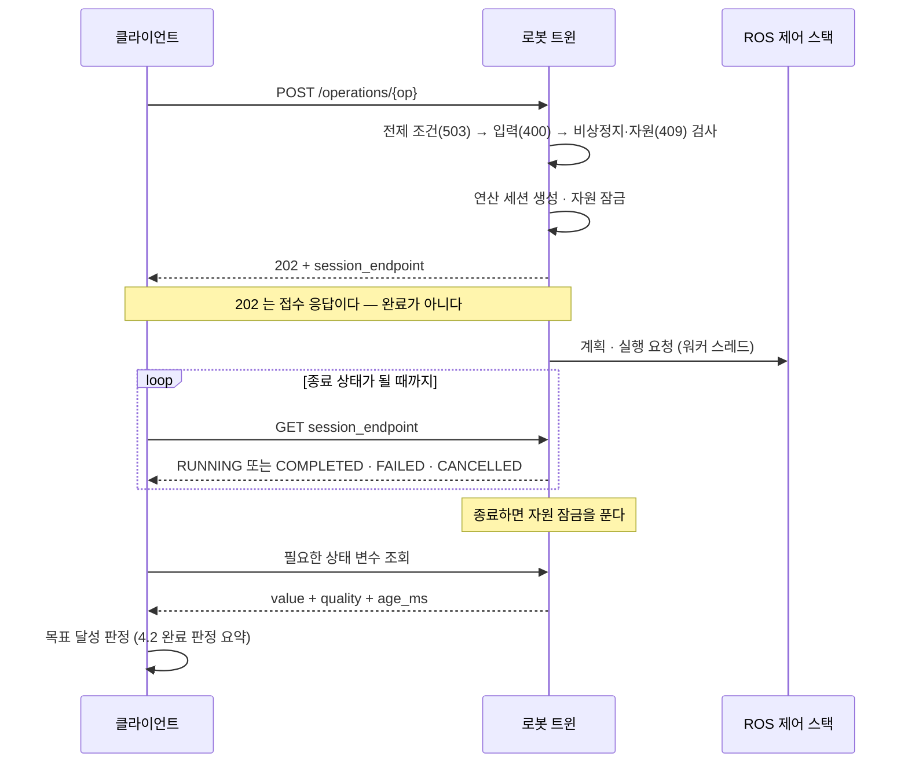

# 로봇 트윈 사용자 가이드

ROS 2 를 직접 쓰기 어려운 환경에서 **HTTP/JSON 만으로 로봇 상태를 조회하고 제한된 제어를 수행**하기 위한 게이트웨이다. 클라이언트는 언어를 가리지 않는다 — curl, Java, Python, Node-RED 모두 같은 인터페이스를 쓴다.

- 설계 근거와 결정 이력: [로봇_트윈_설계서.md](로봇_트윈_설계서.md)
- 프로토콜 원본: `extern_op` (RESTful 기반 외부 시스템 연동 프로토콜)

> **⚠️ 보안 전제**: 현재 트윈은 **인증·권한·TLS 를 제공하지 않는다.** 이 API 에 라우팅이 닿는 주체는 누구든 로봇을 움직일 수 있다. 반드시 **신뢰된 폐쇄망** 안에서만 운용한다 (9장 참조).

## 목차

| 장 | 내용 |
|---|---|
| [1. 빠른 시작](#1-빠른-시작) | 설치 · 백엔드 비교 · 기동 · 예제의 기본 주소 · 종료 |
| [2. 아키텍처 한눈에](#2-아키텍처-한눈에) | 구조 · **두 종류의 "세션"** |
| [3. 클라이언트 인터페이스](#3-클라이언트-인터페이스) | 엔드포인트 · 상태 조회와 시각 필드 · 연산 실행 흐름 · 오류 |
| [4. 제공되는 상태 변수와 연산](#4-제공되는-상태-변수와-연산) | 변수 · 연산별 입력과 **완료 판정** · 자원 락 |
| [5. 예제 프로그램](#5-예제-프로그램) | curl · Python · 시간 제한 · 재시도 · 취소 · 모니터링 · 수집 루프 |
| [6. 로봇 연동 설정](#6-로봇-연동-설정) | 설정 파일 · 백엔드 프로파일 |
| [7. 트윈 여러 대 운용](#7-트윈-여러-대-운용) | 포트 · 이름 분리 |
| [8. 확장하기](#8-확장하기) | 설정만으로 변수 · 그리퍼 목표 · scene 레시피 늘리기 |
| [9. 운영 시 알아둘 것](#9-운영-시-알아둘-것) | 보안 · **정지 수단 비교** · 워치독 · 재시작 |
| [10. 트러블슈팅](#10-트러블슈팅) | 증상별 원인과 조치 |
| [11. 알려진 제약](#11-알려진-제약) | 미구현 · 미제공 항목 |
| [부록 A. 새 연산 구현](#부록-a-새-연산-구현-개발자용) | 백엔드 핸들러 · 설계 규칙 (개발자용) |

**목적별 읽기 경로**

| 하려는 것 | 읽는 순서 |
|---|---|
| 처음 띄워 본다 | 1 → 5.1 |
| 클라이언트를 만든다 | 2 → 3 → 4 → 5, 그리고 9.2(정지 수단) · 9.7(트윈 재시작) |
| 설정 · 운영을 맡는다 | 6 → 7 → 9 → 10 |
| 변수 · 그리퍼 목표를 늘린다 | 8 |
| 새 연산을 구현한다 | 8 → 부록 A. 설계 근거는 [로봇_트윈_설계서.md](로봇_트윈_설계서.md) |

---

## 1. 빠른 시작

### 1.1 사전 조건

```bash
# pip 전용 의존성 (rosdep 이 잡지 못한다)
pip install --user 'fastapi' 'uvicorn[standard]' 'pydantic>=2'

# 선택: 연산 입력의 JSON Schema 검증을 켜려면
pip install --user 'jsonschema'
```

빌드는 워크스페이스 루트에서 한다.

```bash
cd ~/development/ros/rdfp_ws
colcon build --packages-select rdfp_msgs robot_control robot_twin rdfp
source install/setup.bash
```

### 1.2 로봇 스택 기동

트윈은 로봇을 직접 제어하지 않고 중계만 한다. **로봇 스택(MoveIt2)이 먼저 떠 있어야 한다.**

| 스택 | 제어 계층 기동 | 트윈 설정 · 포트 · `twin.id` | 팔 실행 | 팔 연산의 `COMPLETED` | `reset_scene` | `fixtures` |
|---|---|---|---|---|:-:|:-:|
| mock | `./scripts/run_panda_mock.sh` (= `ros2 launch robot_control panda_mock.launch.py`) | `robot_twin_panda01.yaml` · 8801 · `panda01` | JTC | 컨트롤러가 목표 도달을 보고했다 | ✅ 물체를 만든다 | — |
| Isaac Sim | 시뮬레이터 Play 후 `./scripts/run_panda_isaac.sh` | `robot_twin_panda_isaac.yaml` · 8802 · `panda_isaac` | JTC | 같다 | ✅ 있는 물체를 옮긴다 | — |
| 펑션베이 | 시뮬레이터 · endpoint · `/scene/start` 후 `./scripts/run_panda_functionbay.sh` | `robot_twin_panda_functionbay.yaml` · 8803 · `panda_functionbay` | JGPC (개루프 스트리밍) | 명령을 다 보냈다 — **도달이 아니다** | ❌ | ✅ |

`move_linear` 은 어느 스택이든 경로 일부만 실행하고 `COMPLETED` 가 될 수 있다 — 연산별로 무엇을 더 확인하는지는
4.2 의 **완료 판정 요약**에 모아 두었다.

제어 계층만으로 arm · gripper · scene 연산이 전부 동작한다. 트윈은 **제어 계층**에 속하고 `package.xml` 의
실행 의존도 `robot_control`(과 IDL `rdfp_msgs`)뿐이다. scene 노드(`reset_scene` 이 필요로 한다)도 제어 계층 launch 가
기본으로 함께 띄운다(`enable_scene:=false` 로 끌 수 있다). 시뮬레이터 쪽 순서는
[Isaac runbook](../backends/isaac/isaac_bringup_runbook.md) · [펑션베이 사용법](../backends/functionbay/펑션베이_시뮬레이터_사용법.md).

**수집 경계 연산(`start_session` 등)을 쓸 때만** 수집 계층을 위에 얹는다 — 그 연산들의 실제 구현은 `rdfp` 의
`session_control_node` 이고, 트윈은 그것을 entry point(`robot_twin.backends`)로 선택적으로 붙이기 때문이다. 노드가
없으면 해당 연산만 `503 PRECONDITION_FAILED` 로 거절되고(4.2) 나머지는 정상 동작한다.

```bash
ros2 launch rdfp rdfp_collect.launch.py backend:=<mock|isaac|functionbay>   # 다른 터미널
```

학습 데이터를 모을 때는 수집 래퍼(`./scripts/run_collect_isaac.sh` · `run_collect_functionbay.sh`)가 수집 계층과 rosbag 을
함께 띄운다 — [수집_계층_얹기_절차서.md](../collect/수집_계층_얹기_절차서.md).

### 1.3 트윈 시작

**스크립트로 띄우는 것이 간단하다.** 설치본(`install/robot_twin/share/robot_twin/config/`)의 설정을 골라 넘긴다.

```bash
./scripts/run_robot_twin.sh                  # mock      (:8801, robot_twin_panda01.yaml)
./scripts/run_robot_twin.sh --isaac          # Isaac     (:8802)
./scripts/run_robot_twin.sh --functionbay    # 펑션베이  (:8803)
RDFP_TWIN_CONFIG=/path/to/my.yaml ./scripts/run_robot_twin.sh   # 임의의 설정
```

설치본을 읽으므로 **설정을 고치면 `colcon build --packages-select robot_twin` 을 해야 반영된다.** 직접 띄울 때는:

```bash
ros2 run robot_twin robot_twin \
  --config "$(ros2 pkg prefix robot_twin)/share/robot_twin/config/robot_twin_panda01.yaml"
```

> **⚠️ `--config` 는 절대 경로를 쓴다.** `ros2 run` 은 작업 디렉터리를 보장하지 않으므로 상대 경로는 `twin config
> not found` 로 실패한다.

그 밖의 인자: `--host` · `--port`(설정의 `http.*` 를 덮는다), `--log-level {critical,error,warning,info,debug}`(uvicorn).

정상 기동 로그는 다음 순서로 나온다. 이 순서 자체가 설계다 (2장 참조).

```
robot twin 'panda01' starting (move_group_mode=jtc, http=0.0.0.0:8801)
variable 'joint_states' <- /joint_states (sensor_msgs/msg/JointState, reliable/volatile)
variable 'ee_pose' <- /ee_pose (geometry_msgs/msg/PoseStamped, reliable/volatile)
...
no authentication or TLS is configured; binding 0.0.0.0:8801   ← 경고는 정상이다
Uvicorn running on http://0.0.0.0:8801
sent cancel-all to the arm controller on startup               ← JTC 만. 남은 궤적을 끊는다 (9.7)
MoveGroup client ready (mode=jtc)                              ← 여기부터 팔 연산 가능
no orphaned controller goals on startup                        ← 끊은 것이 있으면 WARN 으로 개수
```

마지막 줄에는 백엔드 프로파일이 채운 값이 함께 찍힌다(예: 펑션베이는 `mode=jgpc, {'arm_command_topic': '/input/panda_joint', …}`).

### 1.4 동작 확인

**예제의 기본 주소** — 이 문서의 셸 예제는 아래 두 변수를 쓴다. 값은 mock 트윈 기준이며, 다른 스택은 1.2 표의
포트와 `twin.id` 로 바꾼다.

```bash
H=http://127.0.0.1:8801                    # 호스트 — session_endpoint 는 이 뒤에 붙는 절대 경로다
B=$H/api/v1/robot_twins/panda01            # 트윈 기준 주소
# Isaac:    H=http://127.0.0.1:8802; B=$H/api/v1/robot_twins/panda_isaac
# 펑션베이: H=http://127.0.0.1:8803; B=$H/api/v1/robot_twins/panda_functionbay
```

```bash
curl -s $B/health | python3 -m json.tool
```

`move_group` 이 `READY` 이면 연산을 받을 수 있다.

### 1.5 종료

**`Ctrl+C`** 로 종료한다. 백그라운드로 띄웠다면 **프로세스 그룹 단위**로 종료해야 자식 프로세스가 고아로 남지 않는다.

```bash
# PGID 확인 후 그룹 전체에 SIGTERM
ps -eo pid,pgid,args | grep 'lib/robot_twin/robot_twin' | grep -v grep
kill -TERM -<PGID>
```

> **⚠️ 트윈을 끄는 것은 로봇을 멈추는 수단이 아니다.** 종료할 때 트윈은 컨트롤러에 정지를 보내지 않는다.
>
> | 백엔드 | 실행 중이던 팔 동작 |
> |---|---|
> | JTC (mock · Isaac) | 컨트롤러가 받은 궤적을 **끝까지 실행한다.** 다음 트윈이 기동할 때에야 끊긴다 (9.7) |
> | JGPC (펑션베이) | 명령 스트리밍이 끊겨 **마지막으로 보낸 지점에 선다** — 경로 중간이다 |
>
> 그리퍼 명령도 그대로 진행되고, 클라이언트는 이후 연산 세션 조회에서 `404` 를 받는다. 멈춰야 하면 취소나 비상정지를
> 먼저 쓰고(9.2), 내리기 전에 실행 중인 연산 세션이 없음을 확인한다.
>
> ```bash
> curl -s "$B/operations/sessions?status=RUNNING"
> ```

### 1.6 대화형 API 문서

FastAPI 가 자동 생성한다. 브라우저로 열면 모든 엔드포인트를 직접 호출해 볼 수 있다.

| URL | 용도 |
|---|---|
| `http://<host>:8801/docs` | Swagger UI |
| `http://<host>:8801/openapi.json` | OpenAPI 스펙 (클라이언트 스텁 생성용) |

Java 클라이언트가 필요하면 스펙에서 바로 뽑을 수 있다.

```bash
curl -s http://127.0.0.1:8801/openapi.json > twin-openapi.json
openapi-generator generate -i twin-openapi.json -g java -o ./twin-client-java
```

---

## 2. 아키텍처 한눈에

```
[REST 클라이언트]  ──HTTP/JSON──▶  [로봇 트윈 (Python 단일 프로세스)]  ──DDS──▶  [ROS 2 / MoveIt2]
                                    ├ FastAPI (HTTP 스레드)
                                    ├ 상태 스냅샷 캐시
                                    └ rclpy executor (별도 스레드)
```

핵심 성질 두 가지를 알고 쓰면 오해가 없다.

1. **상태 조회는 캐시를 읽는다.** 트윈이 토픽을 상시 구독해 최신값을 들고 있다가 반환한다. 조회 시점에 ROS 에 묻지 않으므로 빠르지만, **값에는 나이가 있다**.
2. **1 트윈 = 1 프로세스 = 1 로봇.** `ROS_DOMAIN_ID` 가 프로세스 환경변수라서다. 여러 대를 다루려면 프로세스를 여러 개 띄운다 (7장).

#### 두 종류의 "세션"

이 문서에서 "세션"은 **서로 무관한 두 가지**를 가리킨다. 헷갈리지 않게 항상 앞에 이름을 붙여 쓴다.

| 용어 | 무엇인가 | 수명 | 누가 만드나 |
|---|---|---|---|
| **연산 세션** | HTTP 연산 **한 건**을 추적하는 트윈 내부 기록. `session_endpoint` 로 폴링하고 `DELETE` 로 취소한다 | 요청 하나. 끝난 뒤 15분 보존 (9.4) | 모든 `POST /operations/{op}` — 동기 연산도 만든다 |
| **수집 세션** | 학습 데이터 수집의 **작업 단위**. 그 안에 에피소드가 여럿 있다. 현재 상태는 `session_state` 변수 | `start_session` ~ `stop_session` | `session_control_node` (수집 계층) |

수집 세션을 여닫는 `start_session` · `stop_session` 호출도 각각 **연산 세션 하나**다. 수집 세션 · 에피소드를 여닫는
네 연산을 이 문서는 **수집 경계 연산**이라 부르며, 셋의 관계는 4.2 의 그 절에 그림으로 있다.

---

## 3. 클라이언트 인터페이스

### 3.1 엔드포인트 전체

`{twin}` 은 설정의 `twin.id` 다 (예제에서는 `panda01`).

```
# 디스커버리
GET    /api/v1/robot_twins                                  트윈 목록 (항상 1개)
GET    /api/v1/robot_twins/{twin}                           메타 + 카탈로그
GET    /api/v1/robot_twins/{twin}/health                    ROS 연결·준비 상태

# 상태 변수
GET    /api/v1/robot_twins/{twin}/variables                 변수 목록
GET    /api/v1/robot_twins/{twin}/variables?names=a,b       배치 조회
GET    /api/v1/robot_twins/{twin}/variables/{name}          단일 조회
GET    /api/v1/robot_twins/{twin}/variables/{name}?refresh=true  정적 소스 강제 갱신
HEAD   /api/v1/robot_twins/{twin}/variables/{name}          ETag 만 확인

# 자원 점유
GET    /api/v1/robot_twins/{twin}/resources                 arm/gripper 점유 상태

# 연산
GET    /api/v1/robot_twins/{twin}/operations                연산 카탈로그
POST   /api/v1/robot_twins/{twin}/operations/{op}           실행
GET    /api/v1/robot_twins/{twin}/operations/{op}/sessions  해당 연산의 연산 세션 목록
GET    /api/v1/robot_twins/{twin}/operations/sessions       전체 연산 세션 (?status=RUNNING)
GET    /api/v1/robot_twins/{twin}/operations/sessions/{sid} 연산 세션 상태 조회
DELETE /api/v1/robot_twins/{twin}/operations/sessions/{sid} 연산 세션 취소

# 안전
POST   /api/v1/robot_twins/{twin}/estop                     비상정지
DELETE /api/v1/robot_twins/{twin}/estop                     비상정지 해제
```

### 3.2 상태 변수 조회 — 응답 형식

```jsonc
GET /api/v1/robot_twins/panda01/variables/joint_states

200 OK
ETag: "1043"
Cache-Control: no-cache, must-revalidate
{
  "name": "joint_states",
  "quality": "OK",
  "stamp": { "sec": 1786187482, "nanosec": 326478824 },  // 로봇이 찍은 시각
  "received_at": "2026-08-08T11:11:22.412Z",             // 트윈이 받은 시각
  "age_ms": 11,
  "schema_version": 1,
  "value": {
    "header": { "stamp": { "sec": 1786199567, "nanosec": 168720085 },
                "frame_id": "base_link" },
    "position": { "panda_joint1": 0.0, "panda_joint2": -0.785, "...": 0.0 },
    "velocity": { "panda_joint1": 0.0, "...": 0.0 },
    "effort":   { "panda_joint1": null, "...": null }
  }
}
```

`value` 는 **원본 ROS 메시지를 규약에 따라 변환한 JSON** 이다. 메시지의 모든 필드가 들어가므로 `header` 도 포함된다. 필요한 필드만 골라 쓰면 된다.

응답 전체가 JSON 이므로 별도 파서가 필요 없다 — `Content-Type: application/json`.

#### 시각 필드 — 무엇이 언제 찍히나

```
 발행 노드                    트윈                                       클라이언트
 ─────────                    ────                                       ──────────
 header.stamp 를 찍어 발행 ─▶ 수신: received_at = 트윈 벽시계
                              세대 번호 +1 → ETag 가 바뀐다
                              (새 메시지가 없으면 그대로)
                                                              ◀── GET (조회 시각 t)
                              age_ms  = t − received_at
                              quality = t 시점에 판정 (age_ms 대 staleness_ms, 발행자 유무)
```

| 필드 | 기준 시계 | 뜻 |
|---|---|---|
| `stamp` | **발행 노드**의 시계 — `use_sim_time` 스택(Isaac)은 시뮬레이터 시각 | 데이터가 만들어진 시각. 다른 변수의 `stamp` 와 맞춰 볼 때 쓴다 |
| `received_at` | 트윈의 벽시계 (UTC) | 트윈이 마지막으로 받은 시각 |
| `age_ms` | 트윈의 벽시계 | 조회 시각 − `received_at`. **신선도는 이것으로 판단한다** — `stamp` 와 `received_at` 은 시계가 달라 서로 빼면 안 된다. `NO_DATA` · `SOURCE_UNAVAILABLE` 이면 실리지 않는다 |
| `ETag` (헤더) | — | 수신 **세대 번호**. 새 메시지를 받을 때마다 바뀌고, 값이 같아도 바뀐다. **본문과 같은 스냅샷의 세대다** — 응답 하나의 모든 필드가 한 스냅샷에서 나온다 |
| `quality` | — | **조회할 때마다** 다시 판정한다. 새 수신이 없어도 시간이 지나면 `OK` → `STALE` 로 바뀐다 |

#### 값 변환 규약 (알아두면 놀라지 않는다)

| ROS | JSON | 왜 |
|---|---|---|
| `float` `NaN` / `Inf` | `null` | JSON 에 해당 리터럴이 없다. **위 `effort` 가 실제 사례** — mock 은 토크를 발행하지 않아 전부 `null` 이다 |
| `name[]` + `position[]` 병렬 배열 | `{관절이름: 값}` map | 인덱스 순서 의존은 컨트롤러 설정이 바뀌면 조용히 틀린다 |
| 정수 enum 상수 | 문자열 심볼 + `<필드>_value` | 클라이언트가 매직넘버를 하드코딩하지 않도록 |
| `builtin_interfaces/Time` | `{"sec": …, "nanosec": …}` | ISO8601 로 바꾸면 정밀도가 손실된다 |
| `int64` / `uint64` (2^53 초과) | 문자열 | JS `Number` 정밀도 손실 방지 |
| byte array | 노출하지 않음 | 이미지 등은 상태 변수로 두지 않는다 |

**단위 변환은 하지 않는다.** m·rad 원본 그대로다.

**반드시 `quality` 를 확인하고 쓴다.** 값만 읽으면 낡은 값을 최신으로 오인한다.

| `quality` | 의미 | 클라이언트 조치 |
|---|---|---|
| `OK` | 값이 신선하다 | 그대로 사용 |
| `STALE` | 값은 있으나 임계값보다 오래됐다 | 사용 여부를 판단. 발행이 끊겼을 수 있다 |
| `NO_DATA` | 아직 한 번도 수신하지 못했다 | 로봇 스택이 기동 중이거나 미배선 소스다 |
| `SOURCE_UNAVAILABLE` | 소스 자체가 없다 | `reason` 확인. 대개 노드 미기동 |
| `ERROR` | 수신했으나 변환에 실패했다 | `error` 확인. 설정·메시지 불일치 |

`SOURCE_UNAVAILABLE` 의 `reason`: `NO_PUBLISHER` / `TF_LOOKUP_FAILED` /
`SERVICE_UNAVAILABLE` / `SOURCE_NODE_DOWN`.

**`404` 는 "그런 변수가 정의되어 있지 않다"에만 쓴다.** 변수는 있고 값만 없는 상황은 `200` + `quality: "NO_DATA"` 다.

#### 폴링 대역폭 줄이기 — `ETag`

`If-None-Match` 에 직전 `ETag` 를 주면, 그 뒤로 **트윈이 새 메시지를 받지 않았을 때** `304` 로 끝난다. 본문이 오지
않으므로 고빈도 폴링에 효과가 크다.

```bash
ETAG=$(curl -s -D- -o /dev/null $B/variables/joint_states | grep -i '^etag' | cut -d' ' -f2 | tr -d '\r')
curl -s -o /dev/null -w '%{http_code}\n' -H "If-None-Match: $ETAG" $B/variables/joint_states
# 그 뒤로 새 수신이 없으면 304
```

⚠️ **`304` 는 "값이 신선하다"는 뜻이 아니다.** `ETag` 는 값의 내용이 아니라 수신 세대 번호라, 발행이 끊겨 `quality` 가
`OK` → `STALE` 로 바뀌어도, 발행자가 사라져 `SOURCE_UNAVAILABLE` 이 되어도 **`ETag` 는 그대로**이고 `304` 가 계속
온다. 본문이 없으니 그 변화도 보이지 않는다. 그래서 `ETag` 로 폴링하더라도 **주기적으로 조건 없이 조회해 `quality` 를
확인한다** (5.5). 반대로 같은 값이 다시 수신되면 `ETag` 가 바뀌어 `200` 이 오므로, 값이 변했는지 감지하는 용도로도
쓸 수 없다.

#### 정적 소스 강제 갱신 — `?refresh=true`

`source.type: static` 인 변수(`named_targets`)는 **최초 조회 시 한 번 가져와 무기한 캐시**한다. 자동 무효화를 하지 않으므로 `move_group` 이 재시작되어 SRDF 가 바뀌어도 옛 값이 계속 나온다. 갱신 수단은 두 가지뿐이다.

```bash
curl -s '.../variables/named_targets?refresh=true'   # 캐시를 버리고 다시 조회
# 또는 트윈 재시작
```

다른 소스 타입에는 아무 영향이 없다. 갱신에 실패해도 **이미 캐시된 값은 그대로 유지된다** — 값이 런타임에 변하지 않는다는 정적 소스의 전제 때문이다.

#### 배치 조회 — 보장 수준에 주의

```bash
curl -s '.../variables?names=joint_states,ee_pose'
```

보장하는 것은 **각 변수의 응답이 그 변수의 스냅샷 하나에서 나온다**는 것뿐이다(단일 조회와 같다). **변수끼리 같은 순간에 읽혔다는 뜻도, 같은 시각에 생성되었다는 뜻도 아니다.** 두 값은 서로 다른 노드가 다른 주기로 발행한 것이라 `stamp` 가 일치하지 않는다. 정합이 필요하면 클라이언트가 `stamp` 를 직접 비교한다.

### 3.3 연산 실행 — 동기와 비동기

연산마다 **동기/비동기가 고정**되어 있다. `GET .../operations` 의 `kind` 로 미리 알 수 있으므로 클라이언트가 런타임에 분기할 필요가 없다.

**동기 연산** — `200` + 종료 상태로 한 번에 끝난다. 동기 연산도 연산 세션을 만들지만, 응답이 올 때 이미 끝나 있다.

```jsonc
POST /api/v1/robot_twins/panda01/operations/move_gripper_to_target
{ "inputs": { "target": "open" } }

200 OK
{ "status": "COMPLETED",
  "outputs": { "target": "open",
               "goal": "open",         // 상태가 들고 있는 마지막 명령
               "width": 0.0799,        // 개구 폭 [m] — 관절값이 아니다
               "stalled": false,       // 힘을 내는데 안 움직이는가 (관측)
               "at_goal": true }}      // 시킨 일을 이뤘는가 (판정)
```

**비동기 연산** — `202` + `session_endpoint`(연산 세션의 주소)를 받고 폴링한다.

```jsonc
POST /api/v1/robot_twins/panda01/operations/move_to_named_target
{ "inputs": { "target": "ready", "velocity_scaling": 0.3 } }

202 Accepted
Location: /api/v1/robot_twins/panda01/operations/sessions/9e024bc5700c
{
  "status": "RUNNING",
  "phase": "EXECUTING",
  "session_endpoint": "/api/v1/robot_twins/panda01/operations/sessions/9e024bc5700c"
}
```

이후 `session_endpoint` 를 폴링한다.

```jsonc
GET /api/v1/robot_twins/panda01/operations/sessions/9e024bc5700c

200 OK
{
  "status": "COMPLETED",
  "outputs": {
    "final_pose":   { "...": "..." },
    "final_joints": { "...": "..." },
    "closed_loop":  true,
    "measured_age_ms": 21
  }
}
```

#### 비동기 연산의 흐름



`COMPLETED` 는 **연산이 끝났다**는 뜻이지 목표에 도달했다는 뜻이 아니다 — 마지막 두 단계가 필요한 이유다. 기다리는
시간의 상한은 클라이언트와 서버에 따로 있다 (5.2 의 시간 제한 표).

#### 상태와 국면

| `status` | 의미 |
|---|---|
| `RUNNING` | 실행 중 |
| `COMPLETED` | 성공 종료 |
| `FAILED` | 실패 종료. `error.code` 로 사유 구분 |
| `CANCELLED` | **클라이언트 요청**으로 취소됨. `error` 가 붙지 않는다 |

`phase` 는 `RUNNING` 안의 국면이다: `EXECUTING`, 취소 중이면 `CANCELING`.

**계획 국면은 따로 없다** — MoveIt 의 계획 시간도 `EXECUTING` 에 들어 있다. 백엔드가 계획과 실행을 한 호출로 처리해
트윈은 계획이 끝났다는 신호를 받지 않는다. 계획이 실패했는지는 끝난 뒤 `PLANNING_FAILED`(3.4)로 안다.

> **`CANCELLED` 와 `FAILED` 를 혼동하지 않는다.** E-stop 이나 워치독으로 끝난 연산 세션은
> 클라이언트 요청이 아니므로 `FAILED` + `ESTOP_ENGAGED` / `TIMEOUT` 이다. 둘 다 로봇이 멈췄다는 보장은 아니다 (9.2).

### 3.4 오류 응답

HTTP 상태 코드는 **프로토콜 처리 결과**, 본문의 `status` 는 **연산 결과**다.

**연산 세션이 만들어진 뒤의 실패** — `200` + `status: FAILED`. 비동기 연산이면 폴링한 연산 세션에, 동기 연산이면 `POST` 응답에 온다.

| `error.code` | 발생 조건 |
|---|---|
| `PLANNING_FAILED` | MoveIt 이 **계획하지 못했다** — IK 실패 · 충돌 · 도달 불가(`failed with code:`), 직선 경로의 계획 비율 미달(`only N% of the path was planned`), `move_group` 의 계획 요청 거부. **로봇은 움직이지 않았다.** 같은 목표로 다시 불러도 결과가 같으니 목표나 시작 자세를 바꾼다 |
| `EXECUTION_ABORTED` | 그 밖의 모든 실행 실패 — 컨트롤러 tolerance 위반 · goal 거부(`Trajectory execution failed with code:` · `Goal rejected`), 백엔드 노드 부재(scene 노드), 입력이 런타임에 틀린 경우(`not found in group`), 미구현 연산 |
| `TIMEOUT` | 비동기: `max_duration_sec` 초과 — 워치독이 팔에 정지를 보내고 연산 세션을 끝냈다 (9.3). 동기: `sync_timeout_sec` 안에 결과가 오지 않음 |
| `ESTOP_ENGAGED` | 실행 중 비상정지로 중단 |
| `PRECONDITION_FAILED` | 백엔드가 **현재 상태에서 명령을 거절**했다 — 수집 경계 연산의 상태 불일치(`IDLE` 에서 `start_episode` 등). 아무것도 실행되지 않았으니 재시도가 아니라 상태를 맞춘다 |

**연산 세션이 만들어지지 않은 거부** — 4xx / 5xx. `status` 가 없다. 검사 순서는 전제 조건(`503`) → 입력(`400`) →
비상정지 · 자원(`409`)이다.

| HTTP | `error.code` | 의미 |
|---|---|---|
| `400` | `INVALID_INPUT` | 입력 검증 실패. 로봇에 닿기 전에 걸렀다 |
| `404` | `NOT_FOUND` | 없는 변수·연산 |
| `404` | `SESSION_NOT_FOUND` | 연산 세션 만료·축출·트윈 재시작 |
| `409` | `RESOURCE_BUSY` | 자원 점유 중 |
| `409` | `ESTOP_ENGAGED` | 비상정지 잠금 상태 |
| `409` | `NOT_CANCELLABLE` | 이미 끝난 연산 세션을 취소하려 했다 (동기 연산은 응답이 올 때 이미 끝나 있다) |
| `501` | `CANCEL_UNSUPPORTED` | 정지를 전달하지 못했다 — **접수하지 않는다.** JTC 는 컨트롤러 취소 서비스가 없을 때, JGPC 는 **아직 스트리밍 전(계획 중)** 이라 멈출 것이 없을 때다. 동작이 그대로 진행될 수 있으므로 필요하면 잠시 뒤 다시 취소하거나 물리 비상정지를 쓴다 |
| `503` | `PRECONDITION_FAILED` | 연산이 쓰는 백엔드가 준비되지 않았다 — 팔 연산은 MoveGroup 클라이언트, 수집 경계 연산은 `session_control_node`(와 그것을 제공하는 `rdfp` 설치). 그리퍼 · scene 연산은 미리 검사하지 않는다 |

같은 이름 `PRECONDITION_FAILED` 가 두 자리에 나온다 — `503`(연산 세션 생성 전, 백엔드 미준비)과 `200` + `FAILED`
(연산 세션 생성 후, 백엔드의 상태 거절)이다. HTTP 상태로 구분한다. 어느 쪽이든 아무것도 실행되지 않았다.

`409 RESOURCE_BUSY` 는 점유자를 함께 알려준다.

```jsonc
409 Conflict
{ "error": {
    "code": "RESOURCE_BUSY",
    "message": "resource 'arm' is occupied by move_to_named_target",
    "resource": "arm",
    "operation": "move_to_named_target",
    "occupied_by": "/api/v1/robot_twins/panda01/operations/sessions/9e024bc5700c" } }
```

> **현재 `estimated_remaining_ms` 와 `Retry-After` 는 오지 않는다.** 응답에 싣는 코드는 있지만, 산출 근거인
> 연산 세션의 `planned_duration_ms`(궤적 duration)를 아무도 채우지 않는다(11장). 응답에 두 값이 있으면 쓰고, 없으면
> **클라이언트가 자체 백오프**를 적용한다.

> **큐잉하지 않는다.** 순차 실행이 필요하면 클라이언트가 `COMPLETED` 를 확인하고
> 다음을 호출한다. 재시도 시 **jitter 를 반드시 더한다** — 여러 클라이언트가 같은
> 시점에 재시도하면 몰린다.

#### 연산 세션 `404` 를 완료로 가정하지 않는다 ⚠️

폴링 중 `404` 가 나오면 대개 **트윈이 재시작**된 것이다. 이때 연산의 최종 결과는 알 수 없다. **완료로 가정하지 말고 상태 변수로 로봇의 실제 위치를 확인**한다. JTC 스택이면 재시작한 트윈이 남은 궤적을 끊었으므로 로봇은 경로 중간에 서 있을 수 있다(9.7).

---

## 4. 제공되는 상태 변수와 연산

### 4.1 상태 변수

**스택** 열의 의미는 4.2 와 같다 — **제어**는 제어 계층 launch(`panda_mock` · `panda_isaac` · `panda_functionbay`)만으로,
**수집**은 `rdfp_collect` 가 함께 떠 있어야 값이 온다.

| 변수 | 스택 | 소스 | 상태 | 설명 |
|---|:-:|---|:-:|---|
| `joint_states` | 제어 | `/joint_states` | ✅ | 관절 위치·속도·토크. `{관절이름: 값}` map 으로 정규화된다 |
| `ee_pose` | 제어 | `/ee_pose` | ✅ | 엔드이펙터 pose. `ee_pose_publisher` 가 TF 에서 만들어 발행한다 |
| `gripper_state` | 제어 | `/gripper_states` | ✅ | 그리퍼의 **연속 상태**. `width`(개구 폭 m), `stalled`, `at_goal`. 성공 판정은 `at_goal` 하나로 한다 (아래 참조) |
| `session_state` | **수집** | `/session` | ✅ | 수집 세션 · 에피소드 상태 (`IDLE`/`IN_SESSION`/`IN_EPISODE`)와 task label |
| `scene_objects` | 제어 | `/scene/objects` | ✅ | scene 안 물체들의 종류·크기·pose. **물체 이름으로 접근하는 map** 이다 |
| `named_targets` | 제어 | SRDF 조회 (`static`) | ✅ | 그룹별 named target 목록. **최초 조회 시 lazy 하게 가져와 캐시**한다 |
| `fixtures` | 제어 | 백엔드 프로파일 (`static`) | ✅ | **안 움직이는 물체**(구멍·트레이)의 위치와 형상. 펑션베이만 제공한다 — 다른 백엔드는 프로파일에 `scene.fixtures_file` 이 없어 정의되지 않는다 |

**`fixtures` 는 `scene_objects` 와 성격이 다르다.** `scene_objects` 는 **조작 대상**만
싣고 pose 가 매 틱 바뀌지만, `fixtures` 는 **안 움직이는 것**이라 런타임 내내 상수다.
구멍·트레이는 TF 에도 `/scene/objects` 에도 없어서(벤더가 `static="true"` 인 body 를 TF 로
내보내지 않는다) 이 변수가 **그것들을 아는 유일한 경로**다. 값은 `MoveGroup` 과 무관하므로
컨트롤러가 뜨기 전에도 읽힌다.

`session_state` 만 수집 스택에 묶인다 — `/session` 의 발행자가 `rdfp` 의
`session_control_node` 이기 때문이다. 제어 스택만 띄운 상태에서 조회하면 오류가 아니라
`quality: NO_DATA` 로 응답한다(정의된 변수의 값 없음은 200 + quality 로 표현한다).

#### 각 변수의 `value` 형태

모두 JSON 이며, 원본 ROS 메시지 구조를 3.2 의 변환 규약에 따라 옮긴 것이다.

**`joint_states`** — `sensor_msgs/JointState`

```jsonc
{ "header": { "stamp": { "sec": 1786199567, "nanosec": 168720085 },
              "frame_id": "base_link" },
  "position": { "panda_joint1": 0.0, "panda_joint2": -0.785,
                "panda_finger_joint1": 0.0, "...": 0.0 },
  "velocity": { "panda_joint1": 0.0, "...": 0.0 },
  "effort":   { "panda_joint1": null, "...": null } }   // mock 은 토크 미발행 → null
```

`panda_finger_joint1/2` 가 함께 들어오지만 **그리퍼 폭은 여기서 읽지 않는다** — 백엔드마다 믿을 수 없다(아래 "그리퍼는
변수 하나로 본다"). 폭은 `gripper_state.width` 다.

**`ee_pose`** — `geometry_msgs/PoseStamped`

```jsonc
{ "header": { "stamp": { "sec": 1786199577, "nanosec": 839673204 },
              "frame_id": "panda_link0" },      // 기준 좌표계
  "pose": {
    "position":    { "x": 0.30702, "y": -5.2e-12, "z": 0.59027 },        // m
    "orientation": { "x": 0.99999, "y": 0.000199, "z": -3.6e-16,
                     "w": 3.46e-12 } } }                                  // x,y,z,w
```

pose 가 `value.pose` 아래에 한 겹 더 들어간다 (`PoseStamped` 구조 그대로).

**`session_state`** — `rdfp_msgs/SessionCommand`

```jsonc
{ "name": "session_state", "quality": "OK", "schema_version": 1,
  "value": { "header": { "stamp": { "sec": 1786935702, "nanosec": 41258 }, "frame_id": "" },
             "state": "IN_EPISODE",      // 'IDLE' | 'IN_SESSION' | 'IN_EPISODE'
             "task_label": "" } }
```

**이벤트성이다** — `session_control_node` 가 **전이할 때만** 발행하므로 주기성이 없고
`staleness` 를 검사하지 않는다. 한 시간째 `IN_SESSION` 인 것은 낡은 값이 아니라 현재
값이다. 토픽이 `TRANSIENT_LOCAL` 이라 트윈이 **에피소드 도중에 늦게 붙어도 즉시 현재
상태를 받는다.**

상태를 바꾸는 것은 이 변수가 아니라 `session_control_node` 의 서비스다 — 트윈은 읽기만
한다.

**`scene_objects`** — `rdfp_msgs/SceneObjects`

```jsonc
{ "header": { "stamp": { "sec": 1786944345, "nanosec": 868439364 },
              "frame_id": "panda_link0" },        // 로봇 베이스 프레임 고정
  "objects": {
    "cube_0": { "type": "box",    "dimensions": [0.05, 0.05, 0.05],
                "pose": { "position":    { "x": 0.382, "y": -0.135, "z": 0.025 },
                          "orientation": { "x": 0.0, "y": 0.0, "z": 0.0, "w": 1.0 } } },
    "ball_0": { "type": "sphere", "dimensions": [0.02], "pose": { "...": "..." } } } }
```

**배열이 아니라 map 이다.** 물체 순서는 보장되지 않으므로 인덱스가 아니라 이름으로
지목한다 (`joint_states` 와 같은 이유). 물체가 없으면 `{}` 이며 그것도 "scene 이 비었다"는
유효한 상태다.

`dimensions` 순서는 `shape_msgs/SolidPrimitive` 와 같다 — box 는 x,y,z, sphere 는 반지름,
**cylinder 는 `[높이, 반지름]`** 이다 (직관과 반대이므로 주의).

값을 채우는 것은 백엔드별 **scene 상태 노드**다 — mock 은 `mock_scene_state_node`(MoveIt planning scene 을 옮긴다),
Isaac 은 `isaac_scene_state_node`, 펑션베이는 `functionbay_scene_state_node`(둘 다 시뮬레이터가 내보내는 물체 TF 를
옮긴다). 각 제어 계층 launch 가 짝이 되는 노드를 기본으로 함께 띄운다 — 스택마다 어댑터가 정해져 있어 사용자가 고를
일이 아니기 때문이다. 끄려면 `enable_scene:=false`. **조작 대상만** 실린다 — 탁자 · 고정물은 없다(고정물은 `fixtures`).

> **mock 의 물체는 물리를 갖지 않는다.** 파지에 실패해도 굴러떨어져도 pose 가 변하지
> 않으므로, mock 에서는 이 변수로 **성패를 관측할 수 없다.** 배관 검증용이다.

**`named_targets`** — `get_all_named_targets()` 의 반환값 (그룹별 목록)

```jsonc
{ "name": "named_targets", "quality": "OK", "schema_version": 1,
  "received_at": "2026-08-08T11:11:22.412Z",   // 트윈이 백엔드에서 가져온 시각
  "stamp": null,                               // ROS 헤더가 없는 값이다
  "value": { "hand": ["close", "open"],
             "panda_arm": ["extended", "ready"] } }
```

`value` 의 이름을 그대로 `move_to_named_target` 의 `target` 으로 넘길 수 있다.
`move_group` 이 아직 뜨지 않았다면 `SOURCE_UNAVAILABLE` + `reason:
"SOURCE_NODE_DOWN"` 이 나오며, 백엔드가 뜬 뒤 다시 조회하면 채워진다 (트윈을
재시작할 필요는 없다).

**`fixtures`** — 안 움직이는 물체 (펑션베이 전용)

```jsonc
{ "name": "fixtures", "quality": "OK", "schema_version": 1,
  "stamp": null,                               // ROS 헤더가 없는 값이다
  "value": {
    "frame": "panda_link0",                    // 아래 좌표의 기준
    "fixtures": {
      "peg_hole": {
        "name": "peg_hole", "type": "hole",
        "source_body": "peg_hole_round_16",                  // 시뮬레이터 씬의 body 이름
        "position":    { "x": 0.5, "y": 0.0, "z": 0.003 },   // 부품 원점
        "entry_point": { "x": 0.5, "y": 0.0, "z": 0.028 },   // 입구 중심 — 목표로 삼는 점
        "floor_point": { "x": 0.5, "y": 0.0, "z": 0.003 },   // 바닥 중심
        "depth": 0.025, "inner_diameter": 0.017,
        "outer_extent_xy": [0.04, 0.04]                      // 발자국 (가로, 세로)
      },
      "peg_tray": { /* 같은 모양 */ } } } }
```

**넣을 지점은 `entry_point` 다** — `position` 은 부품 원점이라 다르다.

⚠️ **모르는 값은 키가 아예 없다.** `null` 도 `0` 도 넣지 않는다 — 안 잰 바닥 높이를
`0` 으로 채우면 "바닥이 탁자면"이라는 **거짓말**이 되어 손끝이 그대로 내려간다
(구멍 쪽에서 실제로 15 mm 파고든 적이 있다). 없는 키를 만나면 그 값을 **모른다**는 뜻이다.

⚠️ **`outer_extent_xy` 는 손끝이 닿는 실효 바닥을 정한다.** 고정물 위에서는 탁자면(0)이
아니라 입구면(`entry_point.z`)이 바닥이다 — 물체 자신의 바닥으로 판단하면 안 된다.
구멍에 꽂힌 peg 은 바닥이 구멍 **속**에 있다.

값은 백엔드 프로파일의 `scene.fixtures_file` 에서 오며 **런타임 내내 변하지 않는다.**
⚠️ 시뮬레이터 씬을 고치면 **그 파일도 손으로 고쳐야 한다** — 자동으로 따라오지 않는다.

**미배선 변수** — 정의는 있으나 값이 없다. `404` 가 아니다.

```jsonc
{ "name": "some_derived_variable", "quality": "NO_DATA", "schema_version": 1, "value": null }
```

#### 그리퍼는 변수 하나로 본다

`gripper_state` 가 연속 상태이자 명령 결과다. 예전에는 둘로 나뉘어 있었는데
(`gripper_position` + 이벤트성 `gripper_last_command_result`), `GripperState.at_goal`
이 **판정을 값 안에 담으면서** 하나로 합쳐졌다.

연산의 `outputs` 도 이 변수에서 온다 — 트윈이 명령을 보낸 뒤 `goal` 이 그 명령과 같고
`at_goal` 이 참인 스냅샷을 기다렸다가 옮기므로, "지금 읽은 값이 방금 보낸 명령의
결과인가"를 클라이언트가 따질 필요가 없다 (5.7).

⚠️ **연속 그리퍼 폭을 `joint_states` 의 손가락 관절에서 읽지 않는다.** 백엔드마다
믿을 수 없다 — 펑션베이는 TF 성립용 고정값을 주입해 "항상 열려 있다"고 거짓말한다.
`gripper_state.width` 를 쓴다 (**개구 폭 m 이며 관절값이 아니다** — Panda 는 관절값의
2배). 못 구하는 스택은 `NaN` 이다.

### 4.2 연산

**스택** 열은 그 연산을 쓰려면 어느 launch 가 떠 있어야 하는지다 (1.2 참조).

- **제어** — 제어 계층 launch(`panda_mock` · `panda_isaac` · `panda_functionbay`)만으로 동작한다.
- **수집** — `ros2 launch rdfp rdfp_collect.launch.py backend:=…` 를 제어 스택 위에 얹어야 한다.

연산 목록은 설정마다 조금 다르다 — **펑션베이 설정(`robot_twin_panda_functionbay.yaml`)에는 `reset_scene` 이 없다**
(시뮬레이터에 런타임 배치 변경 수단이 없어 `/scene/reset` 을 제공하지 않는다). 없는 연산을 부르면 `404 NOT_FOUND` 다.
지금 붙은 트윈이 무엇을 제공하는지는 `GET /operations` 가 정본이다.

| 연산 | 스택 | 자원 | `kind` | 상태 | 설명 |
|---|:-:|---|:-:|:-:|---|
| `move_to_named_target` | 제어 | arm | async | ✅ | SRDF named target(`ready`, `extended` 등)으로 이동 |
| `move_to_joints` | 제어 | arm | async | ✅ | **관절값 지정** 이동 (joint-space) |
| `move_linear` | 제어 | arm | async | ✅ | 목표 pose 까지 **직선(Cartesian)** 이동 |
| `move_gripper_to_target` | 제어 | gripper | sync | ✅ | **이름 붙은 그리퍼 목표**로 이동 (`open` / `close` / `grasp`). `gripper_state.at_goal` 이 설 때까지 기다린다 |
| `reset_scene` | 제어 | scene + arm | sync | ✅ | scene 을 **레시피대로 새로 만든다**. 물체 위치를 seed 로 랜덤화한다. mock · Isaac 만 |
| `start_session` | **수집** | — | sync | ✅ | 수집 세션을 연다. `task_label` 을 함께 설정한다 |
| `stop_session` | **수집** | — | sync | ✅ | 수집 세션을 닫는다. 에피소드가 열려 있으면 **함께 닫힌다** |
| `start_episode` | **수집** | — | sync | ✅ | 에피소드를 연다 (`IN_SESSION` 에서만) |
| `stop_episode` | **수집** | — | sync | ✅ | 에피소드를 닫으며 **성패·부가정보를 기록에 남긴다** |
| `move_to_pose` | 제어 | arm | async | ⛔ 미구현 | 목표 pose 로 **자유 계획** 이동 |
| `move_gripper` | 제어 | gripper | async | ⛔ 미구현 | 폭을 **요청 인자로** 지정. 명령에 숫자를 싣지 않는다는 원칙이라 열지 않았다 — 필요한 목표는 `backend.labels` 에 심볼을 추가하고 `GripperNode` 의 `targets` 에 폭을 준다 |

**갈리는 지점은 백엔드 노드가 어느 패키지에 있느냐 하나다.** 수집 경계 연산 넷은
`rdfp` 의 `session_control_node` 에 중계되고, 그 노드는 `rdfp_collect` 가 띄운다.
나머지는 `robot_control` 의 노드(그리퍼 노드 · 백엔드별 scene 노드)나 MoveIt 을 직접 쓰므로
제어 스택만으로 충분하다.

`reset_scene` 이 "제어" 인 것이 헷갈릴 수 있다 — **수집을 위한 연산이지만 구현은 제어
계층에 있다.** scene 노드가 `robot_control/scene/` 에 있고 제어 계층 launch 가 기본으로
띄우기 때문이다(`enable_scene:=false` 로 끌 수 있다).

수집 스택 없이 수집 경계 연산을 부르면 연산 세션을 만들기 전에 **`503 PRECONDITION_FAILED`**,
메시지 `session_control_node is not available; …` 로 거절된다. 나머지 연산은 영향을 받지 않는다.

미구현 연산을 호출하면 `202` 로 접수된 뒤 `FAILED` + `EXECUTION_ABORTED` 로 끝나며, 메시지에 사유가 담긴다.

아래 네 절은 구현된 연산마다 **입력 → 완료 판정 → 흔한 실패** 순으로 정리한 것이다. 완료 판정을 따로 떼어 둔 이유는, 모든 연산에 **`COMPLETED` 가 "목표에 도달했다"를 뜻하지 않는 경우**가 있고 그 조건이 서로 다르기 때문이다.

**완료 판정 요약** — `COMPLETED` 뒤에 무엇을 더 볼 것인가. 근거는 각 연산 절에 있다.

| 연산 · 조건 | `COMPLETED` 가 뜻하는 것 | 더 확인할 것 |
|---|---|---|
| `move_to_named_target` · `move_to_joints` — JTC (`closed_loop: true`) | 컨트롤러가 goal tolerance 안에서 성공을 보고했다 | 보통 없다. 엄밀히 보려면 `final_joints` |
| `move_to_joints` — JGPC (`closed_loop: false`) | 명령 스트리밍을 끝까지 보냈다 — 도달이 아니다 | 정착을 기다린 뒤 `joint_states` 를 **보낸 목표값**과 비교한다 |
| `move_to_named_target` — JGPC | 위와 같다 | 클라이언트는 목표 관절값을 모른다(`named_targets` 는 이름만 준다). 정착했는지만 볼 수 있으므로, 값으로 검증해야 하면 `move_to_joints` 를 쓴다 |
| `move_linear` | 계획 비율 60 % 이상을 실행하고 정상 종료했다 — **부분 경로일 수 있다** | `final_pose`(JGPC 면 정착 뒤의 `ee_pose`)를 목표 pose 와 비교한다 (5.6) |
| `move_gripper_to_target` | 보낸 `goal` 에 대해 `at_goal` 이 섰다 (트윈이 기다렸다) | 작업 성공은 따로 판정한다 — `grasp` 의 `at_goal` 은 "막혀 멈췄다"이지 "의도한 물체를 쥐었다"가 아니다 (5.7) |
| `reset_scene` | scene 노드가 배치를 받아들였다 | `scene_objects` 가 새 배치를 반영했는지. 물리 백엔드에서는 물체가 안착하며 조금 움직인다 |
| 수집 경계 연산 | `session_control_node` 가 전이를 받아들였다 | `session_state`. **기록(rosbag · mp4)이 실제로 남는지는 트윈이 모른다** — 수집 계층 쪽에서 확인한다 |

**어느 것을 쓸 것인가**

| 하고 싶은 것 | 연산 |
|---|---|
| 미리 정해 둔 자세(대기·수납 등)로 | `move_to_named_target` |
| 관절값을 이미 알고 있다 (기록 재현, 학습 정책 출력) | `move_to_joints` |
| 잡은 물체를 **자세 유지한 채 똑바로** 옮긴다 | `move_linear` |
| 좌표만 알고 경로는 알아서 (자유 계획) | `move_to_pose` — **미구현** |
| 물체를 새 위치에 랜덤 배치한다 | `reset_scene` |
| 학습 데이터로 남길 구간의 시작/끝을 찍는다 | `start_episode` / `stop_episode` |

`move_to_named_target` 과 `move_to_joints` 는 같은 joint-space 경로이고, 목표를 SRDF
이름으로 주느냐 값으로 주느냐만 다르다.

수집 경계 연산 넷과 `reset_scene` 은 로봇을 움직이지 않는다 — **데이터 수집의
경계와 초기 조건을 만드는 연산**이며 5.10 의 수집 루프에서 함께 쓰인다.

#### `move_to_named_target` — SRDF 이름으로 이동

**입력**

```jsonc
{ "inputs": {
    "target": "ready",              // 필수. SRDF group_state 이름
    "velocity_scaling": 0.3,        // 0.01 ~ 1.0 (생략 시 서버 기본값)
    "max_duration_sec": 60 } }
```

**쓸 수 있는 이름 먼저 확인** — 오타는 계획 단계까지 가서야 `FAILED` 로 돌아온다.

```bash
curl -s $B/variables/named_targets | python3 -m json.tool
# "value": { "hand": ["close","open"], "panda_arm": ["extended","ready"] }
```

`arm` 자원의 연산이므로 **`panda_arm` 그룹의 이름**을 쓴다 (`hand` 쪽 이름을 넣으면
실패한다). 이 값은 최초 조회 시 가져와 캐시된다 — 자세한 것은 3.2 `?refresh=true`.

**출력**

```jsonc
{ "closed_loop": true,          // 항상 온다
  "final_pose":   {...},        // ee_pose 캐시의 최신값 (변수가 비었으면 생략)
  "final_joints": {...},        // joint_states 캐시의 최신값 (같음)
  "measured_age_ms": 21 }
```

**이동 연산의 공통 `outputs` 뿐이며 이 연산 고유의 필드는 없다.** 각 키의 의미,
`final_*` 가 통째로 빠지는 조건, `closed_loop: false` 일 때의 해석은 **4.3** 에 있다.

**완료 판정**

`202` → `session_endpoint` 폴링 → `COMPLETED`. 관절 공간 계획이라 부분 실행 개념이
없어, `closed_loop: true`(JTC) 이면 `COMPLETED` 를 도달로 봐도 된다. **`closed_loop`
가 `false`(JGPC) 면 도달 보장이 없다** (4.3).

**흔한 실패**

| 응답 | 원인 |
|---|---|
| `FAILED` + `EXECUTION_ABORTED`, 메시지에 `not found in group ... Available: [...]` | `target` 오타이거나 다른 그룹의 이름. 메시지에 후보가 함께 온다 |
| `FAILED` + `PLANNING_FAILED` | MoveIt 계획 실패 (충돌·도달 불가). 로봇은 움직이지 않았다 |
| `FAILED` + `EXECUTION_ABORTED`, 메시지에 `Trajectory execution failed with code:` | 실행 중 실패 (컨트롤러 tolerance 위반 등) |
| `400 INVALID_INPUT` | `target` 누락 또는 빈 문자열 |
| `503 PRECONDITION_FAILED` | MoveGroup 클라이언트 미준비 — `/health` 의 `move_group` 확인 |
| `409 RESOURCE_BUSY` | `arm` 을 이미 다른 연산 세션이 점유 (5.3 재시도) |

#### `move_to_joints` — 관절값으로 이동

**입력**

```jsonc
{ "inputs": {
    "joints": {                       // 필수. {관절이름: 라디안}
      "panda_joint1": 0.0,
      "panda_joint2": -0.785,
      "panda_joint4": -2.356,
      "panda_joint6": 1.571 },
    "velocity_scaling": 0.3,          // 0.01 ~ 1.0
    "max_duration_sec": 60 } }
```

**넣지 않은 관절은 현재값으로 고정된다.** 위 예처럼 4개만 주면 나머지 3개는 움직이지 않는다 — `MoveGroupClient` 가
SRDF 에서 그룹 관절을 얻고 `/joint_states` 로 현재값을 채워 전 관절을 제약한다(5.8). 그룹에 `<group_state>` 가 없으면
채울 근거가 없어 실패한다.

**`joint_states` 를 그대로 되돌려 보내지 않는다 ⚠️**

가장 흔한 실수다. `joint_states` 의 `position` 에는 **`panda_finger_joint1/2` 가 섞여 있는데**, 이들은 `panda_arm` planning group 소속이 아니라서 그대로 보내면 계획이 실패한다. 트윈은 관절 이름이 그룹에 속하는지 검사하지 않으므로(그룹의 관절 목록을 갖고 있지 않다) `400` 이 아니라 **실행 단계의 `FAILED`** 로 나타난다.

```python
current = twin.read('joint_states')['position']
arm_only = {k: v for k, v in current.items() if k.startswith('panda_joint')}
twin.run('move_to_joints', {'joints': arm_only, 'velocity_scaling': 0.2})
```

**출력**

```jsonc
{ "closed_loop": true,          // 항상 온다
  "final_pose":   {...},        // ee_pose 캐시의 최신값 (변수가 비었으면 생략)
  "final_joints": {...},        // joint_states 캐시의 최신값 (같음)
  "measured_age_ms": 21 }
```

`move_to_named_target` 과 같다 — **공통 `outputs` 뿐이고 고유 필드는 없다.**
보낸 관절값이 그대로 되돌아오지는 않으므로, 확인하려면 `final_joints` 를 읽는다 (**4.3**).

**완료 판정**

`move_to_named_target` 과 같다 — joint-space 계획이라 부분 실행 개념이 없고, `closed_loop: true`(JTC) 이면 `COMPLETED` 를 도달로 봐도 된다. JGPC 스택에서는 계획을 MoveIt 이 하고 실행은 명령 스트리밍이라 **open loop** 이며 도달 보장이 없다.

**흔한 실패**

| 응답 | 원인 |
|---|---|
| `400 INVALID_INPUT` | `joints` 누락·빈 객체, 값이 숫자가 아니거나 `NaN`/`Inf` |
| `FAILED` + 메시지에 `failed with code:` | 그룹 밖 관절 포함, 관절 한계 초과, 충돌, 도달 불가 |
| `409` / `503` | `move_to_named_target` 과 동일 |

관절 한계를 넘는 값은 트윈이 막지 않는다 — MoveIt 이 계획 단계에서 거부한다.

#### `move_linear` — 직선(Cartesian) 이동

**입력**

```jsonc
{ "inputs": {
    "pose": {
      "position":    { "x": 0.3, "y": 0.0, "z": 0.5 },
      "orientation": { "x": 1.0, "y": 0.0, "z": 0.0, "w": 0.0 }   // ROS 순서 x,y,z,w
    },
    "velocity_scaling": 0.2,
    "max_step": 0.01,
    "jump_threshold": 0.0 } }
```

**인자의 의미**

| 인자 | 필수 | 기본값 | 의미 |
|---|:-:|---|---|
| `pose.position` | ✅ | — | 목표 위치 **[m]**. 기준 좌표계는 `panda_link0` (아래 참조) |
| `pose.orientation` | ✅ | — | 목표 자세. **ROS 순서 `x,y,z,w`** 이며 **단위 quaternion** 이어야 한다 (norm 오차 1e-3 초과 시 `400`) |
| `velocity_scaling` | | 클라이언트 기본값 | 최대 속도 대비 배율(0.01~1.0). 궤적의 시간축만 늘리고 **경로 모양은 바꾸지 않는다** |
| `max_step` | | `0.01` (1 cm) | Cartesian 보간 간격 **[m]**. 작을수록 경로를 촘촘히 검사해 정확하지만 계획이 느려진다 |
| `jump_threshold` | | `5.0` | 관절 공간 **급변 차단** 임계값. 인접 보간점 사이 관절 변화가 이 배수를 넘으면 경로를 거기서 끊는다. `0.0` 은 **검사 안 함**이라 특이점 부근에서 팔이 튈 수 있다 |
| `max_duration_sec` | | `60` | 이 연산 세션의 **시간 상한 [s]**. 초과하면 워치독이 팔에 정지를 보내고 연산 세션을 `FAILED` + `TIMEOUT` 으로 끝낸다 (9.3). MoveIt 의 계획 시간이 아니다 |
| `frame` | | 설정의 `moveit.ee_frame` | **이 pose 가 로봇의 어느 지점을 가리키는가.** 아래 참조. 선언되지 않은 백엔드에는 이 인자 자체가 없다 |

> **좌표를 재는 기준은 항상 `panda_link0` 이다** (`MoveGroupClient` 생성자의 `frame_id`).
> 아래 `frame` 은 그것과 다른 이야기다 — **로봇 쪽의 어느 점을 그 좌표로 옮길 것인가**다.

##### `frame` — 무엇을 그 좌표로 옮기는가 (2026-09-11)

데카르트 목표는 원래 **planning group 의 tip link**(`panda_link8`) 기준으로 해석된다.
그런데 사람이 다루는 점은 보통 그것이 아니다 — 펑션베이의 `/ee_pose` 는 `grasp_center`
를 가리키고 tip 과 **149 mm** 떨어져 있다. 그래서 `ee_pose` 로 읽은 값을 그대로 목표로
넣으면 **에러 없이 그만큼 엉뚱한 곳으로 간다.**

| 값 | 뜻 |
|---|---|
| 생략 | 설정의 `moveit.ee_frame`. 펑션베이는 `grasp_center` — **`ee_pose` 를 그대로 넣으면 제자리에 머문다** (실측 0.00 mm) |
| `panda_link8` | tip link 기준. 옛 동작이며, tip 좌표를 직접 아는 호출자용 (같은 입력이 149.27 mm 이동한다) |
| 그 밖 | 거절한다 — 변환할 수 없는 이름을 조용히 통과시키지 않는다. 출하 설정은 스키마에 `enum` 이 있어 `jsonschema` 가 설치돼 있으면 `400 INVALID_INPUT`, 없으면 `202` 접수 뒤 `FAILED` + `EXECUTION_ABORTED`(`unknown frame …`)다 |

**이름은 백엔드 프로파일의 `frames` 블록이 갖는다**(`config/backends/<이름>.yaml`).
launch 의 `ee_pose_node` 와 트윈이 같은 값을 읽으므로 둘이 어긋날 수 없다.

⚠️ **mock·Isaac 에는 이 인자가 없다.** 그 스택의 `panda_hand` 는 `panda_link8` 과
평행이동이 0 이고 z 축 45° 회전만 다른데, 그 45° 를 클라이언트 쪽(`to_arm_command`)이
이미 곱하고 있어 트윈이 또 돌리면 **90° 이중 회전**이 된다. 그래서 프로파일에
`frames.ee` 를 **일부러 비워 두었다.**

> **`frame_id` 는 2026-09-11 에 제거했다.** 스키마에만 있고 읽는 코드가 없어 주면
> 조용히 무시되던 입력이라, 새 `frame` 옆에 두면 헷갈리기만 한다.

`max_step` 과 `jump_threshold` 는 **계획 품질과 속도의 맞교환**이다. 기본값으로 두고, 경로가 자꾸 끊기면(`FAILED` 에 낮은 % 가 찍히면) `max_step` 을 줄여 본다.

**quaternion 은 단위벡터여야 한다.** 아니면 `400 INVALID_INPUT` 으로 **로봇에 닿기 전에** 거부된다.

> **범위 위반의 처리는 `jsonschema` 설치 여부에 달려 있다.** 설치되어 있으면
> `velocity_scaling: 2.0` 같은 값이 스키마 검증에서 `400` 으로 거부되고, 없으면 검증을
> 건너뛴 뒤 백엔드가 0.01~1.0 으로 **잘라서** 실행한다. 즉 같은 요청이 환경에 따라
> `400` 도 되고 성공도 된다 — 클라이언트는 범위를 스스로 지키는 편이 안전하다.

**출력**

```jsonc
{ "closed_loop": true,          // 항상 온다
  "final_pose":   {...},        // ee_pose 캐시의 최신값 (변수가 비었으면 생략)
  "final_joints": {...},        // joint_states 캐시의 최신값 (같음)
  "measured_age_ms": 21 }
```

**공통 `outputs` 뿐이다 (4.3).** 이 연산에만 있는 필드는 없으며, 특히 **계획
비율(`fraction`)이 담기지 않는다** — 그래서 아래의 도달 검증이 필요하다.

**완료 판정 — `fraction` 은 오지 않는다 ⚠️**

Cartesian 경로는 **장애물을 회피하지 못한다.** 목표까지 직선으로 갈 수 없으면 계획 비율(fraction)이 1.0 미만이 되는데, 트윈의 `outputs` 에는 **그 값이 실리지 않는다** — 백엔드(`follow_trajectory_async`)가 성공 시 아무 값도 돌려주지 않기 때문이다.

| 계획 비율 | 결과 |
|---|---|
| < 60% | `FAILED` — 메시지: `Path planning failed: only 43.2% of the path was planned` |
| 60 ~ 100% | **`COMPLETED`** — 그만큼만 이동하고 정상 종료. **outputs 에 아무 표시가 없다** |
| 100% | `COMPLETED` — 목표 도달 |

즉 **`COMPLETED` 를 도달로 믿으면 안 된다.** `outputs.final_pose` 를 요청한 `pose` 와 직접 비교해야 하며, 코드는 5.6 에 있다.

임계값 60% 는 `MoveGroupClient` 의 `DEFAULT_FRACTION_THRESHOLD` 이고, `move_linear` 의 입력 스키마에 `fraction_threshold` 가 없어 **호출자가 조정할 수 없다.**

일반적인 "저 위치로 가라"는 자유 계획(`move_to_pose`)이 맞지만 아직 미구현이다.

#### `move_gripper_to_target` — 그리퍼 (동기)

목표를 **이름으로** 지정한다. `target` 문자열 하나가 필수 입력이다.

| 파라미터 | 필수 | 값 | 용도 |
|---|:-:|---|---|
| `target` | ✔ | `open` \| `close` \| `grasp` | 이동할 그리퍼 목표 이름 |

```bash
curl -s -X POST $B/operations/move_gripper_to_target \
     -H 'Content-Type: application/json' -d '{"inputs": {"target": "open"}}'
```

`outputs` 에 어떤 목표를 수행했는지 `target` 이 함께 담긴다.

**지원 목표는 서버가 알려준다** — 이름을 하드코딩하지 말고 카탈로그에서 읽는다.

```bash
curl -s $B/operations | jq '.operations[]
  | select(.name=="move_gripper_to_target")
  | .inputs_schema.properties.target.enum'
# ["close", "grasp", "open"]
```

이 `enum` 은 설정에 손으로 적는 값이 아니라 **`backend.labels` 에서 기동 시 파생**된다
(그래서 이름순으로 정렬되어 온다). 목표를 늘릴 때 두 곳을 고칠 일이 없고, 둘이 어긋난
설정은 트윈이 아예 뜨지 않는다.

정의되지 않은 목표는 `400 INVALID_INPUT` 으로 거절되며, 메시지에 사용 가능한 목표 목록이 담긴다.

**요청에는 심볼만 실린다.** 기본 제공은 셋이다.

| 심볼 | 의미 |
|---|---|
| `open` | 손을 편다 |
| `close` | **빈손으로** 닫는다 (힘을 주지 않으므로 파지 용도가 아니다) |
| `grasp` | **물체를 쥔다.** 자세는 `close` 와 같고 힘이 다르다 |

숫자(목표 폭·파지력)를 요청에 싣지 않는 이유는 **그리퍼에 종속**이기 때문이다 — 다른
기구로 옮기면 틀린 값이 되고, Robotiq 2F-85 처럼 관절이 각도인 기구에서는 단위조차
m 가 아니다. 그 숫자는 **로봇 쪽 설정**인 `GripperNode` 의 `targets` 파라미터에 있다
(2026-09-01 결정).

**`close` 로 물건을 쥐려 하지 않는다.** 힘이 없어 실기에서는 파지 없는 이동으로
해석될 수 있다 — 쥘 때는 `grasp` 다.

**출력**

```jsonc
{ "target": "grasp", "goal": "grasp", "width": 0.0364,
  "stalled": true, "at_goal": true }
```

**이동 연산의 공통 `outputs` (4.3) 은 오지 않는다** — `closed_loop` / `final_pose` /
`final_joints` 가 없고, 대신 `GripperState` 의 필드가 그대로 실린다. 각 키를 어떻게
읽는지는 바로 아래에 있다.

**`COMPLETED` 는 "시킨 일을 이뤘다"는 뜻이다**

트윈은 명령을 `/gripper_cmds` 에 발행하고 **`at_goal` 이 설 때까지 기다린다.**
하드웨어를 직접 부르지 않는 이유는 **액션 goal 전송이 서비스라 rosbag2 가 기록하지
못하기** 때문이다 — 명령이 토픽으로 흘러야 학습 데이터의 action 채널이 남는다.

**성공 판정은 `at_goal` 하나로 한다.** `goal` 마다 다른 판정식을 `GripperNode` 가 이미
적용했으므로, 표를 외울 필요 없이 이 값만 보면 된다.

| `goal` | `at_goal` 이 서는 조건 |
|---|---|
| `open` / `close` | 목표 자세 도달 **AND NOT** `stalled` (막혀 멈춘 것은 성공이 아니다) |
| `grasp` | `stalled` — 물체에 막혀 멈춘 것이 곧 성공이다 |

**`grasp` 는 목표 자세까지 닫히면 오히려 실패다** (헛닫힘). 그래서 위치가 아니라 `stalled`
가 판정 기준이며, 이름도 `reached_goal` 이 아니라 `at_goal` 이다.

⚠️ **mock 스택에서 `grasp` 는 타임아웃한다.** planning scene 물체에 물리가 없어
`stalled` 를 관측할 수단이 없기 때문이다. mock 에서는 `open`/`close` 만 쓴다.

**흔한 실패**

| 응답 | 원인 |
|---|---|
| `FAILED` + 메시지 `no publisher for topic` | 기동 시 퍼블리셔가 만들어지지 않았다 — `backend.topic` / `topic_type` 설정 확인 |
| `FAILED` + `TIMEOUT` (결과 없음) | `GripperNode`(`gripper_action_node`) 또는 컨트롤러(`panda_hand_controller`) 미기동. **mock 의 `grasp` 는 정상 동작에서도 타임아웃한다** |
| `FAILED` + `TIMEOUT` | `sync_timeout_sec` 안에 `at_goal` 이 서지 않았다(출하 설정: mock · Isaac 5초, 펑션베이 **12초** — 그리퍼를 2초 램프로 천천히 여닫기 때문이다). **명령은 이미 나갔으므로 결과를 모른다** — `gripper_state.width` 로 확인한다 |
| `409 RESOURCE_BUSY` | `gripper` 자원 점유 중 (`arm` 과는 독립이다 — 4.4) |

#### `reset_scene` — 물체를 레시피대로 랜덤 배치

scene 을 **통째로 교체**한다. 기존 물체는 전부 제거되고 레시피가 정한 물체만 남는다.

```bash
curl -s -X POST $B/operations/reset_scene -H 'Content-Type: application/json' \
     -d '{"inputs": {"scene": "one_cube", "seed": 42}}'
```

| 입력 | 필수 | 뜻 |
|---|:-:|---|
| `scene` | ✅ | 레시피 이름. 쓸 수 있는 값은 `GET /operations` 의 `scene.enum` 에 있다 |
| `seed` | | 무작위 추출 seed. 생략하면 `0` |

**출력**

```jsonc
{ "scene": "one_cube", "seed": 42, "applied_count": 1,
  "objects": [ { "name": "cube_0", "type": "box",
                 "dimensions": [0.05, 0.05, 0.05],
                 "position": { "x": 0.377, "y": 0.104, "z": 0.025 } } ] }
```

> **`outputs.objects` 가 재현의 근거다 ⚠️** seed 만 기록하면 **추출 방식이 바뀌는 순간
> 재현이 깨진다.** 실제 배치를 `stop_episode` 의 `metadata` 로 넘겨 에피소드에 붙인다
> (5.10 참조). 그래야 나중에 "어떤 배치에서 실패했는지" 를 조회할 수 있다.

**무엇이 랜덤인지는 레시피가 정한다.** 설정(`backend.scenes`)에서 축마다 숫자면 고정,
`[최소, 최대]` 면 그 구간에서 균등 추출이다.

```yaml
- { name: cube_0, type: box, size: [0.05, 0.05, 0.05],
    x: [0.35, 0.55], y: [-0.15, 0.15], z: 0.025 }
#      ↑ 랜덤          ↑ 랜덤          ↑ 고정(안착 높이)
```

레시피 추가는 **YAML 편집만으로 끝난다** — `scene` 의 enum 은 이 표에서 파생되므로
따로 적지 않는다 (8.2 의 규칙과 같다).

**흔한 실패**

| 증상 | 원인 |
|---|---|
| `400 INVALID_INPUT` | 선언되지 않은 `scene` 이름. 응답 메시지에 쓸 수 있는 이름이 나열된다 |
| `409 RESOURCE_BUSY` | **팔이 움직이는 중**이다. `scene` 과 `arm` 을 함께 잡는다 (4.4) |
| `FAILED` + `EXECUTION_ABORTED`, `scene reset service '/scene/reset' is not available` | 백엔드 scene 노드가 없다. 제어 계층 launch 가 기본으로 띄우므로 먼저 `enable_scene:=false` 로 껐는지 확인하고, 단독으로 띄우려면 `ros2 run robot_control mock_scene_state_node`(Isaac 은 `isaac_scene_state_node`) |
| `FAILED` + `EXECUTION_ABORTED`, `scene reset failed: …` | scene 노드가 요청을 거절했다 — 예: Isaac 은 스테이지에 없는 물체나 치수가 다른 물체를 거부한다(레시피와 `isaac_scene.json` 이 갈렸다) |
| `FAILED` + `TIMEOUT` | `sync_timeout_sec`(출하 설정 10초) 안에 서비스 응답이 오지 않았다 |
| `404 NOT_FOUND` | 펑션베이 트윈이다 — 이 연산이 없다 |

scene 쓰기 경로는 **`/scene/reset` 서비스**(`rdfp_msgs/srv/ResetScene`)다. 예전의 명령 토픽 + 결과 토픽 쌍은 2026-09-01 에
없어졌다.

> **scene 리셋은 에피소드 밖에서 한다.** 에피소드 안에서 부르면 물체가 순간이동하는
> 장면이 학습 데이터에 들어간다.
>
> **mock 에서는 물체가 물리를 갖지 않는다** — 배치는 되지만 그리퍼로 잡히지 않는다.
> 실제 데이터 수집은 물리 백엔드에서만 성립한다.

#### `start_session` / `stop_session` / `start_episode` / `stop_episode` — 수집 경계

학습 데이터의 **어디부터 어디까지가 한 에피소드인지**를 정하는 연산이다. 트윈은
`/session` 을 직접 발행하지 않고 `session_control_node` 에 중계한다 — 상태 기계는 그
노드 하나가 갖는다.

```
IDLE ──start_session──▶ IN_SESSION ──start_episode──▶ IN_EPISODE
  ◀──stop_session────────    ◀──────stop_episode──────
```

현재 상태는 `session_state` 변수로 확인한다 (4.1).

**수집 세션 · 에피소드 · 연산 세션의 관계** — 수집 세션 하나 안에 에피소드가 여럿 있고, 그 안팎에서 HTTP 연산이
실행된다. 연산 하나하나(`start_session` 포함)가 각각 연산 세션 하나다 (2장).

```
수집 세션 ─ start_session(task_label) ──────────────────────────────── stop_session
  ├─ reset_scene · move_to_named_target(ready)      ← 에피소드 밖 — 학습 데이터가 아니다
  ├─ 에피소드 1 ─ start_episode ──────────── stop_episode(outcome, metadata)
  │     move_linear · move_gripper_to_target · …    ← 에피소드 안 — 학습 데이터
  ├─ reset_scene · …
  └─ 에피소드 2 …
```

**`start_session`** — `task_label` 을 함께 받는다.

```bash
curl -s -X POST $B/operations/start_session -H 'Content-Type: application/json' \
     -d '{"inputs": {"task_label": "pick_red_cube"}}'
```

라벨을 별도 연산으로 두지 않은 이유는, **빈 라벨로 시작하면 그 수집 세션의 모든 에피소드에
빈 라벨이 박히고 기록이 끝난 뒤에는 고칠 수 없기** 때문이다.

**`stop_episode`** — 성패와 부가정보를 남긴다. 두 값은 기록에 실려 데이터셋의
`success` / `metadata` 가 된다.

```bash
curl -s -X POST $B/operations/stop_episode -H 'Content-Type: application/json' \
     -d '{"inputs": {"outcome": "failure", "metadata": {"seed": 42, "scene": "one_cube"}}}'
```

| 입력 | 뜻 |
|---|---|
| `outcome` | `"success"` / `"failure"`. **생략하면 '판정 없음'이며 실패가 아니다** |
| `metadata` | JSON **객체**. seed·초기 배치 등. 배열이나 스칼라는 `400` 이다 |

> **`outcome` 을 생략한 것과 `"failure"` 는 다르다.** 전자는 판정 주체가 없었다는
> 뜻이고(텔레오퍼레이션 수집 등) 후자는 작업이 실패했다는 뜻이다. **파지 실패는
> 유효한 학습 데이터**이므로 `"failure"` 를 학습셋에서 무조건 빼면 안 된다.

**에피소드를 닫는 것은 전적으로 클라이언트의 몫이다 ⚠️** 트윈은 작업이 실패해도
`stop_episode` 를 자동으로 부르지 않는다. 자동 수집에서 실패는 정상 경로이므로
트윈이 판단하면 유효한 실패 에피소드를 잘라먹는다. `try/finally` 로 감싼다 (5.10).

**흔한 실패**

| 증상 | 원인 |
|---|---|
| `FAILED` + `PRECONDITION_FAILED`, `… rejected: invalid command` | 상태가 맞지 않는다 (`IDLE` 에서 `start_episode` 등). 재시도가 아니라 **상태를 먼저 맞춰야** 한다 |
| `503 PRECONDITION_FAILED`, `session_control_node is not available` | 노드가 안 떠 있다. `rdfp_collect` 를 띄우거나 `ros2 run rdfp session_control_node` |
| `503 PRECONDITION_FAILED`, `… provided by the rdfp collection layer, which is not installed` | `rdfp` 패키지가 설치되지 않은 환경이다 — entry point 가 없다 |

첫 줄은 `200` 응답의 본문(연산 세션이 만들어진 뒤 노드가 거절했다), 나머지 둘은 연산 세션을 만들기 전의 거절이다. 검사와
호출 사이에 노드가 내려가면 같은 메시지가 `200` + `FAILED` + `PRECONDITION_FAILED` 로 온다.

**멱등한 시작** — 이전 실행이 남긴 열린 에피소드는 `stop_session` 하나로 정리된다
(`IN_EPISODE` 에서 부르면 에피소드와 수집 세션이 순서대로 닫힌다). 다만 `IDLE` 에서 부르면
거부되므로 상태를 먼저 본다.

```python
if twin.read('session_state')['state'] != 'IDLE':
    twin.run('stop_session')
```

### 4.3 이동 연산의 공통 `outputs`

**`move_to_named_target` / `move_to_joints` / `move_linear` 셋이 여기 해당한다.** 셋 다
고유 출력 필드가 없어 아래가 응답의 전부다. **`move_gripper_to_target` 은 해당하지
않는다** — 그리퍼 액션 result 를 따로 싣는다 (4.2).

```jsonc
{ "closed_loop": true,          // 항상 온다
  "final_pose":   {...},        // ee_pose 캐시의 최신값 (해당 변수가 비었으면 생략)
  "final_joints": {...},        // joint_states 캐시의 최신값 (같음)
  "measured_age_ms": 21 }       // 위 두 값 중 더 오래된 쪽의 나이
```

`final_*` 는 **상태 캐시의 최신 스냅샷을 그대로 쓴 것**이라 동작 종료 시각과 정확히 일치하지 않는다. 별도 조회를 하지 않아 지연이 없는 대신, 신선도는 `measured_age_ms` 로 직접 판단해야 한다. 해당 상태 변수가 `NO_DATA` 면 그 키 자체가 빠지므로 클라이언트는 **키 존재 여부를 확인**해야 한다.

> **`fraction` 은 제공되지 않는다.** `move_linear` 가 부분 경로를 실행하고도
> `COMPLETED` 로 끝날 수 있는데 그 사실이 `outputs` 에 드러나지 않는다 — 4.2 의
> `move_linear` 절을 반드시 읽는다.

> **`closed_loop: false` 이면 `COMPLETED` 가 도달을 보장하지 않는다.** JGPC 스택은
> 명령 스트리밍(open loop)이라 정상 종료해도 목표에 도달했다는 뜻이 아니다.
> 이때는 `final_pose` / `final_joints` 를 목표와 비교해 직접 판단한다.
> 트윈 메타(`GET /robot_twins/{twin}`)에서 호출 전에 확인할 수 있다.

### 4.4 자원 락 — 무엇이 동시에 실행되나

| 자원 | 연산 |
|---|---|
| `arm` | `move_to_named_target`, `move_to_joints`, `move_linear`, `move_to_pose`, **`reset_scene`** |
| `gripper` | `move_gripper_to_target`, `move_gripper` |
| `scene` | `reset_scene` |
| (없음) | `start_session`, `stop_session`, `start_episode`, `stop_episode` |

- 같은 자원은 **동시에 하나만** 실행된다. 두 번째 요청은 `409 RESOURCE_BUSY`.
- **`arm` 과 `gripper` 는 독립**이라 병렬 실행된다 (팔을 움직이며 그리퍼 조작 가능).
- **`reset_scene` 은 `scene` 과 `arm` 을 함께 잡는다.** 물체를 순간이동시키는 동안 팔이
  그 공간으로 들어오면 안 되고, 반대로 팔이 움직이는 중에 물체가 바뀌어도 안 된다.
  둘 중 하나라도 점유 중이면 `409` 이며, **전부 잡히거나 하나도 안 잡힌다.**
- **수집 경계 연산은 자원을 잡지 않는다.** 자원 락의 수명은 연산 실행 시간뿐인데
  에피소드는 `start`~`stop` 두 연산에 걸쳐 있어 락으로 보호할 수 없다. 배타 제어는
  `session_control_node` 의 상태 기계가 하며, 거부는 `PRECONDITION_FAILED` 로 온다.

현재 점유 상태는 `GET /resources` 로 확인한다 (`arm` / `gripper` / `scene`).

---

## 5. 예제 프로그램

**5.1 · 5.2 는 프로토콜을 보여 주는 최소판이다.** 실패 처리 · 시간 제한 · 재시도를 다 갖춘 것이 아니므로 그대로
운영에 쓰지 않는다 — 실사용 클라이언트는 `mdtpy/robot-twin-client` 의 `robot_twin_client` 패키지다(5.2 의 안내).
5.3 이후는 최소판 위에 얹는 패턴이다.

### 5.1 curl — 최소 흐름

**앞 단계가 `COMPLETED` 가 아니면 다음 동작으로 넘어가지 않는다.** 이동이 실패했는데 그리퍼를 여닫으면 물체를
엉뚱한 곳에서 놓거나 쥔다. 통신 오류 · 거절(`409` · `503`)도 같은 이유로 그 자리에서 멈춘다.

```bash
#!/usr/bin/env bash
# 파일로 저장해 실행한다 — set -e 는 대화형 셸에 붙여 넣으면 셸 자체를 끝낸다.
set -euo pipefail
H=http://127.0.0.1:8801                     # 1.4 의 기본 주소
B=$H/api/v1/robot_twins/panda01
field() { python3 -c "import json,sys; print(json.load(sys.stdin)['$1'])"; }   # 최상위 필드 하나

# 준비 확인 — move_group 이 READY 가 아니면 팔 연산은 503 이다
curl -sS --fail-with-body $B/health | python3 -m json.tool

# 이동 (비동기) — 4xx/5xx 면 응답 본문(error.code · message)을 찍고 멈춘다
RES=$(curl -sS --fail-with-body -X POST $B/operations/move_to_named_target \
        -H 'Content-Type: application/json' \
        -d '{"inputs":{"target":"ready","velocity_scaling":0.3}}') || { echo "$RES" >&2; exit 1; }
EP=$(echo "$RES" | field session_endpoint)

# 종료 상태까지 폴링 — 통신 오류에서도 set -e 로 멈춘다
while :; do
  STATE=$(curl -sS --fail-with-body "$H$EP")
  S=$(echo "$STATE" | field status)
  echo "status=$S"; [ "$S" = RUNNING ] || break; sleep 1
done
# FAILED · CANCELLED 면 사유(error)를 찍고 멈춘다
[ "$S" = COMPLETED ] || { echo "$STATE" >&2; exit 1; }

# 그리퍼 (동기) — 200 이어도 status 가 FAILED 일 수 있다
RES=$(curl -sS --fail-with-body -X POST $B/operations/move_gripper_to_target \
        -H 'Content-Type: application/json' -d '{"inputs": {"target": "open"}}') || { echo "$RES" >&2; exit 1; }
[ "$(echo "$RES" | field status)" = COMPLETED ] || { echo "$RES" >&2; exit 1; }
echo "$RES"
```

`--fail-with-body` 는 curl 7.76 이상에 있다 (Ubuntu 22.04 는 7.81). **`COMPLETED` 도 도달을 뜻하지는 않는다** —
무엇을 더 확인할지는 4.2 의 완료 판정 요약에 있다.

### 5.2 Python — 재사용 가능한 클라이언트

표준 라이브러리만 쓴다. ROS 가 필요 없다.

> **이미 만들어 둔 클라이언트가 있다** — 저장소 `mdtpy/robot-twin-client` 의 `robot_twin_client` 패키지다. 아래와 같은
> `RobotTwinClient` 에 더해 검증 헬퍼(`ops.move_linear_verified` · `ops.wait_until_still` · `ops.set_gripper`)와 CLI
> (`robot-twin-peg` 펑션베이 peg 옮기기 · `robot-twin-collect` 자동 수집 · `robot-twin-mcp` MCP 서버)가 들어 있다.
> 아래 코드는 프로토콜을 보여 주는 최소판이다.

```python
"""로봇 트윈 최소 클라이언트."""
from __future__ import annotations

from typing import Any, Optional

import json
import time
import urllib.error
import urllib.request


class TwinError(Exception):
    """트윈이 요청을 거부했을 때 (4xx / 5xx)."""

    def __init__(self, status: int, body: dict) -> None:
        err = body.get('error', {})
        super().__init__(f"HTTP {status} {err.get('code')}: {err.get('message')}")
        self.status = status
        self.code = err.get('code')
        self.body = body


class RobotTwinClient:
    def __init__(self, host: str = '127.0.0.1', port: int = 8801,
                 twin_id: str = 'panda01', *, http_timeout_sec: float = 30.0) -> None:
        self.base = f'http://{host}:{port}/api/v1/robot_twins/{twin_id}'
        self.root = f'http://{host}:{port}'
        # 동기 연산은 POST 응답이 sync_timeout_sec(출하 설정 최대 12초) 뒤에 온다.
        # 그보다 짧으면 트윈이 답하기 전에 클라이언트가 끊긴다 (아래 시간 제한 표).
        self.http_timeout_sec = http_timeout_sec

    # ----- 저수준 -----
    def _request(self, path: str, method: str = 'GET',
                 body: Optional[dict] = None) -> tuple[int, Any]:
        url = path if path.startswith('http') else self.base + path
        data = None if body is None else json.dumps(body).encode()
        headers = {'Content-Type': 'application/json'} if data else {}
        req = urllib.request.Request(url, data=data, headers=headers, method=method)
        try:
            with urllib.request.urlopen(req, timeout=self.http_timeout_sec) as res:
                raw = res.read()
                return res.status, (json.loads(raw) if raw else None)
        except urllib.error.HTTPError as exc:
            raw = exc.read()
            parsed = json.loads(raw) if raw else {}
            if exc.code >= 400:
                raise TwinError(exc.code, parsed) from None
            return exc.code, parsed

    # ----- 상태 -----
    def health(self) -> dict:
        return self._request('/health')[1]

    def read(self, name: str, *, require_ok: bool = True) -> Any:
        """변수 값을 반환한다. quality 를 확인하지 않고 쓰지 않도록 강제한다."""
        body = self._request(f'/variables/{name}')[1]
        if require_ok and body['quality'] != 'OK':
            raise RuntimeError(
                f"variable '{name}' is {body['quality']}"
                f"{' (' + body['reason'] + ')' if body.get('reason') else ''}"
            )
        return body['value']

    def read_many(self, *names: str) -> dict:
        return self._request(f"/variables?names={','.join(names)}")[1]['values']

    def resources(self) -> dict:
        return self._request('/resources')[1]

    # ----- 연산 -----
    def run(self, operation: str, inputs: Optional[dict] = None, *,
            poll_sec: float = 0.5, timeout_sec: float = 120.0) -> dict:
        """연산을 실행하고 종료까지 기다린다. 동기·비동기를 모두 처리한다."""
        status, body = self._request(f'/operations/{operation}', 'POST',
                                     {'inputs': inputs or {}})
        if status == 200:                      # 동기 연산 — 이미 끝났다
            return body

        endpoint = body['session_endpoint']    # 202 — 폴링한다
        deadline = time.monotonic() + timeout_sec
        while True:
            state = self._request(self.root + endpoint)[1]
            if state['status'] != 'RUNNING':
                return state
            if time.monotonic() > deadline:
                # **취소하지 않는다** — 기다리기를 그만둘 뿐 로봇은 계속 움직인다.
                # 멈추려면 메시지의 endpoint 로 cancel() 한다 (아래 시간 제한 표).
                raise TimeoutError(f"'{operation}' did not finish in {timeout_sec}s: {endpoint}")
            time.sleep(poll_sec)

    def cancel(self, session_endpoint: str) -> dict:
        return self._request(self.root + session_endpoint, 'DELETE')[1]

    # ----- 안전 -----
    def estop(self) -> dict:
        return self._request('/estop', 'POST')[1]

    def release_estop(self) -> dict:
        return self._request('/estop', 'DELETE')[1]


if __name__ == '__main__':
    twin = RobotTwinClient()

    h = twin.health()
    print(f"move_group={h['move_group']}  estop={h['estop']}")

    # value 는 원본 메시지 구조 그대로다 (3.2 / 4.1 참조).
    print('joint1  =', twin.read('joint_states')['position']['panda_joint1'])
    print('ee x,y,z=', twin.read('ee_pose')['pose']['position'])   # PoseStamped → value.pose

    result = twin.run('move_to_named_target',
                      {'target': 'ready', 'velocity_scaling': 0.3})
    print('결과:', result['status'])
    if result['status'] == 'FAILED':
        print('사유:', result['error']['code'], result['error']['message'])
    else:
        # closed_loop=False 면 도달 보장이 없으므로 final_pose / final_joints 를 목표와 비교한다 (4.3)
        out = result.get('outputs', {})
        print('closed_loop =', out.get('closed_loop'))
```

#### 시간 제한은 네 군데에 있다

클라이언트와 서버가 **각자** 기다리기를 그만둔다. **클라이언트 쪽 제한은 로봇을 멈추지 않는다** — 기다리기를
그만둘 뿐이다. 팔에 정지를 보내는 것은 서버의 비동기 연산 상한뿐이다.

| 제한 | 어디에 | 위 예제 · 출하 설정 | 넘으면 |
|---|---|---|---|
| HTTP 요청 | 클라이언트 (`urlopen(timeout=)`) | 30초 | 소켓 시간 초과 예외. **동기 연산은 서버에서 계속 진행된다** — 결과를 못 받을 뿐이다 |
| 폴링 대기 | 클라이언트 (`run(timeout_sec=)`) | 120초 | `TimeoutError`. **연산을 취소하지 않는다** — 멈추려면 `cancel(endpoint)` |
| 동기 연산 | 서버 (연산별 `sync_timeout_sec`) | 그리퍼 5초(펑션베이 12초) · `reset_scene` 10초 · 수집 경계 연산 5초 | `200` + `FAILED` + `TIMEOUT`. 명령은 이미 나갔을 수 있다 |
| 비동기 연산 | 서버 (입력 `max_duration_sec`, 없으면 연산의 `default_timeout_sec`) | 60초 | 팔에 정지를 보낸 뒤 연산 세션이 `FAILED` + `TIMEOUT` 으로 끝나고 자원이 풀린다 (9.3) |

**HTTP 제한은 동기 연산의 `sync_timeout_sec` 보다 길어야 한다.** 짧으면 트윈이 `COMPLETED` 든 `FAILED` + `TIMEOUT`
이든 답을 주기 전에 클라이언트가 먼저 끊긴다 — 10초로 두면 펑션베이 그리퍼(12초)와 `reset_scene`(10초)에서 그렇게
된다. **폴링 대기는 서버 상한보다 길게** 두는 편이 낫다 — 짧으면 서버가 아직 진행 중인데 클라이언트만 포기하고, 그
연산 세션은 다른 요청을 `409` 로 막은 채 남는다.

### 5.3 자원 경합 처리 — `409` 재시도

```python
import random
import time


def run_with_retry(twin: RobotTwinClient, operation: str, inputs: dict,
                   *, attempts: int = 5) -> dict:
    """자원이 비기를 기다렸다가 실행한다. jitter 로 재시도 몰림을 막는다."""
    for i in range(attempts):
        try:
            return twin.run(operation, inputs)
        except TwinError as exc:
            if exc.code != 'RESOURCE_BUSY' or i == attempts - 1:
                raise
            # estimated_remaining_ms 는 현재 오지 않는다. 있으면 쓰고 없으면
            # 지수 백오프로 대체한다. jitter 는 재시도 몰림을 막는다.
            wait_ms = exc.body['error'].get('estimated_remaining_ms')
            delay = (wait_ms / 1000.0 if wait_ms else 2.0 ** i) + random.uniform(0, 1.0)
            print(f'arm busy, retry in {delay:.1f}s')
            time.sleep(delay)
    raise RuntimeError('unreachable')
```

### 5.4 취소

```python
status, body = twin._request('/operations/move_to_named_target', 'POST',
                             {'inputs': {'target': 'extended', 'velocity_scaling': 0.05}})
endpoint = body['session_endpoint']

time.sleep(1.0)
print(twin.cancel(endpoint))     # 202 {"status":"RUNNING","phase":"CANCELING"}
                                 # 정지를 전달하지 못하면 501 CANCEL_UNSUPPORTED (TwinError) — 3.4

# 취소는 즉시 확정되지 않는다 — 감속 정지 후 CANCELLED 가 된다
while True:
    state = twin._request(twin.root + endpoint)[1]
    if state['status'] != 'RUNNING':
        break
    time.sleep(0.3)
print(state['status'], state.get('outputs', {}).get('stopped_at'))
```

### 5.5 상태 모니터링 루프 (ETag 활용)

`304` 는 신선도를 보장하지 않으므로(3.2) **일정 주기로는 `ETag` 없이 조회해 `quality` 를 본다.** 발행이 끊기면 그
조회에서 `STALE` · `SOURCE_UNAVAILABLE` 이 드러난다.

```python
import json
import time
import urllib.error
import urllib.request

url = 'http://127.0.0.1:8801/api/v1/robot_twins/panda01/variables/joint_states'
FULL_EVERY_SEC = 2.0      # 이 주기로는 조건 없이 조회해 quality 를 확인한다

etag = None
last_full = 0.0
while True:
    conditional = etag is not None and time.monotonic() - last_full < FULL_EVERY_SEC
    req = urllib.request.Request(url)
    if conditional:
        req.add_header('If-None-Match', etag)
    try:
        with urllib.request.urlopen(req, timeout=5) as res:
            etag = res.headers.get('ETag')
            body = json.loads(res.read())
        if not conditional:
            last_full = time.monotonic()
        if body['quality'] == 'OK':
            print(body['value']['position']['panda_joint1'])
        else:
            # 값을 쓰지 않는다 — 낡았거나(STALE) 발행자가 없다(SOURCE_UNAVAILABLE)
            print('quality =', body['quality'], body.get('reason', ''))
    except urllib.error.HTTPError as exc:
        if exc.code != 304:
            raise
        # 304 — 마지막 수신 이후 새 메시지가 없다. 값이 신선하다는 뜻은 아니다
    time.sleep(0.2)
```

### 5.6 `move_linear` — 도달 여부를 직접 검증한다

`COMPLETED` 는 도달을 뜻하지 않는다 (4.2). `outputs` 에 `fraction` 이 없으므로 **요청한 pose 와 `final_pose` 를 비교하는 것이 유일한 확인 수단**이다.

```python
def move_linear_verified(twin: RobotTwinClient, pose: dict, *, tol_m: float = 0.005) -> dict:
    """직선 이동 후 실제 도달했는지 확인한다.

    반환 dict 의 `reached` 가 False 면 경로 일부만 실행된 것이다 — 트윈은 이를
    실패로 보고하지 않으므로 클라이언트가 판단해야 한다.
    """
    result = twin.run('move_linear', {'pose': pose, 'velocity_scaling': 0.2})
    if result['status'] != 'COMPLETED':
        return {'reached': False, 'result': result}

    # 상태 변수가 비어 있으면 키 자체가 없다 (4.3).
    final = result.get('outputs', {}).get('final_pose')
    if final is None:
        return {'reached': False, 'result': result, 'why': 'no final_pose in outputs'}

    want, got = pose['position'], final['pose']['position']   # PoseStamped → .pose
    error = max(abs(want[a] - got[a]) for a in ('x', 'y', 'z'))
    return {'reached': error <= tol_m, 'error_m': error, 'result': result}


target = {'position':    {'x': 0.3, 'y': 0.0, 'z': 0.5},
          'orientation': {'x': 1.0, 'y': 0.0, 'z': 0.0, 'w': 0.0}}

check = move_linear_verified(twin, target)
if not check['reached']:
    # 60~100% 만 계획되어 중간에서 멈춘 경우가 대부분이다.
    print(f"직선 경로가 막혔다 (오차 {check.get('error_m', float('nan')):.3f} m)")
```

`tol_m` 은 로봇·용도에 맞게 정한다. `measured_age_ms` 가 크면 비교 자체가
무의미하므로, 엄밀함이 필요하면 `outputs.measured_age_ms` 도 함께 본다.

> ⚠️ **개루프 백엔드(JGPC)에서는 위 코드로 부족하다 — 팔이 아직 움직이는 중이다.**
> `outputs.final_pose` 는 **연산이 끝난 시점의 스냅샷**인데 명령 스트리밍은 반환이
> 도달을 뜻하지 않는다. 펑션베이 실측(2026-09-09): 종료 1.5 초 뒤 z 오차가 **64.8 mm**
> 였는데 정착 후에는 **−0.6 mm** 였다.
>
> **고정 대기로는 얼마를 줘야 하는지 알 수 없다.** 2026-09-11 에 3 초를 줬더니 하강 뒤
> 오차를 **7.55 mm** 로 읽었는데 실제로는 **0.04 mm** 였고, 그 잘못 읽은 값으로 다음
> 목표를 만들어 **삽입이 실패했다.** `ee_pose` 가 **멈출 때까지** 기다린다 — 구현 예는
> `mdtpy/robot-twin-client` 의 `robot_twin_client.ops.wait_until_still` 이다 (`quiet_sec` 동안
> `tol_m` 안에 머물면 멈춘 것으로 보고, 상한 안에 못 멈추면 `None` 을 준다 — 움직이는
> 중의 값을 도달로 넘기지 않는다).
>
> **어느 백엔드가 개루프인가는 `outputs.closed_loop` 이 말해 준다** (4.3).

### 5.7 그리퍼 — 파지 여부 판정

`move_gripper_to_target` 은 명령을 `/gripper_cmds` 에 발행하고 **`gripper_state` 에서 `goal` 이 그 명령과 같고
`at_goal` 이 참인 스냅샷이 올 때까지 기다린 뒤** 반환한다. 따라서 별도 폴링 없이 `outputs` 만 보면 된다.

**목표는 세 가지다.** `close` 와 `grasp` 는 목표 폭이 같고 **힘만 다르다** — 물건을
쥘 때는 `grasp` 를 쓴다.

| 심볼 | 쓰임 |
|---|---|
| `open` | 손을 편다 |
| `close` | **빈손으로** 닫는다 (힘을 주지 않으므로 파지 용도가 아니다) |
| `grasp` | **물체를 쥔다.** 닿으면 그 힘으로 버티며 멈춘다 |

**요청에 숫자는 없다.** 목표 폭과 파지력은 그리퍼에 종속이라 다른 기구로 옮기면 틀린
값이 된다 — 그 숫자는 `GripperNode` 의 `targets` 파라미터가 갖는다.

```python
def set_gripper(twin: RobotTwinClient, target: str) -> dict:
    """그리퍼를 조작하고 상태를 그대로 돌려준다.

    **성패는 at_goal 하나로 읽는다.** goal 별 판정식은 GripperNode 가 이미 적용했다
    (open/close 는 목표 자세 도달, grasp 는 물체에 막혀 멈춤).
    """
    return twin.run('move_gripper_to_target', {'target': target})['outputs']


out = set_gripper(twin, 'grasp')
if out['at_goal']:
    print(f"파지 성공 — 개구 폭 {out['width']:.4f} m")
else:
    print('잡은 것이 없다 (끝까지 닫혔거나 가는 중이다)')
```

**`at_goal` 만 보면 된다.** 예전 인터페이스는 `reached_goal`(위치 도달)과 `stalled`
(물림)를 각각 내보내 호출자가 `goal` 마다 다른 규칙으로 조합해야 했다. 지금은 노드가
판정을 마치고 결론만 싣는다 — 이름이 `reached_goal` 이 아니라 `at_goal` 인 것이 그
차이의 표시다.

> ⚠️ **`at_goal: false` 는 "실패"와 "진행 중"을 구분하지 못한다.** 가르려면 `width` 를
> 함께 본다 — `grasp` 인데 최소 폭에서 멈췄으면 헛닫힘이고, 폭이 변하는 중이면 아직
> 가는 중이다. 다만 트윈 연산은 `at_goal` 이 설 때까지 기다렸다가 반환하므로,
> `COMPLETED` 로 돌아온 `outputs` 의 `at_goal` 은 항상 `true` 다.

> ⚠️ **mock 에서 `grasp` 는 타임아웃한다.** planning scene 물체에 물리가 없어
> `stalled` 를 관측할 수단이 없고, `grasp` 의 판정식이 곧 `stalled` 이기 때문이다.
> mock 에서는 `open`/`close` 만 쓴다.

연속적인 폭 자체가 필요하면 `gripper_state.width` 를 읽는다 — **개구 폭 m** 이다. `joint_states` 의
`panda_finger_joint1` 은 쓰지 않는다(관절값이라 Panda 는 폭의 절반이고, 펑션베이는 고정값을 주입한다 — 4.1).

### 5.8 `move_to_joints` — 현재 자세를 읽어 되돌려 보내기

관절값 이동의 가장 흔한 쓰임은 **읽은 자세를 나중에 재현**하는 것이다. 이때
`joint_states` 를 그대로 보내면 finger joint 때문에 실패하므로 팔 관절만 걸러낸다
(4.2).

```python
ARM_PREFIX = 'panda_joint'


def capture_pose(twin: RobotTwinClient) -> dict:
    """현재 팔 자세를 move_to_joints 입력 형태로 저장한다."""
    position = twin.read('joint_states')['position']
    return {k: v for k, v in position.items() if k.startswith(ARM_PREFIX)}


def restore_pose(twin: RobotTwinClient, joints: dict, *, tol_rad: float = 0.01) -> bool:
    """저장해 둔 자세로 복귀하고 실제 도달을 확인한다."""
    result = twin.run('move_to_joints', {'joints': joints, 'velocity_scaling': 0.2})
    if result['status'] != 'COMPLETED':
        print('실패:', result.get('error', {}).get('message'))
        return False

    # JGPC(open loop) 에서는 COMPLETED 가 도달을 보장하지 않으므로 직접 확인한다.
    final = result.get('outputs', {}).get('final_joints', {}).get('position', {})
    return all(abs(final.get(name, 1e9) - value) <= tol_rad
               for name, value in joints.items())


saved = capture_pose(twin)                  # 예: 티칭 직후 저장
twin.run('move_to_named_target', {'target': 'ready'})
print('복귀:', restore_pose(twin, saved))
```

**지정하지 않은 관절은 현재값으로 고정된다.** 일부만 바꾸고 싶으면 그 관절만 보내면
되고, 나머지는 움직이지 않는다.

```python
twin.run('move_to_joints', {'joints': {'panda_joint1': 0.5}})   # 1번 축만 움직인다
```

> **예전에는 그렇지 않았다.** 지정한 관절에만 제약이 걸려 목표가 자세 하나가 아니라
> **집합**이 되었고, 플래너가 그중 아무거나 골랐다. `panda_joint1` 만 준 호출이
> 나머지 6축을 최대 3.5 rad 움직여 엔드이펙터가 로봇 뒤쪽 위로 넘어간 것이 실측된다.
> 지금은 `MoveGroupClient` 가 SRDF 에서 그룹 관절을 얻고 `/joint_states` 로 현재값을
> 채워 **전 관절을 제약**한다. 그룹 밖 관절(`panda_finger_*`)은 채우지 않는다.

### 5.9 arm + gripper 순차 시퀀스

두 자원은 독립이라 서로를 막지 않는다 (4.4). 아래는 지금 구현된 연산만으로 집어
올리는 최소 흐름이다.

```python
def pick(twin: RobotTwinClient, above: dict, grasp: dict) -> bool:
    """접근 → 하강 → 파지 → 상승. 각 단계의 결과를 확인하고 진행한다."""
    if not set_gripper(twin, 'open')['at_goal']:
        print('그리퍼를 열지 못했다'); return False

    # 접근 지점까지는 자유 계획이 맞지만 move_to_pose 가 미구현이라 직선으로 간다.
    if not move_linear_verified(twin, above)['reached']:
        print('접근 실패'); return False
    if not move_linear_verified(twin, grasp)['reached']:
        print('하강 실패'); return False

    # 힘을 주며 닫는다. at_goal 이 곧 '물었다'이다 — grasp 의 판정식이 stalled 라서다 (5.7).
    # ⚠️ mock 은 stalled 관측 수단이 없어 여기서 타임아웃한다.
    if not set_gripper(twin, 'grasp')['at_goal']:
        print('아무것도 잡지 못했다'); return False

    return move_linear_verified(twin, above)['reached']
```

`above` 와 `grasp` 는 `move_linear` 의 `pose` 입력 그대로다 — `position`(m) + `orientation`
(쿼터니언, ROS 순서 `x,y,z,w`, 단위 norm). 좌표계는 **`panda_link0` 고정**이다.

호출부는 다음과 같다. `pick` 자체는 로봇 절차만 담고, 사전 점검·좌표 구성·오류 분류는
바깥에 둔다.

```python
DOWN = {'x': 1.0, 'y': 0.0, 'z': 0.0, 'w': 0.0}   # x축 180° — 그리퍼가 아래를 본다


def above_of(grasp: dict, *, clearance_m: float = 0.10) -> dict:
    """파지 지점 바로 위의 접근 지점. 자세는 같고 z 만 띄운다."""
    return {'position': {**grasp['position'],
                         'z': grasp['position']['z'] + clearance_m},
            'orientation': grasp['orientation']}


def main() -> int:
    twin = RobotTwinClient()

    # 팔 연산은 MoveGroup 이 준비되어야 시작된다. 그리퍼만 쓸 거라면 불필요하다 (3.4).
    health = twin.health()
    if health['move_group'] != 'READY':
        print(f"move_group 미준비: {health.get('move_group_error')}")
        return 1

    grasp = {'position': {'x': 0.40, 'y': 0.0, 'z': 0.10}, 'orientation': DOWN}

    try:
        ok = pick(twin, above_of(grasp), grasp)
    except TwinError as exc:
        # 400(입력) / 409(자원 점유·E-stop) / 503(백엔드 미준비) — 연산 세션이 만들어지지 않았다.
        print(f'거절됨: {exc}')
        return 1
    except TimeoutError as exc:
        # 폴링 상한 초과. 로봇은 아직 움직이는 중일 수 있다 — 상태를 확인하고 판단한다.
        print(f'시간 초과: {exc}  (현재 자원: {twin.resources()})')
        return 1

    print('집었다' if ok else '실패 — 중간 자세로 남아 있다')
    return 0 if ok else 1


if __name__ == '__main__':
    raise SystemExit(main())
```

> **이 예제는 실제로 로봇을 움직인다.** `grasp` 좌표는 예시일 뿐이므로 자기 셋업에
> 맞게 바꾼다. 파지 판정(`stalled`)은 그 자리에 실제로 물체가 있어야 성립한다.
>
> 자원 경합이 잦은 환경이라면 `pick` 내부의 호출을 5.3 의 `run_with_retry` 로 감싼다.
> 지금은 `409` 가 그대로 `TwinError` 로 올라와 시퀀스가 중단된다.

> **단계가 늘어나면 클라이언트 조합이 아니라 복합 연산으로 옮긴다** (부록 A.5). 위 코드는
> 중간에 죽으면 로봇이 어떤 자세로 남을지 클라이언트만 알고 트윈은 모른다 — 취소·복구
> 책임이 프로토콜 밖에 있다는 뜻이다.

### 5.10 자동 에피소드 수집 루프

물체 위치를 매 회 랜덤화하며 pick-and-place 를 반복해 학습 데이터를 모으는 흐름이다.
5.9 의 `pick` 을 그대로 쓰고, 그 바깥에 **초기 조건(`reset_scene`)과 데이터 경계
(`start_episode`/`stop_episode`)** 를 두른다.

```
reset_scene(seed=i) ─ move_to_named_target(ready) ─┬─ start_episode
                                                   │    pick → place      ← 학습 데이터
                                                   └─ stop_episode
```

**물체 순간이동과 홈 복귀는 에피소드 밖이다.** 안에 넣으면 물리적으로 불가능한 장면이
데이터에 섞인다.

```python
def collect(twin: RobotTwinClient, episodes: int, *, scene: str = 'one_cube',
            task_label: str = 'pick_red_cube') -> None:
    """에피소드를 연속으로 수집한다. 실패도 유효한 데이터로 남긴다."""
    # 이전 실행이 남긴 열린 에피소드를 정리한다 (IDLE 에서는 거부되므로 먼저 확인).
    if twin.read('session_state')['state'] != 'IDLE':
        twin.run('stop_session')

    twin.run('start_session', {'task_label': task_label})
    try:
        for seed in range(episodes):
            placement = twin.run('reset_scene', {'scene': scene, 'seed': seed})['outputs']
            twin.run('move_to_named_target', {'target': 'ready'})

            grasp = _grasp_pose_of(placement['objects'][0])
            above = above_of(grasp)

            twin.run('start_episode')
            ok = False
            try:
                ok = pick(twin, above, grasp)
            finally:
                # 실패해도 반드시 닫는다 — 트윈은 자동으로 닫아 주지 않는다.
                twin.run('stop_episode', {
                    'outcome': 'success' if ok else 'failure',
                    # seed 가 아니라 **실제 배치**가 재현의 근거다.
                    'metadata': {'seed': seed, 'scene': scene,
                                 'objects': placement['objects']},
                })
            print(f"episode {seed}: {'성공' if ok else '실패'}")
    finally:
        twin.run('stop_session')


def _grasp_pose_of(obj: dict) -> dict:
    """배치된 물체의 파지 지점. 물체 중심을 잡는다고 본다."""
    return {'position': dict(obj['position']), 'orientation': DOWN}
```

`reset_scene` 의 `outputs.objects` 를 **두 곳에 쓴다** — 파지 좌표를 만들고, 그대로
`stop_episode` 의 `metadata` 로 넘겨 에피소드에 붙인다. 후자가 없으면 나중에 "어떤
배치에서 실패했는지" 를 알 수 없다.

**`try/finally` 가 핵심이다.** `pick` 이 예외로 빠져나가도 에피소드는 닫혀야 한다.
열린 채로 남으면 다음 `start_episode` 가 거부되고, 그 구간의 데이터도 경계를 잃는다.

> **필요한 것**: `session_control_node`, 백엔드 scene 노드, 그리고 기록 중인 rosbag2(와 세션 구동 레코더 `rdfp_image_recorder`). 하나라도 없으면
> 루프는 돌지만 데이터가 남지 않는다. scene 노드는 제어 계층 launch 가, 나머지는 수집 래퍼
> (`./scripts/run_collect_isaac.sh` · `run_collect_functionbay.sh`)가 함께 띄운다.
>
> **이 루프는 `reset_scene` 이 있는 스택(mock · Isaac)용이다.** 같은 일을 하는 완성본이 `robot-twin-collect`
> (`mdtpy/robot-twin-client`)다. 펑션베이는 `reset_scene` 이 없어 이 루프를 못 쓴다 — 경계는 `start_episode` ·
> `stop_episode` 로 같게 찍고, 작업은 `robot-twin-peg` 처럼 고정물 사이를 오가는 식으로 짠다.
>
> **mock 에서는 물체가 잡히지 않는다** — 물리가 없어 파지 판정(`stalled`)이 성립하지
> 않는다. mock 으로는 배관만 검증하고, 실제 수집은 물리 백엔드에서 한다.

---

## 6. 로봇 연동 설정

설정 파일은 `src/robot_twin/config/` 에 있고 `colcon build` 시 `share/robot_twin/config/` 로 설치된다
(`run_robot_twin.sh` 는 설치본을 읽는다). 출하 설정은 셋이다.

| 파일 | 스택 | `twin.id` · 포트 | 다른 점 |
|---|---|---|---|
| `robot_twin_panda01.yaml` | mock | `panda01` · 8801 | `reset_scene` 레시피가 물체를 **만든다**(planning scene) |
| `robot_twin_panda_isaac.yaml` | Isaac Sim | `panda_isaac` · 8802 | `use_sim_time: true`. `reset_scene` 은 스테이지에 이미 있는 물체를 **옮기기만** 한다 — 이름 · 종류 · 치수가 `isaac_scene.json` 과 같아야 한다 |
| `robot_twin_panda_functionbay.yaml` | 펑션베이 | `panda_functionbay` · 8803 | JGPC(개루프). `reset_scene` 없음, `fixtures` 변수 있음, `move_linear` 에 `frame` 입력, 그리퍼 `sync_timeout_sec` 12초 |

셋 다 `ros.domain_id: 31` 이다 — 같은 기계에서 함께 띄울 수 있게 포트 · 이름만 다르다.

### 6.1 전체 구조

```yaml
twin:                 # 트윈 식별
http:                 # HTTP 바인딩
ros:                  # ROS 환경
moveit:               # MoveIt 연동 (필수)
sessions:             # 연산 세션 수명주기
variables:            # 상태 변수 목록
operations:           # 연산 목록
```

### 6.2 필수 설정 — 이것부터 맞춘다

```yaml
twin:
  id: panda01                     # URL 경로에 들어간다. 영숫자/-/_ 만 허용
  description: Franka Emika Panda

http:
  host: 0.0.0.0                   # 노출 범위는 방화벽으로 통제한다
  port: 8801                      # 트윈마다 다르게 준다
  tls: false                      # true 는 아직 지원하지 않는다

ros:
  domain_id: 31                   # rclpy 초기화 전에 환경변수로 적용된다
  rmw: rmw_fastrtps_cpp
  node_name: robot_twin_panda01   # 트윈마다 고유해야 한다
  use_sim_time: false

moveit:
  backend: mock                   # 백엔드 프로파일 이름 — 아래 값들을 채운다
  planning_group: panda_arm
```

**`moveit` 은 `backend:` 한 줄로 시작한다.** `robot_control` 의 백엔드 프로파일(`config/backends/<이름>.yaml`)이
다음을 채운다.

| 채워지는 키 | 내용 |
|---|---|
| `move_group_mode` | `jtc` / `jgpc` |
| `arm_command_topic` · `_format` · `_joint_names` | JGPC 의 명령 채널 (JTC 면 넣지 않는다) |
| `velocity_scaling` | 팔 이동의 전역 기본 속도 (프로파일 `motion.velocity_scaling`) |
| `arm_command_publish_rate` | JGPC 스트리밍 주기 — 없으면 데카르트 궤적이 10 Hz 계단으로 나간다 |
| `ee_frame` · `tip_frame` | `move_linear` 의 `frame` 해석 기준 (프로파일 `frames`) |
| (중력 보상) | 프로파일에 `motion.gravity_compensation` 이 있으면 트윈도 건다 |

| 백엔드 | `backend:` | 모드 |
|---|---|---|
| mock (`panda_mock`) | `mock` | `jtc` |
| mock JGPC (`panda_mock_jgpc`) | `mock_jgpc` | `jgpc` |
| Isaac Sim | `isaac` | `jtc` |
| 펑션베이 | `functionbay` | `jgpc` + `/input/panda_joint` + `joint_state` + 관절 7개 + 50 Hz + `grasp_center` |

프로파일이 정본이므로 백엔드 구성이 바뀌어도 YAML 을 고칠 필요가 없다. **손으로 적으면 그 사실이 저장소 여러 곳에
살게 되고, 한쪽만 뒤처졌을 때 에러가 아니라 "명령이 안 먹는다"로 나타난다** — Isaac 이 bridge → ros2_control 로
바뀔 때 실제로 그랬다. 트윈만 속도가 다르게 나오던 일(2026-09-11)도 같은 종류였다.

개별 키를 함께 적으면 **그쪽이 이긴다** — 프로파일에 없는 변형을 붙일 때 쓴다. `backend` 없이 쓰려면
`move_group_mode` 가 **필수**다. JTC 인데 `arm_command_*` 를 적으면 "설정했는데 안 먹는" 키가 되므로 기동 시점에
거부한다. `arm_command_format: joint_state` 는 `arm_command_joint_names` 가 반드시 있어야 한다.

> **`move_group_mode` 에 `auto` 를 쓸 수 없다.** 자동 판별은 토픽 그래프 조회라서
> DDS 디스커버리가 안정되기 전에 호출하면 **조용히 잘못된 클라이언트**를 만든다.
> 증상이 "이동 명령이 아무 효과가 없다"로 나타나 추적이 어렵다. 그래서 설정 로드
> 시점에 거부한다.
>
> `create_move_group_client()` 자체도 `'auto'` 를 받지 않는다. 트윈의 거부는 이중
> 방어로 남아 있어 아래 오류 메시지가 그대로 나온다.
>
> | 로봇 스택 | `move_group_mode` |
> |---|---|
> | `panda_mock.launch.py` (JointTrajectoryController) | `jtc` |
> | `panda_mock_jgpc.launch.py` (JointGroupPositionController) | `jgpc` |

**`auto` 라는 백엔드도 없다.** 프로파일 넷 다 확정 모드를 가지므로 어느 것을 골라도 런타임 판별로 되돌아가지 않는다.
모르는 백엔드 이름은 조용히 넘어가지 않고 거부된다.

설정 오류는 **기동 시점에** 잡힌다. ROS 초기화 전에 검증하므로 실패가 빠르고 명확하다.

```
twin config error: 1 validation error for TwinConfig
moveit.move_group_mode
  Value error, moveit.move_group_mode must be 'jtc' or 'jgpc'; 'auto' is forbidden ...
```

검증 항목에는 **연산 정의가 백엔드를 구동할 수 있는지**도 들어간다. `move_gripper_to_target`
에 `backend.labels` 가 없거나(키 오타 포함) 심볼이 아닌 것이 섞여 있으면 트윈은 뜨지 않는다.

```
twin config error: 1 validation error for TwinConfig
  Value error, operation 'move_gripper_to_target' requires a non-empty 'backend.labels' list, got None
```

이 검사가 없으면 트윈은 정상 기동하고 `/health` 도 정상이며 카탈로그에도 연산이 보이는데
**호출만 항상 `EXECUTION_ABORTED`** 로 끝난다 — 원인을 설정에서 찾기 어려운 실패다.

### 6.3 다른 로봇에 붙이기

Panda 가 아닌 로봇이면 다음을 바꾼다.

| 항목 | 바꿀 것 |
|---|---|
| `moveit.planning_group` | 해당 로봇의 MoveIt planning group |
| `variables[].source.topic` | 로봇의 상태 토픽 |
| 컨트롤러 액션 이름 | `MoveGroupJtcClient(controller_action=...)` — 기본값은 `/panda_arm_controller/follow_joint_trajectory` |
| 그리퍼 심볼 | `move_gripper_to_target` 의 `backend.labels` — 설정만 고치면 되고 코드 변경은 없다. 심볼에 대응하는 **폭은 `GripperNode` 의 `targets` 파라미터**에 있다 (로봇 쪽 설정이다) |

> 컨트롤러 액션 이름은 현재 코드 기본값으로 박혀 있다. 다른 로봇을 붙이려면
> `src/robot_twin/robot_twin/runtime.py` 의 `create_move_group_client()` 호출에
> `controller_action=` 을 넘기도록 확장해야 한다. JGPC 명령 채널은 `moveit.arm_command_*` 나
> 백엔드 프로파일로 이미 바꿀 수 있다(6.2).

---

## 7. 트윈 여러 대 운용

**포트를 분리한다.** 리버스 프록시는 두지 않는다 (단일 장애점이 되기 때문).

```bash
# 출하 설정 셋은 이미 서로 다르다 — :8801 (mock) · :8802 (Isaac) · :8803 (펑션베이)
# 하나 더 붙이려면 설정 파일을 복사해 twin.id / ros.node_name / http.port 를 바꾼다
RDFP_TWIN_CONFIG=/path/to/robot_twin_panda02.yaml ./scripts/run_robot_twin.sh   # :8804
```

다른 로봇(다른 ROS 그래프)을 붙이면 `ros.domain_id` 도 바꾼다 — 출하 설정은 셋 다 31 이다.

| 반드시 다르게 | 이유 |
|---|---|
| `twin.id` | URL 경로가 겹친다 |
| `ros.node_name` | ROS 노드 이름 충돌 |
| `http.port` | 바인딩 충돌 (`address already in use`) |

> `GET /api/v1/robot_twins` 는 **항상 자기 자신 하나만** 반환한다. 트윈 레지스트리가
> 아니다. 여러 트윈을 한 번에 조회하는 수단은 제공하지 않는다.

---

## 8. 확장하기

이 장은 **설정(YAML)만으로 되는 확장**이다 — 상태 변수, 그리퍼 목표, scene 레시피. 코드가 필요한 새 연산은 부록 A 에
있다.

### 8.1 새 상태 변수 추가

**토픽 소스이면 YAML 만 고치면 된다. 코드 수정이 없다.**

```yaml
variables:
  - name: session                       # URL 경로에 쓰이므로 영숫자/-/_ 만
    source:
      type: topic
      topic: /session
      msg: rdfp_msgs/msg/SessionCommand
      qos:
        reliability: reliable
        durability: transient_local     # ⚠️ 원본 토픽과 맞춰야 수신된다
        depth: 1
    staleness_ms: null                  # 이벤트성 토픽은 검사하지 않는다
    units: {}
    enums: {}                           # 정수 상수를 심볼로 바꿀 때
```

추가 후 트윈을 **재시작**한다 (무중단 리로드는 지원하지 않는다).

| 옵션 | 언제 쓰나 |
|---|---|
| `staleness_ms: <숫자>` | 주기 발행 토픽. 초과하면 `STALE` |
| `staleness_ms: null` | 이벤트성·정적 데이터. 검사하지 않는다 |
| `projection: joint_state_map` | `JointState` 의 `name[]` + `position[]` 병렬 배열을 map 으로 |
| `projection: scene_object_map` | `SceneObjects` 의 `objects[]` 를 `{물체이름: {...}}` 로 |
| `enums: {필드: {정수: 심볼}}` | 매직넘버 대신 문자열로 노출 |
| `qos.durability: transient_local` | 원본이 TRANSIENT_LOCAL 인 **이벤트성** 토픽(`/session` 처럼 전이할 때만 발행). 늦게 붙어도 **마지막 값**을 받는다 |

> **QoS 는 원본 발행자와 맞춘다 — 어긋남은 조용히 실패한다.** 방향에 따라 결과가 다르다.
>
> | 원본 발행자 | 트윈 구독 | 결과 |
> |---|---|---|
> | TRANSIENT_LOCAL | VOLATILE | 연결은 된다. **새 메시지는 받지만 구독 전에 저장된 마지막 값은 못 받는다.** 주기 토픽은 문제없고, 이벤트성 토픽은 다음 전이까지 `NO_DATA` 로 남는다 — `/session` 은 몇 시간이고 그럴 수 있다 |
> | VOLATILE | TRANSIENT_LOCAL | **호환되지 않아 연결되지 않는다.** 발행자가 있는데도 아무것도 못 받아 `NO_DATA` 로 남는다 |
>
> reliability 도 같은 식이다 — BEST_EFFORT 발행을 RELIABLE 로 구독하면 연결되지 않는다. 값이 안 들어오면
> `ros2 topic info -v <토픽>` 으로 양쪽 QoS 부터 확인한다.

`static` 소스는 배선되어 있다. **기동 시점에 조회하지 않고** 최초 조회 요청에서
가져오므로, 기동 로그에는 다음만 남는다.

```
variable 'named_targets': static source (get_all_named_targets) will be fetched lazily on first read
```

`backend.method` 에 적은 이름은 두 곳에서 찾는다.

1. **트윈 자체 제공자**(`runtime._STATIC_PROVIDERS`) — 지금은 `get_fixtures` 하나다. 백엔드 프로파일의
   `scene.fixtures_file` 을 읽어 `fixtures` 변수를 채우며, **MoveGroup 과 무관한 파일 읽기**라 컨트롤러가 뜨기 전에도
   읽힌다. 설정에 `moveit.backend` 가 있어야 한다.
2. 그 밖의 이름은 `MoveGroupClient` 의 메서드로 찾아 호출한다(예: `get_all_named_targets`). 그 메서드가
   `timeout` / `externally_spun` 키워드를 받으면 자동으로 넘긴다.

제공자 쪽을 먼저 보므로 **`MoveGroupClient` 메서드와 같은 이름을 제공자에 두면 그 메서드가 조용히 가려진다.** 조회에
실패하면 `SOURCE_UNAVAILABLE` 로 보고하고 최소 5초 뒤에 다시 시도한다 — 백엔드가 트윈보다 늦게 떠도 재시작 없이
회복된다.

나머지 소스(`tf` / `service` / `derived`)는 스키마에는 있으나 **아직 배선되지
않았다.** 설정해도 `NO_DATA` 로 응답하며, 기동 로그에 다음이 남는다.

```
variable 'some_derived_variable': source type 'derived' is not wired yet; it will report NO_DATA
```

### 8.2 그리퍼 목표 · scene 레시피 늘리기 — 연산을 만들지 않는다

**그리퍼 목표**는 `move_gripper_to_target` 의 `backend.labels` 에 심볼을 추가하면 끝이다 — 코드도, 새 연산도 필요 없다.

```yaml
labels: [open, close, grasp, pinch]   # pinch 추가
```

`inputs_schema` 의 `enum` 은 기동 시 `labels` 에서 파생되므로 **손대지 않는다.**

**두 곳을 고쳐야 한다.** 트윈은 "어떤 의도를 보낼 수 있는가"만 알고, 그 심볼이 실제로
몇 미터인지는 로봇 쪽이 안다 — `GripperNode` 의 `targets` 파라미터에 같은 이름의
항목이 없으면 노드가 명령을 **거부한다**(조용히 무시하면 팔만 움직이고 원인이 보이지
않기 때문이다).

**scene 레시피**도 같다 — `reset_scene` 의 `backend.scenes` 에 항목을 추가하면 `scene` 의 `enum` 이 기동 시
파생된다 (4.2 의 `reset_scene`).

### 8.3 새 연산 · 복합 연산

새 연산은 YAML 선언에 더해 **트윈 코드(백엔드 핸들러)가 필요하다** — API 사용자가 아니라 트윈을 고치는 개발자의
일이라 절차와 설계 규칙을 부록 A 로 뺐다. 여러 단계를 순서대로 묶어야 하면 일반 큐가 아니라 **복합 연산**으로
만든다 (부록 A.5).

---

## 9. 운영 시 알아둘 것

### 9.1 보안 — 현재 상태 ⚠️

| 항목 | 현재 |
|---|---|
| 인증 | **없음** |
| 권한 | **없음.** 누구든 취소·E-stop 가능 |
| TLS | **없음** (평문 HTTP) |
| 바인딩 | `0.0.0.0` (모든 인터페이스) |

**애플리케이션 수준의 접근 통제가 전혀 없다.** 통제는 망 수준(방화벽, 로봇 전용 VLAN, 물리적 접근 통제)에서 해야 한다. 사내망 너머 노출이나 클라이언트 다수 환경으로 가면 인증·TLS·바인딩 제한을 함께 도입해야 한다.

`session_endpoint` 의 식별자는 추측하기 어렵지만 **접근 통제 수단이 아니다** — 연산 세션 목록(`GET .../operations/sessions`),
자원 조회(`GET .../resources`), `409` 응답의 `occupied_by` 가 누구에게나 그것을 알려 준다. 연산 세션을 가리키는
식별자일 뿐이다.

### 9.2 정지 수단 — 취소 · 비상정지 · 워치독 · 트윈 종료 ⚠️

트윈의 정지는 전부 **소프트웨어 정지 요청**이다. **요청을 보낸 것과 로봇이 물리적으로 멈춘 것은 다르다** — 감속
정지에는 시간이 걸리고, 멈췄는지는 상태 변수(`joint_states` · `ee_pose`)로 확인한다.

| 수단 | 대상 | 새 요청 차단 | 팔에 정지 요청 | 그리퍼 | 정지 완료 보장 |
|---|---|:-:|---|---|:-:|
| 취소 `DELETE .../sessions/{sid}` | 그 연산 세션 (비동기 팔 연산). 정지는 **팔 동작 전체**에 간다 — JTC 는 컨트롤러의 모든 goal 을 취소한다 | — | 보낸다. 못 보내면 `501` 로 **접수하지 않는다** | 동기라 취소할 창이 없다 | ✗ — 감속 후 `CANCELLED` 로 확정된다 |
| 비상정지 `POST /estop` | 실행 중인 모든 연산 세션과 이후 모든 요청 | ✅ 해제까지 `409` | 보낸다 (`halted`) | **멈추지 않는다** | ✗ |
| 워치독 (`max_duration_sec`) | 시간을 넘긴 연산 세션 | — | 보낸다 — MoveGroup 을 쓰는 팔 연산만 (9.3) | — | ✗ |
| 트윈 종료 | — | (프로세스가 없다) | **보내지 않는다** — JTC 는 궤적을 끝까지 실행하고, JGPC 는 마지막 명령 지점에 선다 (1.5) | 진행 중 명령 그대로 | ✗ |
| 물리 비상정지 | 로봇 전체 | — | 하드웨어가 끊는다 | 끊는다 | ✅ |

#### `POST /estop` 의 응답 읽기

```jsonc
{ "estop": "ENGAGED", "locked": true, "halted": true, "in_flight_sessions": 1 }
```

- `locked: true` — 새 연산 거부는 **항상 확실히** 동작한다. `DELETE /estop` 으로 풀 때까지 `409 ESTOP_ENGAGED` 다.
- `halted: true` — 팔 컨트롤러에 **정지 요청을 보냈다.** 로봇이 이미 멈췄다는 뜻이 아니고, 움직이던 것이 있었다는
  뜻도 아니다 — JTC 는 움직이는 것이 없어도 취소 서비스만 있으면 `true` 다. 이때 실행 중이던 연산 세션은 전부
  `FAILED` + `ESTOP_ENGAGED` 로 닫힌다. **그리퍼 연산 세션도 닫히지만 그리퍼는 멈추지 않는다.**
- `halted: false` — 정지 요청을 보내지 못했다. JGPC 는 스트리밍 중이 아니면(움직이는 것이 없으면) 이렇게 나온다.
  `in_flight_sessions` 가 0 보다 크면 `warning` 이 함께 오고 **진행 중이던 동작은 계속된다** — 그 연산 세션은
  `RUNNING` 으로 남는다. 물리 비상정지를 쓴다.

**물리 비상정지 회로를 대체하지 않는다.** 실기 적용 시 반드시 하드웨어 E-stop 을 둔다.

### 9.3 워치독

모든 이동 연산에 `max_duration_sec`(생략하면 연산의 `default_timeout_sec`, 출하 설정 60초)이 걸린다. 초과하면 트윈이
**팔에 정지를 보낸 뒤** 그 연산 세션을 `FAILED` + `TIMEOUT` 으로 끝내고 자원 잠금을 푼다. 정지를 먼저 보내는 이유는,
끝내면 자원이 풀려 그 사이에 접수된 새 연산의 동작까지 끊을 수 있기 때문이다.

- **정지는 MoveGroup 을 쓰는 팔 연산에만 보낸다.** 정지 수단이 팔 전체에 걸리므로, 그리퍼 · 수집 경계 연산의 시간
  초과로 보내면 다른 연산 세션의 팔 동작을 끊는다.
- `error.message` 가 결과를 알려 준다 — `…; stop sent to the arm controller` 면 보냈고, `…; stop could NOT be
  delivered, the robot may keep moving` 면 못 보냈다(트윈 로그에 ERROR). 못 보냈으면 비상정지(9.2)로 세운다.
- 정지는 **요청**이다. 감속 정지에 시간이 걸리므로 멈췄는지는 상태 변수로 확인한다.
- 서버가 백엔드를 기다리는 상한도 같은 값이라, 그쪽에서 먼저 `TIMEOUT` 이 나도 똑같이 정지를 보낸다.

폴링 방식이라 트윈은 클라이언트 생존을 알 수 없다. **클라이언트가 죽어도 로봇이 계속 움직이는 것을 막는 유일한
장치**이므로 값을 너무 크게 잡지 않는다.

### 9.4 연산 세션 수명주기

| 항목 | 값 |
|---|---|
| 종료된 연산 세션 보존 | 15분 |
| 연산 세션 개수 상한 | 200개 (종료된 것만, LRU 축출) |

보존 기간이 지나면 `404` 다. **`RUNNING` 인 연산 세션은 축출되지 않는다.**

### 9.5 폴링으로 할 수 없는 것

**궤적을 복원할 수 없다.** 1 Hz 폴링은 50 Hz 토픽의 50 샘플 중 1개만 본다. 모니터링에는 충분하지만 "이동 중 관절 궤적을 받고 싶다"는 요구는 이 구조로 충족할 수 없다. 그런 데이터가 필요하면 rosbag 기록 + 데이터셋 파이프라인을 쓴다.

### 9.6 단위 변환은 하지 않는다

ROS 원본 단위(m, rad)를 그대로 노출한다. deg 나 mm 가 필요하면 클라이언트가 변환한다. 각 변수의 단위는 `GET /variables` 의 `units` 로 확인한다.

### 9.7 트윈 재시작 — 남은 팔 궤적을 끊는다 ⚠️

트윈이 죽어도 컨트롤러는 받은 궤적을 끝까지 실행한다. 새로 뜬 트윈은 그 궤적의 핸들이 없어 취소로 닿지 않으므로,
로봇은 움직이는데 멈출 주체가 없는 상태가 된다. 그래서 트윈은 기동할 때 **팔 컨트롤러의 모든 goal 을 취소한 뒤에**
팔 연산을 받는다 (JTC 스택 — mock · Isaac).

- **트윈이 시작하지 않은 궤적도 끊는다** — RViz 의 Plan & Execute, 다른 스크립트의 MoveGroup 실행 등. 트윈을 띄우는
  순간 진행 중이던 팔 동작이 멈춘다. servo(teleop)는 액션이 아니라 토픽으로 명령하므로 영향이 없다.
- 컨트롤러가 아직 없으면 3초 기다린 뒤 건너뛴다 — 끊을 궤적도 없다. 그동안 `MoveGroup client ready` 가 늦어지고
  팔 연산은 `503` 이다.
- 끊은 goal 이 있었으면 `cancelled N orphaned controller goal(s) on startup`(WARN)이 남는다 — 이전 트윈이 로봇을
  움직이던 중에 죽었다는 단서다.
- JGPC(펑션베이)는 할 일이 없다 — 스트리밍이 곧 실행이라 트윈이 죽으면 명령도 멈추고, 팔은 마지막 명령 위치에 선다.

---

## 10. 트러블슈팅

| 증상 | 원인 | 조치 |
|---|---|---|
| `twin config not found` | `--config` 가 상대 경로 | 절대 경로를 쓴다 (1.3) |
| `address already in use` | 이전 트윈이 살아 있음 | `kill -TERM -<PGID>` 로 프로세스 그룹 종료 |
| 설정 검증 오류로 기동 실패 | `moveit.backend` · `move_group_mode` 둘 다 없음 / `auto` / JTC 에 `arm_command_*` | `backend:` 를 준다 (6.2) |
| 설정을 고쳤는데 그대로다 | `run_robot_twin.sh` 는 **설치본**을 읽는다 | `colcon build --packages-select robot_twin` 후 재시작 |
| 팔 연산이 `503 PRECONDITION_FAILED` | MoveGroup 클라이언트 미준비 | `/health` 의 `move_group_error` 확인. MoveIt 스택이 떠 있는지 본다. **그리퍼 연산은 이 상태에서도 동작한다** (MoveGroup 을 쓰지 않는다) |
| 변수가 계속 `NO_DATA` | ① 소스 미배선(`tf`/`service`/`derived`) ② QoS 불일치 ③ 토픽/타입 오타 | 기동 로그의 `variable '...' <- ...` 줄 확인. 없으면 미배선 |
| `static` 변수가 `SOURCE_NODE_DOWN` | `move_group` 미기동 — 백엔드를 아직 못 부른다 | MoveIt 스택 기동 후 **다시 조회**하면 채워진다 (최소 5초 간격으로 재시도). 트윈 재시작 불필요 |
| `static` 변수 값이 옛날 것 | 정적 소스는 자동 무효화하지 않는다 | `?refresh=true` 로 강제 갱신 (3.2) |
| 변수가 `SOURCE_UNAVAILABLE` / `NO_PUBLISHER` | 발행 노드가 없다 | `ros2 topic info <토픽>` 으로 퍼블리셔 확인 |
| 변수가 계속 `STALE` | 발행이 끊겼거나 `staleness_ms` 가 너무 작다 | `ros2 topic hz <토픽>` 으로 실제 주기 확인 |
| 이동이 `409 RESOURCE_BUSY` | 같은 자원이 점유 중 | `GET /resources` 로 점유자 확인. `Retry-After` 는 오지 않으므로 jitter 를 더한 백오프로 재시도 (5.3) |
| 이동이 `400 INVALID_INPUT` | quaternion 비정규화, 필수 인자 누락 | 메시지에 사유가 담긴다 |
| 이동이 `FAILED` + `PLANNING_FAILED` | 계획 실패 — IK 실패/충돌/도달 불가, 직선 경로가 60% 미만만 계획됨. 로봇은 움직이지 않았다 | 목표를 바꾸거나 시작 자세를 조정 |
| `COMPLETED` 인데 목표에 없다 | ① `closed_loop: false` (JGPC) ② `move_linear` 이 부분 경로만 실행 | `outputs.final_pose` 를 목표와 비교 (5.6). `move_linear` 은 60~100% 계획 시 표시 없이 부분 실행된다. JGPC 는 정착까지 기다린 뒤 비교한다 |
| 그리퍼가 `FAILED` + `TIMEOUT` | 그리퍼 노드 미기동, mock 의 `grasp`, `sync_timeout_sec` 이 개폐 시간보다 짧음 | `gripper_state` 의 `quality` 와 `width` 로 실제 상태 확인 (4.2). 명령은 이미 나갔다 |
| 수집 경계 연산이 `503 PRECONDITION_FAILED` (`session_control_node is not available`) | 수집 계층이 안 떠 있다 | `rdfp_collect` 를 띄운다 (1.2) |
| 수집 경계 연산이 `FAILED` + `PRECONDITION_FAILED` | 상태 불일치 (`IDLE` 에서 `start_episode` 등) | `session_state` 를 보고 상태를 맞춘다 |
| 취소가 `501 CANCEL_UNSUPPORTED` | JTC: 컨트롤러 취소 서비스 없음 / JGPC: 아직 계획 중이라 멈출 스트림이 없음 | 잠시 뒤 다시 취소한다. 급하면 물리 비상정지 (3.4) |
| 폴링 중 연산 세션이 `404` | 트윈 재시작 가능성 (JTC 면 재시작한 트윈이 남은 궤적을 끊었다, 9.7) | **완료로 가정하지 말고** 상태 변수로 실제 위치 확인 |
| `TIMEOUT` 으로 끝났는데 팔이 계속 움직인다 | 정지를 전달하지 못했다 — `error.message` 에 `stop could NOT be delivered` 가 있다 (9.3) | 비상정지로 세운다 (9.2) |
| 트윈을 띄웠더니 진행 중이던 팔 동작이 멈췄다 | 기동 시 팔 컨트롤러의 모든 goal 을 취소한다 (9.7) | 의도된 동작이다. 다른 주체로 팔을 움직이는 중에는 트윈을 띄우지 않는다 |
| 이동 명령이 아무 효과 없음 | 명령 채널이 스택과 불일치 (손으로 적은 `move_group_mode` · `arm_command_*`) | `/health` 의 `move_group_mode` · `arm_command` 확인. `backend:` 를 쓰면 생기지 않는다 (6.2) |

### 진단에 유용한 명령

```bash
# 트윈 전체 상태
curl -s .../health | python3 -m json.tool

# 지금 무엇이 돌고 있나
curl -s '.../operations/sessions?status=RUNNING' | python3 -m json.tool
curl -s .../resources | python3 -m json.tool

# 변수 품질 한눈에
curl -s .../health | python3 -c 'import json,sys; print(json.load(sys.stdin)["variables"])'

# ROS 쪽 확인
rdfp_env                              # ROS 환경 + overlay (옵트인 함수)
ros2 topic info /joint_states -v      # QoS 와 퍼블리셔 수
ros2 topic hz /ee_pose                # 실제 발행 주기
```

---

## 11. 알려진 제약

| 항목 | 내용 |
|---|---|
| 미구현 연산 | `move_to_pose`(자유 계획), `move_gripper`(임의 폭 지정 — 의도적 미개방) |
| 미배선 소스 | `tf`, `service`, `derived` — `NO_DATA` 로 응답 (`topic` / `static` 은 배선됨) |
| `static` 소스 자동 무효화 | 미지원. `?refresh=true` 또는 트윈 재시작으로만 갱신한다 |
| `move_linear` 의 `fraction` | **`outputs` 에 없다.** 60~100% 만 계획되면 부분 실행 후 `COMPLETED` 가 되며 표시가 없다. `final_pose` 를 직접 비교한다 (5.6) |
| 그리퍼 폭 지정 | **이름 붙은 목표만** 받는다. 임의 폭을 요청 인자로 주는 `move_gripper` 는 열지 않았다 — 필요한 폭은 설정에 이름을 붙여 추가한다 (8.2) |
| 그리퍼 취소 | 미지원. `move_gripper_to_target` 는 동기라 취소 창이 없고, E-stop 도 진행 중인 액션 goal 을 멈추지 않는다 |
| 인증·TLS | 미지원 (9.1) |
| 요청 중복 제거 (`Idempotency-Key`) | **미지원.** 비슷해 보이는 두 장치는 다른 것을 막는다 — 자원 락은 같은 자원의 **동시** 실행만 거부하고(끝난 뒤 같은 요청은 다시 실행된다), 절대 목표는 이동을 **다시 불러도 같은 자리**에 서게 할 뿐이다. 응답을 못 받아 재전송한 요청이 한 번 더 실행되는 것은 막지 못하므로, 카탈로그의 `idempotent: false` 연산(`reset_scene` · 수집 경계 연산)은 재전송 전에 `scene_objects` · `session_state` 로 이미 실행됐는지 확인한다 |
| 이벤트 push | 미지원. 폴링 전용 (SSE/WebSocket 없음) |
| 설정 리로드 | 미지원. 재시작해야 한다 |
| 컨트롤러 액션 이름 | `/panda_arm_controller/follow_joint_trajectory` 로 고정 (6.3) |
| `estimated_remaining_ms` / `Retry-After` | **미제공.** `409` 응답에 잔여 시간이 오지 않는다. 백엔드가 궤적 duration 을 연산 세션에 채우지 않는다 |
| `progress` | **미제공.** 연산 세션 응답에 진행률이 오지 않는다 |
| `phase` 의 계획 · 실행 구분 | **안 된다.** 계획 국면이 없고 계획 시간도 `EXECUTING` 에 포함된다. 계획 실패는 끝난 뒤 `PLANNING_FAILED` 로 안다 (3.3) |
| 영상 | 상태 변수로 노출하지 않는다. 필요하면 `web_video_server` 등을 별도로 |

---

## 부록 A. 새 연산 구현 (개발자용)

**API 를 쓰기만 한다면 읽지 않아도 된다.** 트윈 코드를 고쳐 연산을 늘릴 때의 절차다 — 연산은 **YAML 선언 +
백엔드 핸들러** 두 곳이 필요하다. 설정만으로 되는 확장(변수 · 그리퍼 목표 · scene 레시피)은 8장, 설계 근거는
[로봇_트윈_설계서.md](로봇_트윈_설계서.md).

### A.1 YAML 에 선언한다

```yaml
operations:
  - name: move_to_home
    description: >-             # 카탈로그로 나가는 설명 — 아래 참고
      팔을 홈 자세로 되돌린다. 좌표를 모를 때, 작업 시작 전 초기 자세를 고정할 때
      쓴다. 완료가 도달을 보장하지 않으므로 확인이 필요하면 ee_pose 를 읽는다.
    kind: async                  # sync | async — 연산별 고정
    resource: arm                # arm | gripper | null(무점유)
    idempotent: true             # 절대 목표를 지정하면 true
    backend: { method: move_to_named_target_async }
    inputs_schema:               # JSON Schema. jsonschema 설치 시 자동 검증
      type: object
      properties:
        velocity_scaling: { type: number, minimum: 0.01, maximum: 1.0 }
      additionalProperties: false
    default_timeout_sec: 60
```

> **`description` 은 주석이 아니라 데이터다.** `GET /operations` / `GET /variables`
> 카탈로그에 그대로 실려 나가며, LLM 에이전트(MCP 서버 등)의 도구 선택은 이 문자열에
> 거의 전적으로 의존한다. "무엇을 하는가"에서 끝내지 말고 **언제 부르는가**를 함께
> 적고, 완료가 성공을 뜻하지 않는 연산은 그 사실도 적는다 — 그러지 않으면 에이전트가
> 거짓 성공 위에 다음 동작을 쌓는다. 생략하면 빈 문자열이라 기동은 되지만, 그만큼
> 에이전트가 이름만 보고 추측하게 된다.

### A.2 `src/robot_twin/robot_twin/backends.py` 에 핸들러를 등록한다

```python
def _move_to_home(runtime, client, op, session, timeout):
    """홈 자세로 이동한다."""
    if client is None:
        raise BackendUnavailable('MoveGroup client is not ready')

    # externally_spun=True 는 필수다 — executor 가 다른 스레드에서 spin 중이다.
    future = client.move_to_named_target_async(
        'ready', velocity_scaling=_scaling(session, 'velocity_scaling'),
        externally_spun=True
    )
    _await(future, timeout=timeout, what='move_to_home')
    return _motion_outputs(runtime, closed_loop=_is_closed_loop(runtime))


_HANDLERS['move_to_home'] = _move_to_home
```

핸들러가 던진 예외는 연산 종류에 따라 이렇게 바뀐다 — `TimeoutError` → `TIMEOUT`, `PreconditionFailed` → (동기 연산만)
`PRECONDITION_FAILED`, `robot_control.errors.PlanningError` → `PLANNING_FAILED`, 그 밖(`BackendUnavailable` 포함) →
`EXECUTION_ABORTED`. 백엔드가 **현재 상태에서 거절**한 것을 알리려면 `PreconditionFailed` 를 던진다(3.4). MoveGroup
클라이언트의 계획 실패는 이미 `PlanningError` 로 나오므로 핸들러가 감쌀 필요가 없다 — `RuntimeError` 로 다시 감싸면
`EXECUTION_ABORTED` 가 된다.

**수집 계층(`rdfp`)의 연산을 붙일 때는 import 하지 않는다** — 제어 계층이 수집 계층을 import 하면 빌드가
`test_layer_boundary.py` 에서 깨진다. entry point 그룹 `robot_twin.backends` 로 붙인다(`robot_twin/backend_registry.py`,
예: `rdfp/session/twin_backend.py`).

### A.3 도메인 검증이 필요하면 `validate_inputs()` 에 규칙을 넣는다

JSON Schema 로 표현하기 어려운 것(quaternion 정규화, 관절 한계 등)이 여기 들어간다. 이 검증은 **연산 세션 생성 전**에 돌아 `400` 으로 즉시 거부되므로, 잘못된 요청이 자원을 잠갔다 푸는 낭비가 없다.

### A.4 연산 설계 시 지켜야 할 규칙

| 규칙 | 이유 |
|---|---|
| **절대 목표만 받는다.** 상대 이동(`move_relative`)을 만들지 않는다 | 이것이 멱등성의 근거다. 깨지면 `Idempotency-Key` 가 즉시 필요해진다 |
| 물리적으로 움직이면 `kind: async` | 취소 가능성이 안전 요구사항이다. 그리퍼는 짧고 취소 실익이 없어 예외 |
| `MoveGroupClient` 의 **동기 메서드를 부르지 않는다** | HTTP 스레드에서 부르면 executor 를 기다리다 데드락에 빠진다. `*_async` + `externally_spun=True` |
| 구현별 전용 API 를 직접 부르지 않는다 | `execute_trajectory()`는 JTC 전용, `stream_trajectory()`는 JGPC 전용. 공통 API 만 써야 `move_group_mode` 변경이 코드에 영향을 주지 않는다 |
| `idempotent` 를 반드시 판정한다 | 카탈로그로 노출되어 클라이언트의 재시도 안전성 판단 근거가 된다 |

### A.5 복합 연산 (순차 실행)

여러 단계를 순서대로 실행해야 하면 **일반 큐를 만들지 말고 복합 연산**(예: `pick_and_place`)으로 묶는다. 중간 상태·실패 처리·취소가 그 연산 내부 책임이 되어 프로토콜이 그대로 유지된다.

---

## 참고 문서

- [로봇_트윈_설계서.md](로봇_트윈_설계서.md) — 설계서. 결정 근거와 이력
- [로봇_트윈_MCP_서버_설계서.md](로봇_트윈_MCP_서버_설계서.md) — 트윈 위의 MCP 서버(LLM 에이전트용)
- `mdtpy/robot-twin-client` — Python 클라이언트 · 검증 헬퍼 · `robot-twin-peg` / `robot-twin-collect` / `robot-twin-mcp` (5.2)
- [../control/move_group_client_user_guide.md](../control/move_group_client_user_guide.md) — `MoveGroupClient` API
- [../control/gripper_node_design.md](../control/gripper_node_design.md) — 그리퍼 노드 계약 (`at_goal` 판정)
- [../backends/README.md](../backends/README.md) — 백엔드 프로파일 · 백엔드별 차이
- [../../src/robot_control/launch/README.md](../../src/robot_control/launch/README.md) — 로봇 스택(제어 계열) launch 인벤토리
- [../../src/rdfp/launch/README.md](../../src/rdfp/launch/README.md) — 수집 계열 launch 인벤토리
