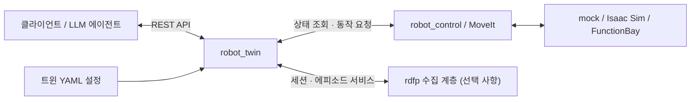
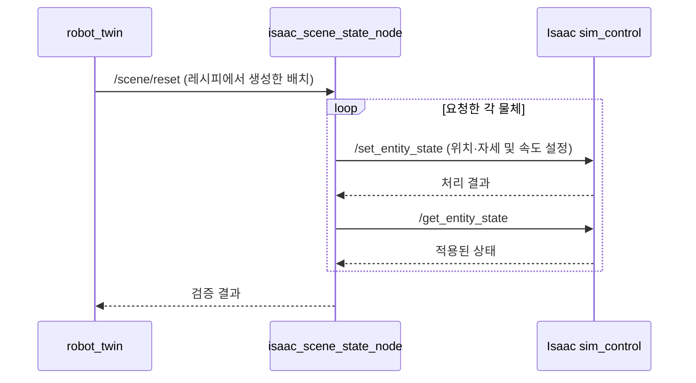

# robot_twin

`robot_twin`은 로봇의 상태 조회와 제어 기능을 REST API로 제공하는 ROS 2 패키지다.
LLM 에이전트 등의 클라이언트는 **변수(variable)**로 상태를 조회하고,
**연산(operation)**으로 동작을 요청한다. 제공할 변수와 연산, 입력 스키마,
백엔드 연결 정보는 YAML 설정 파일에 선언한다.



그림은 주요 계층의 관계를 나타낸다. 실제 변수 조회와 연산 실행에는 설정에 지정된
ROS 토픽·서비스·액션을 사용한다. 수집 계층은 `robot_twin.backends` 진입점(entry point)을
통해 연동하므로, `rdfp`를 설치하지 않아도 로봇 트윈을 실행할 수 있다.

## 실행 및 상태 확인

ROS 2와 워크스페이스의 설치 환경을 불러오고, 사용할 백엔드의 제어 스택을 실행한다.
**워크스페이스 루트에서** 사용할 트윈을 ID로 실행한다. `--twin`은 필수다 — 빠뜨리면 오류로 끝난다
(예전처럼 mock 으로 뜨지 않는다).

```bash
source install/setup.bash
./scripts/run_robot_twin.sh --twin rdfp01          # FunctionBay
./scripts/run_robot_twin.sh --twin panda01   # Isaac Sim
./scripts/run_robot_twin.sh --twin mock01          # mock (쓰지 않을 계획)
```

`--twin <ID>`는 설치본의 `install/robot_twin/share/robot_twin/config/twins/<ID>.yaml`을 바로 연다
(`robot_twin.shipped_configs`). **ID가 곧 파일 이름**이며, 파일의 `twin.id`와 다르면 기동을 거부한다. 없는 ID를
주면 설치된 ID와 백엔드를 보여 준다. 트윈을 추가·삭제할 때는 `config/twins/`에 파일을 넣거나 빼고 빌드하면 되고
스크립트는 고치지 않는다. `--backend`는 없앴다. `ros2 run robot_twin robot_twin --twin <ID>`도 같다.
`src/robot_twin/config/`를 수정했다면 `colcon build --packages-select robot_twin`으로
다시 빌드한 뒤 트윈을 재시작한다. `robot_control`의 백엔드 프로파일이나 장면 정의도
변경했다면 해당 패키지도 다시 빌드하고 이를 사용하는 노드를 재시작한다.

사용자 설정 파일은 `--config`로 지정한다. 이 파일은 직접 읽으므로 파일 내용만
변경한 경우에는 재빌드 없이 트윈을 재시작하면 된다.

```bash
./scripts/run_robot_twin.sh --config /path/to/my.yaml   # --twin 은 함께 주지 않는다
```

트윈 프로세스 하나는 로봇 트윈 하나를 제공한다. HTTP 포트와 트윈 ID는 각각
`http.port`, `twin.id`로 지정한다. API 기본 경로는
`/api/v1/robot_twins/{twin_id}`다.

```bash
curl http://localhost:8801/api/v1/robot_twins/rdfp01/health
```

| 경로(기본 경로 기준) | 메서드 | 용도 |
|---|---|---|
| `/estop` | POST / DELETE | 신규 연산 잠금 및 정지 요청 / 잠금 해제 |
| 기본 경로 자체 | GET | 트윈 정보, 실행 모드, 변수·연산 이름 목록 |
| `/health` | GET | ROS 연결 표시, MoveGroup 초기화·비상정지 상태, 변수 품질 확인 |
| `/variables` | GET | 변수 목록과 설명 조회 |
| `/variables/{name}` | GET | 개별 변수의 값과 품질 조회 |
| `/variables/{name}` | HEAD | 변수의 ETag 조회 |
| `/resources` | GET | `arm`, `gripper`, `scene` 자원 점유 상태 조회 |
| `/operations` | GET | 연산 목록과 입력 스키마 조회 |
| `/operations/{name}` | POST | 동기 또는 비동기 연산 실행 요청 |
| `/operations/sessions` | GET | 전체 연산 세션 조회; `?status=RUNNING`으로 실행 중인 세션 조회 |
| `/operations/{name}/sessions` | GET | 특정 연산의 세션 목록 조회 |
| `/operations/sessions/{session_id}` | GET / DELETE | 연산 진행·결과 조회 / 취소 요청 |

트윈 목록은 기본 경로 밖의 `GET /api/v1/robot_twins`로 조회한다.
해당 프로세스의 트윈 하나만 반환하며 다른 프로세스의 트윈을 탐색하지는 않는다.

### 연산 실행과 정지

`POST /operations/{name}`의 본문은 `{"inputs": {...}}` 형식이다.
응답 방식은 연산 목록의 `kind`에 따라 다르다.

| 방식 | 응답과 후속 처리 |
|---|---|
| `sync` | HTTP `200`으로 종료 결과 반환. `status`가 `COMPLETED`인지 확인 |
| `async` | HTTP `202`와 `session_endpoint` 반환. 해당 주소를 GET으로 조회해 종료 결과 확인 |

`session_endpoint`는 `/api/v1/...`로 시작하는 경로이므로 호스트 주소 뒤에 연결한다.
자원 점유·비상정지 잠금은 `409`, 백엔드 미준비는 `503`, 입력 오류는 `400`으로
거부된다. 실행 중 실패는 HTTP `200` 응답의 `status: FAILED`와 `error`로 보고하므로,
HTTP 상태 코드만으로 성공을 판단하지 않는다.

진행 중 연산은 해당 세션 주소에 DELETE로 취소를 요청한다. 취소가 접수되면 `202`를
반환하며, 이후 세션을 조회해 최종 상태를 확인한다. 정지 요청을 전달하지 못하면
`501 CANCEL_UNSUPPORTED`로 거부된다. 현재 취소 대상은 MoveGroup을 사용하는 비동기
팔 연산이다. 그리퍼·장면 초기화·수집 경계 연산의 취소는 `501`로 거부하며 팔 정지
경로를 호출하지 않는다.

`POST /estop`은 신규 연산을 잠그고 팔 정지를 요청한다. 응답의 `locked`는 잠금 여부,
`halted`는 정지 요청의 전달 여부다. **`halted: true`도 물리적 정지 완료를 뜻하지 않는다.**
`halted: false`이면서 진행 중 연산이 있으면 `warning`이 포함된다. 기존 그리퍼 명령은
이 경로로 정지하지 않는다. 실제 정지는 상태 관측과 장치의 정지 절차로 확인한다.
정지 요청 전달에 실패하면 기존 연산은 자체 실행 결과에 따라 종료하며, E-stop 요청만으로
사용자 취소(`CANCELLED`)로 기록하지 않는다.
`DELETE /estop`은 잠금만 해제하며 종료된 연산을 재개하지 않는다.

`/health`의 `move_group: READY`는 MoveGroup 클라이언트의 초기화가 완료되었다는
뜻이다. 컨트롤러의 실행 가능 여부나 목표 도달까지 보장하지는 않는다.
변수별 `quality`와 연산 결과도 함께 확인해야 한다. 조회 시 값을 가져오는 정적 변수는
최초 조회 전까지 `/health`에 `NO_DATA`로 표시될 수 있다.
`estop`은 신규 연산 잠금 상태인 `ENGAGED` 또는 `RELEASED`를 나타낸다.
세부 응답 형식과 정지 범위는 [사용자 가이드](../../docs/twin/로봇_트윈_사용자_가이드.md)의
3장과 9장을 참고한다.

### MCP 연결

워크스페이스의 [.mcp.json](../../.mcp.json)은 펑션베이 트윈 `rdfp01`에 붙는다(`--twin-id rdfp01`).
[.mcp_functionbay.json](../../.mcp_functionbay.json)은 무엇을 띄울지 주석만 다른 사본이다. **Isaac 트윈은 ID가
`panda01`** 이므로 [.mcp_isaac.json](../../.mcp_isaac.json)을 `claude --mcp-config .mcp_isaac.json`으로 쓴다. 어느 환경에 붙었는지는
트윈 메타(`GET /api/v1/robot_twins/<id>`)의 `backend`로 확인한다.
등록 및 실행 절차는 [MCP 서버 안내](../../../../mdtpy/robot-twin-client/docs/로봇_트윈_MCP_서버_설계_및_운영_가이드.md)를 참고한다.

## 백엔드 설정

출하 트윈은 **환경마다 ID가 다르고 ID가 곧 파일 이름**이다(`config/twins/<ID>.yaml`, 2026-10-25). 노드 이름은 ID를
따른다(`robot_twin_<ID>`). HTTP 포트(8801)는 셋이 같아 동시에 띄우지 않는다 — 실수로 둘을 띄우면 두 번째가 포트 충돌로 뜨지 않는다. 실행 모드는 `twin.backend`가
참조하는 백엔드 프로파일에서 결정한다.

| 설정 파일 | `twin.backend` | 실행 모드 | `use_sim_time` |
|---|---|---|---|
| [rdfp01.yaml](config/twins/rdfp01.yaml) | `panda_functionbay` | `jgpc` | `false` |
| [panda01.yaml](config/twins/panda01.yaml) | `panda_isaac` | `jtc` | `true` |
| [mock01.yaml](config/twins/mock01.yaml) (쓰지 않을 계획) | `panda_mock` | `jtc` | `false` |

백엔드는 `twin` 아래에 둔다 — 팔 명령 채널만이 아니라 시계·고정물·중력 보상도 이 이름에서 나오기 때문이다.
옛 자리(`moveit.backend`)는 받지 않고 기동 시 오류로 새 자리를 알려 준다. 예를 들어 Isaac 설정은 다음과 같다.

```yaml
twin:
  id: panda01
  backend: panda_isaac
moveit:
  planning_group: panda_arm
```

프로파일은 [`robot_control/config/backends`](../robot_control/config/backends)에 있다.
실행 모드, 명령 채널, 속도, 프레임 등 해당 프로파일에 정의된 기본값을 적용하며,
트윈의 `moveit` 블록에 명시한 값이 프로파일보다 우선한다.
`ros.use_sim_time`도 프로파일의 `use_sim_time`으로 채운다(트윈 YAML 의 `ros` 블록에 적으면 그 값이 우선한다).
JGPC 기반 mock 스택(`panda_mock_jgpc`)을 사용하는 경우에는 `twin.backend: panda_mock_jgpc`로
변경한다.

백엔드별로 제공 기능과 입력 조건에도 차이가 있다.

| 항목 | mock | Isaac Sim | FunctionBay |
|---|---|---|---|
| `reset_scene` | 계획 장면의 물체 재구성 | 기존 물체의 위치·자세 재설정 | 제공하지 않음 |
| 장면 레시피 | `one_cube`, `cube_and_ball` | `two_objects`, `one_block`, `initial` | 해당 없음 |
| `fixtures` 변수 | 없음 | 없음 | 고정물 정보 제공 |
| `move_linear` 목표 프레임 | MoveIt 끝 링크 기준 | MoveIt 끝 링크 기준 | 기본 `grasp_center`; `frame` 입력으로 `panda_link8` 지정 가능 |

mock과 Isaac의 연산 이름 목록은 같지만 장면 레시피와 동작 조건은 다르다.
클라이언트는 접속한 트윈의 변수·연산 목록과 입력 스키마를 조회해 사용해야 한다.

**세 설정 모두 `move_to_pose`와 `move_gripper`를 선언하지만 실행 핸들러는 미구현이다.**
사전 검사를 통과해 접수되더라도 `FAILED`와 `EXECUTION_ABORTED`로 종료된다.
현재 구현된 `move_linear`와 `move_gripper_to_target`을 사용하되, 직선 이동과 자유 경로
계획은 동작 범위가 다르다는 점에 유의한다.

### 팔 실행 모드와 명령 채널

| 모드 | 실행 방식 | 완료 판정 시 유의 사항 |
|---|---|---|
| `jtc` | MoveIt으로 계획하고 JointTrajectoryController를 통해 실행 | 액션 결과로 실행 완료를 판정한다. |
| `jgpc` | MoveIt으로 계획한 궤적을 명령 토픽으로 직접 발행 | 개루프 방식이므로 명령 발행 완료만으로 실제 목표 도달을 보장할 수 없다. |

현재 Isaac 구성은 `topic_based_ros2_control`을 사용하는 **JTC 방식**이다.
`/isaac/arm_command`는 하드웨어 인터페이스와 시뮬레이터 사이의 명령 토픽이며,
트윈의 `moveit.arm_command_topic`에 지정하는 채널이 아니다.

JGPC 방식의 명령 채널은 다음 세 항목으로 설정한다. FunctionBay에서는
`backend: functionbay`만 지정해도 프로파일에서 이 값들을 적용한다.

| 설정 항목 | 용도 | FunctionBay 프로파일 값 |
|---|---|---|
| `arm_command_topic` | 명령을 발행할 토픽 | `/input/panda_joint` |
| `arm_command_format` | 명령 메시지 형식 | `joint_state` (`sensor_msgs/msg/JointState`) |
| `arm_command_joint_names` | 명령 배열에 대응하는 관절 이름과 순서 | `panda_joint1`부터 `panda_joint7`까지 |

프로파일과 명령 채널을 생략하고 `move_group_mode: jgpc`만 지정하면
기본 토픽 `/panda_arm_controller/commands`와
`std_msgs/msg/Float64MultiArray` 형식을 사용한다.
토픽 재매핑은 메시지 타입을 변환하지 않으므로 수신 측의 타입과 반드시 일치해야 한다.

설정 로더는 다음 조합을 기동 시점에 거부한다.

- `jtc` 모드에 위 세 명령 채널 항목을 지정한 경우
- `arm_command_format: joint_state`이면서 관절 이름 목록이 비어 있는 경우
- `move_group_mode: auto`를 지정하거나, 프로파일과 실행 모드를 모두 생략한 경우

적용된 실행 모드와 명령 관련 설정은 `/health`의 `move_group_mode`, `arm_command`에서
확인할 수 있다. JGPC에서는 토픽이나 메시지 형식이 잘못되어도 발행 자체는 완료될 수
있으므로, 이동 후 `joint_states` 또는 `ee_pose`를 조회해 실제 도달 여부를 확인한다.

### 운영 시 주의사항

- FunctionBay는 `reset_scene`을 제공하지 않는다. 물체가 작업 영역을 이탈해 복원할 수
  없는 경우에는 시뮬레이터 재시작 등 시뮬레이터 측 초기화가 필요하다.
- JGPC의 도달 판정은 새 관측값이 일정 시간 안정된 뒤 목표와 비교한다. 고정 시간만
  기다리거나 같은 캐시 값을 반복 조회하는 것으로 정착을 판단하지 않는다.
  [사용자 가이드](../../docs/twin/로봇_트윈_사용자_가이드.md) 5.6절에 예제가 있다.
- 트윈으로 계획 동작을 실행하는 동안에는 `teleop_keyboard`를 종료하거나 Servo를
  정지해 같은 팔에 명령을 동시에 보내지 않도록 한다. 동시 제어 방지 지침은 백엔드
  공통이며, 재현 결과와 전환 절차는
  [Servo와 계획 동작 비교](../../docs/teleop/servo_vs_planned_motion.md) 6절을 참고한다.

## Isaac 장면 초기화

Isaac 설정은 `reset_scene` 연산을 제공한다. `isaac_scene_state_node`가
`/scene/reset` 요청을 받아 시뮬레이터의 상태 변경 서비스를 호출하고,
변경된 위치·자세를 다시 조회해 적용 여부를 확인한다.



이 기능을 사용하려면 ROS 측에 `simulation_interfaces`가 설치되어 있어야 하며,
Isaac의 `isaacsim.ros2.sim_control` 확장과 관련 서비스가 실행 중이어야 한다.
`simulation_interfaces`가 없으면 장면 상태 발행은 유지하지만 `/scene/reset` 서비스는
제공하지 않는다.

초기화 대상은 기존 장면에 정의된 물체다. 물체의 생성·삭제나 종류·크기 변경은
지원하지 않으며, 알 수 없는 물체 이름이나 기하 정보 불일치는 오류로 처리한다.
장면 구성 자체를 변경할 때는 시뮬레이터 측
[`setup_scene.py`](../../scripts/isaac/sim_side/setup_scene.py)를 사용한다.
설정과 검증 절차는 [Isaac 장면 초기화 문서](../../docs/backends/isaac/isaac_scene_reset.md)를
참고한다.

## 시작 자세 충돌 시 복구

시작 자세가 자기충돌 또는 계획 장면의 장애물과 충돌하면 MoveIt 계획이 거부될 수 있다.
오류 코드는 실패 단계에 따라 달라지므로 `INVALID_MOTION_PLAN`(`-2`)이나
`START_STATE_INVALID`(`-26`) 하나로 충돌 원인을 단정하지 않는다.

mock의 장면 초기화는 MoveIt 계획 장면에 물체를 배치한다. 반면 현재 Isaac 구성은
`/scene/objects`의 조작 대상을 계획 장면에 동기화하지 않는다. 따라서 시뮬레이터의 물체가
물리적으로 존재한다는 사실과 MoveIt의 장애물 등록 여부를 구분해야 한다.

| 백엔드 | 계획을 거치지 않는 복귀 경로 | 한계 |
|---|---|---|
| Isaac | [`is_recover.py`](../../scripts/isaac/is_recover.py) | 복귀 후 관절 오차와 `/check_state_validity` 확인. 모든 충돌 자세의 복구를 보장하지 않음 |
| FunctionBay | [`fb_recover.py`](../../scripts/functionbay/fb_recover.py) | `fb_ready.py`를 호출해 기준 자세로 복귀. 명령 후 실제 상태 확인 필요 |

Isaac의 joint6 하한 부근 자기충돌에서는 `START_STATE_INVALID`가 발생하고 직접 궤적
명령으로도 복구되지 않아 시뮬레이터 재시작이 필요했던 사례가 있다. 복귀 스크립트를
반복 실행하는 것으로 해결된다고 가정하지 않는다. 팔 자세 복구는 장면 물체를 재배치하는
`reset_scene`과 별개의 절차다.

## 수집 세션 및 에피소드 연동

`start_session`, `stop_session`, `start_episode`, `stop_episode`는 수집 계층인
`rdfp`가 제공한다. 트윈은 `rdfp`를 직접 가져오지 않고 `robot_twin.backends` 진입점
그룹에서 `session_control` 제공자를 조회한다.

| 수집 계층 상태 | 트윈 동작 |
|---|---|
| 제공자가 로드되고 `session_control_node` 서비스가 준비됨 | 네 연산을 수집 계층에 전달 |
| `rdfp` 미설치, 제공자 로드 실패 또는 서비스 미준비 | 트윈 실행은 유지하며, 해당 연산의 사전 검사에서 HTTP `503`과 `PRECONDITION_FAILED` 반환 |

따라서 패키지 설치만으로는 충분하지 않으며 수집 노드도 실행되어 있어야 한다.
로봇 제어 기능만 사용하는 환경에서는 설정의 `operations`에서 네 연산을 제거하고,
`variables`에서도 `session_state`를 제거하는 것이 적절하다.
설정의 `description`은 API 목록을 통해 에이전트에 전달되는 설명 데이터이므로,
실제로 사용할 수 있는 기능과 조건을 반영해야 한다.

여기서 수집 세션은 여러 에피소드를 묶는 단위다. 개별 연산의 실행 상태를 관리하는
REST API의 **연산 세션**(`/operations/sessions/{session_id}`)과는 별개다.

## 테스트

워크스페이스 패키지를 빌드하고 Python 테스트 의존성(`pytest`, `pydantic>=2`, `PyYAML`,
API 테스트용 `fastapi`·`httpx` 등)을 준비한 뒤, **워크스페이스 루트에서** 실행한다.

```bash
source install/setup.bash
cd src/robot_twin
PYTHONPATH=".:${PYTHONPATH:-}" python3 -m pytest robot_twin/tests/ -v
```

기존 `PYTHONPATH`를 유지해 설치된 `robot_control` 등 의존 패키지를 찾도록 한다.
패키지의 `setup.cfg`에는 pytest 플러그인 호환성을 위한 `-p no:anyio` 설정이 있다.
[`test_layer_boundary.py`](robot_twin/tests/test_layer_boundary.py)는 소스의 import를 검사해
`rdfp` 직접 의존과 수집 계층 메시지의 직접 사용이 추가되면 테스트를 실패시킨다.
이는 런타임에서 import를 차단하는 기능과는 다르다.

## 관련 문서

- [로봇 트윈 사용자 가이드](../../docs/twin/로봇_트윈_사용자_가이드.md)
- [로봇 트윈 설계서](../../docs/twin/로봇_트윈_설계서.md)
- [Isaac 백엔드](../../docs/backends/isaac/isaac_backend.md)
- [Isaac 장면 초기화](../../docs/backends/isaac/isaac_scene_reset.md)
- [FunctionBay 백엔드 설계](../../docs/backends/functionbay/펑션베이_백엔드_설계.md)
